往生净土跟钱无关，只要有信心就可以。

第23场

美国帕萨迪纳苏格兰仪式中心

Pasadena Scottish Rite Center, USA

美国·帕萨迪纳

2014 / 11 / 8

## 通向净土的阶梯

## Stairway to Pure Land

主持人：

尊敬的各位朋友、各位道友，下午好！我是今天演讲的主持人。下面介绍一下今天的讲者——尊贵的索达吉堪布。

一提起高僧大德，每一个人的脑海里，都会出现不同的形象和定义。对我而言，堪布也许最能代表这样的形象和定义。2010年，我第一次听到堪布的名字。2012年，有幸在香港见到了堪布本人。如今足足有四年了。在这四年多的时间里，堪布不断地刷新我想象中对高僧大德的理解。

堪布精通三藏，造诣极深，证悟境界更是高深莫测。不仅如此，堪布还管理着庞大的僧团，承担着一个“企业家”所承担的事务。他的日常生活，除了出世间的佛法，还有盖房子、找地方、通水电等世间琐事，甚至需要和当地菜农洽谈，以保证佛学院出家在家四众弟子的日常所需。除此之外，我觉得堪布还是一位非常可靠的朋友，无论你有什么困难，他都以一颗平等的心，向你伸出双手，帮助你，支持你。

我想，今天来到会场的人，一定和堪布有着甚深的因缘。这一点，相信大家在此生，乃至生生世世，都有属于自己的独一无二的感应。

今天演讲的题目，叫“通往净土的阶梯”。《维摩诘经》中说：“心净则佛土净。”作为净土法门的修行人，我们怎样才能修好自己的心？怎样才能增加自己往生净土的把握？今天，堪布将以理论和实修的窍诀，指点我们观察自己的心，步入通往净土的阶梯。

现在，请大家起立，以热烈的掌声恭请堪布——

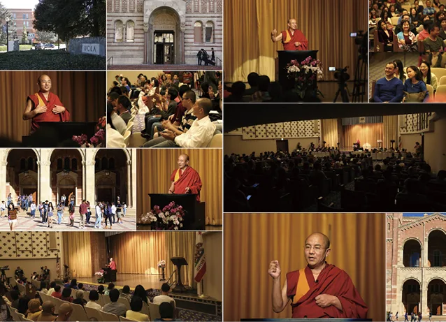

今天下午，我利用这段时间，和大家一起思考或者探讨“通往净土的阶梯”这个话题。它涉及的，是我此生非常有信心的一个法门。

在座的各位，大多数是佛教徒，也有信仰其他宗教的，或没有正式信仰，只对佛教或其他宗教有点爱好的。但不管怎么样，大家离苦得乐的心愿大体相同，追求的目标也基本一致。

## 喇荣与洛杉矶，有了奇妙的缘起

在座的道友，可能有些去过喇荣佛学院，有些虽然没有去过，但也听说过它的名字。在培养佛教人才方面，学院发挥着非常重要的作用。每一年，学院都会举行四大法会，其中一个便是极乐大法会。而现在，学院正在开极乐法会，今天刚好是第一天，再过1个小时就开始了。所以，我认为今天的话题有相当殊胜的因缘和缘起。

这样的缘起，并不是大家主观上去创造的。主办方没有特意挑这个时间，我自己也没有想到，今年学院的极乐大法会，和我在洛杉矶跟佛教团体相聚，是同一个时间。昨天我发微博时，突然意识到：“‘通往净土’的演讲，怎么跟喇荣的极乐法会在同一个时间？好奇妙！”当时有这样的感觉。

当然，对所谓的因缘和缘起，有些人相信，有些人不一定相信。不相信也没有关系，每个人都有不同的价值观和思维方式。按我的理解，在座应该有很多是佛教徒。但如果没有信仰，我觉得也合理，完全可以接受。

我觉得对人类而言，宗教信仰非常重要。我们如果除了金钱、朋友以及各种各样的社会关系外，没有任何精神信仰，生活可能会比较空虚。在我们的周围，经常可以看到这样的事例。对此，希望大家认真思考。

很多人因为没有信仰，在遭受年老、重病、死亡等实质性问题的时候，非常无力，非常痛苦。这样的痛苦，往往无法想象，难以描述。而有信仰的人，在面对这些问题时，表现出来的力量完全不同。从这个意义上讲，信仰对我们的人生，非常有意义。

## 净土法门，能为我们带来什么

很多道友，以前多多少少遇到过净土法。汉传佛教的很多大德，都提倡念佛往生，其中包括实相念佛等四种念法。藏传佛教也同样有忆念阿弥陀佛的修法。有人可能会问：“藏传佛教的净土法，跟汉传佛教的净土法，有什么差别呢？”两种教法的传承和仪轨有所不同，实际上是圆融无违的，没有实质性的差别，最后都是导归极乐，殊途同归。

比如，我们离开美国去往印度或中国，所乘的飞机不管是加航的，还是美航的，都能带我们离开美国，越过大海，安全到达彼岸的目的地。所以，我们不能建立一部法，舍弃另一部法，这样做是不合理的。

任何一个法门，只要是正法，我们依靠他，就能离开轮回的大海，到达解脱成佛的彼岸。因此，对不同宗派或上师宣说的不同法门和窍诀，我们不应该认为，这个是好的，可以修持；那个是不好的，应该舍弃。以自己的分别念来评价任何法门，都不太合理。这一点，我们先要了知。有了法法融为一体的正见，我们才能更好地修行。

净土法门到底能给我们带来什么呢？

在座的各位，最后都会离开世间。到那个时候，所谓的名也好，利也好，财富也好，包括自己非常执著的身体，全部都要留下，独自一人离开。各位有没有把握，到时候安详地去往后世？

有些人，能够依靠其他法门，获得解脱。有些人，却没有这样的把握和机缘。那怎么办呢？修净土法门。它简便易行，言简意赅，具有甚深的窍诀。不管是在印度，藏地、汉地，还是其他国家和民族，前辈大德对净土法门都非常重视。

藏传佛教的大德乔美仁波切，在他自己所造的《极乐愿文》开头讲到：净土法门非常重要，其窍诀是所有窍诀中最深奥的。乔美仁波切本人也把净土法门作为自己最重要的修行。刚开始，他每天都念《弥勒发愿文》，发愿往生兜率天。后来发现，转生兜率天也跟南赡部洲的众生一样，需要面对生老病死，不断流转轮回，无法彻底摆脱痛苦。于是，他每天改念《极乐愿文》，发愿往生极乐世界。

乔美仁波切所造的《极乐愿文》非常优美。学院开极乐法会念的仪轨就是这部《极乐愿文》。不知道大家有没有这个法本。如果没有，希望以后能够得到。成就者以金刚语撰著的仪轨或者法本，具有殊胜加持。把它作为自己的修行所依，是我们有生之年最重要的事情。当我们离开世间的时候，最关键的，是要有修行上的把握。

昨天，很多道友带我去了好莱坞的环球影城。那里有一个地方，专门体验死亡。一到那里，人好像一下子就沉下去了。沉的时候，是不是死了？如果再沉下去，是不是就真的死了？周围还有一些变形金刚，有各种各样的形象。可能代表人死亡后，有恐怖的阎罗狱卒冲过来。

我们独自面对死亡的时候，有没有把握往生极乐世界？有没有把握安住在认识的本性当中？到了那里，我觉得会有很好的体验。我们学了很多的修行方法，但死亡真正来临的时候，能不能用得上？可以去那里检验、训练、磨练。我觉得这个方法很好。

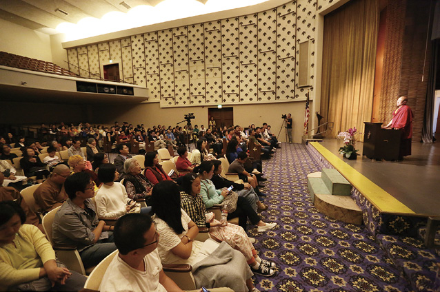

到目前为止，科学有了很大的发展，但修行人的目标好像没什么变化。谁也不知道，自己还能活多长时间，还能在这个世界待多久。当我们离开人间的最后时刻，会感受各种各样的恐怖。当恐怖现前时，往生极乐世界是最重要的选择。这是超离轮回的唯一一个简单而殊胜的方便法门。无论你学修的是汉传佛教，还是藏传佛教，都一定要发愿去极乐世界。

## 修持净土，不是老年人的专利

如果你不学佛、不修行，对这些道理不一定认可。不认可也不要紧，但不要轻易地毁谤。轻易毁谤任何一个人、任何一件事，都是不合理的。你如果有真正的道理，或非常确凿的依据，可以提出反对意见。佛教从来不会说，你们不能反对我。一个真正的佛教徒，完全有勇气和胸怀面对不同的质疑和驳斥。

但我相信，很多人并没有真正研究过佛教的道理。这种情况下，你要诽谤或诋毁佛教，有一定的困难。你如果要否定佛教的净土法门或任何一种教义，最好先认真研究一段时间，再进行评论。这样的话，你发表的意见才可能有真正的探讨价值。

另外，即使是佛教徒，也需要断除对净土法门的一些疑惑或误解。在汉地的个别道场，念阿弥陀佛的老年人多一点。受了这样的影响，一些年轻人便觉得，学佛的人都是老年人，修净土法门的人更是老太太、老公公，自己这么年轻，又是知识分子、大学教授，念阿弥陀佛多不好意思呀，等以后老了、退休了，再说吧。

这种说法是不合理的。虽然你现在是年轻人，但人的青春很快就会消失，很快就会走向衰老。而且，就在你年轻的当下，也可能因为车祸、自杀、疾病等各种原因离开人间。

在我们藏地，不管年轻人，还是老年人，都从小就念诵阿弥陀佛，而且非常重视。佛学院正在开的“极乐法会”——不知道网上有没有，你们方便时可以看看，也有很多年轻人参加。

开极乐法会的时候，我们会念30万遍阿弥陀佛心咒，“嗡阿弥德瓦阿依色德吽舍”。这个心咒很有加持，法会的8天时间里，大家都会念30万遍，并发愿往生极乐世界。其中的念诵者和发愿者，并不都是老年人。

所以，我们不能认为净土法门只是老年人的修法。也不能认为，学佛、念佛，要等到年老以后再说。这些想法都是不合理的。

## 万法皆空，照样可以往生

还有个别的人，因为学过《金刚经》，学过《楞严经》，或学过空性方面的其他法门，由于空性法门宣讲的是万法皆空的道理，他们便觉得往生极乐净土没有用，因为万法都是空性的，不存在的。

耽著空性的词句，而不去修行，这种做法也非常不合理。虽然在究竟的实相意义上，所有的基道果，内内外外的一切万法，没有一个不空，但所谓的空，并不是什么都没有的单空，而是远离四边八戏的大空性。在没有证悟这样的境界之前，万事万物都以如梦如幻的方式，实实在在地存在着。

如果你没有远离边戏的最高境界，最好不要诋毁名言。在没有证悟的凡夫人面前，善有善报、恶有恶报的因果规律，生活当中的点点滴滴，详详细细的所作所为，包括吃饭、走路、说法等，都是存在的，不可能否认的。如果你非要否认，认为一切都是空性的，那你晚上不用睡觉，白天不用吃饭，不用上班，不用开车，路上也不会堵车……因为空性，所以什么都否认，你恐怕还没达到这种境界。

虽然在实相中万法皆空，但在世俗名言中，现实生活的一切都是存在的。既然现实生活是存在的，那么极乐世界也是存在的，往生极乐世界也是有意义的。

## 一定要远离往生的两大障碍

还有些人认为，我们是学净土法门的，至于其他宗派，比如禅宗、密宗等，跟净土法没有关系，所以不需要学习，也不需要了解。因为没有广闻博学，觉得只要念佛就可以，其他法门都没有用，不用修，甚至排斥其他法门，看不起其他法门，好像除了念佛，其他法门都不是正法一样。这些看法也是不合理的。

往生极乐世界有两个最大的障碍。只要有它，不管什么人，不管怎么念佛，都不能往生。哪两个障碍呢？一个是造舍法罪，一个是造五无间罪。

大家一定要注意，千万不能造这两种罪业。否则，一辈子发愿往生极乐世界，自己却在无意当中，因为无知、傲慢、烦恼深重等各种原因，给自己制造了往生极乐世界的两大障碍。如果这样，死了以后能不能往生呢？绝对不能。

什么是舍法罪？如果我们发愿往生极乐世界，却看不起释迦牟尼佛宣说的其他法门，就犯了舍法罪。佛陀为我们宣说的教法，有八万四千之多，总的分为显宗和密宗，其中显宗又分为声闻乘和大乘。《弥勒请问经》和其他经典都明确地说到：若人以傲慢心，认为此法殊胜，彼法不殊胜，属于舍法罪。界限非常严明。所以，你如果因为自己是学净土法门的，就认为其他的法不合理、没必要、不能修等，是非常危险的。

以前，法王如意宝晋美彭措要求我们经常忏悔。他还说，自己年轻的时候非常喜欢辩论，很可能在无意中诋毁过其他的宗派或法门。所以晚年的时候，法王如意宝显现上非常害怕。

法王老人家是大成就者，不一定真有这样的情况。但这件事对我个人的启发非常大。我告诉自己：今后不管有没有机会弘扬佛法，都不要故意诋毁其他的宗派、法门或上师。也有可能在无意中造罪，所以要经常忏悔。对我们来讲，这是非常值得注意的一件事。

我以前经常看到，学净土法门的佛教徒，对其他法门特别排斥，内部的团结也搞不好。有时候，修行人的心好像越修越狭窄，甚至比世间人的心还窄。稍微有点事情不高兴，就除了自己的教派和上师外，谁都不认可。在他面前，其他的佛教团体，可能连一个世间团体都不如。这样的话，真的很危险。

造舍法罪其实是非常容易的。从大的方面来讲，对释迦牟尼佛的任何一个教法，进行排斥和诽谤，认为不合理，都是舍法罪；从小的方面来讲，除了自己所修的法以外，其他的显法密法也好，各派各教也好，认为不合理，从而诋毁、舍弃，也是舍法罪。所以，对释迦牟尼佛的所有教法，我们都不能诋毁、舍弃，否则就造了谤法罪、舍法罪，根本没有希望往生极乐世界。

往生极乐世界的第二个障碍，是造五无间罪。所谓的五无间罪，是指杀父亲、杀母亲、杀阿罗汉、破和合僧、出佛身血这五个极重的罪业。总体上看，现在除了极个别人会造杀父、杀母的罪业外，其他的绝大多数人，都不太容易犯五无间罪。但是，与之比较接近的罪业，还是比较容易犯的。

往生极乐世界的发愿者，如果对父母不孝顺、不恭敬，天天跟他们吵架，或经常诽谤上师，不恭敬圣者、损害圣者，就会造下接近五无间的罪业。现在，亲自出佛身血是没有的，但如果对佛陀的圣像等三宝所依不恭敬、诋毁、染污，也是接近五无间罪。以上这些行为，都会成为我们修行和往生极乐世界的障碍。这在其他的经论当中，也有所宣讲。

净土法门非常殊胜，但总的来讲，在修行过程中，要特别注意这些问题。

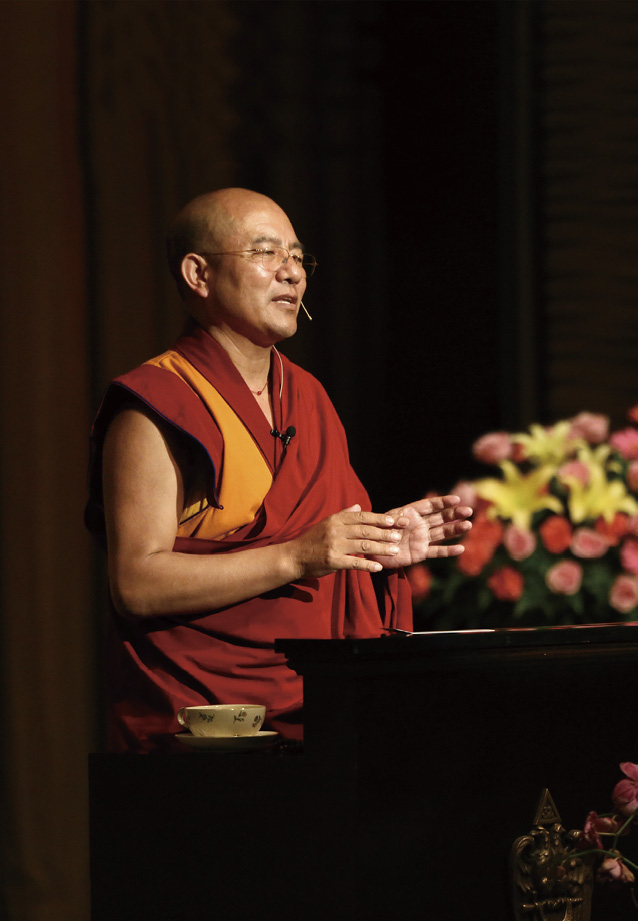

## 要系统闻思，不要神神叨叨

我很希望大家广闻博学。无论在什么场合，佛教徒都要学习。佛教本身，是一门非常系统的具有逻辑性的智慧教育。我们作为佛教徒，如果没有接受这些教育，就自认为是佛教徒，还给别人宣扬，那你说出来的，肯定不是正规的佛教。

现在一说“佛教”，好像天天都是算命打卦，有点迷信。一个佛教团体有没有水平，从他们交流的内容也看得出来。真正有水平的佛教团体，会经常谈论教理或修行方面的道理。而佛教水平比较低的形象佛教徒，会讲什么呢？整天都神神叨叨、鬼鬼怪怪的，要么说梦，要么说神通。他们没有受过系统正规的佛法教育，讲不出真正的佛法道理。这是我们现在存在的一些问题。

美国这边，我不是特别了解。听说在洛杉矶，佛教团体非常多，学佛的人也多，学净土法门的人也多。我很想了解你们的状况：是真的有基础、有信心、有智慧，还是形象上的佛教团体？平时不学习教理，偶尔凑个热闹，开个法会，烧几炷香，拜几下佛；没事的时候，就说过失，聊是非，谈一些不着边际的境界，等等。有这些行为的人，大多是形象上的佛教徒。

刚学佛的人，整天都喜欢说自己的境界：今天做了个梦，佛赐予了加持；明天又得到了超越的感应。反正谁都不相信的事，他津津乐道，说得比较多。随着学佛的时间越来越长，慢慢会沉淀下来，变得比较稳重，不再把成就挂在嘴巴上——因为已经知道，成就并不容易，但要退失，也不容易。这时候，修行会有次第地进行，既有理论的后盾，也有实修的引导。在这种状态下学佛，会比较安全，也比较稳妥。

国内的很多佛教徒，刚开始很迷茫，虽然对佛法有信心，行为却不太正规，既不好好学习，也不好好修行，每天背一个黄色的包，到处乱跑。今天跑这个寺院，明天跑那个法会，这就是所谓的跑跑居士——整天跑来跑去。也有一些跑跑和尚，我可能算是跑跑和尚吧。

现在的很多宗教，有些只是单纯的信仰，并没有深奥的理论体系，全凭信心维护本宗教的正义和理念；而有些宗教，则是有教理，有学习，有研究，也有实修，佛教正是这样的一种宗教。作为佛教徒，我多年以来一直坚持深入学习。我自己的体会是，越学习，对佛法越有信心，越觉得它是真理，经得起任何考验。

不仅是佛教徒自己，甚至世界顶尖的科学家，他们在学习和生活中的迷茫，也能依靠佛法的智慧得以消除。这一点，并不是我们自赞毁他，而是实实在在的事实。而且，人类世界的许多神秘现象，依靠佛教的理论进行挖掘和探讨，都能得到合理的解释。这是我们在研究佛法的过程中得出的结论。

## 信心是往生极乐世界的根本

在座的各位，一方面人身难得，另一方面，即生遇到这样的净土因缘，也很不容易。因此，一定要好好珍惜，好好修习佛法。

我对往生净土的教理，一直很有兴趣。并不是因为今天需要讲课，所以产生了一个新的兴趣。多年以来，我对包括《净土五经》在内的往生法门，讲过很多次，并将《观经》从中文翻译成藏文。所以，我在净土方面，稍微有一些经验。

是不是每一个人都能往生极乐世界呢？是的。关键看你的信心，看你的愿力和行动。只要有往生的信心和愿力，并付诸行动，好好修净土法，就可以往生。并不是有钱才能往生，没钱就不能往生；也不是有地位才能往生，没地位就不能往生。

一个人要从中国来美国，跟钱会有一定关系，不然买不起飞机票。但往生净土跟钱无关，只要有信心就可以。而且，信心是往生最根本的条件。有了信心，年轻人可以往生，老年人也可以往生；富人可以，穷人也可以；有智慧的人可以，没智慧的人也可以。原因是什么呢？自己的信心和阿弥陀佛的愿力，是往生净土的两大因缘。只要因缘具足，人人都可以往生。

因此，我们对净土法门，首先要有坚定的信赖之心。

个别人可能在想：“有没有那么简单哦？会不会像你说的那样？”心里有怀疑的人，可能还需要进行大量的闻思。因为光念一个佛号，光念一个心咒，不能斩断我们的分别念。而对往生有怀疑，是没办法往生的。

凡夫人的分别念很重。你们有些人，从小就不学佛；学了佛以后，仍然有许许多多的妄念、分别念，不断地怀疑猜测：这个合不合理？那个合不合理？实际上，我们的六识非常有限，根本触及不到世界的真相。这双肉眼看不到什么，这对肉耳听不到什么，光靠自己的分别念，也想不出什么。你不能说“因为我不相信，所以没有”，否则，只会暴露自己的孤陋寡闻。

在我出生的地方，有些人一辈子都生活在小小的帐篷里，连县城都没有去过。他们不会相信科学的发展，也无法想象高楼林立的城市。大概在十年前，我接触过一个牧民，他住在山里。我跟他说，外面有很高的房子，有好多层。他不相信：“我这辈子没见过两层楼的房子。你再怎么说也没用，我就是不相信。”有时候，人的智慧和根识确实很有限。

就像那个牧民不相信有两层楼的房子，有些人也不相信有极乐世界。当然，相不相信，对个人来讲都是可以的。但你所谓的不相信，不一定是智慧的抉择。分析而言，不相信有两种情况：第一种，通过多年的研究，最后确定是迷信，不合理，所以不相信。这个时候，你是有发言权的，因为用智慧进行过观察。另一种，自己没有任何研究，只是不相信而已。这种不相信，没有什么可靠的依据，也不能说明什么问题。

作为佛教徒，要遣除心中的怀疑，一定要广闻博学。很多怀疑的网，都会因为你的见多识广，自然而然地解开。

## 往生极乐世界的大保障

想往生极乐世界，必须具足往生四因。不管是藏传佛教、汉传佛教，还是其他教派的大德，都有类似的教言。什么是往生四因呢？我给大家简单解释一下。

### 1．明观福田

所谓的明观福田，就是随时观想极乐世界和阿弥陀佛。如何观呢？就像《阿弥陀经》和《观经》所讲的那样，观想从这里往西方，越过无数世界，有一个清净庄严的刹土，叫极乐世界。那里有具足相好、断证圆满的阿弥陀佛，他一面二臂，身色红色，周围被观世音菩萨和大势至菩萨为主的成千上万的清净眷属所围绕。极乐世界的这些圣者，日日夜夜注视我们，加持我们，慈悲我们。无论是谁，只要发愿往生，就一定能生到那样的世界。

这样的极乐世界和阿弥陀佛主眷，行住坐卧都要认真地观想。并不是明天要死了，今天才开始观一观。不是这样的。修行应该融入生活。现在有很多人认为，一个礼拜拿出一两个小时，简单地修一下，这才叫修行。除此之外，都不是修行。上班就是上班，家里的事情就是家里的事情，都跟修行没有关系。

你们最大的毛病和最大的困难，就是生活不能融入修行，修行不能融入生活。在藏地，很多藏民都没有你们聪明，但他们放牛也好，吃饭也好，坐车也好，走路也好，手里经常拿着念珠，心里经常观想阿弥陀佛和极乐世界。无论干什么，他们都有观修和念佛的习惯。一旦有了这样的习惯，生活就变成修行，修行也变成生活，不一定需要特意空出时间来修行。

可你们平时是怎么做的呢？开车就开车，工作就工作，从来不观想。等所有的事情全部处理完了，再规规矩矩地打坐一会儿，假装修行一下。时间非常短，根本不能叫真正的修行。

我们如果真的想修行，生活中随时都可以修。走路的时候，可以观想极乐世界的清净刹土；吃饭的时候，可以观想美味的食物献新部分，供养阿弥陀佛为主的十方三世诸佛；睡觉的时候，可以观想阿弥陀佛的光芒照耀自己。

有人可能会想：“不可能吧？极乐世界那么远，我在这里观想，能起到什么作用？”

其实，这都是我们的分别念。麦彭仁波切说过：具有清净智慧的佛陀，就像月亮，虽然高高地挂在空中，但只要有清净的水器，就会映现出清晰的月影。同样的道理，佛的法身无处不在。一个有信心的人，无论什么时候观想，佛都能当下赐予加持。如果没有信心，即使佛就在你身边，你怎么祈祷也没用。

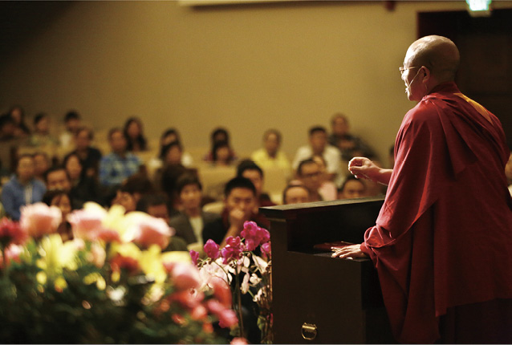

所以，晚上也好，白天也好，大家随时都要观想阿弥陀佛，这叫做明观福田，是往生极乐世界的第一个因。千万不能忘记。不然，到死的时候才念几句佛号，恐怕有点晚了。现在有些人就是这样，临近死亡了，才念几句佛号，别人也给他助念几句佛号，然后就完事了。这样做，能不能往生，我不敢保证。

所以，大家在生活中，一定要养成经常观修阿弥陀佛的习惯。

### 2．积资净障

所谓的积资净障，是指积累资粮、净除障碍。一般来讲，积资净障可以包含在七支供的修法中，也就是供养、顶礼、随喜、忏悔、请佛转法轮、请佛和上师不要涅槃，最后是回向。

我们平时要多修七支供，比如经常皈依，经常顶礼，经常随喜别人的功德，经常忏悔，经常观修自己祈请十方诸佛菩萨，以及善知识们，转法轮，最后把善根回向众生和菩提。这样就能积资净障。

如果进行归纳，就是尽量行持积累福德资粮和智慧资粮的善法，并好好忏悔自己的罪业。

作为凡夫人，每个人过去都造了很多罪业。要顺利往生极乐世界，必须尽量消除这些罪业和障碍，比如排斥其他宗派的舍法罪等。如何消除呢？励力忏悔。

汉传佛教，会依靠八十八佛、三十五佛等对境进行忏悔。藏传佛教则有念百字明、念金刚萨埵心咒等忏悔方法。我们学院每年都要开专门的忏悔法会。大家通过相应的忏悔方法，清净往昔所造的罪业，非常重要。在这个基础上，再进行修行。

现在有些佛教徒，特别喜欢讲空性，喜欢讲高大上的法语，而不好好修行。世间人也有相信因果，愿意做善事的，佛教徒却在一边说大话，说空话，不行持善法，真的令人惭愧。

当然，说空性，我自己也很喜欢，修空性法门确实很有功德。但如果认为，“全是空性的，什么都不用做”，以空性为名，把世俗资粮全部否认，是不合理的。我们应该从点点滴滴做起，多行持善法，多积累资粮。这样修行才能成功。

世间有些人，也知道以点滴的小事，积累大的资粮。这方面有很多感人的故事。那天，我看到美国这边的一个节目：故意放50元美金在路上，看谁会捡。后来，有一个60多岁的老太太捡到了。但她捡到之后，并没有自己收起来，而是把这钱送到了银行。记者采访的时候，她说，她非常穷，银行卡上有10美元，身上只有7美元，50美元对她来讲，是一笔非常大的财富。

“你为什么不自己留着用呢？”记者问她。

她说：“做人应该多做善事。从小母亲就告诉我，千万不能偷窃。”

其实路上捡到的——美国这边，路上捡到也算偷窃吗？不知道，可能各个国家的观念不同。节目组的人很感动，把这50元美元送给了她。她很开心，接受了。我不知道这位老太太有没有信仰，但她的言行确实让人感动。

我们这些佛教徒，有没有像那位老太太一样，点点滴滴地积资净障呢？这是一个值得思考的问题。

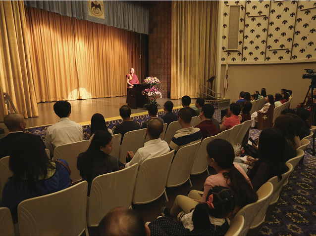

积资净障非常重要。尤其是我们学净土法门、希望往生净土的这些人，一定要多多地积累资粮。不要认为，只要念一句阿弥陀佛就行了，连一点点的布施、一点点积累资粮的善法都不愿意做。

国内有些老菩萨，非常虔诚，经常跑到寺院去。但是他们又特别吝啬，特别执著，尤其是对钱、对儿女、对家庭，执著得不得了。这么自私，能不能往生很难说。

就佛教的理念和修行而言，应该是越信仰，越开放，越包容，而不是相反。大家如果真的想往生极乐世界，从现在开始，就要依靠七支供的修法，好好地积资净障。

### 3．发菩提心

修净土法时，我们一定要想到，自己一个人往生极乐刹土，并没有多大意义；要为天下无边的众生都能往生极乐世界，而发殊胜的宏愿。这应该成为我们往生极乐世界的唯一目的。当依靠阿弥陀佛的大愿力，和自己的大信心，往生极乐世界以后，我们一定要回来度化众生，把所有众生接引到极乐世界。一定要发为众生而往生的大愿。

现在有个别的人经常讲：“自己往生就可以，其他众生不用管。”有这种想法的人，汉传佛教有，藏传佛教也有。昙鸾大师在《往生论注解》中说：有些人不愿意发菩提心，却想往生极乐世界，这是不可能的。这可以说是汉传净土的究竟教言。《往生论注解》在汉地非常有名，写得很好，我以前看过。

其实，汉传佛教有很多关于菩提心的教言。前一段时间，我看了《出生菩提心经》，是隋朝时期阇那崛多翻译的。其中讲了发菩提心的必要和功德，比如：“若有众生等，欲灭于无明，及断贪爱网，须发菩提心。”要断除无明愚痴、贪爱之网，须发菩提心。还讲到，如果要断除各种傲慢，也要发菩提心[^1]。这部经在网上好像有，你们方便的时候可以看看。《入菩萨行论》里面，也有很多发菩提心的教言，希望大家也学一下。

我看到，每次开法会，都有很多人在烧香、拜佛、念阿弥陀佛，但真正为了众生而烧香、而拜佛的，不知道有多少。如果我们佛教徒个个都自私，只关心自己，根本不为众生着想，那实在是太惭愧了。

汉传佛教和藏传佛教的很多道场，我都去过。有些道场，僧众共同念阿弥陀佛或《阿弥陀经》的声音，非常好听。无论是维那师，还是大众，唱腔都很优美。但也许只是唱歌，只是好听，并没有发菩提心。有没有功德呢？有一点。就像歌手唱念佛歌一样。每个老菩萨都变成歌手，都唱阿弥陀佛，唱《心经》，好听是好听，但没有发菩提心的话，可能不会成为往生的因。

那我们要怎样发菩提心呢？菩提心包括胜义菩提心和世俗菩提心，世俗菩提心又包括愿菩提心和行菩提心。因为时间关系，我在这里不广讲。总之，发菩提心很重要。

在座的很多人，即生遇到大乘佛法，非常不容易，一定要以菩提心来摄持一切善法。如果没有出离心、菩提心的摄持，所有善法只能成为世间法或人天法，有点可惜。

什么是世间法呢？现在有些人，经常求平安、求健康、求无病、求幸福，这样那样的全是为了世俗利益。为了达到这些目的，他们去皈依佛、皈依法、皈依僧，或者念佛。这些行为，基本上是世间法。

什么是人天法呢？下一世，自己希望有一个幸福的人生，或变成天人，转生天界。这样的想法，就属于人天乘。从来没有想过出离轮回，也没有想过利益天下无边的众生。这样的发心，不论小乘法，还是大乘法，都没办法受持。

我们很多佛教徒，都认为自己是学大乘佛教的。但实际上，世界上如果有一种仪器，能测试我们的内心，可能好多人都不达标。为什么？我们心里真正希求的，都是人天福报。甚至有些人，连人天福报都不知道求，就迷迷糊糊地皈依，迷迷糊糊地拜佛，迷迷糊糊地认为自己是佛教徒。

出家人当中，也有相当一部分是这样的。只是剃了头发，换了衣服而已。如果心态没有摆正，尽管形象是出家人，也不能说明什么问题。光头谁都可以剃，有时警察也剃光头。头发没有了，不一定能变成真正的出家人。

发菩提心，必须要有超越轮回的真正的出离心。这是我们现在最关键的问题，也是往生极乐世界最关键的问题。遗憾的是，大家的心态可能都不怎么达标。为什么皈依？为什么修行？很多人不是为解脱，而只是为平安、为健康。美国这边的情况怎么样，我不清楚。但我接触的很多佛教徒，都比较倾向于人天乘。

这样的话可能不好听，很多人都不高兴：“你说我是人天乘？我连声闻乘都没达到，更别说菩萨乘了？这种话，我根本不想听！”不想听也没办法。声闻乘的佛教徒是什么样的？菩萨乘的佛教徒又需要什么样的条件？你可以对照这些标准，观察一下自己的心。名相上，我们可以说自己是什么什么，实际上却不一定真的是。

作为一个佛教徒，不能只在表面上下功夫，相续中应该实实在在拥有释迦牟尼佛传下来的戒定慧。否则内心空空，只有一个佛教徒的外壳，这不是什么好的事情。

释迦牟尼佛的戒定慧，博大精深，浩如烟海，全部通达有一定困难。但是，我们至少应该了知大乘佛教的个别教理。前一段时间，我在加拿大给道友们说：“一个真正的佛教徒，至少要学习50部经典和论典。没有这样的学习量，不能算中上水平的佛教徒。”

但我们学得太少了。只念一两部经典，只看一两部论典，就认为自己怎么样，实际上远远不够。我们的知识还需要提升。

总之，发菩提心非常重要。能真正把所有善法都归摄为往生之因的，就是发菩提心。这是第三个因。

### 4．发愿回向

所谓的发愿回向，是指我们做点点滴滴的任何善事，都要回向极乐世界。如果不经常观想、经常发愿，往生极乐世界将非常困难。就像去一个国家，你自己如果不愿意，不努力争取，则不太可能有机缘。

所以，我们要以强烈的意乐，好好发愿：此生命终，一定离开充满烦恼和痛苦的娑婆世界，往生极乐世界的清净刹土，然后依靠清净的禅定和智慧，利益天下无边的众生。往生极乐世界以后，我们会有各种各样的善巧方便，度化众生。

一般而言，发什么样的愿，就得什么样的果。蕅益大师也说过：如果没有信愿行，往生很难。一个人能不能往生，关键看自己有没有信愿行。这和藏传佛教的说法完全相同。如果没有去极乐世界的强烈意乐，往生是非常困难的。

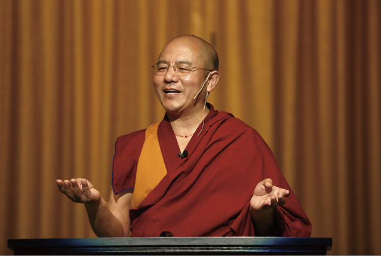

只要经常发愿，即使是非常普通的人，死的时候也会很安详。我以前去过一个藏民的家里。他们没有什么文化，但却有很深的信仰。当时，这家的老人快死了。老人非常安详地说：“今天早上，我感到了阿弥陀佛的加持。我要前往极乐世界了。”家人听了，都开心地等着。不像没信仰的有些人，亲人死的时候，全家都在伤心、哭闹。

我觉得这个家庭的气氛很好。你看，要死的人很安详。他说：“今早阳光照进屋里的时候，我感觉得到了阿弥陀佛的授记。”到了下午，他便欢喜地离开了。家人也很安心，觉得他到极乐世界去了——确实出现了很多往生的瑞相。其实，这些不可思议的往生相兆，很多人通过努力，死的时候都可以出现。

有些人认为：“你们佛教徒就知道关心死亡！”确实如此，因为死亡非常重要。一个人如果能淡定地面对死亡，就一定能淡定地面对所有的事情。可是，对很多人来讲，死亡却是一件非常可怕的事。有些人甚至根本不愿意提这个词。比如，我有时问某个人：“你死的时候怎么办？”他特别不高兴：“多不吉利！你不要提这个！”其实，迟早都要面对的事，光在口头说吉不吉利，又有什么用呢？如果有一种方法，能让我们从容地面对死亡，那为什么不提前了解，提前做准备？

不过，死亡毕竟只有短短的时间。安详也好，不安详也可以，都没什么要紧。关键是死亡之后，如果能往生极乐世界，未来的生生世世，都不会在轮回中继续感受生死流转的痛苦。

在轮回的苦海里，不管哪个世界，都充满痛苦。我这次去了好几个地方，先是国内的个别地方，然后是澳大利亚、加拿大，最后是美国。我看到的每个凡夫众生，都跟我们一样，感受着各种各样的痛苦。有些表面上比较成功，内心的痛苦却随时都在产生。

所以，要得到真正的快乐，唯有从轮回中解脱。如果没有解脱，你即便再富裕，再成功，长得再好看，仍然会在希望与担忧、痛苦与烦恼的淤泥中挣扎不休。

我的心态，不知道跟大家的是否相同。我自己的确觉得，死时能够安详地离开，死后能够彻底脱离轮回，非常重要。而且这一点，我们是能够做到的。只要活着的时候好好下功夫，死后就一定可以往生极乐世界，脱离轮回的痛苦。

## 一个老喇嘛往生了

但像有些修行人那样精进，我们可能真的做不到。去年，我们学院有一个喇嘛往生了。他往生的当天，丹增活佛的网站也宣布了这个消息。我以前采访过他身边的堪布，大家的描述完全一样。

他叫丹珠喇嘛，85岁。活着的时候，非常快乐。死了以后，没留下什么家产。家里所有的东西，包括房子在内，全部卖了，不到1000人民币。去年，他跟身边的人说：“我今年一定会死，应该在法王涅槃纪念法会之前。”

他身边有个居士林的堪布，叫特尼堪布。有一天，特尼堪布准备回自己的家乡一趟，丹珠喇嘛告诉他：“你今天最好不要走。明天到来之前，我会离开。”特尼堪布便留了下来，没有走。

特尼堪布不一定相信丹珠喇嘛的话，但因为他刚来学院的时候，丹珠喇嘛对他恩德很大，所以就没有离开。后来，正如丹珠喇嘛自己所说，当天他真的离开了，而且圆满了所有往生的瑞相。

丹珠喇嘛生前特别精进，念了6亿观音心咒。这是一个非常惊人的数字。我也很惊讶。我们很多人，不要说1亿，这辈子可能连1000万遍都没法完成。他一生念了6亿，活了85岁，不知道每年念多少。此外，他还念了100万遍《普贤行愿品》，好像还有10万遍《三十五佛忏悔文》，具体数字我忘了，但当时是得到证实的。

以前，我们在法王晋美彭措面前，发愿每天念大圆满的一个续部。我虽然发了愿，但出门的时候，有时会念，有时时间来不及，就没念。丹珠喇嘛每天坚持念7遍。他每天很早就起来，非常精进。

当我们看到他往生的种种瑞相时，一方面觉得惊讶，另一方面也不惊讶。作为一个修行人，如果活着的时候肯下功夫，死的时候肯定自由，想走就走，而且十分安详，没有痛苦。

不像我们有些人，得到医院的病危通知，或者临近死亡的时候，特别紧张，特别恐惧。他们的家人也特别着急，到处去打听：“他会不会死？他死了怎么办？”等到真正离开的时候，大家又哭成一片，闹成一堆……人类世界真的非常奇怪。

## 在这个奇怪的世界，做点快乐的事

前一段时间，我看到爱因斯坦说过的一段话。他是在朋友贝索离世以后，说这段话的。他说：“他比我先离开了这个奇怪的世界。这没有什么。对于像我们这样相信物理学的人来说，过去、现在和未来之间的区别只是一种错觉，尽管是一种持久的错觉。”

从这段话来看，他好像有点修行的境界。他的头脑的确跟常人不同，在科学方面还是很厉害的。听说他在普林斯顿生活了很长的时间。过段时间我要去那里。不过我想，可能在那里什么都看不到。我还是很敬佩这些人的智慧。爱因斯坦的有些话，很像境界比较高的修行人讲出来的。

我们每个人，最终都要面对死亡。我希望每个修行人离开这个世间的时候，都能安详地往生。你可以按照汉传佛教的修法，通过念佛而往生；也可以修藏传佛教的颇瓦法，把自己的心观成阿弥陀佛的种子咒“舍”字，用念“吼”“啪的”的方式往生。如果死得比较突然，比如发生车祸或其他意外，则可以用刹那往生法——刹那间观想阿弥陀佛，把自己的心融入阿弥陀佛的心间。我们只要有信心，依靠阿弥陀佛不可思议的发愿力，什么事情都可以呈现，什么事情都可以成办。

也希望在座的各位，有信仰的把它变成正信，没有信仰的好好观察信仰。在这个世界上，可能有了信仰，自己的人生才有归宿。当然，没有也可以。最关键的是，有了信仰以后，还要系统地学习理论，并得到实修的体验。人生很短暂，如果每天都浑浑噩噩地过，死的时候什么境界也没有，跟普通人一模一样，有点可惜。

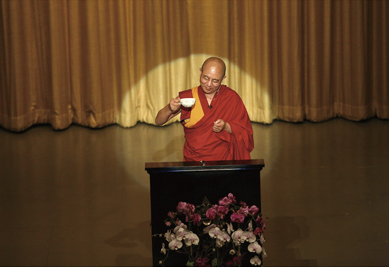

作为修行人，境界稍微高一点，都不会像世间人那样，遇到一点事就特别痛苦，特别烦恼，特别伤心。在我们的身边，有很多这样的修行人。既然他们能修得好，同样是人，我们为什么不能呢？

总之，修行人要有包容的心态，同时修一些窍诀性的实修法。当传承上师、前辈大德的加持与我们的信心融为一体，我们不但今生快乐，来世也快乐。

现场互动

主持人：

感恩堪布为大家带来的精彩演讲！“佛以一音而说法，众生随类各得解。”听了堪布的演讲，相信大家的问题，都在一定程度上得到了解答。可能还有一些朋友，对佛教不是太了解。希望今天这样的因缘，能引发你们的思考。

下面是问答环节。

堪布刚才提到了爱因斯坦。其实，堪布对现代科学，比如量子力学等，有着非常渊博的知识。对佛教与科学的关系，也有很深的研究，并写有这方面的专著。一会儿大家提的问题，可以广一点。

堪布非常open，非常开放。很早就利用互联网传法，不仅有脸书Facebook的账号，还天天发微博。万一哪天没有发，还会给大家请假：“今天发不了啦，给你们发两张照片。”所以，大家提问不要怕难，也不要怕广。问题越难越好，这样才能领略堪布的智慧。

问：和基督教相比，佛教在教育、医疗和社会互助方面要差很多。请问，这到底是什么原因？什么时候，佛教也能像基督教和其他宗教一样，在社会上有所作为呢？

堪布：这个问题可以从两方面来分析。一方面，在西方国家，基督教确实比较有优势。不管是美国也好，英国也好，基督教在主流思想中，都占了非常重要的位置。在社会慈善方面，比如建医院、建学校等，基督教都发挥了很大的作用。

这当然有历史方面的原因。在英法美等西方强国中，基督教很早就进入了主流社会，对这些国家的文化和教育产生了深远的影响。我去过的很多西方学校，都能见到基督教的教堂，却没有佛教的寺庙。不过，基督教对教育的研究可能比较少，更擅长用行为做一些慈善活动。

另一方面，在东方国家，尤其在中国，虽然基督教也有一定的影响，但佛教的文化根基和社会影响却要大得多。就拿我所在的甘孜州来说，那里大概有100万人口，在当地建学校和医院的，都是佛教徒，而没有基督教的人——基督教在当地的力量非常微弱。在中国的其他地方，佛教团体或个人做慈善的也相当多。

这样的情况，跟历史文化有一定关系，跟宣传教育也有一定关系。当然，作为佛教徒，我们也需要认真思考这个问题。实际上，基督教的爱心和利他心，大乘佛教徒更应该拥有。为什么？从教义上看，佛教的利他心，是无上菩提心，针对的不仅仅是人类，还包括所有的众生，比如动物。因此，佛教在爱护生命方面，比基督教积极得多，优势也更为突出。不管哪里放生，都能看到佛教徒的身影。这跟我们的教育和发心有关系。

问1：我是佛法幼儿园的一名老师，刚开始修加行。每天早上，先读课诵，再念莲花生大士心咒。但一边读诵，一边冒出各种杂念：“哎呀，电话费忘了交！水费也没交！过会儿吃什么饭？”这应该如何对治？

堪布：善法包括三个方面：行为的善、语言的善、内心的善。作为凡夫人，行持善法的力量比较薄弱，要将身口意全部摄于善法，确实有点困难。但是，如果我们有行善的意乐，虽然会出现各种分别念，但只要坚持，到一定的时候，这颗心会全部收摄于正法的境界。

我刚才说，藏地很多修行人随时都在念咒。其实，他们也一样，表面上在念咒语，心里却不断地胡思乱想。你开车的时候，口里一直在念观音心咒或莲师心咒，心里想的却是其他事情，这种情况肯定也有。这些都很正常，问题不是很大。

我早上也有接近一个小时的专门念诵。刚开始会想：“不能有分别念，一定要认真念！”结果，有时候念着念着就开始打瞌睡，有时候不知不觉就已经念完了。因为念得特别快，自己也产生怀疑：“刚才是不是没有好好念？”尽管这样，我还是一直坚持在念。每天都有这个心，从来没有间断。

在行持善法方面，我们需要不断地努力。虽然有杂念，但总比不念好，总比念其他无意义的东西好，总比去做非法或罪恶的事情好。每当分别念跳出来的时候，就提起正知正念，告诉自己：“我正在念莲师心咒，电话费、汽车保养费之类的事，等会儿再说！”

每一次，都可以用这种方法来过滤。到一定的时候，心就会有进步。刚开始可能很强烈，慢慢会有一些转变。我觉得问题不是很大，每个人都会这样。继续努力，坚持下去。

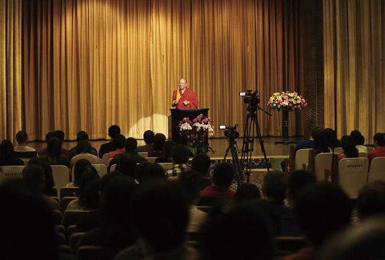

问2：我平时工作很忙，又想在三五个月或半年之内修完五加行。为了节约时间，我会一边开车，一边念经，尤其是等红灯的时候。心并没有完全专注在念诵上，这样念11万遍也可以吗？

堪布：可以，而且堵车的时候可以多念。现在很多修行人都觉得，堵车是修行最好的时机，因为到了家里，会有很多琐事。一说堵车，别人可能觉得无聊，但作为修行人，我们可以好好念经。所以，路上最好堵堵车。（众笑）

问：在汉传净土传承中，曾有古德说过：“弥陀可以总摄大乘法。”在大乘法中，空性智慧占了很重要的部分。请问，念阿弥陀佛如何包含空性智慧？

堪布：佛经中讲，称诵十方诸佛的名号，功德非常大。而念诵阿弥陀佛的名号，功德尤其不可思议。不知道你们学过《无量寿经》没有，里面专门讲了这方面的功德。《妙法莲华经》中也说，“一称南无佛”，能消尽我们无始以来的罪业。

阿弥陀佛的名号，应该包含了空性智慧。在藏语中，阿弥陀是沃华美，意思是无量光，其中“阿”对应“无”，“弥陀”对应“量光”。也就是说，“阿”是无生的意思，无生就是空性。从发音方面讲，“阿”本身就有无生和空性的意思。通过推理可以知道，阿弥陀佛包含了无量的法门，包括空性智慧。

因此，不管是念诵阿弥陀佛的名号，观想阿弥陀佛的身像，还是佩戴阿弥陀佛的佛像，都能得到不可思议的加持。对我们来说，这是非常重要的。

问：汉传的持名念佛，和藏传的颇瓦法与阿弥陀佛灌顶的修法，有什么不同？如果我是一个汉传的净土修行人，是否需要通过灌顶来增加自己往生的把握？

堪布：念佛的念有两种意思：一种是念诵，一种是忆念、观想。汉传的净土法门，也有持名念佛、观想念佛、观像念佛等不同的方法。关于这个问题，我以前分析过。

现在很多人认为，念佛就是持诵佛号。持诵佛号当然有功德，但更重要的，心里还要观想阿弥陀佛。

藏传佛教既有显宗的修法，又有密宗的修法。灌顶实际上是密宗的修法，显宗是没有灌顶的。不过，《极乐愿文》虽然是藏传净土法，但没有得到灌顶，也可以修，也可以念。所以，我们不能说，因为这部法是藏传佛教的，所以要灌顶，修汉传佛教的法就不用灌顶。

其实，汉传佛教的唐密也有往生法，我以前看过。要修唐密的往生法，按理也需要灌顶。因为唐密属于密宗当中的外续部，要接受外续部的灌顶以后，才可以修持。只不过，汉地从一开始可能就没有灌顶的传统。但严格来讲，应该是需要的。

我刚才忘了，学院今天念诵的《阿弥陀佛修法仪轨》，要给大家传一下。现在他们正在念诵，应该是3点钟开始的。我看了一下，这里的3点钟，正好是那边早上七八点钟。今天是法会的第一天。

你们如果有兴趣，或者比较虔诚，可以多念一些阿弥陀佛心咒，算是参与法会的共同发愿。我不敢说念30万遍。对你们来说，30万遍太多了，因为你们总是很忙。其实你们并不忙。很多人修行的时候说很忙，可是到处去玩，到处去旅游的时候，一点都不忙。你们去过很多地方，到处消费，因为你们不爱存钱，跟美国人一样。不过你们还是爱存钱，因为大多是中国人。你们是心忙，身体不忙。

下面给大家念一下传承，算是一个缘起。

（堪布念藏文传承）

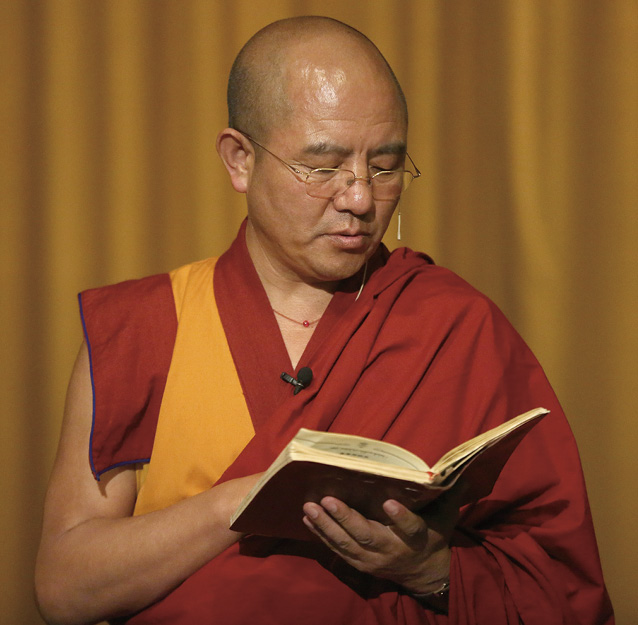

我们共同这样发愿，功德很大。那边参加法会的人，特别多。成千上万，集聚一起，一心一意念诵阿弥陀佛的心咒。有汉族，也有藏族，还有其他民族。你们可以通过网络或者其他途径看一下。和这么多僧众一起发愿，功德很大，非常难得。而且，能以这样的方式和僧众结上善缘，也特别殊胜。

有时候，我们的善心很容易消失。所以一旦具足善心，具足因缘，一定要珍惜。人生的改变，有时只是因为某位老师的一句话，或者一堂课。一个小小的因缘，就能转变你的一生。因此大家发愿的时候，一定要抓住特殊的因缘，不要轻易放过。机缘一旦失去，茫茫轮回大海，什么时候再能遇到呢？很难。像今天这样的机缘，确实值得我们把握。

现在很多商人，四处寻找商机。而所谓的商机，就是机缘成熟的一种表现。其实，商机随时都会出现，但学佛的善缘之机，却不那么容易遇到。以后大家遇到殊胜机缘的时候，一定要懂得争取。

问：在成长的过程中，老师告诉我们：“人人生而平等，这种平等是人格上的、权益和义务上的、发展和机会上的。”但是随着年龄和阅历的增长，我和朋友都认为，人与人之间不是平等的，先天的禀赋也好，父母的给予也好，后天的机会也好，都是因人而异的、不平等的。我想问，在佛教体系中，对这种平等和不平等，有怎样的看法？

堪布：你的观点很好，佛教也这样承认。

关于平等和不平等，佛教认为，所有众生都有想远离痛苦、获得快乐的心，每个众生也都有本自具足、其性本善的内在资源——如来藏。如果懂得去挖掘和利用，我们都能开发出巨大的潜能。这就是佛教所谓的众生平等。

当然，尽管每个凡夫众生现在都具有潜力，将来都可以成佛，但因为如来藏被烦恼客尘所障蔽、所覆盖，所以不能如理如实地挖掘出来。这也是我们修行的意义所在。

不平等的地方，又体现在哪里呢？比如刚才你讲到的那些地方。再比如，两个同卵的双胞胎生下来，父母给予的爱是一样的，但长大后，很可能一个聪明，一个不聪明；一个有病，一个没病。同一个家庭的孩子，刚开始父母可能同等地对待，最后却不一定同等地给予，每个孩子所得到的也不一定相同。为什么？我深信他们前世的业力不同。否则，他们的人生一定没有任何差别——但这是不可能的。

佛教认为，众生的共业可以相同，但个体的业却不可能相同。我们今生所有的不平等，都来自前世业力的不平等。有些生物学家也说，人与人之间，即使基因、背景等所有因缘都相同，成长过程中的造诣和智慧也是不同的。这样的结论，可以作为众生业力不同的一个证明。

有些人，今生不管怎么努力，由于业力原因，始终不能如愿以偿。虽然佛教并不承认，一切都是命中注定，但的确有个别人，因为前世所造的业因，力量非常强大，今生无论怎么做，都有很多无法预测的事情出现。

大家可能有这方面的体会，同在一个教室的同班同学，有一些很优秀，有一些不那么优秀。长大以后，在不知不觉中，有些得到了好的机遇和前途，有些堕入了痛苦的深渊，有些甚至造下极大的恶业，非常可怜。

每一段人生的背后，都有一只业力的手。这从同一个家庭、同一个班级、同一个社会背景的群体中，完全看得出来。这就是我们的不平等之处。

业力问题，其实是非常甚深的。所以大家一定要重视善有善报、恶有恶报的因果道理，谨慎因果取舍。

问：请问，什么叫做五加行？

堪布：在藏传佛教当中，修行密法会有很多不同的次第。在这些次第当中，排在最前面的，是最基本的五种修行方法，也是修密法最基础的五个条件，这就叫五加行。它包括我们平时说的皈依、发菩提心、顶礼、供曼茶、忏悔等五个修法。一般来讲，五种加行修完以后，才能进入正行。

修行密法的次第，包括加行、正行、后行，共有三个阶段。前面的五种加行，是进入正行的一个阶梯。

问1：我们都知道，“心净则国土净”。净土原本存在于我们的内心，西方极乐世界是我们心清净的一个感应。既然这样，如果我们的心没有调伏，能往生西方极乐世界吗？

我读过您写的一本书叫《不离》。其中讲到，法王如意宝说，念100万遍阿弥陀佛心咒，一定能往生西方极乐世界。但我觉得，西方极乐世界是心的一种感应，并不能以数量来衡量。念100万的阿弥陀佛心咒，就能说明心已经被调伏了吗？怎么样理解法王如意宝的这个授记？

堪布：《不离》这本书里，确实有这段话。但是，法王紧接着解释说，他是以《阿弥陀经》为依据说这番话的。而且，他的根本上师、观音上师等，对他都有明确授记：“将来你若让有缘人念100万遍阿弥陀佛名号，他们就能往生极乐世界。”

当然，法王如意宝说的，是用藏文念佛“炯丹第得印夏巴 扎炯巴 样达巴 作波桑吉衮波哦华德美巴拉 香擦洛 秋多 嘉森切哦（顶礼供养皈依出有坏、如来、应供、真实圆满正等觉怙主无量光佛）”100万遍。如果是用中文念佛号“南无阿弥陀佛”，则需要念600万。

我们修任何一个法，都要有传承上师的指点和佛经的依据。《阿弥陀经》中说：“若有善男子、善女人，闻说阿弥陀佛，执持名号，若一日，若二日，若三日，若四日，若五日，若六日，若七日，一心不乱……即得往生阿弥陀佛极乐国土。”这算是佛经的教证。

法王的根本上师托嘎如意宝、观音上师、多额单比尼玛活佛等，都对他有特殊的金刚语授记：凡是和法王结缘的有缘人，如果念100万佛号，将来都能往生。所以，你可以再看看《不离》是怎么讲的。

法王讲的100万佛号，虽然是一种数量，但数量积累到一定的时候，就跟我们心有关系。比如，开飞机本来是一种技术，跟数量无关，但要成为一名飞行员，却需要2万个小时以上的飞行训练。通过2万小时的数量，就能达到独立飞行的技术要求。

所以，我们表面上是念100万佛号，实际上也是训练自心的一种方法。修50万加行也是这样。为什么是50万，而不是60万、30万？而且，有些人哪怕修100万也不一定修到量，但基本要求就是这样。

问2：这是一个由量变到质变的过程，对吗？

我的第二个问题是：刚才堪布说，往生净土需要很多条件，比如明观福田、积资净障、发菩提心和发愿。但是，佛在《观经》中提到了“十念往生”，其中并没有说平时需要明观、发心、积资净障等。甚至一个恶人，临终清净地念十声佛号，并发愿往生，也可以成功地往生。这个应该怎么理解呢？

堪布：《观经》的后半部分讲到了九品往生。其中的下下品往生，虽然恶人临终通过念佛，也有往生的，但一般来讲，大多数人还是需要积资净障才能往生。

我们知道，世间的学校招生，会有不同的要求。往生极乐世界的道理，也有点类似。对某些人而言，依靠念十遍佛号，能够往生，但大多数人只念十句，是达不到这种境界的，所以会增加一些辅助条件。

其实，藏传佛教也好，汉传佛教也好，每个宗派或上师都有不同的要求。我们不能认为，这个是对的，那个是错的；这个是真的，那个是假的。大家在世间做事情，有时也会用不同的方法。而且，这些方法也各有各的合理之处，各有各的解释角度。

不过我个人认为，所谓的十念往生太简单了。作为凡夫人，想用这种方式往生，没有什么把握。我以前讲《净土五经》的时候，觉得念十句就能往生，真的很好，但我们平时做得太差了，所以没有那么简单。平时不下功夫，可能还是不行。

蕅益、慧远两位大师，都比较重视持名念佛。现在有很多人持名念佛，七天七夜不睡觉。汉地的净宗祖师和各位大德，在往生方面，提倡的行为和传承都有所不同。

问3：是不是可以理解成根基不同？

堪布：可以这么理解。

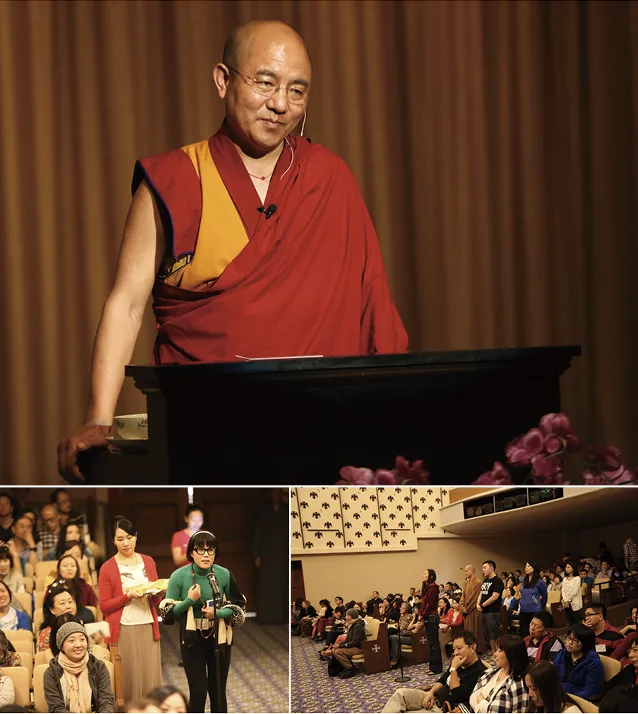

问1：您在开示中提到了接近五无间罪。请问，接近五无间罪只是往生的一种障碍，还是彻底不能往生？

堪布：按照乔美仁波切的说法，近五无间罪对往生确实有一定的障碍，但没有说决定不能往生。但如果是五无间罪，确实不能往生。

问2：临终的一念往生，跟之前提到的无法往生，是不是相违？

堪布：应该不会。前面讲的那些障碍，如果好好忏悔，最后得以遣除，还是有一念往生的机会。但如果造了舍法罪或五无间罪，不管依靠什么方便法，也决定不能往生。这种人如果能往生，无有是处——阿弥陀佛的四十八愿中，说得非常明确。

问：密乘中的很多本尊，都有自己的净土。我们是不是只能发愿往生阿弥陀佛的净土？还是说，可以发愿往生自己本尊的净土？

堪布：每个人对净土的理解和信心都不相同。在密宗修行人当中，也有发愿往生邬金刹土或其他刹土的。实际上，往生极乐世界以后，通过神变和神通，一刹那就可以云游其他的清净刹土，然后再返回极乐世界。所以，无论往生哪个刹土，都不相违。

问：初学者应该先生起菩提心，再修学空性，还是先修空性，再生起菩提心？

堪布：寂天菩萨在《学集论》当中，引用佛经的教证说：有一种人，先对众生生起无上的菩提心，再逐渐产生空性智慧；另一种人，先对万法空性产生极大的信心和定解，依靠证悟空性或者了知万法真相的力量，再对无量无边的众生产生悲心和菩提心。

汉文《大藏经》中有《学集论》，你们方便的时候可以看一看。那里面说，这两种都是合理的，因为众生的根基不同，有些人更容易产生空性智慧，有些人更容易产生大悲菩提心。

问：堪布您现在也看微博。大家总说：“一边是马云，一边是星云。”马云，我见过，当时我就像打了鸡血一样，觉得雄心勃勃。星云大师，我也见过。在大师面前，我又觉得所有的这一切都没有意义。

生活和工作也是这样。在工作中，要应对各种问题，有时必须全力以赴，不得不牺牲家庭的利益。这是困扰我很久的一个问题：应该是马云，还是星云，还是怎么样？堪布，您有没有好的解决方案？

堪布：我既不是马云，因为没有那么多钱。他现在是全世界最有影响的72位人物之一。他的影响主要以金钱为主，以阿里巴巴为主。我也不是星云老和尚，因为没有那么大的福报和能力。他年龄比较高了，在世界各地都有弘法的道场。

但是，在不是马云、也不是星云的中间，有一条小路。我的老师法王晋美彭措说过：“莫舍己道，勿扰他心。”意思是说，我们应该有自己的正知正见，不能随波逐流，在这个过程中，尽量不要扰乱别人的心。

见到成功的世间人，就兴致勃勃，也想变成那样，我有时也会这样。最近，我在一些学校里，见到了一些科学家。当他们谈到生物学、谈到物理学的时候，我很有兴趣，觉得自己也可以好好地研究研究，这很有意义。

有时候，看到一些修行人，放下万缘，在寂静的地方一住就是好几年，甚至几十年，我也会想：“我应该把事情全部放下，像他们一样，去寂静的地方好好修行。”

但对我来讲，这些都不现实。我还是要走适合自己的一条路，不能太“世间”，也不能太“出世间”。太“出世间”，什么都不管，肯定不行；太“世间”，一味地跟着世俗走，也不行。虽然现在有很多好的机遇，但在短暂的人生中，一直跟着机遇跑，对今生来世不一定有利。

所以，法王的这句话很重要：做人应该有自知之明，千万不要舍弃自己的道。

最主要的原则，是不舍菩提心。如果能够利益众生，当马云也可以，当星云也可以，甚至当什么都可以——只要对众生有利。在印度的大成就者当中，有很多是受世人讽刺、轻贱的小人物。我个人觉得，如果对众生有大的利益，即便当这样的人，也很有价值。但是，我不知道自己能不能做到。

我希望你用智慧进行观察。既不舍弃世间的机遇，也不舍弃出世间的修行。对你自己来讲，这两者都非常有意义。

问：请问，应该怎样理解“无我”的概念？

堪布：现在很多佛教徒，把“无我”跟世俗的修行对立起来。实际上，这二者并不矛盾。从胜义谛的角度观察，“我”是没有的，修行者也没有，轮回也没有，涅槃也没有，天堂地狱也没有，什么都不存在。但在世俗名言当中，在现象当中，所谓的“我”是存在的，轮回涅槃也是存在的，极乐世界、地狱饿鬼也是存在的。这两者不能混淆。

大家最好学一下中观。藏传佛教著名的大德麦彭仁波切说过：任何一个中观派，都不会破显现。意思是说，抉择空性的时候，任何一个中观宗，都不会否定世俗名言的存在。所以，我们不用担心，一旦“无我”了，“我”是不是就不存在了。

但进行实相观察的时候，今天现场的一切，这个场合不存在，你也不存在，我也不存在，灯光、座椅等都不存在。这种不存在，并不是口头上说说。实际上，我们一个一个去观察的时候，万法确实都不存在。

这不仅仅是佛教的观点，量子力学的科学家也认为：世界就是一种错觉——概念是错觉，空间是错觉，时间上的未来现在过去也是错觉。那物质是不是错觉呢？很多科学家，包括美国的科学家南沙，都认为物质世界是由分别念幻想而成，是分别念设计的假象。这些科学家，并没有接触过佛教的中观道理，但他们通过研究，得出了与中观教理完全一致的结论：世界上的一切，都只是假象。

其实，现象世界不存在的道理，是很容易分析的。比如，我们平常会认为：这是桌子。但到底哪一块是桌子？是下面的四条腿，还是上面的那块木板？这样一个一个进行分析，到最后你会发现，所谓的桌子连一块也找不到。

我特别希望有更多的人，尤其是年轻人，能够通达这样的道理。为此，大家应该学一下《中观根本慧论》《中观庄严论》《入中论》《中观四百论》等中观论典。虽然真正学起来，不那么容易，有点困难，但学完了以后，你会知道佛教在哪些情况下是“无我”的，哪些情况下是“有我”的。

大家要记住的是，在名言的实相当中，千万不能说“我不存在”。

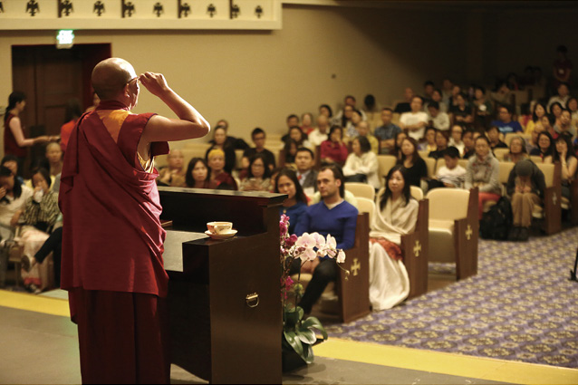

主持人：

亲爱的各位朋友，短短的两个小时很快就过去了。我想，可能很多朋友还意犹未尽，所以在这里给大家提供一点信息：明天和后天，堪布还有两场演讲。明天下午是在南加州大学，后天下午是在UCIOA。详细的信息，大家可以去查一下。

《华严经》云：“犹如暗中宝，无灯不可见。佛法无人说，虽慧莫能解。”堪布不远万里，从雪域高原来到洛杉矶，为我们开示甚深的佛法。所以，我们要再一次感恩尊贵的索达吉堪布仁波切！希望大家与堪布结缘以后，精进地闻思佛法，让自己的心清净，也让我们周边的国土清净！

最后，请大家再次起立，以热烈的掌声感谢并恭送堪布仁波切！

[^1]: 《出生菩提心经》：“若有众生等，欲灭于我慢，及色使我慢，须发菩提心。若有众生等，欲离于贡高，无病命我慢，须发菩提心。若有众生等，欲灭老我慢，无常常住慢，须发菩提心。若有众生等，欲灭多闻慢，及以持戒慢，须发菩提心。若有众生等，欲灭兰若慢，乞食等诸慢须发菩提心。若有众生等，欲灭知识慢，爱粪扫衣慢，须发菩提心。若有众生等，欲灭神通慢，一食以为净，须发菩提心。若有众生等，欲灭一切慢，所有有为慢，须发菩提心。”
