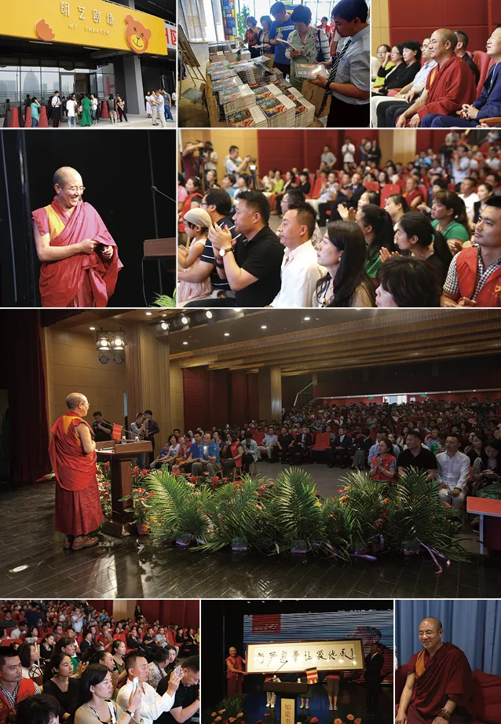
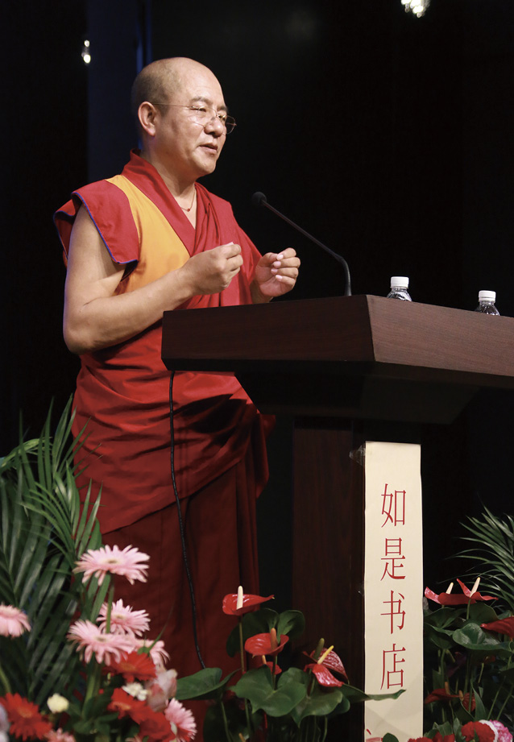
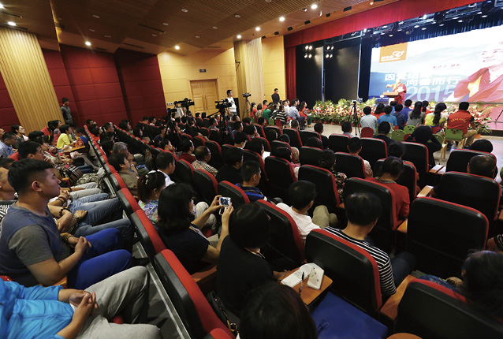
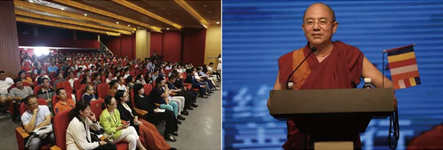
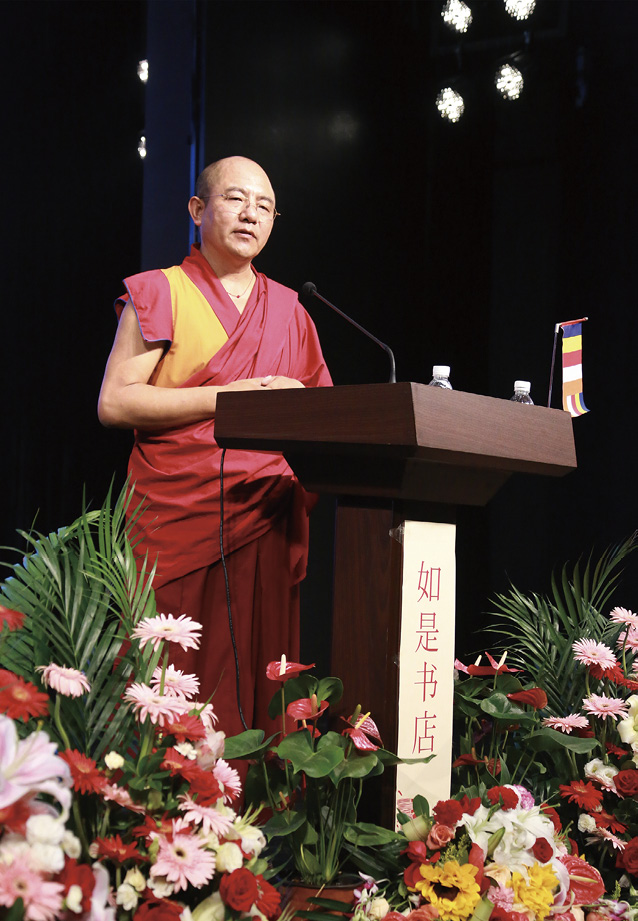
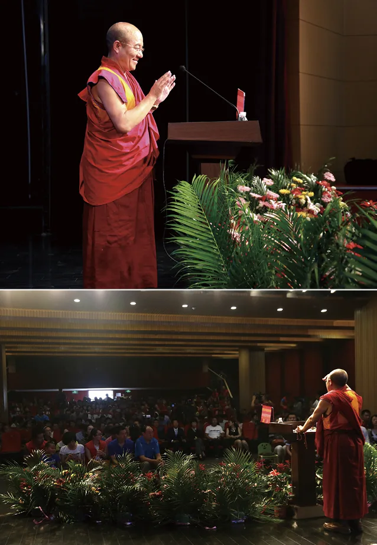
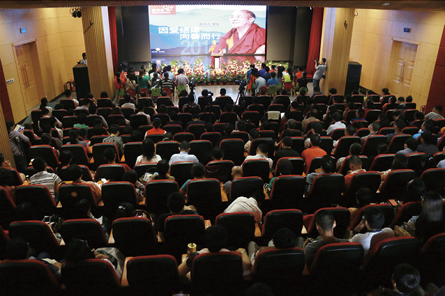
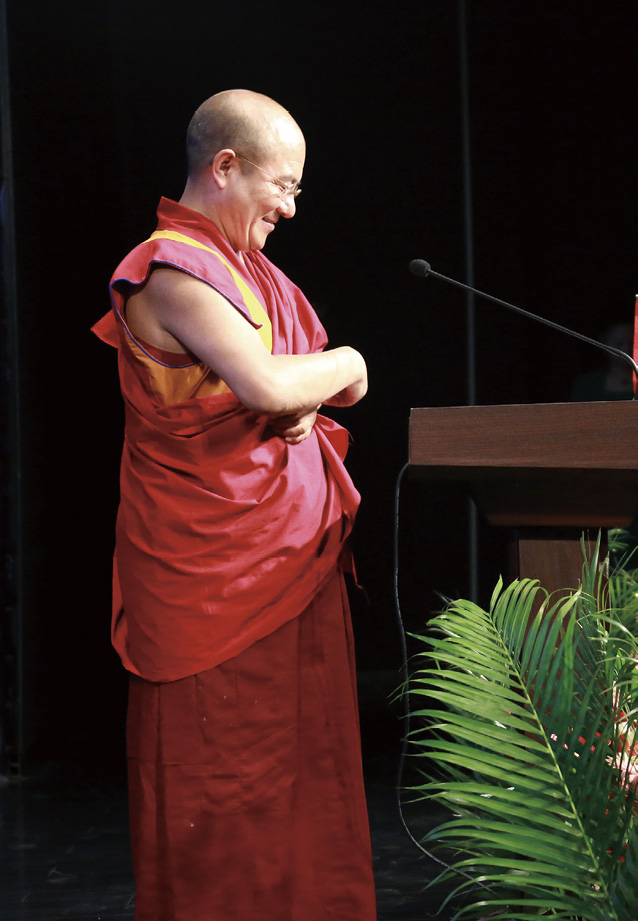
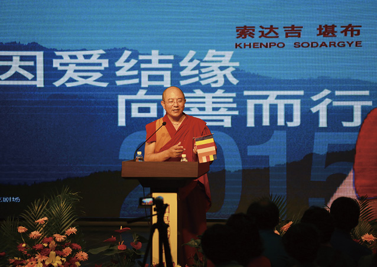

慈善是一种修行。

慈善的意义在于利他。

第29场

青岛慈善论坛

Qingdao Philanthropy Forum

中国·山东

2015 / 6 / 17

## 因爱结缘 向善而行

## Love Unites Us for Goodness

主持人：

大家早上好！

今天是一个无比殊胜、美好的日子，我们“爱基金”非常荣幸地邀请到来自全球最大的佛学院——喇荣五明佛学院的索达吉堪布上师，来为我们做“因爱结缘，向善而行”的慈善演讲。

索达吉堪布，怀着仁心善念为汉地僧众译经讲学，不辞辛劳；他著作等身、方便说法、度人无数；他捐资助学、慰问灾区、扶危济困、广施慈善；他到过欧美、东南亚等许多国家和地区进行弘法、讲学；他曾经与北大、清华、人大、浙大、复旦等高校学子欢聚一堂，帮助大学生探索智慧的源头，浇灌心灵的花朵。在国内外产生了极大的影响。

2006年，堪布上师开始以网络视频等科技手段传法，普降法雨、广利有缘，并发起“启动爱心”的号召，奉劝所有人要向社会奉献一份爱心，关注、关爱身边需要帮助的人。上师也身先士卒，先后建立起智悲学校、小沙弥学校、敬老院、罗科马小学等等。近两年，堪布又拿出了毕生的积蓄，在社会各界慈善爱心人士的帮助下，建起了上罗科马中学，让数千名小学毕业的孩子有机会继续读书。

平常堪布最常教导我们的话，就是两个字——利他，利他就是利益、帮助他人。他老人家说：“我不知道自己能活多长时间，但只要有一口气，哪怕有一个人，想办法让他生起一颗善心，我们百千万劫做他的仆人也可以。”每次想起这句话的时候，我都非常非常感动。堪布就像一盏明灯，鼓舞着我们的幸福人生之路。

今天希望各位放下烦恼，放松身心，带着一颗感恩的心来聆听上师的教导。谢谢大家！

主办今天这次慈善演讲的，是来自岛城著名的慈善团队——爱基金。接下来，让我们以热烈的掌声欢迎“爱基金”的会长上台为大家致辞。

“爱基金”陈会长：

尊敬的索达吉堪布上师！尊敬的各位慈心爱友！今天我怀着崇敬、激动的心情，欢迎大家来到这里一起聆听索达吉堪布上师的智慧之声。

索达吉堪布上师是全国乃至全球深受爱戴的佛学家和慈善家，其博大宽广的慈悲之心和醍醐灌顶的智慧之才，深深打动着每一个追随他的有缘之人。今天我们有幸当面聆听他的教诲，是莫大的荣幸和福报。

青岛市慈善总会“爱基金”，是专注于助学帮教的民间慈善组织。秉承“尊严慈善，让爱传承”的理念和宗旨，开创并实施了“我爱图书角”“爱心午餐”“爱心助教”等多个慈善救助项目。七年以来共筹集善款两千多万，受益师生一万多人次。

今天“爱基金”有机会协助索达吉堪布上师组织这样的一次盛典，将对“爱基金”产生极其重要的意义和影响，这意味着未来将有更多的力量加入助学帮教的爱心奉献中。对此，我代表“爱基金”和广大被救助的师生，向索达吉堪布上师以及在座的各位表示深深的感谢和敬意，并代表“爱基金”向四川甘孜上罗科马学校捐赠善款。

我对索达吉堪布上师所倡导的“利他”哲学深信不疑，并获益良多。多年来我清晰地感受到，所捐的善款或所做的善行，总能以更大的回报反馈给我。这让我深感惊喜，并愿意不断地付出和利他。

千言万语无法表达我内心的感受，最后化作真诚的祝愿，祝愿在座的每一位，能够在上师的教诲中领悟真谛、感悟人生。感谢大家！

尊敬的陈会长，尊敬的各位慈善家、爱心人士，很高兴今天跟大家一起共享慈善之乐。

## 将爱心的小河流汇入爱的海洋

我相信在座的每一位都有佛性，都会因爱结上善缘，以爱利益众生。其实每个人心中都有一条爱心的小河流，它们潺潺不息地奔向大海，最后汇聚成了爱的海洋。

世上有各种需要帮助的人——贫穷的人、孤寡老人、残疾人、失学儿童；患有自闭症、抑郁症的人，以及艾滋病人等患有各种身心疾病的人。我相信，依靠爱的力量、爱的作用，会转化他们的生活境遇，逐渐令此等众生获得快乐。

在中国，关于爱的知识，无论年轻人、中年人还是老年人都很关注，每个人都有自己的思维方式，也有不同的表达。在其他民族和其他国家，对爱的探索也有不同的形式。在2005年，日本举行“年度汉字”公开投票活动，调查结果发现，在收到的八万多张投票中，喜欢“爱”字的人最多。

对于爱，也许世间人有各种不同的理解，但我认为，当今社会需要的是无条件的付出与奉献，是不掺杂自私自利的、利他的、纯正的爱。今天在座的各位，为了倡导爱心一起共同奋斗，这是非常有意义的事情。

## 慈善要以智慧摄持

慈善很重要，但慈善必须在智慧的前提下进行，若是缺乏智慧，盲目地做，很可能到一定的时候，慈善活动会中止或断层。

比如，放生是件好事，但不会放生的人，不考虑生命、不考虑环保、不考虑国家的相关法律，随意买一些生命，然后在大自然的环境中乱放，结果对当地的百姓造成不好的影响，受到各种媒体的谴责，令很多人在内心对放生有了反感，甚至有许多误解的现象。

我们所做的诸多事情，既有负面影响，也有正面影响。但是，在当今信息爆炸的时代，正面影响报道得不一定非常多。你做了多年慈善，社会效应、社会影响都非常好，但最后得到的反馈不一定是正面的，甚至还会因极少数人的言行抹黑整个慈善事业。

藏传佛教对汉地信教群众智慧的提升、悲心的增长、信心的延续等起到很大作用，但很有可能因为极个别人行为不如法，被各种媒体利用之后，让整个藏传佛教因此受到影响。

前段时间有位记者问我：“有媒体声称，在北京有一条‘活佛街’，住着三十万假活佛，作为一名藏传佛教的佛教徒，您怎么看待？”我当时说，媒体的这种说法我不认可，不要说三十万，哪怕是三万其他民族的人居住在北京某条街上，手续恐怕也不一定很好办。

所以，个别人行为不如法，被媒体夸大其词、添枝加叶之后，对整个慈善事业会造成一定的影响。

以前慈善界“郭美美事件”发生后，有些记者也问我：“作为多年做慈善的人，您如何看待这件事情？”其实这是她个人的行为，不一定代表整体，但有时个人的行为能抹黑整体。这件事情发生后，我们做慈善很尴尬，甚至很长时间都无法正常运行。

总之，做慈善非常好，但一定要有智慧。

这种智慧如何体现呢？即善款的透明度、合法化、规范化、专业化，在善款的运用方面一定要非常有理有序地、有效地、合理地进行。否则，一旦出现纰漏，就很可能被人利用。因此，任何做慈善的人，一定要尽量地做到合法化和专业化。

现在这个环境，做得特别合法有一定的困难。我以前也在不同场合提过，我们现在没有一个真实的“慈善法”，相关法律、法规也不够明显，若是参照西方国家的慈善理念，因为国情、民族传统文化和法律意识等方面都很不相同，不能完全照搬。按理来讲，美国的慈善做得比较好，时间更久，更为成熟。我以前也研究过，因为在美国有遗产税等相关法律，所以他们大多数的慈善都带有被动性。

比如洛克菲勒去世时，洛克菲勒家族留下来的遗产，百分之七十以上要被政府征收，再扣除个人所得税，最后留给后人的资产已所剩无几。现在大多数遗产，也是百分之四五十以上都会被政府征收。因此，很多富贵的人觉得与其捐给政府，不如做一些善事。而且，美国政府也不希望自己国家像欧洲那样，少数家族特别富裕，最后对国家政权构成一定的威胁。因此，美国政府全面推动慈善事业。

## 慈善需要长远、清净的发心

很多人认为，慈善是有钱人的事，钱花不完的人可以做慈善，而其他人不一定要做。我以前讲过：慈善是心。慈善是一种善行、一种修行，每个人有慈善的心非常重要。

一定要把慈善当作一项长远的事业。有些人刚开始特别激动，很想做慈善，但过了两三年、五六年之后，便已退失了当初的热情。做慈善在一两年内做不出什么成绩，至少也需要五年、十年、二十年的时间，最好先要有这样的认知。

我个人而言，以前想做翻译时，计划至少要做十年；后来想去大学讲课，一年、两年不行，我要做五年的计划；2006年开始做慈善，我想至少也要发愿十年。人生只有几个十年，前面的两个十年做不了什么事情——人在20岁之前，没有做慈善的想法，也没有能力与因缘；如果能活到80岁或者90岁，后面的二十年可能也做不了什么，人一般在衰老的时候做事很困难，因此，只有中间的几个十年可以利用。在此时间段内，包括你的精力、财富和地位等各方面的因缘都能具足。

地位也很重要。人有地位的年龄，一般是在30到60岁之间，很多人50岁、60岁之后在家里就丧失了“政权”，现在我的很多同学就是如此，他们的“政权”被自己的孩子抢夺了。没有“政权”的时候，经济权也没有。所以，做慈善需要政权，至少要有家庭的“政权”、个人的“政权”等，要利用这些权力做慈善。

我们现在正面临种种危机，包括精神上的危机、经济上的危机等。但也有人认为，“危机”是人生的机遇，危机——最危险时最有机会。我们可能觉得做慈善很难，但逐渐会出现很多机缘，有机缘时并不一定要做得很大，一步一步做上来很有必要。

以前我做慈善时也有很多人反对，说世上贫穷的人、可怜的人太多，失学儿童也特别多，根本帮不完。我当时也想过，确实可能越做越难、越帮越多，但后来我看到一个故事，不管真假如何，对我而言启发很大。

这个故事我在其他慈善场合也讲过：海边涨潮时，有很多小鱼被海浪推到沙滩上，当阳光洒向大地，海水开始退潮，小鱼只能等着干死。这时有一个孩子，拼命地把一条一条小鱼扔回海里，旁边有一个人劝他：“你不要白费力气了，海边密密麻麻那么多鱼，你是救不完的，谁会在乎呢？”这个孩子不管，他一边继续将一条条小鱼扔回水里，一边说：“它在乎，它也在乎……”

做慈善也是如此，至少在五年、十年中，实实在在地能做多少算多少。同时，不要带有个人经济、政治、名声等方面的目的，也没有必要利用世间八法来扩大自己的影响力，这不叫善心，而是有目的的一种包装。

慈善界有很多非常优秀的人，但也有个别人以慈善的名义作秀，有些原来特别坏的人做慈善为自己洗白，有些是为了忏悔，有些想要改变在社会公众面前的形象，有些犯法的人在一段时间做慈善，实际上并不是很真诚，而是带有某种目的。诸如此类的种种情况并不是很好。

不掺杂其他目的，很真诚地哪怕帮助一个学生、帮助一个人，也非常有意义。

我刚开始做慈善时，曾经收到一位学生的来信，这封信对我的触动确实比较大。当时她给我写完这封信之后，中间延误了好几个月，因为那个陌生人没有及时把信转给我。后来我在门缝里发现一封信，外面用一条哈达包着。我打开一看，从写信至收到信，一个学期已经过去了。她很想读书，但没有钱，她在信里留了邻居的座机，因为她自己家里没有电话。我通过她邻居的座机找到了这个孩子，帮助她完成大学学业。前段时间她出来工作，成为了一名医生，怀里抱着一个孩子，说：“这是我的孩子。”我说：“这么短的时间你已经找到工作了？还有了新的生命，多好啊！”

在座的各位，在做慈善的过程中，心要清净、行为要清净，且方法要尽量合理、专业，如此，我们所做的事情慢慢会被社会认可。即使社会不认可，自己从良心上也完全能过得去，这非常重要。

## 慈善的意义在于利他

我始终认为，做慈善是一种修行。有些人也许会想：做慈善对自己的修行、修证有一定的影响。确实在时间等各方面会有所影响，但最重要的意义在于能够利他。

我以前看过一个故事：一位修行人很想在山洞闭关，于是花了很长时间挖洞穴。最后通过努力，挖好了准备住进去时，碰到一位老人对他说：“你可不可以让我住？我现在身体不行，剩下的日子也不多了，我很想在这里修行，可不可以把这个洞穴让给我？”这个人把洞穴让给老人了。后来他还是很想修行，又挖了一个山洞，结果又来了一个老人，他又再次让给这位老人。再后来，他已是风烛残年，但还是想挖一个山洞，自己好好修行。等他把洞挖好以后，来了一个年轻人，这个年轻人跟他说：“如今你已年迈，所剩时日不多，可能难以修成，能否让我在此修行？”这个人心很善良，把洞穴给他了。

拖着老朽之躯，他再也无力挖山洞。他想：自己一辈子辛辛苦苦挖了几个山洞，都奉献给了别人，即使没有修行场地，这辈子也没有遗憾。想到这里，以三宝加持或者是天地感应，在他面前出现一位本尊，告诉他：现在你的修行已获得圆满。他当下开悟。

发心利他的利益，确实从自己的行为中可以体现出来。你也许没有很多时间修行，但在没有掺杂狡诈心的情况下，不断地努力，真正行持利他的善行，到一定的时候，菩提心、利他心自然会生起。当相续中真正生起了菩提心时，修行的境界、成就的境界就不会很遥远，到那时，所有的快乐和幸福也会纷至沓来、唾手可得。

著名的寂天菩萨在《入菩萨行论》中说：“所有世间乐，悉从利他生，一切世间苦，咸由自利成。”世间所有的快乐，从利他而产生；世间所有的痛苦，由自私自利而引发。在座的人都知道，很多眼泪、伤痕，全部都是因为自私自利的心太重而产生的。

做慈善其实是一种享受，是一种快乐，让这种快乐建立在每个人的生活中，甚至建立在从小的教育中，这非常重要。

## 做慈善的过程也是做教育

做慈善的同时要增上智慧，比如，帮助贫困学生时，不仅是在经济上给予帮助，还有精神上的。佛教讲财布施和法布施，仅仅作财布施还不行，还要想办法让此人变成一个好人，变成一个善良的人。

财富应取之于人类，用之于人类。很多企业家、有钱人，应该要想：当你来到人世时，你的灵魂也只带有前世的善业和恶业；当你离开世间时，无法带走分文。不要说万贯家财，连最珍贵的血肉之躯也带不走，身体留在殡仪馆，赤条条地离开世间，如影随形的就是相续中的善恶业。其中你所做的善业，相当于是转化成一种能让你带走的“随身卡”，人民币、美金、欧元无法带到后世，但善的力量、善的“储蓄卡”可以存放在你阿赖耶的“银行”里，在下一世“提现”成你的财富、你的智慧。

当然，做慈善时，只是金钱上的付出还不足够。我在藏地或汉地做慈善时，在给予经济帮助的同时，还带有一个条件——让对方必须行持善法、具有感恩社会的心，等自己将来有能力和智慧时，也要同样做慈善。如此成为一种良性的循环，一代一代把爱的接力棒传递下去。

做慈善者自己身心要健康、有修养，同时，要尽心尽力地帮助被资助者理解并延续爱的教育。

爱的教育非常重要。二战之后的德国人，吸取了希特勒的重大教训，从此以后，在他们的学校有爱护动物的“善良教育”，无论是家长还是老师，如果发现有孩子用暴力抽打或者虐待动物，会对他给予相应的惩罚，例如非常严厉的批评等。

其实在中国，佛教确实特别适合做国教。翻开历史时可以看到，唐朝时期佛教如何兴盛，包括皇宫在内的所有地方，百分之九十以上的人都信仰佛教；宋朝有段时间道教比较兴盛；元朝和明朝很多皇帝信仰佛教，尤其是元朝时期，佛教基本上成为国教；清朝的康熙、乾隆等皇帝都信仰佛教，佛教理念成为全民的主流精神、主流思想。然而到了后来，短短几十年间，以儒家、道家、佛家思想为主的传统文化受到了严重破坏。现在很多年轻人的心目中认为：佛教是不是一种迷信？是不是一种极端的宗教？有这方面的怀疑。但这种观念，我想慢慢也会转变。

## 困难是走向成功的途径

无论个人还是集体，做善事的过程都是困难重重、违缘众多。但是，有智慧的人应该坚强，不要因为一两次的挫折而感到痛苦、失望，甚至放弃。其实做任何一件事，都会经历折磨，这是自然现象，也是自然规律。若真正了解这个规律，实际上困难只是通往成功的途径。

以前爱迪生在探索的过程中经常失败，一次，有人问他：“你经历过一万次的失败，难道不感到受挫吗？”他说：“我没有失败，而是发现了一万种行不通的方法，我只是在做不同的调整。”很多人一件事情不成功，就认为“我已经失败了”，其实只是这种方式行不通而已。人需要有坚强的意志力，当然，口头上说起来很容易，还需要不断地尝试。

假设在做慈善时，确实遇到了意想不到的困难或障碍，可以尝试换一种方式。我曾经也有过类似经历，比如在一个场合演讲时气氛不是很好，或者遇到了一些状况，我就换一个场所；如果这里也不合适，那就把演讲缩小到二十人的规模；如果这样还不行，那就换成十人规模。人生有很多条路，不管做什么事，尤其做善事时会有些障碍，但我们可以用不同的方式来转换。

有一次，科学家霍金参加一个科技交流会，在临近结束之际，一位记者问他：“作为一名科学家，你被疾病永远地固定在轮椅上，是否觉得命运不公？”霍金笑着回答说：“其实我很幸运，我的手指还可以活动，大脑可以思维，拥有爱我的亲人和朋友，我还具有感恩之心。”可能有些人处于霍金的位置时会很伤心，然而事实上，作为科学家，他在面临世间的灾难和违缘时，也会用另一种方式来转化。

## 断除我执，无条件利他

在做慈善的过程中，会遇到这样那样的现象：也许会遭受他人的非议，说自己做慈善不怀好意、带有不可告人的目的；也许相关管理部门不理解，认为自己在做善事的过程中有违法现象；被帮助的对象非但不报恩，反而忘恩负义或者有不满的言行……这些时候，我们都应尽量地以宽广的心、善良的心来面对。以前巴尔扎克说过：拥有一颗善良的心最为珍贵。想到通过自己的善行能解除其他众生的痛苦时，因此而遭受的各种非议、千辛万苦都不足挂齿，非常值得。

我自己的切身体会是，做善事与不做善事相对比，不做善事较为轻松、悠闲，没有人找你麻烦，不会被误解、被议论，没有是非；但做一段时间善事再回顾人生时会发现：如果没有做这件事情，就帮不上这些人，做了以后自己会面临挑战，有风险，也会遇到困难，但很多人会因此而受益。所以，虽然自己确实辛苦过、累过、痛苦过，也遭遇过很多挫折，但从中感受到的快乐、成功，以及与他人所获得的利益进行对比时会明白：我应该无条件地去做，能做到多少算多少。

如果最初带有自利心，事情做不成就会非常懊悔、伤心；如果没有自利的心，而是想把握此机遇尽量利益他人，即使最后没有成功，也不会因此而痛苦。

在座的很多人都非常热爱慈善，每个人情况不同，但根据自身的能力、财富、福报和智慧，都在认真地做。只要有这一颗心，都是在完成一项伟大的任务。

最近大家在这里成立“微尘福慧基金”，在创办的过程中，在推进、发展的过程中，会遇到许多困难，到一定的时候，发起人最初的发心是否还能继续下去？如果不能继续下去，换届的时候，利他的思想能否对接好？会出现很多问题。不仅是慈善，很多社会活动也是如此。

我认为，做慈善要凝聚社会的力量，如果有不合理、有缺陷的地方，可以直言不讳地指出来，有好的建议或点滴善心、善举，也可以集聚在一起。如此，我们会改变身边许多微小的群体，甚至改变社会、改变世界。

家庭是社会的细胞，也许一个基金会能改变一个家庭，也许能改变二十个、三十个、五十个家庭等，无论如何，它的存在是有价值的。因此，希望很多善心人士、爱心人士、慈善人士，发挥正能量，要有大乘佛教的利他心——不仅是物质上的利他，还有精神上的利他。

我们身边还有很多需要帮助的人。比如藏地、云南、贵州等地，都有需要帮助的学生等群体；我去年去了柬埔寨、泰国等地的一些难民营，当时我感觉到，现在大城市里的人生活太过富裕，一千块钱或一万块钱，在你的生活中并非特别大的数目，但也许会永远改变这些人的命运。

在有生之年对别人的给予，表面上看是在帮助他人，实际上是在帮助自己——我们断除了傲慢心、吝啬心乃至我执，培养了爱心、智慧和悲心。所以，间接来说是自己的获得。

## 希望与祝愿

因此，特别希望在座的爱心人士，以爱心来拥抱世界，用善行来照耀世界，相信世界会因此变得更美好！愿所有的人类都能暂时享受人天之乐，究竟获得无上大乐！谢谢！

主持人：

非常非常感谢堪布的慈悲开示！您今天也是给我们幸福人生的加持，谢谢！

现场互动

问：我是青岛明艺剧社的导演，我们今年做了一部非常棒的儿童剧，名字叫《奇妙梦旅行》。这部儿童剧告诉小朋友，夏天游泳时该如何正确地防溺水、如何保护自己、如何自救，以及在出现火灾等意外的情况下该如何逃生等。想请教您，这部剧如果制作出来，传播到社会，是否也属于一种公益、也属于做善事？

堪布：我没有看过这部剧的内容，但我想，任何一部戏剧或电影，在人们认真了解它的思想之后，起到的社会作用应该很明显。

媒体、影视，或者儿童动画，对现代人的内心能够起到非常大的影响。所以，我很希望它们的内容、表达方法，都能带有爱与慈悲、智慧和信仰。若能如此，对孩子、对家庭的影响会很好。

问：很多人做生意时，声称多赚钱就可以多供养三宝，自己现在不闻思也没有关系，因此去执著自己的事业。如何区分这是一种贪心，还是一种善的上进心，或是一种精进呢？

堪布：一是赚钱的手段和途径值得观察；另外，当他真的有些金钱时，能否布施可怜众生或供养三宝所依？这种因果的奥秘，需要根据自己善心的不同程度再去观察。

依靠自身的力量和福报帮助别人，其实这是一个比较笼统的概念。最主要、最具体的，要看这件事情到底是如何发生的，每一个问题的根源需要探究。

问：现在的放生环境越来越恶劣，旁边钓鱼和打鱼的人特别多，我们该怎样取舍？

堪布：放生时，组织者应再三地认真考虑，不能简单地这里买、那里放，这是对生命不负责任的行为。我们在四川放生时，首先寻找放生地点，有时会找很长时间——十几天开着车四处寻找；找到之后，放生路上还需要四五个小时的车程。

作为放生团体，应尽可能地想办法，虽然不可能百分之百让它们的生命从此不受到任何威胁，但要尽量考虑周详。我们毕竟是有智慧的人，买生、放生的过程，包括所放的动物能否适应当地的环境，比如在咸水或淡水里能否存活，这些方面要做很多了解和思考之后才能进行。

现在放生的人越来越多，但在放生的方法上出现很多问题。虽然很多地方确实不太方便，但也并不是完全没有放生的空间。我们放鸟时，是在大自然的森林，可能有个别鸟儿会重投罗网，但大多数不会，百分之七八十的动物都能安全地生存下来。

自然界还是蛮大的，尤其像你们这里，周围的森林、大海，应该有一定空间。如果简单地这里买、那里放，看起来较为省事，但很危险。我们在成都放生，每次买生之后，开车到大概两三百公里以外，然后做一个仪式放在那里。不一定每天都放，但每一次都会把它们送到最安全之处。为达到这个目的，相关人员要举行多次会议，商量之后再分工合作，有些人负责买生，有些人负责看地，有些人负责运输，这样做就比较圆满。

问：我身边有很多有爱心的人，他们很想帮助人，但是没有钱，怎么办？

堪布：我刚才说“慈善是心”，这颗善良的心比金钱还要珍贵。因此，不一定要有很多金钱才能帮助人，如果有一颗善心，帮助身边的人可以用心来表示。

如果用金钱做善事时带有吝啬心，也有一定的过失。做善事尽量不要带有任何条件，在没有吝啬心、完全自愿、很放松的心态下做才有意义。

主持人：

因为时间关系，今天的互动问答就到这里。接下来，让我们以最热烈的掌声，欢迎“爱基金”陈会长上台进行捐赠仪式，由索达吉堪布上师代表四川省甘孜州炉霍县上罗科马学校接受捐赠。

谢谢陈会长，非常感谢！这是堪布亲笔书写的“尊严慈善，让爱传承”，也是“爱基金”的理念。这八个大字送给“爱基金”的陈会长，送给所有的“爱基金”人。感恩堪布！
