想要增长大爱，祈祷观音菩萨；

想要打开智慧，祈祷文殊菩萨。

第31场

荷兰鹿特丹公开演讲

Public Speech, Rotterdam, Netherland

荷兰·鹿特丹

2015 / 9 / 27

## 慈悲与智慧

## Compassion and Wisdom

主持人：

女士们、先生们：

下午好！欢迎各位来宾朋友来到鹿特丹世界贸易中心，聆听索达吉堪布仁波切的演讲。

今天我们非常荣幸地邀请到了堪布索达吉仁波切来到荷兰，分享他的慈悲和智慧。

首先，请允许我为您简单地介绍一下仁波切：

在雪域高原清澈的蓝天下，坐落着世界上最大的佛教中心——喇荣五明佛学院。那里被红色的小木屋和红色的僧袍所覆盖，俨如一朵绽放的红莲。正是在这个圣地，堪布开始了他的佛行事业，至今已三十年。虽然面临着各种困难，堪布仍坚持翻译、教学、写作，并同时管理着庞大僧团的修学和生活等事务。仁波切曾说：作为21世纪的佛教徒，必须进行系统的学习。因为唯有经过传统的闻、思、修，才能产生佛法的真正智慧，以及对佛教纯洁的正信；也唯有通过这样的方式，我们才能向周围的人传递慈悲和智慧的正能量，而这，正是当今时代所迫切需要的！

在这个纷繁复杂的时代，敏锐的智慧能帮助我们辨别取舍；能使我们幸免于各种现代思潮的冲击；能引领我们走向自利利他的道路。除了智慧，我们还要对整个人类乃至对所有众生都怀有善心和慈悲心，因为我们一个小小的举动，也许就能改变另一个生命的轨迹。堪布曾经告诉我们：“当你在路上看见烈日下快被烤焦的小虫，如果轻轻把它放到路边的草地，那它就会从痛苦中解脱出来，并且它的整个生命也因为你的一个小小善举而全然改变。”

90年代初期，仁波切跟随法王如意宝访问了东南亚、美国、欧洲。从那时起，堪布就和世界各地的人们结下了善缘。如今，作为法王如意宝的心子，堪布秉承着法王将佛法的慈悲与智慧传递到全世界的宏愿，不断在世界各国传授着所继承的法脉，孜孜不倦地做着这样伟大的事业。

佛陀出生时，曾经步步莲花，通过堪布的演讲，祈愿堪布的慈悲和智慧也能在我们的心里开花结果，并引领我们去创建更美好的未来！

下面让我们有请堪布索达吉仁波切——

今天，在中国汉地，很多汉族人过一个叫做“中秋”的特殊节日，全家团圆，一起看圆圆的月亮、吃圆圆的月饼等。这种传统，如今日本、韩国等也在实行。按照我们藏族的日历，今天也是很吉祥的月圆之日。

在这吉祥的日子里，与这么多有缘善士一起交流和沟通，也非常开心。其实，我来荷兰的缘起，早在1993年跟随法王晋美彭措去法国时就已种下，但梦想最终在今天才得以实现，我认为，这也是非常殊胜的因缘。

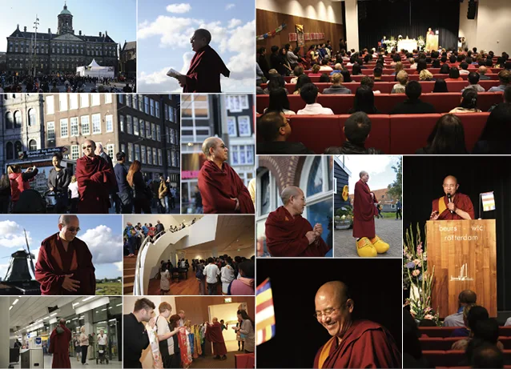

这次来荷兰的第一个感觉：这里的国土面积不算很大。这让我想起，我认识的一位佛教徒曾经来过荷兰，当时我问：“荷兰这个国家大不大？”她说：“荷兰一点都不大。我跟孩子的父亲吵架，气得开车出去，结果一不小心差点开出国了！”当时我有点不相信，但是到这里以后，感觉很有可能是这样。（众笑）

这里虽然面积不大，与汉地一些中等省份差不多，但我感觉当地人都有着善良的心，政治和经济也非常稳定，整个状况跟很多地方比较起来，让人心生羡慕。所以，虽然我是第一次来，但是感觉很好。刚才有人说：“您这次来天气比较好，如果天气不好，不一定这么开心。”但不管怎样，我并非为了让你们高兴而特意赞叹，确实这几天对荷兰的感觉很好。

总的来说，今天我们在此共同交流，从佛教层面讲，这叫“因缘”，而让我们结上缘的，就是智慧和慈悲。实际上，无论对于东方人还是西方人，这二者都不可或缺。

## 世出世间慧，缘“我”境不同

今天我所分享的智慧，可分为世间智慧与出世间智慧。

首先，世间智慧是指世间的专业和技术知识，包括为人处世等。也就是说，从小到老我们所希求的知识都是世间智慧。

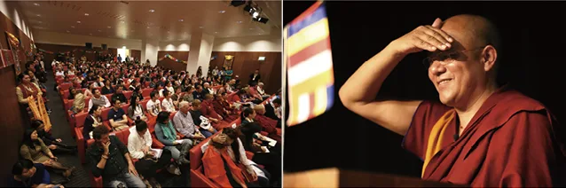

在这样的智慧中，每个人的价值观有所不同。比如，西方人非常强调自我，有强烈的自我保护理念。你们从小学习的或父母教育的，都在灌输以自我为中心，强调自我发展、自我提升、自我实现等。其实，自我保护虽然重要，但如果过分地强调自我，就会导致过于执著自我，只会给自己的生活带来痛苦。比如人们互相吵架，国家互相战争，这都是源于对自身的保护、自身的执著而引发的。关于这点，很多人不一定能察觉到。

出世间智慧是指佛教中的无我空性，即对自我进行观察、剖析，最后达到一种无我的境界。当然，很多人因为所受的教育和习惯，刚开始也许不一定能接受，但即使不接受，也有必要观察：天天为自己而奋斗的这个“我”，到底是什么样的？要知道，佛教的智慧并非张扬或膨胀自我，反而是要削弱对自我的执著，因为这种执著只会给我们带来诸多痛苦。

不知你们是否观察过，生活中的很多痛苦，实际上来自对自我的执著。如果对某件事并不特别在意，那它不一定能给你带来很大的伤害。反之，如果执著于人与人之间的感情或某种价值观，它带来的痛苦与伤害就会非常大。

因此，藏传佛教中有很多人，在长时间修持无我空性之后，到达一种很高的境界。到那时，即使在生活中遭遇挫折，他也不会那么痛苦，反而会很乐观地面对。

其实，所谓的出世间智慧，就是用智慧观察“我”到底存不存在。如果最终你认识到“我”只是一种概念、一种虚假的幻象，到那时，你看到的世界也许更加美好。

## 佛教乃真慧，择前可慧察

当然，在此之前，佛教会要求你再三观察，如果通过细致的智慧观察，觉得有道理，才可以进行皈依和接受；如果觉得没道理，那你完全可以放弃或舍弃。

佛陀时代，有一个非常富贵的人叫优婆离，他原本信仰其他宗教，当他听到释迦牟尼佛讲法后，觉得非常有道理，就想皈依，然而佛陀并没有答应，让他再继续观察。在观察多次以后，他进行了皈依。他说：“我觉得佛教有点与众不同。其他教派如果遇到我这么富有的人来皈依，也许很开心，你们却要求我再三观察，这一点让我很感动。”

所以，我们佛教的理念，并非通过宣传或各种方式来拉人加入。我们会给大家一种自由的空间，用智慧来观察后，如果觉得有道理，可以接受；如果觉得没道理，就可以放弃。不仅如此，你还可以用智慧来进行驳斥和批判，真正的佛教，对于别人的批判也会乐意接受。

如今在世界各地，有些佛教徒比较善巧，但也有些佛教徒，通过各种方式强迫别人皈依，这可能不是太合理。我认为，应该一切随缘，不能强迫，强迫不是佛教的原则。另外，也许有个别佛教徒的行为与佛教教义不符，但这只是个别人的过失。真正的佛教教理，经得起21世纪所有人，包括所有科学家的智慧观察。这并非我的一家之言，伟大的科学家爱因斯坦以前也说过：“任何宗教如果有可以和现代科学共依共存的，那就是佛教。”这是他的原话。所以，佛教虽然古老，但其教法经得起当前任何智慧的观察。

今天的主题是智慧和慈悲，智慧就先讲到这里，下面简单讲一下慈悲。

## 世出世间悲，亦有云泥别

慈悲也可以分为世间慈悲和出世间慈悲——大慈悲。

### 1．世间之爱亦重要

世间的慈悲，是指人与人之间的友爱、男女之间的感情、父母对子女的关怀、子女对父母的尊重等。世人对亲朋好友和周围的人，都会有一种特殊的爱。

关于这种爱，爱因斯坦在给女儿写的信里也说过：如果想对自己很好、对周围的生命很好，想拯救这个世界，那就需要有一种生命力——爱。

这样的爱很重要。

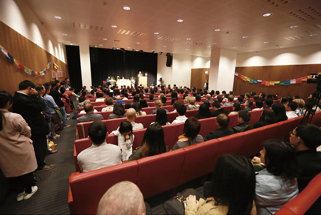

### 2．人情冷漠致心病

最初可能很多人都有爱，比如，夫妻之间有一种爱、孩子和父母之间有一种爱……一旦过了热情期，或者随着时间的流逝，有些感情就会慢慢淡漠，在缺乏关爱的环境下，人心也逐渐变得冷漠，这在当今社会很严重。

我下午刚听说了发生在荷兰这边的一件事：据说，有一个人很有钱，但他老了只能住在养老院。后来，这位有钱的老人跟孩子打电话：“你来看看我，好吗？”他的孩子说：“我现在工作很忙，而且还要看电视，没有时间去看你。”最终，这位老人申请安乐死，绝望地离开了世间。听说，安乐死在荷兰是合法的。

其实，人类需要互相关爱，人老了以后，如果年轻人弃之不管，或者老人始终对周围的人很排斥，宁可独自面对寂寞，也不愿与人共住，那么，即使他物质很丰富，也可能得不到快乐，因为缺乏爱。

现如今，很多人内心非常焦虑、浮躁，甚至患有抑郁症，人与人之间的关系也不像古人那样单纯，这样的现象在东西方国家的城市中越来越多。有些人很渴盼得到他人的关心，但却始终得不到；也有些人很讨厌与人交流，因为看不惯周围所有的人。长此以往，他们会出现各种严重的心理问题和精神问题。

### 3．禅修利他可医心

其实，很多心理不健康的状况，通过禅修或修持利他心可以治愈。因为这样的心很包容、很放松，自然而然会健康。我认识的很多人，以前在没有这种内心的修炼和锻炼时，虽然物质生活并不贫乏，但内心会莫名其妙地产生很多痛苦。后来，因为修行或参与一些利他活动，心理完全恢复了健康。一个人的心理一旦变得健康，对身体健康也会起到非常大的作用。

### 4．出世大爱无界限

当然，世间的爱，范围仅局限于对某些人和某些动物等的关心。

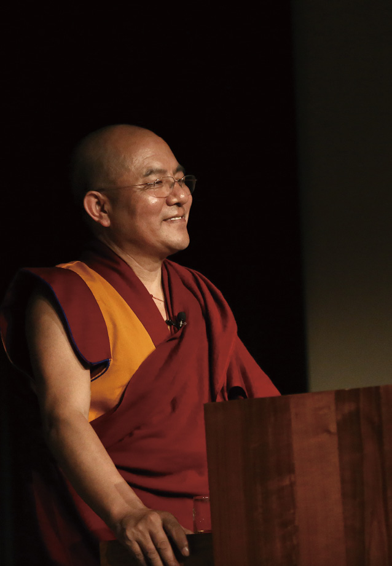

如果是佛教中最高的出世间大爱，那么，不管是什么众生——人类、动物，乃至能感知苦乐的所有生命，我们都要去帮助。而且并非今天帮一下，明天就不再管了，这种帮助，时间无限，范围无限。这样的爱，可称之为大爱。

其实，出世间的爱跟世间的爱的确有云泥之别。世间人的爱是有条件的：你对我好，我也对你好；一旦你不爱我了，我就恨你。这就是世间的爱，本质是一种贪爱。

而出世间的爱是：你若爱我，我当然爱你；你若不爱我了，我仍然爱你。这种大乘佛教的精神，世界上任何人都会觉得很伟大、很了不起。当然，一般人很难做到。

## 慈悲无国界，利众当无疆

因为人们爱心的层次不同，在生活中容易发生各种矛盾。这次我来欧洲之后感觉到，以欧洲为主的全世界来讲，这次难民潮[^1]是二次世界大战以来，或者可以说是有史以来最大的一次。

包括荷兰、德国在内的很多国家，以怜悯心、慈悲心引发，对难民提供了诸多帮助。尤其是前段时间，德国的默克尔总理说，今年要接纳八十万到一百万难民[^2]，后来在真正的实行过程中，可能也遇到了各种麻烦。

与此同时，我们也看到，有些国家无论如何就是不管，态度坚决，难民的痛苦与他们无关；有些国家什么都不说，装作不知道；而有些国家也许不一定乐意，但迫于舆论压力，表示“我们尽量努力……”不知道他们的“尽量”到底是什么意思；有些国家也想做点好事，但对于宗教的冲突、难民的安置等各种问题，也不得不考虑。这就是现实[^3]。

我本身是佛教徒，不关心政治，但无论任何国家的任何众生，如果涉及到他们的痛苦与快乐，那就不得不关心。以前我去过亚洲的很多国家，也去过一些难民营，到那里以后，感觉他们非常可怜，因为这些人失去了国家、失去了家庭，无依无靠，无家可归，非常非常痛苦。倘若我遭遇了与他们相同的经历，的确也需要他人的保护和帮助。

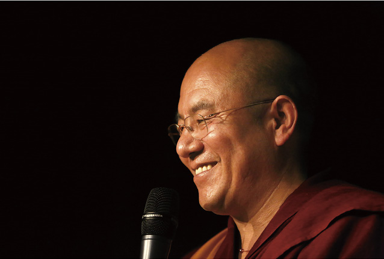

我昨天到荷兰后，听说有一个四五岁的小孩也在街头跟路人筹钱，说要解决难民问题。我当时特别感动。其实，我们如果拥有爱心，就很有可能解决许许多多人的现实困难。

佛教最伟大的地方，并非展现自我或成就自我，而是帮助包括旁生在内的无数众生。

## 若具真悲力，利生必成办

听说你们这里有“动物党”，动物受到虐待可以报警，这很好，也是一种进步。无论如何，我们对于包括动物在内的众生应该有怜悯心和慈悲心，维护他们的自由权和生存权，这是作为人类非常重要的责任。

我们在帮助他人时，肯定会遇到很多困难，荷兰、德国等国家在大量接收难民时，可能很难满足所有人的愿望与需求，国民自身的生存方面也会受到一定影响。但作为人类，尤其是作为发达且具有能力的国家，如果真正具有爱心、慈悲心，很多事情是可以成办的。

一位欧洲的科学家，曾经做过一个观察实验：他家养的母鸡生了几个蛋，他故意把蛋调换成野山鸡的蛋。最初，母鸡有些怀疑和排斥，但慢慢也接受了，并将孵化出来的小山鸡当成自己的孩子一样爱护。

他觉得十分稀有，于是又换成鸭子的蛋。母鸡最初仍然比较犹豫，但后来也一样地孵化。最终，母鸡妈妈拥有了两个孩子：一只小山鸡和一只小鸭子。母鸡很有智慧，它有时把小山鸡带到山里散步，有时把小鸭子带到湖中游泳，并分别为它们寻找合适的食物喂养。

动物尚且有这样的智慧，懂得帮助自己抚养的孩子提高适应能力，同时分别抉择不同的育养方法，何况我们万物之灵的人类？所以，只要想做，对于包括人类和动物在内的弱势群体，都可以用自己的慈悲和智慧为其提供帮助。

## 结劝重智悲，遣暗获大益

如何在世间应用以上所讲到的智慧与慈悲呢？以下几种方式供各位智者参考：

第一，通过学习爱、学习智慧来充实自己。

第二，有一位圣尊叫“文殊菩萨”，他是智慧的象征，经常祈祷他、观想他，我们的智慧就会打开。这一点我自己有很多经验，但暂时不便透露，因为这是秘密。

第三，如果想要真正增长大爱，要经常祈祷观世音菩萨，因为观世音菩萨是一切大悲的尊主。所以，要想让我们的慈悲心增长，可以像藏传佛教的修行人那样，经常念观音心咒。

观世音菩萨的心咒是“嗡玛呢巴美吽”，文殊菩萨的心咒是“嗡阿Ra巴匝那德”。其实，念咒跟你是否具有信仰并无太大关系，念咒就像是吃药，无论是否具有信仰，药效都没有差别，都能治疗身体的病。同样，如果服用精神上的“智慧总集丸”，精神上愚痴、嗔恨等很多不良情绪、疾病都可以遣除。

总而言之，无论我们在世界上生存多长时间，智慧与慈悲永远不会过时。任何身份的人，只要拥有了智慧与慈悲，对自他的今生来世都能带来无穷的利益，会非常有意义。但如果缺少了其中一者，恐怕就不一定很圆满。所以，希望人们都能特别重视慈悲心和大智慧。

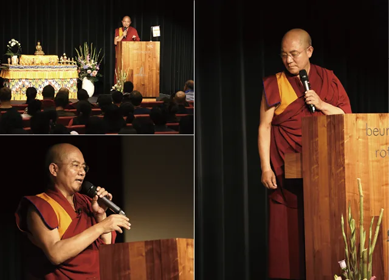

## 致语家乡客，精勤学佛法

下面我用藏语说两句。首先跟大家说一声：扎西德勒！很高兴今天在这里和你们相遇。

你们当中有多少藏族人？不知你们是否能听懂荷兰语？今天我是用汉语讲的课。以前我去过澳大利亚、加拿大、美国等地，在世界各地都能够看到我们藏族人，不管生活在哪个国家的藏族人，都信仰佛教，对我们民族的文化、传统也很重视。今天，无论是从家乡赶来的，还是从印度、尼泊尔过来的，都是远道而来，能在这里见到你们，我很高兴！希望你们好好学习佛法和藏文化，非常感谢！扎西德勒！

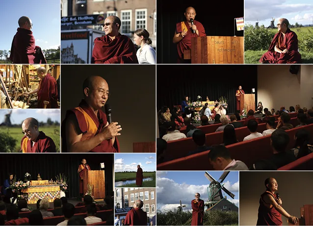

主持人：

《华严经》中云：“佛法无人说，虽慧莫能了。”意思是，佛法如果没有善知识的开解，任凭你有再高的世间智慧，也不能通达其中的涵义。

所以，让我们再次感谢堪布仁波切，为我们开演佛法的奥义！

现场互动

问：我爱玩游戏，但也是佛教徒。请问：玩有攻击性的游戏是否合适？如果并没有其他激进的想法，只是想通过游戏加强团队合作的能力，从另一个角度看，这是否是一件好事？还是说，因为游戏本身具有攻击性或者容易让人变得具有攻击性，所以不能玩？

堪布：会有不良影响。周围的环境、包括玩具都会给我们的一生带来非常大的影响，尤其是在孩童时期。从希特勒的传记中看，他特别喜欢杀戮，因为他最初遭到其他民族的歧视，进而引发对其他民族的仇恨。

因此，如果给孩童的教育是一种暴力，带来的结果不一定很好，从小一直在这样的生活中熏染，长大之后，心里很多暴力的种子就会逐渐萌发。所以，对大多数人来讲，确实会受到影响。

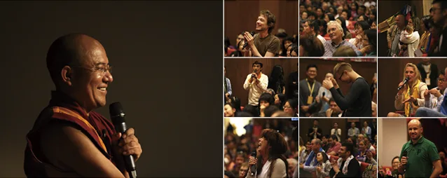

问：作为世俗人，我们一直在爱别人、爱父母、爱亲戚朋友，在这种情况下，如果要想解脱某些痛苦，一定要追随佛法才能够做到吗？这是第一个问题；第二个问题是，作为出世的修行人，是否也需要世俗的智慧来辅助修行？

堪布：第一个问题：其实，世间的爱有时也会带来很大痛苦。昨天我在意大利，有一个年轻人说：“我以前爱上一个人，就像心里钉了一颗钉子一样，特别痛苦。后来这个人抛弃了我，我又爱上另一个人，我的‘钉子’又转移到了他身上。”所以，从世间角度来讲，所谓的爱，其实伴随着痛苦，这种痛苦如果没有转为道用，对自己的生活、工作都会带来一定的影响。

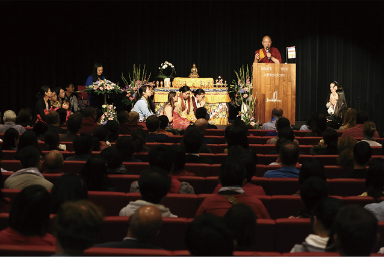

因此，世间的爱可以有，但不能过度执著，否则，可能导致疯狂等不正常的行为。所以佛教的主张是：适度生活。这很重要。若有因缘修学佛法，当然很好。

第二个问题：佛教的修行中，个别世间智慧是需要的，但不一定需要所有。有些世间智慧与佛教的修行并无关系。

问：我来自尼泊尔，专程过来拜访仁波切。在今天这么殊胜的日子里能见到您，我感到非常欢喜！您之前讲到“菩提心与智慧”，我对此有一个疑问：比如，我们通过观察了解到一个人比较富裕之后，就很难对他生起菩提心——因为我们认为他很富有。请问：我们应该先通过智慧来修菩提心呢？还是先修菩提心，再提升智慧？或是两者需要同时修？

堪布：按照寂天论师和静命论师的观点，可以先观修无我智慧（空性），再逐渐对一切众生发大悲心；也可以先修慈悲心，再产生无我智慧。这两种方式都可以。不同根基的众生可以选择不同的方式。

问：我是做昆虫学方面的研究，工作重点是虫害防治，所以很多时候我做试验就要杀虫。但自从学佛以来，做试验时我心里很不忍、很内疚。希望您能给我一个开示：该如何处理与对待？

堪布：按照佛教的观点，杀害众生很不好，因为每个众生最珍惜的就是生命，不管是做实验还是工作需要，都应该尽量避免。如果实在无法避免，那就应该按照佛教的方法来忏悔。否则，杀生的果报很可怕。无论你是否有信仰，一旦种下杀生的因，将来就会带来各种痛苦。所以，这方面要谨慎，用自己的智慧进行选择。

问1：荷兰语不是我的母语。我尽力尝试聆听您的讲解，这让我的心非常舒服，或许是慈悲让我有了这种愉快的感觉。我生长在一个基督徒的家庭，学过《圣经·旧约》，也阅读过一些佛教书籍。《旧约》和佛教都有对地狱的描述，那是非常可怕的地方，会让人心生恐惧。佛教如此慈悲，为什么还会有地狱呢？

堪布：人类向来提倡和平，为什么还会有监狱呢？道理是一样的。

问2：我明白了。

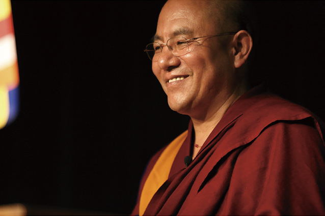

问1：我们有一个儿童中心，是根据佛教理念开办的，主要面向行为紊乱和自闭症儿童，那里也有一些小动物。如果您有时间，能否来我们中心看一看并做加持？

堪布：需要什么样的加持呢？是要念个经，还是要亲自到那里去？

问2：如果可以去，那就太棒了！

主持人：具体位置在哪里呢？

问3：靠近阿姆斯特丹，在霍夫多尔普。

主持人：虽然荷兰并不是很大，但阿姆斯特丹和鹿特丹还是有点距离，在斯基普机场附近。

堪布：后天我们去机场时，看看路上能否安排。如果可以的话，我愿意去。因为自闭症群体确实需要关心，虽然我做不了什么，但还是很愿意去。

问：我用中文问一个问题：跟人的交往过程中，有些小人看到你越好，他越不开心，在背后做很多坏事。这种情况是源于你自身，还是别人的问题？

堪布：应该说，两种情况都有。有些人生来善良，但因为处在一个不好的环境中，慢慢就养成了口是心非，或者“当面一套、背后一套”的习惯。

而有些人，按照我们佛教的说法，因为前世做的坏事比较多，今生也无恶不作，这种人也会对别人带来不好的影响。

还有更深一点的分析：如果我自己是受害者，可能是由于我的业力，导致别人来伤害我。这是佛教的特殊说法。

问：弟子来自瑞典哥德堡，有两个请求：一是祈请上师来瑞典弘法；第二个请求是：祈请上师给我们这些弟子赐予一些口传窍诀和皈依。感恩上师！

堪布：第一，以后有时间，并且各方面因缘成熟的话，可以考虑，我也想去瑞典看看；

第二，关于口传，密法的一些修行窍诀，暂时不行。应该先修加行，慢慢会有机会的；

第三，关于皈依，你们在座的人当中，有些可能不信仰佛教，但也不用担心，我念皈依偈时，想皈依的人才能得到戒体。

（堪布念莲师七句祈祷文，并做皈依）

问：虽然我明白一切都是因缘和合，真相是空，要学会放下。但我经常会在事情突发时控制不住情绪，转念的时间大概需要一分钟。请问：我怎样才能缩短情绪失控的时间？

堪布：每个人在遇到特殊对境时，都会产生不良情绪，但在佛教中有位寂天菩萨曾经讲过：“……如树应安住。”意思就是，当你情绪不好的时候，不要马上发脾气，也不要马上做决定，要像一棵树一样安住下来。

这样之后，很多奇迹会发生的。

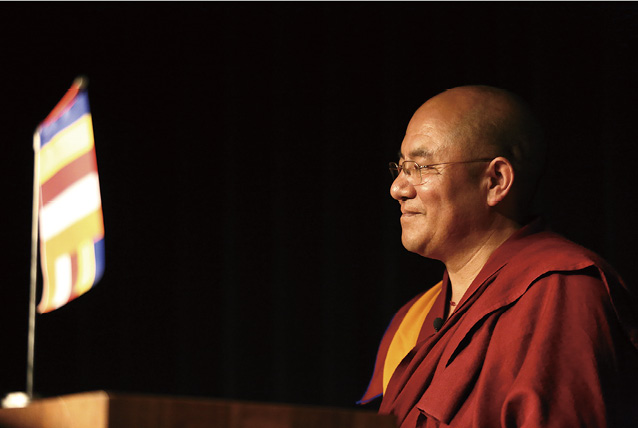

问：我不是佛教徒，但我的妻子是。之前看到一些佛教寺院已经商业化，我非常反感。但通过跟妻子的交谈，我对佛教有了新的定义，就是以哲学的理念来定义佛教。所以我尽量以哲理的方式来自我解答，但很多事情可能是智慧不够，自己解答不了。所以想请您指点一下：如何通过哲理的方式，来解决自己的烦恼？

堪布：现在很多汉地的人好像认为，唯有在非常寂静的山洞或寺院里生活的人，才算是佛教的代表。

我认为，佛教徒有两种：有一种在山里修行，不一定跟人接触，也不从事商业等；还有一种佛教徒，可以广泛接触社会，做一些慈善、商业。

如果整个佛教团体没有任何商业，在21世纪的今天也有一定困难。但在藏地，佛教的商业化没有那么严重，很多修行人还保持着非常纯净的生活和修行。所以，我们判断一件事情时，要深层次地了解所要判断的对象，否则，可能在误解的状态下产生反感、激动等情绪。如果你要了解佛教哲学，那就需要花一定的时间，长期、深层次地了解之后，才能有很好的结果。

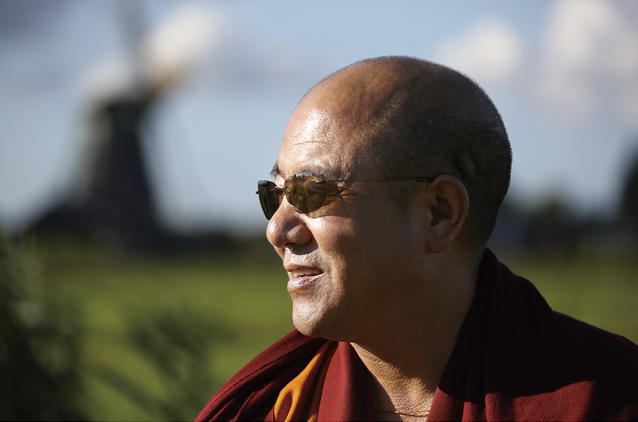

大城市里的很多人，往往只看到佛教表面的烧香、拜佛等行为，并没有看到佛教内在的慈悲和智慧。所以，我会跟慕名来到我们佛学院的游客们说：拍照留念固然重要，但这些只是外在的形式，更重要的是，要了解藏传佛教的慈悲与智慧。

因此，我这次来到荷兰，也被这里的美丽风景所吸引，但我更想了解相关的人文精神。昨天我们去“风车村”时，我想，相比于眼前的风车，几百年前人们的智慧和勇敢更值得学习。因此，虽然我喜欢外在的事物，但更喜欢内在的智慧。希望你们在真正了解佛教时也要明白，外在虽然重要，但其实更重要的是内在。

主持人：

谢谢仁波切，在结束您的演讲之前，我们有一位来自德国的小朋友米娅，希望给您送花！

（德国小朋友献花）

今天的讲座到此结束了。接下来，索达吉堪布仁波切会离场——请大家起立，鼓掌！感谢仁波切的精彩演讲！

[^1]: 联合国难民署发布的全球难民趋势年度报告显示，截至2015年年底，全球被迫流离失所者人数增至6530多万人，较去年（2014年底）增长580万，这是该数字首次冲破6000万。
[^2]: 难民潮发生后，德国是接收难民较为积极的国家。当时，高达88%的德国百姓捐赠钱物给难民，67%的国民愿意当志愿者去服务难民。一位德国民众在接受采访时说：“多年前我们在战争中造成非常多的伤痛，侵略别国，还做了很多可怕的事，该是我们疗愈别人伤痛的时候了。”
[^3]: 最初，匈牙利拒绝接收难民，并签发禁止难民上火车令；希腊、意大利等国接收数万难民之后，表示不想再收容更多难民；美国的态度是，可以出钱和派遣专家，但不打算接收难民，为此，国际救援委员会不得不向美国再次呼吁，要求美国在2016年底前安置难民。芬兰民众曾强烈抗议为难民开设接待中心，为做表率，芬兰总理尤哈·西皮莱将自家闲置的一栋住宅提供给中东和北非的难民……难民潮的现实背景下，欧洲各国的表现迥然各异。
