人们的心里有慈悲和智慧、教法和证法存在，  
那才是真正的佛法住世。

第27场

澳门宁玛巴白玉佛法中心

Macau Nyingmapa Palyu Changchub Dargyeling Buddhist Center

中国·澳门

2015 / 6 / 10

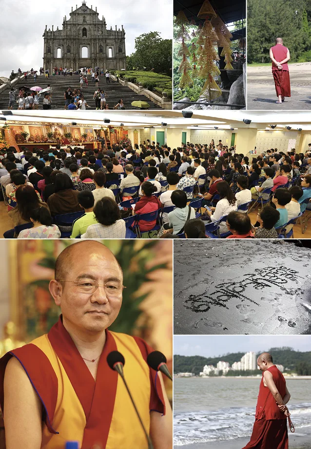

## 放生功德与修行次第

## Merit of Releasing Lives and Systematic Approach of Practice

主持人：

大家晚上好！今晚澳门宁玛巴白玉佛法中心非常荣幸邀请到索达吉堪布仁波切给各位开示。索达吉堪布仁波切学识渊博，接受过系统和完整传承的藏传佛教密法，是当代最知名的佛教大德之一，在国内外信众里具有巨大的影响力。他曾到世界近百所大学讲经弘法，深入浅出地展示佛学奥秘，广利有缘众生。

今晚索达吉堪布仁波切将以普通话为大家演讲有关现代生活的修行，请大家珍惜。今天仁波切开示的时间是一个小时，另一小时是自由提问的时间。现在有请索达吉堪布仁波切开示——

今天有缘在这里与宁玛巴白玉中心、地藏殿，以及菩提学会的佛友们一起共享法乐。我是第一次到澳门，看到这里有这么多佛教徒都在学习和修行，这确实很有意义。

## 一、开放心态 同心同行

今天在座的各位，有些来自同一个法脉，有些是不同法脉，但实际上我们的目的都是相同的。不论是汉传、藏传，或是南传佛教，我们祈祷的都是本师释迦牟尼佛为主的诸佛菩萨。所以，我在这里首先想说，无论什么教派，既然大家都在共同学习佛法，各个教派的所有教徒就应该发自内心地同心同行。

同心，也就是共同的发愿；同行，就是共同的行为。我们共同的心愿是什么呢？就是解脱成佛，度化众生。共同的行为是什么呢？就是一起修行释迦牟尼佛的教法。当然，我们修行不同的宗派和法门，这是可以的。全人类生活在这个世界上，其实都应该有一种求同存异的态度。我们作为佛教徒，在对待人与人、人与其他生命的关系上，是最注重和谐的。所以，今后无论在任何场合，我都希望所有佛友们发自内心地共行善举、共襄盛事、共同利益无量的众生。

如今世间很多事业，只有靠共同合力才能圆满完成。来自不同教派的佛友们，今天共聚于此，也是为了共同的心愿、共同的修行、共同的念诵。虽然有时候我们依照汉传的仪轨念诵，有时候用藏传或南传的，但其实都是殊途同归，在究竟的意趣上没有任何差异。因此，我们佛教徒要立足于这个世界，相互之间应该要有一种内在的沟通融合、同心同力。尤其是我们学习大乘佛法的人，内心要有一定的包容性和开放性，而且这种开放和包容应该比世间人的心态更加宽广。所以我希望，我们将来都能有更为开阔的思想和广大的发心。

## 二、闻思关键——系统性与次第性

在这个基础上，今天我将在这里给大家讲两个方面的内容。第一，我们作为佛教徒，应该要有完整、系统的修法。第二，讲一讲关于放生的道理。

首先我要讲一下修行。在座的大家都是佛教徒，虽然你们当中有人正值青年，有人处在中年、老年，但人只要来到世上，其实都会有生老病死。不管你是年轻、富贵、有权有势，还者衰老、贫穷、病痛残疾，都逃不过生老病死。这就是一种法则、一种规律，谁都免不了。要找到超越生老病死的方法，毫无疑问，本师释迦牟尼佛给我们宣讲的八万四千法门是最为殊胜的。我经常这样想，在这茫茫人海、滚滚红尘之中，我们大家遇到了佛法，实在是不幸中的万幸。一定是非常有福报，才能拥有这种善缘。

要是我们没有遇到佛法，每天都沉溺在轮回的琐事当中，表面上看来，我们的人生也许成功，但这种人生在我看来并没有多大意义。因此，我想跟大家说，你们不论学习净土宗、禅宗、藏传佛教，或是其他任何宗派都可以，但要明白，作为一个佛教徒，在短短的一生当中，自己一定要有一个完整的修行法门，这是非常必要的。要想为自己找到这种完整的法门，最好先在上师面前好好听受佛法，自己长时间反反复复去思维、去了解，然后再去修行，如此修行之后方能呈现其成果，也就是你修证的果。这就叫做见修行果。

在座的不论年轻人还是老年人，都应该找到适合自己的修法。我们作为佛教徒，不能停留在简单学佛的层面上，觉得自己已经皈依了三四十年，功德就很大。皈依佛门当然非常有功德，但更重要的是，一生中一定要修行一个完整的法门。

什么叫做完整的法门呢？例如，藏传佛教中的前行法门，像《大圆满前行·普贤上师言教》。这部法你们许多人都很了解。其中首先讲了人身难得，也叫暇满难得，就是让我们意识到，自己的这个人身为什么是珍贵难得的。如果我们转生到地狱、饿鬼、旁生，或者边地中，那么连修行的机会都不可能有，通过这样的学习，就能真正懂得人身的难得。当我们对此有了真正的认识之后，就会有修行的紧迫感，因为不论器世界还是有情世界，万事万物都是无常的，这就是第二步要懂得的道理。懂得了无常的道理还不够，如果我们没有好好修行，很有可能会堕入地狱、饿鬼、旁生当中，这便是轮回的痛苦。在如此痛苦的轮回当中，获得快乐的方法是什么呢？就是取舍因果。这四个基本修法叫做共同四加行。要懂得这些道理，必须依靠善知识的引导。没有上师的窍诀，可能很多人无法了解其中的深意。因此，如理如法地依止一位善知识，是非常重要的。

大家最好不要一听说某位上师来了，就马上去依止，不能这样。澳门的情况我不是很清楚，现在在内地，只要一有上师灌顶、传法，很多人就忙着去接，从来不观察。其实在此之前应该先详细地去做一些观察，在对这位上师充分了解的基础上，再去听法。现在很多人以为，给上师做个供养，结上法缘，就可以了。其实对上师来讲，你供不供养并不是很重要。同时，对弟子来讲，依靠供养也不一定能成就。因为供养只是一种财物上的结缘，而真正应该与上师结的是法缘。那么，佛法是灌个顶就可以得到的吗？也不是。灌顶是一种仪式，最重要的是要去修行灌顶的内容。对所修内容要先充分闻思，没有闻思很难理解灌顶的内容。

现在很多人认为给上师做个供养、请个客、拍个照、聊个天就可以了。还有些人喜欢跟上师一起去名山圣地朝拜，但上师对你真正的利益，并不是一起朝山就让你解脱。如果跟上师一起朝山就能解脱，跟其他任何人朝山也可以解脱。所谓的上师是什么呢？真正的意义就是老师。作为老师，应该教课；作为学生，应该听课，这才是最重要的。如果老师没有给学生讲课，学生没有听课，很多佛法的道理就不可能懂得。佛法就是依靠老师一点一滴地讲解，弟子一点一滴地学习，这样才能逐渐为大众理解，真正传播下去。

所以我一直在强调，要重视系统性的学习。什么叫系统性的学习？就像世间的教育体系，是从小学、中学，到大学。我听说澳门的大学教育几乎全民普及了，这非常好。我们佛教徒也应该普及系统性的佛法学习，都应该要读到“大学”。如今这个时代，佛教徒的水平一定要有所提高。光是受个皈依、念个佛号、念个“嗡玛呢巴美吽”，可不可以？当然，这些也是非常好的。但我们自己如果没有受过系统的佛法教育，恐怕难以满足这个时代的要求，难以满足个人修行的要求。

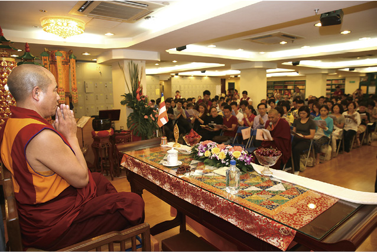

所以，我特别希望大家不要止步于学两三部论典。如果各方面因缘具足，学十部以上论典都是可以做到的。有些人觉得学完《入菩萨行论》和《大圆满前行引导文》就可以了，但其实不能就此满足，应该尽量活到老学到老，这是很重要的。我希望大家都能好好依止善知识学习佛法的智慧，学习以后还要进一步地去思维法义。然后，你就能真正懂得皈依的道理、发菩提心的道理、忏悔的道理、往生的道理。到时候，不论你学地藏法门、净土法门，还是学密法，都可以通达无碍。

不管修学各宗各派，我们都需要基础知识的教育。如果没有基础知识，就只是盲修瞎练，或者迷信盲从，那么佛教群体的水平就没办法提高。因此我在这里诚恳地呼吁、劝请，全世界的佛教徒都要重视系统性的佛法学习，不要像过去的有些老人那样，只会念个佛。我们藏传佛教当中，确实有很多信徒非常虔诚，但让他讲讲皈依三宝的功德，或者念阿弥陀佛的功德，他却讲不出来。当然，限于各种条件，个别人佛法水平不高也情有可原，但我们当代的佛教徒如果普遍水平低下，那是不行的。

从世间的角度讲，很多佛教徒都是有一定知识水平的。就像澳门现在遍地都是大学生，我猜今天来听课的人许多也是高学历。在过去，要是一个村子里出了个大学生，大家都觉得很了不起。但现在大学生好像太多了，甚至连工作都不好找，变得不再稀奇了。在德国不少人博士毕业都找不到工作，据说还有博士后去当门卫。所以，有时候世间知识并不一定是很稀罕的。

我们作为佛教徒，最重要的是要保持对学习的热爱。如果我们认真、深入地学习佛教的教理，到了一定的阶段，自己就会懂得怎样去修行。那个时候，你就会很想把自己懂得的这些道理分享给别人。像这样把佛的智慧和悲心不断转动开来，这就叫做转法轮。佛法要住于世间，并不是光靠佛像树立就有教化存在。人们的心里有慈悲和智慧、教法和证法存在，那才是真正的佛法住世。所以我要说的第一点，就是希望大家一定要有一种对佛法系统学习的概念和意识，这是非常重要的。

第二点，对学习的概念和意识，要有次第性。不知道这里的状况如何，在内地，很多人在修行方面很有兴趣，但在方法上不太明白。像禅宗的明心见性、净土宗的一心不乱、藏传佛教的大圆满、大手印、大威德等觉悟境界，很多人认为这些是很容易的，一来就开始修，其实这是不合理的。刚开始的时候应该一点一滴学习法义，先修基础法门，然后再一步步往上，没有必要一开始就攀求高法。如果在初期盲目追求高法，就像冰上的建筑一样。冬天在湖泊冰面上建起高高的楼宇，到了夏天，冰一融化，全部就会倒塌，这是非常危险的。同样的道理，我们若没有打好基础，一开始就去求许多高深的法门，那么一段时间之后发现没办法修成什么境界，就很有可能对佛法产生邪见。

在我们藏传佛教当中有位大德名叫仲敦巴尊者，在他依止著名的阿底峡尊者的过程中，刚开始上师没有给他传授高法，而是给他讲了非常基础的道次第。有一次仲敦巴尊者很有意见，问阿底峡上师：“为什么给其他弟子传授最深的密法，却只给我讲最基本的道次第？”阿底峡尊者告诉他：“我发现你的根基很不错，将来可以传承我的衣钵，所以才给你讲最重要的道次第。”表面上看来，仲敦巴尊者得到的只是非常简单的次第法门，但实际上正是因为他的根基最好，才能真正了知佛法修行的核心。所以，刚开始的时候千万不能好高骛远，如果对高法趋之若鹜，到最后却连基础法门都没学扎实，那什么也不可能得到。

因此，我们特别希望大家在学习的时候，不要急于求成。这里很多佛教徒都已经皈依和修行二三十年了，这非常好。我们的修行不是一天两天、一月两月、一年两年的事，应该要有一种长期的、稳固的、持之以恒的心，这是非常重要的。我们这一辈子，乃至生生世世，都要发长远的愿，更要成为长期具有学习性、智慧性、理论性的修行人，这尤为重要。

现在世间人都崇尚科学，其实我们佛教真正的道理都是非常符合科学的。我有时开玩笑说，我们的寺院就是科学院，真正的佛教大德就是心灵科学家，我们佛教的信徒，就是科技工作者，可以这么讲。现在不论东西方人，都对科学很有信心，但其实世间的科学中也包含着伪科学。很多人把科学当成一种盲目崇拜的对象，不少骗子用所谓科学技术骗了很多人。在这个时候，我们佛教应该要展现自己的理性特质，尤其是年轻人，如果各方面因缘具足，最好是学习一些因明、中观、俱舍、戒律，还有般若修行次第的道理。在藏传佛教，这都囊括在所谓五部大论之中，这些论典每一部都有甚深的意义。通过这样系统深入的学习，到了一定阶段，你的心永远都不会动摇，会拥有非常坚固的定解，那时要修什么法门都十分容易。

现在这个时代，某种意义上是值得欢喜的，因为人们更加容易找到自己的信仰，找到解脱的道路。如果我们的心没有朝着解脱的方向，每天都专注在赚钱、享乐、美容上，天天想着这些，那心灵将会多么贫瘠。当然，关注这些也无可厚非，但我们不能把价值观全部聚焦在这里。人可以追求美、追求快乐、追求财富、追求成功，可以去实现任何想法，但我们更应该想一想自己的生死大事，在真正要离开的时候，到底有没有把握。如果我们死时没有任何把握，活着又没有任何信仰，那跟动物其实没有什么差别。

人们辛辛苦苦攒一辈子的钱，离开人世的时候连一分都带不走。就像乘飞机的时候，不管你在别处有多少房产，也只能带一个行李包过安检上路。死的时候也是这样，我们除了能将今生中的善业和恶业打包成一件行李，带着走向后世，其他的一切我们都无能为力。同样的道理，我们在座每一个人，在一百年之内肯定都要离开这个世界，当你离开之时，能依靠的就只有自己的善业，因此要多多积善。

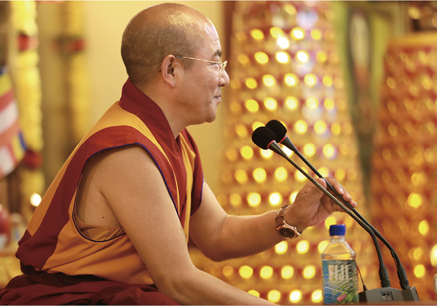

## 三、修行关键——选择一法 终生修行

接下来我想讲讲修行方面的问题。大家要系统地学习佛教的道理，学习之后更需要实践修行。如果光是学了而没有修行，实际上这些境界并不是你自己的。修行应该贯穿我们的一生。比如在刚才提到的《大圆满前行引导文》中，人身难得、寿命无常这些理论表面上似乎很简单，但如果要把这些道理真正融入内心，则需要长期实修才行。我以前讲过顶果钦哲仁波切的故事，他是我们宁玛派的教主，是非常了不起的大德。在他接近圆寂的时候，每天仍然要看好几页《大圆满前行》，并且不断地修行，这是我们学习的榜样。

对于佛法的修行，并不是听过一遍、看过一遍、学过一遍就可以，就像上完幼儿园之后就再也用不着幼儿园的课程了，不是这样的。二十年前所学的道理，我如今还在看，还在念，还在不断地修。我们每当学会一个念诵，就会一直念下去，到死为止，不会放弃。大家不论学习显宗还是密宗，最好每个人能从所学的经典教言中，找到自己最根本的一个法门。学地藏法门的修行人，对《地藏菩萨本愿经》中的一些教言，就该永远牢记，视其为自己的生命。学宁玛派的修行人，对所得的教授，也要永远当作自己最重要的法门。如果你没有属于自己最可靠的法门，今天学这个，明天修那个，短短的人生当中每天都这样飘来飘去，那最后临死之时可能什么都没得到，只不过在自己的阿赖耶识上种过一些善根而已。

所以，我今天在这里要跟大家强调，每个人最好找到一个自己主修的法门。你选择哪一个法都可以，凡是跟解脱有关的就不会偏。但要注意，不要去跟随一些新生的宗教。现在有些人自称是佛、是菩萨、是这个那个的化身，给自己戴各种高帽子，这些我是不敢相信的。真要相信，就该找一个有传统、有高僧大德们认可的法门，这样的法门，我们才能放心去修。听说有些人声称自己的上师发明了什么修法。佛法的发明可不是那么容易的，大家不要轻信这些说法。佛法也用不着谁去发明创新，南传、藏传、汉传佛教分别有哪几个传承，大家都很清楚。我们要找可靠的去修，不要相信一些江湖流派。现在有些地方环境和思想比较开放，鱼龙混杂，是很有危险性的。所以，我们应该追求一个真正可靠的、一辈子不用改变的法门。

我自己三十年前学的法，现在还在念修，三十年前看的书，现在也还在翻看，没有什么改变。不管我还能再活多久，有生之年中这些就是我生命的一部分，不会改变。我看到很多佛教徒虽然虔诚，但是在修行上并没有什么把握，好像只会去庙里拜一拜，既没有好好学过佛法的道理，也没有真正依止过一种解脱的法门。在出离心和菩提心方面，没有一样靠得上，这样是不行的。

我们每个人都要有自己的一个最根本的依靠处。如果你学的是净土宗，那《佛说阿弥陀经》每天都应修一定数量，临死的时候才会一心想着阿弥陀佛。学其他法门也是同样。就好比人有了一个固定工作，生活就有保障，我们修行也是如此。如果单单只是皈依佛教，那也很值得随喜，可如果自己没有一个终生修行的法门，那其实是很遗憾的。每个修行人都应该有一位本尊。什么是本尊？就是如果你修阿弥陀佛或者观世音菩萨的法门，不论在什么情况下，都要不断祈祷他。对于自己真正的本尊，当你活着的时候，要把他作为心灵的依托，经常念诵他的咒语和名号；当你离开人世的时候，也要祈祷他、依靠他。这就是我们的本尊。关于本尊的选择，很多人是请上师来给自己选择，但如果上师不选或者你不想去问，也可以问问自己，我的本尊是谁？如果自己对阿弥陀佛非常有信心，就可以想：“从此以后阿弥陀佛您就是我的本尊，我每天都念您的名号和咒语，我死的时候您一定要接引我。”就这样自己选择本尊也是可以的。这对于我们每个人的修行非常重要。

所以，我希望大家一是要好好闻思学习，二是要好好修行。在修行中，修多种法门也可以，但要有自己最根本的一个依靠，这是我再三强调的，大家要记住。大部分人都很聪明，听了这一堂课之后就会做一些改变。如果你们从今天开始认定一个法门不断修行，再过二三十年，绝对会有感觉。否则走马观花、飘飘散散，就没有方向。有些人似乎只把学佛当一个爱好而已，今天这里看一下，明天那里看一下，一会儿这念一下，一会儿那念一下，这样等到真正大限来临时，很可能什么都用不上。所以，我们每个人都应该找到属于自己的一个依靠处。虽然我们可能暂时修得不是很好，但是在一生中应该拥有自己最主要的一门修法，这是我们必须去选择的。

## 四、爱护生命 戒杀放生

下面讲讲放生方面的问题。放生是非常重要的。我听说这里也经常举行放生。关于放生，有些不理解的人，经常讲一些放生的过失。有人说放生没有用，这边刚放那边就打捞走了；有人说放生不环保，对生态环境有影响；有人说，放生人士常常随便放毒蛇、放外来物种，对当地生态有损害；有人说，放生已经形成了产业，让屠夫发了财，实际危害了更多的生命……很多人以各种各样的理由批评放生的行为，这些也确实是放生中存在的问题。在很多方面我们也应该去改善，包括放生的方式、放生的地点、放生的时间，这些都应该用智慧来观察。但不能因为存在这些问题就不去放生。虽然是有一些问题存在，但我们可以找到解决的方法。

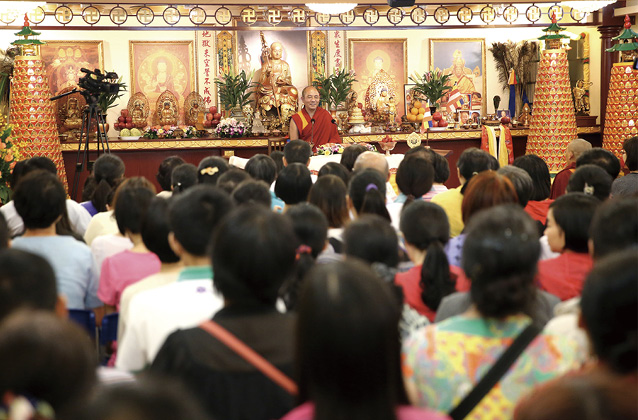

当然，有些人很简单地出点钱，怎么方便就怎么放了，这是不负责任的态度，这样肯定是不妥的。我们放生时首先应该考虑：要放哪些动物？放到什么地方？这些物种是否适合当地环境，等等。有了各方面充分的考虑，我们不敢保证百分之百不会有害，但也大概率能有机会救护这些生命。所以，正确地放生非常重要。

放生的意义和功德在这里不用多说，我想大家都清楚。近三十年来我一直提倡放生，自己也很有意乐参与，这对我来说是非常有意义的事。我们每个人最恐惧的就是死亡，其他众生也和我们一模一样。这个世界上，最宝贵的就是生命。对于生命，凡是保护、爱护的行为，我们都应该随喜；而对生命进行威胁、践踏、摧毁的行为，我们都不能容忍。所以，放生的确是非常重要、非常有意义的。

从世间法来讲，放生有着诸如令人身体健康、延长寿命，或是升官发财、子孙满堂等很多功德。汉传佛教的莲池大师、弘一大师等许多前辈大德都讲过放生的各种功德，大家可能也看过。我们一定要知道，放生的功德何其不可思议，而且这样的功德在我们即生当中是能得到的。我们身处这个末法时代，很多人可能多病、短命，这种情况下，放生是最有益处的。

《譬喻经》中有这么一个公案：有一位国王，因为母亲病重，就召集全国上下的婆罗门出主意治病。有婆罗门告诉国王，杀死一百种动物和人的生命进行祭祀，就可以延长母亲的寿命。正当国王按婆罗门的要求将要杀的众生驱往祭坛之时，释迦牟尼佛携众眷属挡在国王面前，做了这番开示：“如果想获得粮食，就要精勤耕种；如果想获得财富，就要行持布施；如果想健康长寿，就要慈悲众生；如果想获得智慧，就要认真学习。要想得到这些结果，就应该先种下相应的因。用杀生的方式来求长生，只会离生路越来越远。”佛陀告诉国王：“若人寿百岁，勤事天下神，象马用祭祀，不如行一慈。”意思就是，如果有人想活到一百岁，即使精勤地承侍全天下的神灵，对寿命延长也毫无作用。真正有用的是发慈悲心，哪怕放一条生命，也有无量的功德。后来国王依佛陀的教言而行，果然使母亲的病症得以消除。[^1]

因此，我们作为佛教徒，一定要重视放生。在这个世界上，有很多人不但不去救助生命，反而把杀生当成祈福延寿的方法。大家可能知道，现在有些地区和宗教，认为杀生越多越好。像尼泊尔的印度教，有一个兴盛了数百年的传统，每五年就要做一场大型的杀生祭祀。2009年的祭祀中他们在一两天内杀了三十多万头动物。2014年，同样的祭祀又一次举行。大家看看这些照片，来自尼泊尔和印度的两百多万人参加祭祀，将牛羊和其他动物集中起来全部宰杀，据说有五十多万条生命，现场尸横遍野。尽管全球的动物保护组织一再反对这种行为，但持续数百年的传统很难改变。他们认为这种残酷的杀戮是为了供奉嘉蒂麦女神，可以给自己带来好运，带来健康。但其实这是非常不合理的。用杀害生命的方式怎么可能延长我们的寿命呢？绝对不可能的。这种杀戮是非常可怕的，但世间有很多人就是热衷于杀生，现在世界上灾难频发，是否有杀生的报应，虽不敢绝对这么说，但我认为确实有一些关联。

相比于这种杀生献祭，印度的另一个宗教叫耆那教，就非常注重保护生命。我在美国耶鲁大学交流时遇到过几个信耆那教的学生，他们介绍自己的动物保护意识的时候，我真是非常随喜。在他们的教义中，任何动物都不能伤害，而且教徒都要吃素。2014年，印度一个以耆那教为主的城镇，在两百多位耆那教徒的积极倡议下，成了世界上唯一的一座全素食城市。耆那教在全球有约500万信徒。在这个世界上能有这样一部分人，不但戒杀，而且吃素，这是非常好的。

在座各位也应尽量以素食为主。素食一方面确实对健康有利，另一方面也对其他众生的生命有利。如果你吃一天素，那这一天全世界所有杀戮的罪业你都毫无沾染；如果一年中坚持素食，那这一年里全世界的杀戮血腥都跟你没有关系，这是非常重要的。

有些人担心，吃素会不会营养不良、不利于健康？其实不必有这种顾虑。很多人认为多吃肉才对身体健康有益，这其实是一种颠倒的观念。我以前研究过这方面的资料，早在1956年，美国发布过一份全民饮食建议，限于当时的研究水平，建议中认为高脂肪、高蛋白的肉、蛋、奶类食物对身体健康有益。于是，这种饮食结构就被大众广泛接受认同。但过了几十年，研究机构逐渐发现，吃肉越多的人越不健康，而且癌症患者不断增多。1994年，世界卫生组织基于最新研究，开始提倡以素食为主的健康饮食结构。但过去错误的饮食观念已经形成了一种惯性模式，多年以来很多国家模仿西方的饮食习惯，认为多吃肉类有利于健康，这是一种盲目的跟从。事实上，西方人现在也在努力纠正不良的饮食结构，因为肉食已经对他们的健康产生了明显的不利。在北美洲，每四个人中，就有一人死于癌症。现在已有许多临床证据表明癌症与肉食之间存在相关性。随着物质生活水平提升，现在都市中的“文明病”越来越高发，其中许多疾病都是肉食过多引起的。

相反，素食中完全具有人体所需的营养成分。尤其是植物中的膳食纤维，以前不被重视，后来证明对于我们的健康非常重要。它可以帮助我们畅通肠道，预防许多疾病。所以，科学的素食其实比肉食健康得多。有些人觉得光靠素食营养不够，我经常跟他们开玩笑说，你看牦牛不吃肉却那么壮，猪不吃肉却那么肥，所以，不用担心你吃了素会变得太瘦。（众笑）

推广健康的饮食观念非常重要。我希望佛教徒能尽量以素食为主。素食观不仅体现了我们的慈悲心，也有利于我们自身的健康长寿。大家可以看到，汉传佛教中的很多高僧大德，虽然一直吃素，却特别长寿。像本焕老和尚，世寿106岁；现在的梦参老和尚也有100多岁了，净空老法师也是高寿；过去的虚云老和尚更是活到了120岁。所以，我们完全有理由认为，素食对慈悲心有益，对长寿也有益，以后应该尽量倡导素食观。

如果我们一直吃肉，一辈子可能会吃掉很多生命。我以前看到新闻上说，一个人如果活到80岁，一生中平均会吃掉8000条生命。你们生活在海边的人，也许会远远超出这个数量，一生中吃掉8万、80万条生命都很难说。所以，我们需要好好地忏悔。虽然过去因为没有信仰，没有遇到佛法，不知道生命的重要性，但既然现在知道了，就该当机立断，不再杀生，而是用慈悲心来爱护众生。虽然我们以前在这方面可能犯过很大的错，但今后完全可以改邪归正，做一个对众生善良无害的人，做一个时刻具有慈悲心的人。

我们曾经因为无明愚痴，修行上有些地方做得不是很好，所以现在更要尽量地帮助众生，尽量放生护生。放生的方式我就不多说了，大家应该都会参照仪轨。放生时一定要念诵诸佛菩萨的名号，还要用甘露丸和经书做加持，这些也是很重要的。我以前写过一篇《放生功德文》，这里面有一些放生的注意事项，讲得还算比较细致。我希望大家以后放生要做到如理如法，放生过程中可能会有一些困难和不方便之处，但我们都要尽量去解决，因为每个众生的生命都是那么的重要。我们如果有机会，哪怕一年当中能放一条生命也是非常好的。

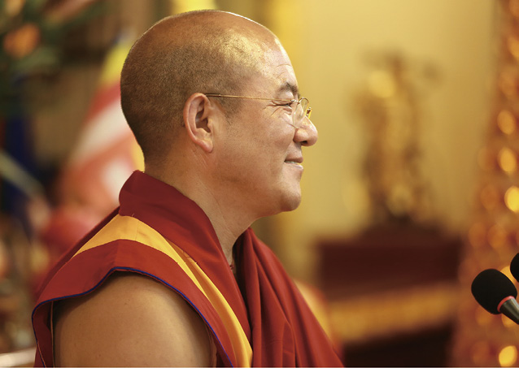

今天特别感谢在座的各位，希望大家以后多多参与放生。我今天开示的内容就是这两个方面，一是大家要在有生之年变成很好的修行人，应该着重选择一个法门好好修行，其他的法门也可以学习了解；二是尽量放生，这个世界上最宝贵的是生命，动物的生命跟人类的生命有同样的价值。我们要爱护其他众生的生命，只要有能力，哪怕是一条生命我们都应该尽力去救助。

有时候我会放一些鸟雀，让它们飞回天空，回到大自然的怀抱，我心里就会有说不出来的欢喜。有时候我会放鱼类，把它们放回水中，看它们一条条自由自在地游走，那时候也会非常开心。有时候我会在藏地放一些牛羊，把它们从人间地狱般的屠宰场里救出来，的确令人特别开心。说实在的，现在世间各种天灾人祸频发，跟人类的杀戮脱不了干系。人类如今在杀生方面，可以说是不择手段。你们应该知道，以前一个渔夫能打到的鱼其实不多，而现在的海洋捕捞技术，一次就会把大量的众生全部捞出来，非常可怕。在这个时候，我们佛教徒的力量虽然微薄，但我们心是很强大的，所以我们要发无上的菩提心，修持大乘佛法，持之以恒地行持善法，要从整个人类、整个地球的层面做出自己的贡献。

所有的功德中放生功德最大，所有的过失中杀生过失最大，这是龙猛菩萨在《大智度论》中说的[^2]。如果我们能把一个众生保护起来，这份功德其实就已无量无边。所以，我希望大家能把佛陀的慈悲心作为我们修行的重点，作为我们在世间一切行动的依靠。大乘佛教的真正教义，归根结底就是利益众生和度化众生。我们如果能把一个生命真正度脱到轮回的彼岸，就是最究竟的度化众生；如果我们还做不到这样，那么暂时让他离苦得乐，超离死亡的威胁，这也是一种度化众生的方法。

今天这场开示就讲到这里。接下来你们有什么问题我们可以共同交流。

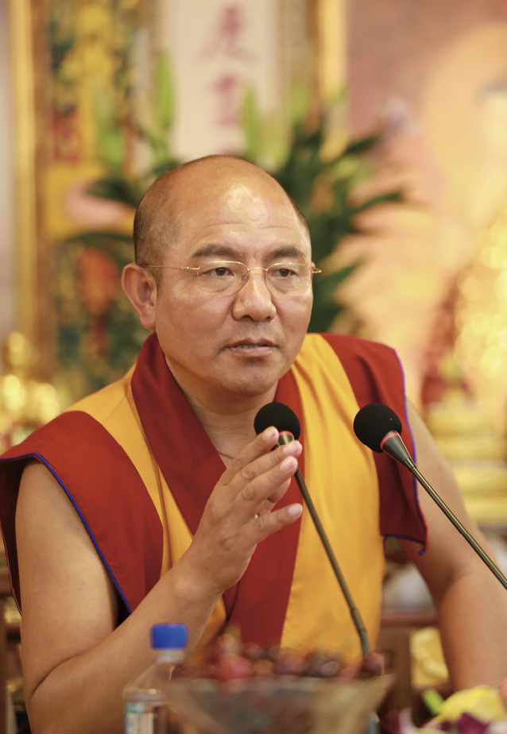

现场互动

问：我有一次在意外之下差点无常了，但那个时候不知道该祈祷谁。印光大师说临终时要祈祷阿弥陀佛，可我观不起来。自己也觉得应该念金刚七句祈祷文，或者上师如意宝的祈祷文，但当时很混乱，所以想请问，自己修得不到家，担心无常的时候怎么办？

堪布：遇到这种情况，不论阿弥陀佛也好，莲花生大士也好，自己对哪一位本尊有极大信心，都可以祈祷。这在汉传和藏传佛教中都有相关的传承和密意。实际上，当人的信念真正达到极点，对上师、对本尊有坚定的信心，不管是离世的时候，还是平时遇到危险困难的时候，都可以向他们祈祷。依靠这些圣尊不可思议的加持，一定可以获得暂时和究竟的利益。

问：我的第一个问题是，您说过学习中观和因明就可以生起定解，我也希望自己增上信心，但是我看不懂，该怎么办？第二个问题是，我现在在修加行中的磕头，但不太修得下去，请问有什么办法？

堪布：我刚开始学中观的时候也特别费劲，看很多遍还是不懂，于是就不断向一些法师请教。有些法在刚开始学的时候确实特别难，但如果把它当作一件非常重要的事，反复研究，就会越学越明白。只看一遍是很难通达的。我们看小说、看电影，通常一遍就能看懂。现在很多年轻人喜欢看韩剧、看好莱坞大片，这些你们都没什么看不懂的，然而遇上因明和中观就看不懂了，实际上还是功夫没下够。因为这些古代的论典内容都是关于万法本质的思想体系，仅仅看一遍，跟我们的分别念不一定能相合。但是电影、小说的创作者都知道大众的喜好，自然让你容易理解。要学懂中观和因明，主要还是得下功夫。

关于修加行的困难，其实我们都是一样的。有时候磕头很累，尤其夏天天气炎热的时候确实不容易坚持。但是，在修行当中，磨炼自己的意志是很重要的。古代有些大德一生中修了很多遍五十万加行，而我们现在修一遍都感到非常困难。其实修行人应该去做常人做不到的事，这十分重要。如果让你一路磕长头到拉萨，你肯定不敢想象。但在我们藏地，有很多人在那么高的海拔上，三步一拜，一直拜到布达拉宫，拜到觉沃佛像面前。我在去西藏的路上，也遇到过磕长头的人，他们不管下雨下雪、日晒风吹，越过几千公里，哪怕翻山越岭，都一直磕着长头。如果他们可以做到这些，那我们在舒适的环境里磕十万个头其实也是可以做到的。要是磕大头实在不行，就磕小头。人的意志在没有得到磨炼的时候，就会服从原有的习气。但我们作为修行人，如果连十万顶礼都完成不了，自己应该有一种惭愧心。其实只要心的力量增上，什么都是可以做到的；但如果心的力量不够，做什么都会觉得好累。所以，要不断地努力，修行就是长期磨炼心性的一种过程。

问：《醒梦辩论歌》里讲了醒梦一如的道理。我们在日常生活中该如何践行醒梦一如？虽然知道人生如梦，但我们具体应该怎样做？

堪布：在真正的意义上，人生确实是一场梦。但如果暂时还没有了达其中的意义，那么梦就是梦，醒就是醒。所以现阶段我们可能在理论上知道生活如梦一般，但在感觉上还是会有一定差别，这需要我们不断地修行。到了一定的时候，面对真实发生的事，也不会太在意，就可以感觉到人生是一场梦。如果没有经过长期修行，虽然口头上可以讲这个理论，但实际上还是会有很大差别。

问：我是澳门理工学院教职工家属，想请教您两个问题。第一个问题是，我们在修行中，有时会遇到身体、工作、经济或者家庭方面的违缘。很多人平时可以坚持下去，但碰到违缘，心力就很容易退失。我们该怎么增上心力，把违缘当作助缘，在菩提路上不退失？第二个问题是，我们应该如何在生活中修自他相换？碰到一些比较自私自利的人，我们修行人该怎么用自他相换的方式跟这些人接触？如何在扩大心量随顺众生的同时，又不失去对善恶因果谨慎取舍的原则？在这方面应该怎样去把握？

堪布：这两个问题都提得很好。的确，很多人在快乐、顺利、各方面因缘具足的时候，闻思修行都很不错，但一遇到违缘，就坚持不下去了。所以有时候我真正感觉到，能长期坚持修行的人是非常坚强、非常了不起的。有些佛教徒中途退失了，因为经济有困难、因为家庭不支持、因为工作特别忙、因为生了孩子、因为家里老人去世、因为政治背景不方便、因为孩子读大学……各种各样的情况都有。有些问题可能会让我们觉得无能为力，但如果遇到问题就退失，我们出家人也可能会因为各种各样的原因而脱下僧衣，或者放弃讲经说法。我们也面临着很多困难的情形，但仍一直在努力坚持着。像我自己，不管遇到什么事，讲法都是放在第一位的。在学院的时候，不管来了什么样的高官、什么样的高僧大德、什么样的重要会议，我都不管，每天必须讲一堂课，什么也干扰不了，这是我自己最坚定的信念。我在外的时候也是这样，除了讲课，其他事情都不重要。这次来到澳门只有两天的时间，接待方说这里有很多寺庙和景点。我没来过澳门，按理应该多去了解了解，但时间上有一定的困难，所以我只想保证昨天和今天的这两堂课，这个才是我最看重的。所以，很多情况取决于我们对待事物的价值观和重视程度。如果你对学习佛法很重视，有些违缘表面上似乎没办法度过，但是实际上你会发现并没有那么严重，也不是非退不可。如果遇到困难就退却，在我们的一生当中，导致退失闻思修的事情可能非常多。就像我们出家人，有时候会遇上疾病，有时候会遇上外在的各种障碍违缘，但我们一直扛着。多年以来，我唯一的坚持就是讲经说法和自己的修行这两件事。虽然不知道能坚持多久，但撑到实在撑不下去时，也不会有遗憾。所以，当违缘发生时，有的情况实在无力对抗，但有的情况只要我们去争取，也可以化险为夷。这个时候就需要我们努力坚持。

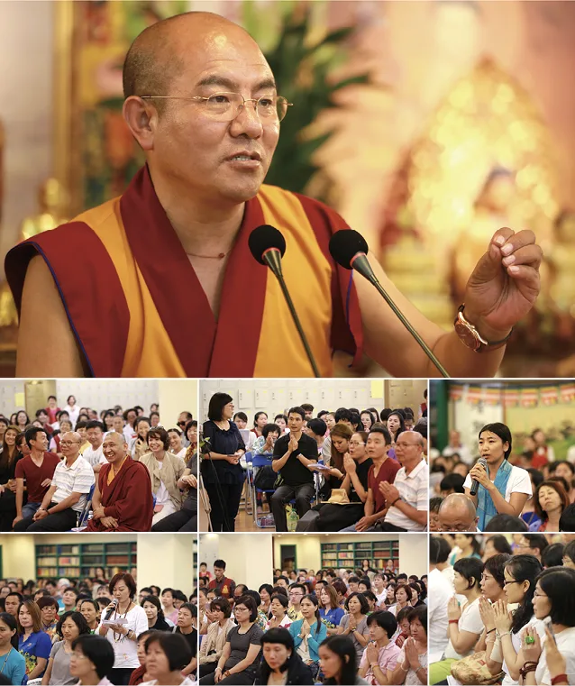

关于第二个问题，自他交换是菩提道里很高层次的修法。如今对于经济利益和日常生活，全世界绝大多数的人都是以自我为中心的，这就是世间的价值观念。如果要求我们把自己的利益全部出让给别人，别人的损失全部由自己来接受，从世间价值观的角度，确实有很大的困难。我们修自他相换，是一个逐渐去实现的过程，并不是要求在今天就把一切放下，生意该亏就亏，什么都不要，让给别人去享受，这些现在可能是做不到的。我们作为大乘修行人，虽然暂时没法做到全然自他相换，但在一些关键的问题上应该尽量想到众生的利益，在力所能及的方面做到。毕竟我们是学习大乘佛法的人，理应为众生付出自己，哪怕先做一部分也可以。有一次，我们那里一位修行人说自己要安住一会儿，旁边另一位修行人就开他的玩笑，说：“你可不要太骄傲，以你的水平有什么好安住的。”他说：“我哪怕只能安住一分钟，这也是我的了不起之处，你也不应该不为我高兴。”同样的道理，我们哪怕能为一个众生稍微修一点自他相换，也是很好的。我们做不到像释迦牟尼佛在因地时那样，把身体都布施给别人，但即使能做一点点，也是非常有功德的。所以我觉得，在自他交换方面，我们应该尽心尽力。在对抗违缘方面，就更要努力。只要努力，你会发现所谓的违缘其实并不是那么严重，只不过在自己的意识中被放大了影响，其实可以找到很多变通的方法。

问：佛法修行应该有什么次第？上师和弟子分别应该具备什么样的条件？另外，我看过书上说，阿底峡尊者给仲敦巴尊者留下教言：舍弃世间心，修菩提心。应该怎么去理解这句话？

堪布：你的第一个问题是关于佛教的修行次第。以我们藏传佛教的一些修行体系而论，首先要具有贤善的人格，此基础上，再修人身难得、寿命无常等，先令自私自利的心慢慢退下来，然后再利益众生，以这样的次第，出离心和菩提心就能一步一步逐渐增上。就像幼儿园、小学、中学、大学的顺序，这样循序渐进，最后就可以学修佛教最高的法门。这些次第在我们的法本上都可以详细了解到。

第二问题，作为一位合格的上师，应该具有清净的戒律、精通佛法的智慧、利益一切众生的大悲菩提心、对弟子的慈悲心、自心极其调柔，以及其他等条件。而作为佛弟子，有不同的层次，比如声闻乘的佛弟子，至少要看破世间，不能贪恋世间的荣华富贵。如果是大乘佛教徒，那至少也要有一颗利益众生的善心、菩提心。所以，佛弟子的层次并不相同，这些在我们的书本里也有非常清楚的介绍。因此，大家要一步一步地深入学习。

第三个问题，关于阿底峡尊者对仲敦巴尊者说的舍弃今世和要修持菩提心。舍弃今世是小乘当中的修行基础。如果我们整天想的是今生的工作、感情、家庭、生活，这对修行会有很大的影响。所以，我们对世间法不要太过贪执。当然，要做到完全不贪执，对于在家人有一定困难。我们修行人刚开始不能要求过高，否则达不到的话，很容易产生厌烦心，要从合理的程度做起。虽然有些标准我们目前达不到，那也不要紧，先从能做到的做起。要是我们刚开始就像米拉日巴尊者那样把所有事情全都放下，班也不上，饭也不吃，那是违反常情的，佛教中也没有这样的要求。

应该一步一步来，比如想做到不吃肉，可以先尝试一个月中三天不吃，看能不能做到。如果三天做不到，一个月有一天不吃肉，应该能做得到。就这样一步一步去做。如果一天念一部《金刚经》做不到，那一天念一遍《心经》应该能做得到；如果一天念一万遍阿弥陀佛名号做不到，那念一百遍应该能做得到。我们不能太懒惰，懒惰就无法好好修行，但有些人刚开始过度精进，也容易退失，所以最好是循序渐进。这是关于舍弃今生。

阿底峡尊者还说要利益众生，发菩提心。阿底峡尊者是大乘佛教里的榜样人物，他曾去往印度尼西亚依止金洲上师，从而生起了菩提心。听说当时的那个地方还在，有机会我很想去朝拜。阿底峡尊者对藏传佛教的贡献非常大，也在汉地广为人知，因为他是真正为利益众生而发起了菩提心的。这对每个修行人来说都是极其重要的事。所以要生起大乘利益众生的菩提心，这是阿底峡尊者对后人的一个期望。

问：我早上做功课喜欢念诵莲师心咒，请问莲师心咒有没有手印？

堪布：莲师心咒没有其他的手印。如果一些修法的手印不会，只要合掌就能代替所有的手印。有些人可能不太会结手印，合掌是所有手印的根本，因此做任何祈祷和修行时，只要合掌就可以。

问：我想提三个问题。首先，刚才上师讲了学习要有次第，我觉得自己深入思维法义时在理论上很薄弱，想请问一下五部大论跟前行的次第是怎么样的？是不是应该在学前行的同时把五部大论学起来？还是在前行学完了之后再学五部大论？另外五部大论之中应该先学哪一部比较好？

第二问题是，有一位师兄本来跟我们一起学习加行，但后来他的上师根据他的根基给他传了大圆满，他就退出了我们的共修小组。我们劝他，上师说过一定要打好加行的基础再去修高法。但是他说，我今生虽然没有修加行，但是你们怎么知道我前世没有修过加行？所以我们也不知道该怎么去反驳他。

第三个问题是，《大圆满前行》里唐巴比丘和美女饿鬼的公案，都讲了因为没有把心转为道用，所以转生到了恶趣。所以想请教上师，怎么把心转为道用才是如理如法的？

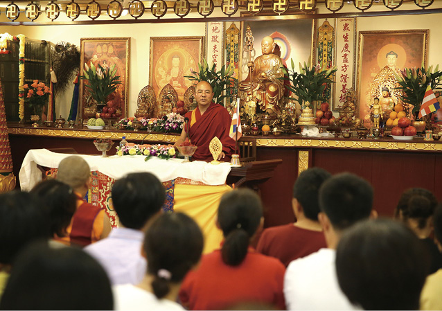

堪布：第一个问题是关于加行与五部大论的关系。对于加行，只要对佛教有信心，就可以修行；但如果从生起智慧的标准来进行修行，最好应该有一些理论的基础。藏传佛教的五部大论，包括光明如来藏、中观空性等很多方面的甚深道理。如果有了五部大论的理论基础，修加行会修得更好，念佛也更能懂得其中的意义。而且当你有了大量的理论功底，学佛就不容易退转。所以，关于加行和五部大论的关系，加行主要侧重于修行方面，如果再有一些五部大论的理论基础，二者就能相辅相成。五部大论相当于我们的学术课题，是研究性非常强的一套理论体系，非常重要。

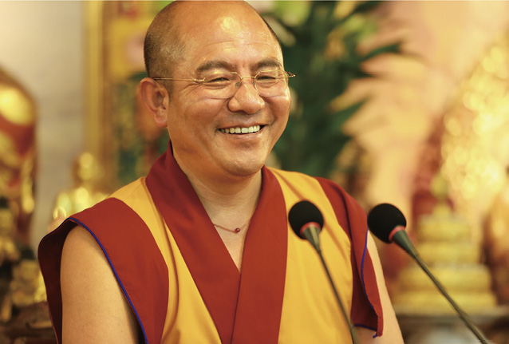

第二个问题，那位道友说，即生没有修加行，但是你怎么知道前世没有修？那个时候你应该反问，你怎么知道你前世修了呢？对吧。其实他那句话在我们五部大论的因明辩论当中，犯了一个很大的逻辑错误。就像我即生当中很贫穷，不能推导出我前生很富贵这个结论。这在逻辑上有很大的缺陷。但你这样驳斥，他可能也不会认同。有些人本来自己在好好修行，但由于其他的某些上师，把你从原先的地方引出来，然后又把你扔在那里，也不好好带你，最后你就这么变成了一个孤儿。这种现象非常多，我也确实觉得这样的人有点可怜。

至于第三个问题，修行中该怎么把心转为道用。其实修行是长期的，也是很艰难的。你们在大城市中还能坚持不断修行，我觉得真的很厉害。有些人既要忙工作又要忙家庭，还得照顾老人孩子，甚至要去听节课也得忍受堵车穿过整座城市。面对各种压力，不断坚持努力修行，确实非常不容易。所以我们在修行过程中，要是遇到一些不如法的现象，就需要依靠自己的发心之力。其实，想要把心转为道用，包括贪嗔痴等烦恼，只要我们拥有一颗对佛法、对众生的虔诚之心，一切都可以转为道用。

问：现在港澳地区有很多灌顶活动，每次一有上师来安排灌顶，就有很多人去接受。我看到很多师兄，在受灌顶之后其实对那个修法并不是很理解，但他们还是一直去受。请问按藏传佛教的观点，是否应该先有很好的基础才能接受灌顶，还是只要对那位上师有信心就足够了？

第二问题是我帮其他朋友问的，想请教仁波切对其他教派，比如天主教、基督教的看法。谢谢！

堪布：这个问题问得很好。其实灌顶是对某个修法的一种开许，就像一个商店开业要举行一个活动一样，放了鞭炮就表示今天开业了，但开业之后商店里还要有人上班卖东西。所以，如果一个仁波切给你灌了一个观音法门的灌顶，之后你还需要得到观音法门的修法仪轨，要知道怎么修。而且，得到灌顶以后要守持哪些戒律，这也需要了解。实际上，灌顶表示你进入了密法。密法中有十四条根本戒、二十五条戒、五条根本戒等不同的戒律要求。通常上师灌完顶之后，会要求弟子遵守相应的戒律、修持相应的法门，还会规定修法的数量。灌顶只是进入修行的一个开始，后面还应该有修行的延续。然而很多人求灌顶的时候，并不知道这位上师到底是谁，只要听说有灌顶就去。按理来讲，至少也应该了解这位上师来自哪个地方、他的修行怎么样、他有没有得过这些灌顶和传承、在当地的影响怎么样、他的人格怎么样……这些在接受灌顶之前应该先进行一些了解。不要先受了灌顶，然后再去打听。现在很多人只要看到广告“某天在某某中心，有某某仁波切进行长寿灌顶、财神灌顶”，根本不观察就去接受，灌完之后又去怀疑：这个仁波切会不会是个骗子？这是不合理的。应该提前观察清楚，再去求这个法，这点很重要。

第二个问题，天主教和基督教，都是非常重要的宗教，尤其是对西方世界来讲。我在香港和泰国，多次参与佛教、天主教、基督教、伊斯兰教、道教这些宗教间的相互对话。对于每个宗教自身的观点，我们可以持有自己的见地，但我们同为宗教界，更重要的是要有一些共同推进的事业，比如慈善。任何宗教都可以为人类做一些有意义的事。就像现在某些国家与国家之间的关系，比较敏感的话题不必提及，应该多多寻求相互合作的机遇。同样的道理，宗教之间可能存在个别的观点分歧，我觉得教义是可以有不同的。在我们藏传佛教里，一些教派之间也会有差异。比如我们的白玉派和竹钦派，一些仪轨的念诵方式就有不同，但大家都属于藏传佛教。所以，我认为宗教和教派间可以求同存异、互相学习。我听说你们澳门有些寺院里，关公、孔子、观音菩萨、释迦牟尼佛，全部都放在一起供着，这样也很好，我们应该有一种包容的心态，对吧？

问：我之前一直学习净土，后来又学习加行，觉得都很殊胜。我想请问如何将净土法门和藏传教法相结合，让他们能够圆融无碍？当我分享金刚萨埵忏悔法门时，很多汉传佛教的佛友一时间不太容易转变去念咒，觉得念佛就好了，所以想请教您该用什么方法让他们接受这么殊胜的教法。

堪布：其实不管修什么法门，只要我们自己内心当中没有隔阂，都可以圆融。比如今晚在这里既有显宗的地藏殿，也有密宗的白玉派，我们大家在同一个殿堂中学习同一个佛法，心中应当毫无隔阂，因为解脱的目标是一致的，诸佛菩萨的加持是一样的。作为大乘佛教的修行人，我们甚至要把所有众生都视为佛陀和本尊的化现。只要从对众生的慈悲心、对诸佛菩萨的信心出发，不论修什么样的法门，都是可以圆融的。如果我们内心狭隘，画地为牢，除了自己的法门、自己的上师，其他什么都看不惯，这样会活得很累。我并不要求谁去改变自己主修的法门，如果你原来修的是阿弥陀佛，一辈子这么修就很好。很多人一门专注修密宗、修净土宗、修禅宗，也有像你这样同时兼容净土和加行，净密双修的，都是可以的。就像黄念祖老居士，他是净密禅三宗同修。不管怎么样，要修一个法门，就要诚恳地去修，不要只做表面功夫，更不要去诽谤他宗，这样的话我们的修行就会很快乐。然而，现在汉地和藏地个别修行人对于宗派问题处理得不是很好，道场之间也偶有矛盾。同时，有些佛教徒由于缺乏学习和智慧，遇事特别计较，处理不好人与人的关系，控制不了自己的脾气，经常为琐事争吵，让旁人疑惑，怎么佛教徒的脾气也那么大？我们学佛之后，至少要做到心性调柔，对身边的人不要随意发脾气。要是家人骂我，我就趁机好好修忍辱，先把家人当成是修忍辱的对境。所以，我们要有一种包容的心态，这样修什么法都很容易。

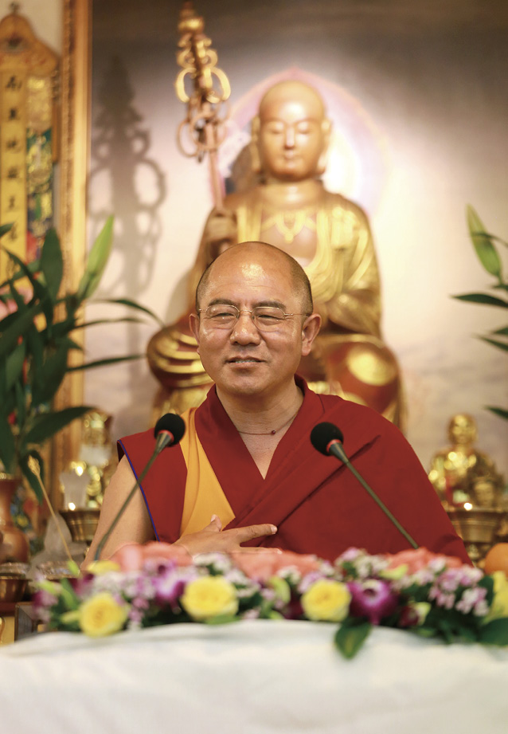

问：我虽然没有什么违缘障碍，但是我心很散，静不下来，总想跑来跑去，见这位师父那位师父。您就是我一直向往拜见的人，今天终于如愿以偿。我对您信心一直特别足，所以，您能不能教我一个办法，震慑下我这颗心，让心安定下来？

堪布：想要把心定下来，应该经常祈祷地藏菩萨和观世音菩萨。如果我们对这两位菩萨时常祈祷，心自然而然就会安定下来，心定下来以后，修行就会很容易。地藏菩萨发过愿，能满足众生的一切意愿。所以，我们以让心安定的愿望来祈祷，心就可以定下来。

问：我们修行人都需要圆满福慧二资。智慧方面我知道应该不断精进学习。对于福报方面，我知道能够进入佛门、遇到殊胜的上师和殊胜的密法、能够长期学下去，都是需要很大福报的。我曾听过一个说法，做功德的时候，要尝试放下功德心，去生起菩提心，用菩提心去摄持善法，功德会非常大。但我们这样的初学者，在做一些礼佛和发心工作时，第一个念头总是有多大的功德，然后才会提醒自己去生起菩提心。所以我想请问，在这方面有没有好的窍诀？

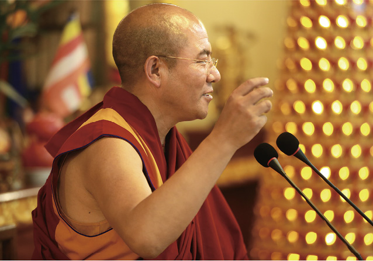

堪布：要增上福报，同时生起菩提心，我觉得一是要经常祈祷上师三宝；二是要认识到即生当中这样熏习是多么重要；然后要想到众生的痛苦，这个时候，自己的菩提心就不会退转，而且能够与日俱增。所以，我的窍诀就是祈祷上师三宝、忆念众生苦难、认识修学重要性这三点。

[^1]: 《法句譬喻经·慈仁品》
[^2]: 《大智度论》：“知诸余罪中，杀罪最重；诸功德中，不杀第一。”
