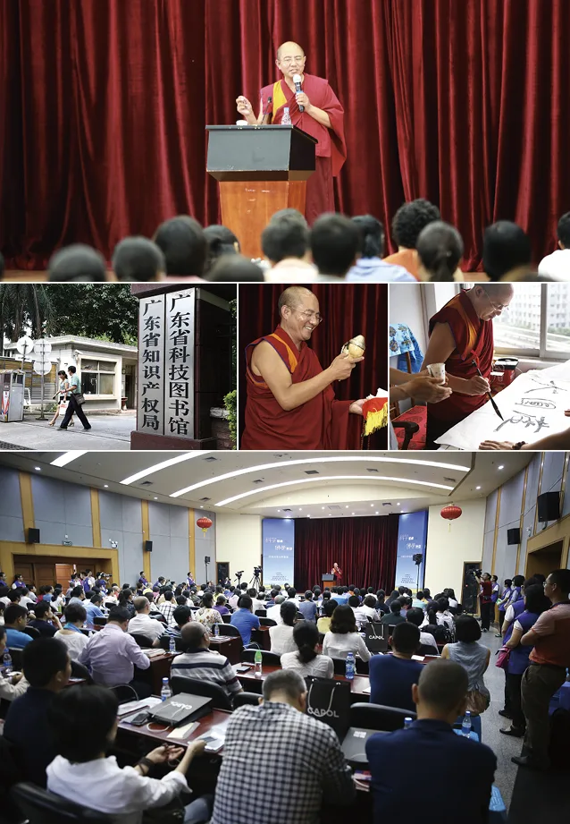
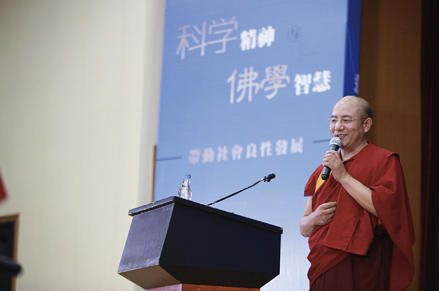
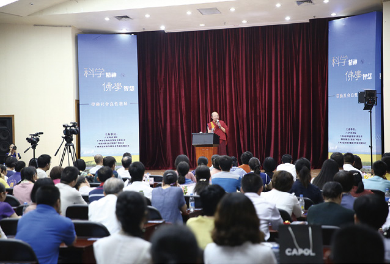
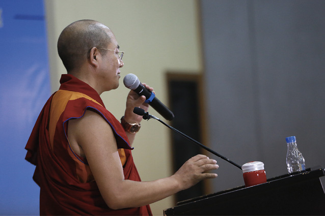
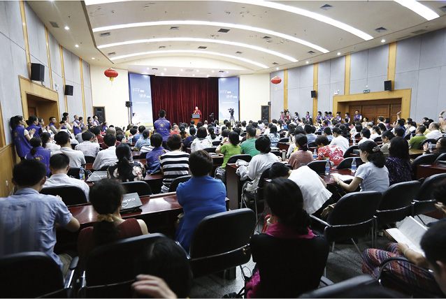
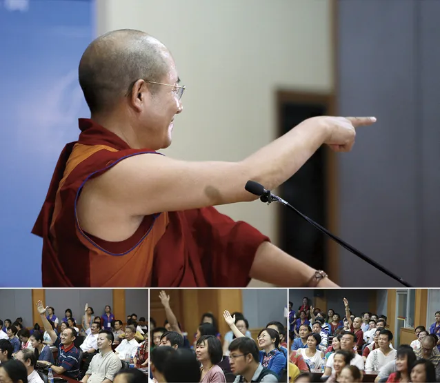
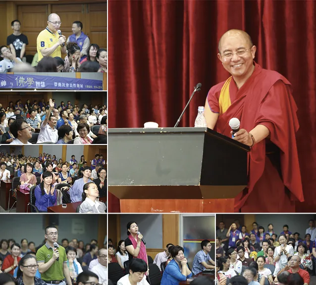
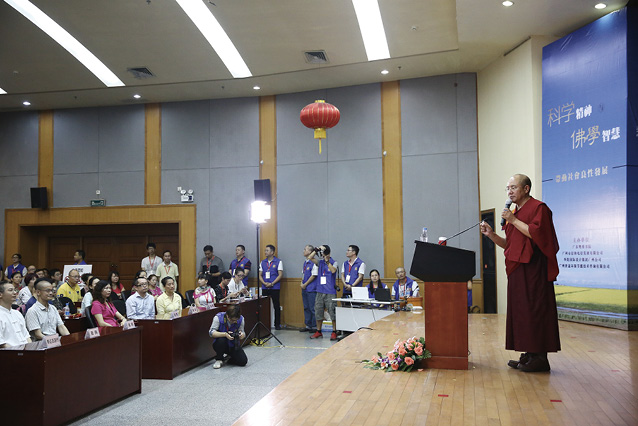
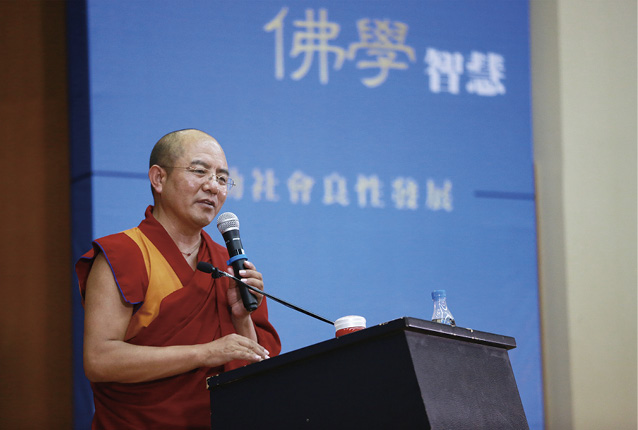

“当科学家千辛万苦爬到山顶时，

佛学大师早已在那里等候多时。”

第28场

广东粤秀书院

Yuexiu Academy, Guandong

中国·广东

2015 / 6 / 12

## 科学精神与佛学智慧

## Integration of Science and Buddhism

主持人：

尊贵的索达吉堪布仁波切、尊贵的广东粤秀书院瞿院长、各位主办方负责人、各位嘉宾、有缘善信，大家早上好！

欢迎大家来到“科学精神与佛学智慧”的讲座现场。我是今天的主持人——“广东海上丝绸之路文化促进会”的秘书长，非常荣幸能在今天为这么殊胜的讲座做主持人。感谢大家！

在讲座开始之前，我们已经通过视频了解了索达吉堪布仁波切，在此，我再隆重地向大家介绍一下索达吉堪布：

堪布是当今公认的大德，他精通显密教法，传法的内容覆盖汉藏经典，传法的脚步遍布全世界。他将大量的藏文佛典译成汉文，还将部分汉文典籍译成藏文，大力推动传统文化的继承与弘扬。能邀请到富有智慧和慈悲的索达吉堪布莅临开示，我们倍感荣幸和欢喜！

在堪布正式开始讲课之前，有请本次活动的主办代表作个简单的致辞——有请广东粤秀书院瞿院长，有请！

瞿院长：

尊敬的索达吉堪布，扎西德勒！亲爱的各位来宾，上午好！感恩大家福德积聚，各方因缘和合，能恭请尊敬的索达吉堪布来到这里，作为这次讲座的主办单位之一——粤秀书院，感到无比荣幸。

今天大德为大家开示：科学精神如何融入佛学智慧，从而带来社会的良性发展。我们以至诚感恩之心，再次以热烈掌声恭请索达吉堪布！祝愿讲座圆满、吉祥！

吉祥如意！

主持人和瞿院长穿着白色的衣服，我穿着红色的衣服，工作人员穿着蓝色的衣服，在座的各位穿着不同颜色的衣服。这代表什么呢？代表现今时代既有多元文化，也有主题文化——有科学精神的文化、佛教智慧的文化，以及其他传统文化和现代文化。所以，各位都是文化的弘扬者、继承者、传播者。

今天在此与大家交流的话题——科学精神和佛学智慧，看起来比较深奥，若对科学领域鲜少涉足，对佛教文化也不甚明了，今天的内容听起来是否会觉得晦涩难懂？如果意义深奥，确实需要精通专业知识，但在座的各位毕竟生存在科学时代，同时，我们生活中都不曾离开过传统文化，尤其是佛教的智慧。因此，今天这个场合，跟大家交流起来应该是轻松的。

## 科学与佛教的关系

科学家爱因斯坦晚年曾说过一句话：“没有宗教的科学是跛子。”意思是，科学一定需要宗教支撑，否则，它走不远。

我们都知道，科学发展到今天只有几百年历史，而宗教已存在了几千年。所以，想要深层次挖掘人类真正的智慧，必须依靠宗教的思想。否则，仅仅依靠科学的理论、知识和方法，恐怕人类最神秘的主观意识上的许多精神知识无法挖掘出来。

当然，宗教也需要科学的验证，任何一个宗教，如果跟不上科学时代，经不起科学的观察，恐怕这个宗教也看不清世间的真相。因此，我始终认为，作为一个佛教徒或宗教徒，要与科学相适应。

但从究竟意义上讲，其实佛教根本不需要用科学来论证，因为科学家所观察、所发现、所得到的结论是有局限性的，以有局限性的智慧来印证佛教的智慧，的确有些牵强。

可能有人会问：那你作为一个佛教徒，为什么经常引用爱因斯坦、牛顿、罗素等科学家的语言呢？究竟意义上我没有想过“因为是科学家说的，所以佛教是正确的”，那为什么引用呢？我是无可奈何。因为现今时代人们特别“信仰”科学，如果没有引用科学家的语言，有人会认为佛教所讲的有些内容带有神话色彩、迷信色彩，甚至认为它是一种陈旧、古老、过时的思想。所以，有时很有必要引用一些科学界人士对宗教的评价，以及他对佛教的认识、体验，包括生活中的感应等。

## 科学对现代社会的影响

科学在很多人眼里已然成为一种“宗教”，虽然科学工作者并未说“科学是一种宗教”。正因为如此，很多企业家，以及宣传自己文化理念的人，常借用科学的名称、科学的名义来宣传自己的思想。

这样的“科学宗教”有好处，也有坏处。科学的确在一定程度上为人类做出了前所未有的贡献，例如走出贫困、趋入物质世界的天堂。今天交通工具、信息工具都非常发达，出行、生活等各方面都极为便利。它们的来源是什么？就是科学，这是科学带来的利益。

但科学也有其不合理之处，比如，科学对于没有发现的事物一律否认，将某些传统、古老的宗教，以及与自己不融合的思想，全部都用“迷信、不科学”的名称将之排除在门外，这是科学的弊病。

### 1．科学难以突破的神秘领域

科学只是对客观世界的物质进行分析、判断，而并未分析作为人类更重要存在的主观意识。意识的感应、意识的力量、意识的作用非常强大，可无论科学再怎样发展，目前对意识层面的研究并不究竟。

举例来说，一个人心地善良，具有慈悲心、具有智慧、具有忍耐性，但此类心态很难用科学仪器证明；一个人的人格非常坏，具有极其强烈的嗔恨心、嫉妒心、傲慢心，用仪器来观察时，最多发现此人性情暴躁，心跳不太正常。除此之外，最细微的心理状态，科学到目前为止也无法发现。

### 2．科学发明背后的心态

科学发明者本身也存在着差异性：有些科学发明是贪心的体现，发明者的自我膨胀在欲望的驱使下做出的发明有利己害人的现象；有些是在嗔恨心的驱使下发明的，如原子弹、炸弹、核武器，以及世上很多可怕的仪器；有些科研与当今的生态平衡、环保、节能、节约等理念完全相违，人类在贪欲或愚痴的驱使下，不择手段地挖掘宝藏、开发资源，肆无忌惮地摧毁人类家园，许多人们根本用不到的产品过度地开发，导致子孙后代资源匮乏，无法生存。前段时间有些学者发微博说，现在的核电站很有可能再过一百年会发生核泄漏，倘若如此，一百年之后的人们很可怜。很多发明者只关心眼前的生活，缺乏更为长远的考虑。

因此，在座的各位也应该想到：一方面我们特别相信科学——我也信科学，科学带来的很多神妙知识的确让人叹服；另一方面，这一代人太过于迷信科学。科学也许会带来无穷的利益，但也有可能导致无穷的过患，这些在取舍上还需要智慧。

### 3．科学是否一定可信

前几年，有些名人、明星、有钱人，为了延缓衰老，在体内注射一种抗衰老产品——羊胎素，据说使用后不显老，皱纹越来越少，且身体更为健康。但瑞士卫生部的科学家们，利用大量物资进行观察、调查后发现，实际上该产品对抗衰老起不到真实的作用，甚至会引发情绪浮躁等许多负面心理，并会引发身体的各种过敏反应等。

处于现今的广告时代、信息爆炸的时代，如果听说“这是科学家认可的”或者“经由某个检验部门认证且得过专利”，我们便会认为它能百分之百保证人们的身心健康，但有时它的背后可能有很多商人、经纪人联合起来，以科学的名义欺骗众人。

有人说，一些佛教徒打着佛教的幌子，在社会上有许多骗人的现象。我也承认，有些人根本不是藏传佛教的，却以藏传佛教的名义欺骗信众；根本不是我们佛学院的人，仅仅只是去佛学院拍过一张照片，或者跟某位上师一起合过影，就说“我是喇荣五明佛学院的”，然后到汉地去骗人。

类似现象在科学界也同样存在，有些是办假证书，有些是做假广告，有些是做假宣传片，再加上某科学家的题名、某部门的认证书……这种现象在世间非常多。

我们需要的是真正的科学和真正的智慧，若是真正的智慧，我认为可以将其称为“科学”。现在人们特别相信“科学”一词，似乎想以科学的名义来统治天下；与之类似，如果某地宗教非常兴盛，宗教就成了一种权威。这是很多人需要深思的。

## 你也可以成为菩萨

今天在座的有很多精英人士，非常有才能、有智慧、有悲心，有一定社会经验和自己的事业，是非常成功的一群人。大家作为公认的成功人士，如何定义成功？既已成功，未来还需要做什么？

从很多企业家的言谈举止中可以看出，他们主要考虑自己的成功、发财，维护自己的利益。当然，在任何时候都想到别人有一定的困难。但我们真正的价值观，以及人生的定位、方向、目标是什么？目标不应该只是生活而已，若只是生活，不一定只有万物之灵的人类才可以做到，牛、羊、马、猪，它们也是早上起来为生活“奔波”，吃草、喝水，晚上也会休息。

我们一定要确立好人生价值观。养活自己、成家立业，这只是小部分的人生价值。在我看来，自己有钱不一定是成功；相貌端严，也不一定是成功。那么，何谓真正的成功？就是对身边的人、对整个社会，说得再大一点，乃至对地球和地球上的所有众生、一切万物，都带来直接与间接的利益，这就是真正的成功者。这也符合于大乘佛教的理念：人生存于世，最主要的价值是帮助他人，这样的人可以称为“菩萨”。

汉地很多人认为，佛菩萨即寺院里供人参拜的雕像，觉得寺院里面的诸佛菩萨很慈祥。实际上佛像只是佛菩萨的一种象征，它并非真正的佛菩萨，真正的佛菩萨其实是心。什么叫“菩萨”？菩萨即“菩提萨埵”——勇敢利益众生、在利益众生方面永不怯懦之人。

其实在座的每一位企业家、每一位成功人士都可以成为菩萨。如果你有一颗利他心，真诚地关心自己的员工、客户，及周围所有相关人士，关心他们身体和心灵上的苦乐，用自己的智慧、能力、财富等种种资源帮助他们，其实就是在行持大乘菩萨的伟大事业。

## 四依与四种科学精神

前面简单介绍了科学和佛学，下面为大家分享的是，如何将佛学智慧与科学精神进行结合。

科学的逻辑思维非常严谨、严密，只承认客观事物，而不承认妄想、主观、意识等，这一点与佛教的“四依”非常相似——“依法不依人，依义不依词，依智慧不依分别心，依了义不依不了义”，这是佛教的专有名词。那么，四依如何与科学精神相结合呢？

### 1．依法不依人——真理精神

首先是“依法不依人”，此处的“法”，指真理、真相、实相。从科学精神来讲，应该依靠真理而不依止权威——科学只需依靠客观事实，不应该依靠主观思想。但有时科学也迷信权威，比如“爱因斯坦说什么、牛顿说什么、笛卡尔说什么、布朗说什么”，这就是依靠权威。并非因为某人讲过，所以百分之百正确，爱因斯坦的部分思维和观点也被很多后人所推翻。因此，科学需要依真理不依权威——依法不依人。

佛教中依止的是什么呢？就是客观的真实意义，而无需依靠某个人，“因为他是名人，他是有钱人，他是有地位的人”，这不合理。释迦牟尼佛也曾说：对于佛陀的言教，不要因为对佛陀的恭敬心而接受，你们应像锤炼金子般，多次用智慧来观察，如果觉得有道理，可以接受；如果没有道理，不要接受。

### 2．依义不依语——本质精神

“依义不依语”，依靠意义而不依靠词语。真理分为本质与现象两种，有时真理会用语言进行夸张，但有些真理也有其真正的本质。意思是要依止真理的本质部分，不要依止现象，现象会随着人们的意识、历史、文化和思想的变迁而改变，我们需要的是真正的本质。

### 3．依智不依识——觉悟精神

第三是觉悟精神。何为觉悟精神？在抉择本质问题时，觉悟较高之人所抉择的是正确的，觉悟较低之人所抉择之理不正确。所以，只依靠觉悟的精神，不依靠分别心识。

科学家有其智慧的觉悟，但是否所有人自认为的全部都是真理呢？不一定，觉悟较高之人所认识的真理相对可靠。依靠智慧不依靠分别心识很重要。

### 4．依了义不依不了义——顶尖精神

最后，觉悟的智慧也分层次，要依靠了义，不依靠不了义。何谓“了义”？即最顶尖的精神。

精神层面有低级的、中等的，也有顶尖的，比如课程分为幼儿园课程、小学课程、大学课程；大学课程当中，有西方模式的课程，也有东方模式的课程。其中，有些是由顶尖的学者所编著，最为可靠，可称为“了义”。其他不了义、不究竟的思想和意图，应暂时统统放下。

综上所述，佛教的“四种依止”，我认为在科学界可称为“四种精神”——需求真理的科学精神、需求本质的科学精神、需求觉悟的科学精神、需求顶尖的科学精神，若能将此四种科学精神应用在科研领域，堪称完美。

## 六波罗蜜多与六种精神

再者，我个人认为，佛教中的“六波罗蜜多”，从科学理念或者从企业理念的角度，也可诠释为“六种精神”：布施是给予的精神；持戒是道德的精神；安忍是坚强、顽强的精神；精进是勤奋的精神；禅定是一种凝聚力的精神；智慧是利他的精神。

包括科学家在内的任何一个人，给予的精神需不需要？需要；道德的精神需不需要？需要；坚强的精神需不需要？勤奋的精神、凝聚力、智慧需不需要？都需要。这六种精神值得很多人认真考虑。因此，我想简单分析一下六种精神，这在科学上也同样需要。

### 1．布施——给予精神

实实在在为社会做事的人，给予很重要。我以前看过一本美国畅销书《历史上最伟大的赚钱秘密》，此书中讲到：赚钱最容易的方法归根结底就是帮助别人、给予别人，逐渐自己也会得到回馈与利益。表面上看，给予是舍出去，自己可能得不到，但实际上，无论是财富方面还是精神方面，给予别人的越多，自己逐渐获得的外在资源也会越来越多。

我记得美国石油大王洛克菲勒的传记中写到，他在五十多岁时，身体出现了严重疾患，有人告诉他，你应该重新做些调整。于是，他做了两个决定：第一，从现在开始，心里不能只想着赚钱，否则，可能身体状况会越来越差，于是，他选择过一种比较悠闲的生活，去聊天、唱歌、喝咖啡；第二，多做慈善，资助芝加哥大学、建立基金会……后来他的财富与日俱增，成为世界首富。中国人一般讲“富不过三代”，现在洛克菲勒家族已经到了第六代，他的家族及其布施精神一直延续到现在。前段时间我看到一本书，里面提到包括比尔·盖茨在内的很多美国富贵家族，洛克菲勒家族仍然位列其中。

很多人可能有疑惑：给了别人自己怎么享用？实际上，布施分为两种，其中之一是给予他人精神上的财富，佛教称之为“法布施”——尽量为他人宣讲真理。

还有一种是财布施。在座的很多老板，有一定的地位、权力，在拥有这些有利条件时，关心身边的人很重要。人身处高位时，对下面很多人的情况不了解，比如员工的工资待遇、平时生活中的困难……有些人确实比较可怜，他们毕竟只是依靠微薄的工资来维持生活。

作为一位真正的成功人士，要真诚地关心每一个人，所谓细节决定一切。当然，细节并非指吃喝拉撒等小事，而是作为企业存亡的关键问题你要考虑，每个人生活中的困难和痛苦也要尽量照顾。若自己实在时间有限、精力有限，也应安排相关人员经常关心他们。

表面上看来，关心别人好像是对方获得了利益，但为他人付出的力量会返回到自己身上，这是一种规律。但如果只是表面上对他人好，实际上内心并不真诚的话，将来我们感受的果报也会如此。故而，发自内心真诚地关心、帮助他人很重要。

此处所讲的第一层内容是布施。布施很重要，在座的各位拥有物质财富，或者思想上有些能力时，要时常给予他人，这叫给予的精神。

### 2．持戒——道德精神

作为企业家，至少大的良心和原则不能破坏，应有基本的道德底线。现在部分企业因为道德观念丧失，出现了“地沟油”“毒奶粉”等现象，在食品安全、饮食健康方面非常成问题。

我去澳大利亚和美国的时候，很多留学生不愿意回国，我问：“你们为什么不回来？”他们说：“因为害怕雾霾、害怕饮食不健康，在国外虽然生活很累，但饮食比较健康。”其实他们有些人的生活也不尽如人意，但为了健康长寿，还是宁愿留在国外受苦。

现代社会有很多不健康因素。总体而言，每一位企业家要为整个大自然、大环境，以及人类的健康着想；分别而言，作为企业家和成功人士，至少有一个道德底线，我们佛教里讲的十善业[^1]——不杀人、不偷盗、不说妄语、不说绮语、不要过于贪心、不要发怒、嗔恨……这是非常好的一种规则，也是基本的做人底线，此即为道德精神。

无论何种身份，学校的教职人员、科学研究者、宗教人士等，都需要做一个好人，我们不能保证成为一个百分之百的好人，但至少也要朝百分之八十以上去努力。

### 3．安忍——顽强精神

如今，企业立足于世很难，上面有很多政策、压力，对下面民众的反映也需要修安忍。职场人士也会面临各种压力、困难、烦恼，好像问题全部集中在你这里，针对着你；家人也无缘无故找你麻烦，跟你吵架，本来没有犯错误，却拼命给你扣帽子，“你怎么怎么坏……”这些都需要安忍，需要一种坚强的精神。若人心坚强，外在的许多事物都无法干扰你，有人大声骂你，你也会很开心地把它当作音乐来听：“唱得很好！”“哇！表演得很好！”

作为真正的修行人、有智慧的人，将外在的各种声音当作一种悦耳的妙音来对待，这是禅宗讲的“明心不坏”，明心不会毁坏的意思；按照密宗的讲法，是“觉悟不扰”，觉悟的心不会被其他人扰乱、不会动摇。在此种状态下做事，每天都会过得很开心。

我看过一些藏传佛教大德的金刚歌，无论身处何种环境，他们都能非常欢喜地对待，不会丧失正念。有时可能身体特别累，但如果心力很坚强也不觉得累，这也是一种安忍，安忍很重要。在任何时候，真心、明心不被扰乱，作为科学工作者也很需要。

### 4．精进——勤奋精神

无论做企业或者其他任何事情，都需要勤奋、精进。有些人特别懒惰，一直睡懒觉，醒不过来，睡眠特别多。自认为这是一种“禅修”，不仅晚上要“禅修”，白天还要“禅修”，我们把这种爱睡觉的人称为“禅师”，爱“入定”的“禅修大师”。

修行人也需要精进，否则，你可能学佛多年，但到最后一无所成，连几本书都没有看过，藏传佛教的五加行也没有修过，阿弥陀佛的名号都没有念过……在这种状态下离开人间，特别可惜。

从世间角度来讲，生活一定要有规律，对工作、对家庭有一种热情的心。有些人在家里做家务很勤快，我喜欢比较勤快的人，太懒惰什么事情都做不了。我们藏地有些男人比较懒惰，女人比较勤快，但汉地也有不同情况吧。

希望做家务或者工作时都要勤快、勤奋；若想修行，也要勤快。精进、勤奋，与成功有一定的关系。我原来写过一本书叫《做才是得到》，没有做就得不到。有些人特别懒惰，不想付出，但很想得到，不好好修行却想成就，这有一定的困难。

### 5．禅定——凝聚力精神

心如果不集中，无论做任何事情都无法成功。从佛教出世间的精神来讲，心要静下来，这叫“寂止”。在座的很多人可能没有信仰，但希望你每天能稍微花一点时间安住、禅修。现在西方国家几乎每个大学都推广禅修，禅修能让身心得以净化。我们的心每天都很浮躁，工作极其繁忙，生活节奏特别快，到最后自己身心疲惫、苦不堪言。不如在每天繁忙的生活中，留出少部分时间令身心放松。

放松有两种方法，如果你有一些禅修的知识，很有必要一天当中哪怕五分钟、十分钟、一个小时、两个小时，将手机处于静音状态，以禅修的方式让心静下来。苹果的发明者乔布斯每天坚持修禅，通过修禅的力量有了许多新的创意。也许我们没有像他那样的大脑，但至少自己的生活不要一团乱麻、毫无头绪，心要沉静下来。

第二种方法，若没有专业禅修的知识，那么，什么都不思维，只是让心安静下来，这也是一种养生，对身体非常有帮助。心特别狂躁时，会毁坏身上的很多细胞；心处于宁静状态时，具有养生、修心等多种作用。

所以，凝聚力的精神在生活中不可缺少。否则，每天忙碌、奔波，处于一种狂躁的心态，活着的时候从来没有休息过，到死的那一天永远安息，来一个“大休息”，有点可惜。

### 6．智慧——利他精神

最后讲一下智慧。佛教所讲的智慧与科学的智慧有所不同，科学的智慧主要是研究外面的物质世界，而佛教的智慧包括了思维。因此，要想解决烦恼，依靠科学非常困难。现在很多高等学校所传授的只是解决物质问题的这部分知识，而彻底解决人类内心的烦恼、痛苦、焦虑的知识，到目前为止没有。个别大学有宗教系和哲学系，但也并未触及到最究竟的智慧。

我始终认为，现在人类缺少一种最关键的知识——宗教知识或佛教知识。我并非要求你们学佛，你们学不学佛对我没有影响，每个人都拥有信仰自由、宗教自由，但有些道理想与大家分享。

在佛教知识没有进入我们的生活之前，人没有任何信仰，每天活在迷茫中，不知为何而活。一旦有了宗教的智慧，才知道原来活在世上不只是为了赚钱和成家立业，还可以进一步地去净化和提升我们的思想，当人类智慧提升到一定境界时，我们会帮助别人、利益众生。利益众生是佛教智慧最重要的思想，哪怕是微不足道的小事，也要尽力为对方考虑，为他人带来希望。

前法国总统希拉克，某天在街头散步，发现有一个小孩一直跟在身后，开始他以为这个小孩想找他签名，经过询问得知，他并非来要签名——那天天气特别热，这位前总统身材高大，小孩就跟在他身体的影子里乘凉。希拉克特别高兴，回去后连夜写了一篇演讲稿《我愿为你们带来阴凉》。这篇演讲稿很著名，我看过翻译过来的中文稿，其中讲到：如果我的身影能为他人带来阴凉，我也甘愿为之效劳。

表面上看这是一个有趣的故事，但实际上背后隐藏着一种思想、一种文化、一种价值观——用身体、语言、思想来帮助他人是最有意义的事。见到有人身体不适，不管是在医院或是在哪里，我们要去扶一下他；有必要的时候，用我的语言来纠正别人的邪知邪见、谬论；通过各种方式来传递我的思想。这是分别从身语意方面而言的利他方式。如果没有这样的机会，像刚才法国总统那样，哪怕依靠身体的影子、脚印，给别人带来利益，我觉得人生存于世也是有价值的。

在我们身边仍然有很多贫穷的人、可怜的人，人类并没有去关心他们、垂怜他们，按照大乘佛教的观点，我们不算是菩萨。从世间理念来讲，社会的高层人物一旦忽视了弱势群体，说明他的道德价值观也值得观察。

在当今科学极其发达的时代，拥有剖析万法的智慧很重要；与此同时，要有利益一切众生的悲心、利他心，这更为重要。如果一个人既具足现代科学观察外物世界的敏锐度，也具有观察内心世界的智慧，同时也非常关心所有的物种和自然环境，这种心态极为难得。

因此，今天在座的科学工作者、佛教修行人，都应树立一个共同的目标——先净化自心，再用我们的智慧和悲心点亮人生的路，同时力所能及地帮助众生。希望每个人在这方面多多努力！

现场互动

主持人：

感恩堪布幽默又慈悲的开示！佛法浩如烟海，今天堪布的开示如智海撷华，短短的一小时足以让我们领略佛法的高度与智慧。科学与佛法，方法不同，然而追求是一致的。最终我们都希望，通过认识世界的真相去为这个世界谋求幸福的未来。

大家听了堪布的开示可能会有一些疑问，接下来的环节，我们会有三四十分钟回答问题的时间，看看下面哪位来宾，哇！这么多！有请笑得最甜的那位女士。

问：尊贵的堪布仁波切，科学技术在究竟上来说，应该也是空性的吧？它既不好也不坏。我的问题是：应该如何驾驭科学这个工具？

堪布：科学本身确实不带任何正与邪，从技术本身来讲它是一种智慧。科学所发现的有些方面，我觉得它并没有领悟到佛教所讲到的高度。为什么这么讲呢？佛教可以先把某个事物从外在的地、水、火、风的成分开始观察，这是第一步。

第二步，佛教可以观察事物与人的心念之间的关系——我认为是好的，别人不一定认为好，好和坏、美和丑、大和小、热和冷跟众生的主观业力有密切的关系。作为科学工作者，要么说它好，要么不好，有主观意识参与时带有一定的评价。但按照佛教的观点，对某个事物的看法，观待众生业力的好与坏，这是第二种分析方法。

第三种分析，科学家可以将外在的某种物质一直观察到最后的微尘，而用佛教的智慧对此逐一观察时，最后变成空性。佛教认为空性是进入一种不可思议、无法言说的境界。然而，万法的实相这一点，科学家并没有去观察。所以，科学的技术，以及它所发现、所推测的万物的本相，跟佛教智慧比较起来有一定的差距。

当然，正如你刚才所说，与驾驭者的心也有一定的关系。科学技术掌握在具有善心的人手里，可能会为世界增添非常快乐的光芒；如果这个技术被非法的坏人驾驭，那他也会做出很多不可挽回的事情。比如本·拉登，用他手中的一种科学技术和势力，将美国世贸大楼里面的几千个生命，在短短的时间内全部毁于一旦。

所以，科学技术跟人的动机或者手段也有密切关系。

问：听了“科学精神跟佛学智慧”的演讲后，有一件让我很遗憾的事情：优秀的精英到国外学习，不想回来的原因之一是对食品安全问题不放心。中国人其实最讲究饮食文化，他们反而不敢回来，这是我们的耻辱。

请您跟我们分享一下：在国内推广素食文化这一块，结合食品安全问题与我们吃素的慈悲心、佛学智慧，怎样去做会更好一点？

堪布：刚才我讲到，有些留学生不愿意回来，确实与食品安全方面有一定的关系。我听浙江大学一位教授的讲座，他说他去日本留学时，日本东京大学有很多来自中国的博士生，但后来只有他一个人回国。

很多人担心饮食问题，不喝水不行，不吃饭也不行，但里面到底加了什么很难说。最根本的就是道德，如果道德出了问题，人们心里只想着钱的时候，很多跟食品有关的工厂、企业，都不得不让人质疑。

从人的身体结构，比如牙齿、肠子等来看，人类非常适合素食。从上世纪60年代开始，美国认为肉食对身体好，推广这样的饮食结构，结果中国人也强调像美国人一样吃肉、吃鸡蛋，包括乳制品、牛奶，因为全世界的很多人认为，美国科学发达，美国说了算。后来美国也发现，大多数的癌症跟肉食有关。到了上个世纪90年代，美国很想改变饮食结构，但那时人们形成的固有观念已很难转变。

其实最好是吃素，素食中含有一种植物纤维，能够疏通肠胃，为人类健康带来非常大的利益。正因为如此，汉传佛教和藏传佛教的很多大德、出家人活到一百多岁。我以前写过一本书叫做《藏密素食观》，那时我大量搜集国内外素食主义者的观点，发现很多人并非因为信仰吃素，而是为了健康吃素。

究竟而言，肉食对身体并不是很好，因为动物身上有各种疾病。原来日本发生核泄漏，有害物质进入鱼虾等的身体，进食这些鱼虾时，核辐射释放的放射物质随之进入到人体内，不久很容易得癌症死亡。此外，人类将许多垃圾扔在海里，海中的鱼类因此而吸收了很多有害物质，进而产生疾病；再者，动物在被宰杀时带有一种怨气，在吃它们的肉时，因怨气、嗔恨而产生的毒素以及各种疾病直接进入到我们的身体，这是非常可怕的事情。

所以，为了健康建议尽量吃素，如果实在做不到，可在一个月当中吃几天素，佛教认为素斋的功德非常大。

问：非常感恩今天有机会能听您给大家作开示！今天讲座的主题是“科学精神与佛学智慧”，在刚才您讲的内容里面我们发现，科学可能有一定的局限性，但佛法不坏世间法，我们应该去随顺它，还是勇敢地去颠覆它？用一种什么样的态度更好呢？

堪布：作为人类的一员，无论是否具有佛教的信仰，都没有必要排斥科学，该接受的应该接受，但也不能百分之百认为只有科学说了算。也有些人对宗教有成见，认为宗教是一种迷信；是一种麻醉药、鸦片；宗教只是刺激人类的感官……这样没有必要，应秉持公正的态度。

我个人认为，科学当中有一部分我们应该要接受，不接受可能也不行，你使用的手机、汽车，很多方面都要应用科学的技术。因此，应该要承认科学带来的方便、智慧、利益等。

但也不能完全认为科学是全世界的权威、科学百分之百正确。在其背后有很多没有发现的科学统治人类的手段，科学掩盖真理的阴影，科学给人类身心带来的不健康因素……科学带来了许多无法了解真相的迷惑。

任何一件事情，应当一分为二去分析。现在有些人把佛教或者其他宗教当作迷信，但实际上他对科学的信仰也是一种迷信。这样不合理，最好以智慧来观察。

问：我的理解是，一切法都是佛法，好像佛经里也有这种说法，那么真正科学的精神——被认证了的相当于真理的这种科学精神，是不是也就是佛学智慧？佛学智慧也就是科学精神？二者并非对立的关系，因为它是一，不是二，真正的科学精神其实是佛学智慧的一部分。想请教您是不是这个意思？

堪布：按照爱因斯坦的观点，他认为真正的科学是不断完善、不断改变、不断发现的过程。后来量子力学问世以后，它的科学精神也是如此。

在座的很多人心目当中的“科学”，也许现在新一代的科学家不一定承认。我们学的物理其实是经典物理学，应该是上个世纪科学家的一些观点，现在新一代的科学家完全把他们的观点推翻了。很有可能现在科学家的观点，也会被22世纪和23世纪的科学家所推翻。

但佛教的智慧并非“不断地完善”，它所发现的一切万法的真正实相，无著菩萨和龙猛菩萨已经抉择出来了，早在两千多年前的思想那么成熟，许多人为之感到惊讶。不知你们是否有信仰，我个人认为，佛教不一定是科学，科学也不一定是佛教，但二者有相同之处。

问：有些时候在广州或者其他地方放生，我身边有朋友会说：“把它们放到珠江里去，明明会死掉，你这是在杀生不是在放生。”所以我想问一下，当遇到这种情况时，我应该如何向我身边的朋友等人解释这件事情？

堪布：放生，如果放得不好，可能反而被捞，反而会死，有这种可能，但如果放得好，不存在这种问题。所以，你最好亲自参加几场放生，然后自己观察：哪些情况下它们的生命是有保障的，哪些情况下他们的说法是对的。

有些人不喜欢放生，将所有的过失全部推到放生者身上，“放生没有什么意义，只是让屠夫发财”“放生没有什么意义，放完了以后马上被人捞完了”“放生没有意义，其他众生照样杀生”，等等。

如果是我们自己马上要被杀，对我个人的生命来讲，只要有人能救我，其他都不重要。哪怕是五百个生命当中，能够成功放生一百个，这也是值得的。所以，放生者确实要科学放生、合理放生，你要观察放生的水源、自然环境，要观察放生的地方对于所放的生命而言到底能否存活。

现在有些佛教徒随便乱放。前段时间在山东威海，有些人把毒蛇放在农民的房屋旁边，最后有大量新闻报道说这是不合理的放生，对周围的平民带来极大的威胁。这也是事实。所以，佛教徒不能因为信心，什么事情都不观察，想怎么做就怎么做，这样不合理。我们应该如理如法地做一些事情。

问：我是做外语教育的，我想请教一下：如何更好地将法布施与我的教育工作相结合？

堪布：做教育的人以丰富的资源来帮助别人，这就是法布施。无论是做外语教育、国语教育，或者藏语教育等，我认为教育就是法布施，将自己拥有的智慧赐给学生。

有时用钱来作布施时带有吝啬心，因为钱也不好赚，有一定的痛苦，但作法布施时，将曾经所学的知识分享给别人会很快乐，且法布施功德更大。所以，我经常跟一些辅导员讲，若实在没有金钱做布施，可以多做法布施，这是有生之年非常难得的机会。如同佛教中所说，凭自己的智慧哪怕是讲四句法、一个偈颂的功德也是不可思议的。

你做外语教育或其他教育的同时，让人行善、做一个好人，这很重要。现在很多教育工作者，只是把知识和理论讲清楚，并没有教学生怎样做人、怎样发起爱心、怎样行为如法，应该更加重视传授这些方面的道理。

问：我是一个企业的老板，接触佛法后，我觉得佛法的智慧就像甘露般，确确实实非常好。但也有一个矛盾：时间有限，一方面很想学习，可是公司也要治理。我的一些老板朋友们也会开玩笑说，学习佛法会不会影响我们养家糊口、影响公司的发展？

堪布：这个问题问得很实在、很有意义。广东这边也一样，企业老板有很多责任，自己需要养家糊口、需要赚钱，但企业员工的生存也要考虑，这也是作为企业经营者不可推卸的责任。

因此，我认为，有自己的企业管理方法很重要，而在所有的管理当中，最高级的管理是用心管理——若能加入佛教的信仰，管理起来会非常容易。就像我所在的佛学院，现在国家注册的有五千人，因为大家都有共同的信仰，人际关系很容易处理，没有非常复杂、非常敌对的矛盾。

我认识的一些企业老板、董事长，他们在企业内传递一种知识、一种文化，人心自然而然比较调柔。比如在企业内做一些心灵的培训、坐禅，让大家不要有太多的欲望，跟大家一起做一些感恩的回馈。我们活在世上需要有感恩的心。爱因斯坦在1943年的一篇文章《关于财富》中提到，他每天上百次地想要感谢所有为他付出的人。

树立有感恩心的企业文化很重要。感恩谁呢？感恩社会，感恩所有的员工、所有的客户，感恩周围创造良好条件的所有我认识和不认识的人。如果每一个人都有一颗感恩的心，大家在一起工作就会比较容易。所以，以一种高层次的心灵管理方法，让人具有感恩心时，更容易承担起相应的责任。

我现在去一些企业演讲的目的何在呢？很多企业家比较迷茫，光是以赚钱为目的，这样是不可行的。应该承担社会责任，回馈社会。就算对社会起不到大的帮助，如果你的企业有一百个人，让这一百个人过得快乐，也是在利益众生，这是大乘佛教的观念，也是最大的功德。在这种前提下，即使佛教的有些修行实在做不到，一心一意地帮助这些人，也是一种修行。

我给大家结缘的这本书《你在忙什么》，意思是若只为自己而忙，意义不是很大；如果一直为身边的人、为社会忙碌，你的忙碌是有意义的。所以，我每天是为自己忙还是为别人忙？如果为别人，忙一点也值得。

问：非常感谢堪布的开示，如沐甘露！我相信大家都听过这样一句话：哲学是最高层次的科学，而佛学是最高层次的哲学。还有，前两天我在书上看见一句话，是中国科技大学前校长朱清时院士说的：“当科学家千辛万苦爬到山顶时，佛学大师早已在那里等候多时。”我相信不少人都听过这句话。刚才我在想，能不能这样理解：如果科学用佛学来作指引的话，科学会更加有意义，或者少走点弯路。我们能不能听堪布用最直接、最客观的角度来评价刚才说的那两句话？

堪布：刚才你引用朱清时的话，其实我和他有过一次交流的机会，我亲自问过他这个问题：“你在科技大学已经当了十多年校长，似乎对佛教有一些更深层次的理解。你认为‘科学家千辛万苦爬到山顶上的时候，佛教大师早已在那里等候多时’，作为一个科技大学的校长，你是不是对科学没有信心？”

他自己的回答是，他依止过南怀瑾先生，学过藏传佛教的一些气脉明点。在他所研究的领域，他觉得科学无法超越、无法突破的某些现象，佛教已经给出了答案，他把这段话写在文章中。我也问过他：你说了这句话之后，网上很多人开始攻击你，说“科学家已经落入迷信的网当中”等，你有没有后悔过？他一直很坚定地认为，自己讲得非常对。

中国科技大学在合肥，我去年也去做过讲座，当时我也问了很多老师：关于科技大学原校长的这种观点，你们如何看待？大家始终认为，科学确实是在物质方面的一种发现，在心灵方面的研究到目前为止也是迷茫的。

朱清时院士的观点非常具有代表性，现在科学界，无论是社科院还是中科院，很多院士和科学人士原则上是认可的。当然也有个别代表其他思想流派的人不承认，这也是合理的。但我很认同你刚才所提出的观点——科学有了佛教的引导，对整个人类的进步有非常大的利益。我前面引用的第一句话是“没有宗教的科学就像跛子，它是走不远的”，爱因斯坦说得很对。

所以，我的观点是，如果科学家具有大乘佛教的慈悲观，将来对人类、对整个世界，包括对地球的生存方面有很好的引导；如果具有大乘佛教的智慧观，对微观世界和宏观世界也有非常好的引导。否则，科学仅仅是观察外在的物质，到最后确实也有一定的危险性。

我作为一名佛教徒，对佛教非常有信心，但我也非常喜欢科学，科学的任何领域我都有兴趣去研究和了解。在书店看到一些科学方面的书，无论是微观科学还是宏观科学，我经常买来学习。当然，我的所学有限，是自学的科学，并不能成才。

但无论如何，我觉得现在这个世界，同时需要有科学的精神和佛教的慈悲。如果科学工作者一味地排斥佛教，认为佛教是迷信，其实这并不符合科学精神；有些宗教人士完全是一种信仰，没有理性的科学和智慧的推敲，恐怕也有一定的困难。

为什么现在西方很多高等学校接受佛教的教育呢？其实背后也有原因。仅仅依靠科学技术还不行，需要有人文精神。

主持人：

谢谢堪布！我知道大家仍有诸多问题，那请关注堪布的微信公众号和微博，下面再一次用热烈的掌声，感谢我们智慧、慈悲、幽默的堪布！

缘起殊胜，今天借着难得的机会，粤秀书院想祈请堪布担任粤秀书院的学术顾问。接下来，有请广东粤秀书院瞿院长一起到台上来，请尊贵的索达吉堪布接受书院的聘任。有请堪布接受聘书……让我们的摄影师记录这富有意义的历史时刻！

也希望堪布经常到广东来，到书院来，让广大的社会人士有更多的机会能接受佛法甘露。感恩堪布！

[^1]: 十善业包括：一、不杀生；二、不偷盗；三、不邪淫；四、不恶口；五、不两舌；六、不妄语；七、不绮语；八、不贪；九、不嗔；十、不痴。或称十善业道。
