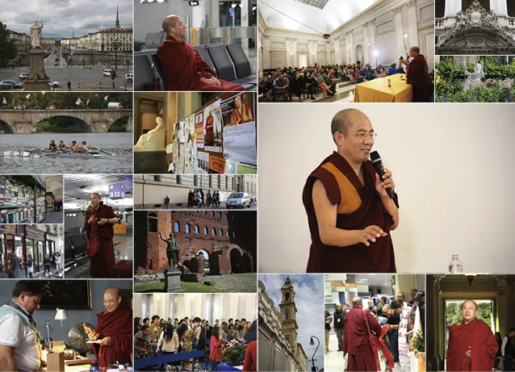
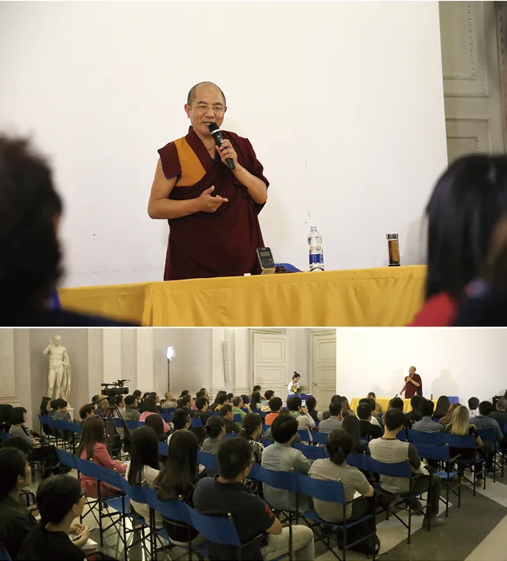
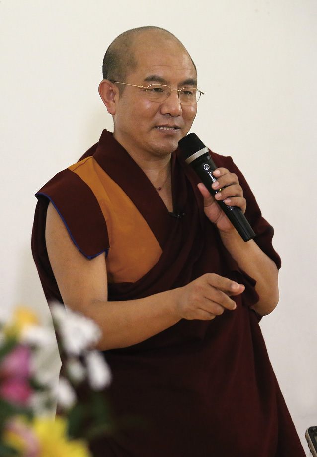
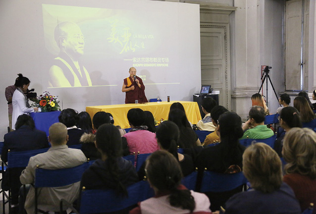
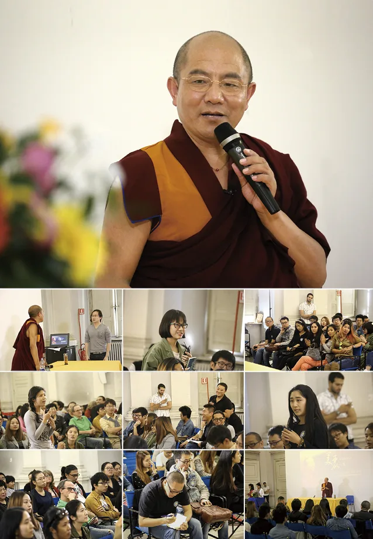
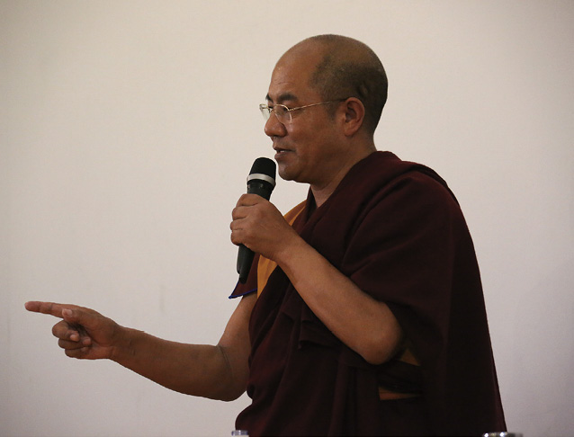
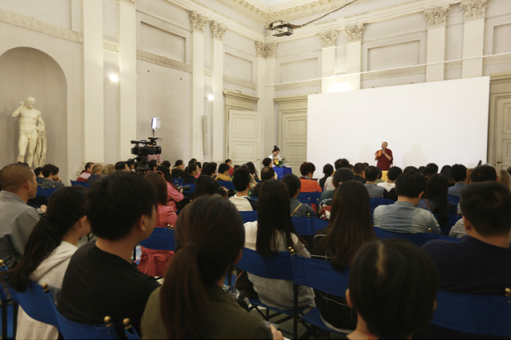

人生虽美丽，应知无常理。

第30场

意大利都灵公开演讲

Public Speech, Vienna, Austria

意大利·都灵

2015 / 9 / 25

## 美丽人生

## Bella Vita

主持人：

本次活动是由欧洲佛学会意大利分会主办的一场免费公开演讲。旨在以佛法的智慧启迪人生，令大家从不同的角度思考当前的生活、未来的方向，并分享人生的另一种美丽。

每个人在生活中都希望避免痛苦，拥有快乐幸福的人生。我们华人远在他乡谋求生存发展，本来就要付出很多代价，眼下，意大利甚至整个欧洲都处在严重的危机当中，我们在如此严峻的环境下，要怎样做到勇敢、智慧，实现自己的美丽人生构想呢？今天，我们邀请到了尊敬的堪布，给大家带来一些启示。

索达吉堪布仁波切来自著名的喇荣五明佛学院，是一位在华人世界具有广泛影响力的心灵导师；一位将传统与现代完美结合的佛法上师；一位行走于世间传播慈悲与智慧的禅修行者；一位充满愿景、怀抱希望、心存大爱却又随缘自在的仁波切。

下面有请堪布仁波切上台为大家演讲——

今天下午跟大家一起交流，我感到很开心。在座的各位不管是什么身份，我们应该有很多共同的语言和目标。

你们居住在意大利，这里非常美丽，是让人向往并羡慕的一个发达国家；而我来自藏地的雪域高原，那里的环境也很美，那里的文化也让人们非常羡慕并向往。对我而言，第一次来到这个国土，到了以后有一种感觉：这里的阳光、这里的花，很多地方跟我们藏地相似，加上还有一个相同之处：这里好像很多人没有时间概念，跟我们藏族人比较像。（众笑）

## 话题虽美丽，苦才是人生

今天我们要探讨的主题是“美丽人生”。实际上，要我探讨这个话题不一定很合适，因为我几年前写过一本书——《苦才是人生》。所以，作为此书的作者，我的思想“苦才是人生”，跟你们提出来的“美丽人生”，在某种意义上也许有些矛盾。

我为什么认为人生是苦呢？因为，按照佛教观点，人生有“变苦”，指快乐很快就会变成痛苦；还有一种叫做“苦苦”，指苦加上苦，人生中的这种苦还没有消失，另一个苦又接踵而至；还有一种苦叫做“行苦”，指表面上看不出来，但实际上它是痛苦的因缘，在生活中处处隐藏着。所以，我在这里要强调的是，生活中其实有诸多痛苦。

许多人认为人生是快乐的，但是，如果我们一开始就有这样的确信，很可能在人生中遇到小小的痛苦时就无法面对，最后因此倒下去；甚至很多年轻人在感受到一些痛苦时会选择自杀，这种情况也很容易发生。虽然很多人不喜欢听“人生是痛苦的”，但实际上没有必要遮遮掩掩。直言不讳地讲，每个人身上确实有很多痛苦。所以有时我会十分坦诚地说：苦才是人生。

## 东西见不一，因根性不同

但从另一个方面讲，我们可以说，人生是美丽的，是幸福的，也是快乐的。

其实，关于《美丽人生》[^1]，在座的很多人应该知道，这是在上世纪90年代上映的一部电影。电影的剧情是一个犹太人及其家人被抓进纳粹集中营，后来，父亲为了让自己的小孩不背负战争的阴影，一直鼓励着他：“我们现在所过的这些危机生活都只是一个游戏。”后来，父亲不幸遇难了。再后来，那个孩子经历了种种痛苦，在集中营里遇到孤独、饥饿、恐怖时，都一直坚信着父亲美丽的谎言，认为这只是游戏，而且这种游戏最终会结束，一旦结束，就会获得真实的自由，并且获得大奖。

依靠这样的信念，这个孩子勇敢地面对生活，最终生存了下来。当时这位父亲明知战场和集中营的痛苦，但他为了保护孩子的心灵，掩盖了残酷的事实，谎称人生有希望，而最终他的孩子也确实获得了希望。我们在实际生活中，把人生美化得特别幸福快乐，也许与这位父亲的谎言有着相同之处。

所以，东方文化和西方文化存在着某种程度的差异：东方文化愿意直接正视人生的很多阴暗面，包括痛苦、身体的不净等，这些在宗教的书籍里、在我们的传统中都会经常提到；而在西方文化中，比较喜欢说好的一面，比如，人生中最闪亮的时刻、生活中最浪漫的时刻，包括衣服上最特别、最好看的地方，都会以各种赞美的语言说出来。又比如，我们经常会讲，身体如何好看、头发如何漂亮、生活如此浪漫等……

其实，这些不同之处，主要是和人的根基，或者跟接受教育者的心态有关。

## 利众应善巧，应机而施教

如果我们的表达能恰如其分，就能对每个人都有利。在我们佛教当中，这叫“应机施教”；或者按照古人的说法，称为“因材施教”。对于不同的人，需要说相应对方根基的不同语言，让他的智慧和心灵中的正能量发挥出来。因此，懂得每个人的不同心态，非常重要。

藏地有位著名的大德叫晋美朗巴[^2]，在我们后人看来，他的智慧非常超胜。他有非常著名的四大弟子，每个弟子的名字叫晋美什么什么，就像汉地的有些师父给所有弟子统一取名字，诸如“智什么什么”。当时藏传佛教也有这样的传统，例如晋美嘉威尼格、晋美衮恰、晋美诚林沃色……后来，他给四大弟子选择了不同的四个地方，让他们各自建立寺院，弘扬佛法，弟子们遵从师命所建的寺院对后人的贡献相当大。

所以，各位在跟同事、同学交流时，包括教育自己的学生和孩子时，首先了解对方的智慧、爱好、兴趣等方面，非常重要。

我再讲一个真实的故事：在大约两千五百年前，那时，汉地儒教思想的创始者孔子有两个弟子，一个叫子路，一个叫冉有。有一天，子路问孔子：“如果得到一些做事的机遇时，该怎么办？”孔子回答说：“不要马上做，你要请教你的父亲、你的哥哥，请问了长辈之后才可以决定。”

后来，冉有也问了同样的问题：“如果有人给我一个机遇，该怎么办？”孔子回答：“你要马上、立即去做。”这令另外一个弟子感到稀有，两个人问同样的问题，老师对他们的回答却不相同，这是什么原因呢？

孔子解释说，前面的子路，他的性格容易冲动，比较傲慢，所以让他遇事先请教长辈；而后面的冉有比较脆弱，性格优柔寡断，为了增加他的积极性与决断力，就要鼓励他做事情，而且要马上做。后来，这两个弟子都非常成功。

这个故事对我个人来讲很有帮助，也经常想起。我在给人教导、与人交往时，首先要知道对方的性格、能力、智慧等，否则，盲目地想什么就做什么，最后就会失败。

## 人生美丽否，决定于自心

很多人都认为是“美丽人生”，那么，人生是否真的美丽呢？其实人们的想法各不相同。有人将人生比喻成马拉松赛场；有人将人生比喻成一场梦；有人将人生比喻成战场，还有人将人生当作一部或喜或悲的戏剧、一种游戏……因此，关键看每个人对人生的态度是乐观还是悲观，这一点很重要。不管你做的事情是大还是小，实际上，如果认为它对自己的工作和家庭很有意义，那它就有一定的价值。

以前俄罗斯前总统叶利钦[^3]在任期间，有一个人向保洁人员提问：“你怎样看待自己的人生？”保洁人员回答：“我的人生跟总统叶利钦没什么差别。”那个人问：“为什么？”他说：“因为我每天忙着扫地很有意义，叶利钦每天忙着治理国家也很有意义，所以我们是一样的。”

这种乐观的人生态度很重要。有些人可能这辈子各方面非常顺利，有钱财、有才华、有各方面的资源等；而有些人不管怎么努力都一贫如洗，处处遇到坎坷不顺。但无论如何，我们都要坚强勇敢地走下去，因为有些事想逃避也没有用，人生可以掌握在自己手里。

美国第三十四任总统艾森豪威尔[^4]，年轻时脾气非常暴躁，每次打牌，如果牌抓得不好，就怨天尤人，特别不高兴。有一次母亲告诉他：“不管怎样，牌已经拿到手里了，你要打下去，因为这就是该你面对的。人生也是如此。”从此之后，他努力从普通人变成了美国总统。所以，我们自身的毅力和坚强勇敢的心，对人生非常重要。

## 若知无常理，则能坦然对

人在年轻时、成功时，都会觉得开心快乐，一旦韶华逝去、遭受疾病，或经济状况不好时，就会倍感痛苦。

最近在全世界范围内，美国、欧洲等国家先后出现金融危机，以前非常有钱有势的人，财富缩水，地位下降；现在，金融危机已蔓延至亚洲，以前很风光、很傲慢的人，现在变得特别低调。所以，人生中的很多变化和无常来得特别快。

如同一些宗教中所说，一切都是无常的。比如，佛教的《金刚经》云：“一切有为法，如梦幻泡影，如露亦如电。”意思是说，青春美丽的身体、外在美丽的花朵、灿烂的阳光、世间的高官厚禄，到了一定的时候都会无常变化。如果我们提前懂得无常之理，一旦人生遭遇变故，以及生老病死等现象出现于自身时，我们就不会那么痛苦，而是以正常的心态去接受与面对。

## 应学修结合，悟万法真相

无论具有何种宗教信仰都很好，重要的是通过听闻、学习相关宗教的教义之后，再开始修炼。修行很重要。

以前，晋美朗巴大师（智悲光尊者）说过：“有成千上万的弟子，也不如只有一个证悟心性的弟子。”所以，通过修行真正认识万法的真相，非常重要。

听说今天现场也有部分佛教徒，如今佛教徒存在的问题，主要是不懂得将学习和修行相结合。有些人不学习，只是盲目地修，这样不好；有些人只学习，不好好修行，这也不好。当然，其他的宗教徒也同样如此。

当然，今天不是有关修行的专题讲座，暂时不广说。

## 寂忿外在相，对症皆良方

我想说的是，在很多年轻人眼中，生活似乎很简单，好像只要自己想要，就能够心想事成；或者只要自己有道理，大家就会认可。但社会其实很残酷。一定要尽量地跟社会相融，努力适应社会的同时磨炼自己，这很重要。

比如，我在与人交谈时，如果对方是一名医生，那么我尽量用医学方面的知识跟他沟通；如果对方是一位老师，我就用教育方面的道理与他交流；如果对方是警察，那就应该用他感兴趣的话题来交谈……所以，刚才所讲的应机施教，对自己和他人都很重要。

只要方法正确，即使别人不理解，实际上也能起到一定的作用。

也许你们在报纸上看过，前几年，美国哈佛大学有位博士生，她管教孩子的方法非常暴力，用各种逼迫的手段来对待孩子。当时她的这种暴力教育方式，很多人都难以接受。比如，孩子如果没学好钢琴就不让睡觉、不让上卫生间、不让休息、不让喝水，东方和西方都称她为“虎妈”。但最终她的这种教育方式似乎成功了。这背后是什么原因，已经成了教育界关注的话题。

还有一个与她截然相反的案例，叫做“疯妈”。这位妈妈完全随顺孩子，跟孩子在一起时，疯狂般地随顺。但是通过她的方式，也把孩子教育得很好。这两个案例是明显的一组对比，说明只要方法用对了，对别人就会有帮助。

与此类似，藏传佛教中，佛菩萨有忿怒相，非常威猛地拿着各种厉害的武器；还有一种是非常寂静、慈悲的相。这两者都能度化众生：对野蛮的众生，用忿怒相来调伏；对温和的众生，用寂静相来调伏。不理解佛教的人，看到忿怒相可能会想“为什么那样恐怖”，实际上，自己的妈妈也有变成恐怖相的时候，但那是为了管教孩子，对孩子是有利的。

有时，结合世间的一些道理，就能把出世间的很多道理想明白。所以，只要对我们的生活有利益，无论外在是寂静相还是忿怒相，都是一种人生的美丽。

## 劝内求智悲，享真美人生

学艺术的人，对“美丽”比较在意，认为物质上的美丽很重要。我听说人们很执著意大利的名牌，比如阿玛尼服装、法拉利跑车、宝格丽珠宝……很多中国人都喜欢并希求。但这些只是外在的奢侈品，更重要的是内在的奢侈品——智慧与慈悲，这是永不过时且最有价值的。

总之，如果懂得人生的苦与乐并非真实存在，而是一种游戏，就可以从轮回苦海中获得解脱，这可以称得上是美丽人生，因为在这种开悟的境界中，人生没有不完美之处。所以，佛教中的弥勒菩萨有一句著名格言[^5]，大概意思是：人生就像漫步在花园，无论发生任何生老病死等现象，开悟者的内心都不会受到干扰。

希望每个人都能真正懂得这样的道理，享受最快乐、最幸福的人生。谢谢！

现场互动

问1：我从米兰来，专门为了见索达吉堪布。对于佛学，我是初入门者。请问：在佛学中，该怎么理解神通？比如有人说他开天眼了，可以看到别人看不到的东西；另外，佛经中所开解的“怎样解脱你的心”，是仅作为一种哲学性的存在吗？二者之中，哪个才是真正的佛学？如果说这二者并存，那我应该见佛要拜、要上香、要念咒，用天眼去看东西或者怎样？还是说，我应该朝着一种哲学的方向去修？

堪布：佛学中有很多神秘的部分，包括开天眼，以及一些超越言思的部分，但这要通过修行才能得到。关于这方面的神秘性和逻辑性，有一部论典叫《大乘经庄严论》，其中有一品叫“威力品”，专门讲神通与逻辑、修行之间的关系。

有些佛教徒通过修行，确实可以获得比较超胜的境界，有些则不一定。无论如何，真正的佛教里面，这些超胜的功德既有神秘性，也有逻辑性，是真实的。

问2：那二者的成分各占多少？

堪布：每个人的情况各不相同。

问3：如果从真实而言、从佛教本身的事实而言，请问这两者的成分？

堪布：如果是真实的神通，那么他得到的神秘部分，是百分之百有逻辑性在里面。

问4：我经常会有一种困惑，但也会力图告诉自己，这些东西是不真实的，它是因为你的想象而存在的，想证明这种神秘性的虚伪。可能是因为我们受过多年的教育吧，一直把佛学的神秘性称之为迷信，所以内心会对它有一种抗拒。但是很多直接的个人体验，又让我感觉自己真实经历了它。所以我很疑惑，不知道哪条路才是正确的？

堪布：其实，宗教信仰的神秘部分，普通人想要通过一种理论、逻辑来验证是非常困难的。所以我昨天引用了爱因斯坦的一句话，他说：“如果以现在流行的科学来解释人类生命的公理，这不但是一个大错误，而且应该受到谴责。”

所以，很多人试图用现有的科学来判断生命的现象、宗教的现象，很难。这需要通过修行，到一定的时候，真正的体验才能得到。

问：我五天前刚来都灵，之前什么都不知道，无意间看到您要来的海报，我特别高兴，真的就像您昨天讲的主题一样——“偶遇”！

我想问的是，我们现代人比起古代人，更容易获得佛法的知识，但为什么现代人修持佛法得到印证或得到果位的却越来越少了？然后，对于我们这些年轻的大学生，关于修行、生活和学习之间的联系，您有什么建议呢？

堪布：佛教从时间上可分为果法期、教法期、形象期等，释迦牟尼佛时代是果法期，很多阿罗汉、独觉的果位确实很快就能获得。现在果法期已经结束，所以，证果不如佛陀时期那么容易。但实际上，现在真正通过修行而证果的人，在藏地、在印度都非常多。

第二个问题：你们作为大学生，现在最关键的是，对佛教的基础理论知识要搞明白。但在这个过程中需要学习，而且要合理安排好学习时间。

因为，大学生经济不稳定、心态不稳定、感情不稳定、工作不稳定，有很多不稳定的因素。所以，这时学习、修行、工作等很多事情要并行的话，有一定的困难。但是，如果自己能合理安排时间，我觉得都可以。关键是靠自己，利用什么时间去学习、去修行，与此同时，还要学习世间知识，以后还要参加工作。这其中最关键的是，看你能不能用功？用功的人应该可以并行。

问：我刚刚接触佛教。我好像明白了禅修很好，我想知道，我们西方是否也有类似的禅修？或者是否还有其他方式能做同样的修行？

堪布：类似的修行有很多。比如，在藏地，一个人可能会念一亿遍观音心咒。观音心咒的功德很大，今天上午我们去了都灵的喜马拉雅博物馆，里面有一件藏品就是《玛尼经》，讲述的是观音菩萨咒语的功德。其实，西藏很多人虽然禅修，但也有可能心无法安住，所以有些人也会念很多咒语，比如念一亿遍或三遍亿不等。

还有一种方式就是念诵经典，每天大概念诵好几百页，这在佛教里面叫“课诵”——念诵功课，也是一种修行；还有一种方式，虽然不是禅修，但可以经常去当义工、做慈善，这也是大乘佛教的一种修行。

问1：我把佛教当作哲学来看。您刚刚说，对于一件事情要很努力地去做，可是，我不知道“努力做事”跟佛教说的“我执”这个观念该怎么平衡？因为，在“我执”的情况下坚持做一件事情，其实是会有痛苦产生的，不可能都是自己想要的结果。那么，在“一直坚持做下去”的理念下，怎么决定是该放手还是该继续坚持呢？

堪布：在生活中需要智慧。很多人把生活比喻成战场，打仗的时候，如果能够打得赢，就拼命地冲上去打；如果觉得有点危险或者打不赢，就会暂避锋芒或以另一种方式应对。因此，生活中，无论是面对事业或家庭，有很多事情要去努力。但努力的过程中也不能盲目，一定要具有智慧，也要随顺现在的时代和生活习惯，同时，自己的心不能太受伤。

现在有些人太投入了，正是因为太执著，最后伤痕累累，丧失勇气。很多年轻人可能觉得，这件事无论如何一定要成办，但最后却结果不妙。所以，这时就要有一种智慧，如果智慧用得对，即使你有时候放松也可以。佛教有一部论典叫《入菩萨行论》，其中讲到，在做某件事时，若是累了或做不动了，可以暂时放松休息一下，这也是一种努力的表现[^6]。

问2：这个点该怎么拿捏？

堪布：每件事情各不相同，依靠智慧分别对待。

问1：我在2007年就已拜读过您的很多著作，我的家人修净土宗，所以也看过您很多DVD资料。我在2007年给您写过两封信，而且您都回复了，那两封信一直在我家保存着。我来自山东东营胜利油田，如果您有印象，可能还记得。我现在有一个问题是：关于东方净土药师佛的加持，这方面的资料特别少，请问“东方净土”和“西方净土”的修为该如何界定？或者如何对东方净土能了解得更多？

堪布：应该是东方不动佛的刹土吧？

问2：对！

堪布：其实，在我们藏传佛教中，有关于东方净土的一些描述，包括整个清净刹土的外在庄严、诸佛菩萨形象。

为什么很多经典里没有讲呢？因为，要往生到东方刹土比较难，“门槛”较高；而西方净土，很多人都容易去。以我们娑婆世界的众生素质，要到东方净土有一定的困难，所以，许多经典里重点介绍的是西方净土，以及西方净土的往生方法等。

但在藏传佛教的有些经典中，还是对东方净土做了介绍。

问：据说我们的生活中有两种苦，一种是内苦，一种是外苦。但我不理解，什么是内苦？什么是外苦？生活中遇到困难的时候，要如何把这两种苦转为道用？

堪布：这个名词比较新。所谓的内苦，可能指内心中的一些痛苦；外苦，指包括身体、外在生活方面的一些痛苦，这样理解也可以。比如，物质方面的痛苦、工作上的痛苦，可以称为外苦；内苦，例如虽然我的工作、环境和待遇都很不错，但内心患有忧郁症等心理病症。

其实，依靠佛法的加持和祈祷，通过禅修以及对“万法空性”“万法无常”等佛法道理进行学习，解决内在和外在的痛苦很容易。

所以，希望大家尽量拿出时间学修佛法。今天的很多年轻人、中年人，对知识的希求都很不错。尤其是欧洲的这些国家，有很好的学习条件和资源，虽然生活上可能有压力，但并不像香港、上海压力那么大。我看到都灵的街上，人们走路的步伐都没有国内那么匆忙，说明可能有学习的时间。

问1：您之前在《释量论》里说“能立由大悲”，想请教您：怎样努力培养自己生发出这种真正的菩提心？

堪布：哇！你好厉害哦！能立由大悲，意思是，以何种理由或根据将释迦牟尼佛安立为量士夫呢？就是用大悲心来安立。

“能立由大悲”这句话很重要。佛陀之所以被称为“全知”，是因为佛陀的大悲心和智慧已经达到极致，这也是佛陀与其他教主不同之处。因此，我们如果系统学习《释量论》，就会明白，“能立由大悲”可以延伸出释迦牟尼佛的整个故事，包括他因地时的所有经历。

问2：那么，如何培养出真正的菩提心呢？应该朝哪个方向努力？

堪布：一定要长期闻思和修行。

问1：我父亲是一位唯物主义者，也是知识分子。可能是被他自己的人生经历和学识所蒙蔽吧，他现在年龄蛮大了，还在为一些世间事操心、烦恼、忙碌。我该如何引导他相信因果轮回、接受佛学呢？

堪布：唯物主义者要相信因果很难。（众笑）

如果是年轻人，跟他可以讲一些道理和事实，但是人到了一定的年龄，思想已经“凝固”了，在死之前，想要他再改变，就非常非常困难。其实，每个人的价值观或思想，跟小时候的教育有直接关系，如果生长在一个根本不相信因果的家庭和社会中，现在要马上转过来肯定很困难。

刚才他的问题还是很有代表性的。有时候，人们对佛教的神秘主义、因果轮回，可能找不到理由破斥，但是他们从小的教育中又从未提及，或者即使提及了却是批判的眼光，这样他们就很难相信。

在藏地，人们从小就在一种“善有善报，恶有恶报”的环境里成长，所以很容易相信这些道理。就像意大利就在梵蒂冈[^7]的附近，所以很多人从小都具有信仰，认为这是理所当然的。我就近问了这边的很多居民，他们觉得信仰宗教是很正常的现象。所以，每个人生长的环境不相同，信仰的状况也不同。

当然，你的努力也很重要。如果实在没办法，最好在他耳边念些佛号，这样能种下善根，也有一定的功德。

问2：如果我替我父亲观修，这样会减轻他的业力吗？

堪布：可以给他念念经，或者念修金刚萨埵，然后为他回向。

问：我有两个问题。第一个是如何理解布施？无论在地铁或马路上，当我们遇到乞讨者时，应该用什么心态去布施？

第二个问题是，密宗算是佛陀的八万四千法门中最至高无上的，无论是宗喀巴大师还是莲花生大士，最后都证悟了大圆满。我们这些大学生也很希望趋入佛法，但是对佛法的了解都局限在外缘，请问：我们该如何去学习真正的佛法呢？初步要学什么？

堪布：首先第一个问题：布施有个很高的要求叫“三轮体空”，但这一点可能很难做到，先暂时不提。那么，关于布施的分类，有财布施、法布施、身体布施等。其中，我们能做到的、最重要的有两种布施：

第一种叫“法布施”。将自己懂得的真理经常给别人讲一讲，因为我们身边不了解真理的人比较多。首先你自己要多学一些，之后你将所学到的知识传给别人，功德非常大，这叫法布施。用现在的话来讲，就是传播教义。

第二种叫“财布施”。不管怎样，路上的乞丐还是很可怜的。每个国家都有乞丐，哪怕是一分钱、两分钱，即使很小的财物也要布施给他，不要侮辱他。这是布施中的财布施，也很重要。

当然，至于要求更高的身体布施，对于一般凡夫人来说，暂时是不允许的。

第二个问题：佛教有显宗和密宗，密宗的确有很多极为深奥的道理。

我个人而言，无论学密宗还是学显宗，三十多年来一直浸润在佛教的教义中。我给大众讲课也这么多年了，自己越来越感到，密宗不是一种传说，也不是一种吹嘘，的确在修行过程中有很多收获，并且能让我们简单地面对人生。密宗不仅有特别好的一些教言，更重要的是，在“如何面对来世、认识心性”这方面有着特别重要的修行窍诀。

我建议，如果要学密宗，先学《大圆满前行引导文》，因为它能打好基础；然后再进一步学习无上大圆满的《大圆满心性休息》。如果这样次第学习，应该非常稳妥。

有时我想：世界上有这么多书、这么多法本，但只要学了最重要的密宗的两三本书就已足够，今生来世的大事都能解决。

问：大师，我有一个问题：要如何去坚持做一件自己不喜欢做，但又不得不做的事情？

堪布：闭着眼睛往前走。（众笑）

我们的人生会有很多因缘，有些自己不愿意做的事情也要去做；自己不愿意见的人经常会出现在你面前；有时不愿意说的话不得不说；不愿意吃的东西经常要吃；不愿意碰到的事情经常会碰到——这叫不欲临苦，指自己不愿意发生的事，经常降临到自己的头上。但是，如果你不能改变，还是要以乐观、积极的态度去面对。到一定的时候，你可能就习惯了，而且也喜欢做了，这时可能就会出现成果。

主持人：

谢谢堪布为我们带来的精彩演讲！

在短短两小时里，我们经历了一场心灵的洗礼，相信大家对人生有了新的认识和思考。非常感谢堪布仁波切的演讲！

现在，大家请起立，目送仁波切离场！

[^1]: 《美丽人生》：罗伯托·贝尼尼执导的意大利电影。该片于1999年在第71届奥斯卡奖获得了最佳外语片、最佳男主角、最佳配乐的奖项。影片以德国法西斯捕杀犹太人为背景，讲述了一个犹太人和一个意大利姑娘结婚生子，然而幸福短暂，不久法西斯占领城市，将居民抓进纳粹集中营。母亲被关进女牢，男牢中的父亲为了保护孩子的心灵，谎称这是在做一场赢取积分获得真正坦克的游戏。最终，父亲死在纳粹的枪下，而天真的孩子坚信父亲的美丽谎言，坚强地熬到了解放。
[^2]: 晋美朗巴尊者（1730-1798），又名钦哲沃瑟（智悲光）、无畏洲、持明无畏洲、仁增吉美林巴、晋美林巴。尊者开启了广大而甚深的龙钦宁提意伏藏法门，是宁玛巴近代最伟大的祖师之一。
[^3]: 叶利钦，1991年6月当选俄罗斯苏维埃联邦社会主义共和国总统。同年12月，苏联解体，最大加盟共和国更改国名为俄罗斯联邦，叶利钦担任俄罗斯联邦的首任总统。
[^4]: 艾森豪威尔，美国五星上将之一。二战期间，担任盟军在欧洲的最高指挥官，负责计划和执行监督进攻维希法国和纳粹德国的行动。1952年参加总统竞选获胜，成为美国第34届总统，并在35届竞选中获得总统连任。
[^5]: 弥勒菩萨《大乘经庄严论》：“观法如知幻，观生如入苑，若成若不成，惑苦皆无怖。”意思是，了知诸法如幻的圣者不会有任何执著，不论转生地狱还是人间，就如同进入花园一样自在，纵然历经世间的任何衰苦，也不会被烦恼所染。
[^6]: 《入菩萨行论》：“身心俱疲时，暂舍为久继。”
[^7]: 梵蒂冈是全球面积最小、人口最少的主权国家，全国仅0.44平方公里，国土位于意大利首都罗马市的西北角。梵蒂冈是全球约13亿天主教徒的信仰中心。
