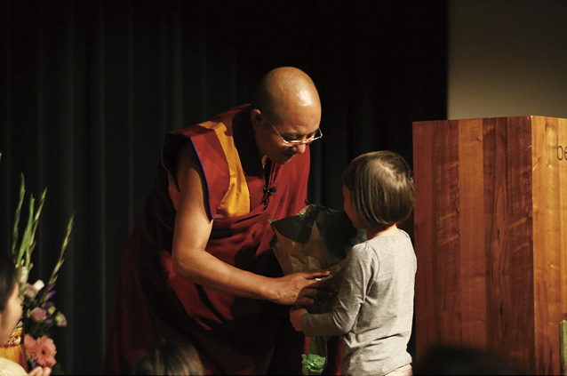
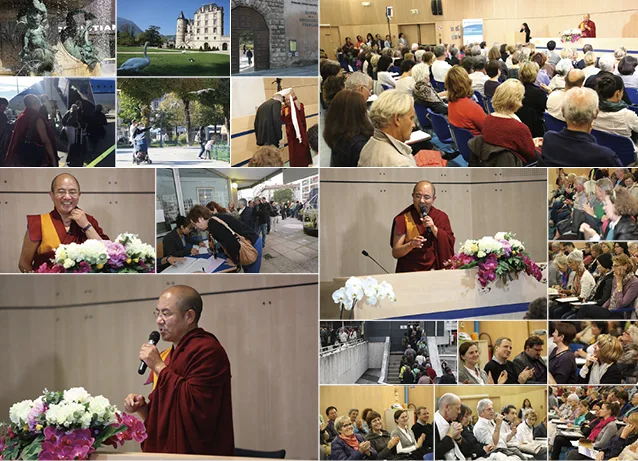
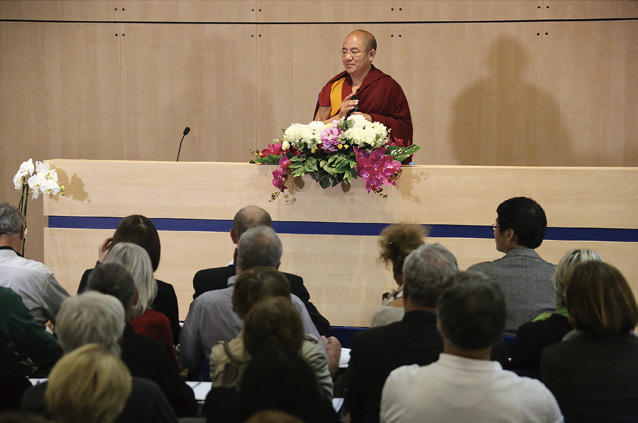
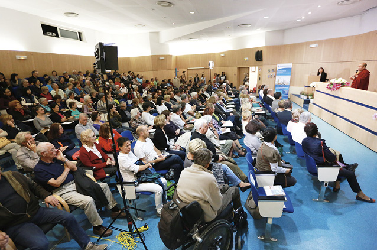
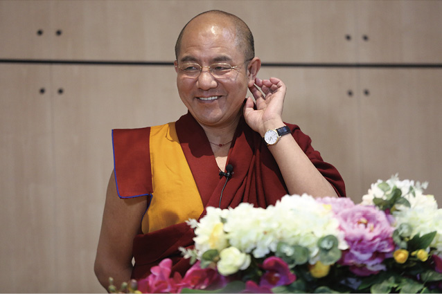
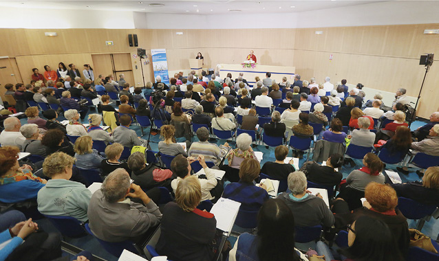
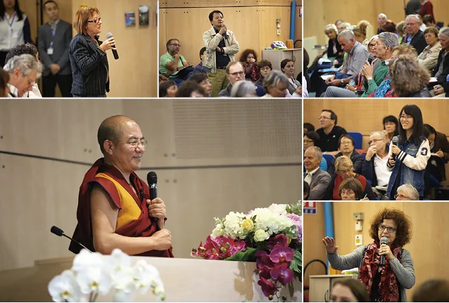
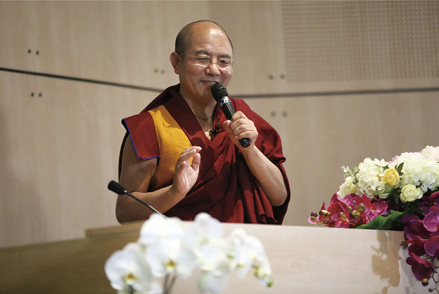
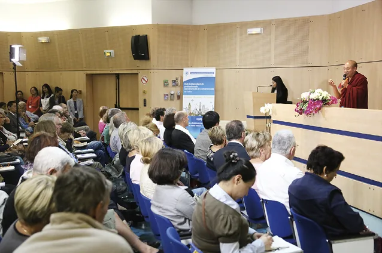
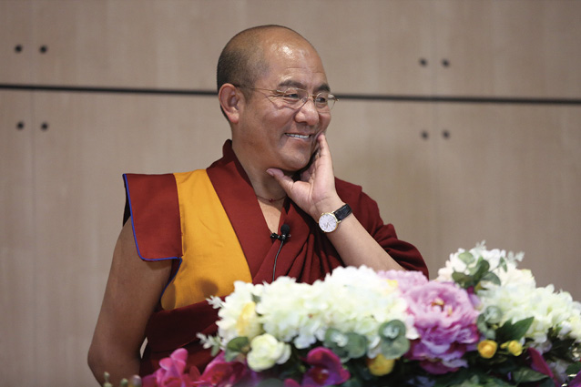

你有贪嗔痴？我有戒定慧！

第32场

法国格勒诺布尔旅游局

Office de Tourisme Grenoble Alpes, France

法国·格勒诺布尔

2015 / 10 / 1

## 藏传佛教的 基本教义和现代生活

## Buddhism in the 21st Century

主持人：

今天的场面让我印象深刻。在法国的文化背景下，大家居然都按时到场了。讲座预计晚上七点开始，现在是七点零一分，真棒！法国人向来以迟到闻名，但今晚看来，并不尽然。

首先，我代表伊泽尔省出口商俱乐部，对大家来参加这个特殊的讲座表示欢迎！下面我先介绍一下本俱乐部，然后再有请特地为我们而来的堪布，格勒诺贝尔是他此次欧洲巡讲中的一站。

现在，请允许我先自我介绍：我目前任出口商俱乐部的经理人已有五年时间，本俱乐部集中了二十五个企业的二十五位出口经理，大家每六个星期会面一次，就有关国际问题的不同主题进行研讨。

众所周知，国际问题中包括了文化的概念，自然也包括了宗教。显而易见，如今，宗教已成为不同文化的中心论题，宗教在新闻中的频繁出现也是有目共睹。所以，今晚的讲座将是一场非同寻常的佛教之旅。近年来，在法国甚至整个欧洲，佛教都得到了广泛传播，今天，索达吉堪布仁波切将特别为我们讲解当代社会中的佛教。

“佛教”这个主题非常宏大。在当今社会，佛教是什么？佛教要传达的是什么？佛教是宗教吗？还是一门哲学？诸如此类的问题，希望在讲座之后，我们能对佛教有一个更清楚的认识，对佛教哲学有更深入的了解。

现在有请索达吉堪布仁波切！欢迎——

很高兴今天有跟大家一起交流的机会。本来，我可以用藏语与大家交流，但因为临时没找到翻译，所以我用汉语讲，然后用法语翻译。

我来自喜马拉雅山脉下的一所藏地佛学院，在那里成长，且至今仍在那里学习；你们来自阿尔卑斯山脉下的西方发达国家，是在城市中生活的人。虽然我们所处的山脉不同，文化背景也有所不同，但是我想，从全人类的层面来讲，我们有很多相同之处——希望远离痛苦、享受快乐等，都有这样共同的生活目标。

我是第二次来法国。1993年，我曾经来过索甲仁波切（《西藏生死书》的作者）在法国的列绕林中心。那时我还比较年轻，现在想来，有很多美好的回忆，因为当时我的老师法王晋美彭措还在世。之后20多年，我一直没有来过法国。

当然，格勒这座城市我是第一次来，我早就听说这里是“欧洲的硅谷”，高科技非常发达。今天，在座的很多企业家、科学家也都是具有智慧的高层人士，你们的一些生活目标也许跟我们不同，但是今天可以从“21世纪的佛教”这个话题来分析我们的共同点。

## 高速发展下，科技成双刃

我们知道，21世纪是比较特殊的时代，因为，从20世纪到21世纪短短的时间中，高科技发展迅猛，现代人跟古人或者跟前面好几个时代的生活相比，全世界在物质层面有了翻天覆地的变化。

虽然21世纪是一个多元化的时代，但同时也是文化单一的时代。为什么这样讲呢？因为，如今全世界的人都穿着同样的衣服、吃着同样的食物、乘着同样的车、用着同样的手机，说着同样的语言……同样的价值观和审美在普遍流行。例如，放眼东南西北，如今高层的人都穿西服，年轻人则比较赶时髦，我昨天看到街上很多年轻人都穿着露出膝盖的牛仔裤。

其实，不仅你们西方是这样，甚至我所在的小山谷，一些农民和牧民的孩子也喜欢穿这种时髦的露膝盖裤。包括全世界很多人都拿着苹果手机、都说英语、都爱看好莱坞电影等，所以，现在全世界已经统一思想了。

科技的发达为全人类带来了一定的便利，全球任何国家的人互相打电话、发信息聊天，或者共事都非常方便。但同时也存在一定的弊端——因为无线网络的泛滥，不该看的、不该听的、不该做的，这些也无法控制。年轻人所受到的教育不像古人那么纯良，由于没有辨别能力，很多不正当、不合理的邪知邪见不断地注入他们内心。

## 科技之发展，应以善引导

到了欧洲之后，看到很多建筑物的整体保存着固有的古老建筑风格，我内心很赞叹、也很欣赏——我想，也许你们内心的传统和文化也一直保存着。人类需要文化，物质文化虽然重要，但更重要的是世世代代在每个人的心灵中所传承的文化。

不过，去年去德国的哥廷根大学时，我跟一位教授说：“你们欧洲这边的建筑风格没有变，很多几百、几千年历史的图书馆保存得很好，你们的文化应该也保存得很好吧？”遗憾的是，他当时回答：“实际上，欧洲文化在二战之前保存得还算不错，二战之后没留下什么文化。”

法国的情况我不太清楚。但现在很多西方国家，包括亚洲国家的建筑，其实并未蕴含相应的文化，这是否说明人们精神世界的匮乏？这是我比较担忧的。

其实我觉得，人类内在的道德和文化不应随便舍弃，否则，单单依靠科学技术或物质层面的发展，对人类不一定有利。因为，科学如果没有良善的教育作为向导，是非常危险的。爱因斯坦以前说过：“没有宗教的科学是跛子。”也许你们会赚到很多钱，但不一定能带来真实的幸福和快乐。爱因斯坦还说过：“伟大的科学家对世界做出了巨大贡献，但是他们对人类的贡献远远不如释迦牟尼佛、耶稣和穆罕默德。”他的话让我感觉，人类科技的发展必须要有善的取向和道德作为基础。

现在，科技的发达给人类带来了很大便利，比如，以前从亚洲大陆航行到欧洲或者步行到欧洲，需要很长时间，可前两天，我从中国飞到这边只要十二个小时。所以，我们不能否认科学带来的利益，但如果没有慈悲的理念，科学技术也许会带来可怕的后果。

## 简析三毒患，以三学对治

如果用宗教的眼光来观察现在有些科技发展，其实是制度化的贪嗔痴。

比如，在贪心的驱使下，人们为了谋取自身的利益，有规划、有规模地造作恶业；现代化的战争、军事管理等，属于制度化的嗔恨心；此外，现在部分媒体进行不切实际的报道和宣传，是制度化的痴心。

下面，我从佛教的角度简单讲一讲贪嗔痴的危害及对治方法。

首先是贪心，人如果过多地贪财、贪物，也许就舍弃了根本。以前，有个寡妇养了一只母鸡，母鸡每天都下一枚鸡蛋，后来她觉得，如果养得更好，也许它能下两枚鸡蛋。于是她为母鸡增加了更多的食物，结果母鸡越来越肥，连原本每天的一枚鸡蛋也没有了。所以，很多人因为过度贪婪，总想再赚一点、再赚一点……结果连本钱都拿不回来，这就是贪欲所导致的痛苦。

因此，适当的贪欲或许有必要，但过分的贪欲不合理。佛教的“戒、定、慧”三学中有一个“戒律”，它能对我们的行为加以控制和规范，就像开车时需要有红绿灯一样，戒学是每个人都需要遵守的行为准则。

其次是嗔恨心，嗔恨就是发怒，我们的情绪突然爆发时，原本理智的心态全部消失了。一个人在生气发怒的时候，连他最爱的人都会杀害。曾经有人说，他和家人吵架时，很想掐住对方的脖子弄死他，经常有这种冲动。这种心态也需要调整，当你情绪不稳定时，容易做出让自己后悔的事情。

其实，你们西方人吵架也跟我们东方人一样。刚才我吃晚饭时，有两个女孩子互相吵得很厉害，她们自己没办法平静平息，后来警察过来把事情平息了。刚才她们吵架的时候，虽然我听不懂，但是很好奇地在观察：她们的动作、表情，很多方面都跟亚洲人吵架一模一样。（众笑）

一家人也有吵架的时候，但不管怎样，家庭要和合。很多人没学佛之前，家庭感情不好、关系不好，经常吵吵闹闹，后来通过学佛，变得非常理解对方，家庭更加和睦。在我接触的人当中，这种现象相当多。所以，性情想要变得温和，需要有一种思想的调整方法。

如何调整呢？在佛教修行中对治或控制嗔恨心的办法，主要是“戒、定、慧”三学中的“定学”，即通过禅定专注于心的本体。就是说，用心观察自己的心，原来气愤的情绪就会全部荡然无存，消失殆尽。每个人都有嗔恨心，佛教中对治嗔恨心的方法最为彻底。

最后，人类还有一种不良的心态，叫做愚痴，就是“贪、嗔、痴”中的“痴”。愚痴不像贪心和嗔心那样明显，贪心、嗔心爆发时，自己能很明显地发现，身边的人也感觉得到，但痴心是对事物真相不明白而导致的一种负面状态，这种状态每个人都会有。

那么，如何解决呢？世间的心理学家、文学家，包括很多科学家都并没有发现好的方法。但是，佛教中有方法能彻底根除无明愚痴，诸如“空性智慧、无我智慧”这样非常细致、锐利的智慧就可以对治。当然，这些智慧在今天短短的时间中不一定能介绍清楚。

## 佛法之真理，乃疗心妙药

可以说，即使在21世纪，佛教的思想也不会因为古老而面临淘汰，相反，人类非常需要它。我们在生活中遇到的以贪嗔痴为主的很多痛苦烦恼、心灵疾病，其实在佛教中确实有解决的方法。因为，佛陀并非开创一种宗教，他只是发现真理，并且把真理传递给人们。信或不信，是我们自己的事情，但如果我们真正懂得了其中的道理，就会明白，原来世间所发生的很多问题，也不过如此。

佛教中有句话叫“三界皆无常，如秋日浮云”，意思是，万法都是无常的，就像秋天的白云一样变化多端，世间的感情、金钱、地位……一切都如云聚云散，并非长久。也许，大概的道理我们能明白，但唯有结合生活中发生的事情去思维，才会真正有所受益。

昨天我在这里遇到一个法国本地人，他学佛已经接近三十年了。我问：“你这么长时间修学佛法，有什么利益？”他说：“虽然我学得不好，但也给我的生命带来了无与伦比的意义。因为，纷繁复杂的世界中所发生的很多问题，佛教早已明确地告诉了我们答案。如果当年没有学佛，可能我现在会很苦。”我想，他的话也算是一个真实的心声。

## 慈悲利他心，佛教精髓义

最后，将佛教最精华的思想简单做个总结，在此与各位分享。

佛教分为南传佛教、藏传佛教，还有北传佛教。这三大佛教的核心思想实际上都是讲利他——完全不伤害任何众生，哪怕是昆虫以上的生命，都要用慈悲心、利他心去饶益对方。这就是佛教的精髓、佛教最究竟的意义。

纵观古今，在涉及自身利益时，还能坚持利他思想的恐怕不多。有句话叫“没有永远的敌人，没有永远的朋友，只有永远的利益”，这也反映出在受某种文化思潮的影响下“利益至上”的思想。而佛教的究竟思想完全是利他。当然，不能保证所有佛教徒的行为都能做到绝对利他，个别佛教徒可能有些行为不如法，但是，佛教的教义百分之百完全是利他主义。

在世间做任何事，利他都非常重要。若在发明技术或制造产品时，以利他心去做，不仅对人类有利益，而且对个人也有非常大的利益。古语有云：“君子爱财，取之有道；君子散财，行之有道。”意思是，作为有智慧的人，应该以对社会负责任的态度作为前提而获取财富；拥有财富时，你可以将财富布施给他人，但在此过程中，也要有规矩。

所以，社会各界人士应该有爱心，对人类和社会要有一种负责任的态度、一种慈悲的观念，这样能对全世界带来极大利益。否则，如果一个人的心态不好、动机不良，也许制造的产品会危害无数人。

## 凡事判驳前，劝持公正慧

实际上，我并非因为自己是佛教徒，而特意选出以上观点来赞叹，或者给大家传教。佛教一直讲，如果有功德可以直接讲，有过失也照样可以直接讲。所以，以上的道理，如果觉得合理，你们可以接受；如果觉得不合理，可以当场批评或完全舍弃。

当然，你也可以不信仰。但如果想要驳斥或批判，应该先弄明白它的道理之后才有话语权。所以，无论对佛教、其他宗教或是对科学，在不了解的情况下进行驳斥不太合理。

刚才经过雨果广场时，我想起有位作家曾经说过：“我们千万不要对自己不了解的领域进行批判，否则可能要用生命的代价来偿还所犯过的错误。”这句话我也曾在我的书中引用过，就以它来作为今晚讲座的结尾，愿我们用公正的智慧来对待和分析所有的人与事。

现场互动

问：您提到了佛教既是宗教又是哲学，那您本人是如何看待这种主张的？

堪布：佛教是一种哲学，也可以说是一种宗教。其实，这方面的道理，昨天我在荷兰跟马修[^1]见面时讨论过。在他的著作《僧侣与哲学家》[^2]中，他的父亲以哲学家的身份进行提问，而他自己作为僧侣，从佛教的角度给父亲进行解答。关于你的这个问题，他们的对话具有代表性意义。

其实，马修跟我早在二十多年前就有过一面之缘。昨天在荷兰才知道，1990年，我跟随法王晋美彭措访问印度时，他也随同顶果钦哲仁波切前往。当时我们在新德里见过，但我只顾着看顶果法王，并未对他过多关注——那时他还只是顶果法王身边的一个小和尚。当时他也不认识我，只是看着晋美彭措法王。一直到昨天聊起往事，我们才知道，彼此在很多年前就已经见过面。实际上，他一直在这方面做相关研究，我本人也是。

我在十年前写过一本书，叫《佛教科学论》，其中讲到，佛教中也包含了很多科学理论。我认为佛教也可以称为一种哲学，但并非西方哲学，以柏拉图为代表的西方哲学，跟佛教哲学还是有一定的差别。

问：我有两个问题，第一个问题比较通俗，是针对僧衣的疑问。请问堪布为何袒露右臂？这背后有何象征意义？

第二个问题是，据我所知，作为佛教徒，也与世界、人类、自然、环境等息息相关。不过，佛法的修行是否主要基于禅修？

堪布：因为我这边有别人不能看的东西，所以盖着。（众笑）开玩笑！

第一个问题，其实，不管是我们藏传佛教，还是斯里兰卡、泰国为主的南传佛教，都是露出右肩，左肩用袈裟盖上，这主要是追随佛陀。往昔，释迦牟尼佛在苦行时、在成佛时，包括在转法轮时都是这样的衣着。所以，这是一种特殊的缘起，代表佛教徒追随佛陀的足迹和行为。

第二个问题，最好养成禅修的习惯。通过禅修，我们浮躁波动的心会慢慢静下来，就像水放在那里慢慢会沉淀。当里面的杂质沉下去，心安静下来时，真正的快乐、智慧就可以呈现。若心一直波动起伏，就无法显现真正的自性，因此，佛教的境界都要通过禅修而呈现。当然，极个别的利根、智慧超胜者不需要经过禅修，在行住坐卧等所有的行为中也可以开悟。

问：我是一名中国留学生，虽然以前从未与您见过面，但您算是我佛学上的第一位导师。其实我以前就幻想过您来欧洲，我可以当您的翻译……一直很憧憬能够见到您，所以，请允许我表达一下现在的激动之情！

我有一个问题，现在学佛的年轻人越来越多，然而在认识佛教、了解佛学知识的过程中，往往伴随着一些疑问。比如，有很多同龄人问我：“你说佛教是讲究因果，那么，遇见一些不公平的事情以及困难的时候，我们应当去反击并捍卫自己应得的权益，还是仅仅忏悔，然后祈祷这件事赶快过去？”有很多同学都被这个问题困扰过。所以希望可以听到堪布的解答。

堪布：接下来，我的回答会尽量简略，因为可能很多人还想提问，大家都希望有交流的机会。

第一个问题，你想要做我的翻译，也很好，这次我们已经安排完了，或许下次有机会，英文、法语都可以。

第二个问题，确实，现在中国有特别多的年轻人在学佛，我认识的也有成千上万人。你的问题，解决的办法并非一味地祈祷，也并非一味地抱怨。要知道，我们现在遭遇的很多不公平跟前世有关，要想创造公平，现在就应该做善事，同时也应该忏悔往昔的过错。这个道理，在佛教中讲得非常透彻明白。

所以，我们现在很有必要深入去学习，学习以后，很多怀疑会自然遣除。包括今天在座的法国人也一样，如果真的对佛教有兴趣，光有信仰还不够，一定要系统地学习。

问：您刚才讲到利他，翻译中涉及另一个术语——“慈悲”，在我的个人词汇里，利他与慈悲几乎是一对反义词。怎么解释呢？比如，针对近期欧洲的移民风潮问题，我们表现出很多悲悯情怀，但很少有利他的做法。所以我很想知道堪布的观点，结合佛教精神，您如何区分这两者？

堪布：最近在欧洲，大家都很关心难民问题，我也非常关心。如果每个人都有特别强烈的慈悲心，那当然很好，因为他们毕竟是战争难民，需要有很多人以慈悲心来做饶益他们的事情。

但是，如果我们的慈悲心并没有达到很高的境界，恐怕所做的利他事情是有限的。例如，我发现有些国家虽然接受难民，但实际上在背后也带有利益自己的私心。

如果真正是利他，就要将利他放在第一，自利放在第二；如果是利己为重，那么在先利己的基础上再行持利他，这种慈悲心的境界并不是很高。

问：非常感谢上师！听闻您的讲演很受启迪。我是格勒高商的教授，我有一个问题：实际上，刚才您讲的“做人要善良、要多帮助别人、要追求内心的平和”等，在我看来，这并非佛教独有，它是一个跨文化、跨宗教的理念，在其他的文化传统和其他宗教里也在讲这些。我认为，佛教最精彩、最值得称赞的地方，或者说它最核心的部分，是关于因果和轮回的理论。

尤其在佛教中讲因果时，比如，我今天中了彩票，得了一大笔财富，佛教可能会说，这是因为你一年前曾经做了一件好事；如果我今天摔倒了、胳膊摔伤了，可能佛教会解释，那是因为你曾经干过坏事；如果我这一生都很幸福，佛教也许会说，这是因为你上辈子做了很多善事，有这样的因果关系。

但事实上，作为一个大学教授，我们在建立因果的时候特别讲究证据，无论是用科学的方法，或是用思辨的方法、哲学的方法，都强调因果的建立必然要有证据。那么，在佛教中，因果关系的证据是什么呢？怎么证明因果存在呢？我今天提问，绝对不是来挑战佛教，实际上我非常尊敬佛教。今年夏天，我还专门去西藏拜访了很多寺庙和很多修行者，与僧人进行交谈。我提问是想请上师解答我内心的困惑，谢谢！

堪布：这个问题问得很好！实际上，这在佛教的经典、论典里面早就有非常明确的回答。

在世间所有因和果的关系，不一定马上就可以呈现出证据。比如，医生治病时，如果要他说出疾病的根源及其因果关系、药物的根源及其因果关系，还有药物发明和配方的因果关系……要找出每一个细节的根据、根源，即使医学家和科学家也是很困难的。

但是，如果从理论上入手，例如佛教中经常讲，用比量[^3]、用圣教量[^4]来进行证明。就是说，我们现在用逻辑无法推理的一些事情，通过佛教的教典作为依据可以来证明[^5]。就像科学的有些道理暂时无法解释清楚时，就会以某位科学家的权威论断作为根据，现在的科技界也是这样。

这在佛教中也很重要。所有的证据，不一定非要眼睛看得到，如果从道理上明白，也就是真实的证据。这样一来，你对佛教的很多道理就会非常清楚。

问：您刚才讲到慈悲跟利他是佛教的基本理念，这一点毋庸置疑的。但它们也是其他一些大型宗教的基本教义，同时也是所谓的人道主义原则。如果要下定义，可以说是无宗教性的人文道德观。因此，我的问题很简单，佛教在慈悲和利他方面是否有独特的诠释角度？

堪布：慈悲利他心，在佛教中分几种层次。如果是在比较高的大乘佛教的层次上，是完全没有自私心、无条件地利益别人。这样高境界的慈悲心，在其他宗教中很难找到。

而且，佛教的这种慈悲，并非仅仅局限于人类，而是如同我刚才所言，对所有的动物也像对待人类一样，维护它的生命、帮助它，这是佛教特有的慈悲心。

关于佛教悲悯动物的态度，可能其他文化背景的人士不一定接受。我今天在微博上发了1978年诺贝尔奖得主辛格的一句话：“从动物的角度看，人类纯粹是纳粹。”原本，崔布林卡是德国纳粹的集中营，但在动物的眼中，人类跟崔布林卡的纳粹没什么差别。虽然辛格并不是佛教徒，但他的观点非常相符于大乘佛教所提倡的大悲心。

问：中国有着悠久的佛教传统，从历史上看，人们长期受到佛教思想的指引，但现在看来，似乎佛教在中国的发展并不如西方。佛教传统对中国的影响是否减弱了？您是如何认为的？

堪布：在唐朝、宋朝时，佛教确实非常兴盛，因为很多皇帝信仰佛教；在明朝时并不那么兴盛；元朝时期，藏传佛教特别兴盛；清朝时期，佛教算是比较兴盛。

后来有段时期，不仅是佛教，包括其他传统文化也受到了很大破坏。如今的情况不是特别清楚。如果高层领导在不同场合，讲一些对佛教有利的语言，也许就能起到转变作用。

主持人：

无论如何，感谢索达吉堪布仁波切！非常感谢！再次感谢您！

依照传统，我们恭送堪布先行离开会场。请大家向堪布致谢，并祝他此次欧洲之行圆满！

再次感谢您的传讲！谢谢！

[^1]: 马修·理查德，1946年出生，生物学博士，曾师从诺贝尔生物医学奖得主从事分子生物学最尖端研究。后为了探求究竟的智慧，马修弃俗出家，师从顶果钦哲仁波切，修学藏传佛教，并从事藏文经文的翻译。现居尼泊尔谢城寺。
[^2]: 1996年5月，马修·理查德的父亲（法兰西学院院士、哲学家）让·弗兰索瓦·何维勒来到尼泊尔加德满都的哈提班，与已经成为藏传佛教僧侣的马修进行了一场为期十天的对谈。所谈涉及社会、文明、生命、宇宙等诸多重大话题，这是一对父子相隔二十年的重逢，更是东方智慧与西方哲学之间的一次震撼心灵的碰撞。
[^3]: 《量理宝藏论讲解》：“现量和比量亦分真实、相似两种，以真实、相似的现量与比量能了知自己的相续、自己的观点。”又，“比量也分真实比量和相似比量。论证的三相推理圆满具足，这叫真实比量，真实比量可分为因比量和果比量；虽然使用了推理，但所采用的推理并不能圆满证实所立，这叫相似比量。”又，“然后是比量，因为它是依靠三相齐全的推理来进行论证的，所以推出来的法也是符合实际的一种推断识，这种识也是非常正确的。当然世间中也有一些相似比量，但相似的比量并不属于量。”
[^4]: 《量理宝藏论讲解》：“释迦牟尼佛之所以叫做量士夫，就是因为他所宣说的法，从现量上看也好，比量上看也好，乃至从教量上看，根本没有任何错误。所以，能够宣讲这样正量的人就叫做量士夫，其所宣说的语言就叫做圣教量。”
[^5]: 《闲谈问答录》：“《释量论》中说：‘倘若属于第三处（即圣教量。第一处为现量，第二处为比量），则当采用圣教量。’无始以来众生当过我们的父母，这是现量无法触及的隐蔽部分，就像三世因果一样，凭我们的理证智慧也观察不出来。所以因明中说：现量的对境以现量成立，比量的对境以比量成立，对于特别隐蔽的部分，应以圣教量来成立。”
