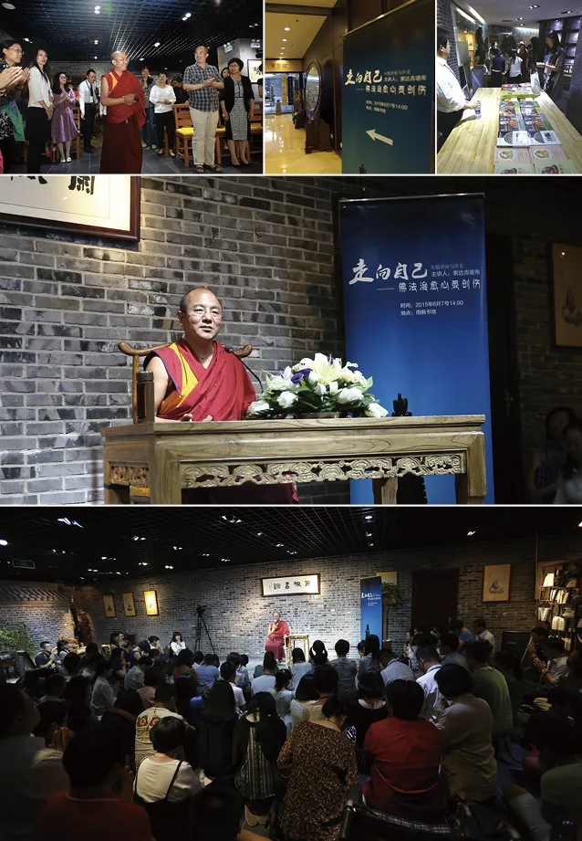
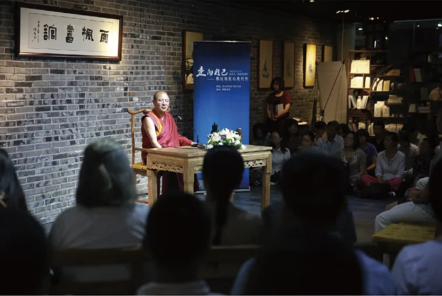
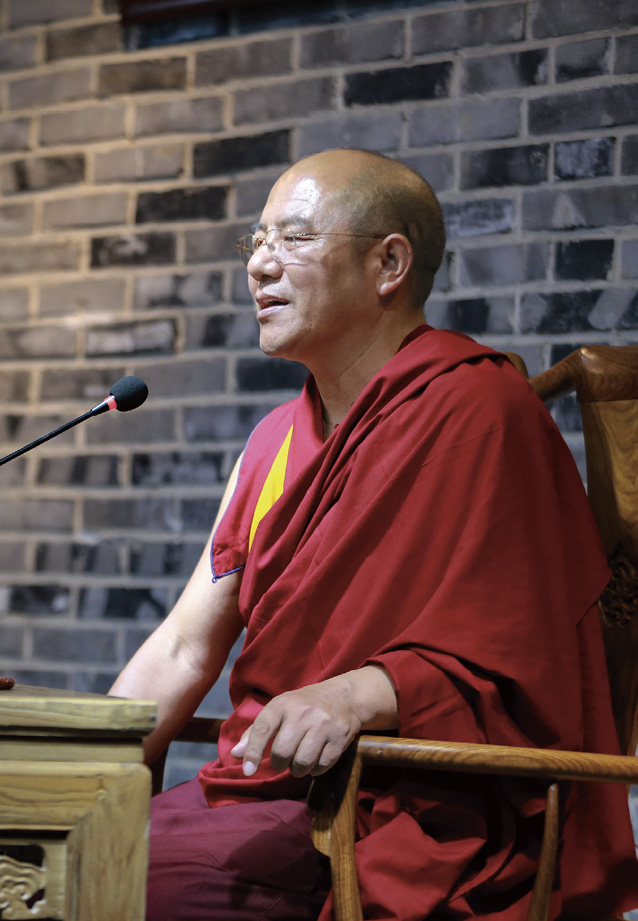
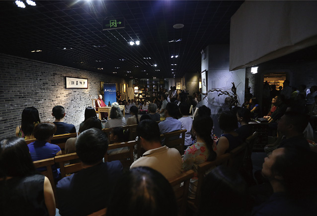
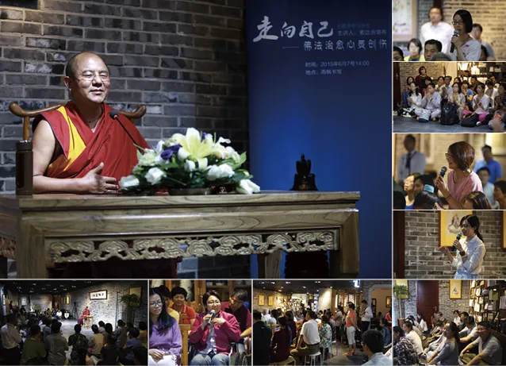
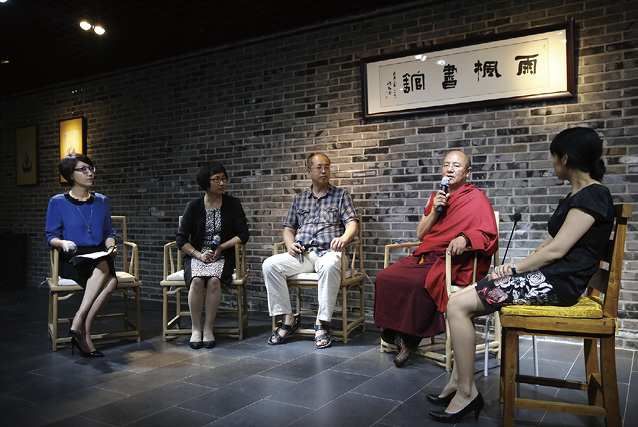
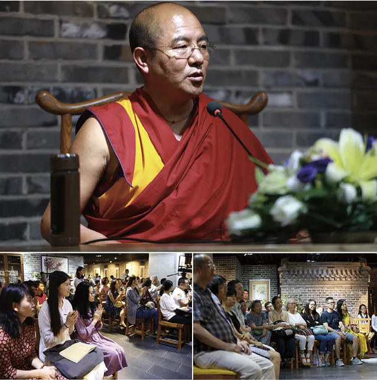

《正法念处经》云：“治心名治病，治身非治病。”

第26场

北京雨枫书馆

Beijing Rain Library

中国·北京

2015 / 6 / 7

## 走向自己 佛法治愈心灵创伤

## The Path Within - Buddhist Healing

主持人：

现场的各位：大家好！欢迎来到活动现场。今天的演讲主题是关于心灵与佛法，所以，我们的主讲人肯定与佛法有关，他是一位堪布——喇荣五明佛学院的大堪布。

“堪布”在汉语里有“教授”的意思。相信很多人对他有所了解，当然，也有人可能不了解。这位堪布著作等身，他的作品有《残酷才是青春》《苦才是人生》《做才是得到》等，最近新出的书叫《你在忙什么》，这句话也在问在座所有人。他的书受益者众多，不知各位是否也有从中受益的类似经历，等一会儿在观众和台上嘉宾互动的环节，大家可以谈一下自己的感受。

下面把会场交给堪布，欢迎——

今天跟各位一起交流、互相学习的主要内容，是关于心理疾病的治疗。作为一名佛教徒，我也经常关心人类的心灵健康，因此，我先抛砖引玉，简单讲一下当前人们存在的心理问题。

世界各国有许多机构、专家、心理咨询师以及宗教人士，都在关心、参与心理疾病的治疗工作，听说今天在座的很多人，多年以来都在从事心理咨询、心理治疗方面的工作，我们佛教徒对此也极其关心。虽然我们的性格、意乐、爱好等各有差异，但关心的话题有共同之处，因此，互相交流很有意义、很有必要。

## 物质丰富 精神匮乏

当今时代，人类心理问题越来越严重，不仅威胁到我们的身心健康，甚至威胁到家庭与社会的各个角落。因此，大家都应该重视起来，一起探讨、商量、研究。

我个人所了知的现代人的心理问题确实比较多。今天听说，有一个孩子多年以来早上不想起来，也不愿意跟人接触，内心一直存在很多问题，今天对他而言是非常关键的时刻——高考，但他却不愿意参加考试，以非常急躁、痛苦的负面情绪来抵抗。

其实，现今时代较以往而言，在物质方面有了很大提升，穿的衣服不像以前那样破破烂烂、有很多补丁，饮食、住房等各方面都有了翻天覆地的变化。但与此同时，我们的心灵也不似前人那般纯洁、清净了，现代人大都比较浮躁、焦虑、痛苦。我还听说有些人表面上看起来非常正常，工作能力、沟通能力、社交能力都比较不错，但其实内心极其脆弱。

以前我看过一则新闻：台湾的一位留学生，他的家人在柬埔寨，当时那里发生战争，他所有的家人都在战争中去世，在此后的四年中，他不曾开口说过一句话。人在感情上、生活上遇到挫折时，无法面对，内心已接近崩溃的边缘。

美国在这方面的问题也非常严重，尤其“9·11”事件发生后，美国政府耗资几十亿美元，挨家挨户为很多家庭配备心理医生。

## 信仰带来的奇迹

相对而言，我所在的青藏高原，目前心理疾病的问题并没有那么严重，在发生大大小小的灾难时，人们心理无法面对的情况，据我看来比较少。原因在于什么？我相信很大程度上跟信仰有关。

藏族人无论是否有文化，从小都有一种认知——诸佛菩萨会加持的！面对人生的诸多不幸，人们提前有些心理准备，知道人生并不完美，很可能发生各种无常、灾难。一旦生活发生变故时，大家都能从内心接受。

我曾去过玉树地震的灾后现场，当时来了很多心理医生，一些天津和北京的医生都亲口跟我说：“我们去过国内外很多受灾现场，也支援过汶川地震等，但在这里，我们却没有找到需要心灵救助的人。”也许你们不一定相信，但确实，人生需要有一种信仰与智慧来面对逆境。

藏地很多人不知道什么叫“抑郁症”，这几年我们编著藏语词典时，造了一个新的藏文名词“东才尔”——抑郁症。但说起“东才尔”，藏族年轻人不知道，老年人也没有这个概念，可能有这种病的人并不常见。这种疾病，通过佛法中自我认识的方式就可以治愈。

## 心理疾病的根源

按照佛教的观点，心理问题归根结底是由于“我执”太重。佛教经典《维摩诘经》[^1]中讲到，众生的我执是由分别妄念而产生；藏传佛教的《四部医典》[^2]也说，痛苦来自我执，来自贪嗔痴等无明烦恼。

抑郁症、自闭症，以及各种痛苦，有一部分可能跟前世的业力有密切的关系，有一部分是因为今生过度地贪执“我”的感情、“我”的家人、“我”的财富、“我”的地位、“我”的工作……对各方面特别执著，一旦愿望没有实现，好像天都塌下来了，无法面对。

最近在北京，我去了一些学校，很多老师告诉我，现在患抑郁症的孩子比较多，在校内跳楼自杀的现象很普遍，学校也非常重视，甚至在楼内安装铁丝网，防止意外发生。但内心出现问题时，不锈钢或铁丝网不一定能挡得住，一栋高楼上没办法跳，另一栋高楼上也可以跳，这些孩子的确非常可怜。当你们遇到痛苦时，会不会也想选择这条路？

所以，一定要从根源上解决问题。

世界各地有很多心灵疗法，这非常重要，因为内在的治疗才是真正的治疗。佛教著名经典《正法念处经》中云：“治心名治病，治身非治病。”意思是，治疗人心才是真正的治疗，身体的治疗并非根本。因此，在所有的疗法中，对自心的认知与安抚非常重要。若能建立此种观念，就会发现，佛教中的有些疗法确实非常有用。

## 莲花色比丘尼的故事

给你们讲一个佛教故事，如果能懂得其中的含义，哪怕人生会经历诸多坎坷，也不会因此而绝望。

佛陀在世时，有位莲花色比丘尼，出家前的遭遇非常坎坷。她嫁给第一任丈夫后，育有一子，准备回娘家生第二个孩子时，孩子在途中出生，血腥招来毒蛇，将她的丈夫咬死。她一个人带着两个孩子继续赶路，过河时，把大儿子留在岸边，先抱着小儿子过河，到了对岸把小儿子放下来，再回去接老大。没想到大儿子见母亲回来接自己，便下水向母亲走去，没走几步就被河水冲走了。她又回头去抱小儿子，结果小儿子被狼叼走了。她伤心地回到父母家，却听闻噩耗：父母家中发生火灾，双亲都在火灾中离世，房子也被全部烧毁。后来她又嫁给第二任丈夫，这个丈夫也死了，按照当地习俗，她被埋进土里陪葬。结果盗墓贼前来盗墓时，把她挖了出来，她又被迫嫁给了这个盗贼。谁知这个丈夫也死了，再次把她埋入地下陪葬，最后竟又被野狗挖出来了……

从她的一生来看，几任丈夫相继离世，孩子夭折，父母双亡，换成其他人也许活不下去。但她一直很坚强，后来依靠佛法获得成就。这是一个非常典型的案例。

每个人都有不同的遭遇，如果花费精力去执著痛苦，会导致很多心理疾病，其实只要放松下来，很多心结自然而然可以解开。有些人因为自己特别执著，越执著越痛苦，最后导致行为疯狂。很多抑郁症患者，晚上睡不着，白天不愿见人，一直闷在屋子里；还有一部分人特别狂躁，莫名其妙地发脾气，莫名其妙地骂人，莫名其妙地打人……其实这都是心理出了问题。

## 破碎的瓦罐，留它何用？

有些人对感情极为执著，一旦失去，就觉得活着没有任何意义。

七八年前，我翻译了一部论典叫《密宗大成就者奇传》，讲述印度一些大成就者的传奇经历。其中有位国王与王妃情投意合，生活过得非常幸福快乐。一次，国王问王妃：“你会不会永远爱我？”王妃回答：“会，我特别爱你，深入骨髓！”后来国王为了试探她，自己躲在花园，让仆人转告王妃：国王去森林打猎，不幸被老虎吃掉了。王妃听后非常伤心，气绝身亡。

国王没想到会导致这样的后果，他特别伤心，也很后悔，觉得是自己的行为令王妃离开了人世。王妃的尸体被抬到尸陀林，从此之后，国王舍弃了王宫，长期住在尸陀林，一直守护着尸体，不愿离开。最后尸体变成了一副骨架，他还是天天抱着这副骨架，呼唤王妃的名字。他在尸陀林守护王妃的骨架长达十二年，也有是八年，总之时间非常长。其实这跟现在有些人的情感较为相似。

后来，一位佛教大师为了度化他，故意在他面前将一个瓦罐摔在地上，碎了一地。大师捡起碎片，捧在手上悲伤地哭泣，大声喊着：“我的瓦罐啊！你怎么破了？”

国王觉得他莫名其妙，说：“瓦罐都已破了，你还把碎片捧在手上哭喊，太愚痴了！”大师说：“你比我更愚痴，十多年来爱人的尸体都已变成骨架，你还舍不得放下。”国王如梦初醒，才意识到自己跟他没有差别。

也许有人觉得这个国王的做法很荒唐，但在我看来，这与有些人对感情的执著、对钱财的执著有相似之处。

前段时间，在北京还是武汉，据说两个人的感情破裂，一方根本无法接受，整天喊着对方的名字，最后精神失常。医院想尽办法治疗，但他还是天天呼唤对方的名字。

昔日有位佛教大师叫寂天菩萨，他曾用悲悯的语气说：“自迷痴狂徒，呜呼满天下！”意思是，太悲哀了！痴狂之徒已遍满大地。很多人看不清真相，执著无谓的人事物，徒增烦恼、痛苦，给自己带来极大的困扰。

按照佛教的观点，因缘具足时，可以“执子之手，与子偕老”，而一旦因缘消散，即使再痛苦、再执著、再疯狂，也无济于事。拳头握得越紧，手中的沙子流失得越快，此时就算你叫苦连天，也不一定起作用。

在座各位有必要关心一下心理问题，否则，现在你觉得别人的做法非常幼稚、愚蠢，但万一事情落到自己头上，如果内心脆弱，很可能因为某个人、某件事而导致疯狂，甚至丧失生活自理能力。会不会有这种危险？非常可能！

## 治疗心理疾病的三种方法

### 1．禅修

建议大家适当预防心理疾病，一旦患有抑郁症或其他心理症状，可以去寺院等静处禅修，让心完全放松。

### 2．发菩提心

第二种方法是大乘佛法中提到的发菩提心。我个人认为，发菩提心很重要，很多有心理问题的人，通过学习《入菩萨行论》等大乘论典后，奇迹般地趋向好转，这是一种殊胜的方法。当真正生起利他心时，关心的就是如何利益天下众生，不会特别执著自己，之前紧绷的心态与负面情绪自然就会烟消云散。

越执著就越束缚，越放松反而越快乐，越洒脱自在。如果不再强烈地执著自己，试着关心其他众生，任何心理疾病都很容易治愈。一旦了解这个真相，痴迷妄想当下就会瓦解。

### 3．无我的修法

无我的修法也非常重要。汉地的智者大师说过：“般若一观，能治五病。”意思是，般若空性这一法门，能治疗许多疾病。这方面我深有感触。

曾有人问我：“我似乎出现了心理问题，该怎么办？”我说：“多念《金刚经》或《心经》。”一方面，佛经有一种无形的加持力；另一方面，这两部经讲到了空性，如果以自我为中心，就会特别痛苦，若能通过般若空性削弱我执，许多疾病自会不药而愈。所以，可以尝试念诵《金刚经》《心经》，让身心恢复健康。

## 珍爱生命，不讳疾忌医

如今，人群中患有身体疾病的人很多，患心理疾病的人更多。据前几年的统计数据显示，全世界大概有三亿多抑郁症患者，中国每年自杀的有二三十万人，很多都是由心理疾病所导致。人身很珍贵，且不说自杀，自残自贱也不应该。人无论到了何种境地，只要活在世上，就能找到出路，如果这条路走不通，可以选择另一条路，也许那条路更适合你。

其实，得了抑郁症也不可怕，很多世界名人都有这种心理疾病。《老人与海》的作者海明威患有抑郁症，美国前总统林肯、罗斯福也患有抑郁症。我看过爱因斯坦和牛顿的传记，牛顿从小没有父亲，处处受逼迫，这反而成就了他探索科学的因缘；爱因斯坦也很可怜，在临死之际内心没有释然，非常痛苦。

有些人身体上的疾病可以直接跟别人说，但患有抑郁症、自闭症等心理疾病时，不好意思向人诉说。其实没有关系，应该坦然地接受治疗，依靠佛法或世间疗法，心慢慢就可以恢复到原来的状态，甚至更为坚强。根据佛教观点，心的力量极其强大，若能真正认识它，不仅是疾病，就连现有的烦恼也不会对我们构成危害。当然，这需要依靠修行的力量才能呈现。

总之，这次与大家交流，并非为了宣传什么，而是发自内心地认为：心里痛苦的人若有机会系统学习佛法，也许在未来的人生旅程中，能体会到无法言说的快乐——暂时来讲，发生任何事情都有面对的能力和勇气；究竟而言，乃至生生世世都会为你指明一条光明的道路。这是迷茫的人生极其需要的！

最后，希望大家能用智慧观察自己的人生，用悲心关注身边需要关爱的人。谢谢！

现场互动

主持人：

接下来是嘉宾对话环节。

我们请索达吉堪布上场！下面有请北京林业大学心理系教授朱建军博士、心理咨询师丛立美女士、雨枫书馆创办人许春宇女士。

刚才堪布的演讲，相信各位都已经听到了。我发现在堪布的演讲中，出现一个高频词汇——“我执”，理解为执著。堪布，我没有理解错吧？

索达吉堪布：

对。“我执”是佛教的专用名词。有一部论典叫《入中论》[^3]，其中讲到：众生先对“我”产生执著，因为有了“我”的执著，然后有“我所”的执著——我的房子、我的车子、我的银行卡、我的钞票等，“我执”和“我所执”二者综合起来叫做“我见”（即萨迦耶见）[^4]。我刚才讲到，痛苦是由于对“我”的执著太强烈，很多眼泪是为“我”而流的，为众生或者为社会产生的痛苦比较少。我的看法是这样。

主持人：

各位都是跟心理学相关的研究学者，我想知道，“执著”和“我执”这两个词，在心理疾病上占的分量真的很大吗？它们是什么关系呢？朱教授，您先来。

朱教授：

可能我们用的术语不一样，但所说的事情其实是一样的。虽然心理学用的是其他词，比如，在精神分析中用的一个词叫“固结”[^5]，但实际上它所说的也是一种执著。我觉得心理学和佛学相比，它没有像佛学那样把问题最深的那一层说出来，更多的是看患者外在各种各样的具体表现。但是，这些具体的表现，也都是执著在各个方面所反映出来的特点。所以本质上应该是一样的，只是用的语言、表述的方式不同。

主持人

丛女士怎么看呢？

丛女士：

基本上是像朱教授说的这样。我是拉康学派的，也是动力学派的，我的理解，还是被欲望推动的一个结果，“我要这样、我要那样”，如索达吉堪布所言。这样的案例非常多，几乎都在充分地表明，是被欲望推动的一种症状的呈现。

主持人：

刚才堪布已经说了很多，其实我特别想从两位心理学专家这里有所了知，能给我们简单举一个你们遇到的比较极致的心理案例吗？

朱教授：

各种案例都有。刚才说到抑郁症，其实抑郁的一个很主要的原因是，他们有一个比一般人更大的潜在欲望。用佛教的话说，他可能贪心更强，但表面看上去不见得是那样。表面看一个抑郁症患者可能是一个很谦和的人，是一个要求并不高的人，是一个很收敛也不跟别人争的人，我们看到的很多抑郁的人都是这样。但是，如果真正去探索他的内心深处，你会发现他可能真正想要的东西更多。

比如，他可能想要的是“所有人都觉得我好”，实际上他没有意识到。但当他意识到之后，他会发现这其实是一个极其不合理的要求，就像刚才堪布讲的一样。所以，当他有这样一个很不合理的、比一般人更大的欲望时，他的内心就会有更严重的抑郁。

当然，心理学不像佛法能做得那么彻底，我们要求也没那么高。如果能够让他的欲望小到和一般人一样，他就不至于是一个抑郁症患者了。

主持人：

这里提到了一个说法——意识。没有意识到自己的问题？

朱教授：

对，是这样的。

主持人：

在佛法中，这是不是叫“觉知”——自我的觉知？觉知力不够，有这样的说法吗？

索达吉堪布：

在佛教中，不明真理分为两种情况：一是被其他邪知邪见所误导；二是因为无明导致迷惑。所以，要想真正明了事物的真相，跟世间的教育一样，也需要多方面的了解和学习。

有些人说：“佛教的道理只是作为一种信仰就可以了。”其实，佛教徒光有信仰还不行，一定要有智慧。这种智慧不可能无缘无故产生，天下所有的智慧都是依靠勤奋、努力、系统的学习才能得到。所以，不管你是否信仰佛教，在抉择任何事物时，一定要靠非常深邃的智慧才能发现真相。

因此，通达这样的道理需要觉知力，也需要一种纯净的智慧，否则，内心的纠结或执著很难解开。

有些道理，名称上知道、理论上明白，但内心真正通达恐怕有一定的困难。部分佛教徒遇到事情时，理论上完全知道如何剖析“我”不存在，但很难立刻解决。这说明在理论的基础上还需要修行，修行达到一定境界时，就能够非常容易地面对和解决很多烦恼。

主持人：

我很想问一下堪布，您刚才说了很多关于心理疾病、自己的感受以及治疗的方法，我想知道，出家人有没有得抑郁症的，或者其他心理疾病的？

索达吉堪布：

我在学院、在藏地时，大多数时间生活在出家僧团里。我身边有个别人，以前在家时得过非常严重的抑郁症，后来有些痊愈了，有些虽然并未完全康复，但确实跟以往不同。我认识一个人，在未出家时多次自杀未遂，后来以其他因缘出了家，从此没有再产生过自杀的念头。总之，在我所了知的范围内，以前没有抑郁症、出了家之后得抑郁症的案例，到目前为止没有发现。

虽然身体不好的出家人也相当多，但患有心理疾病的比较少，可能是作为出家人能想得开。出家人放弃了一般世间人很难以放下的感情、地位，甚至曾经非常执著的头发，对世间的荣华富贵看得很淡，心结也逐渐消散，这是我所了解的情况。

主持人：

听堪布这么说，好像有心理疾病的，出家之后抛掉三千烦恼丝就能解决这个问题，这是不是也是一种出路？可惜汉地或者中国没有短期出家的寺院，如果有的话，大家是不是也可以去尝试一下？特别是有心理疾病的人。

朱教授：

我觉得佛法是一种药，这个药本来就是用来治心理疾病的，但不一定非得是被称为有心理疾病的那种病人才有心理疾病。其实，从佛教的角度来看，每个人都有病，只不过轻重程度不同而已，因为有我执就是病，对吧？所以每个人都是病人。现在叫有心理疾病的是重病人，我们这些人叫轻病人，在座的各位是轻病人。（笑）

所以，其实我们不用太划清界限——“他那个叫不叫心理疾病，我是不是正常人”，其实正常人就是轻病人而已，一样是有病的。

如果真的能有信心出家，或者短期出家，包括参加“几日禅”之类，它一定是有帮助的，因为佛法本身就是一种药。心理咨询也是药，但心理咨询有很多不同的种类。借用计算机的语言来说，有些跟佛法更契合、更兼容；有些可能兼容度稍微低一点，但它也是不同的各种各样的药物，也可以治疗很多类别的疾病。

主持人：

朱教授一直在说“佛法也是一种药”，我想知道，在您治疗心理疾病时，是否开过此类药方？

朱教授：

我会根据来访者的信仰做心理治疗。如果他本身信佛，他说“我已经皈依佛教了”，那我就会用佛法的语言跟他谈；如果他还没有信佛，他说“我是个基督徒”，你跟他讲佛法，他心里就会很排斥。

主持人：

您就需要用《圣经》的语言去跟他谈？

朱教授：

对。基督教徒有时也强调博爱的心，这种博爱的心当然不能算是菩提心，但也有些相似，总比仇恨的心要好很多。所以，如果能够有博爱的心，其实心理也会更健康。

堪布，我如果说错了您给我纠正一下。

主持人：

堪布很赞许，一定要在治疗心理疾病的时候多开佛法这味药。

朱教授：

不好意思，我说话多了点。我自己在读佛经时看到一些故事，其实佛陀就是在做心理治疗，而且做得非常巧妙：

一位妇人，一岁时儿子夭折，她很伤心，去见佛陀，希望佛陀能让她的儿子死而复生。佛说：“这很容易！你只要到没有死过人的家里去要一颗芥子就可以。”这个人就去找啊，找啊，找了很久，发现家家都死过人。于是，她明白了世间无常，就不再有那么强烈的痛苦。

后来我从心理学的角度分析，发现能从中找出心理疗法的不同原理，我目前找出了二十七条，还没找完。

主持人：

时间有限不能逐一说，但您可以说一两条，我们很好奇。

朱教授：

原理之一，平常只是听道理，和在实践中发现道理是不一样的。假如她去找佛，然后佛直接告诉她结论：“每家都会死人，无常是普遍存在的。”她可能就不会在内心留下深刻的印象，也不愿意承认——别人家可以死人，但我儿子凭什么死？好多人都是这种心态，她就会不接受。但实际上佛用的一个心理学技巧：我不马上打消你的希望，而是让你一家一家去找，在现实一次次碰壁的过程中，她一次次地明白了佛要跟她说的道理。这就是在实践中学习，最后给她的印象特别深刻。

还有一个心理学原理，当她这样去做的时候她会发现，不光是我苦，家家户户的人都要经历失去亲人的苦，在这个过程中，她又增长了一种类似于菩提心的东西，而同时她又得到了别人的安慰。

这是其中的一些心理学原理。这样的原理我找了二十七条。所以，我那时就有一个心愿：应该花时间找很多佛法中的心理疗法，然后把那些原理跟我们现在心理学中所用的技巧、方法之间的关系写出来。但是因为我的智慧太少了，时间也太少，所以现在还没有做，但我觉得的确很有必要。

主持人：

我们期待您写到五十八条、一百零八条。朱教授在讲到心理疗愈的时候，用了一些佛法中的词汇，堪布好像满脸欣慰，觉得这是一个很好的“弘法者”，只是没穿袈裟而已，是这样吗？

索达吉堪布：

其实无论讲佛法还是讲世间法，我都很有兴趣，可能你没有发现，用到一些其他词汇时我更专注。

刚才朱教授说，对基督教徒用更相应他的方法，如果我遇到这样的事情，我也会这么做。对无信仰者或其他宗教信徒，不一定必须用佛法的信念为他治疗心病，我会尽可能学习其他宗教，并使用对方的宗教语言。

佛教比较注重应机施教——根据不同根基的众生，对不同意乐、不同爱好的人使用不同的法门。你们认为我是一个佛教徒，在任何场合只讲佛法。其实不然，我在不同的环境会“表演”不同的节目。

主持人：

我很好奇，堪布这么说的话，您是用《圣经》开导过向您求助的基督教的病人吗？

索达吉堪布：

我学过不少《圣经》的相关道理，去西方遇到基督教徒，我用对方的信仰与他们交流时，他们对我的态度完全改变，聊得比较愉快。

主持人：

我们是不可以脑洞大开一下，以后堪布也可以去教堂讲经说法？

索达吉堪布：

其实去年我去耶鲁大学等学校时，在基督教的教堂讲过课，当时至少有三个教堂邀请我。

主持人：

还真发生过这种事？

索达吉堪布：

是的。

主持人：

真是世界大同啊！我觉得其实无论是哪个宗教，真正有正信正念的教徒都有宽容的心，而且大家的目标在某个层面上基本一致。堪布在听我说这话的时候犹豫地点了点头，我说得不够确切是吗？

索达吉堪布：

我觉得这不是为了应付。

其实这个世界应该有多种空间，无信仰者有他的空间，信仰其他宗教的人也有他相应的空间，甚至一个人也可以信仰多种宗教。因此，作为一个人，对他人的信仰很有必要包容。

我以前认识一家人，他们一家四口人有四种不同的信仰：有基督徒、佛教徒、伊斯兰教徒，也有无神论者，但他们很团结，和睦相处。所以我觉得，只要心开放，很多事情可以融合。

主持人：

这是李安的电影《少年派》的真实版，是吗？

我想问一下丛女士，以我有限的心理学知识，我知道心理咨询师在面对这么多心理辅导时，要听到不同的垃圾或困难，可能自己也会面临心理上的困扰，这种时候怎么解决呢？

丛女士：

大多数人都认为，咨询师面对的是别人倾诉的“垃圾”，但我在个案中的体会其实并非如此。可能他自己症状很严重，“我为什么会这样？我为什么不能好起来？”痛苦难忍，对于他自己来说不能接受。其实我个人的体会，这是一个一个的故事，而不是垃圾，我们要发现故事背后的意义。

主持人：

我打断一下：这么说的话，难道还能从这些负面情绪当中获得营养吗？

丛女士：

咨询师的成长，从现实案例中能积累经验，从理论中能学到一些技巧或不同流派的观点，但更重要的是个人的体验，以及在个案当中的积累，它让我们每天都在成长。朱教授可能更有发言权。

朱教授：

那我补充两句。

我觉得一个新手咨询师，对方的消极情绪会给他带来很多消极影响，的确很不容易。我自己的经验是，一个成长得比较好的心理咨询师，当你去做咨询，碰到来访者有很消极的情绪时，对心理咨询师而言的确是一种营养。

怎么是营养呢？两方面：第一点，当你很努力地想去理解他，他为什么这么痛苦？为什么这么难过？他哪个地方想不明白了？他的情绪卡在哪儿了？当我们努力地、全心全意去理解他时，其实你就忘了自己。

主持人：

这个答案我很意外。这属于佛教中的利他、无我吗？还是忘我？

朱教授：

我觉得是暂时的忘我，还达不到无我，但也很有帮助。

另一点，我一个人只能活一辈子，假如我发现这辈子我的人生是很无常的，可能在我内心深处觉得：我倒霉，所以我的人生无常，如果我来世不倒霉的话，可能我的人生就很有常。但我去接触了一千个人、几千个人，听他们讲述了几千个人的人生，我发现每个人的人生都是苦的、都是无常的，这也给我留下了特别深的印象：哦，真的是这样！

而且更明显的一点，在我做咨询的时候就能看到因果——他现在得了一个什么疾病，我们在心理咨询中就要给他找原因，最后发现：跟他童年的某件事情有关，跟他家庭的某件事情有关……然后，我就特别清楚地认识到佛教里说的一句话：所有的事情都有因果，不是平白无故地得了这个病。让我对因果不虚这一点有非常非常强烈的感受。

我接待了一千个来访者，就等于我活了一千辈子，一千次看到因果不虚，看到世事无常，看到人生是苦，我觉得这对我们特别有帮助。

主持人：

堪布在笑。可能堪布在想，我得算算我活了多少辈子，几千辈子？

我前两年去印度采访了一位藏传佛教的大德，记得当时采访他时，他的门外有很多佛教弟子等着求见，每个人大概进去五分钟时间。

后来我在采访他时，我问：这些人要见您干吗？求加持吗？他说：可能他们心理上也需要寻求安慰，来问我各种问题。我问：大致什么问题呢？他说：比如，我想要的名利没有得到；关于我的婚姻状态；甚至我们家的猫吃这个猫粮好吗？我说：那您怎么回答呢？他说：大多数时候我其实不用回答，他们说完之后自己就心满意足地走了！

堪布遇到过这种情况吧？堪布活了几千辈子，或者几万辈子呢？

索达吉堪布：

我觉得刚才朱教授说的确实很有道理——世事无常、人生是苦、因果不虚。观察世间许多案例时，表面上看是我在治疗别人的心理疾病，但其实对自己而言也是一种学习。

我每天下课后，也有一段较短的接待时间。在接待的过程中，因为快乐而提问题的比较少，因为痛苦而提问题的比较多。这些问题归根结底，如同刚才所说，是“我执”在作怪。

不知道你们是否学过《入菩萨行论》，此论的作者寂天论师有句非常著名的话[^6]：世上所有的灾难、恐惧、痛苦，都来自我执，因此，对“我”的执著是一个大魔。世间很多痛苦是由我执而产生，一旦修行成功，顿悟了无我的智慧，虽然在我们身上照样会出现无常，但不会那么痛苦，家人去世也可以坦然面对，因为我们知道，一家人不可能永远活着。

刚才朱教授讲的公案很出名，佛陀当时让她一家一家地找没有死过人的人家。很多世间人可能没有思考过无常的道理，好像觉得“我的家人永远都不会死”，一旦离开的时候就接受不了，马上需要心理治疗，此时可能为时已晚，不如在平时的生活中多思维世事无常。

在治疗心理疾病方面，观无常可能是最好的妙药，无论在感情还是地位方面，多观无常，这是最重要的修行。从很多新闻中可以看到，一瞬间或者一夜之间，便已天人永隔。我在坐车、乘飞机时会想：我此刻是在人间，很有可能再过几分钟便会步入后世。尤其是乘飞机时，如果飞机掉下来，那时不要说生命，可能连身体都找不到。有时自己和他人出现无常都特别快，故而认识真相很重要。

主持人：

如果我现在问堪布“您开悟了吗”？您肯定会说“没有”。您刚才说，没有开悟的人就会有我执，那我斗胆问您一句：您有我执吗？

索达吉堪布：

有。但我的我执在某种程度上可能比较小，很多事情能想得开。

主持人：

您的心理医生是谁呢？

索达吉堪布：

我的心理医生是法本、书。

主持人：

是释迦牟尼佛，是吗？

索达吉堪布：

对，释迦牟尼佛留下来的法本。

主持人：

我想问一下许女士，好像您还在关注孤独症患儿，今天现场也来了一些孤独症患儿的家长，还有这方面的专业人士。我不是很清楚：孤独症在心理方面是属于什么样的状态，是属于心理疾病吗？

许女士：

我之所以会关注这个问题，是因为我身边有这样的案例。无论是孤独症，或者刚才说的抑郁症，离我们都非常近，可能身边的朋友、自己的亲人就会有这样的疾病。孤独症是孩子的一种症状，我觉得特别重要的是，孩子的父母要学习如何面对。

我今天也很想请问堪布：我记得有位哲学家维特根斯坦[^7]曾经说过：其实人生是虚无的，除非你有宗教信仰。从这个角度来说，我们一生总体的追求，应该去寻找并追求自己的信仰，才能够抵抗我们生命中的虚无感。

在抵抗的过程中，当你遇到特别大的痛苦，比如说亲人有了这样的疾病时，可能我们会迅速地去寻找出路——也许从佛教层面去寻找，也许从其他层面去寻找，往往会触动你去做这样一件事情。可是，作为平常人，在庸常的生活中，在忙碌的工作中，他有很多无明烦恼，这些烦恼并没有导致极大的痛苦，并没有那么刺痛你，这时，你其实离这些能够走向心灵的通路反倒更远，反倒不会去主动寻求。

所以想请问堪布老师：作为一个普通人，如果没有感受到生命的无常，没有感受到巨大痛苦来临之前，我们怎样能更快地走向自己？我自己有一点小小的探索是，更多地去看一些图书，与一些朋友交流、对话，但是，我希望能够从堪布这里得到更好的开示。谢谢！

索达吉堪布：

无论是患有孤独症、抑郁症，或是其他心理疾病的人，按照佛教的观点，可能有前世的业力、今生的四大不调，以及我们看不到的鬼神干扰等原因。因此，身心不健康时可以做些法事。

也许有人认为这是一种迷信或表面上的仪式，但实际上如果懂得其中的意义，确实有非常好的疗效。就像西医治不了的一些疾病，依靠中医的特殊疗法——拔罐、按摩、针灸等可以治疗，同样，佛教在心灵的按摩和治疗方面疗效显著。

现在得孤独症的人越来越多，尤其是西方社会，因为西方人基本上没有自己的传统文化，比如孩子对父母的孝顺、父母对孩子的照顾。西方国家的父母认为，孩子成年以后，他们已尽到了为人父母的责任，不像中国人，从读书、结婚，一直到抱孙子，永远关注自己的孩子。在这种情况下，非常容易引发心理疾病。

如同刚刚雨枫书馆的创始人所说，阅读也是很好的治疗方式。在西方，看书的人非常多，无论坐火车还是坐飞机，很多人都捧着一本书，这是他们的习惯。然而，国内的很多城市，在百货公司购物的人比较多，买奢侈品的人比较多，书店却是门可罗雀。

我刚才进来的时候在想，这个椅子看起来很好，但不知道坐下来看书的人多不多？我比较担心。关掉手机，心静下来，很清净地边看书边喝一杯咖啡、喝一杯茶，对我来讲是最好的享受。我也希望很多人通过看书来放松身心，也许很多疾病自然就会消失，这也是一种令心灵健康的方法。

主持人：

看这椅子的崭新程度，好像它很寂寞，应该没有多少人坐过。

许女士：

希望堪布大师来过之后，这个椅子能够经常被大家坐到。

我来说一个自己的案例，也是跟阅读有关的。去年我母亲去世时，我爸爸已经77岁了，他被六院诊断为老年性抑郁症。从物理诊断来说应该不是非常严重，属于轻度焦虑型。但对我来说，这个打击很大。我想了种种办法帮他、宽慰他，后来想到一个办法，就是陪爸爸读书。在两个月的时间里，我陪爸爸读了不下六十本书，这个过程其实也蛮愉快的。因为长这么大，也没有与父母在心灵层面走得那么近，长大后，你很难发现跟他有特别多的共同爱好，但在那两三个月的时间里，我们一起看相同的书，聊很多共同的话题，爸爸终于慢慢从悲伤的心态中走出来。

所以，堪布老师您的提示，我觉得在我身上实践过，通过阅读可以帮自己度过一些难关。当然也可以通过别的方式，但阅读一定是方式之一。

朱教授：

我再插两句，我觉得各种病名，叫“老年性抑郁症”或者叫什么，它就是个标签，这个标签是有用的，帮助我们知道它是哪一类。但也不要太把它当真，因为人的心理是变化多端的，有时太把标签当真了也是一种执著。

你刚才说的故事——陪爸爸读书，我觉得特别好，很孝顺，同时自己也得到很多满足，真的很棒！唯一加一点建议，就是除了读那些书之外，还可以读读堪布的书，真的特别好！因为我也读过刚才说的《苦才是人生》等，我觉得给老年人读尤其好。

为什么呢？老年人跟年轻人不一样，年轻人更多的精力还是在往外跑，心还野着呢！但是老年人会想：我活这一辈子都活明白了什么？有很多东西他需要思考。这时去读读佛学的书，对老年人特别有价值。

许女士：

对，您说的这点非常重要！佛学经典我也跟爸爸一起读过，我们在共读《圆觉经》的时候体悟就很深。堪布老师的书，刚才我有在问——我们在这么忙碌的生活中如何接近佛法，接近自我的心灵？其实堪布老师最近就有一本书《你在忙什么》，大家可以读一读。

主持人：

这是售书环节吗？朱教授是请来的“托儿”是吗？（众笑）

希望老人家能过得更加愉快健康！其实最好的心理医生就是索达吉堪布，也可以找机会请堪布开些药方。

我是一名记者，采访过很多有心理疾病的人。我曾经采访过一位病人，当时他说，他有段时间患上特别严重的抑郁症，需要24小时在医院被守护，因为他随时想要自杀。他的心理医生曾经对他说了一句话：当你真的想要自杀时，你试着给我打个电话，我告诉你哪种方法更好，向人求助是一种美德。

所以，我想问一下丛女士和朱教授，你们面对这种问题时，有没有一些宝典类的话语？

朱教授：

我没有宝典式的话语，而且我觉得最不应该找这种宝典式的话语。为什么呢？因为每个人都不一样，遇到的情况也不一样，如果同样的方子大家都去用，这是很危险的，所以我拒绝。

主持人：

丛女士呢？

丛女士：

确实如同朱教授所说，每一位来访者都是个例。就像堪布说的一样，我们都是一个个独立的个体，一定有各自的独特性。虽然框架都是抑郁，但它的表现形式千奇百怪。

主持人：

我对您很好奇：您内心的底色是明亮的，还是偏暗淡？

丛女士：

分阶段吧。

主持人：

现阶段呢？

丛女士：

现阶段我很明亮！有堪布在这儿我更明亮！（笑）

主持人：

堪布属于大瓦数的照明灯、大太阳是吗？

索达吉堪布：

上面的灯比较亮，所以我的头也比较亮。

主持人：

反射出的光照亮所有人。

索达吉堪布：

对，我的内外都是明亮的。

朱教授：

我刚才说没有宝典式的话语，现在我想说一句，好像有点打自己的嘴。

主持人：

没关系，我们不在意，洗耳恭听。

朱教授：

我认为别等到病了以后再去找医生，在生病之前就要预防病。预防病有什么方法呢？就是多读好的心理学书，尤其是多读好的佛学书。

主持人：

特别是堪布的书，是吗？（众笑）

好！谢谢在场的四位嘉宾。下一个环节是，观众有什么问题，可以对堪布现场提问。

问：刚才听到您说所有东西都是源于“放下”，放下一切就能想开很多。我想问，您的放下是源于得到之后还是得到之前？

堪布：佛教虽然讲“放下、看破、自在”，但这是比较高的境界。放下要分次第，暂时来说，平时行持善法、行住坐卧，这些现在放不下，也没有必要放，因为在生活中不得不面对。所以，只是放下虚妄的、不实在的部分，比如，若是没有放下过多的欲望，可能一辈子非常痛苦。

所以，该放下的部分应该放下，部分先暂时不放下，一直到最后再放下。如同过河的时候，船只暂时不能放下，过了河以后可以放下，这是很重要的。因此，非常严重的部分要先放下来，否则，将会给自己带来非常大的痛苦。一步一步地，到最后确实能放下一切的时候，再全部放下来。

我们觉得“放下”是一个很重要的词，但仅仅只是口头上说，实际上放不下也不行。很多人说：“你们佛教徒不是全部放下吗？你怎么还没有放下？”其实，“放下”也分不同的阶段。

问：堪布老师，您走过很多地方，今天所探讨的问题很多也与教育相关。我也是学校的老师，现在的教育（尤其是大学教育），怎样完善才能避免目前这么多心理问题的出现？

堪布：我对教育的问题也很关注，我昨天在北京大学跟他们一起交流时也提到，这个时代的教育，已经变成了只重视知识，而不重视文化，或者说不重视综合素质，这是非常大的问题。因此，如果家长、老师、学校，都只重视知识，培养出来的人也许有知识，但不一定有智慧。

想要改革教育，并非极少数人的一种向往就能做到，冰冻三尺非一日之寒，应该需要很多机构长时间共同努力。而且，要找到现在大方向的根，才可以彻底扭转。

因此，在培养青少年时，我觉得对综合素质、品德、修养的培养非常重要。否则，个别学校只能把孩子培养成最厉害的考试机器，除此之外营塑造出人才。所谓的人才，需要德才兼备。

现在的教育状况一方面很好，很多80后、90后，比前辈们掌握了更多的知识，操作电脑、上网等技能也是熟能生巧；而另一方面，与家人、同事之间的沟通却比较困难，在这方面大家都需要共同努力。

问：我今天是从医院偷跑出来的，为了听您的讲座。我正在住院，身边有好多病人都不太理解为什么我生病很快乐？我跟他们讲得最多的一句话就是“消业”。他们都知道我是佛教徒，所以我会让身边的很多病友多念咒。因为我现在还没有经过系统的闻思修行，我的问题是：我想帮助身边的人，让他们多念“嗡玛呢巴美吽”，并告诉他们“佛菩萨会加持你的”，这样行不行？或者是能用什么方法，去帮助身边更多的病友？

堪布：中医治疗病人时，会先摸一下脉，再看看舌苔。若想用佛法来为他治疗，我会先了解一下此人是否相信这些，有没有必要给他念“嗡玛呢巴美吽”？若是通过我的观察，对方绝对不会信仰，我干脆不念；若是这样念对他确实有作用，那么我可以为他传播。

否则，不管遇到什么人都念“嗡玛呢巴美吽、嗡玛呢巴美吽、嗡玛呢巴美吽”，也许有些人觉得这很好，是佛菩萨的加持，但有些人会特别反感，甚至特别讨厌这些出家人。包括一些基督教徒的行为，有些人很容易接受，但有些人特别反感。

所以，作为佛教徒，也需要有智慧，要分场合。

问：还有一个问题是关于“代受”。比如在我最痛苦时、扎针时就想：让众生的业障成熟在我身上，我来替众生代受这些痛苦。

后来有个人说，有些你能承受或代受，但有些众生的痛苦你代受不了。我不太明白“代受”应该怎么去观想？也请堪布开示，我们如何正确地代受？

堪布：首先，你带病来参加讲座、很开心地面对疾病，这样很好。有些人学佛后反而非常烦恼，给很多人带来痛苦；也有一些人通过自己的行为感化别人，遇到身体患病、周围人发生的不幸，都可以转为道用，把它当作一种修行，这非常有必要。

我也经常讲：我们佛教徒会不会生病？会生病；我们会不会死？会死；我们会不会衰老？会衰老。生、老、病、死我们都会有。但是，我们对衰老、生病、死亡的认知方式与世人有所不同，这就是一种特点。

因此，首先我非常赞叹你在感受痛苦时很开心地面对，这是每个人都需要的；其次，代受众生苦是大乘的一种发愿，非常好，不管怎么样，我们要经常发愿。在现实生活中我也会这样行持，扎针时我比较痛，希望众生的痛苦由我来承受，但是正在扎、特别痛的时候会忘记，过一会儿不痛的时候才想起来。不管怎么样，这是一个善愿，应该可以发。

问：在学习佛法的过程中面临很多现实的问题，比如，最近我们正在学习地狱之苦，谈到血肉供养。在现实生活中，我的同修不得不作一些血肉供养，比如请客吃饭之类，但心里又无法接受。后来听人说念什么咒，念完了就能吃肉了，且这样做也可以减轻果报。所以特别想听听您开示，该怎么办？

堪布：在佛教的教义中，罪业也分轻重。比如杀人或严重的偷盗，这些在法律上也不允许，佛教也是如此；有些是轻罪，比如吃肉，这在佛教中当然也遮止，但如果实在有一定的困难，通过念“嗡班匝儿萨埵吽”——金刚萨埵心咒或百字明进行忏悔，能够清净或者减轻罪业。

不同的人，工作、家庭都不相同，有些佛教徒非常虔诚，同时也做得非常好；有些不一定能做得很圆满，但能做多少就做多少。

问：听说最近股市特别“牛”，我们也有人说想通过炒股赚些钱，然后再拿这些钱来做慈善，甚至做供养。请问，这样做可以吗？

堪布：股市前段时间跌得很厉害，很多人也非常痛苦。最近比较不错，对吧？但何时再跌下去也很难说。虽然我对这方面不是很了解，但我认为这是最好的观无常的机会。

若是没有想欺骗他人的心，通过自己的力量赚一些钱，在因果上应该没有大的不合理之处，因为你并没有想偷别人的钱，也没有想欺骗，只是以自己的方法来谋取利润，因此，我觉得应该是合理的。但它很危险，很多人在短短的时间当中，特别多的金钱一下子就没有了。所以首先应该问一问心理咨询师，否则……（众笑）

问：现在心理咨询中也有许多用音乐、舞蹈、戏剧等，让人的心情得到放松，通过这样的方法来治疗。我知道在佛教中有些戒律说“不可歌舞伎乐”，老子也会说“五音使人耳聋”等，但我也知道佛教中有很多梵音，它是梵呗，能够净化人心。音乐要有一个度，这个度应该怎样把握呢？当代社会有这么多流行音乐，我们怎样从世人的角度契入，更好地治愈人心呢？

堪布：在佛教中，如果受了出家的戒，或是受八关斋戒的当天，因为行持善法不能过于散乱，所以对歌舞、高广大床等都有限制。

但平时，佛教实际上并不排斥听一些音乐，佛教有金刚歌、金刚舞，同时有“普贤云供”——用轻音乐、美妙的花和香等来供养诸佛。这些艺术在佛教中展现得非常多，依此可以净化自心。现在禅宗的很多寺院也有一些声韵——禅宗特殊的一种轻音乐，用它来平静自心。

佛教是一个非常庞大的体系，在某个地方不能行持的，不一定在整个佛教的大环境中都不行。你们可能也有所耳闻，现在很多佛教歌曲，用摇滚等各种形式令更多信众和爱好者听受，这并无不合理之处。

问：我好像听过一句话，是不是您说的我有点记不清了，叫做“内成熟”“外成熟”。请您帮我解释一下：什么叫做“内成熟”和“外成熟”呢？

堪布：这句话我可能讲过，但来源不是我，是佛教中著名的龙猛菩萨。

龙猛菩萨有一部论典叫做《亲友书》，其中以芒果为比喻，将人的智慧分成四种：有一部分人是外成熟、内没有成熟；有一部分人是内成熟、外没有成熟；有一部分人内外都是成熟的；有一部分人内外都不成熟。这是以芒果来作比喻的，芒果有这四种分类。

有些人从表面上看很有智慧，但其实内在面对问题时特别笨，所以外成熟、内没有成熟；有一部分人内外都没有成熟，始终都是笨笨的、傻傻的；有一部分人不论做什么事情，确实内也很成熟，外也很成熟；还有一部分人，外表看起来好像特别不好，但实际上内在早已成熟。此处是以芒果来比喻修行人或世间人。

我吃芒果时会看：它到底是内外都成熟的，还是内外都没有成熟的？或者只是一部分成熟？每次吃芒果时都会观察自己。

因此，作为修行人，我们很希望自己内外都非常真实、有正义感，且尽量减少烦恼。人活在世上，要多舍弃过去各种痛苦、烦恼、抱怨，无论发生何事，应该很开心地活在当下，即使生病也开开心心地坐轮椅过来。

可能有些人的一生很成功，有些人不是很成功。我以前看过一部纪录片《人生七年》，你们也许看过。国外的一个人对一群不同阶层的孩子做调查，他每隔七年观察一次，观察出来的结果：富贵人的孩子年老时还是富贵人；贫穷人的孩子年老时仍是贫穷人。但也有例外，有一个贫穷的孩子叫尼克，后来通过努力成为大学教授。

生活中确实有人很富裕、很有智慧，而有些人特别贫穷，这也是命运。但佛教中讲，通过自身的努力可以改变命运，若能如此，人生将会更有意义。

我也希望在座的各位，通过学习充实自己，通过利他心帮助别人，通过修行来面对问题、战胜各种心理疾病。如此一来，无论在生活的哪个角落，都有自己的一种快乐，都可以散发出光芒，照亮周边的人！

主持人：

谢谢堪布的开示，现在两个小时结束了。我相信在场的各位，无论心理疾病的轻与重，可能都从中找到了治愈自己的药方。再次谢谢在场的四位嘉宾！

[^1]: 《维摩诘经》：“有疾菩萨，应作是念：今我此病，皆从前世，妄想颠倒，诸烦恼生，无有实法，谁受病者。所以者何？四大合故，假名为身。四大无主，身亦无我。又此病起，皆由着我，是故于我，不应生着。既知病本，即除我想，及众生想。当起法想，应作是念。”
[^2]: 《四部医典》：“诸病总因归纳只一条，只因不解无明为蒙昧。”
[^3]: 《入中论》：最初说我而执我，次言我所则著法，如水车转无自在，缘生兴悲我敬礼。
[^4]: 《藏传佛教辞典》：梵语，译为坏聚见或身见。即于无我之处执为有我，是一种我执无明。
[^5]: 固结：所谓心理能量的固结，即心理能量被固着或者阻碍而不能自然流动，不能自然地释放，带给人的不畅快的感受。
[^6]: 《入菩萨行论》：“世间诸灾害，怖畏及众苦，悉由我执生，此魔我何用？我执未尽舍，苦必不能除，如火未抛弃，不免受灼伤。”
[^7]: 路德维希·约瑟夫·约翰·维特根斯坦（Ludwig Josef Johann Wittgenstein，1889年4月26日—1951年4月29日），犹太人，哲学家，出生于奥地利维也纳省，逝世于英国剑桥郡，享年62岁。
