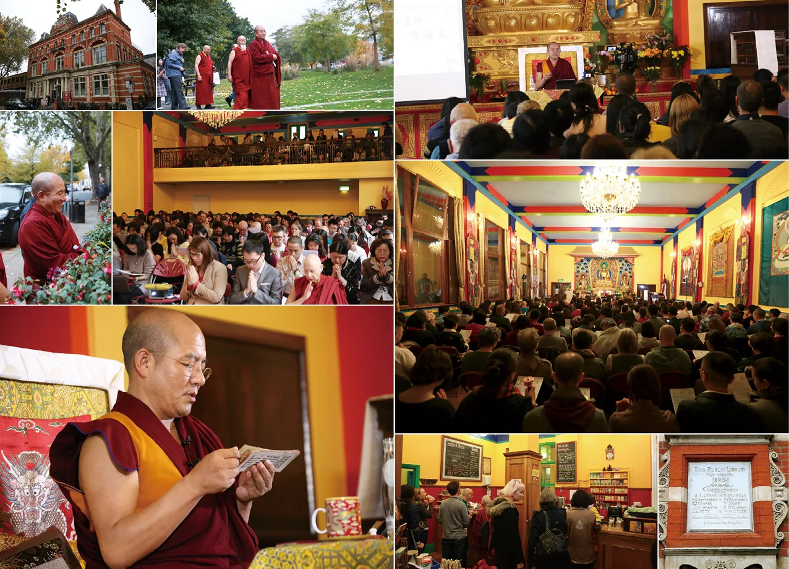
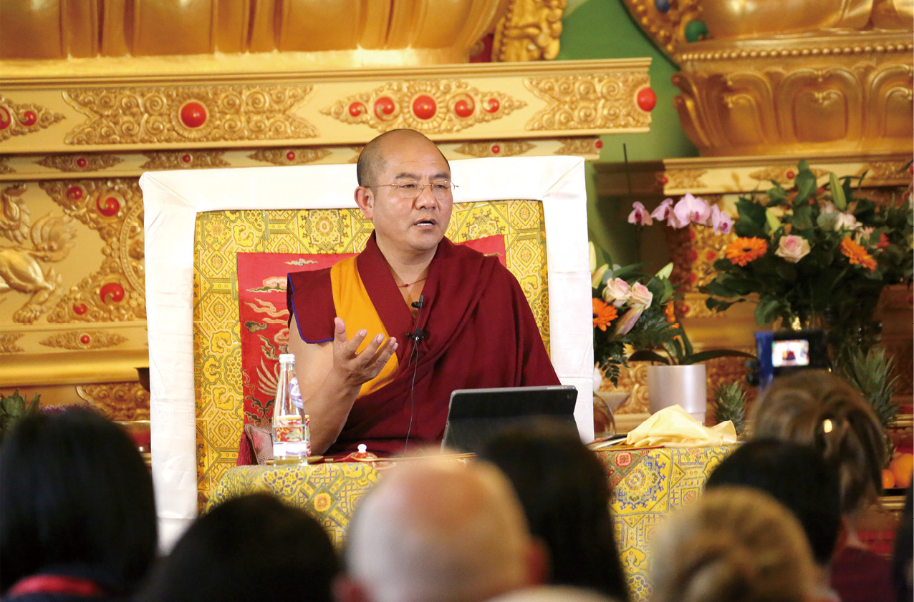
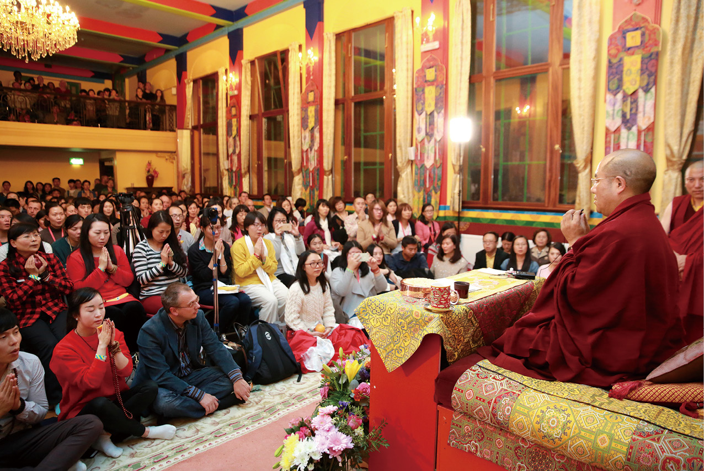
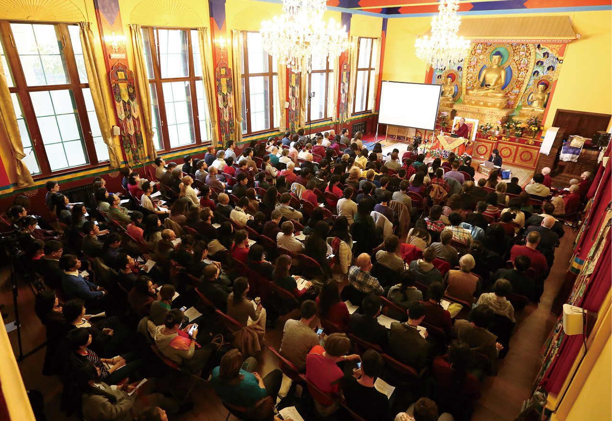
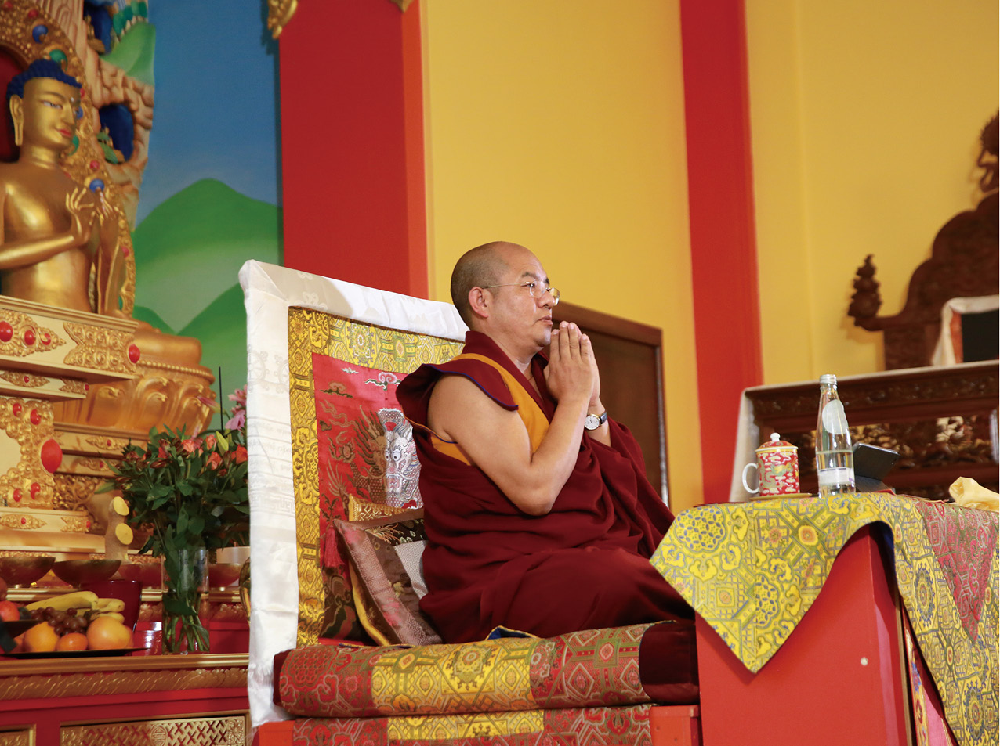

任何人在临终时，  
如果能祈祷三十五佛，  
死后就不会堕入恶趣。

第38场

英国伦敦三昧宗佛教中心

Samye Dzong London Tibetan Buddhist Meditation Centre, UK

英国·伦敦

2015 / 10 / 23

## 《三十五佛忏悔文》略释

## Brief Explanation on “The Thirty-Five Confession Buddhas”

主持人：

欢迎来到噶举三昧宗！

能邀请索达吉堪布来到这里，我们感到非常荣幸和欢喜。他是一位真正的具德上师，是大家能遇见的最棒的上师！所以，希望大家都能从堪布的开示中有所收获。堪布所教授的内容，不离良善的宗旨，他教导我们如何获得喜悦、得到幸福。我们要感谢堪布仁波切来到这里并给予开示，希望大家都欢喜听受！

接下来，堪布将用中文开示。由于我不懂中文，所以先下台了，请堪布和大众见谅，下辈子我会学习中文的。（堪布与众笑）

今天下午和晚上、明天上午和下午，我将用四节课的时间，给大家作佛法开示、给予密宗灌顶。这次传授用的语言，主要是汉语，同时配有英语翻译。其实我也可以用藏语讲，但这里的听众大多是听汉语和英语的。

有孩子的道友被安排在了其他房间，我建议让他们到现场听课。我认为，孩子从小接受慈悲等佛法教育非常重要。可能他听不懂教义，但只要他参与了，这样的经历就会给他带来深远的影响。也许他长大后会回忆：“我很小的时候，跟妈妈一起听过佛法的课，参加过佛法的活动。”他成年后的观念会跟没参加过的人有很大差别。

有些堪布、法师讲经的时候，会觉得孩子在现场影响讲课效果，所以要求“勿带小孩入场”。但我觉得，虽然孩子们有时比较调皮，哭声、笑声有一些影响，但影响也不太大——我经常把孩子的哭声当作传法中的背景音乐。做任何事情，有一些“好听”的背景音乐还是很好的。（众笑）

接下来，利用下午的时间，我准备给大家讲一讲《三十五佛忏悔文》——藏传佛教的修行人特别重视念诵这部经文。

今天选择宣讲有关忏悔的内容，是因为在座的人都有信仰，而且大多愿意修行——在修行过程中，首先要让自己的相续恢复清净。否则，恶业没有清净，修任何法都会非常困难。无论什么身份的人——有钱、没钱，年轻、年老……来到这个世界后，都造了不计其数的恶业。

佛教的《地藏经》中说，南赡部洲的有情起心动念，无不是业、无不是罪[^1]。也就是说，南赡部洲的众生在行住坐卧中，起心动念经常有很多烦恼——常生贪心、嗔心、傲慢、嫉妒等等。所以，我们平时造的业非常、非常多。

在座的一些人修行了很多年，对佛教的见解、行为都非常清楚；也有些人刚开始学，对佛教教义并不是很了解，理论基础也比较薄弱。作为佛教徒，首先应该用虔诚、恭敬的心全面了解佛教的道理。不然，你们当中的很多人，把东西方的各种现代文化、科技知识，满满地塞在大脑里，很难对法产生真正的信心。甚至随着学习，起初的分别念会变成深深的怀疑，有这样的心态很难修行成就。

我听其他法师说，噶举中心这里的工作人员和修行人，有很多在中心已经二三十年了，这样确实非常好。因为修学不能浅尝辄止，不能只是简单接触一下，而是要花一定的时间和功夫进行长期修行。长此以往，我们的修行自然而然会融入生活。当生活中的行住坐卧等一切行为与佛法相应，修行就会成功。

在座的人，对佛教教义，都能理解一些，但更重要的是长期依教修行。心如果没有在约束下进行修行，恐怕分别念将永无止息。我刚才跟喇嘛一起做了探讨，他说自己以前的心态很不好，但经过长期修行有所改变——从刚开始强迫性的闭关、修加行，到现在自然而然地修行，他感觉做什么事情都很快乐。我当时说：“作为修行人确实应该这样。”其实，每个人在修行中，都会有这样的经历，刚开始的时候，感觉修行很困难，但串习到一定程度后，即使不造作，心自然而然也会成就。

## 忏悔有次第，如理则能净

今天所讲的忏悔很重要。忏悔的方法非常多，比如，念修百字明十万遍、金刚萨埵心咒一百万遍等，以这些方法忏悔，可以让自心得以清净。

“忏悔”，在藏文中是“悔忏”——“悔”在前面，“忏”在后面。意思是说，以前我们因为无知、烦恼深重等各种原因造了很多罪业，生起后悔心后，我们发愿要把罪业忏悔得干干净净。

简而言之，忏悔的意思就是先生起后悔心，再通过修行将罪业忏干净。汉文中是先“忏”再“悔”，次第与藏文不同。总之，所谓的忏悔，就是先对自己所造的恶业生起后悔心，进而在诸佛菩萨面前发露、不作覆藏。这就叫做忏悔。

在基督教中，忏悔是很普遍的。前段时间我去了很多教堂，看到教堂中有小木屋，神父坐在里面。忏悔的人在小木屋外发露忏悔、发誓痛改前非——这是他们忏悔的方式之一。

总之，只要我们好好忏悔，罪业一定会清净。大家可能都读过米拉日巴尊者的传记。刚开始的时候，米拉日巴尊者由于家庭的变故，学咒术害死了很多人。但他后来特别后悔，于是前往依止善知识、至诚忏悔，最终在即生中获得了成就。在人类历史上，他是非常伟大的一位成就者。

在英国和中国，很多人以前不学佛，不懂取舍，所造之罪罄竹难书；现在懂得了因果，应该好好忏悔。如果能够如理忏悔，即生中就有清净的机会。

## 此经功德胜，昼夜应忏诵

为了忏悔，藏传佛教的修行人会非常精进地念百字明或《三十五佛忏悔文》。这部忏悔文在藏地有一个简略的称呼，叫做《堕忏》，意为忏悔能令众生堕入恶趣的罪业。如果没有好好忏悔，一定会堕入地狱、饿鬼、旁生当中，但若依靠三十五佛的愿力进行忏悔，不但不会下堕，反而能清净一切罪业——不仅能清净今生的罪业，也能清净往昔无量劫以来所造的罪业。

在藏地历史上，宗喀巴大师非常重视这部殊胜的忏悔文。我以前看过宗大师的传记，他每天晚上都拜三十五佛，有时向每一尊佛顶礼三十五次，有时在临睡前，一边念《三十五佛忏悔文》，一边礼拜三十五佛。总之，这是藏传佛教修行人不可或缺的法门。

在生活中，我们也可以经常念这部忏悔文。依靠对它的念诵，不仅可以于此世消灾延寿，也可以成办出世间的一切所愿。此外，临终时如果没有专人来超度、助念，那么，由身边的人为亡者念《三十五佛忏悔文》，也可以超度。

你们可能学过《普贤上师言教》，也就是华智仁波切的《大圆满前行引导文》，文中说，有些人为亡人超度、为生人祈福，都不是很如法。其实，与其以不如法的心态做某些宗教仪式，还不如以清净心念一遍《三十五佛忏悔文》或《普贤行愿品》来超度，这样做对亡人非常有利。任何人在临终时，如果能祈祷三十五佛，死后就不会堕入恶趣。如果自己实在无力念诵，那么，身边的人以忏悔文助念，也能免去临终者的一切堕罪。

《三十五佛忏悔文》也叫《三聚经》。《入菩萨行论》中云：“昼夜当各三，诵读三聚经。”意思是说，白天应该念三遍《三聚经》，晚上也应该念三遍《三聚经》，通过这种方式来清净修持菩提心过程中的一切罪障。

在座很多人都是大乘行人，在修行大乘佛法的过程中，我们也做过不如法的行为，不知道大家为此忏悔过吗？我们可以通过每天念六遍《三聚经》来忏悔——《入菩萨行论》中是这样讲的。

《三十五佛忏悔文》中讲了忏悔、随喜、回向，经文包含这三部分内容，因此也叫《三聚经》。如果各位得过灌顶、受过菩萨戒，那么按理来讲，应该每天念六遍《三聚经》：白天三遍、晚上三遍。对于这一点，学过《入菩萨行论》的人应该非常清楚。但很多人不要说一天念六遍，连六天念一遍都做不到，这也是有可能的。（众笑）

我出家这三十年来，确实没有每天念满六遍，但除特殊情况外，每天念一遍是有的。因为从刚开始学佛时，我就觉得《三十五佛忏悔文》很重要。

在今生以及无法忆念起的前世中，自己肯定造了很多罪业，如果没有清净这些罪障，即生想获得很高的境界和成就，恐怕有一定困难。所以，我刚出家的时候，就发愿每天要念一遍。但比较忙的时候，可能会有中断。如果我当天忘念了或者没念完，就隔天补上。总之，不管到了哪里，我对《三十五佛忏悔文》的藏文念诵一直很重视。

等简单介绍完每尊佛之后，我会用藏文给大家念一遍《三十五佛忏悔文》的传承。

## 逐次而宣说，诸佛胜功德

下面介绍三十五佛，图文都在PPT上。我为大家简单介绍一下每尊佛的功德、手印、身色等。

如果有时间，你们最好每天念一遍，如果实在没时间，两三天念一遍也好，因为我们每个人都需要忏悔，这真的非常非常重要。大家要知道，很多前辈修行人都把忏悔当作最重要的修行。那么相比之下，现代人的业力更加深重，因此也更需要忏悔。有很多人总说：“我现在修不成，分别念非常重。”其实这类现象与业障有一定关系。

南无释迦牟尼佛

在三十五佛中，第一位是本师释迦牟尼佛，尊称为“薄伽梵、如来、应供、正等觉、具德胜尊释迦牟尼佛”。

释迦牟尼佛身色纯金，右手作触地手印，左手持定印。他的身体具足三衣，相好圆满，身相庄严，金刚跏趺坐。如果祈祷、持诵世尊名号，可令众生不退转菩提道。而且，能够听到世尊名号的人都非常有福报。一般来说，如果没有一定福德，即生中不会有机会见到佛像、听到佛陀名号。这其中的诸多道理，推荐你们多看一下《释迦牟尼佛广传·白莲花论》。

南无金刚不坏佛

第二尊佛叫做金刚不坏佛。他的身色为金色，三衣圆满，双手作说法手印——往昔佛陀转法轮时，即作说法手印。如果我们祈祷、持诵他的名号，可以让多劫以来的身口意罪业全部清净。

我经常想，能见到这些佛像确实是莫大的福报。在座的各位也许不懂其中的功德，如果能懂得，就会明白自己多么幸运。

南无宝光佛

第三尊，宝光佛。宝光佛身红色，与阿弥陀佛的身色相近，双手结定印。一般情况下，如果释迦牟尼佛位于中央，宝光佛则位于东方。

如果持诵宝光佛名号，能令三大劫以来的所造罪业得以清净。

我们有时候说，持诵某某佛的名号能够清净多少劫的罪障，这种说法侧重说明此佛的佛号功德；而并不是说，只念一句佛号，其他什么都不用做了。所以，在讲述所持诵的佛号功德时，有不同的解释方法，而这里是侧重讲佛号的功德。

南无龙尊王佛

第四尊，龙尊王佛。龙尊王佛与其他佛有些不同，他的颈部以上是白色的，身色是蓝色的，双手作说法手印。

龙尊王佛位于释迦牟尼佛的东南方，如果我们持诵他的名号，能令八万劫以来的罪障得以清净。

南无精进军佛

第五尊，精进军佛。他位于释迦牟尼佛的南方，身色为黄色。他的右手作施护手印，取“一边布施、一边保护”之意，左手在胸前作说法手印。如果我们持诵他的名号，能够清净多劫以来所造的口业。

有些人不太会说话，常常造口业。今天说粗语，明天说离间语，后天说恶语，有时还说绮语，每天都不停地说说说……偶尔还由于贪心、嗔心的牵引，说一些不好的语言。总之，凡是口业非常严重的人，需要念精进军佛的名号。

南无精进喜佛

第六尊是精进喜佛。汉文的“南无”，应该读作“na mo”，是“顶礼”的意思，英文的发音跟藏文相似。

精进喜佛位于释迦牟尼佛的西南方，身色为黄色，双手作说法手印。如果我们念诵他的名号，能遣除意所造罪，即能清净贪心、嗔心等总的意业。

南无宝火佛

第七尊叫做宝火佛。他位于佛陀的西南方。在一些唐卡中，三十五佛的位置展现得非常清楚。

宝火佛身红色，右手作触地手印，左手作定印。持诵他的名号，能清净盗窃三宝物的罪业。若发心人员不小心令三宝的食物、财物有损失，通过祈祷这尊佛，能清净相关罪业。

我特别欢喜见到唐卡上的佛像，不知道你们有没有同感？

南无宝月光佛

第八尊是宝月光佛。他的身色洁白，左手结定印，右手作触地手印。如果我们持诵他的名号，能令一劫以来所造罪业得以清净。

南无现无愚佛

第九尊，现无愚佛。他在佛陀的北方，身色碧绿，双手在胸前持说法手印。持诵他的名号，能令宣说四众弟子过患的罪业得以清净。

南无宝月佛

第十尊是宝月佛。他的身色为白色，双手持说法手印。如果持诵他的名号，可以清净五无间罪中杀母的罪业。

西方有些人对父母本来就不孝顺，现在一听这个，如果觉得念这尊佛的名号，就可以名正言顺地不孝顺父母，甚至杀害父母，这是不太合理的。

南无无垢佛

第十一尊，无垢佛。无垢佛身蓝色，双手结定印。持诵他的名号，可以清净杀父的罪业。

很多人对念诵《三十五佛忏悔文》的功德，以及其中每尊佛的手印等都不清楚。其实，在藏传佛教中，《三十五佛忏悔文》是一部很重要的经典，描绘它的唐卡也很常见。所以我稍作讲解，这样你们持诵佛号时，就可以知道每尊佛的功德。

南无离垢佛

第十二尊，离垢佛。我们现在用的这个版本有点不同，因为在个别版本中，有这尊离垢佛，但没有前一尊无垢佛[^2]。

通过念诵离垢佛的名号，能清净许多罪业。他的身色金黄，右手作触地手印，左手结定印。

南无勇施佛

第十三尊，勇施佛。他的身色为黄色，双手作说法手印。如果持诵他的名号，可以清净杀阿罗汉的罪业。

南无清净佛

第十四尊，清净佛。清净佛身黄色，右手作触地手印，左手结定印。如果念诵他的名号，能清净五无间罪中破和合僧的罪业。

南无清净施佛

第十五尊，清净施佛。他的身色为红黄色，双手持说法手印。持诵他的名号，能够令出佛身血的罪业得以清净。

南无娑留那佛

第十六尊是娑留那佛。他的身色为白色，双手结定印。如果祈祷、念诵他的名号，能清净过去生驱逐阿罗汉等罪业。

南无水天佛

第十七尊，水天佛。水天佛的身色也是白色，双手持说法手印。若往昔有杀害菩萨等罪业，通过持诵这尊佛的名号，可以令罪业清净。

南无坚德佛

第十八尊，坚德佛。他的身色为黄色，右手作施护手印，左手结定印。如果念诵他的名号，可以清净杀害阿阇黎、师长等罪业。

南无旃檀功德佛

第十九尊是旃檀功德佛。其身色为白色，右手作触地手印，左手结定印。如果念诵他的名号，可以清净供斋时处理食物不当的罪业。

南无无量掬光佛

第二十尊，无量掬光佛。他的身色为红色，双手作说法手印。如果持诵他的名号，往昔毁坏佛像、佛塔等罪业可以清净。如果此生不小心损坏了佛经、佛塔，持诵无量掬光佛的名号，也可以清净罪业。

南无光德佛

第二十一尊，光德佛。其身蓝色，双手持说法手印。以持诵其名号的功德，能够遣除过去生中由嗔恨所造的罪业。

有些人的嗔恨心很重，但修行人应该尽量不生嗔心。如果所处环境可以改善，我们不用生嗔，去改善环境就可以了；如果想改变却无济于事，那么再怎么生气也没有用。所以我希望，修行人一定要改变心态。如果心态无法改变，就谈不上是修行。当然，在不修行的人当中，也有心态好、很快乐的人。

总之，修行中一定要学会观察自己的心。

南无无忧德佛

第二十二尊，无忧德佛。他的身色浅红，双手结定印。持诵他的名号，能遣除过去生由贪欲心所造的一切罪业。

众生在世间有无尽的欲望和贪婪，如果想完全断除贪心，的确有一定困难，但尽量减少自己的贪欲很有必要。

南无那罗延佛

第二十三尊是那罗延佛。其身黄色，双手持说法手印，持诵他的名号也能清净很多罪业。

南无功德华佛

第二十四尊，功德华佛。他的身色金黄，右手拇指和食指作相捻手印，置于膝盖上；左手作说法手印。通过持诵他的名号，能令多劫以来的罪障得以清净。

在有些版本中，此处的佛名为“南无清净光游戏神通王如来”。

南无莲花光游戏神通佛

第二十五尊，莲花光游戏神通佛。其身红色，右手作触地印，左手结定印。持诵他的名号，能令过去七劫中所造罪业得以清净。

南无财功德佛

第二十六尊，财功德佛。他的身色为蓝色，双手结定印。持诵他的名号，能遣除烦恼习气的罪过。

南无德念佛

第二十七尊是德念佛。其身色为黄色，双手结定印。持诵他的名号，能遣除一切身体所造罪业，比如，杀生、邪淫、偷盗等。

南无善名称功德佛

第二十八尊，善名称功德佛。他的身色洁白，右手作说法手印，左手结定印。念诵他的名号，能清净无始以来因不喜爱善法而造的罪业。

南无红炎帝幢王佛

第二十九尊，红炎帝幢王佛。他的身色是蓝色，右手持宝幢倚在左肩，左手结定印。念诵他的名号，能遣除由嫉妒心所造的罪业。

南无善游步功德佛

第三十尊佛叫做善游步功德佛。其身蓝色，右手持宝剑，左手结定印。持诵他的名号，可以清净唆使他人造恶的罪业。

南无斗战胜佛

第三十一尊是斗战胜佛。其身蓝色，双手于胸前持盔甲。念诵他的名号，能遣除傲慢所生之罪障。

南无善游步佛

第三十二尊，善游步佛。其身蓝色，右手作触地印，左手结定印。以持诵其名号的功德，能遣除两舌，即“离间语”的罪业。

南无周匝庄严功德佛

第三十三尊，周匝庄严功德佛。他的身色为红黄色，右手作施护手印，左手结定印。持诵他的名号，能够清净随喜他人作恶的罪业。

比如“今天你干了坏事，太棒了！”“今天美国跟伊拉克打仗，随喜赞叹！”“俄罗斯打叙利亚、美国打叙利亚，打得好！”诸如此类随喜恶业的罪业都能得以遣除。

南无宝华游步佛

第三十四尊是宝华游步佛。他的身色是红黄色，右手作施护手印，左手作说法手印。持诵宝华游步佛的名号，能令谤佛、谤法的罪业得以清净。

南无宝莲花善住娑罗树王佛

最后，第三十五尊佛是应供、正等觉、宝莲花善住娑罗树王佛。其身黄色，双手结定印，定印中间托妙高山，即须弥山。持诵他的名号，能遣除诽谤上师、违犯三昧耶戒的罪业。

以上就是三十五佛的功德以及庄严身相等。

## 结摄忏诸罪，随喜及回向

后面的内容，我从字面上简单做一下介绍。

如是等一切世界，诸佛世尊，常住在世，是诸世尊，当慈念我。若我此生，若我前生，从无始生死以来，所作众罪，若自作，若教他作，见作随喜。

在这部《三聚经》中，现在讲的是随喜的部分。

十方所有世界正在住世的如来正等觉，请您们垂念我。我于今生、前世以至无始以来，在轮回任何一处所造的罪业，包括自己所造、让别人造、见别人造业而随喜——这些罪业我全部忏悔。

这段经文，在汉语和藏语的版本中，都有些不容易理解的地方，我简单解释以后，可能会好懂一些。你们不要认为会念英语原文就算懂了，等一会儿我要考试。（众笑）

若塔若僧，若四方僧物，若自取，若教他取，见取随喜。五无间罪，若自作，若教他作，见作随喜。十不善道，若自作，若教他作，见作随喜。所作罪障，或有覆藏，或不覆藏，应堕地狱饿鬼畜生，诸余恶趣，边地下贱，及篾戾车，如是等处。所作罪障，今皆忏悔。今诸佛世尊，当证知我，当忆念我。

对佛塔以及四方僧众的财物，自己取、让别人取、见别人取而随喜（“取”在这里是偷或抢的意思），我对这些罪业一一忏悔。对曾经所造的五无间罪——自己做、教唆别人做、见别人做而随喜的罪业，我也一一忏悔。对十种不善业——自己造、叫别人造、见别人造而随喜的一切罪业，也好好忏悔。

如果由于没有忏悔而被罪障所覆，我等有情将堕入地狱、饿鬼、旁生，或转生到长寿天。即使获得人身，也将转生为诸根不具、持邪见者，或转生到边地成为篾戾车[^3]，甚至会转生到佛不出世之时劫[^4]。

所有罪障，我今对世尊发露忏悔。您是能证者，通达一切智慧；您是眼证者，是弟子的见证人；您是称量者，是唯一的量士夫；您是知者，具一切智智，为一切见者……在您这样的殊胜主尊、世间导师面前，我至诚发露忏悔、不覆不藏，并发愿今后永不再犯。

前面第一部分是随喜，第二部分是忏悔，下面是《三聚经》的最后一部分——回向。

我复于诸佛世尊前，作如是言：若我此生，若我余生，曾行布施，或守净戒，乃至施与畜生一抟之食，或修净行，所有善根，成就众生；所有善根，修行菩提；所有善根，及无上智；所有善根，一切合集，校计筹量，皆悉回向阿耨多罗三藐三菩提。

这段内容也包含了“愿一切佛垂念我”之义。我于今生、前世乃至无始以来，在轮回的任何一处，哪怕对旁生仅仅有一抟之食的布施，我也把我做布施的善根，以及护持戒律、清净行为的善根、成熟有情的善根、修无上智慧的善根……将这些善根全部集聚，经审视、筹算之后，在世间无与伦比、无比超胜、一切殊胜中最殊胜的世尊面前全部回向。回向的目的是让所有众生获得无上正等觉的果位。

如过去、未来、现在诸佛所作回向，我亦如是回向。众罪皆忏悔，诸福尽随喜，及请佛功德，愿成无上智。去来现在佛，于众生最胜，无量功德海，我今皈命礼。

过去诸佛怎么回向，未来诸佛怎么回向，现在诸佛怎么回向，我也这样回向。愿所有罪业得以忏悔，所有福德皆已随喜，祈请十方诸佛，让我获得无上智慧。过去、现在、未来的所有世尊，是最超胜的人中之尊，对于他们如海的无量功德，我在这里合掌、皈依。

我一边念一边解释，也算传了汉文传承。刚才有人说英文翻译得很通顺，等会儿我要考一两个人，让他们讲一下，看是不是真的懂了。（众笑）

下面还有两个颂词。

> 菩萨具足大悲力 勇士救护利有情

> 普救无依罪恶我 彼诸菩萨我皈依

菩萨圆满具足大悲力，利益、救度一切有情。祈请菩萨救护无依无靠、罪恶的我，为此我在诸位菩萨面前进行皈依。

以上是第一个颂词。下一个颂词是：

> 身业有三种 口业复有四

> 以及意三业 十不善尽忏

> 愿戒净无垢 无执戒度圆

> 无始至今生 十恶五无间

> 心随烦恼转 诸罪皆忏悔

对于三种身业、四种口业、三种意业——共十种不善业，我今皆忏悔。愿戒律无有垢染、清净圆满；愿从无始直至今生，十恶业、五无间罪等一切因烦恼而生的罪业，全部得以清净。

## 劝沉潜温习，能释此经义

以上是汉文版《三十五佛忏悔文》的讲解。汉文有很多不同版本的翻译，我对比过藏汉的几个版本，内容基本相同。接下来，我给大家念一遍藏文传承。

明天我可能要抽几个人，来解释一下《三十五佛忏悔文》。今天讲了一堂两小时的课，有些人可能听懂了，有些人可能没听懂，没听懂的人还要继续努力。总之，希望大家课后还是复习一下。虽然我在这里只代课一两天，但也有考试的权力。（众笑）

（堪布念诵《三十五佛忏悔文》藏文传承）

很多藏族修行人，包括一些法师，都不会解释《三十五佛忏悔文》。所以我希望你们空出时间，通过汉文或英文好好地看。明天也许考试，也许不考试。如果要考，我会根据报名名单，抽两三个人。抽到的人，可以用英语讲，由翻译译成汉语我来听；或者直接用藏语或汉语讲，我可以听懂这两种语言。

听完这堂课，希望大家都要会讲解《三十五佛忏悔文》——其中每一尊佛的相关内容都要能解释。在念诵、忏悔的时候，要知道经文的内容是什么。其实，这部经的藏文版是很难懂的，汉文版也不太好懂，所以，你们说英文版好懂，我不太相信。（众笑）

[^1]: 《地藏菩萨本愿经》：“南阎浮提众生，举止动念，无不是业，无不是罪。何况恣情杀害，窃盗邪淫妄语，百千罪状。”
[^2]: 《三十五佛忏悔文释》（第二课）：“这里跟藏文的版本稍微有一点差别。藏文当中虽然有离垢佛，但前一位无垢佛却是没有的。”
[^3]: 篾戾车：又作蔑隶车。旧曰边地。下贱种也。
[^4]: 此段描述的是八无暇处。经云：“地狱饿鬼与旁生，边鄙地与长寿天，邪见不遇佛出世，喑哑此等八无暇。”
