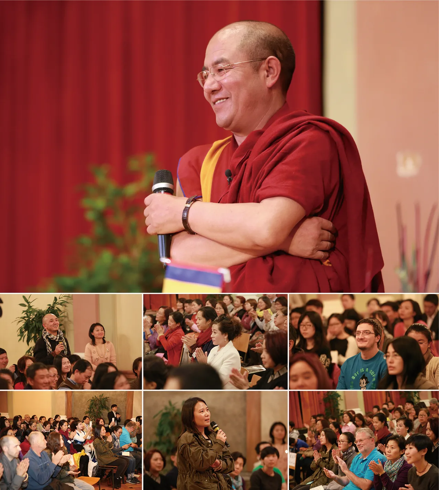
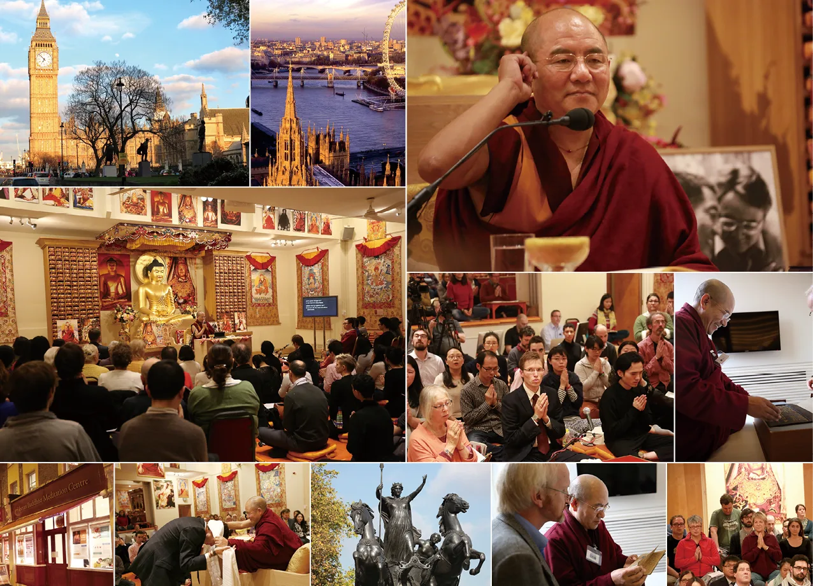
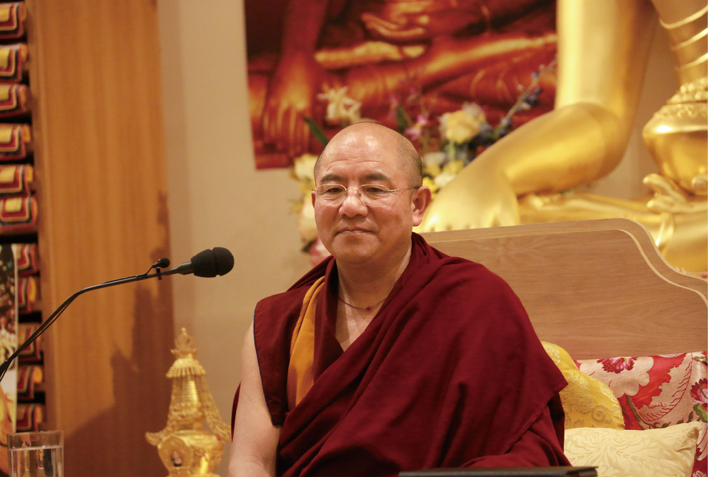
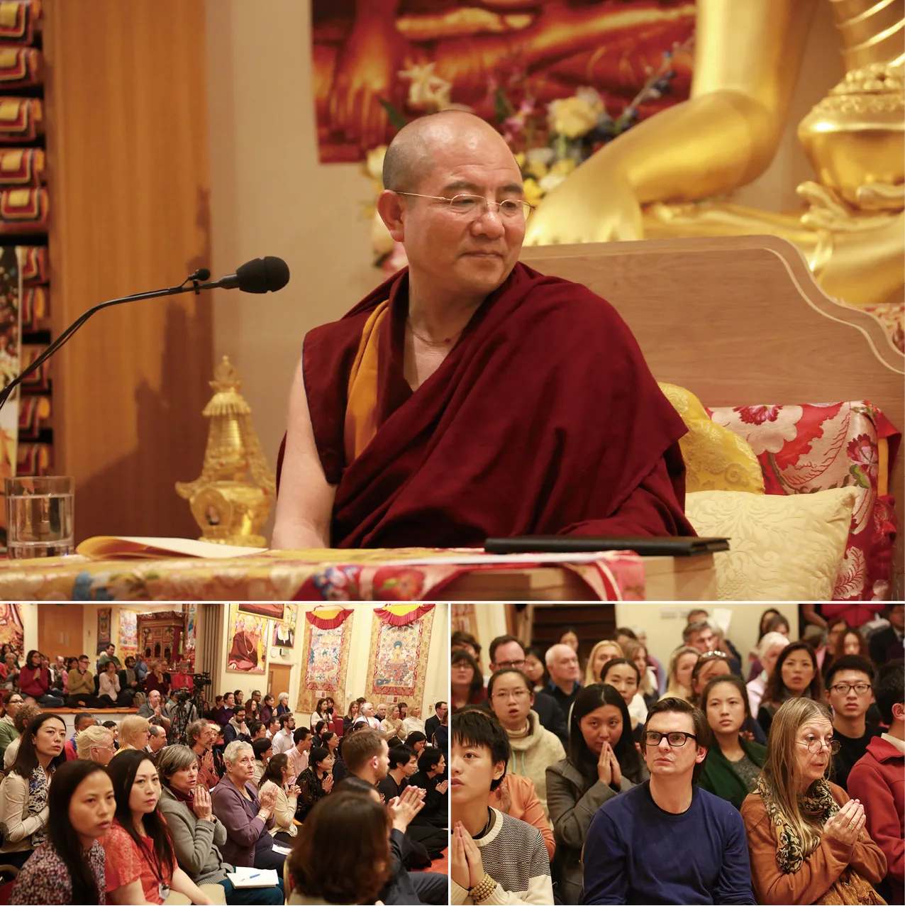
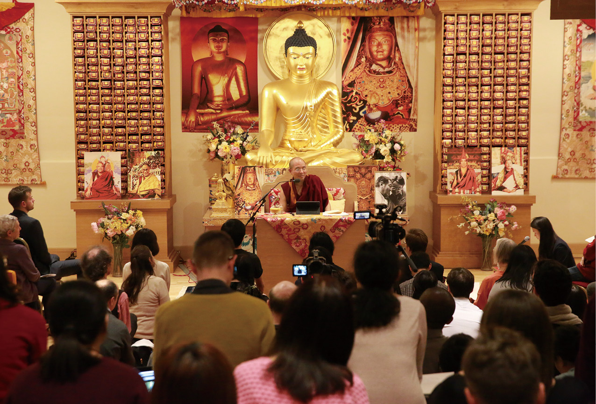
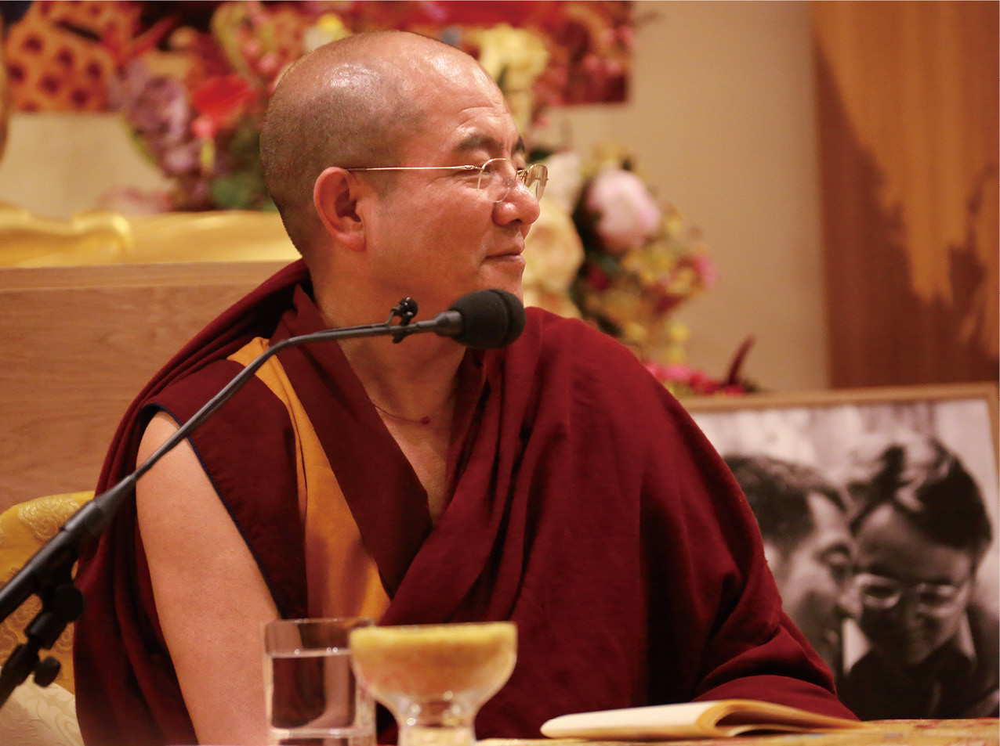
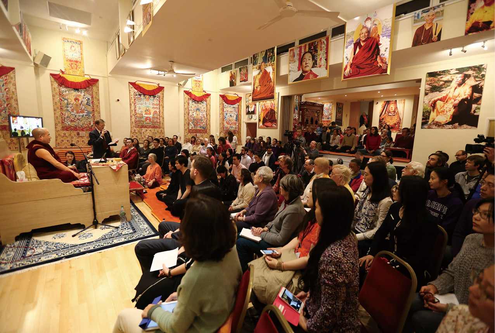

法王经常讲，纵然依止他一百年，  
所获得的教言也没有比这更殊胜的了。

第37场

英国伦敦索甲仁波切中心

Rigpa London Centre, UK

英国·伦敦

2015 / 10 / 21

## 《忠言心之明点》略释

## Brief Explanation on “The Heart Essence: My Heart's Advice”

主持人：

尊敬的堪布，非常欢迎您的到来！也欢迎今晚到场的每一位朋友，很多人从很远的地方来到这里。第一次来列绕林中心的朋友，有些可能没有见过堪布，下面让我为你们介绍一下。

索达吉堪布受教于堪钦[^1]晋美彭措仁波切，是仁波切最主要的汉语翻译，并被委任为堪布，为汉众传讲佛法。如今，索达吉堪布已成为当代最杰出的法师之一。堪布不仅是藏传佛教的上师、法师、学者，还是多产的藏汉翻译家、现代佛学思想家。他在亚洲乃至西方都享有盛名。

堪布注重将传统佛教与全球问题、现代生活相结合。他曾亲口说：“我不知道自己能活多长时间，但只要有一口气，哪怕只有一个人听法，我也会尽心尽力地用佛法饶益他。”

堪布，我们非常欢喜您来为我们传讲佛法！因为堪钦晋美彭措仁波切的缘故，我们感到列绕林与您有甚深的缘分。索甲仁波切也非常赞叹您在亚洲的弘法事业。在此，我代表列绕林中心和今晚在场的听众，怀着欢喜之情欢迎您的到来！

请赐予我们教授。感恩堪布！

很高兴来到索甲仁波切的列绕林中心与大家交流。

二十多年前（1993年），我跟法王晋美彭措一起去过法兰西的Rigpa中心。当时，我们有到访英国和荷兰的计划，但未能成行，就直接返程了。

刚才，我看到了当年与索甲仁波切的合影，以及二十多年前我年轻时的照片[^2]。这次我来欧洲，很荣幸地见到索甲仁波切两次，一次是在意大利，一次是前段时间刚到这里的时候。因此，因缘非常殊胜。

## 传讲开始前，稍作略介绍

下面按照今天的安排，给大家做简单的传授，采用的是藏传佛教传统的传讲方式。

平时我去学校讲课，一般不讲真正的佛法，因为学校里的老师和学生大多不懂佛法；我也不讲世间法，因为世间法我不太懂，也没有很大兴趣，所以我在学校里讲的内容可能有点不伦不类。

今天，我要正式讲一些佛教义理，按照藏传佛教寺院对论典的解释方法，对每一个颂词做简单讲解，同时，大家根据法义一起思维，以这样的方法传授。授课圆满后，如果还有时间，再进行互动问答。

今天要讲的是堪钦晋美彭措的一部殊胜论典，此论典造于堪钦1987年前往五台山的时候。当时，藏地的高僧大德与汉地的信众基本没有联系，所以可以说，是以那时的缘起，令藏传佛教在汉地再次复兴。对于这一点，很多了解历史和实际情况的人都清楚。

对于堪钦晋美彭措，我在这里不用做过多介绍，你们应该有所了解。其实，那时法王到Rigpa和列绕林时曾说：“伏藏大师列绕朗巴[^3]的转世，可能会显现为一个出家相和一个在家相。”出家相的化身，根据诸多授记所说，就是堪钦晋美彭措，主要在东方弘扬佛法；而在家相的化身，即是索甲仁波切，主要在西方弘扬佛法。也许有些人会认为这是一种自夸，是弟子对自己上师的赞叹，但通过我对两位大德弘法愿力、事业的观察，我对这种说法完全有信心。

接下来，我用藏语念一句颂词，再用汉语进行解释。大家可以按照《忠言心之明点》的英文法本，一起来学习。对你们来说，这种讲法可能比较特别。

## 闭关时造论，智慧中涌现

《忠言心之明点》由法王智慧中倏然流露，此道次第论极具加持，是涵摄整个藏传佛教显宗、密宗的次第论总集，非常殊胜。那么，这部论典的造论缘起是怎样的呢？五台山有一个善财洞，1987年时法王在善财洞闭关。洞上方有一小山，山顶是文殊菩萨广转法轮的圣地之一。当时，法王在善财洞山顶上的帐篷里，突然说有一个教言要我记录。我飞快地把法王的智慧流露现场记录下来，仅用了23分钟。我亲眼见证了整个过程，确实非常稀有。

1989年，我用藏文写了一本《忠言心之明点释义》，对每个颂词做了较多解释，应该有十多万字。这本书当时印过一次，但二十多年后，原本几乎没有了——前段时间我拼命找，也只找到一本。虽然我写过这本书，但这本书在藏地不怎么出名——也许是我不出名的原因（堪布笑）。慈诚罗珠堪布也写过一本释义，比我写的简略一些，但他的书也不怎么出名。（众笑）

## 论名：《忠言心之明点》

这部论典叫《忠言心之明点》，从论名可知，它是法王最重要、由内心最深处流露的教言，犹如心灵的精华醍醐。

法王经常讲，纵然依止他一百年，所获得的教言也没有比这更殊胜的了。如果这部论典没有修好，即使依止他也没有用；如果这部论典修好了，即使没有见过他，也与他的亲传弟子无异。

> 众佛菩萨诸三密，总集成熟相好身，

> 语之杲日童子尊，令汝心转菩提道。

这是对文殊菩萨的顶礼句。十方所有诸佛菩萨一切智慧功德，都集于文殊菩萨一身。祈祷文殊菩萨加持所有弟子。

这一颂旨在以吉祥文祈愿[^4]文殊菩萨加持所有传承弟子。其缘起是，一方面，当时的造论之处在文殊菩萨道场——五台山；另一方面，法王的著作前，大多有对麦彭仁波切或文殊菩萨的顶礼句。

接下来是开显讲述此教言的原因：

> 相应无边众信解，深广法理虽无量，

> 归摄要诀实修法，心语心要授心友。

佛陀随顺不同众生的根基，宣说了广大、甚深无量无边的法门，但若归纳为一个核心修法，就是本论所讲的内容。所以法王说，我要给你们讲一个最简要的实修要诀。

若想在末法时期修行八万四千法门，基本不太可能——很多人终其一生，连看一遍《大藏经》都无法做到。因此，若想通过浅显的方式，了达释迦牟尼佛所有的深广法门，就要闻思修行这部论典。法王说：“我对自己最贴心的弟子们，才宣讲这样的教言。”

教言窍诀在藏传佛教中不可或缺，而且对修行人，尤其是老年修行人，非常重要。

本论宣讲的次第很清晰，首先讲修行的违缘、顺缘、基础。

如何避免修行的违缘？就是不能太贪执今世：

> 贪今生离修法缘，愈享欲妙愈增贪，

> 利乐称誉无了时，如梦买卖当舍弃。

耽执今生的名闻利养等世间八法[^5]，贪执名声、财物、世间快乐，享受世间的种种欲乐，都只会令贪欲不断增长，没有完结之时。其实，享受世间快乐就像在梦中做交易一样，毫无实义。

作为一个修行人，不能过度耽执今生，否则永远不会有修行的时间。当然，对于世间法，我们也不能完全舍弃——并不是说学佛之后就要抛弃家庭、放弃工作。在《杂阿含经》中说[^6]，佛教徒同样可以经商、种田、畜牧、建造，这些工作都是被允许的。但是，如果要做一个好修行人，也不能把所有时间都用在世间法上，否则，直到死亡，修行也不可能成功。

按照藏传佛教噶当派的传统，修行人应当看破世间。法王用这个教言教诫大家，不要太过执著世间法。

下一偈讲修行的顺缘是依止善知识：

> 于能增长众功德，远离一切诸过患，

> 殊胜具相善知识，以三喜依成心意。

如果我们能依止一位很好的善知识，那么，贪嗔痴等所有烦恼过患都会远离，闻思修行的所有功德都会增上。所以，对具足法相的上师，我们要通过三种欢喜来依止——为令上师欢喜，上等者以修法供养，中等者以承侍供养，下等者用欧元、美元、人民币等货币、财物供养。不过，也会有“上师”喜欢下等的供养。（众笑）

我个人而言，喜欢上等的供养，自己外出演讲时没有接受过钱财供养。去英国时，我没有接受英镑，所以还不知道英镑的样子；去年去美国时，也没有接受美元。我去过很多国家，有些人以为我会带很多钱回国，有位藏族喇嘛就对我说：“你这次去了那么多国家，肯定有一大堆美元。”但实际上，我没有美元，因为我假装喜欢接受上等的供养。（众笑）

我们依止善知识，一定要长期。同时，要常常祈祷上师，这一点很有必要。Rigpa中心的很多三宝弟子对上师很有信心，从许多方面都可以看得出来。我那天也跟索甲仁波切说：“在《西藏生死书》里，我最赞叹的就是您和上师之间的精彩故事。”所以，对上师具足信心、常常祈祷非常重要。也许在西方的思维模式中，崇拜偶像不一定合适，但依靠恭敬祈祷，确实会给我们心灵带来无穷的力量。

下面讲修行的基础——戒律：

> 如求空中欢乐园，诸增上生定胜富，

> 失戒者无得是处，具知念谨调自心。

如果没有戒律，即生与来世的快乐、暂时与究竟的安乐都无法获得，就像在虚空中无法建造花园一样。所以，每个人在修行时，先要守持戒律。在家人有在家人的三皈五戒，出家人有出家人的戒律，总之，要有正知正念，令自己不放逸。

具正知，要经常观察自己的三门；具正念，不能忘失善法；同时，要注意小心谨慎——须用这三种方法经常观察自己。

不同的人需要受持的戒律也不同。如果可以守住人格、具足戒律，其他修行都很容易成功。

以上讲了修行的违缘、顺缘以及基础。我们要观察自己——是不是特别贪恋今世？有没有戒律基础？有没有上师的指导？虽然这个颂词看似简单，但它对真正的佛教徒来说，非常重要。

接下来讲学习佛法要闻、思、修，这是藏传佛教非常重视的。

首先是闻所生慧：

> 无始至今如疯子，独漂轮回痴暗中，

> 今为寻求寂乐宫，理当喜闻佛法海。

无始以来，我们像疯狂的人一样，漂泊在无明轮回中。现在，为了寻求解脱的宫殿，一定要听闻浩瀚如海的佛法。

我们要习惯在多位上师面前听闻佛法，就像世间人在学习世间知识时，要读小学、中学和大学一样。总之，为了解脱，一定要听闻佛法。如果没有听闻，根本不懂法理和窍诀，修行就变成了盲修瞎炼。所以，在闻思修的过程中，闻法是第一位的。现在有些佛教徒，未经闻思就盲目修行，这肯定是不正确的。

第二个是思所生慧：

> 唯闻不能断增益，难以诚信佛与法，

> 故以百般讲辩著，思所生慧铭刻心。

仅仅是听闻佛法，还不能断除我们的怀疑，尤其是对本师释迦牟尼佛、对佛法还不能生起真正的信心。因此，我们应该通过讲课、辩论、造论来断除增益。

“讲、辩、著”是藏传佛教非常重视的。按照这三种方法，反复探讨、辩论、造论、讲论等，以多种方式深入法义，最终一定能对佛法生起不共的、不退转的信心，这一点非常重要。

现在很多人不思维法义，不会辩论、不会讨论，更不会讲法，只满足于听一些简单的佛教名词，这样不太保险。因此，系统闻思非常重要。

第三个是修所生慧：

> 博通宗派大法师，未调自心如鹦鹉，

> 死亡骤至懊悔因，教义入心诸心友。

即使一个人会讲千经万论，学术上什么都精通，但如果没有好好修行，讲法也会像鹦鹉学舌一样。鹦鹉非常聪明，教它一句，它会重复一句，但它根本无法理解词句所表达的意义。不重视修行的人，在死亡降临的时候，会非常可怜，因为他将感受死亡的恐惧、以恶业结生后世的痛苦。

所以，自己得到的教言一定要付诸修行。在我去过的大学里，有些教授一生研究佛法，但从来不修行，包括我这次去的牛津大学、剑桥大学，有些老师的学问很不错，我也很佩服，但他们对佛法的探索只局限于学术研究，所以我为他们感到遗憾——或许他们临终时会跟凡夫人一样，很痛苦、很可怜。

法王在这个颂词中告诫大家：不要只满足于学术和理论研究，应该实地修持。否则，自己的相续始终不能与法相应。

由于修行非常重要，因此，在下面的偈颂中，再三强调修行。

> 佛说浩瀚众法理，唯调自心之方便，

> 复次劝请莫耽句，胜深要义融心底。

释迦牟尼佛宣说的八万四千法门浩如烟海，其目的归根结底就是调伏自己的心。换句话说，佛陀宣说各种法门的目的，就是为了令众生开悟、真正了解自己的心。

法王在这里劝诫我们：不要耽执于词句。如果每天只是在文字上看一下，没有深入修行，非常可惜。对于这些甚深教言，我们一定要记在心里，并好好修行。很多人是遵循次第、从头开始修的。但也有些人喜欢从高法开始修，听说很多外国人，先观心的本性，然后再修加行，其实这样的次第有一些颠倒——按理来讲，应该先修加行、再观心性，这样比较稳妥。

前面讲的是整个修行次第中的基础部分，下面广说真正的修行。

闻思修要以“前行、正行、后行”次第进行。修无上大圆满前，须修“共同前行”——按照华智仁波切的《大圆满前行·普贤上师言教》，修人身难得、寿命无常、因果不虚、轮回过患；然后修“不共加行”的皈依、发心、百字明等。

首先是人身难得：

> 难得此身如昙花，具义超胜十万宝，

> 未来难得如是故，成办大义莫懈怠。

在轮回中获得人身如昙花一现，极为罕见。昙花绽放的时间非常短暂，同样，具有意义的人身，其珍贵性胜过十万珍宝。

现在拥有珍贵的暇满，千万不要散乱、懈怠、天天睡懒觉。不要认为英国的天气不好，就一定要睡好（众笑）。有些人说冬天下午四点太阳就落山了，所以从下午四点钟一直睡到第二天八九点钟，这样不太好。既然人身这么难得，就应该好好工作、好好修行，不要太懈怠。总之，这个颂词是劝诫我们要珍惜人身。

下面是寿命无常：

> 死主大敌如霹雳，谁亦不知何时至，

> 无暇住留数岁月，当下理应修善法。

死亡犹如霹雳，突然就会降临。因此，什么时候死、以何种方式死、在什么地方死，谁也无法测度。其实，我们不一定能在这个世界住留很长时间。时光匆匆，万物无常，因此，应该马上修行。

无常观对佛教修行人尤为重要。世间人由于不懂无常，会认为“我可以在这个世界上活很长时间”。修习过无常的人，当生活、工作、感情发生变故时，会很坦然：“一切都是无常的。”比如，以前有钱而现在没钱了，会意识到只是无常现前；以前没钱而现在突然发财了，也会知道是无常的示现，因此对钱财不会太执著。又比如，以前长得很好看，现在不好看了，会明白：“这是无常的，我以前还是很美的。”当然，以前不好看，现在变好看了，因为做了整容，这也是无常（众笑）。总之，我们确实需要有观无常。

刚才索甲仁波切问：“汉地人的性格跟西方人有什么不同？”我认为的不同点是，我说的有些话，汉族人笑得“哈哈哈”，但西方人好像没有感觉。（众笑）

下面是业因果：

> 有情业果不虚耗，果报临头不可改，

> 如今具缘自在时，自欺自己谁能救？

众生所造的业，若无对治，永远无法耗尽，一旦因缘成熟，谁也无法阻止果的产生。

所以，在业未成熟时，不要自欺欺人、不要造恶业。如果造恶业，等恶果成熟时，谁也无法救护，就像已经被关进监狱的人，谁也没办法立刻把他救出来。同理，一旦堕到地狱中，谁也没办法直接救护你。因此，相信业因果非常重要。

下面是轮回过患：

> 难忍轮回诸痛苦，唯念能令毛耸立，

> 无数苦逼身心时，如何是好当自忖。

轮回中恶趣的痛苦，仅仅忆念、听闻、看图，都会毛骨悚然，感到非常恐惧。那么，如果这样的痛苦无边无际、逼迫你的身心，你能忍受吗？

讲理论的时候，也许你们都讲得头头是道，但对于真实的修行，很多人还没生起定解。

如果对业因果深入修行，自然会常常忆念轮回过患：“如果我转生到地狱，那可怎么办？”据我所知，有些佛教徒并不相信因果，这样的“修行人”很可悲。理论与修行相结合是很重要的。

下面是不共加行中的第一个——皈依：

> 如此大怖极难脱，余处不得引导者，

> 无欺智悲力主尊，如是三宝当皈依。

上面讲了轮回痛苦，如果想从轮回中解脱，那么，除三宝外，没有其他皈依处；除了依靠“佛宝、法宝、僧宝”三宝的力量以外，没有其他方法。所以，我们一定要真诚地皈依具有智、悲、力的三宝。

有些人说：“不用皈依，只要心清净就可以。”其实这是不懂皈依、不懂佛理的说法。因为只是心清净还不够，如果根本没有皈依的心，也没有皈依的仪式，不是真正的皈依。

在藏传佛教中，修无上密法之前，“人身难得”等共同加行要修很久。修完后，再念“皈依”十万遍、“发心”十万遍、“百字明”十万遍、“磕大头”十万遍、“供曼茶”十万遍，这就是五十万加行。

以五十万加行作为基础，对于真正修密法的人来说，非常非常重要。如果有加行基础，再修密法的生起次第、圆满次第、大圆满，就会很容易成就。如果没有打好加行基础，即使得过一些窍诀，你的修行也会像没有地基的墙，不一定稳固。

下面是发菩提心：

> 求自乐生三有苦，利他心生诸妙乐，

> 故当追随人天师，发最无上菩提心。

三界轮回的一切痛苦，源于只追求自身的快乐；三界的所有安乐，源于行持利他。因此，我们一定要追随本师释迦牟尼佛，发无上菩提心、修行大乘道，这一点很重要。

现在有很多修行人，很重视自己的成就，但实际上，自己的终极成就就是利益众生。因此，如果发菩提心，就会有成就的机缘。

下面是忏悔——念百字明：

> 自心觉界水晶镜，客尘障碍遮覆时，

> 难现深明等持影，四力白布应勤拭。

我们的心像一面明清的镜子，如果被尘垢遮障，就无法显现任何影像。同样的道理，如果有很多烦恼遮障我们的佛性，那么，修很多法也无法成就。所以，一定要以四种对治力——所依对治力、厌患对治力、返回对治力、现行对治力来摄持，精进地念百字明，以此“擦拭”我们的心。

以上是显宗的加行部分。下面是密宗的正行部分。现场有些人可能没有得过灌顶，也没有修过加行，所以接下来的内容我就简单念个传承，根据科判作简单介绍，不详细讲，因为害怕泄露秘密。

首先是生起次第：

> 了知显现声心识，本是本尊咒法性，

> 不离此见转修箭，自如折服摄受行。

“生起次第”是观外器世界、内情世界等万法皆为清净的修法。通过修清净观，把不清净的见解转为清净的见解。继而，通过息、增、怀、诛四种事业获得成就。

下面是圆满次第：

> 以命勤持身幻轮，能招明乐无念伴，

> 光明幻身自在故，圆满次第融心底。

“圆满次第”是对身体风、脉、明点的修行。通过这种瑜伽，最后能现前光明身或幻化身。这个颂词是劝诫我们要好好修行圆满次第。

接下来，讲大圆满的殊胜特点：

> 五浊黑暗尤重时，八乘星光难驱散，

> 绝密心滴万光日，三信七马乘所引。

这里用了一个古印度的比喻。在末法时期，大圆满以外的八乘，即声闻、缘觉、菩萨乘，外三续——事续、行续、瑜伽续，以及玛哈约嘎、阿努约嘎，这八乘就像星光一样，难以遣除末法众生心中的黑暗；而大圆满就像日光一样，能遣除一切黑暗。

所以，我们应该依靠三种信心，好好修大圆满。因为此时修其他法不一定能遣除烦恼，而修大圆满法却可以。

下面介绍在末法时代大圆满的殊胜性。

大圆满分两个方面：一个是本来清净，另一个是任运自成，即“嘎当彻切”和“恒札脱嘎”。

首先是本来清净：

> 所现无改逸然觉，自然自住性中观，

> 认识离根自明空，顿越地道成佛果。

在大圆满修法中，心不要耽著，自然放松。以心观心时，会认识自己的心。

《般若经》中也有类似的教言：“心者无有心，心之自性是光明。”但与此并非完全一样。相比而言，大圆满的教言更具窍诀性，反观自心即可认识心的本来面目。通过这种方式，可以快速获得成就。这就是大圆满本来清净的直指法。

印度的中观宗、汉地的禅宗也讲直指心性，实际上，修行的根本就是认识心性，这一点很重要。

以前我去法国索甲仁波切中心的时候，看到道友们修大圆满修得非常好，很随喜他们。英国这边修得怎么样，我还不清楚，但相信大家应该修得不错。

观察自心、认识心性，对每个人来说都非常重要。一旦认识了心性，世间所有痛苦、烦恼都无法伤害你。

下面是任运自成：

> 直定中以坐看式，享自现界明点觉，

> 二取轮暗消法界，四相究竟大虹身。

大圆满观脱嘎，通过三种坐式、三种看式，观天空中的明点、金刚链等。最终，所有执著全部消于法界，大圆满的四步境界得以圆满。

最后，在这部论典的结尾，法王做了一个总结：

> 如是俗语碎忠言，虽无智者所喜诗，

> 顿现流露未择取，前译传承之特性。

他是怎样造论的呢？与其他人的造论方式不同。法王说，这部论典由非常简单的语言撰著，没有美妙动听的词句，因此不一定令智者欢喜。

有些人造论可能要参考很多资料，一直冥思苦想，但法王造论则是通过智慧的自然流露。这就是藏传佛教前辈大德造论的一种特点。不像有些学术界的人，只是将各种数据、观点堆在一起，拼凑成一篇文章。

当时，法王飞快地说，我拼命地写，才记下了这部论典，之后再没有修改过。通过这个颂词，可以了知藏传佛教造论与学术界著述的诸多不同。

最后是回向善根：

> 愿以此善无余众，自在四身妙佛果，

> 我一刹那亦不离，文殊童子勇猛力。

以上所造的善根——大家听课的善根，我给大家授课的善根，包括有些人打哈欠、打瞌睡的“善根”，这一切善根，都回向给所有老母有情获得法报化三身以及本性身的果位。

法王曾说：“我在生生世世中，与文殊菩萨的宏愿一刹那也不分离。”他将以无异于文殊菩萨之心的勇猛菩提心，生生世世救度无量有情。

火兔年（1987年）五月初三，阿旺罗珠宗美于汉地五台山寂静处文殊童子为一万佛子转深广法轮之山顶，二十三分钟内即性而造。善哉！

这是一个总结文。

五台山有一处圣地叫善财洞，去五台山朝圣时应该可以见到，这个洞在菩萨顶对面，洞上方的山顶即是文殊菩萨转法轮之地。要爬山才能上去，路不太好走，上去之后可以看到很多经旗。法王就是在那里造了这部论典。

我每次去五台山的时候，都会去那里朝拜，然后念一遍《忠言心之明点》。此外，东台顶有一个罗延窟[^7]，是文殊菩萨驻锡之地，对此，《华严经》中也有记载。这两个地方我经常去，因为它们是文殊菩萨转法轮以及特殊加持过的地方。法王的这部论典，是我在善财洞用23分钟飞速记下来的，确实非常不可思议。

在我们宁玛派中，有一部殊胜的论典，就是全知龙钦绕降[^8]所造的《大圆满心性休息》，我在学院正在讲。每天晚上听课的人有多少呢？据上次统计，网上听课的人有一万多，现场听课的人有两千左右。

《忠言心之明点》从显宗讲到密宗，广说的话，就是格鲁派的《菩提道次第论》《密宗道次第论》以及宁玛巴的《大圆满心性休息》。反之，如果将这三部论典归摄，就是这部《忠言心之明点》。因此，通达理论、有修行的明眼人，一眼就明白这部论典的殊胜性。

那天你们中心的人让我讲这部论典，我当时就感觉好像参与了一个很好的项目，找到了很好的“生意”，因为我很长时间没有讲过这部论典了，所以很欢喜。

我刚才问了负责人，最后需要留多长时间念诵，他说需要五分钟。我时间控制得还不错，刚好还有五分钟。今天很圆满！

主持人：

堪布，十分感谢您今晚精彩的教授！我们有太多想要感谢您的话——非常感谢您慷慨地分享了堪钦晋美彭措仁波切的珍贵教言，它的内容是如此甚深、广大。

我想，在场的每位听众俨然都已被折服——被您慈悲柔和、清晰明了的讲法风格所折服。您宣说的纯正教法令我们叹服，您讲法的风格直接、幽默且具有感染力。西方有个说法叫做“实话实说”，您就是这样做的——这也正是我们所需要的。

在今晚这么短暂的时间里，诚挚地感谢您的教授十分有力地提醒我们：要对自身负责，不能自欺、不能仅仅将佛法当作理论，应当真诚切实地思维佛法，用佛法转变自己的心态。您还说西方人要多笑。

源于我们与您的上师堪钦晋美彭措仁波切的缘分，我们感觉与您在法上有一种与生俱来的联系。

堪布，我们祈请您长久住世！祈愿您无勤地成办广大的弘法事业，成就您的一切所愿！希望不久之后您能再次来到西方，到访伦敦的列绕林中心以及其他中心。请您将这里当作您的家。再次感谢您的精彩教授！

现场互动

问：佛教如何理解和对待其他不同的宗教信仰？作为普通的佛教弟子，如何在生活中处理其他宗教、思想的非议与质疑？

堪布：在各种宗教信徒中，佛教徒应该是很容易相处的。因为佛教教义很包容、很开放。所有众生都具有佛性，都是我们的所化对境，因此我们不排斥异教徒。

佛教徒应该有宽广的胸怀，尤其是对基督教等比较兴盛的宗教，要尊重他们的信仰，学习他们的正确行为。因此，除对众生有害的个别宗教外，我们都可以随顺、包容。

总之，佛教徒一定不能用狭隘、自私的心态对待他宗，否则会对佛教未来的发展不利。另外，善巧平衡家庭与工作之间的关系，也非常重要。

问：我很爱看书。我看过钦哲仁波切、慈诚罗珠堪布还有您的书，我觉得书里讲的内容都很有道理。其中有一本书是慈诚罗珠堪布写的，是您翻译的，叫《生命的真相》，里面有很多有趣的故事。但有个故事我一直想不通，所以给慈诚罗珠堪布发了Email，但他没有回。那个故事是说，曾经六世达赖去一个山村，看到一个头掉了的人一直活着——他靠插在脖子里的两根管子生存了很久。我想不通他是怎么活的。

堪布：他没有回Email，可能是暂时不方便回答你。那么由我在这里回答。

世间有很多人认为，我们的灵魂在大脑当中。如果真是如此，那么按照科学的观点，没有头的人是不可能生存的。但当时的六世达赖却亲眼看到，没有头的人还活了很长时间。这是很多人都难以置信的。

实际上，在美国等一些国家，也有无头动物可以存活的报道，比如无头鸡[^9]，最近也有这类的新闻。如果按照科学的说法，即意识在大脑当中，那么，没有头是不可能存活的。因此，意识的存在与大脑没有必然关系。

现在，世界上有很聪明的无脑人[^10]，这是推翻所谓“大脑能操控一切”的主要依据。对于这些案例的存在，我们可能想不通原因，但世界上确实有不计其数、令人难以想象的事情，这就是佛教所说的“业力不可思议”。

如果你们有兴趣，可以在网上搜一下“无头鸡”，有照片和相关资料。既然无头鸡可以存在，那么无头人也可以存在。

[^1]: 堪钦：藏语音译，意为“大堪布”。
[^2]: 当天，中心现场的墙上挂着诸多大幅合影以及上师仁波切年轻时的照片。
[^3]: 名声威震西藏的瑜伽自在列绕朗巴（1856-1926）是《莲花遗教》等诸多密续中授记的伏蔵大师。
[^4]: 《中观庄严论释》：“一般来说，藏传佛教当中有四种顶礼方式。一种是直接明说的顶礼句，一种是诸佛菩萨护持我、救护我，一种是愿诸佛菩萨战胜一切违缘的顶礼句，还有就是诸佛菩萨赐予我吉祥的顶礼句。”
[^5]: 世间八法：利、衰、毁、誉、称、讥、苦、乐。
[^6]: 《杂阿含经》：“佛告婆罗门：有四法，俗人在家得现法安、现法乐。何等为四？谓方便具足、守护具足、善知识具足、正命具足。何等为方便具足？谓善男子种种工巧业处以自营生，谓种田、商贾，或以王事，或以书疏、算画。于彼彼工巧业处精勤修行，是名方便具足。”
[^7]: 罗延窟：即那罗延窟，在五台山东台顶下不远的半山腰处。《大方广佛华严经》里面明确授记，那罗延窟是文殊菩萨长期为众菩萨传法的地方。
[^8]: 即全知无垢光尊者。
[^9]: 无头鸡：美国有一只被斩掉头部后依然生存了18个月的公鸡。
[^10]: 无脑人：1980年12月，科学界著名杂志《科学》发表了英国谢菲尔大学神经学教授约翰·罗伯的一个研究成果，论文名《你真的需要大脑吗？》。
