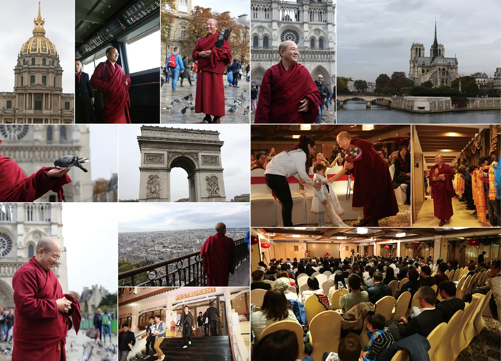
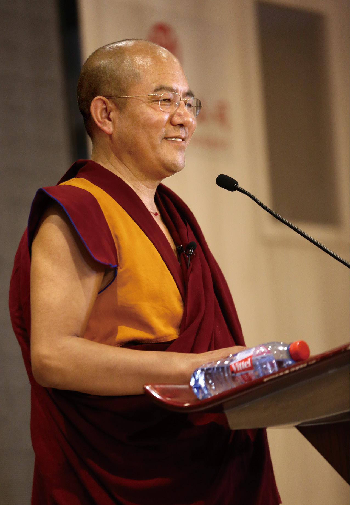
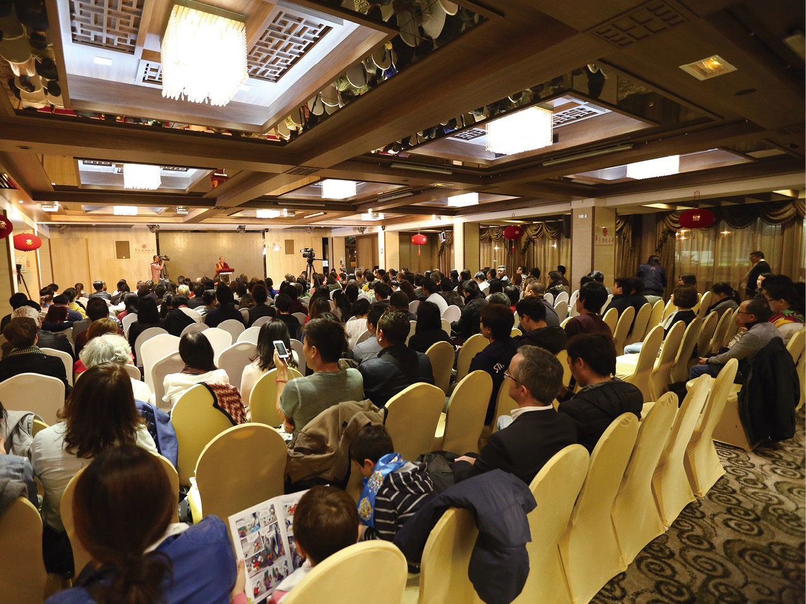
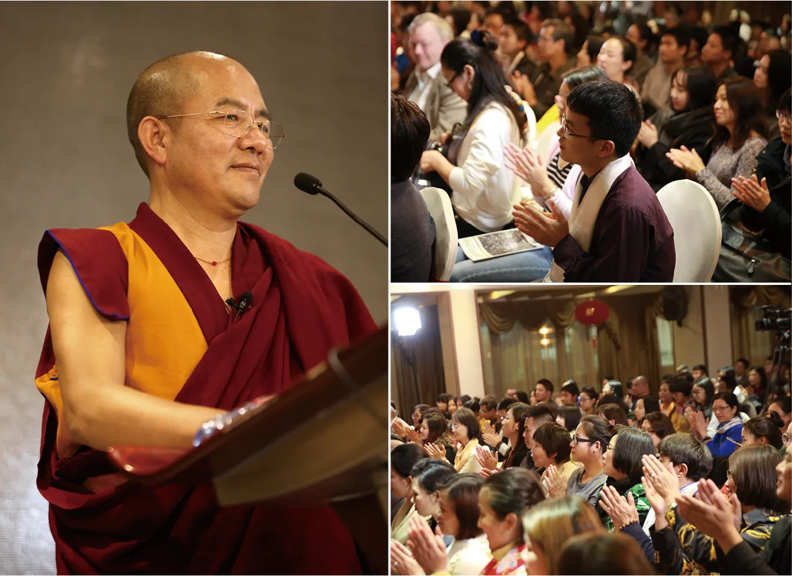
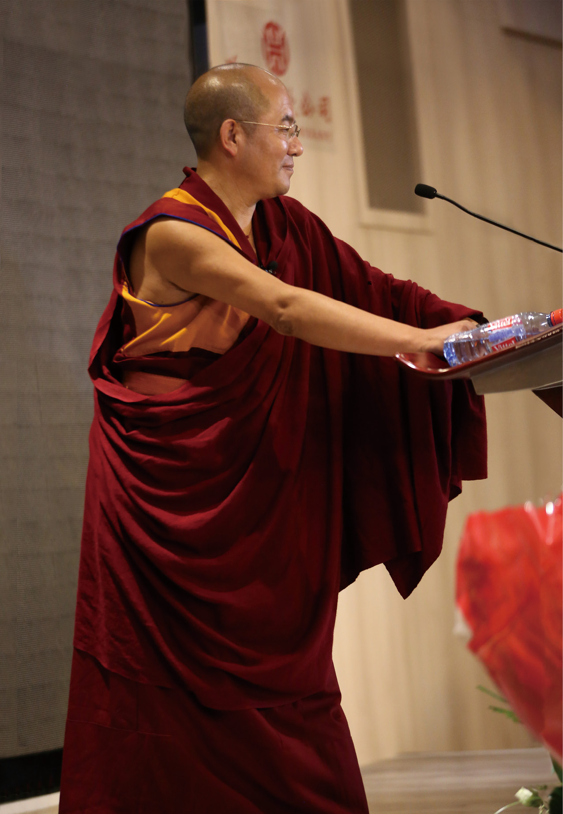
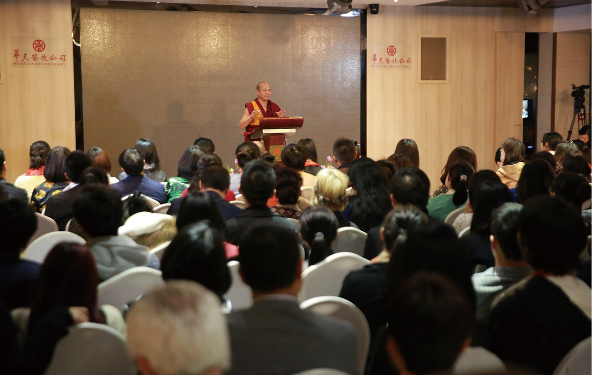
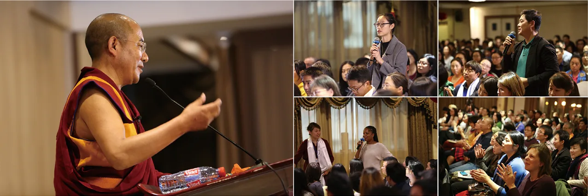
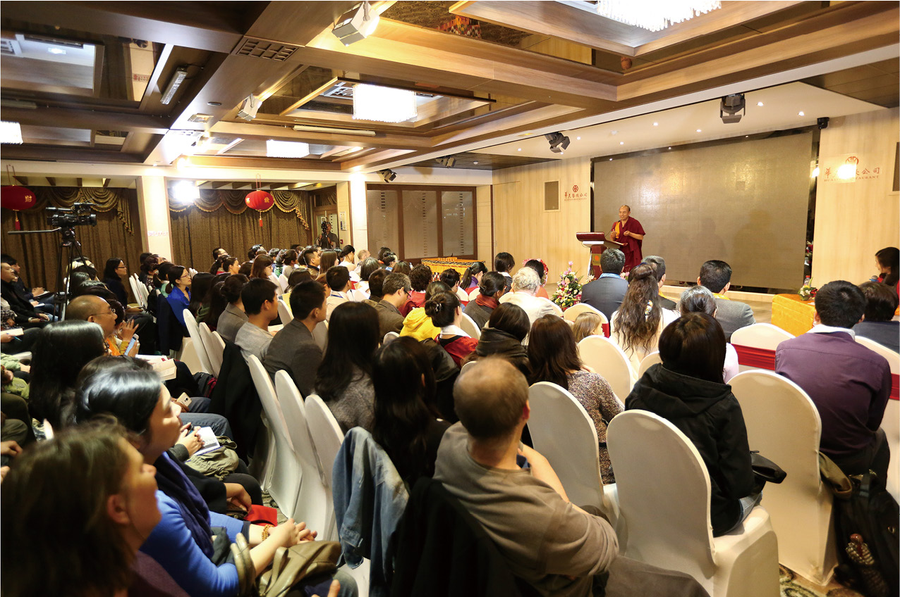
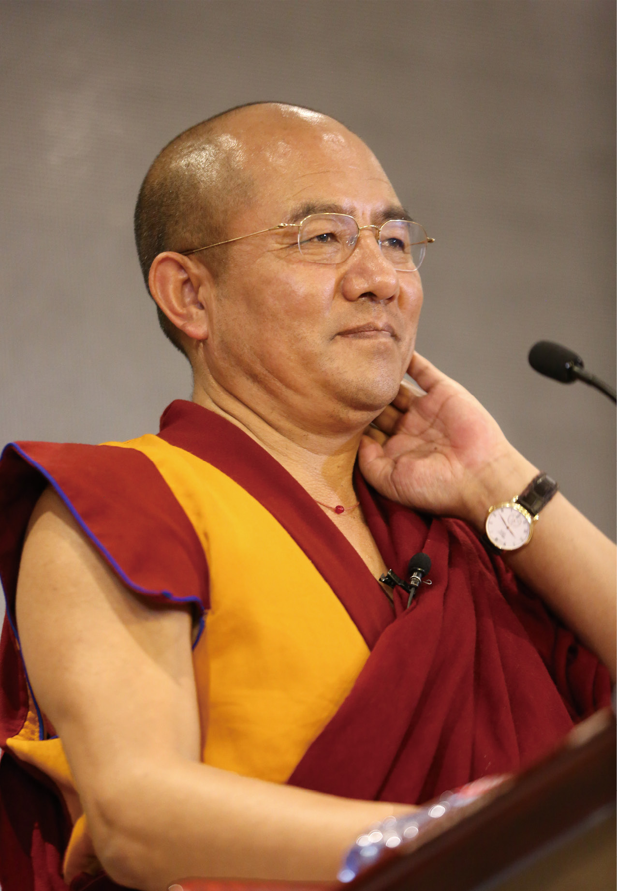

佛教智慧来源于东方，  
但我认为，它也适用于西方的生活，  
并且对西方人会有非常大的帮助。

第35场

法国巴黎公开演讲

Public Speech, Paris, France

法国·巴黎

2015 / 10 / 7

## 东方智慧与西方生活

## Eastern Wisdom and Western Life

主持人：

大家晚上好！当今时代，不同民族与文化之间的交融日益加深。如何更好地与不同民族、文化背景的人进行交流，是当代人需要共同思考的话题。今天的演讲嘉宾——尊贵的索达吉堪布仁波切，就是实践跨文化交流的典范。

堪布仁波切虽是一位藏族佛教大德，但近三十年来，他一直摄受以汉族人为主的四众弟子，熟知汉族人的喜好和生活习惯。堪布仁波切认为，不同民族虽然在习俗、文化、理念等方面存在诸多差异，但佛教包容一切，完全可以超越民族的差异。

在场的朋友，来自不同民族、不同国家，说着不同的母语，有着不同的成长背景，但大家都生活在法国这片美丽的土地上。也许我们都应该思考：为了给自他带来更多利益和幸福，要如何在不丢弃传统的前提下，积极融入多元化的文化环境中？

下面有请尊敬的索达吉堪布仁波切，与我们一起探讨这个问题——

今天下午我用藏语进行了演讲。但今晚的汉族朋友比较多，所以我用汉语讲，配法语翻译。

## 追忆与对比，今昔之巴黎

二十多年前（1993年秋天），我跟法王晋美彭措一起来过巴黎。那时我们在巴黎待的时间不长，然后去了蒙彼利埃——就是索甲仁波切的列绕林中心所在的城市。当时，我们在他的中心待了大概十天，然后又返回巴黎，飞往香港。

二十多年后的今天，我又来到这里。一方面，我很想念上师老人家，因为他已经离开了我们；另一方面，我也有一些感触——巴黎这座城，好像没什么变化，与当年的面貌无异，依旧很迷人。当然，我不清楚她的内在是否有变化。不过，人们的习惯变了不少，二十多年前，没有人拿iPhone手机，那时，富人手里拿的手提电话叫“大哥大”。另外，法国人爱喝咖啡，年轻人手里习惯拿着一根烟……这些都给我留下了深刻的印象。

欧洲的建筑保存得非常好，有些建筑已经有几百年甚至上千年的历史。就像我们昨天去的巴黎圣母院[^1]，始建于1163年——即使在东方，保存得如此完好的古老宗教建筑也比较罕见。

## 东西方文化，存在诸差异

如果说外在建筑是一种文化，那么，内在思想也是一种文化。文化又可以分为传统文化和现代文化。对于“西方是否完好保存了传统文化”的问题，我以前问过很多学者，一些人说“没有保存好，二战之后就没有了”，也有一些人说“保存得还不错”。

现在是东西方文化高度融合的时代，东方人和西方人在一起聚居生活、深入交流，世界渐渐成为一个地球村。全球化、国际化，确实是一种大趋势。

所谓的东方文化、西方文化指的是哪些文化呢？东方文化是指印度文化、中国文化，以及阿拉伯、以色列、非洲东北部一带的文化。而西方文化是指欧洲、南美洲、北美洲、大洋洲的文化。

东西方文化之间，确实有很大差异，甚至在某些问题上，存在着冲突与矛盾。如果不能接纳不同文化的差异，可能会导致人与人之间的诸多分歧。

有些学者认为，东方文化是以农耕文化为主的陆地文化，或者称“农夫文化”。人类文明早期，进入农耕社会后，人们便开始了春耕秋收的农耕生活。因此，在东方文化中，蕴含了长远性的理念，习惯长期规划。而西方文化是以海洋文明为主导的“渔夫文化”，好比渔夫打完鱼，当下即完成收获，无需等待日后。因此，在西方文化中，鼓励通过创造与创新解决问题，但在问题解决之后，并不太注重后续影响。

## 东西方思维，习性皆有别

东西方人的思维方式确实很不同，文化背景、生活习惯也有极大差异。比如，打招呼的时候，中国人问“你吃饭了没有”，法国人问“你住在哪里”，英国人问“今天天气怎么样”……我只是举个例子，真实情况是不是这样，我不是特别清楚。各位来自各个国家，大家打招呼的方式是不是有所不同？

东方人与西方人之间，有些地方确实差异比较大。比如，东方人大多比较感性，情绪容易起伏，有时会比较激动，很多东方佛教徒也是这样。而大多数西方人则比较理性，情绪相对稳定，甚至有点冷漠，总有很多问题：“为什么他这么笑？为什么哭？为什么会这样？”

东方人普遍在意祖先、父母、政府、上司的看法，对文化传承比较重视。而西方人并非如此，他们对父母、老师、国家总统的话都不太在意。听说有些学前班的孩子，如果对国家总统的行为不满，也要提意见。因此可以看出，西方人是比较自由、开放的。

由于这些差异的存在，法国人和中国人一起生活，就会有一些分歧——他们都认为自己的传统才是正确的。其实，不同国家民众之间的争论，往往都源于民族文化、个人思想的差异。

## 东西方教育，乃差异之源

接纳彼此的不同，首先要懂得对方的习惯和思维模式，这一点很重要。其实，思维模式的形成，与所接受的教育有关。比如，中国人从小就被父母教育：“你一定要孝顺，长大以后要照顾父母，要听大人的话”，等等。但是，很多西方人不一定受过这样的教育。因此，产生差异的根源之一，在于东西方的教育方式有很大不同。

在西方的教育中，有自我中心主义、民族主义的教育，而且尤为重视科学教育。他们提倡创新，不倡导被动地接受知识，鼓励孩子从小就发挥自己的才能和智慧，这是西方教育的特点。在这种教育中，塑造了人类个体自信、坚强的个性。

对于自己的优点，西方人会很自信地承认，而东方人会说：“哪里哪里！我没有智慧，很惭愧。”对东方人来说，谦虚、不骄傲是一种美德。而西方人可能会觉得：“难道我评价错了吗？我认为你有智慧，但你不承认，这是对我的一种侮辱。”

这种情况我遇到过很多，但也许你们不承认——如果不承认，在提问环节可以跟我辩论。当然，不要所有人都跟我辩论，不然我辩不赢。（众笑）

## 东西方思维，需融合借鉴

拥有西方思维的人，很有发展前途。因为父母、老师、国家领导所说的，不一定都对。在没有确切的答案时，自己有独立思考能力是合理的，所以培养创新精神是正确的。

我认识的一位加拿大老师说，东方的孩子大多很听话。如果让他们从后门进来，他们就从后门进来；如果让他们从正门进来，他们就从正门进来。这是让老师很舒心的优点。但在做作业的时候，老师讲什么，他们就乖乖写什么，没有自己的思考。如果让西方孩子从后门进来，就会有人抗议：“明明前面有门，为什么一定要从后门进？我还是从前门进吧。”他们经常我行我素，这一点老师不太喜欢。但在做作业的时候，这些孩子往往能给出一些自己的思考。

这些现象，体现了东西方文化的差异，也说明东西方的思维方式需要互相融合、借鉴。

## 东方之佛慧，遍愈众人心

要接纳彼此的不同。当发现他人的不足时，要选择包容，这是佛教中最重要的智慧之一。

虽然佛教智慧来源于东方，但我认为，它也适用于西方的生活，并且对西方人会有非常大的帮助。无论是东方人，还是西方人，如果具备了佛教的智慧，就会拥有幸福美满的生活。

三十多年以来，我一直在研究佛教教义，但并不会因为自己是佛教徒，就特意去赞叹佛教。我始终坚定地认为，佛教智慧有两个殊胜之处：第一，它在理论上非常有说服力；第二，它能够帮助任何人，实现物质生活和精神世界的巨大转变。

人间的痛苦，有些来自愤怒，来自对他人的不理解。甚至，我们的家庭中也有一些“战斗”——家人之间的冷战与热战。不知道法国有没有这种说法？冷战指的是双方长期保持不说话的状态，一天、两天、三天、四天……但有时过了一段时间，也不得不说话。不过，有时不想说话，也可以发微信或短信说一两句，类似“嗯”“是”“不”这样的话。发生这种情况，完全是我们的嗔恨心所导致的。

还有一种痛苦来自贪欲，比如，很想得到一个特别漂亮的人。可能自己长得比较难看，却想得到像天女那样的美人，这是一件痛苦的事。

## 身在此山中，纵美不自知

我以前遇到的中国朋友，都很喜欢巴黎，他们说巴黎是一个浪漫、美丽的城市——好像来到巴黎，就到了天堂。所以那天我问定居在巴黎的人会不会有这样的感觉，对方回答：“‘浪漫’这个词确实很好听，但生活中并非处处是浪漫。我亲眼见过塞纳河旁的一对夫妻，他们本来要一起吃饭，但丈夫没带钱，妻子却不愿借给他。最终，他只好求助其他朋友借钱吃饭。堪布，如果你看到这种场景，也不一定会觉得浪漫。”

因此，住在巴黎的人，不一定觉得这里很美好，但其他地方的人会这样觉得。我以前去过澳大利亚和加拿大，那里是亚洲人普遍认为的幸福国度。当地人得知我来自藏地之后说：“西藏高原的蓝天白云多么美好！我从来没有去过西藏，很想去一次，我此生的愿望就是去一次西藏！”但很多西藏人都说：“我的愿望是去成都！”曾经有一个藏族朋友就跟我说：“听说成都非常好，我这辈子一定要去成都。”

## 纵为异乡客，融入莫指责

在座的各位，有很多是法国本地人，可能大家对没有去过的国家、没有见过的人、没有了解过的文化都很向往。今天到场的还有很多是定居法国的藏族人和汉族人，要在这里长期生活，对法国的文化、语言、生活习惯都要去适应。对于本地人和外来人来说，互相学习、相互理解是非常重要的。

有些人进入到陌生的环境后，对当地的文化往往无法轻易接受。比如，一些中国留学生，在外国只吃自己习惯的饮食，每天找中餐馆；只想说自己的母语，不愿意学当地的语言，也不愿意跟当地人交流。因此，最后连工作也找不到，只能回到自己熟悉的环境中谋生。所以，人适应环境的能力、与人交往的能力一定要强，如果不强，或许不出国、不跟其他民族的人一起生活，会好一些。

有些人习惯抱怨“这个人对我不随顺”“这里的习惯很奇怪”“这里不应该这样”等等，内心充满怨恨。这不合理。比如，选择在法国生活的人，不应该抱怨法国。因为你是自由选择的，不是像难民一样被送过来的。既然你选择生活在这个地方，就应该勇敢地适应当地的生活。否则，让地球跟着你转、让环境配合你，是不可能的。我听说，法国有六千多万人，但在法国的中国人只有六十万人——六千万人不可能跟着六十万人的生活转。因此，你既然选择了这里，就应该对这里的生活有适应的能力。

在喇荣佛学院，有很多汉族人来求学，有人就抱怨：“藏地的酥油很难吃、很难闻。”我就跟他们说：“如果觉得藏地的东西不好，就不应该到这里来。”我无论到哪个国家去，都吃当地的食物。虽然刚开始也感觉有点不习惯，但我对自己说：“既然来到了这里，就要吃这里的食物。”到了法国，我尽量吃法国餐；到了荷兰，尽量吃荷兰餐；到了意大利，就尽量吃意大利面和比萨。

## 劝求内智慧，勤学《入行论》

如果只希望满足自己，那吃什么都可以。但实际上，我是想通过调整饮食习惯，表达一种期望——希望以包容的心态接纳一切。当然，要做到这一点也需要通过学习。

对于没有信仰的人，我也不强迫大家一定要学佛。我只是觉得没有接触过这样的智慧，非常遗憾。很多中国年轻人来到这里后，既没有得到过英文的佛法教授，也没有得到过来自汉地、藏地的佛法教授——无法获得这样的精神食粮非常可惜。因为对于人类来说，最重要的不是外在的表象，而是内在的智慧和信仰。

如何建立佛法学习的系统？如何促进思想的包容性？我的建议是学习《入菩萨行论》。我以前讲过这部论典，法国也有很多人在学习。我希望再次引起大家对这部论的重视。如果想真正通达佛教的包容性思想，我建议认真学一遍《入菩萨行论》，你的行为会有非常大的转变。

## 重自宗教义，承扬以传灯

对于法国等各个国家的人来说，系统的闻思修行确实很重要。尤其是自宗的修行人，一定要好好闻思自宗的教义。

在西方，基督教的教堂建了特别多，但更为重要的是传承基督教的智慧。否则，即使在教堂祈祷的基督徒，也无法阐述基督教的真正教义。所以，建立教堂、参加祈祷仪式，都不是最重要的。其实，最重要的是学习基督教理论，让基督教的思想后继有人——年轻的基督徒也一定要懂教义。

我问过一些年轻的基督徒：“上帝为什么存在？人死之后上天堂或下地狱，这样的状态是永恒的吗？所有人都只有这两种结局吗？”他们无法解释。其实，在基督教的教义中，应该是有解释方法的。

佛教团体也有这样的情况。如今在汉地，寺院里烧香拜佛的人非常多，但如果问他们一些佛教内容，比如释迦牟尼佛的生平、佛教徒修行前后有何变化、前后世如何存在等问题，很多人都答不上来。

相较而言，藏传佛教的思想一直传承至今，没有间断过，就像欧洲几百年来的建筑风格，鲜少改变。假如你们不相信我说的话，可以去了解一下藏传佛教。

## 思想与心态，快乐之关键

如果深入学习过宗教思想，由贪心、嗔恨等所导致的负面情绪都可以被遣除。佛教，尤其是藏传佛教，完全可以调伏我们内心的烦恼。

无论是东西方哪个国家的人，一定要学会宽容，这很重要。如果学会了宽容，无论你接触的是西方人还是东方人，在任何环境中，与任何人交往，都会感到很开心。同时，希望东方人还要学会传统文化，这样的文化对社会、个人都很有意义，因此不要忘失。有些人通过学习传统文化，确实能将生活中的不快乐都转变为快乐。

其实，快乐有很多种可能，因为人的思想可以很开阔——可以比天空还高远，比大海还深广。但如果思想狭隘，就很难拥有快乐。比如，在别人眼中，巴黎的很多房子很小，但你也可以觉得房子很大。这与自己的心态有关，如果自己的心态好，房子再小也会觉得快乐；如果心态不好，房子再大也会感觉痛苦。

## 结劝莫忘本，继而融入世

每个人应该在不忘记本民族传统美德与文化的基础上，尽量多了解世界的多元文化——作为世界的一员，要学会融入这个世界。

对于同样的事物，人们的观点也在不断变化，比如，起初你觉得面貌丑陋的人，后来会发觉他其实很好看。同样的道理，生活中的一切都可以逐渐被适应和接纳。

我原来特别不习惯喝咖啡，所以非常不理解喜欢喝咖啡的人，但我现在也喜欢上了喝咖啡，而且觉得喝咖啡是一件让人感觉特别舒适、浪漫的事。不过，咖啡也不能喝得太多，不然对胃不好。我看法国人一天要喝很多咖啡，如果我长住巴黎，可能也会跟大家一样，但我现在还不能完全适应。其实，适应任何生活都需要时间。一旦你适应了，就会觉得当下的生活很美好、很有意义，所以关键是你能不能去适应。

现场互动

问：我最近刚失去了父亲，因此很感谢堪布给我提问的机会。我在法国已经六年了，很适应这里的生活，但父亲过世后，我开始觉得出国是一个错误。我的内心很不平静，甚至有一种撕裂感，完全不知道该怎么处理我的情绪，希望得到您的开示。

堪布：每个人的生老病死、亲人的离世都非常正常。从佛教的观点来看，这是一个自然规律。但对于没有无常观的世间人来说，亲人的离去确实让人非常难过。无论是在西方，还是东方，对于亲人的死亡，很多人都难以面对。

我认为你选择出国没有错，因为即使你在其他地方，也无法避免亲人的离世，所以你在哪里并不是问题的关键。不过，我希望你通过这件事，开始好好闻思修行——通过学习佛法，你才能真正明白无常的道理。在接触佛法之前，很多人都非常痛苦，有些人的痛苦来自亲人的离去，有些人的痛苦来自抑郁症的折磨……但这些痛苦，通过系统地学习佛法，都可以被遣除。

我希望对佛法感兴趣的人，要系统学习《入行论》和《大圆满前行》。在学《大圆满前行》的“轮回痛苦”“寿命无常”时就会明白，无论是父母，还是自己，都终将离开这个世界，其实，人与人之间总会分离，感情也终将逝去，这些都很正常。如果我们没有通达无常的道理，内心总是很执著，或许最终会失去活下去的勇气。

我特别希望年轻人可以系统学习佛法，尤其是在座的各位都很有文化，更应该好好地学。学习小组的建立不是为了经济利益或名声地位，只是一心一意地想帮助大家多学一点佛教知识，这也是我个人的一个愿望。

希望我们的发心人员，以后要共同努力。虽然有少数发心人员还比较不错，但并不是所有人都参与了。今后，总负责人应该合理分工，安排给每位发心人员一些工作，因为参与弘法利生的事业很重要。

总而言之，希望大家好好了解佛教思想。人生的无常特别容易现前，如果不了解无常的道理，即使你的房子再好、生活再富裕，一旦无常降临，幸福便不复存在。因此，我们要饮用智慧的甘露、享用思想的盛宴，只有这样我们的人生才会越来越好。

问：我是从德国来的。我的问题是：随着学佛的时间越来越长，我们会发现，在人生的每个阶段甚至每一天，都会有不同的心愿。如果用佛法帮我们实现这些愿望，算不算是一种贪执？如果用贪执心祈请佛菩萨，会不会对佛菩萨造成不良影响？

堪布：我们以某种缘起祈求诸佛菩萨，不算是贪心。虽然这样的行为的确是一种执著，但对修行和生活来说，这样的执著有暂时性的必要。正如已经上岸便不再需要船只，但正在渡河时，却不得不依靠船只。

因此，起初我们需要有祈祷发愿、祈求诸佛菩萨加持这样的方便方法——暂时来讲的确有必要。但究竟而言，它也是一种执著，最终应该舍弃。

另外，你的祈祷不会给诸佛菩萨造成麻烦，因为他们的事业是无勤的，不会像世间人一样忙得不可开交。（众笑）

问：结合今天的主题，即“东方智慧与西方生活”，我设想了一个场景。如果有一天把您放在圣米歇尔山修道院里，周围全都是天主教徒，一年以后您会怎样生活？十年、三十年以后又怎样生活？

堪布：我也有过类似的想象。我经常去藏地和汉地的监狱，当我看到监狱里的犯人时，就会想：如果我是被判了无期徒刑的犯人，我会怎么做？如果不准出声念佛、不准有任何修行行为，我就会默默念佛。同时，如果有能力，我会尽量让监狱里的人保持开心，并做一些有意义的事。因此，我会以佛教徒的身份，行持一些善法。

假如我在天主教的修道院里，若被允许，我会出声念我的咒语，若不准出声，我会默默地念。同时，我会尽量给周围人带来快乐，劝人行善。所以，我应该会过得很自在。

我也问过自己，如果晚年都在监狱里，会不会开心？我想，如果周围的人不打架，我应该也会过得很开心。因为现在监狱里吃得还不错，尤其是对于吃素的人来说，饮食上不会不满足。其实，人的生活可以很简单，也可以很复杂——简单起来特别简单，复杂起来非常复杂。（掌声）

问：我突然想到一个问题，之前听说，如果做不到不杀生，吃“三净肉”也可以，但不要自己点杀。在欧洲超市里，没有活禽，也没有活的鱼虾。所以，按照这个标准，我很久没有杀生了，还挺开心的。但实际上我还是吃肉了，但对比国内的点杀，我造的恶业是不是少一些？

堪布：国内的一些肉食确实离不开点杀，点杀的肉，不是三净肉。但国内也有一些冷冻肉，可能跟法国的差不多。

其实最好不吃肉，这样就完全没有罪业，是真正的清净。当然，如果实在做不到，尽量不点杀也很重要。

问1：不好意思，我对佛教没有什么了解。我看到大家都向您请教生活中的问题，然后您会建议他们如何解决。可是我觉得，在生活中，我们应该对自己负责。一般来说，如果法国人有问题，不会找别人解决，不然，好像解答者是成人，提问者是小孩子，因为每个事情都要问。可是，每个人都是上帝的一部分，每个人的灵魂里都有佛，而且我们的大脑中有很多知识，因此，在现在这样的新时代，每个人应该靠自己面对现实中的问题。可能在中国，大家对选择依靠权威还是依靠自己很矛盾，但在内心中，其实每个人应该愿意在很多观点上，与社会大部分人的想法有所不同……

堪布：我问一下，你想说的是什么呢？

问2：我的意思是，生活中不应该害怕依靠自己。而在中国文化中，大众大多跟随社会的安排，很少有人会有勇气一个人走《圣经》的路。

堪布：那上帝的安排也不行吗？

问3：上帝的安排可以。

堪布：那为什么上帝的安排可以，社会的安排不行？

问4：我觉得社会……

堪布：你的问题是什么？

问5：我的问题就是汉语不好，不知道怎么表达。（被告知可以说法语）可以说法语太好了！我想说的是，当我参加一个宗教类的讲座时，我希望可以听到类似“人类的本质是什么”这样的话题。但我有一点失望，可能您觉得我们听不懂，所以没讲这些。

主持人：看来她不是来提问的，是来交流的。

堪布：她说得很对，我今天没有讲佛教的修法，也没有讲其他宗教的甚深意义。因为即使我讲，有些人也不一定听得懂。所以，我们就聊一聊大家生活中的问题以及比较关心的话题。我觉得这样的沟通很好，大家有什么问题都可以开诚布公地说出来，这是西方文化的特点，我很乐意接受。非常感谢这位女士。

我在这里补充一句，如果我讲得更深一点，也许你会更失望，因为听不懂。而且，一个人如果真的不需要依靠别人，那么，别人讲的无论是深是浅，他也不会失望的，因为他对别人没有期望。

问：我在藏区长大，所以对藏区的寺庙、经幡以及高原红，都有一种天生的亲切感。我不是佛教徒，所以我的问题比较简单。我的第一个问题是，在您的开示中，反复提到了“宽容”。我的佛教徒朋友告诉我，宽容并不是忍气吞声。但在实际的生活和工作中，有时我们为了相安无事，可能还是会选择忍气吞声。我想请教您，怎样区分宽容和忍气吞声？

堪布：今天有很多藏族朋友到场，所以在回答问题之前，我先跟他们用藏语说一两分钟的话，希望大家包容一下：

“今天来了很多藏族朋友，虽然没有单独与大家见面，但我希望在法国或任何地方，藏族人都要团结、彼此尊重、互相帮助。这是我的第一个希望。

第二个希望，藏族人无论在哪个国家、哪个地方，都不要忘记藏文化和佛法，并且要保护好它们。

第三个希望，藏族人要向汉族人学习。汉族是一个很勤奋的民族，也很有能力。一般来说，汉族和其他民族的人，在经营商业、学习文化方面都特别努力。听说法国有很多藏族人，希望藏族人要提升心力，学习本民族的文化和佛法，还要学习其他民族的语言和文字，这样一来，藏族人在任何地方都会非常出色。所以，大家一定要勤奋努力！

今天中午我见了一些藏族人，有以前认识的，也有不认识的，能在这里与大家见面，我发自内心地感到高兴。希望你们都能维护好藏族人的形象，未来在各方面更加努力。无论遇到什么困难，藏族人之间都不要有嫉妒心，一定要互相帮助。大家可以像汉族人一样，建立网络微信群，谁有困难，其他人都可以伸出援手。总之，大家要继续努力。最后祝愿大家吉祥如意！”

我刚才跟藏族人说了三分钟话——对不起，超了一分钟。

下面回答问题。所谓的“忍气吞声”和“安忍宽容”有很大差别。如果是因为内心脆弱，才对什么事情都不在意，这叫做懦弱，不叫宽容。所谓的宽容，是指以智慧面对一切，不发怒、不生气，以微笑接受任何意见。

问：您刚才授皈依的时候，用的可能是梵文吧？我不是佛教徒，所以听不懂。但我在听的时候，真的感觉到一种神奇的力量。在念经的时候，我们应该通过佛教智慧为人生获得一些启示，但藏传佛教的经文是梵文，我不懂它的意思，所以应该怎样深入这种思想的精髓呢？

堪布：我念诵的是藏文，不是梵文。其实，藏文和梵文有很大差别，但藏文的字母来源于梵文。无论是用藏文还是梵文，诵经的声音都有一种力量，这就是加持力。因此，念诵很有必要。可能你不懂念诵的内容，所以要好好去学，任何知识都要经过长期学习才能掌握。学习佛教、学习藏文或梵文也是如此，应该把它们作为很重要的学问来学。在座的法国朋友、学习小组的道友，希望你们把念诵的内容当作一门学问，认真学习。

欧洲的生活这么好，按理来说，在这里修行比国内更具条件，所以不应该懒惰。虽然在这里也有压力，但世界上没有不存在压力的地方，可以说除极乐世界等清净刹土以外到处都有压力。因此，你们需要更加精进地闻思修行。

等结束的时候我们也要念诵。刚才我进来的时候，大家都在唱诵“嗡啊吽舍 得钦巴瓦……”，这样很好。以前法王如意宝来巴黎的时候，当时有藏族人也是这样念诵的。我希望等会儿我走的时候，你们可以和刚才一样高声念诵。今天的活动应该在具有加持力的声音中结束，这是一种非常吉祥的象征。

主持人：

非常感恩索达吉堪布仁波切，给予我们难得的交流机会。大家相聚在金秋十月的巴黎夜晚，是非常殊胜的缘分。上师在今天的演讲中，阐述了如何运用东方智慧解决现代生活中的痛苦，并在最后对大家提出了殷切的希望。我们只有认真努力、次第地闻思修行，才能真正运用佛法的智慧。希望大家都能用东方智慧的精华，解决生活中的所有烦恼。谢谢大家！

（堪布领大众念诵怀业自在祈祷文）

[^1]: 巴黎圣母院（Cathédrale Notre-Dame de Paris），天主教巴黎总教区的主教座堂，哥特式建筑风格。始建于1163年，历时182年建成，是古老巴黎的象征。
