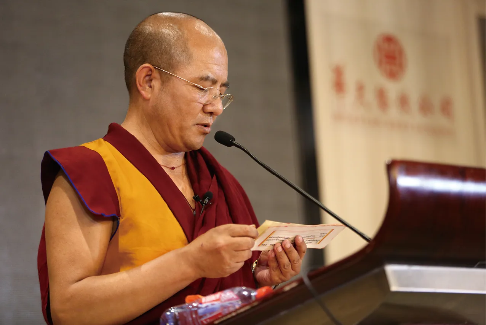
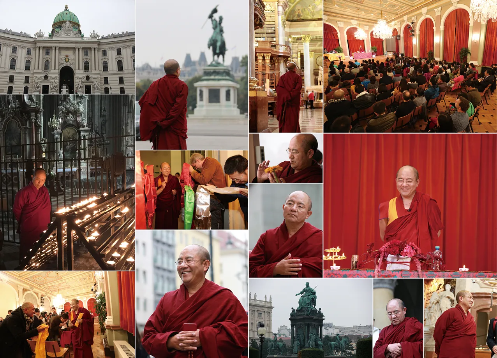
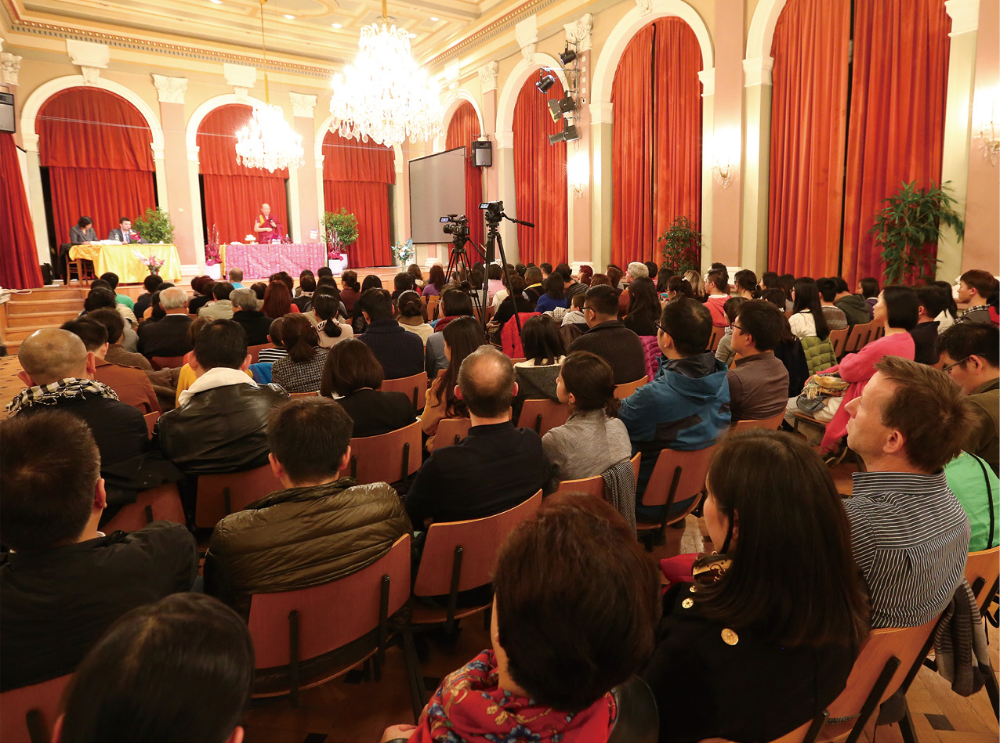
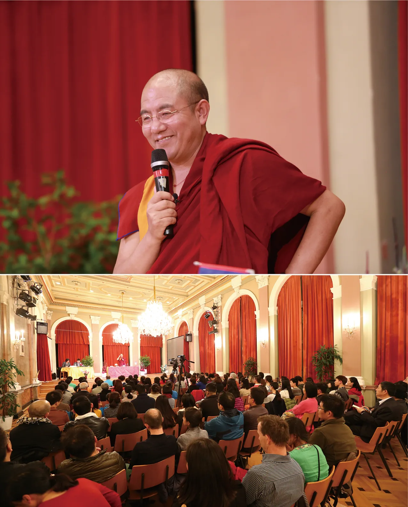
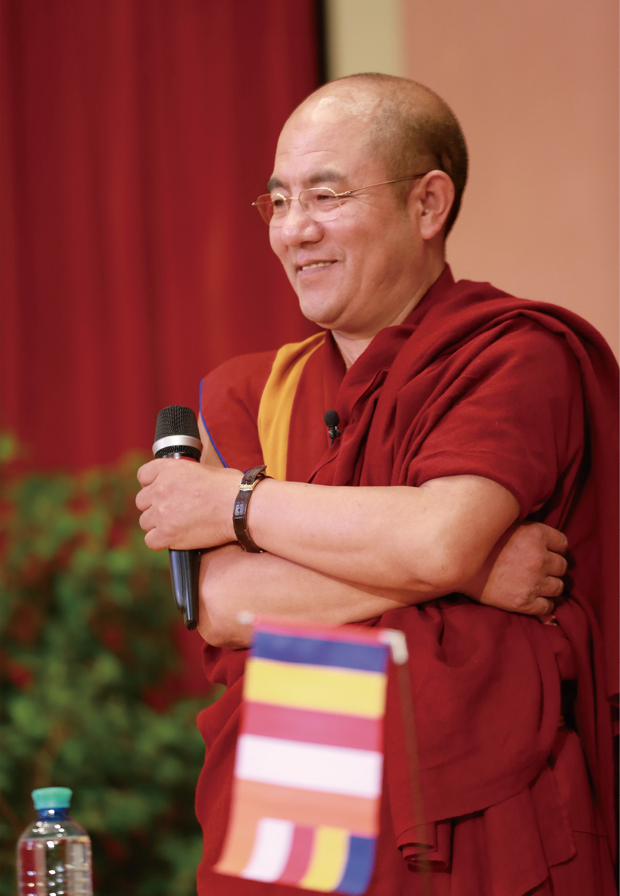
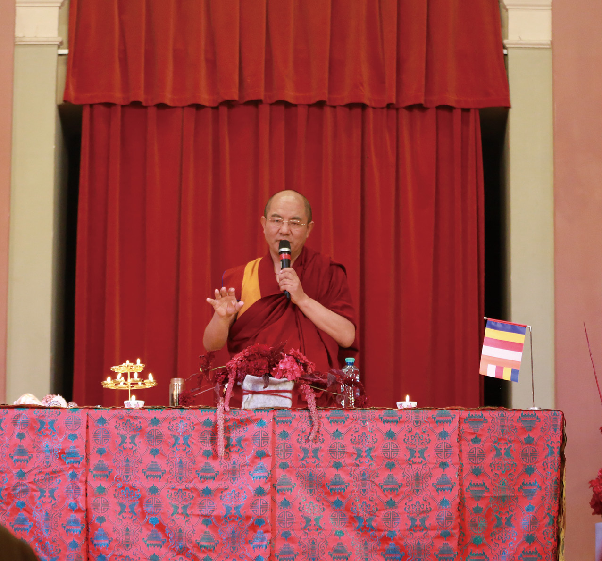
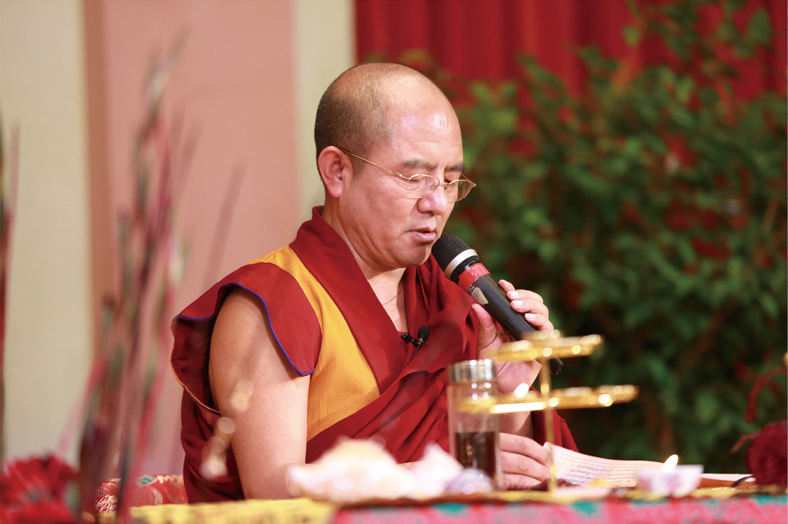
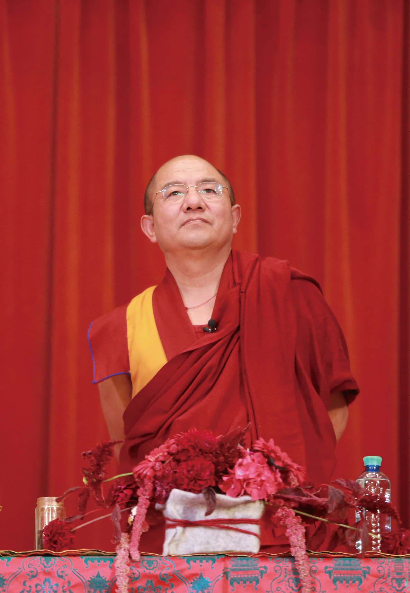
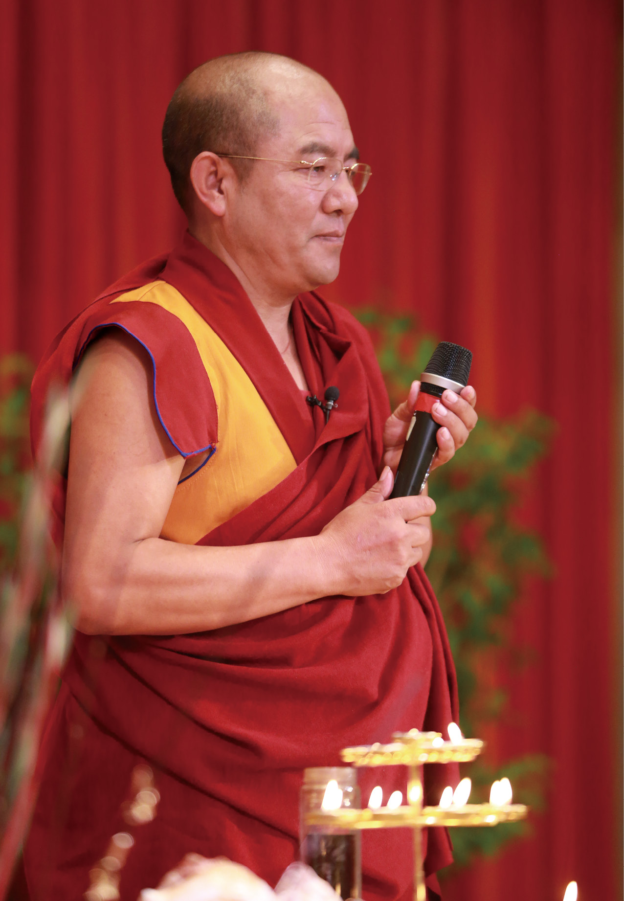

每个人都要有无常的观念，  
不能永远抱有美好的期待，  
因为它总有一天会破灭。

第36场

奥地利维也纳公开演讲

Public Speech, Vienna, Austria

奥地利·维也纳

2015 / 10 / 10

## 什么是最大的财富

## The Greatest Fortune

主持人：

大家晚上好！当代社会，人们谈论最多的是如何获取财富。然而，什么样的财富才能给我们带来真正的快乐和幸福呢？这需要用智慧来抉择。

今天，在维也纳这个美丽又充满艺术气息的城市，我们迎来了一位特别的客人，他就是藏传佛教大德——索达吉堪布仁波切！

索达吉堪布仁波切，是当代最受欢迎的藏传佛教上师之一。早在二十多年前，他就将许多珍贵的藏传佛教典籍译成中文，传授给成千上万的汉族四众弟子，为他们提供了系统闻思修的机会。近年来，堪布仁波切又不断推出通俗易懂的佛法畅销书，为忙碌而不堪重负的现代人，进行富有深刻哲理的智慧引导，给予当下即可受用的心灵慰藉。

多年来，堪布仁波切不仅是一位深入人心的心灵导师，同时，他也是一位爱心人士——他帮助上千名的贫困学生完成了小学、中学、大学的学业。他曾说：“作为大乘行人，我们要关心身边的人，乃至身边的动物。”而谈到“什么是最大的财富”，仁波切本人也正在践行他的财富观。他的身体力行，也许能让在座的朋友们去思考：我们当下所追求的事物，会成为自己最大的财富吗？

下面，让我们用热烈的掌声，有请索达吉堪布仁波切带来精彩的演讲“什么是最大的财富”——

今天很荣幸，围绕着话题“什么是最大的财富”，与大家探讨、交流。

我是第一次来奥地利。以前经常听说，维也纳很美丽，来到这里确实有这样的感觉。其实，我以前看过维也纳的照片，感觉这座城市像天堂一样。今天上午我去了博物馆、图书馆、斯蒂芬教堂[^1]，这些建筑充满文艺气息，独具艺术风格，特别殊胜。

## 东西差距故，金钱观不同

无论是东方人还是西方人，都会追求内在和外在的财富。尤其是一些年轻人，在追求外在财富的时候，喜欢穿名牌衣服、喝美酒、用化妆品把自己打扮得非常漂亮。而年长的人，喜欢买车、买房子，用物质财富满足自己、充实自己的生活。

在一些贫富差距很大的东方国家，人们对金钱特别重视。他们认为所有幸福都建立在金钱上，只要有钱，获得快乐就轻而易举；如果没有钱，就非常可怜。这样的人，他的价值观完全以金钱为导向，把自己的快乐、幸福全部建立在金钱之上。

大多数欧美国家的社会福利比较好，即使人们再贫穷，一般也不会沦落到吃不到饭、穿不到衣服的地步。所以有很多年轻人，认为自己的生活水平达到一定标准即可，不会无止境地追求财富，因为挣的钱越多，税收也越高，工作会更辛苦。所以，相比而言，欧美人好像没那么执著金钱。当然，这种风气的形成还有其他原因，比如，欧美人更易于满足，他们认为钱挣得再多，到最后不一定能用上。

我问过这里的年轻人：“你们喜不喜欢钱？”有些人回答说：“虽然喜欢钱，但钱并不是万能的，所以有一定量就足够了，因为即使挣再多钱，离开这个世界的时候也用不上。”这样的思想是比较符合实际的。

因此，东西方的金钱观有一些不同。

## 执财徒增恼，内财更具义

英国文学家菲尔丁[^2]说过一句话，给我留下了深刻的印象，他说：“如果把金钱看作上帝，会受到魔鬼般的折磨。”现在有很多人不信上帝、不信佛陀，只信欧元、美元、人民币……只要是钱都喜欢。如果心里只有钱，除此之外什么都没有，会比被恶魔折磨更加可怕、更加痛苦，这样的人非常可怜。

东方人和西方人在情感上是互通的，大家都有烦恼、痛苦，有复杂的情感关系、嫉妒心等等。昨晚我看了一眼奥地利的电视，不过我听不懂德语，也看不懂德文。电视里正在播放一部电影，演的是一个老头和一个老太太吵架，他们的情感关系比较复杂。他们吵架时的表情、行为跟东方人类似。最后，他们因为吵架导致驾驶超速，被警察逮捕，看起来很痛苦。可见，人类的烦恼是相似的。

外在的财富的确很重要，因为幸福的生活需要具备物质条件；但内心的财富——智慧、满足感、乐于布施等善念更加重要。如果具足心灵财富，即使物质财富比较匮乏，生活也会很快乐。所以，积累内在的财富、开显内心的智慧，更有意义。

## 内财即智慧，慧能应万变

内在的智慧财富，在任何时候都可以运用。比如，在生活中遇到各种违缘、障碍、变化时，有智慧的人可以把这些不利因素转化为有利因素。比如，金融危机导致的亏损、离婚引发的家庭安全感缺失、衰老所致的皱纹遍布、牙齿掉落等等——人生中不快乐的事情，对于有智慧的人来说，是一种珍贵的财富。日后，再回顾当时的遭遇时，会发现这样的经历让自己获得了成长。

如果每个人都能懂得变化的必然性，那么，每次在变化出现时，就可以灵活处理、积极面对。这是很重要的态度，也是一种内在的财富。否则，即使你有很多金钱，也不一定能给你带来利益。

总之，生活中有很多变化，如果能够以智慧灵活应对，那么，无论发生任何事情，我们都能够处理好，而且，这段经历会对我们更有意义。

## 以慧观无常，提前做准备

对于任何人来说，懂得观察事物的真相都很重要。如果能洞悉事情的发展过程，那么，即使发生的事情再大，对你来说也不大——只要有智慧，事情就会变得很简单。如果不了解事情的真相，那么，即使一件很小、很简单的事情，对你来说也特别大。比如，两个年轻人吵架，大多是因为很小的事情，但双方都觉得这是世界上最大的事情，所以争吵不休，甚至会因为嗔恨造成更严重的后果，比如自杀等等。所以，用智慧观察、抉择非常重要。

生活中的一些事情，若以智慧观察，会发现并不重要，但我们还是会很执著。不过到最后，很多事情也不得不放弃。我们经常讲，一切万法皆无常，因此，每个人都要有无常的观念，不能永远抱有美好的期待——因为它总有一天会破灭。

在这么美丽的城市中有特别美丽的花，但每一朵花最终都会凋零，它所有的美丽都会消失。同样，人间的荣华富贵、财富地位，到最后也都会毁灭。所以，在拥有美好的时候，也要时常想：“这样的美好一定会离开。”如果有这样的心理准备，那么，一旦你的亲人、名声、才华、容貌显现无常时，你应该也不会非常伤心。

现在是10月份。9月19日的时候，有一个迪拜王子，年纪轻轻，才33岁，就因为突发心脏病去世了。据说他的财富有19亿美元，他擅长马术，获得过很多金牌，长得也特别帅。他的突然离世，让整个国家陷入极度悲伤之中，毕竟他还那么年轻。我们当中的有些人也很年轻，家庭充满快乐、非常圆满。但要知道，无常随时都会现前，往往在我们还没反应过来的时候，无常就出现了。在无常未到来时，先做好思想准备——这样的思维习惯，我认为很重要。

## 欲壑永难填，知足者常乐

谈及内心的财富，欧美人是比较具足的，因为他们容易有满足感。这或许跟整个环境、民族文化以及个人的人生追求有一定关系。人应该有满足感，这一点最为重要。如果有知足的心，那么，即使不太富裕，你也会觉得“我的生活条件已经可以了”。拥有这样的心态，你会成为真正富有的人。与此相反，如果你的心里充满欲望，那么，即使你有再多财富，也欲壑难填。有了一百万，想要两百万；有了两百万，想要一千万；有了一千万，仍觉得不够，还想做更大的事业，追求两千万、一个亿；等有了一个亿，又想办上市公司，想要一百个亿。在短短的人生当中，就这样不断追求，可能到死的时候，也无法达到你的目标。

一旦拥有满足感，那么，即使你在工作中吃了亏，也可以过得很快乐。曾经，乔布斯和另外两个伙伴一起创业，那时苹果还没有现在的规模。他们有两个大股东，各持45%的股份，还有一个小股东持10%的股份。持10%股份的股东，没有继续跟乔布斯合作，于是把股份卖掉，获得了八百元美金，然后用这笔钱过上了安闲的生活。

二十年以后，苹果已成为世界闻名的大公司，那时10%的股份价值约350亿美金。很多人问他：“你会不会很后悔？如果你当时继续跟他们合作，现在已经拥有350亿美金了。”他回答说：“我不后悔，因为乔布斯和他的伙伴都是高智商的工作狂人，如果跟他们继续合作，我可能早就累死了。命都没有了，有钱又有什么用呢？因此我已经很满足了。当时我赚了八百美金，现在又拥有一个幸福的家庭，我很知足。”对于他的选择，或许大家有其他想法，但无论如何，满足感对人生的重要性值得大家思考。我们已经获得了珍贵的人身，也拥有了美好的生活，更应该对人生有自己的思考。

## 今生幸福果，前世资粮因

我们经常评价“这个人有福报”“那个人没有福报”，这是佛教徒的评价方式。世间的经济学家也有自己的评价方式，他们以经济学观点进行评论、开展研究；同理，宗教人士也是以宗教理念分析一切。通过分析可以了知，今生的所获与即生的勤奋努力有一定关系，比如，有些人拼命赚钱，到晚年的时候，生活会变得很富裕。但也有些人，虽然非常努力，但到了晚年，生活也不一定有什么改善。这是因为，与今生的努力相比，前世积累的福报更为重要。

前世积累资粮、行持善法，可以让一个人在即生当中现前福报，拥有很多财物。有很多中国年轻人刚到这里时，创业是很困难的。我问过很多人，他们说刚来的时候打工很辛苦，洗碗、扫地……做过很多粗活。后来，由于前世的福报和今生的努力，因缘最终具足，在晚年的时候，他们在这里生活得非常快乐。

当然，前世的因缘是很复杂的。因此，今生的福报一方面与自己的努力有关，另一方面，也与看不见的因缘有关。

## 布施之善力，致富之秘密

我们常讲，以布施等行持善法之力，可以令我们在即生中享用更多资财；在未来的生生世世中，也将拥有源源不断的财富。

有一个典型的案例。第二次世界大战后，当时的美国、苏联、中国、法国、英国这五个国家认为：为避免日后再发生这样的世界性战争，一定要有一个组织协调各国的关系，于是经过商议决定建立“联合国”。当时，洛克菲勒[^3]家族无条件为联合国提供了一块位于纽约的地皮，价值870万美金，同时他们把周围的地也买了下来。联合国建立之后，周围的地价都涨了，因此，洛克菲勒家族又大赚一笔。当时有很多专家认为，这其中的秘密就是布施。

佛教中常讲，布施的果报是财富圆满。基督教也常讲，要多做慈善。因此，做善事对今生来世都非常有帮助。

## 佛慧察万法，如梦莫执著

也许你们很多人不信宗教，这也可以。按照佛教的观点，不一定非要有信仰。因为佛教信仰并不需要盲目的信心，而是需要一种智慧。

其实，你们可以随时观察甚至批评我们的宗教。佛教智慧包罗万象，从宏观角度，宣说了整个物质世界的构造——在两千五百多年前，就已有相关记载。而对于极其细微的微观世界，如分子、质子、夸克等粒子的本质，在两千五百多年前的中观经论中也讲得非常清楚。

佛教倡导大众用智慧作观察。如果以你的智慧，有充分的理由证明佛教的观点不成立，那我们也可以承认。但如果佛教能够以理服人，最终，你对佛教也不得不承认。

我们对人生、对世界，都需要用智慧来观察。以智慧观察时，暂时看到的现象，我们也可以承认，但这些现象都是暂时的、如梦如幻的。再进一步详细观察，可以了知一切现象都是空性的。有一句非常著名的教言：“一切有为法，如梦幻泡影。”[^4]一切法皆如梦幻，与昨天的梦没有任何差别。其实，人生中所发生的一切事情，都与昨晚的梦没有差别。因为昨晚的梦，只能回忆。同样，人生中的所有经历，除回忆外，没有任何实质。

其实，我们当下的一切，与现在的梦没有什么差别，明天要发生的事情，也与明晚的梦没什么差别。刚听到这个道理，有些人可能会觉得：“这不可能，梦和现实还是不同的。”但用智慧认真观察时就会明白，人生的确是一场梦，只不过有好梦、恶梦的差别而已。

因此，对于工作、家庭中发生的事情，最好都不要执著，因为它跟一场梦没有什么两样，尽量不要有负面的情绪，否则只会给自己带来更多痛苦。

如果可以把事情看得比较淡，不太去执著，就获得了人生中的一种觉悟——它是内在的财富，是最为珍贵的。

## 法能疗众苦，结劝闻思修

以上是关于“什么是最大的财富”的一个简单的演讲。

接下来，我想跟佛教徒们说几句话，其中也包括从瑞典、德国等地来这里的佛教徒。虽然现场有一些人还不是佛教徒，但未来也可能会成为佛教徒。

无论是什么身份的人，我都希望你们能够认真、系统地闻思修行。如果没有这样做，即使你表面上是一个佛教徒，但内心却什么都不懂，也非常可怜。因此，我希望这里的人都可以好好闻思修行。

我用汉语讲课是比较顺畅的，懂汉语的人应该听得懂。但在其他地方，一些华人既听不懂英文讲座，也没有机会听汉语的课，会因此失去修学佛法的机会。所以，我特别关心海外的华人佛教徒，也特别希望你们能系统地闻思修行。

如果你们可以好好学习，相信你的所学将成为一生中最重要的财富。甚至通过一次讲座、一次学习，你的人生都会有很大转变。未来，即使你没有获得很多钱，但也有了真正的人生目标、获得了真正的财富，这非常有必要。

我讲这些没有其他目的，讲课也不收供养，我唯一的希望是：无论是欧美国家的人，还是中国人，大家都有必要具足思想的财富，这一点非常重要。在当今时代，有些人的内心很浮躁、充满困惑，甚至患有抑郁症等各种心理疾病——这些烦恼、疾病完全可以通过佛法来遣除。因此我再次郑重地说：希望大家好好闻思修行。

如果只是参观一下教堂、拜访一下寺院，算不上是学习；如果真想学习，自己就要下功夫，至少要学十年、八年，这时你才能成为一个真正的宗教徒。否则，什么教义都不懂的宗教徒，是很可怜的。

主持人：

非常感谢堪布的精彩演讲！下面恳请仁慈的堪布为我们传授二十一度母赞、金刚萨埵心咒、莲师七句祈祷文的传承。

（堪布用藏语传授传承）

现场互动

问：在您看来，“利美运动”对于现在康巴、安多地区的佛教有哪些影响？在学院里，利美运动是否对佛教的教学和发展有一些影响？

堪布：佛教的利美运动[^5]，在藏地开展得比较早。我的上师法王晋美彭措，为了体现利美运动的精神，在我们佛学院建造了一座坛城，里面有不同教派的殿堂，象征着佛学院的开放与包容，体现了教派无偏的理念。

去年我在美国哥伦比亚大学，专门以利美运动、教派无偏作为话题，做过一次讲座。可以通过那次讲座，了解利美运动和我个人的观点。

问1：我已经确认学佛是我想走的路，但我不知道选择哪种修学方式。我应该参加小组共修还是在家自修？

堪布：小孩子如果想要接受教育，最好是去学校。如果在家里自学，很难有自觉性，最后很有可能学不好，所以最好去学校。

问2：可是我不是孩子，我是大人。

堪布：对于学习佛法，也许你还是孩子。

问：听说如果信仰佛教就不能信仰别的宗教。那如果信仰两个以上的宗教，比如基督教和伊斯兰教，会有什么不良后果？

堪布：在教义上，如果佛教与其他宗教没有相违的地方，比如修慈悲心、行持善法，那么，与其他宗教一起行持没有任何困难。只要对众生没有危害，对个人的身心健康也没有危害，那么，无论是基督教还是其他宗教，都可以共同行持。

问：都说初一、十五要吃素，但我在维也纳，与国内有时差，所以我应该按照北京时间还是维也纳时间来吃素？

堪布：无论在维也纳，还是在其他地方，吃素都没有时间限制，没有上午或下午的区别。如果受持八关斋戒，过午不食，就以当地时间为准——如果在维也纳，就以维也纳时间受持过午不食。

问：佛教崇尚放下执著、放下执念、放下欲望，但这与青年人的进取心、上进心岂不是矛盾了吗？我们应该怎样平衡这两种观点？

堪布：我们的我执不能太重，如果我执太重，生活中会有很多痛苦。比如，你会很介意别人没有提你的名字，会觉得别人不重视你、不爱你、看不起你……会有很多很多痛苦。所以，在世间为了进取，虽然需要有对“我”的执著，但我执不能太重。如果太重，确实会带来各种各样的痛苦。

问：在佛教教义中，建议我们念佛号、咒语，因为这样对我们有帮助。对此，您的看法是什么？

堪布：美国密苏里大学的专家通过研究证实，念咒语对心理有非常大的转化作用。所以，通过禅修、念咒语，可以解决很多麻烦的事情。

特别建议大家在生活中经常念一些咒语。因为，很多咒语确实像妙药一样，蕴藏着不可思议的力量。同样，禅修也是心灵的妙药。我们需要这些妙药治疗自己的心病，这一点很重要。

问：汉地的一些佛教徒，没有学过什么佛理，也没有看过什么书，只想通过念阿弥陀佛，往生西方极乐世界。这种修行人是您说的“只是表面的佛教徒，其实什么都不懂”的很悲哀的人吗？

堪布：汉地有很多人修净土宗，以念“南无阿弥陀佛”为主要修行方式。真正有信心的修行人，可以通过这种方式往生极乐净土。但是，分别念多、烦恼重的人，需要理论上的闻思，有了理论基础，修行会更有保障。

主持人：

让我们再次感谢上师精彩的佛法开示！最后，祝大家都能如上师所言，不断积累心中的智慧与财富，寻见世间、出世间的一切财富。祝吉祥圆满！

[^1]: 斯蒂芬大教堂：天主教维也纳宗教区的主教座堂，是维也纳的标志，也是奥地利最重要的哥特式建筑，现存世界第八高的教堂。
[^2]: 亨利·菲尔丁：英国文学家。出生贵族。被誉为英国18世纪最伟大的戏剧家、小说家。代表作有《弃儿汤姆·琼斯的历史》《堂吉诃德在英国》等。
[^3]: 洛克菲勒（1839-1937）：美国企业家，美孚石油公司联合创始人，同时致力于教育和医药领域的慈善事业。二战结束后，无偿捐献纽约曼哈顿东岸的地皮给联合国。
[^4]: 《金刚经》：“一切有为法，如梦幻泡影，如露亦如电，应作如是观。”
[^5]: 利美运动：利美，藏语意为“无偏向、无偏见”。《东嘎藏学大辞典》中解释：“藏区有宁玛、萨迦、噶举、格鲁等诸多藏传佛教教派，各派不以自派主张为据，在不诽谤、不歧视其他教派的基础上，各持己见，清净守持见修，称之为‘利美’。”
