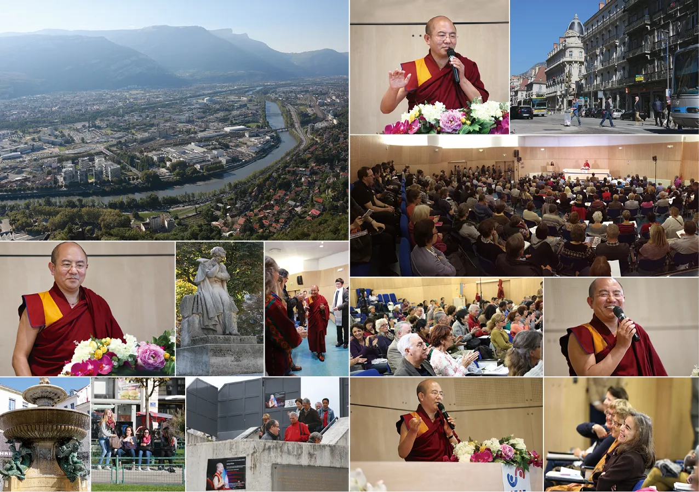
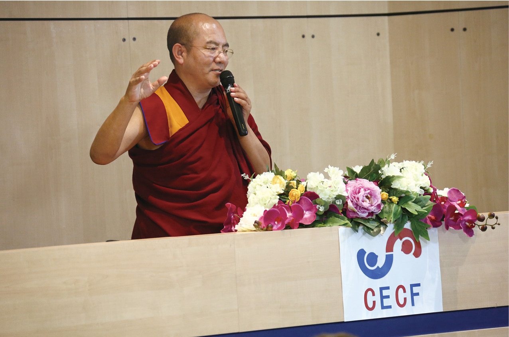
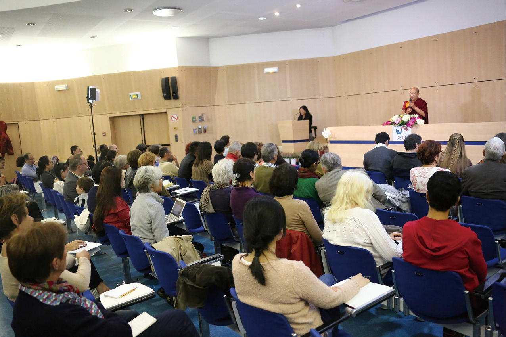
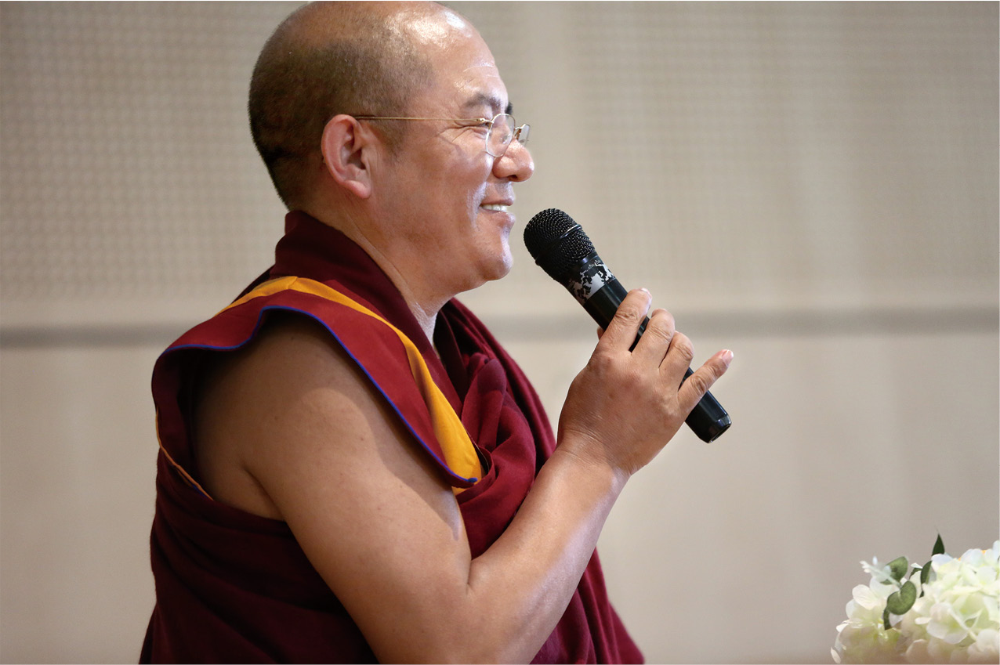
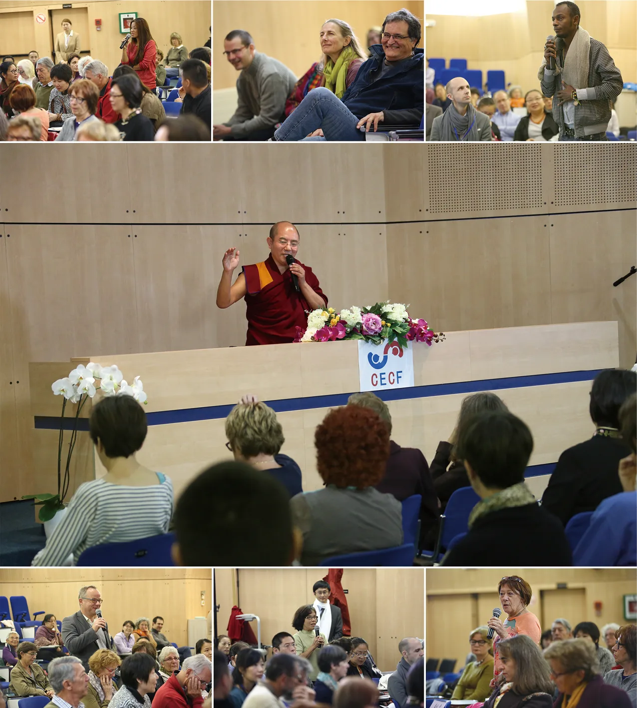
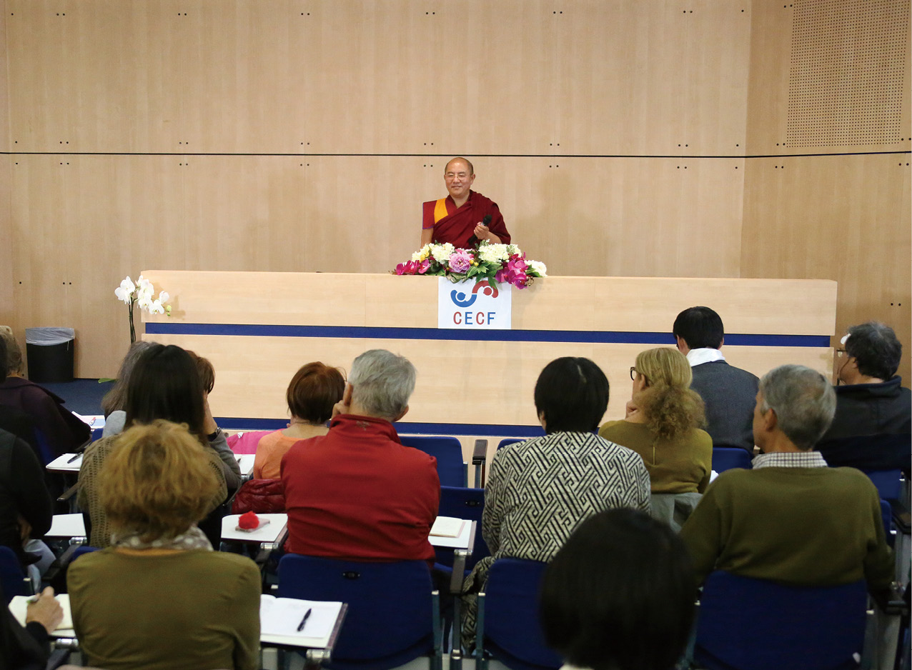
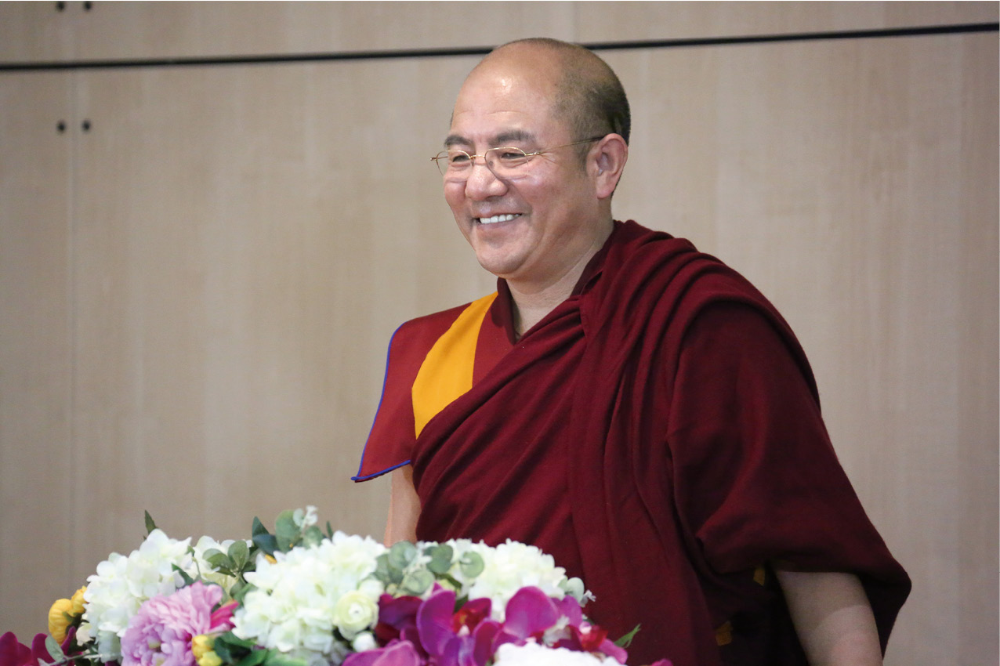

让世界上所有基督徒，都变成更好的基督徒；  
让所有穆斯林，都变成更好的穆斯林；  
让所有佛教徒，都变成更好的佛教徒。

——甘地

第33场

法国格勒诺布尔CECF中法企业交流协会

Association Des Chefs d'Entreprises France-Chine, Grenoble, France

法国·格勒诺布尔

2015 / 10 / 3

## 宗教和谐与世界和平

## Religious Harmony and World Peace

主持人：

大家好！欢迎参加由CECF[^1]主办的主题为“宗教和谐与世界和平”的佛法讲座。

十多年前，中法企业交流协会依据法国1901法案成立。我作为秘书长，已在协会工作多年。协会意在定期举办各类文化活动，向法国公众推广中国文化。

热烈欢迎今天的演讲者——尊敬的索达吉堪布仁波切，很荣幸堪布来到格勒诺布尔市！

堪布的演讲，很可能会彻底改变我们对藏传佛教的看法。在佛教领域，我们诚恳地向堪布学习。我们十分期待通过以“宗教和谐与世界和平”为主题的交流会，实现文化互通与跨宗教交流。相信我们一定会碰撞出智慧的火花。

祝愿大家度过愉快而有收获的一天！

尊敬的各国学者、中法企业学会的企业家、学者们，很高兴今天与大家共同探讨“宗教和谐与世界和平”。

## 文化缤纷异，诸宗愿景同

虽然我本人是佛教徒，但对其他宗教、文化一直非常感兴趣。在这个五彩缤纷的世界上，有各种各样的花草、树木，同样，全世界的人类，无论是外在的肤色，还是内心的兴趣，都迥然有异。与自己相应的文化，自然很容易接受；对于暂时无法接受的文化，则有必要学习，因为这些文化也有意义和价值。

其实，审美也因人而异，东方人认为的美，西方人不一定认可；而非洲人，也有自己的审美。其他人认为美的事物，起初我们无法接受，但习惯以后，我们也可以认同。

现在全球有七十多亿人，其中，有宗教信仰的人有六十亿左右。当然，这是粗略的数据，因为没办法统计到每一个人。但据美国的可靠数据，全球百分之八十以上的人，都有宗教信仰。如果信仰宗教的人，能够拥有共同的愿景，那么，所有宗教徒就能和睦相处；如果没有信仰的人也能求同存异，那么，世界就可以实现和平。

如今很多人将世界上发生的战乱、冲突、流血事件，都归咎于宗教。但以智慧观察就会发现，实际上这些纷争多源于政治、经济利益的纠纷。在纯粹的宗教层面，不会有这样的冲突。

不同宗教之间要互相学习，这是很有必要的。在21世纪，科技进步使学习变得非常容易。对不熟悉的词汇或理论，只要在iPad或手机上搜索一下，就能找到。因此，在如今的时代，想要学习知识并不困难。对于未经了解的事物，不应该戴“有色眼镜”去观察，否则，你将看到变色的、不真实的外境——由于偏见，你将无法理解对方的宗教或文化。

我们要真正了解，各个宗教的教义对于人类社会，确实有救护的力量——几乎所有宗教都提倡和平、平等、热爱与慈悲。

## 诸宗渊流久，各具加持力

在人类历史的长河中，宗教一直生生不息，展现出顽强的生命力。人类社会形成的早期，宗教就已经出现了。比如，印度婆罗门教的出现，距今已有四千多年；犹太教以及中国传统道教雏形的出现，已有近三千年。此外，印度耆那教、中国儒教的历史也很悠久。而人们熟知的三大宗教，佛教、基督教和伊斯兰教，它们的历史分别有两千五百多年、两千多年和一千四百多年。

如今世间的一些思想，如闪电般突然出现，随即很快消失得无影无踪。与这些思想相比，世界上留存至今的宗教，它的力量仍然鲜活。

不同宗教的教义有相似之处：佛教讲慈悲；基督教讲慈爱——慈爱人类、拯救苦难；印度教讲救济穷苦、弘扬真理，以仁爱之心救助世界；伊斯兰教提倡热爱生命，如安拉一样对待万物。所以，很多人除自己的信仰外，不敢、不愿意甚至排斥接触其他宗教，这不一定合理。在未了解时，你可能会认为某个宗教很荒谬，所以心生厌恶，但一旦了解，你会发现，每个宗教都有它的魅力与加持。

## 诸圣迹皆真，劝莫狭隘观

凡人的双眼所见、双耳所闻、心中所想，都不一定正确。就目前而言，大部分人都不能接受更深层次的知识。也有一部分人，只相信自己教派中的神秘事迹，不相信其他宗教中的见闻感应。

比如，佛教中讲，释迦牟尼佛在尼泊尔蓝毗尼花园，于母亲右腋下降生人间，向四方行七步后，说：“天上天下，唯我独尊。”对此，很多人会觉得，佛教的说法不合理：“人的腋下怎能生人？”

又比如，基督教的圣母玛利亚以处女之身，受感应而怀孕，所以圣母之子耶稣，并没有真正的父亲[^2]——现在有些基督徒认为，圣母玛利亚在俄罗斯和其他地方有丈夫，甚至她的丈夫很不高兴，因为耶稣是感而孕，不是他的亲生儿子。但不管怎么样，对于这些说法，其他宗教徒都觉得不可能。

八卦的创造者伏羲[^3]，其母于今菏泽一带，因踩大脚印而怀孕，诞下伏羲[^4]。在中国出现五帝之前，早有三皇现世，因此，伏羲可以说是我们最早的祖先[^5]。对此，很多人觉得不可思议：“伏羲之母为什么会因为踩大脚印而怀孕？”

我以前看过伊斯兰教穆罕默德的传记，他是一位在家人，第一任妻子育有四个女孩、三个男孩。四十岁左右时，他在山洞里修行，受到来自圣灵的启示，成为真主在人间的使者并开始传教。这就是伊斯兰教的起源。对于这种说法，有很多人怀疑：“怎么能凭一面之词，就相信他是所谓真主的使者？”

藏传佛教里有一位密教的创始者，叫做极喜金刚，他的母亲是一位比丘尼。有一天夜里，这位比丘尼梦到一位身色洁白的人，把由五部佛种子严饰的水晶瓶放在她的头顶。以此因缘，比丘尼怀孕，诞下极喜金刚[^6]。藏地的莲花生大士，降生于今阿富汗境内的一个湖里，化生于莲花中，并非胎生。很多人都觉得这些示现不可思议。

以上提到的人物都非同一般，他们的地位、境界，就算是国家总统、领袖也远不能及。他们的思想延续了几百年、几千年，直至今日。他们的这些事迹，我个人认为都是真实的，但没有信仰的人，会觉得是天方夜谭，甚至是人为制造的骗局。很多人只愿意相信自己信仰的宗教，不太愿意相信其他宗教。其实，人类需要反思自己的狭隘，不要一味排斥其他文化，只接受自己的文化。

## 应勇敢包容，具合理信仰

古时候，交通、信息都不发达，在这样的背景下，大家互相批判、存在误解，还情有可原。但现在科技这么发达，人类如果想互相了解，是轻而易举的。以前，西方人觉得东方人不漂亮，东方人也认为西方人不好看，大家很少有接触的机会。但通过昨天的提问，我发现现在东西方交流得还不错。（众笑）

随着时间的推移，人们对世界上各个宗教的思想，会有进一步了解。首先，我们要去学习，进而对教义有初步的理解，最终真正懂得教义的内涵。因此，实现宗教之间的互相理解，需要大家共同的努力。

由于根深蒂固的观念，一些人会觉得：“伊斯兰教很可怕”“藏传佛教也很可怕”“基督教与我无关，我也不信”……总之，人们习惯于分别“你”和“我”——“我有我的宗派，你有你的宗派”，在思想上有隔阂。但过于分明的界限感，日久会带来更多的矛盾。

我以前看过一本书，说是在一个寺院里，有个女孩顶礼的时候，颈上的耶稣十字架不小心露了出来，旁人讥笑：“你到底是佛教徒还是基督教徒？你在寺院里磕头，身上却挂着耶稣的标志。”女孩是怎么回答的呢？她说：“耶稣也好、佛也好，都是圣者，我对所有不可思议的对境都有信心。”

女孩所说的话体现了一种开放的思想。如果你的思想比较保守，可以只信仰一个宗教；如果思想比较开放、包容，可以有双重信仰。如果你相信某个宗教的教义，其实就可以算是一种信仰。每个人都可以有自己相信的事物，就像佛教里讲，一个事物只要在世间真实存在，你就可以去相信、承认。

## 众生具佛性，佛法纳万宗

佛教思想是很有包容性的。《涅槃经》中说，一切众生都具有佛性[^7]。对于这个观点，其他宗教的信徒不一定能理解。

“佛”是什么意思呢？梵语就是Buddha，觉悟之义。佛教认为：每一个众生、每一个生命体，都具有完全认识、通达宇宙真相的觉悟潜能。佛教能够以开放的态度，接纳所有宗教，是因为所有宗教的信仰者都是众生，而佛教可以接纳所有众生。

伊斯兰教有一个分支教派叫苏菲派[^8]。苏菲教也认为：我们的心将来可以觉悟，但在此之前，心有很多负面情绪。他们将负面情绪分为七万层，并将遣除负面情绪的过程称为“剥离”。佛教说众生有八万四千烦恼，多了一万多种（众笑）。苏菲派说，七万层烦恼遮障觉醒，而将烦恼逐一剥离后，最终会获得觉悟，即通达真主安拉的真义或去往天堂。在其教义中，同样承认来世的存在。而佛教认为，八万四千烦恼被全部遣除后，众生将彻底觉悟。所以，不同宗教所宣说的道理，有很多相似之处。

## 应理性观察，创宗教和谐

“宗教和谐”不应只停留在口头上，而应付诸行动。如果之前大家没有意识到勇于实践很重要，那么从现在起，应该勇敢地去接触现实中的宗教。如果你想了解基督教，可以去探访西方的教堂、与牧师交流。我去过很多教堂，在与主教交流之后，才了解到基督教的教义和实际情况。如果你想了解伊斯兰教，可以前往伊斯兰教比较兴盛的中东地区，去了解宗教教义、感受宗教生活。如果你想了解藏传佛教或印度教，则很有必要去藏地、印度的寺庙，了解他们的教义和生活。

在9·11事件[^9]后，有些人对伊斯兰教产生了误解。我接触过一些伊斯兰教的信仰者，据他们介绍，伊斯兰教根本没有鼓励杀害他人的教义，因此，这是极端分子和恐怖分子利用宗教所制造的事件。

我们需要通过宗教徒的宣讲，直接了解宗教教义，因为道听途说无法确保真实性。对于不理解的教义，通过亲自听闻，才容易理解。有一位台湾法师，之前对日本的一些宗教状况不太理解，他的上师就要求他去日本亲自了解。去了日本后，他才明白这些行为是度化众生的需要，是日本佛教针对当地实际情况所作的示现。

有一个话题在法国可能比较敏感，你们不一定能接受，但我也想讲一下。我认识的一个佛教徒前段时间去了中东，回来后他告诉我，他之前特别讨厌一夫多妻制，对于一个丈夫有好几个妻子的做法特别反感，认为这样做完全违背伦理道德。但他去中东后就了解了，一夫多妻制的存在，有历史、信仰和战争等原因，因此很多妇女需要由一个男人照顾。于是，他反感的心态就转变了。因此，只有亲自了解过，才能理解某个习惯或传统存在的原因和价值。当然，我这样说并不代表我就赞同某种做法。

有些事情，也许年轻时非常排斥，但到晚年时就不排斥了。因此，对于惯性思维，要理性观察它是否适应当下，这一点很重要。

## 愿众皆有爱，多宗皆和谐

1993年时，我跟随法王晋美彭措前往美国，在那里停留了大概三个月。回来后，法王有一次跟我开玩笑说：“以前在藏地的时候，觉得红色头发不太好看，但在美国待了三个月后，现在觉得红发、金发特别好看。”（众笑）

现在藏地的年轻人，特别喜欢染红色、黄色的头发，一些比较保守的上师、长者对此特别反感。我就跟他们说：“这种行为其实是一种大趋势。虽然严格的道德约束也有必要，但它会影响我们感受世界。所以，把心放宽，内心就会好受一些。”

在这个世界上，尽管人们的信仰、爱好各不相同，但有一件事情，我们应该保持一致，那就是对人类以及其他生命存有爱心。这应该是人类的共同目标。

著名的音乐家贝多芬曾说：“人类的内心如果连善良都没有，那美德就更不必说了。”所以，我们既要有一颗善良的心，也要有普世的道德标准与行为。圣雄甘地也曾说：“让世界上所有基督徒，都变成更好的基督徒；让所有穆斯林，都变成更好的穆斯林；让所有佛教徒，都变成更好的佛教徒。”

我希望，在我们保有自己文化和宗教的同时，也能与身边的人成为真正的朋友，彼此和睦相处！

现场互动

问：堪布刚才讲了，为了重新认识佛教，需要亲自去寺院或佛教圣地进行了解。我相信在座的很多人，对这样的参访都非常感兴趣，也很想朝拜您所在的学院。请问学院的大门是不是为我们所有人敞开呢？

堪布：是的。我们佛学院刚建立的时候，法王就表明：“这个学院虽然是一个佛教道场，但海纳百川，各宗各派的人都可以来学。”所以，如今佛学院之所以有这么多人，我认为最主要的原因就是有开放的思想，不排斥任何众生。所以，学院的大门永远都是敞开的，就看大家能不能来、愿不愿意来。

问：我是一名工程师。昨天您提到了中老年人年龄的划分。不幸的是，我即将步入中老年。

您刚才提到一个观点，说我们可以同时信仰几个宗教，对此我很难理解。虽说信仰不同宗教的创立者、接受不同仪轨也不无可能，但在我看来，不同宗教的一些教义是有矛盾的。具体来说，谈及死亡，基督教说人死后将去往天堂或地狱；佛教则说众生死后将以不同身份流转轮回，由人变成动物或其他身份。请问如何同时信仰在教义上有矛盾的不同宗教？

堪布：其实，只信仰一个宗教，但尊重并学习其他宗教，是非常合理的。

关于死亡，我前两天也讲过，佛教对死亡的过程讲得非常清楚。如果觉得佛教的死亡学说有道理，可以选择接受。当然，如果认为基督教的死亡学说有道理，也可以接受。

不同宗教的观点不同很正常，因为对于一些问题，有些宗教详细宣说了，而有些宗教没有详细说。关于死亡的问题，我问过一个研究基督教的人，他说：“虽然基督教讲天堂和地狱，但并没有说人死后不会转生——只是没有明确说而已。”因此，可以说基督教也间接承认人有来世，并没有否认。

问：我已经在格勒诺布尔生活了25年，之前一直是全职妈妈，现在已经退休了。佛教有一种修行，旨在消除分别心、摆脱性别歧视等一切歧视。我记得您也做过相关教导。在政治领域，有黑人总统奥巴马，也有女性总统。在宗教领域，变革也在不断发生，涌现出越来越多的女性修行人，那么，什么时候会出现女性的精神领袖？

堪布：在宗教领袖、各国元首中，有很多非常成功的女性。据统计，截至2015年1月1日，在193个联合国成员国中，有19名女性当选为国家元首或政府首脑[^10]。

在佛教戒律方面，男众、女众基本守持同样的戒——出家戒和在家戒。在地位方面，男女众平等，如果女众有能力，也可以成为导师——我们佛学院现任的院长就是一位女性。我以前去过很多大学，有一些大学的校长也是女性。在政界同样如此，美国的希拉里正在争取成为总统。

我相信未来会有更多女性成为各个宗教的领袖，因为一位具有智慧、慈悲与能力的女性，没有理由不能成为宗教领袖。

问：我是一名经济税法的顾问——这个职业不怎么浪漫。我是一个无神论者，我应该不会成为宗教的信徒。我曾经尝试去信仰宗教，但做不到。我没有从任何教义中获得过启发，也没有任何信仰。虽然我对佛教哲学很感兴趣，但我不是信徒，所以，对于非佛教徒，佛教意味着什么？

堪布：对于无神论，我研究得比较多。

在佛教最究竟的“空性”观点中，对包括神、佛在内的一切都不承认，这是最高的境界。这一观点，区别于无神论在世俗层面也不承许神、佛存在的观点。我个人认为无神论不太合理，因为在世俗层面，可以承许神、佛的存在。而且没有证据能否认他们的存在。

达尔文思想，对无神论起到了理论支撑作用，对全人类的思想有非常深远的影响——很多人不再相信宗教中的神，并将宗教思想一一推翻。尽管如此，如果我们用智慧去抉择，就会发现无神论的缺陷显而易见。我以前读书的时候，与相信无神论的老师有很多辩论。

问：今天您讲的主题在法国很敏感，因为我刚到法国的时候，法国人就跟我说，吃饭的时候有三点不能谈——宗教、政治和工作。但实际上，吃饭的时候，这三点他们都会谈。

关于宗教的内容，我刚才仔细听了，也做了笔记。总的来说，您今天主要讲了三点：

第一点是每个宗教的价值。欧洲是多宗教的国家，所以存在很多冲突，今年法国的“查理事件[^11]”就说明了这一点。我的下属有基督徒，也有穆斯林，在查理事件中，他们都支持自己的宗教。您今天讲了很多伊斯兰教的正面信息，我的穆斯林下属也说穆斯林是非常正面的。所以，对宗教内在的价值，大家都非常肯定。

第二点是宗教的神通。有时候，其他宗教对佛教的神通有误解，但我相信佛教的神通并没有不合理的地方。我也很感谢上师到访这座城市。我昨晚做了一个好梦，梦到了法国的小甲虫。在法国，这种小甲虫象征着好运，我以前从来没有做过这样的梦。

最后您讲了文化，与我的问题有关。虽然文化传播对宗教弘扬有一定助益，但也可能带来负面影响，因为不同文化背景的人，会以自己的文化理念解释宗教。所以，对于消除文化对宗教产生的负面影响，您的建议是什么？

堪布：其实，我在法国没有讲敏感话题，应该说，我讲的是最不敏感的一些道理。也许你认为比较敏感，所以的确应该讲出来。

我讲的主要是宗教的正面作用，虽然有时宗教看似与负面事件有关联，但实际上，这些过失不一定是宗教造成的，因为有些人打着宗教的旗号向世人宣扬自己的理念。像在汉地，经常有人以佛教的名义行恶事。当然，借其他宗教名义的也有。所以，对于这样的事件，我们一定要进行观察。

谈到文化与佛教，佛教的“教”，也可以按“教育”的“教”来理解。如果仅仅把佛教当作一种宗教，就很难从文化层面深入理解；如果把它作为教育中的学科，像大学中的哲学系、艺术系一样，将基督教、佛教看作基督教系、佛教系——从文化的角度去理解，就会非常好。现在在一些大学，不能宣扬宗教，只能谈论文化。其实，宗教也是一种文化，但规则的制定者对此并不了解——他们对“宗教”的词义有误解。

问：如今出现了所谓的新道教。以前的道教，以避世的态度面对人生，而新道教则倡导“心中有花，万物是花”。可以看出，道教在教义上有一定发展。那么，在佛教的发展中，教义是否也有一些新的内涵？

堪布：道教、佛教等各个宗教，都有不同程度的发展。我们希望道教有道教的兴盛，佛教有佛教的兴盛，不同宗教都能在各自的因缘中，发展得特别圆满。但我们不希望看到某个宗教统治全世界的局面，因为这不一定是好事。当然，一般来说，这样的情况也不会发生。

问：我来自西非几内亚的科纳克里市，到格勒诺布尔市生活刚好一年。虽然我信仰伊斯兰教，但我读《古兰经》的同时也读《圣经》，还阅读佛陀和甘地的教言。

我的问题是：人类是否可以期望信仰一个统一的宗教，而不只是谈论宗教的共存？就像大家可以使用通用的语言一样，这样一来，无论在何时，人们都可以无障碍地交流；无论在何地，都能遇到说同样语言的人。如果这个目标可以实现，人类之间的相处会更容易，相互之间的理解也可以加深。

在佛教中，有没有这种乐观主义呢？或者说，佛教是否承许共享伊斯兰教、基督教、犹太教、佛教等思想，并汇集这些思想为新一代人类创立一种新宗教呢？

堪布：过几天我去英国演讲，下一站就会去非洲。但我去的不是几内亚，而是南非、莱索托等几个国家。我对非洲的文化、宗教不是特别了解，因此也想借这次机会好好学习。

关于你的问题，从佛教的角度讲，并不提倡佛教变成所有真理的收集者，也没有期望基督教或其他宗教成为全世界唯一的宗教。而且四五千年来，各个宗教一直处于并存状态。所以，未来把所有宗教整合为一个宗教的想法，恐怕有点难以实现。

历史上，还没有出现过只有一个宗教的局面，只不过在某一时期，有些宗教的信徒越来越多、有些宗教的信徒越来越少，就像经济不平衡的状态一样。在历史长河中，有时候基督教兴盛，有时候佛教兴盛，有这样的现象。

对此，佛教的态度是什么呢？希望所有对众生真正有帮助的宗教，永远存在。对社会、人类有害的宗教，即使包装得再好，也不值得赞叹。

真正的世界和平，体现在每个人的慈爱心中——愿人类的慈爱之心永不消逝。因此，可以说弘扬慈爱的宗教，就是最好的宗教。佛教的理念是：“不为自己求安乐，但愿众生得离苦。”让所有人类乃至所有生命获得快乐，就是佛教最究竟的理想。

主持人：

非常感谢堪布今天的精彩演讲！堪布下一场讲座将在巴黎的法兰西学院举行。祝您旅途愉快，一切顺利！

[^1]: CECF：中法企业交流协会。
[^2]: 基督教《圣经》中说，圣母玛利亚为处女时，受圣神天主感应而怀孕。
[^3]: 《太平御览》：“伏羲坐于方坛之上，听八风之气，乃画八卦。”
[^4]: 《山海经》：“华胥氏履大人迹而孕伏羲。”
[^5]: 中国最远古的帝王是三皇五帝。三皇，指伏羲、神农、黄帝。五帝，指少昊、颛顼、帝喾、尧、舜。
[^6]: 密主极喜金刚的诞生经历，在《六中阴》《大圆满前行引导文》中有述。
[^7]: 《大般涅槃经》：“何等不闻而能得闻？所谓甚深微密之藏，一切众生悉有佛性；佛、法、众僧无有差别，三宝性相常乐我净……”
[^8]: 苏菲教（Sufeiyah），10-11世纪，伊斯兰教中出现的神秘主义和禁欲主义派别。
[^9]: 2001年9月11日上午，两架被恐怖分子劫持的民航客机撞向美国纽约世界贸易中心双塔，另一组劫机者迫使第三架民航客机撞入华盛顿五角大楼。
[^10]: 数据来自《新京报》。
[^11]: 查理事件：2015年1月7日发生于法国巴黎《查理周刊》总部的恐怖袭击。两名蒙面男子高喊“Allahu Akbar（真主至大）”，向平民和警方射击。
