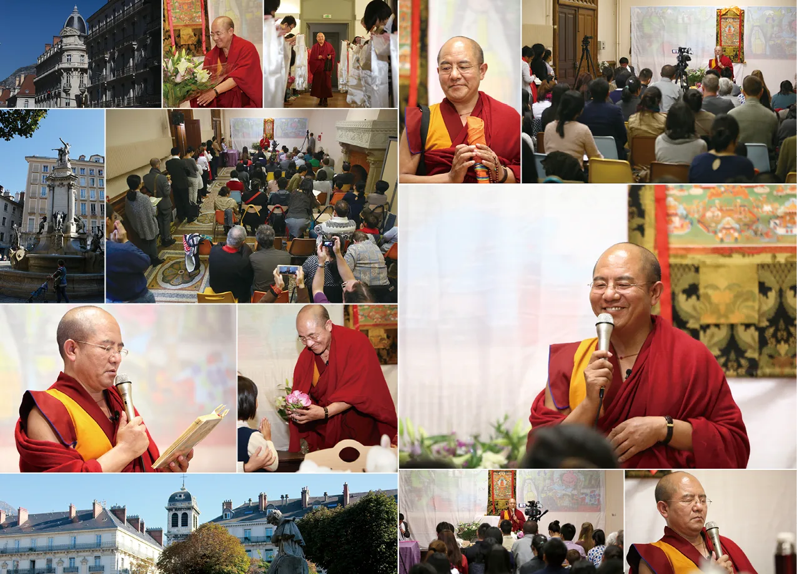
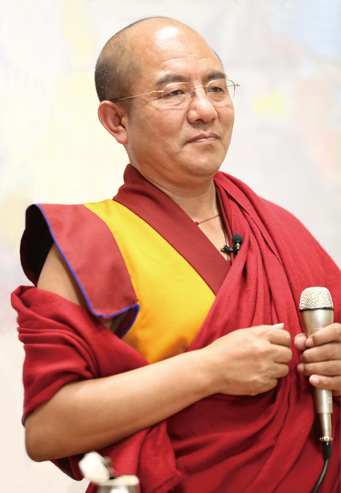
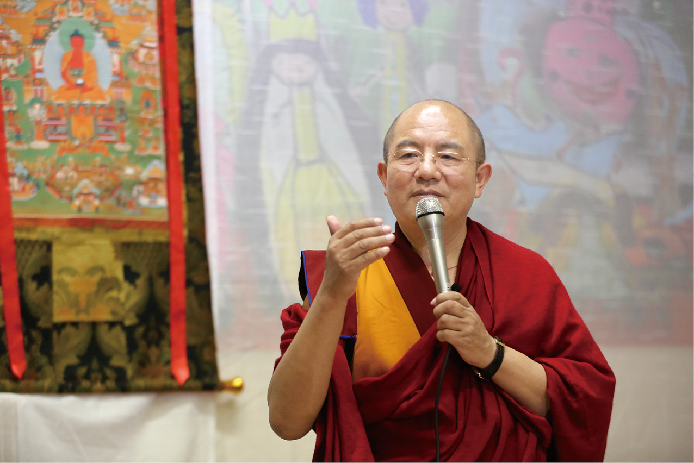
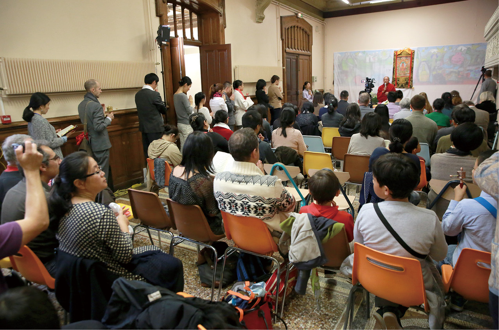
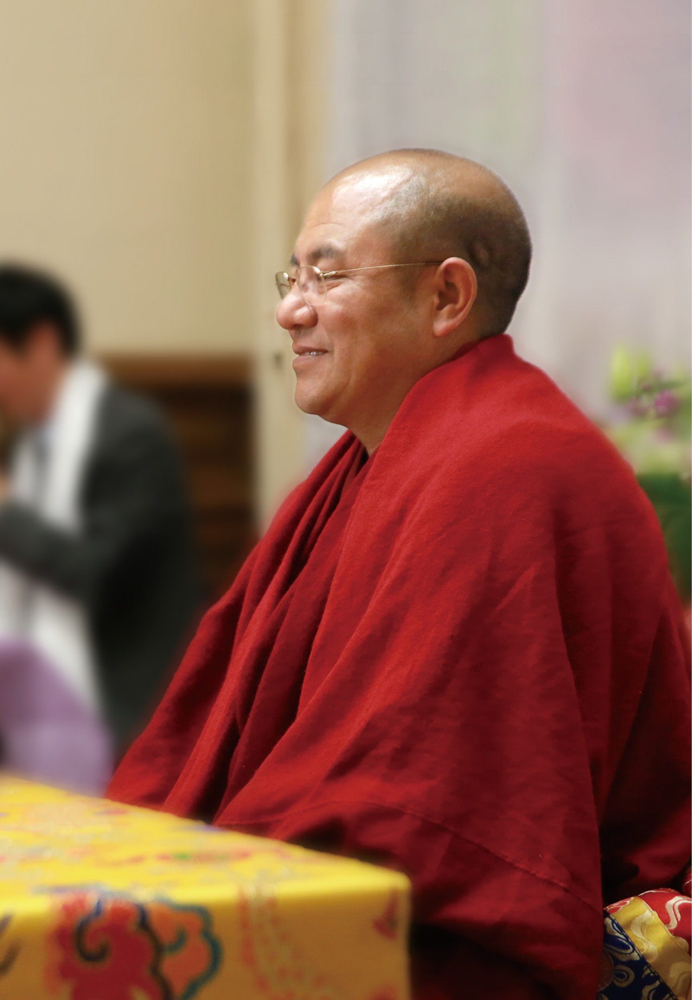
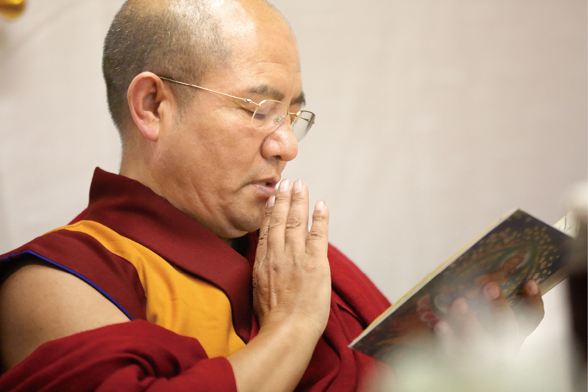
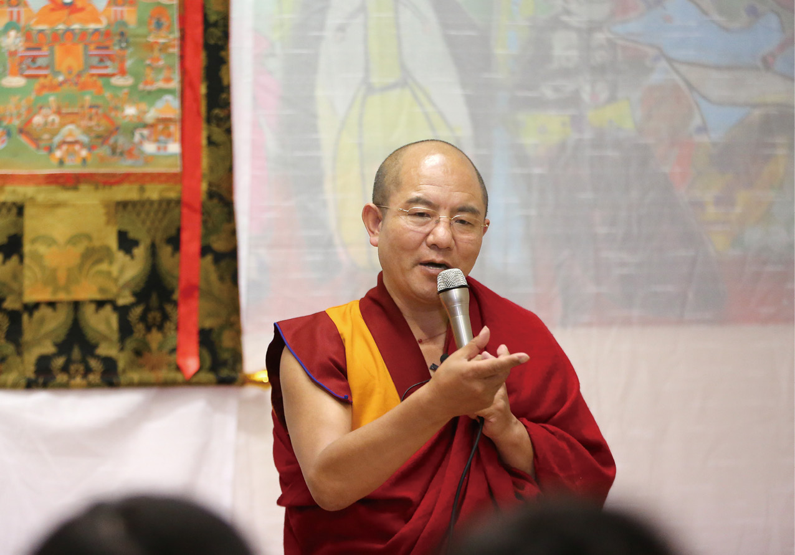
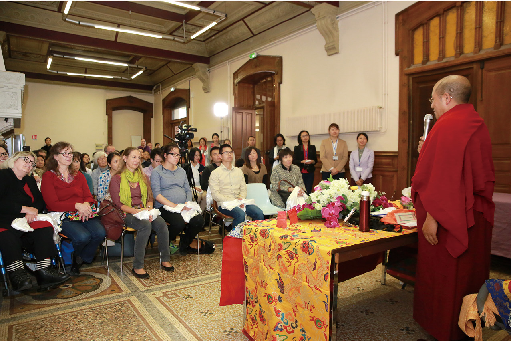
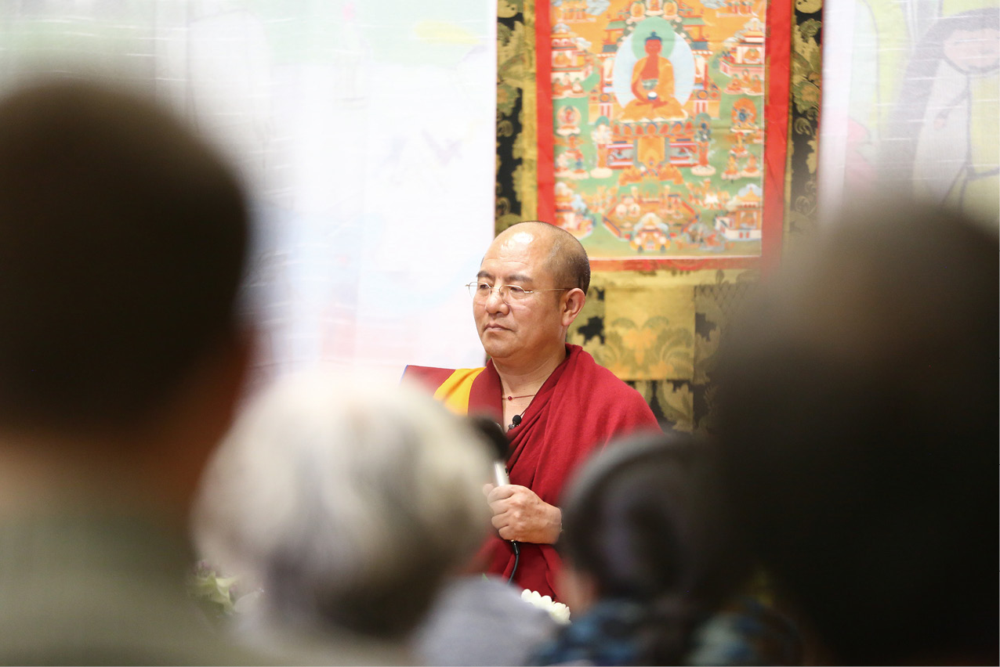
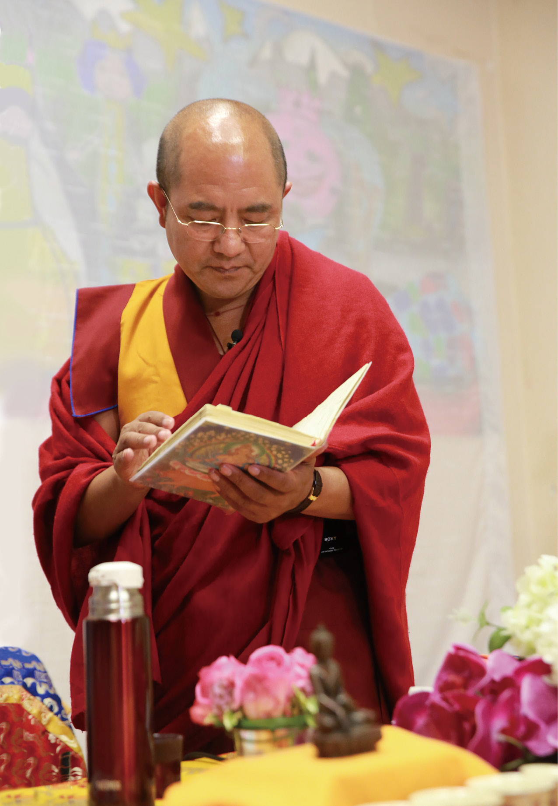

你会惊讶地发现，  
两千五百多年前，  
佛陀所开显的真理，  
真实不虚、不可思议。

第34场

法国格勒诺布尔公开演讲

Public Speech, Grenoble, France

法国·格勒诺布尔

2015 / 10 / 3

## 寻找生命的皈依处

## Seeking for a Life Refuge

主持人：

下午好！作为一位受过系统闻思修训练的藏传佛教僧人，一位当今时代颇具影响力的心灵导师，一位平等与各界人士交流佛法的学者，在三十个看似平凡却又不寻常的年头里，堪布仁波切的生活简单而充实。

堪布曾把自己描述为一位精进的凡夫，多年以来，陪伴他的是一起为弘法利生不懈努力的道友，是装满精舍的经文、书籍，是坛城中庄严慈悲的诸佛菩萨，是始终在他心灵深处的法王上师。特别是对法王，堪布曾写下绵绵无尽的感恩与思念：“上师啊！昔日我扶过您的手，至今还留有您的味道；曾经我得过您的法，至今还在血液中流淌；过去我听过您的教言，至今还在耳畔回荡。虽然您的色身已离开了我，但您的智慧法身从未远去，仍如当日一般，是我一切的源泉。”

不难看出，堪布仁波切的皈依处是佛法僧三宝，是赐予他智慧、慈悲与力量的大恩上师法王如意宝。对佛教徒来说，上师三宝是身心的依靠处、福报的增上处和智慧的源泉地。堪布仁波切曾在很多场合中说过：“我这一生最觉荣幸的地方，就是在这样复杂的社会里，遇到了佛法、遇到了我的上师们，尤其是法王如意宝。”

在生活节奏过快、压力超负荷的21世纪，我们难得有闲下来、静下心来的时候，因此你是否曾想过，要寻求一个心灵的依靠处？那么，哪里才是生命的皈依处呢？今天，就请堪布仁波切带领我们一起来探讨这个问题。希望我们都能从中得到启发、获得安慰，找到生命真正的皈依处！

现在，让我们用最热烈的掌声欢迎堪布仁波切，为我们做精彩的演讲——

今天是我到这个城市的第四天。明天我将离开这里，前往巴黎。

最近我发现，这边的很多佛教徒，无论是修行，还是听法、听演讲，都非常用心。之前我来法国的时候，还比较年轻，有好奇心，但智慧并不成熟。这次再来法国，我有一些新的感触，我感觉法国人的性格很像藏族人，一开始比较慢热，但人格非常稳重，这样的性格会帮助大家在修行上走得更远。

中国和法国的关系应该不错，因为在昨天的提问环节，我了解到很多中国女孩成了法国人的妻子，但我好像没听说中国男孩成为法国人的丈夫。也许有吧？但我没听说。（众笑）

无论是法国人，还是中国人，或是其他国家的人，都需要有皈依处。来这里寻找伴侣的人，其实也是在寻求人生的皈依处。又如医生是病人的皈依处，老师是学生的皈依处，父母是孩子的皈依处，等等。当然，这些只是世间的皈依。而心灵的皈依，需要以佛、法、僧三宝为对境。如果没有这样的皈依处，人生会非常迷茫，找不到真实的方向。

## 心皈依对境，佛法僧三宝

那么，我们皈依的三宝是什么呢？所谓“佛”，即觉悟者，他已完全通达宇宙万物的真相。所谓“法”，是指佛陀所宣讲的八万四千法门，即释迦牟尼佛觉悟后开显的真理，这些真理被结集后以文字形式保存，后来又被翻译成多种语言。所谓“僧”，是指追随佛陀、修习佛法的修行者，其中也包括已证悟佛教真义的圣者。

我们要以觉悟者、觉悟的智慧以及追寻真理的同行道友为皈依处，此三者即佛、法、僧三宝。

我对世界上的所有宗教都非常尊重，也愿意与各个宗教一起交流、互相学习，但我对佛法僧三宝的皈依，永远不会改变。出家之前，我就在研究佛学，出家后的三十年，我也在不断闻思修。在这个过程中，我亲自品尝到了佛法智慧的滋味，它甚深而不可言说。所以，能成为佛教徒，我非常荣幸。

## 皈佛究竟慧，轮回无忧怖

在座的各位，对于没有说服力的事情，可能不会轻易相信。但佛教的智慧，经得起科学的检验、理性的观察，所以我们不得不心悦诚服。

有一位印度学者写过一篇赞叹佛教的文章，他说：“我对佛教之外的宗教不排斥，对佛教也不刻意赞扬。无论是哪一个宗教，只要宣说了颠扑不破的真理，我都会皈依[^1]。”

所谓的皈依，并非仅仅是一个仪式。我们要通过学习，在内心真正认识到，一切有情的皈依处，除佛、法、僧三宝外，再无其他。在行为上，我们要与所有宗教和谐相处，但在见解上，为了最终的解脱，我们要认识到只有佛陀的智慧最为究竟。

在座的各位，都很有智慧。从世间角度讲，你们精通汉语、英语、法语、西班牙语等等，还有很多其他技能。但智慧不应该只用在处理世间事务，更应该用来解决生死大事。如果以智慧抉择佛教的真实教义，你会惊讶地发现，两千五百多年前，佛陀所开显的真理，真实不虚、不可思议。

如果佛教对人类乃至所有生命没有意义，我们也不会竭力弘扬。但既然已经发现它是解决生老病死等巨大痛苦的妙药，我们就有责任好好去弘扬。就我个人而言，没有期望佛教徒越多越好；但对个人来说，如果可以通达佛教真理，确实非常有意义。

世间有很多人有这样的困惑——人活在世界上的意义到底是什么？除赚钱、结婚生子、成家立业以外，还有其他追求吗？找不到答案的人，就像街头的流浪汉，没有生活的方向和目标。如果皈依了三宝，就能找到自己的归宿，从此，在轮回的大海中，再不会有恐惧之心。因此，很希望大家都能皈依三宝，并深入了解它的内涵。

## 皈依功德多，圣者亦重视

皈依有很多功德[^2]。佛陀对阿难尊者宣说过皈依的八种功德，还教导我们：以三千大千世界各种珍宝供养无数佛陀的功德，犹不及以清净心皈依三宝的功德[^3]。

皈依可以遣除罪障，就像千年暗室中，突然出现一盏明灯，霎时便能遣除黑暗一样。人们无始以来的诸多障碍，通过皈依的力量都能迅速遣除[^4]。

皈依三宝的人，有三十六位善神等许多护法神的守护，而且不会堕于地狱、饿鬼、旁生此三恶趣中[^5]，能够获得人身、天人身……诸如此类的功德不胜枚举。

以前，印度的阿底峡尊者来到藏地后，经常讲皈依的功德。有些弟子就对阿底峡尊者说：“您这么大的上师，总是讲这么基础的法，很多人都会笑话您。您不应该总讲皈依，应该多讲大法才对。”但阿底峡尊者回答：“皈依就是佛法中最大的法，我看不出有比这更大的法了。”因此，即使是这样的大成就者，对皈依都如此重视。

## 皈依后勤修，实践于生活

皈依不是参加一次仪式便了事，而是要经常念皈依偈。藏地的很多佛教徒，包括大成就者、出色的修行人，都经常念四皈依。藏语的皈依偈念作“喇嘛拉加森且奥、桑结拉加森且奥、秋拉加森且奥、根敦拉加森且奥”，译为“皈依师、皈依佛、皈依法、皈依僧”。这个偈颂，在行住坐卧中——走路的时候、坐车的时候、爬山的时候都可以念，包括在水里游泳的时候，也可以边游边念。

将皈依的修法融入生活很重要。早上起床后、白天工作时、晚上睡觉前都可以祈祷三宝并念皈依偈。这样的修行，能让我们成为真正的三宝弟子。

总之，起初需要通过仪式获得皈依，之后自己要常常修学皈依，在有生之年活到老、学到老，不能只满足于参加一个皈依仪式。

## 集体共闻思，恒修自他利

闻思修行应当持之以恒。目前，法国的佛教徒正在进行有次第的闻思修行，这很重要。如果没有系统闻思修，只是参加皈依或灌顶仪式，无法通达佛教的甚深意义。因此我希望，西方人能从理论上认识和学习佛教。因为西方人的思维大多比较严谨，思考能力强，如果通过这样的方式，研究佛教的甚深意义，相信大家会有出乎意料的收获。

我们现在特别提倡海外道友以团体形式进行学习，其中有两个目的：

一、很多中国人刚到西方，用英语或其他语言听受高僧大德的传法，还有一定困难。这样一来，既失去了在中国本地接受佛教教育的机会，又无法适应西方的佛教教育，还是比较可惜的。而在我们的佛教团体中，至少可以通过汉语学习佛法。

海外的很多中国道友，已自行建立了学习小组，虽然规模没有中国本地的那么大，但大家都很努力。在海外过好自己生活的同时，不要舍弃对真理的追求，这对每个人来说都非常重要。

二、很多西方人对参加灌顶和简单的修法有意乐，但系统学习显宗、密宗理论的人却不太多。因此，很希望大家进行系统学习。很多中国道友也是这样，虽然精通英语、法语、德语等各国语言，但对佛法却不精通，因此应当系统学习佛法，并运用各种语言，与家人、朋友、同事一起交流佛法。相信大家通过理论学习和实际修持，会有很大改变。

## 劝请常弘法，惜缘莫松懈

中国的年轻佛教徒应该有一种责任感，首先自己要精进闻思修行，进而要通过不同语言，把佛教真理传讲给他人。别人是否接受，我们不强求，但自己应该有这样的发心，要发愿帮助他人——暂时而言，遣除他人此生的痛苦，究竟来讲，帮助他人度脱轮回的大海，直至解脱彼岸。希望大家为这个目标共同努力。

这次讲座，本来我用藏语讲也可以，但一方面懂藏语的翻译比较难找；另一方面，我用汉语为汉族人讲经说法已将近30年，对大家的情况比较了解，因此，我有责任让国外的汉族道友有机会继续学习佛法。如果西式的佛法教育得不到，中式的佛法教育也抛弃了，我觉得很可惜。

对西方人的思想、语言，我不太懂；但对汉族人，我还是比较了解。所以，我希望汉族人尽量加入学佛团体，系统地闻思修行。我们要抓住闻思修行的机缘，在生活、修行中坚强起来，不断努力；不要太懈怠，睡眠时间不要过长。我上午十点钟出门的时候，有人跟我说：“法国人现在肯定还在梦乡中。”我当时觉得很惊讶：“怎么十点钟还在做梦？”

## 团结和合住，发起长远心

最后，我要对很多道友表示感谢，因为他们特别辛苦。我每到一个城市，相关的工作人员、发心人员、义工都特别劳累。

希望道友之间一定要团结和合，这一点很重要。国家、家庭、佛教团体，都需要建立在和合的基础上。如果争吵不断，家庭不会和睦，团体也不会有发展。因此，要在团体稳定、和合的基础上，努力地闻思、修行、发心。

做任何一件事，都要长远考虑，学佛也是这样，不能只学一两年、浅尝辄止。因此，希望大家多思维自他的长远利益。

昨天有一位法国女士说，她已经修行了三十年，我觉得很值得赞叹。索甲仁波切的一些法国弟子，二十多年前就是他的弟子，现在也还是他的弟子——人要有这样的恒常心，不要一两年甚至一两天就变了。尽管生活千变万化，但我们的人格、心态要稳重，学佛也是这样。我对法国人的性格了解得还不太深，但大家看起来还是很稳重的。因此，希望大家坚持长期学习。

接下来，我给大家念传承，之后再进行简单的问答。

（堪布念莲师七句祈祷文传承）

现场互动

问1：我已经皈依了藏传佛教，参加过一些禅修，去中国的寺院里念过经。希望您可以帮助我找到正确的方向，并引导我的太太也跟随一位上师修学，因为我不想再耽误修行的时间。请问在法国是否能找到一位指引我们修行方向的上师？希望这位上师通晓所有佛法，并能指导我们次第修学。

堪布：在法国应该有很多上师吧？我对法国的情况不是特别清楚。但是我想，如果你的家人也想一起学习，现在通过网络、光盘，学习正统佛法也并不困难。虽然亲自寻找上师很重要，但如果暂时找不到，可以参加一些学习班或研讨会，这样也能通过听闻经论实现系统学习，而且更加方便。

问2：您说的研讨会是不是网上的呢？

堪布：是的。

问3：或者去参加现场共修可以吗？

堪布：能参加现场共修也很好。

问：我是从尼斯过来的。今天同行的法国人，让我给您带个好！我已经学佛多年，但还是很难平衡修学佛法与实际生活的关系，不擅长运用佛法处理工作、学习中的事务以及与周围人的关系。所以，应该如何去处理这些关系？怎样实现平衡？这是我一直很疑惑的。而且，周围的人不理解我学佛；在我分享佛法时，也得不到别人的认可。因此，即使想弘法，也不一定有机缘，而且自己的智慧有限，也没有资格去弘法。在这种情况下，我应该怎样做？

堪布：你的问题有三点，我也分三点来回答。

第一点，作为佛教徒，一定要尽量学习佛教基础知识和理论。打好基础后，对佛教的闻思修，就不会有疑惑。

第二点，作为在家佛教徒，一定要有“双重身份”。一个身份是佛教徒，另一个身份是家庭和职场中的角色。比如，你是一位丈夫、一名员工，就需要尽职尽责。

第三点，要用智慧处理人际关系。比如，面对医生，就说医生关心的话题；面对警察，就随顺警察说的语言。如果有智慧，做事就自在。

问：我来自巴黎。作为上师的弟子、大乘佛教的追随者，在了解其他宗教的过程中，在阅读他们的经典、参观他们的圣地时，有什么需要注意的地方？

堪布：佛教徒参访其他宗教的殿堂，与教徒进行交往，要有学习的态度、求知的精神，不要故步自封。在《瑜伽师地论》中讲，大乘佛子需要学习五明，即工巧明、医学、逻辑学等方面的知识[^6]。对其他宗教的知识，也应当以求知的态度进行学习。

人与人之间的交往，诚恳的态度很重要。在与其他宗教徒、无信仰者以及其他佛教徒交往时，无论对方怎么想，站在自己的角度，都要有一颗真诚、善良的心，要发自内心地尊重对方，因为友好的交往不能仅仅落在口头上。如果能够做到这一点，那么，即使对方对你有怀疑、不认可，你也可以问心无愧。因此，无论与任何人交往，真实、忠诚、仁厚的品格都很重要。

问：我妈妈是您的皈依弟子，她现在每天都非常精进。她特别在意数字，比如，一天要完成一万遍莲师心咒，要磕多少个大头。但在我看来，过于执著完成数量，让她忽略了佛法的道理。我甚至觉得她有点功利。要如何解决这个问题呢？

堪布：如果她没有很好地学习佛教的义理，而只是执著完成数量，并不是最好的修行方式。如果她可以在兼顾闻思与修行的基础上，完成每天的功课，这是我们所提倡的。

当然，制定完成功课的数量，是对个人修行的一种考察——看自己今天有没有懈怠、散乱。所以，她每天对自己的修行有要求，也是对自己的一种约束。从这个角度来说，这样的行为是有益的。但从另一个角度讲，佛教的修行并非只局限于完成数量。

对此，我们应有的态度和行为是，通过完成数量促进修行，进而由量的积累实现质变，最终令自己的修行有所进步。如果没有量的积累，就很难有质变，所以对这个问题，我们要一分为二地去看待。

问：我学佛才五六年，时间不长。但我深刻地体会到，生老病死犹如苦海。现在，我对此生和整个轮回有很强烈的出离心，很希望能以有限的精力，去做一些有意义的事情。因此，我自己很想保持单身，这样就可以把更多精力投入教育事业中。但我的父母非常希望我早点结婚、成家立业，他们认为这才是人生的归宿和意义。我想请教您，我该用怎样的善巧方便，让他们明白我的选择，以及如何从究竟层面帮助他们？

堪布：其实，世间有很多成功女性，都不愿意成家生子。因为如果有了家庭和孩子，很多精力都不得不放在这上面。我以前认识的一些人，有男有女，刚从学校毕业的时候很想成家，成家之后，几乎把所有精力都用在照顾孩子上。因此，如果你实在不愿意结婚，可以对父母说：“我的要求很高，找不到非常满意的人。”（众笑）然后你可以把“门槛”不断提升，父母也不太可能强迫你，这是一种方法。当然，还有其他方法，你可以慢慢去发现。

其实，每个人的选择都有合理性，你的选择或许可以让你为他人做更多、更有益的事情，所以很随喜你！

问：我的先生是法国人，他从小受了洗礼，是天主教徒。听了您今早的开示，他有一个问题：上师说有信仰才会有宽容，但在学校也可以学习宽容，为什么还需要宗教信仰？

堪布：在学校的确可以学习宽容，课本里有这个词，但它主要是从哲学、文化层面讲的，因此在很大程度上，这种宽容只是理论上的宽容，并没有结合自身的行持。如何结合自身呢？比如，大乘佛教里讲宽容，需要通过修自他交换来修菩提心——真正希望所有众生的痛苦由我来承受，自己的安乐无条件地奉献给众生。因此相对而言，学校里的学习只是理论上的学习。

当然，我们没有要求每个人都信宗教，如果觉得在学校习得的宽容已经足够，那也可以。但实际上，理论知识与实际修持之间，有很大距离，因此，宗教实修也有必要。总之，对理论与修行之间的关系，还要去深入思考。

问：现在，越来越多的法国人对中国传统文化感兴趣，但主要是对道教、儒家感兴趣，因为他们大多是通过中医针灸、太极气功了解宗教思想的。但提到佛教的时候，他们往往认为这是一种哲学。有些法国人觉得，佛教和生活没有特别密切的关系，就算佛教很重要，它也只是哲学。因此，他们对佛教无法产生更深的认识和了解。

我个人觉得佛教非常好，对人类社会、自然环境有很大利益，我也很想让更多法国人来学习佛教。欧洲人的生活比较有保障，而且也有意乐寻找物质以外的追求和寄托，因此我想找到一个方便方法作为切入点，让他们有机缘接触、学习佛教，祈请上师给予开示。

堪布：其实有一种方法，可以把对佛法感兴趣的法国人召集起来，关在一个佛堂里（众笑）。开玩笑的。

在上世纪八十年代，有很多中国人认为佛教是迷信，因而对它嗤之以鼻；还有一部分人，认为佛教过于高深，普通人没办法了解。后来，这些人通过学习，真正懂得了佛教教义后，才恍然大悟：“原来佛教可以运用于生活，并非高不可攀。”所以，如果能进一步了解、学习真实的佛教教义，比如智慧与慈悲，而不局限于参与一个仪式，慢慢就会领略到佛教对改变人生的意义。

总之，引导他人学佛，要随缘而行，或者把佛教作为一种教育来弘扬，这样可能更适合。

问：我在修法的时候，无法调伏自心，心总是不能专注。因此，我想知道，在禅修中应该运用修菩提心、数息或者什么方式，才能让我更快速地安住于心、让心融于法？

堪布：有两个要点。第一，如果想尽快获得修行觉受，最好是修菩提心；第二，通过禅修调整自心时，祈祷上师三宝至关重要。做到以上两点，我相信你会很快有进步。

问：我的问题与“随顺众生”有关。一年前，以一些因缘，我开始读佛教书籍，并开始吃素。每当家人为我做肉食的菜肴，我都会拒绝，他们就非常伤心。后来我了解到有个观点叫做“随顺众生”，所以后来怕他们伤心，我就会说：“好，那我只吃这一盘，下一盘就不吃了，好不好？”请问我在遇到这种情况时，暂时这样随顺众生是否可以？

堪布：一般来说，在一些原则问题上，比如对方劝我们不要学佛、做与佛教根本理念相违背的事，就不能随顺，应该用一些善巧方便来化解。如果不是原则问题，那么随顺家人、朋友，处理好与他们的关系是很重要的。

关于吃素的问题，如果你觉得肉特别好吃，看到家人吃，自己也觉得特别香，那么，你一方面是随顺他们，同时也是随顺自己（众笑），不过这应该不是很大的问题。但在大的原则问题上，不能随顺别人，也不能随顺自己的烦恼，这时需要用智慧来抉择。这是今天的最后一个问题。

这三天我在格勒诺布尔，讲课站了八个小时——前天两小时，昨天两小时，今天上午和下午一共四小时。但我感觉非常好，因为在别的地方讲课，有时一天就要站八小时，所以这三天不算有压力。

希望大家以后好好修行，不要半途而废、不要退失。中国人、法国人愿意参加都可以，因为我们不涉及政治、民族、经济等问题，也没有传教的目的，只有一个共同的目标，就是好好学习真理。提供这样的平台，完全是为了让更多人了解真实的佛教教义，因此希望大家能够长期学习。

以后，也许我经常来，也许不来，不好说，因为生命是无常的。但不管怎样，希望你们好好学下去，这是我最后的总结语。

[^1]: 德协达波于《胜出天神赞》中云：“我不执佛方，不嗔淡黄等，谁具正理语，认彼为本师。”
[^2]: 《善生经》：“若人受三皈，所得果报不可穷尽，如四大宝藏，全国人民七年之中，运出不尽。皈依三宝者，其福过彼，不可胜计。”
[^3]: 《佛说希有校量功德经》：“若三千大千世界满中如来，如稻麻竹苇，人以四事供养满二万岁。诸佛灭后，各起塔庙，复以香花种种供养，其福虽多。不如有人以纯净心，皈依三宝所得功德。”
[^4]: 《佛说希有校量功德经》：“夫三宝者，千生难遇，万劫难逢，皈依者，福增无量；礼念者，罪灭河沙。譬如灵丹之妙药，疗百病而蠲除。冥冥黑夜中，三宝为灯烛；涛涛苦海内，三宝为舟航；焰焰火宅中，三宝为雨泽。”
[^5]: 《开启深道门扉》：“皈依者不堕恶趣，往昔所积恶业渐尽。”
[^6]: 《瑜伽师地论》：“已说有心无心地。云何闻所成地。谓若略说。于五明处名句文身无量差别。觉慧为先。听闻领受。读诵忆念。又于依止名身句身文身义中。无倒解了。如是名为闻所成地。何等名五明处。谓内明处。医方明处。因明处。声明处。工业明处。”
