若想不扰乱他人的心，就需要培养慈悲心。

第40场

英国伦敦大学

University of London

英国·伦敦

2015 / 10 / 25

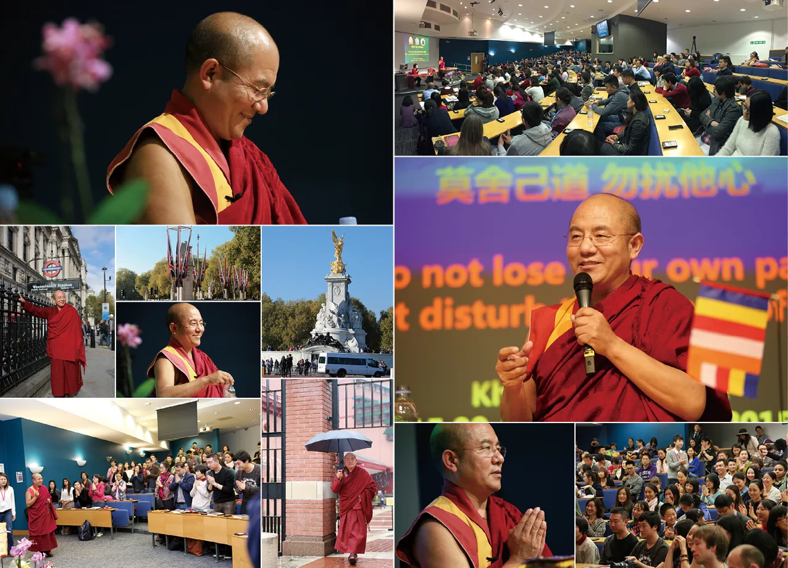

## 莫舍己道，勿扰他心

## Don't Lose Your Path, Don't Disturb Other's Mind

主持人：

女士们、先生们，大家下午好！今天非常高兴尊贵的索达吉堪布仁波切能来到这里。他将与我们分享他的根本上师法王如意宝晋美彭措的珍贵教言——“莫舍己道，勿扰他心”。

下面，请让我简单地为大家介绍一下堪布仁波切。索达吉堪布仁波切是当代极具影响力的藏传佛教上师，他来自佛教圣地喇荣五明佛学院，常住学院逾三十年。仁波切常说，早年在法王座下听法的日子，是他人生中最美好的时光，是他最珍贵的记忆。

作为宁玛传承的持有者、卓越的现代佛教思想家，堪布的言行正是对“莫舍己道，勿扰他心”的最好诠释。依照法王如意宝的嘱托，从1987年至今，堪布一直肩负着培养和管理汉僧的重任。

在信息高度发达的时代，仁波切常常提起与人沟通的重要性。与人相处的最胜之道是什么呢？堪布说，法王如意宝对此有最殊胜的教言，即对上者恭敬、对下者爱护、对与自己平等者和睦相处。堪布无论在哪里，无论与任何人相处，都可以照顾到对方的感受和需求。堪布还以这种慈悲，平等地对待一切众生——他要求在学院听他讲法的每一位弟子都必须吃素。

“莫舍己道，勿扰他心”，是法王如意宝在圆寂前留给大家的最后教言，对教言的解读可以有很多角度。下面，掌声有请索达吉堪布为我们分享他的理解与感悟。欢迎堪布——

很高兴今天有机会与大家共同学习。学习是一件很美好、很有意义的事，让人停不下来。学习有很多种方式，可以是老师讲课、学生听课，也可以互相辩论，或者通过参观、走访、与他人交往来学习。

爱学习的人，无论到什么地方，接触什么层次的人，承办什么事情，都能找到学习的机会，并通过学习增长自己的智慧。不爱学习的人，即使老师苦口婆心地为他讲课，他也不会好好听。

藏传佛教中有一句名言：“活到老，学到老，智慧无有穷尽。”还有一句名言：“即使明天死亡，今天也要精进修学。”这些格言对人生很有指导意义。虽然我没有机会在伦敦大学听课，但在这里分享应该也算是一种学习。

## 法王临终言，意义极深远

今天我分享的主题是“莫舍己道，勿扰他心”。这是法王晋美彭措在圆寂前，为我们留下的甚深教言。在近现代，法王对佛教、藏文化的继承与发展、跨文化的交流，有非常大的贡献。他是非常了不起的修行人、智者、成就者。

我在上师晋美彭措座下学习过很多年。他在圆寂的那年，做了心脏手术，在成都住院。临近圆寂时，法王给喇荣佛学院打电话，对弟子们讲了很多话，他说的最后一句话就是“莫舍己道，勿扰他心”。

当时，佛学院成千上万的弟子，听到上师最后的声音、耳根留下的最后印记，就是这八个字。从表面看来，这句教言的文字简单、内容易懂，但实际上它的意义非常深。在法王离开之后，成千上万的弟子视此教言犹如“上师”。

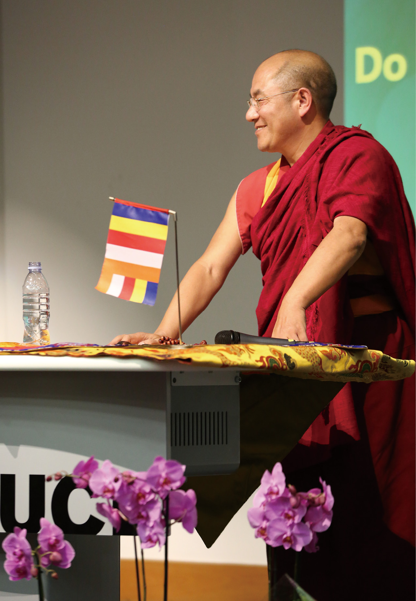

佛陀在涅槃之前曾说：“我在世的时候，我是你们的老师；我离开之后，戒律就是你们的老师。”同样，在上师离开之后，我们把上师的教言作为人生的准则、规范自己的标准。

## 莫舍己之道，实践各不同

对于这一教言，不同身份的人有不同的理解。比如，作为藏族人，不能舍弃藏族的民族文化、语言、传统、信仰，不能舍弃与此相应的思想、行为、品质等，不能损害人类乃至动物的一切众生，要尽量保护他们。这是从藏族人的角度来理解并实践这句教言。

汉族人以及东西方其他各民族的人，也不能舍弃自己的道——不能舍弃自己的传统文化、应有的宗教信仰、有用的知识技能，同时，不能损害地球上的生命。

从事不同职业的人，同样不能舍弃自己的道。作为老师，要明了自己老师的身份，不能舍弃老师应有的行为；作为出家人，不能舍弃自己的本分；作为医生，不能舍弃自己的职责。作为飞行员、服务员、护士、政府官员，乃至任何正当行业的从业者，都不能舍弃自己的道，也不能舍弃人类的善良与慈悲。这样的“道”，可以用“莫舍己道，勿扰他心”来诠释。

每个人无论身处何方，都要常常观察自己、提醒自己。有的留学生，父母的经济条件并不好，他们为了供孩子读书花了很多钱，甚至倾尽所有。但孩子在读书时，留着奇怪的头发，穿着奇装异服，每天都喝得醉醺醺，人在教室也昏昏沉沉，不知身处何处。这样的留学生就舍弃了自己的道，扰乱了老师、父母以及周围很多人的心。每个人都有当为与不当为之事，如果做了不该做的事，会让自己后悔一辈子。

我想起英国前首相卡梅伦的一个故事。他在高二的时候，有一次跟同伴出去玩，玩得忘记了时间，结果他们回来时，一场很重要的考试已经开始了。到教室门口的时候，卡梅伦决定欺骗老师，于是对老师说：“这次外出时，我们的汽车不幸爆胎。我向上帝发誓，我们不是故意迟到的，请老师原谅。”他这样说着，还向其他三个同学使了眼色，让他们也跟着一起撒谎，于是这三个同学纷纷帮他作证，一起撒了谎。

老师并没有批评他们，而是说：“没关系，我可以给你们一次考试机会，我会出一道很简单的题，让你们很轻松地拿到成绩。”于是，老师让四位同学分别坐在教室的四个角落，互相离得比较远。安排好座位后，老师说：“考试剩下的时间不多了，所以你们只需要做一道非常简单的题——你们的汽车是前轮还是后轮爆胎了？把它写清楚就可以交上来了。”

分别坐在四个角落的同学无法沟通，所以最终不得不交白卷。本来他们以为骗老师非常容易，结果没想到，这样的欺骗让他们都得了零分。

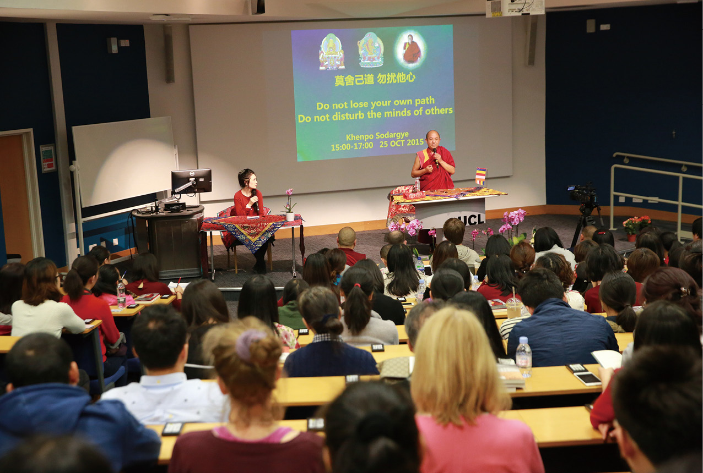

卡梅伦自己也说过，在他的一生中，确实因为自作聪明做过错事，这让他终生难忘，因为那时的他失去了道德与良心。如果以后有机会，你们可以问问他详细情况。我是很早以前在资料中看过他说这些话，应该是真实的。

我们佛学院有一位慈诚罗珠堪布，他以前也做过一件坏事，我在这里跟大家讲一下（众笑）。他上的小学在一个山谷里，有一次“六一”儿童节，校方让他去很远的地方买糖。他买了糖以后，要背好几公里带回学校，所以学校的人就一直等他回来，他在回来的路上偷吃了几颗糖，到现在还没有忘记，而且特别后悔。不过，这件事不算是秘密，好像他在微博上也发过。

无论你是否跟别人讲过，但实际上，每个人在生活中，都做过一些不道德的行为，可能是因为自己无明愚痴、烦恼深重，但无论如何，这都是不好的。我们不应该舍弃善良、高尚的道德与行为。

纵观全球，有一些非常好的传统、信仰、民族文化，都渐渐被抛弃，于世间销声匿迹。等某一天再去寻找，即使寻遍整个地球，也许都无法找到。

西方的现状是这样，东方也不例外。在东方的印度、尼泊尔、不丹等国家的寺院，出家僧团越来越少。尤其是近十年来，出家人的数量明显下降。在藏区各地的寺院，出家僧人也越来越少。在汉地，本来僧人众多的寺院就很少。近年来，我基本没有见过有千人以上僧众的寺院。即使有这样的寺院，常住僧人的数量也在不断减少。

而在西方，无论是美国还是欧洲，放弃自己信仰的人越来越多。很多教堂也改作他用，有的变成了幼儿园、图书馆、博物馆，有的变成了餐厅、游乐园、车库、住宅区，等等。我之前在荷兰时，听说未来十年中，将有一千座教堂面临关闭。现在西方形成了这样的“关门潮”，情况不容乐观。

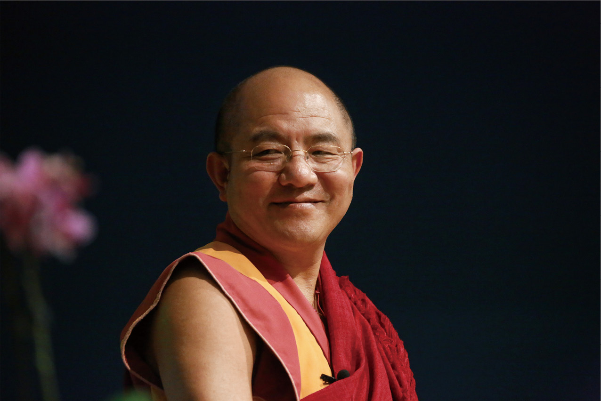

我也看了英国的资料，2001年时，信仰基督教的人占英国总人口的71.7%，而到2011年，也就是在十年间，信仰基督教的人口比重下降到59.4%。还有资料显示，现在英国无宗教信仰者有1400多万。可见在十年间，有许多人放弃了基督教的信仰。当然，他们中的一部分人，也有可能转而信仰佛教或其他宗教。但即使信仰其他宗教的人数略有增长，增长率也不是很高。

从现在的整体趋势来看，很多人只信仰钱，而且这样的人越来越多。他们信仰美金如同信仰基督教，信仰人民币如同信仰佛教，这种现象很普遍。其实，具宗教信仰人口比重的大幅度下降，对全人类而言，并不是一件好事。

另外，短短十年以来，许多极具价值的少数民族的语言、文字、文化也在逐渐消失。我看过一个联合国教科文组织2009年的统计，说世界上原本有6000多种语言，但在短短十年中，大约有2500种语言濒临消失。在历史上，澳大利亚的语言曾多达3万多种，到后来只剩下250种，而其中的110种又很快消失了。

在一百多年前，中国的官方文字之一是满文，但现在懂满文的人只剩下几十个。我作为藏族人，对藏族的语言、文字也非常担心。我在英国看到过很多藏族人，他们的孩子只会说英语，不会说藏语。在中国城市里的藏族人也是如此，他们的孩子只说汉语，不说藏语。或许几代人之后，藏族的语言、文字将只能存在于博物馆中，成为大英博物馆收藏的资料。

此类现象的出现，与当前的民族环境有关，或许与政治、经济等其他领域也有关系。不过，我没有听说过西方人到中国后把自己的语言忘了，也没有听说过汉族人到西方后忘了汉语、只会说英语。这种情况也许有，但我没听说过。不过，有些中国人回国后，汉语说得不是很地道的情况倒是有。

这个话题不再展开讲了，今天主要是交流佛法，不过这也是佛法。在座的中国面孔比较多，各位年轻人在西方生活，如果你们的孩子将来变得既不像西方人、也不像东方人，甚至只会说西方语言，不会说自己的母语，就是舍弃了“己道”。其实，舍弃母语是没有必要的，因为人类有习得多种语言的能力。如果你的孩子会说母语，会写本民族的文字、了解自己民族的文化，这非常好。

据牛津大学的研究机构发现，如今有一种语言只有三个人会说，等这三个人离世后，这种语言就会消失，只剩博物馆里保存的录音资料。

因此，大家要多关心语言、文化的保护问题，不能对此视而不见。古人有一句成语叫“落叶归根”，是说树上的叶子掉下来后，会落到树的根部。就像有些人，年轻时在国外漂泊，年老时会回到自己的国家一样。如果在回国时，不会说自己的母语，也是一种遗憾。

以上简单地讲了“莫舍己道”。

## 当修慈悲心，勿扰他之心

下面讲“勿扰他心”。“勿扰他心”的字面意思相信大家都明白，也就是尽量不要扰乱别人的心。你的父母、孩子、家人、身边最亲的人，还有你的同事、朋友等周围的人，都与你有非常近的因缘，因此尽量不要扰乱他们的心。

对脾气、性格不太好的人，我们常常把他们比作“一把火”，因为“一把火”接触谁都会燃烧、会得罪周围所有人。他们就像一颗定时炸弹，让周围的人都非常害怕。的确，如果人心没有被调伏，是会让他人感到恐惧。

若想不扰乱他人的心，就需要培养慈悲心。每个人应当每天修炼自己的心，并帮助其他人修心。包括对孩子，也要从小培养他们的慈悲心，避免爆发愤怒的情绪，禁止虐待身边的动物，等等。

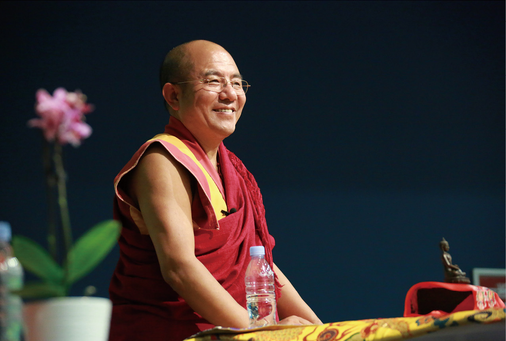

有很多坏人，比如杀人犯，他们在很小的时候，就有虐待、杀害动物的行为。我看过一则国外的报道，有一个人杀了三十五个人，警察询问他的经历，他说他第一次行凶时掐死了一只狗，后来演变成杀人——他一个人就夺去了三十五个人的生命。可见，孩子杀害动物，会导致愤怒心不断增盛，最后很有可能会演变为杀害人类，这是非常可怕的。

去年八月，有一位父亲带着孩子逃到叙利亚，七岁的孩子拿着人头，父亲将这一情景拍了照片放到网上，配文是：“这就是我的儿子，他是一个英雄。”他们通过这种方式加入ISIS恐怖组织。当时这张照片轰动了全世界。

如今，这个恐怖组织的成员已由原来的几百人，增长为三千多人。在短短的时间当中，成员人数还在不断增长，甚至美国、欧洲等地的西方年轻人，也愿意加入它。

恐怖组织控制人心的手段是什么呢？起初，先通过各种报道吸引年轻人的注意，进而宣扬组织的理念。虽然从表面看来，一些理念是在倡导理想的生活，但实际上是在培养组织成员的嗔恨心，最终，成员会毁坏自身，甚至毁灭世界。

人成长于怎样的环境，受怎样的教育，会体现在他所做的事情上。因此，我很希望大众能接受大乘佛法的教育。大乘教义不仅教导我们对人类要有无条件、无私的爱与维护，对所有动物也要无条件地去帮助、保护。在这个世界上，这样的理念确实非常伟大。

很多人在修正念禅修、空性智慧、慈悲菩提心时，不愿意贴上佛教、基督教等任何宗教的标签，只能接受无宗教或科学的理念。这是一种错误的观念。其实，只要对人类的身心健康有意义，带宗教标签也没关系。我们应当以一种开放的心态去接受。

## 为众佛教徒，慈示诸期望

今天在座的有佛教徒，因此我对佛教徒也提一些期望。

首先，“莫舍己道”。希望大家无论跟随哪位上师、安住哪个道场、信仰哪个教派，都尽量不要舍弃。因为起初你选择的时候，是经过智慧观察的，所以应当一直按照这个宗派的修行方法去修行，直到你离开人间。不要今天依止一位上师，明天又舍弃，这样不太好。

第二点，“勿扰他心”。作为佛教徒，要调伏自己的心，应当时时处于平静、欢喜的状态中，不应当扰乱其他佛教徒。不能因为非常小的事情让自己整天不开心，还到处去传播；不能在各道场、上师、弟子之间制造是非，也不能在佛教徒与其他教徒、佛教徒与无信仰者之间制造矛盾，这是不合理的。人生在世，应当与其他众生和睦相处，这需要一种智慧。

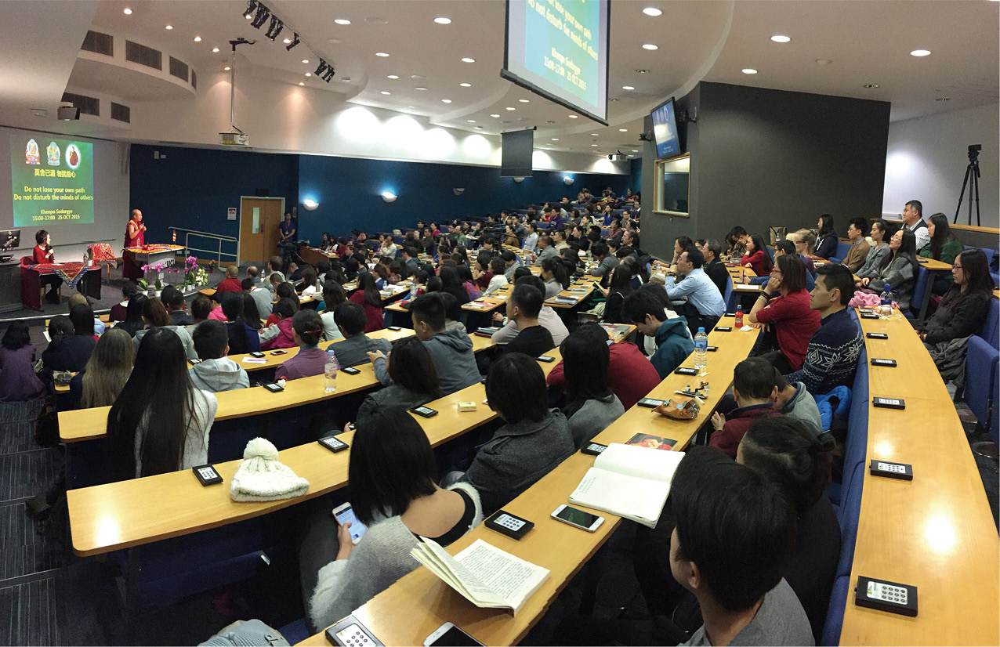

第三点，重视佛法学习。现在无论是在东方，还是西方，很多佛教徒并不重视学习，但我们应当学着去重视。对于佛教显宗和密宗的道理，要非常努力地去接受，否则，我们的行为很有可能不如法。在中国的香港、台湾等地，有一部分佛教徒不太重视学习，只重视灌顶等仪式，因此有很多不如法行为，这甚至出现在大型的佛教活动中。至于中国内地，可能由于宗教活动原本就不多，因此不如法的宗教行为也不太多。

在20世纪，藏传佛教的很多大德来西方弘扬佛法。他们都非常了不起、非常有成就。在21世纪，还有没有这么多大德来西方弘扬佛教呢？这很难说。

大家作为在家人，也可以护持道场、树立佛教胜幢，因为你们完全能接受佛陀关于显宗、密宗的教授。一旦你们具备了戒定慧的见解，未来在弘传佛法时，一定会发挥非常大的作用。

第四个希望，在短暂的人生中，至少好好修持一两部法。如果没有修行，即使你此生习得了再多世间、出世间的知识，但在临终时，还是没有解脱的把握。你可以修寿命无常，或者修五十万加行，总之至少选择一部法终生修持。否则，当你临近死亡时，会非常后悔，死后的你仍将漂泊在无边无际的轮回中，非常可怜。为什么会后悔呢？因为你已经得到这么好的人身，遇到这么好的佛法和上师，却始终没有修行。

第五点，希望大家常常处于快乐之中，但也不要过于散乱。那么，快乐的因是什么呢？就是平时吃饭、穿衣，都不要特别挑剔。吃饭的时候，有可以吃的食物就行，不要因为挑剔而天天跟人吵架；穿衣服也是同样，不要有太高的要求。现在有很多人特别喜欢穿名牌衣服，其实这也是一种对资源的浪费。

平时在生活中，并不需要天天逛街。我之前看过一则报道，有一位欧洲的女士，在五十几岁的时候，计算了自己在一生中用于逛街的时间——计算结果是三年半。试想一下，如果白天、晚上都在逛街，其实是很可怕的一件事情。但这位女士确实很喜欢逛街，甚至每天都逛，实际上这是对时间的一种浪费。

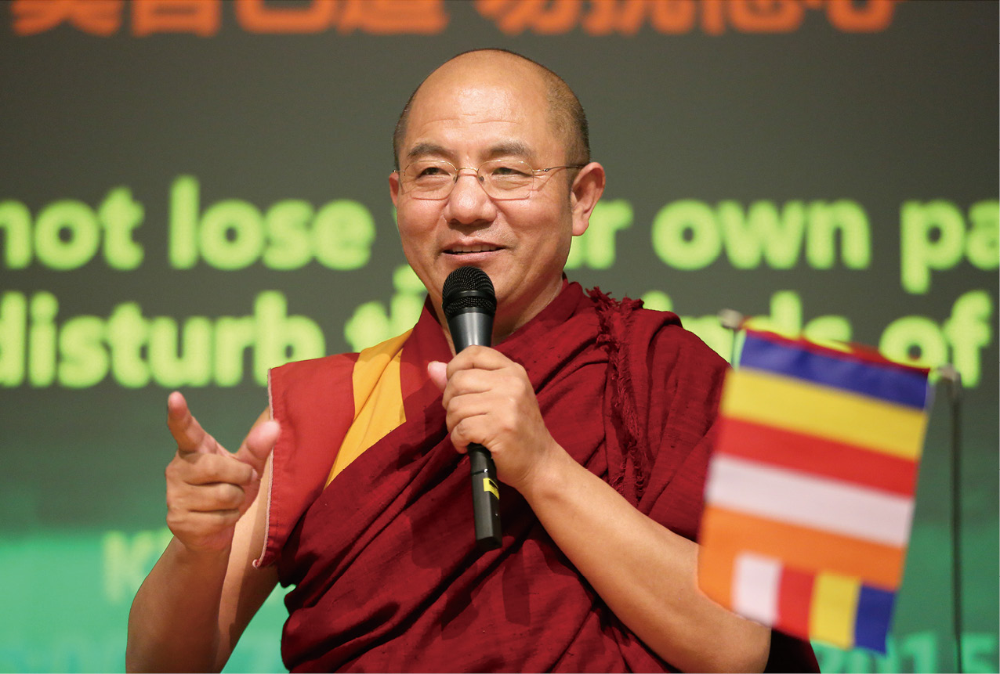

当然，作为佛教徒，还是有必要在一些场合中，随顺当地的装扮。否则大众会觉得人学了佛就变得不正常了，这样也不行，所以在应该穿得漂亮的场合就要穿得漂亮，该如何展现自己就如何展现自己。为了随顺大家的看法，应该让自己看起来外表庄严、内心喜悦。我到了西方之后，发现很多汉地年轻人没有染头发，但很多藏族人都染了红色头发。

虽然按照佛教观点，在究竟意义上，一切都是空性的、如幻如梦的，但在没有达到这样的境界前，我们应该快乐地生活、工作，乐于助人，拥有温暖的家庭生活。无论生活中发生什么事情，我们都应该开心地去面对。

挂真切！（藏语“谢谢”）

现场互动

问：您提到我们要快乐地生活、工作，但在现实生活中，凡夫会遇到很多烦恼——生老病死、分分合合。那么，我们如何才能做到放下？我认为这很难。

堪布：如果以修行的心态，就可以快乐地面对衰老、疾病、死亡。

经常有人问我：“我现在离婚了，该怎么办？”我就回答说：“离婚很好，以后就不用吵架了，这是一种快乐和解脱。”不过，提问的人不接受我的回答，认为我在敷衍他们。

实际上，对任何痛苦的事情，如果换一个角度看，确实有方法快乐地面对。当然，我是对已经离婚的人这样说，对没有离婚的人，我没有建议他们离婚。（众笑）

问：我在接触佛教之后知道有六道轮回，但因为我是凡夫，没有天眼，看不到饿鬼道、地狱道、天道，所以其实我不是很相信有六道轮回的存在。因此，我还没有能力深信佛法。不过，当我读《地藏经》的时候，也会感觉有鬼，但只是一种感觉而已——也许是自己的错觉。

对于读经、拜佛等修行，我有时候觉得确实有用。因为在面对一些事情的时候，修行会给我的心态带来很大改变。但时间久了我就又变得懈怠，觉得修行没那么大的用处，因为也没看到六道轮回，不知道是不是真的。万一不是真的，会觉得修行不值得，所以没办法坚持修行，很懒散。等自己再遇到难以解决的事情，就又像抓救命稻草一样抓一下佛法。所以我想问的是，有没有什么方法能让我坚持修行？即使在我看不到六道轮回的情况下，也能生起信心。

堪布：你的问题让我想起了我家乡的一个故事。我有一个亲戚，他没有读过书，性格刚强难化，做过很多不好的事，比如偷盗、破坏他人家庭，等等。他偷盗的劣行尤为严重，很多人都劝他改邪归正。我也劝他说：“不要这样做，否则对你的今生后世都不好，而且你有可能会被关进监狱。”但他对我说：“我从来没有见过监狱，所以我不相信。”后来，他因为做了特别过分的事被关进监狱五年。等他出狱后我就问他：“你现在相信有监狱了吧？”他说：“我终于知道了，原来监狱确实存在。”

问：感谢堪布不远万里来到英国对我们进行教诲。我想问的是，作为需要工作的社会人，或者说世俗人，应该如何兼顾世俗生活与佛法修行呢？

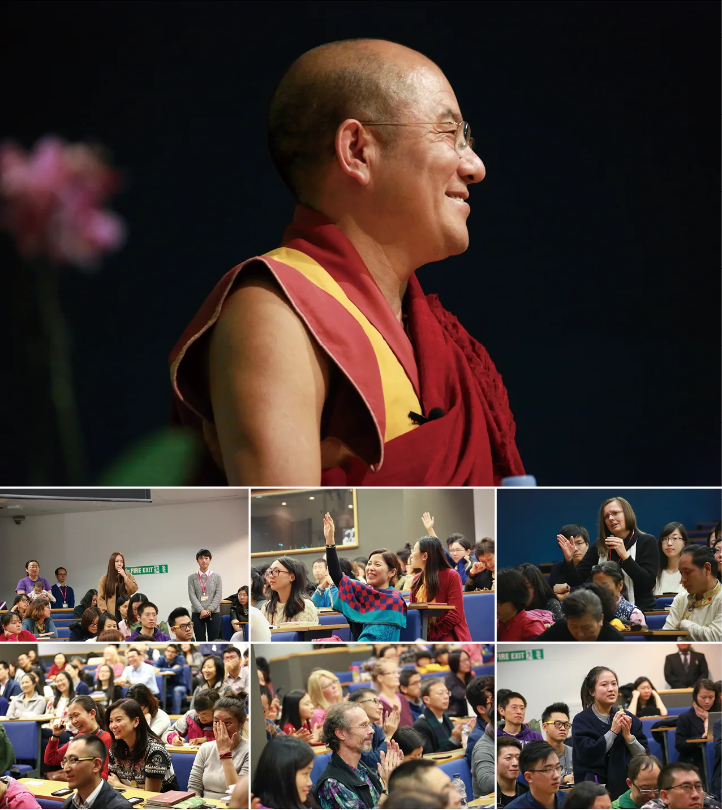

堪布：天天念观音心咒，好好上班。（众笑）

问：我看过某位仁波切写的关于业力与轮回的书，书中说六道中的道，并不是死后身躯去往的地方，而是一个业的结束与另外一个业开始的心之显现。我之前的理解是，当我们造了业，业会驱使我们去往三恶道或三善道。能否请您讲解一下轮回的流转？

堪布：佛教所讲的六道轮回，其流转的根本因是业力，业有善业、恶业，也可以分为满业和引业。前世的业，令你投生到今世，因此这一世的所现，源于前世所造之业的力量。而此生结束时，此生的业又牵引我们去往后世的善趣或恶趣。关于这个问题，在《俱舍论》的第四品中，讲得比较清楚。

问：我患抑郁症有八年了，这几天一直参加您的讲座，感觉症状有所缓解。我时常会陷入对人生很绝望的境地中，但没有症状的时候，我又像一个正常人。我一直对自己没有什么信心，不确定我的病是否可以被治好。有时候，我感觉念佛经会让我的状态有所好转，所以我以为之后不会再陷入困境，但最终我还是会陷入痛苦，不断循环，周而复始。前段时间，在我病得特别严重的时候，我很害怕一个人待着，而且很想自杀，一直困于这样的情绪中，但我最终没有自杀，因为我想到了父母。我的病真的很严重，我不知道自己到底能不能好。

堪布：现在患抑郁症的人确实比较多。但从某种意义上讲，我觉得抑郁症不是一种无法治愈的疾病，尤其是当患者遇到佛法以后。

前段时间，我在剑桥大学的时候，讲了很多关于抑郁症的内容，也传了一些窍诀。或许在座的其他人，也或多或少有抑郁的倾向，只不过没有说出来而已。因为抑郁症患者在大众中占有很高的比例，在一则英国的报道中说：在英国，约有六分之一的人患有抑郁症。今天在座的约有六百人，按这个比例计算，肯定有相当一部分人患有抑郁症。包括我自己到了伦敦同样有这样的问题，今天天气还稍微好一些，在天气不好的时候，我也怀疑自己会不会得抑郁症。（众笑）

不过，我可以确信地说，通过佛法修行能够大幅度减轻、并最终彻底治愈抑郁症。希望患者们好好祈祷不动佛，并念诵咒语“嗡赞札玛哈若卡纳吽啪的”，这个咒语非常重要。或者也可以通过禅修让心放松。

在这样的时代当中，抑郁症是一种高发的疾病，对人类的影响也很大。因此，希望大家对很多事情不要特别执著，尽量随缘、放松。当心越来越放松的时候，治愈抑郁症就不会有太大问题，对此我很有把握。

现在在中国大陆，抑郁症的问题也非常严重，但并不是没有办法解决。总之，希望大家好好祈祷。等一会儿问答结束后，请你到这边来一下。

问：虽然我不是佛教徒，但我对佛教的一些观点非常感兴趣。因为佛教中的很多说法，与我看待人生的方式非常相似。但我一直有一个问题——究竟什么是佛教？在您的一本书里，第一章就提到了佛教的定义。不过我一直认为佛教不是宗教，而只是一种哲学。但在您的书中说，不能简单地把佛教与哲学进行对比，还说佛教的核心是学习智慧与慈悲。所以我很想知道，佛教究竟是不是宗教？如果佛教是宗教，那么宗教又是什么？

堪布：所谓“宗教”一词，最早出现在欧洲，后来被广泛使用，直至今日。对于佛教是不是宗教，可以有两种说法。第一种，你可以说佛教不是一种严格意义上的宗教，而是一种充满智慧的教育。

今天我遇到了一位英国的大学教授，他认为佛教就像一座高山，其他宗教则像一般的建筑物。这是他的观点，我不清楚其他人对这样的比喻会有怎样的看法。

第二种说法，在某种意义上，佛教可以被称为宗教，因为佛教毕竟是五大宗教之一，这是全世界公认的事实。如果你一定要说佛教不是宗教，恐怕会与世间的很多说法有矛盾。

当你体会到佛教对为人处世带来的意义，以及其中所包括的天文、地理、医学等方面的内容，就会明白佛教中蕴藏了很多领域的哲理与知识。因此，在学习佛教的同时，也是在学习世间的一切知识。实际上，藏地的很多寺院就是学校。

问：我的问题是关于保护传统的。我认为积极保护传统与固执留守旧习之间的界限比较模糊。过分执著传统会引发嗔恨，从而带来痛苦，因此，在某些情况下，我们需要改变传统。为此，我们需要去审视，哪些传统值得保留，哪些传统有待改进。

例如，我是一名女数学家，从事这一职业的女性并不多，其中一个原因，正是由于人们执著旧有的传统。所以我想请问您：第一，您是否会考虑转世为一位女性上师？第二，如何区分好与不好的传统，以此来保护佛教阿毗达摩的教义，以便让人更容易理解？

堪布：在传统中，确实有些内容不一定要一直保存，比如在西方文化中轻视女性的传统。的确有一些古代传统，是我们不建议保留下来的。但有一些语言、文化方面的传统，在人类历史上确实非常重要，一旦失去，对人类来说将是一种损失。对于这些问题，你提到的微妙、模糊的界限，以及用微妙的智慧去审视，这是我完全接受和承认的。

在传承高尚传统的基础上，人类要与时俱进，要有创新、创意——但所谓创新，并不是让人类把旧有的一切全部改造。

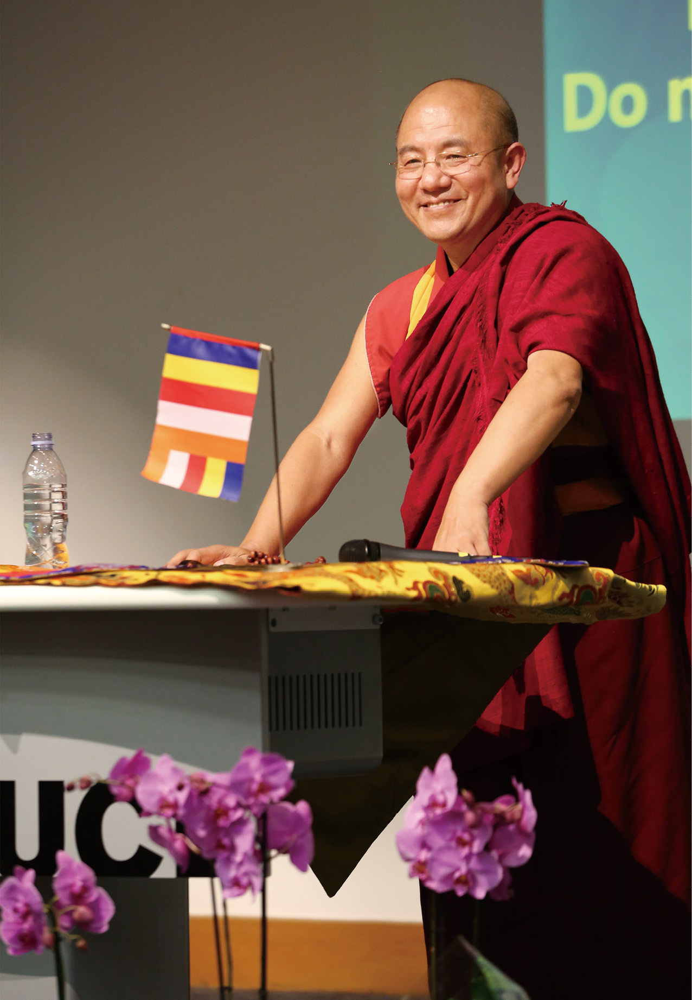

最近在伦敦，每当看到现代的高楼大厦时，我并不是很欢喜，但看到富有文化底蕴的欧洲风格建筑时，我就很欢喜。我之前去巴黎时，感觉那里的很多建筑还保留着自己的文化风格。

总之，我认为有价值、有意义的艺术、文化、习俗，最好都保留下来，而没有意义甚至对人类有害的观念，随着时代的变化与发展可以摈除。

于我而言，下一世变成什么样，我很难知道。不要说下一世，明年在哪里，我现在都不知道。（众笑）

问：我是伦敦大学的学生。我母亲是一位非常虔诚的佛教徒，她非常景仰您。她一直让我修法、念经，当我遇到任何问题时，她就说是因为我没有修好、经没有念好。她自己在生活中遇到问题时，也会说是因为她今天功课没有做好、经没有念好。我想请您开示一下，这种想法值得认可，还是需要改进？

堪布：其实，考试没有考好、事情没有做好，不能完全归咎于念经没有念好，因为念经虽然可以起一些作用，但不是所有事情都能通过念经来做好，即使是出家人也没有这样的想法。今天不顺利、事情没有做好，与自己今生、前世各方面的因缘有关。

你应该先好好学一学佛法，一个年轻人只念经不学法是不行的。年轻人应该要懂得佛教的道理，在见解上要超过你的母亲，之后用道理说服她：念经只是一种仪式，实际上是如何如何。

时间快到了，但还有很多人想提问，所以请之后提问的人，用简单的一句话问，我用简单的一句话回答。

问：请问您计划什么时候再来伦敦或欧洲分享您的思想精华、面对面解答大家的问题？您目前有固定的安排吗？

堪布：我现在没有，希望将来有。

问：我的问题与杀生有关。医生需要用药物杀细菌、病毒，还要消灭四害——苍蝇、蚊子、老鼠、蟑螂。是否应该这样做？在一个密闭的房间中，有一只老虎，还有一位非常有学问的博士，如果我是这位博士，我应当选择消灭老虎还是被老虎吃掉？

堪布：在佛经中说，自己杀害、劝别人杀害、随喜杀害都有过失，所以我们应该尽量避免这种过失。

主持人：

感恩法王如意宝振聋发聩的教诲——“莫舍己道，勿扰他心”。感恩上师慈悲给予精彩开示！弟子想请您为今天有缘的来宾传授三皈依，并祈请上师慈悲授予上师瑜伽的传承，弟子愿与上师心心相印，生生世世不离师。感恩上师！

（堪布授皈依与传承）

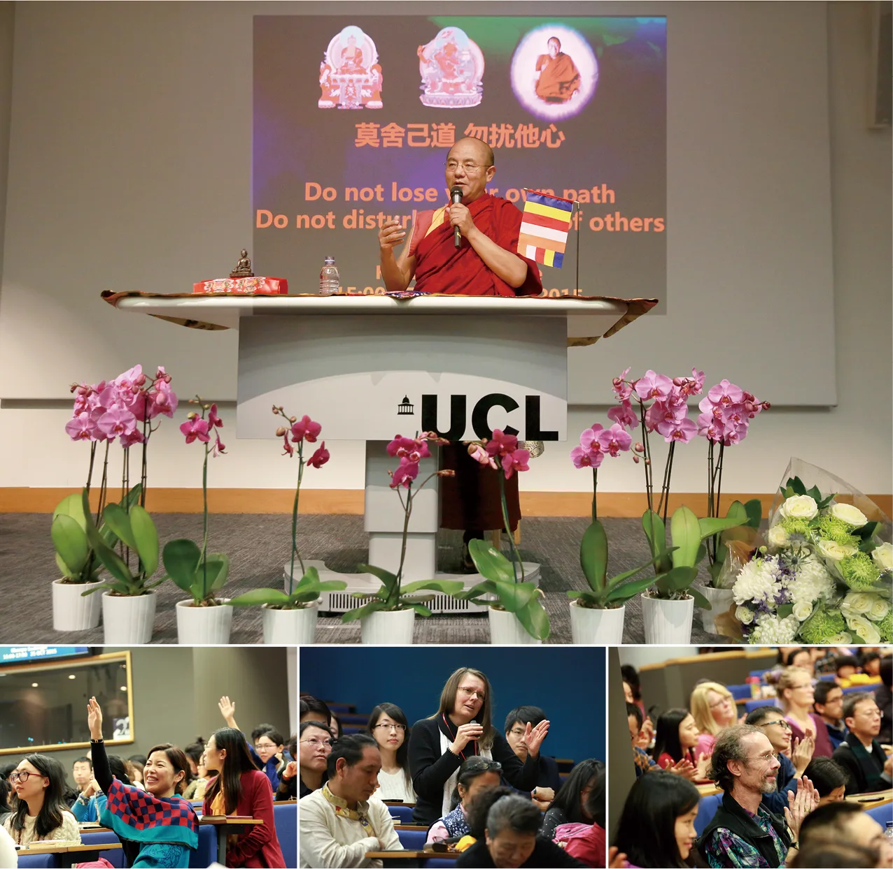

问：从事科学研究的人要发表论文，因此必须要针对前人的研究成果作出一些反馈，比如有时要找出他们的漏洞。这样的做法算不算扰乱别人的心？有什么方式可以尽量降低这种影响？

堪布：你们可以找不在人间的前辈的漏洞，这不算扰乱别人的心。（众笑）

你们把名字写在纸上然后递过来，我在其中抽三个问题回答，不然今天问题太多，时间延迟太久了，等会儿还要念一遍《普贤行愿品》。

问1：今天的主题是“莫舍己道，勿扰他心”。一个人可能有很多道，他可以成为一个拯救人类的科学家，也可以投身佛道、传播佛法，那怎样知道某个道是我的道呢？

堪布：即生当中有缘做一件事情，就是一个人的道。在无形当中，你会接触这个道，而且必须要做这件事情，这就是你的道。

问2：那您是怎么知道的呢？

堪布：一件事做着做着就知道了，就像我走着走着就走到了出家的路上。（众笑）

问：我有两个问题。第一个问题是，有一句话叫做“一切的成就都来源于上师”，上师又有外上师和内上师，依止皈依外在的上师是为了唤醒内在的上师。在我依止外在上师的过程中，上师的状态和心情可能会有浮动，我和上师的关系状态也会有浮动。在这个过程中，如何才能保证自己的信心更坚定、更清净，最终能够实现由外在上师唤醒内在上师的目的？这其中的道理是怎样的？以及为什么依止外在上师是一切成就的根本？

第二个问题是，虽然我从小就相信佛法，但在不同国家学习的过程中，我发现学到的许多内容无法再用佛教理论去解决。比如，我这学期学的International Business，其中的理论说：国家和国家之间注定会存在矛盾，因此一个国家的领导人，应该有勇气去做道德上有争议的事情——哪怕是伤害其他国家的人来保全自己国家居民的利益。如果这个领导人没有这样做，那么他对自己的国家就是不道德的。这样就出现了两难，如果“莫舍己道”注定要“扰他心”，或者说如果“勿扰他心”注定要“舍己道”的时候，应该如何取舍？

堪布：你的问题我用两句话回答。关于第一个问题，你自己一定要如理如法地好好闻思修行，这是依止外内密上师的唯一窍诀。第二个问题，国家领导如何行持“莫舍己道，勿扰他心”，应该当了国家领导的时候再去管，我们现在不用管。（众笑）

问1：我的问题有关佛教徒与其他宗教信仰者之间的相处。一个佛教徒的伴侣是信仰其他宗教的，比如天主教，天主教的教义要求教徒的孩子全部信仰天主教。但作为佛教徒，希望孩子信仰佛教、皈依三宝，并得到三宝的庇佑。在这种情况下，如何在“莫舍己道”与“勿扰他心”之间取得平衡？

堪布：家里有几个孩子？

问2：这件事要随缘，看天意的安排。

堪布：这个问题比较关键，我稍微广说一下，作为今天最后一个回答。

中国人在英国或其他国家时，先要了解对方的宗教、传统、国情，我个人认为这是非常有必要的，因为我们不可能改变他们的信仰和国情。要在“莫舍己道”的同时，尽量不扰乱对方。

作为佛教徒，如果经常扰乱其他宗教徒或非宗教徒，这非常不好。如果家庭成员信仰不同宗教，在有分歧的问题上，要通过和平的方式来解决。如果有两个孩子，一个孩子非要信仰其他宗教，那就让他去信仰，另一个孩子，可以信仰佛教，这样比较公平。在一个法治国家，这样做应该是可以被接受的。现在很多家庭中，家庭成员之间的民族观念相互交融、冲突。将来，在全球化的背景下情况可能更严重。

之前在法国时，我也讲了我对东西方文化交融的态度和看法，其中最重要的一点是学会随顺。在这方面，“莫舍己道，勿扰他心”的教言，对每个人来说都很有用处。希望大家在不舍弃自己语言、文字、信仰的基础上，尽量不扰乱他人。如果有时候稍微扰乱了一下，就好好忏悔。

我这次走访了欧洲五个国家，今晚是最后一站。我来这边主要是为大家讲一些课，或者从佛教意义上讲，来为大家种一些善根。今天到场的大众，有些是最近一直跟我学习的，有些是新来的佛教徒，希望大家将最近获得的善根，通过念诵《普贤行愿品》回向给一切众生，发愿令无量无边的众生获得真实利益，并祈愿世间所有战争、疾病、痛苦全部消除。

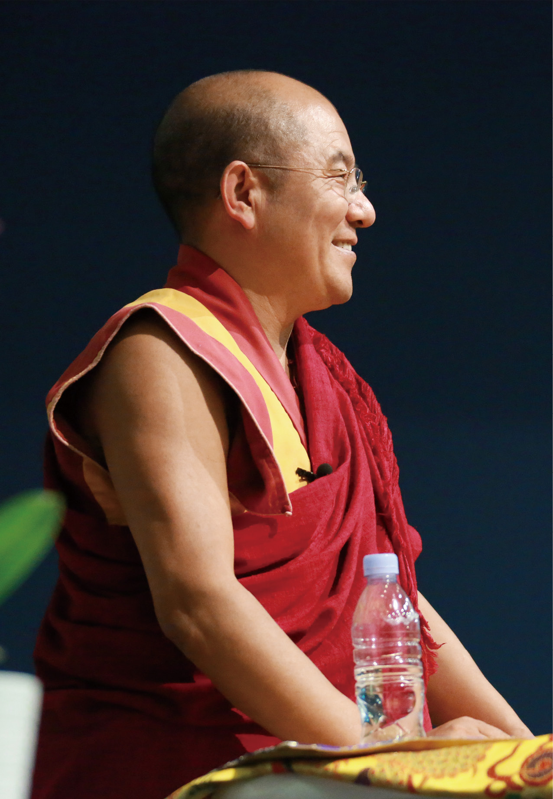
