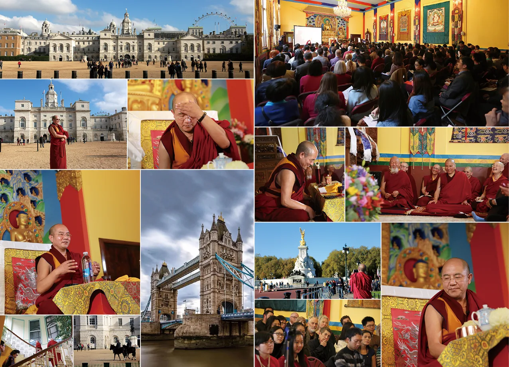
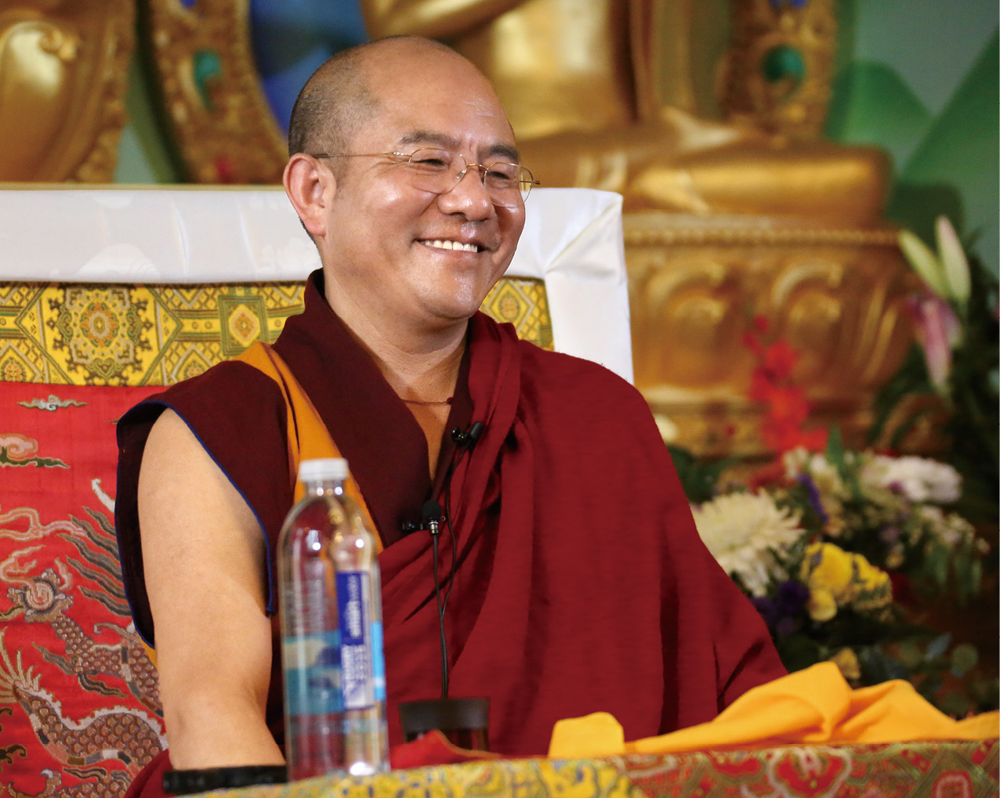
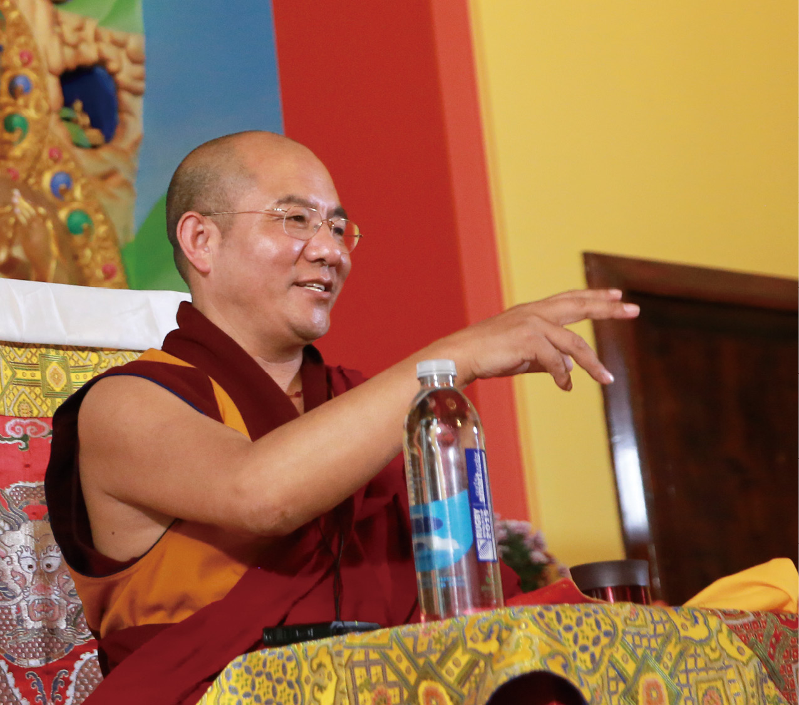
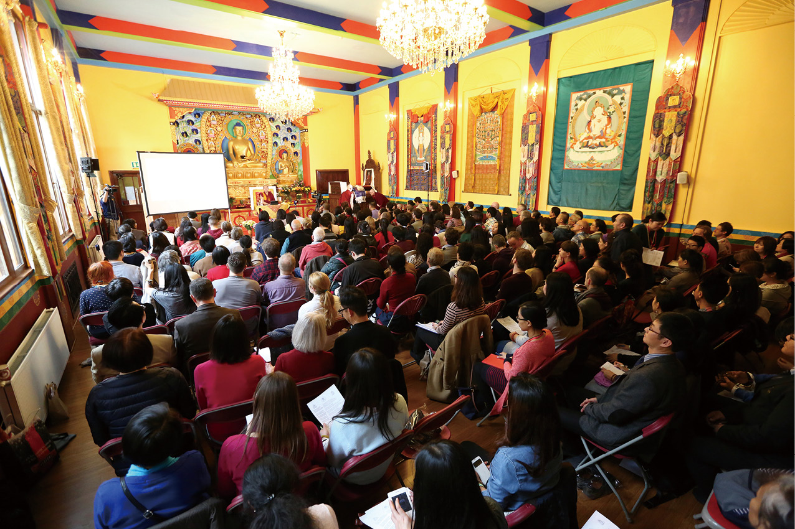
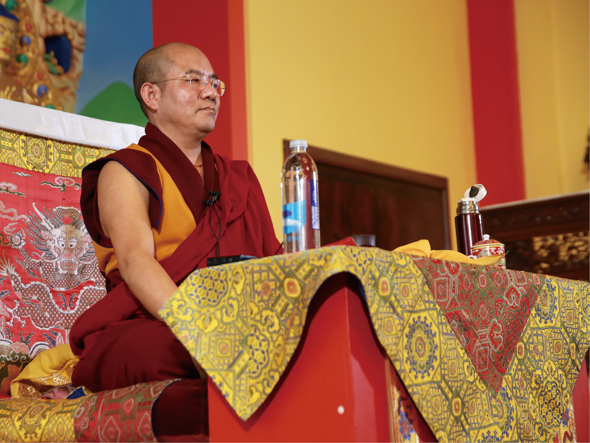
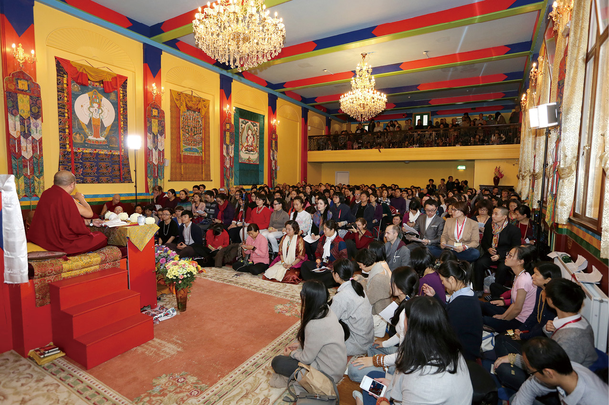
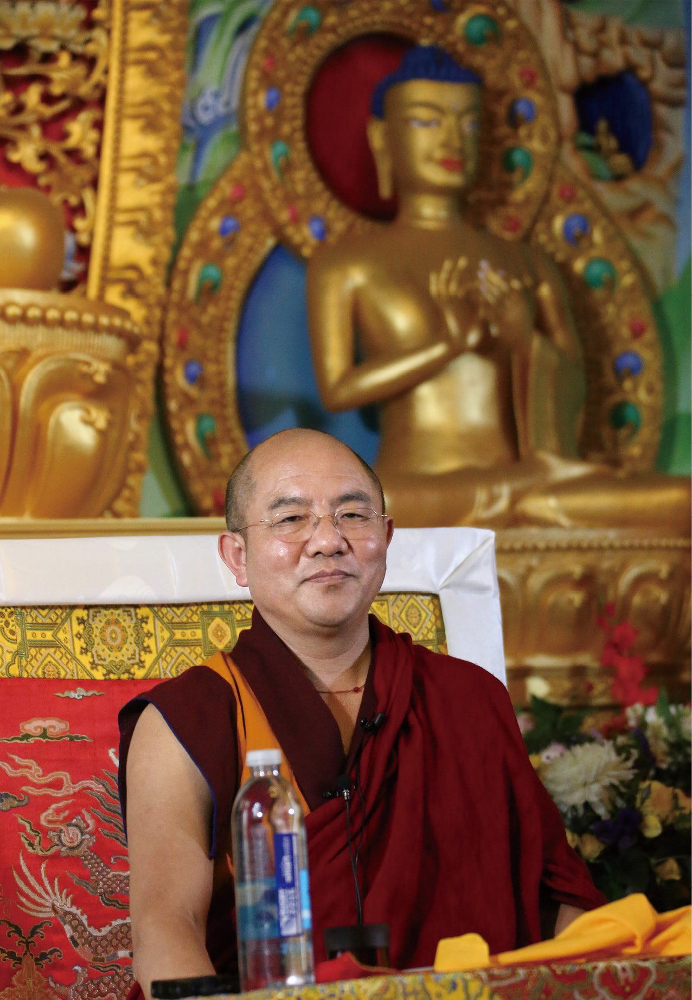
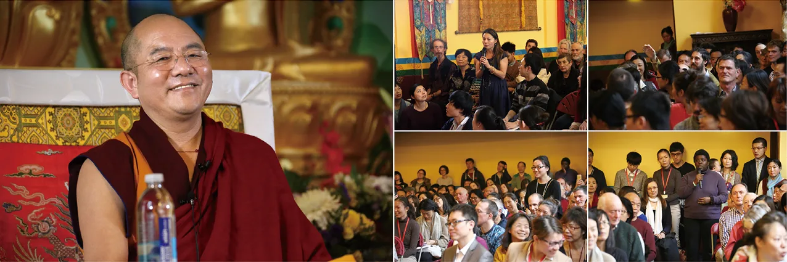
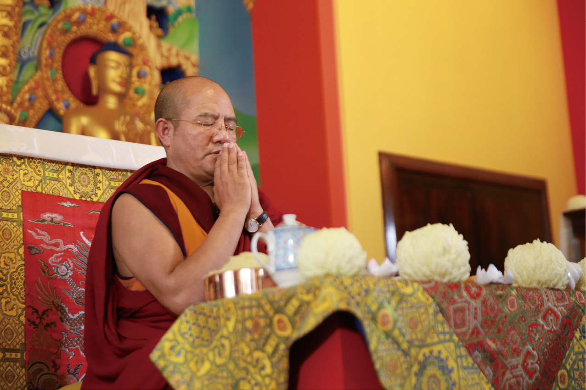

在当今时代，  
形式并不是最重要的，  
最重要的是学习和修行。

第39场

英国伦敦三昧宗佛教中心

Samye Dzong London Tibetan Buddhist Meditation Centre, UK

英国·伦敦

2015 / 10 / 24

## 菩提心的修法与运用

## Cultivation and Application of Bodhicitta

现在，上午的讲座正式开始。在此之前，希望在场的人都发菩提心：“我今天听课，是为了度化天下无边的一切有情。”每个人都应该以这样的心态来听受讲座。

关于今天的演讲主题，听说海报上写的是“慈悲心”。其实，道场的本意是讲菩提心，但如果写成“菩提心”，担心很多人不懂是什么就不来参加，而写“慈悲心”，就会有很多人来。所以，虽然海报上写的是“慈悲心”，但其实上的是“菩提心”的课。（众笑）

未经系统学习或没有学习过的人，会觉得慈悲心、慈心、悲心、善心，与菩提心没什么差别，因为这些心都与利他有关——可能很多人会这样认为。虽然从广义上讲，这些心的确都是善心；但实际上，在大乘经论中，这些“心”有很大差别。

因此，在学习的过程中，首先要了解为大众所熟知的慈悲心、善心；进而更要了知大乘不共的菩提心，比如它的修法、分类、作用及功德等，这些都非常重要。

## 求法莫畏难，劝深入学修

面对没有系统闻思过的同学，我会简单讲一些大乘佛教的教义，而面对长时间接受佛教教育的人，我会有更高的要求。长期闻思的人，不应该满足于理解简单的字面意思，而应该深入挖掘佛教的甚深意义。如果不能深入挖掘，那么，表面的词句、知识将很难打动我们，更无法引导我们进行深层次地修行与利他的实践。

欧洲的很多情况，我还不是特别清楚。不过按理来讲，自上世纪六七十年代开始，很多藏传佛教的高僧大德，一直在欧美弘扬大乘佛法和密法，很多修行人也一直在努力，因此，相信这里有很多人对佛教理论、实际修持有非常超胜的成就。

不过，就目前汉藏两地的情况而言，在理论闻思与实际修持方面，居士团体与僧团相比还有一定差距。很多居士由于工作繁忙，还没有在理论上进行深入，如果对理论的研究和学习不够深入，很容易退失信心，也难以对佛法生起定解。

佛法确实非常难得。不过，你们住在都市里，不一定感觉得到。其实，在佛教历史和传记中，东西方弘法者、修行人的求法事迹多如牛毛。如今，在英国等各国有很多留学生，也有很多求学的故事。我在欧洲的这一个月，看到了很多留学生，他们在生活、学习等各个方面，都比较辛苦。我把自己的求学经历与他们的进行过对比，我求学时虽然没有出国，但我的苦行应该更多一些，当时我是“出县留学”。（众笑）

当时像我这样的求学者，离开家乡，去其他地方依止上师，那时各方面的条件都比较困难，但我们还是会花大量时间闻思修行。在美国、欧洲弘法的藏传佛教大德，比如邱阳创巴仁波切和我们中心的阿贡仁波切，他们也曾度过艰难的岁月。听说他们刚来英国的时候，语言不通，文化上也不适应，但为了弘法利生，他们还是坚持了下来。阿贡仁波切在这里的医院工作过，为创巴仁波切道场的建立付出了很多。我以前也去过几个创巴仁波切的道场。仁波切们当年的坚持，意义深远，为后人所知。

## 诸德事业广，劝思此缘由

阿贡仁波切在藏地的特殊时期，帮助了很多藏族学者。这些学者本来没有机会读书，但依靠他老人家的愿力，不仅使西方弟子有修行佛法的机缘，而且更重要的是，在本民族文化极其危脆、面临断层之际，他做出了常人难以想象的贡献。

很多在各国弘扬佛法的大德，起初都很艰难，因为在某种意义上，他们当时的身份就像难民一样，而对于难民来说，连生存都非常困难。不过，很多大德在特殊的历史背景下，不但解决了自己的生活问题，还在当地开展弘法利生事业，不断传播大乘佛教的理念，将佛教的慈爱传递给了无数人——不仅是藏族人，还有其他民族、国家的人。总之，在各个国家，他们以弘法的能力，勇敢地帮助了不计其数的人。这些付出背后的根本原因是什么？我们有必要去思考。

在这个世界上，有些人不但自己可以生存，还能帮助他人，为他人的生活带去希望和快乐。他们背后的动力是什么呢？第一，他们在年轻的时候，受过非常严格的大乘佛教教育；第二，他们不但受过理论上的教育，还真正修行过。在苦行的岁月中，他们不仅能以自己的所学充实自己，还能在有机缘、有能力的时候，将它传递给周围的人。

## 莫流于表象，劝殷重学修

今天在场的听众大多数是佛教徒。我建议大家不要当名义上的佛教徒，虽然这样做很简单：在一位上师那里皈依、得灌顶，但一生都不深入学习，也不好好修行，这样的人，即使自认为是佛教徒，但实际上，他并没有进入佛教的殿堂。要想成为真正的佛教徒，需要深入学习理论，不能学一两部论就放弃。

对于佛教最重要的戒定慧之理以及经论中的其他道理，应该依止善知识来学习，或者自己通过各种方式来修学，这非常重要。否则，现在很多佛教徒跟个别其他宗教徒一样，内心没有任何见解，这种人只是表面上的信仰。长此以往，很多佛教道场将从社会中慢慢消失。基督教等一些宗教的现状就是如此，在世界各地，包括法国和英国，近年来很多教堂没有人去，变得空空荡荡。信仰者的信心退失现象也日益严重，其根本原因就是信众没有理解、没有深入宗教教义。

今天我喝的水和茶比较多，这边有两杯，另一边也有两杯——这边代表西方，另一边代表东方（众笑）。我们的听众也可以分为这两大类，大家的文化背景不同，心态和生活习惯也不同。

如果你只想做一个佛教爱好者，有时间的时候看看书，那可以很自由，我对你也没有任何要求；但如果你想成为一个真正的佛教徒，那就要花一定的时间。有很多年轻人，六七年甚至十几年，连一两部论都没有系统学过。甚至听几堂课都要找无数理由推脱：“我特别忙”“我特别累”。其实，如果把闻法当作非常重要的事情，就不会找这么多借口。

做任何事情都是如此：你下了多大功夫，就会得到多大成果。修五十万加行其实非常简单，但很多人认为它是一个特别大的工程。如果没有真正实修，可能特别简单的佛法教义在自心都没办法生起来。如果自心没有真实的体会，那做什么都只是外在的形式而已。因此，在当今时代，形式并不是最重要的，最重要的是学习和修行。

## 心大则力大，劝生菩提心

修学大乘菩提心，按照印度寂天菩萨的观点，有“自他平等”、“自他交换”和“自轻他重”的修法——可以通过这几种修法令菩提心生起。

从阿底峡尊者到藏地弘扬大乘佛法至今，后学者依尊者的传承一直不断修行。按照尊者的修法，修持菩提心有七种窍诀。依靠此实修法，藏地的许多高僧大德在相续中生起了无伪的菩提心，令利生事业圆满广大。

我刚才也提过，有些人的力量非常强大，让人感受到强大的加持力；而也有些人，即使希望为他人传播真理，也无法实现。这是为什么呢？差异产生的原因，在于内心是否生起菩提心。如果没有菩提心，即使境界再高，也不一定能为世界带来利益。所以我很希望，包括在座道友在内的所有佛教徒，都能生起真正的菩提心。如果有菩提心，任何人都无法障碍你的修学；如果没有菩提心，即使与别人有一个小矛盾、小争吵，也会使你想离开这个团体，甚至不想再学佛了。

去年我去美国的时候，有一个藏地出家人跟我说：“到了美国，直接给他们讲一些空性和大圆满的境界就好。你千万不要讲菩提心，他们不习惯，也不接受。”当时，我断然反对他的提议：“我刚开始给汉族佛教徒讲菩提心的时候，他们也不习惯，‘为什么要度化无量众生呢？我怎么能度他们呢’，有很多怀疑和顾虑。后来经过长期修行，大多数人完全接受了菩提心。”

最后，我又对他说：“我不一定会讲很多空性方面的内容，但我一定要讲菩提心。虽然西方人可以接受对人类的慈悲心，但对更为超胜、对所有众生的慈悲心，接受起来需要一个过程。就像有些东方人刚到西方的时候，对当地的一切都不能接受，但十年、二十年之后，他们也适应了西方的生活。一些西方人刚到东方的时候，也是这样。其实，学会适应新的生活是很有意义的一件事。总之，适应世间的生活尚且需要一个过程，那么，接受出世间的利他菩提心更需要一些时间。”

因此，在接触“菩提心”这样的新理念时，先不要着急用各种理由拒绝，应该先深入了解，进而接受，最终去实践。通过实践利他，会让很多人获得快乐。而且，拥有利他思想的人，自己也会非常快乐、幸福。

## 依窍诀实修，定生菩提心

阿底峡尊者修菩提心的窍诀，有“知母”、“念恩”、“报恩”、“修慈”、“修悲”、“增上意乐”和“生起”这七个。通过这七个窍诀进行实修，一定能生起真实无伪的菩提心。

在显现上，阿底峡尊者并非具有俱生的菩提心。从他的传记来看，他依止过很多上师来实修菩提心法门。那时，海上交通不便，他坐船从印度前往印度尼西亚，花费了很长时间。他在印尼依止了金洲上师，十二年中唯一修菩提心，最后获得了真正的成就。之后，他在印度和藏地广弘大乘佛法。

在座的很多人，对修行没有下定决心，也没有花功夫。所以，我对现在的一些佛教徒有点不满——没有好好地去闻思，也没有好好地去修行，这样怎么能得到真实的定解和真实的菩提心呢？确实很难。像阿底峡尊者这样的圣者，尚且需要十二年的苦修，才能得到真实的菩提心并为他人传讲，那更何况是我们？

下面详细介绍修菩提心的七个窍诀：

一、“知母”。在修菩提心时，对所有众生，要像对待自己的父母一样。这里的众生不单单指人类，也包括其他有情。刚开始修的时候，肯定有很大困难，但我们从理论上应该知道，一切众生确实都当过自己的父母[^1]。《梵网经》中云：“一切男子是我父，一切女人是我母。”

众生无边无际，于轮回中无数次流转，因此一切众生在生生世世中，都曾做过自己的父母。对此，藏传佛教中有大量的教证、理证可以证实。比如，汇集众生在轮回中流过的眼泪，其体量超越大海；堆积死后的尸骨，其体积超越山王，等等。通过学习这样的理念，我们能够理解——所有众生与自己的父母无异。这就是“知母”。

实修时，我们要反反复复地观修“一切众生与自己的母亲一样”。而修行的验相，可以参照阿底峡尊者的示现——尊者看到任何众生，包括狗、牛等动物，都直呼为“我的母亲”，对待它们就像对待今世的母亲一样。

二、“念恩”。仅仅知道众生做过自己的父母还不够，同时应该知道，众生当自己父母的时候，对自己有怎样的恩德，并忆念这份恩德。任何众生，在做父母的时候，都给予了我们最深的关爱[^2]。比如，我刚来到这个世界的时候，什么力量都没有，是父母给予了我身体；在我成长的过程中，是父母教我说话、吃饭、穿衣，并为我传授知识；当我稍微长大，没有食物的时候，是父母给我食物；没有衣服的时候，是父母给我最好的衣服；没有钱财的时候，是父母给我各种财物……如今，追求出世间解脱的这个人身，也是父母给予的！因此，我们应该深切地了知父母的恩德。

有些地方的人，对父母的晚年不太关心，对于这种传统，我个人不赞同。我之前看到过一个说法：“您养我长大，我陪您养老。”对待父母就应该如此。父母抚养我们的时候，时时刻刻关心我们；现在他们衰老了，我们也应该关心他们，并应该在他们即将死亡时，送他们最后一程，这是我们的责任。

进一步观想，与今生的父母一样，无始以来，每个众生做我父母的时候，都曾经对我特别关爱。

当然，也有些人认为，我的父母对我不好，所以我不想为他们的晚年负责。其实，即使他们对你的态度不好，他们也一定有付出，否则，你不可能出现在这个世界上。如果你生下来的时候，父母就把你遗弃了，你也不可能有今天。这是第二个窍诀“念恩”。

三、“报恩”。只知道众生对自己有恩德还不够，我们一定要报答恩德。其实，如果不报恩，就相当于忘恩负义，即使从世间的角度讲，这样的人也很不好。

一方面，我们对今生的父母要有报恩的心和行动；另一方面，也是最重要的一点，在修持大乘佛教的菩提心时，要忆念所有众生对我的恩德。所以，我今生不但不能伤害众生，还应该让一切众生都获得快乐。

佛教里有一部《父母恩难报经》，讲述了父母恩重如山、难以报答，以及应当何如报答。按照出世间的观点，劝请父母行持善法，是最好的一种报恩。同样，对众生报答恩德，也应当劝请对方行持善法。世间人认为，给父母一些钱、买一个房子就是孝顺，当然，暂时来讲这也有必要，但更为重要的是让父母获得解脱。

四、“修慈心”。修慈心指的是“愿所有轮回中的众生获得快乐和快乐的因”。

这里的快乐指的是灭谛，灭谛是通过道谛实现的，也就是修慈心。在实修的过程中，要常常想到“愿众生获得乐和乐因”。在四无量心中，这叫做慈无量心。

五、“修悲心”。修悲心是指“愿所有的众生远离痛苦和痛苦的因”。

痛苦是指苦谛，在佛教中，痛苦的因叫集谛。我们可以看到，有些众生正在感受三界的痛苦；也有些造恶业的众生，将来会感受痛苦。所以，我们发心的时候，要愿所有众生离开苦和苦因。这样的修行叫悲无量心。

六、“增上意乐”。即发愿由我来承担度化众生的重担。无论其他人是否愿意度众生，我都要发愿度众生；无论世界如何变化，我都要承担起度众生的责任。为了实现利益众生的最终目标，我一定会在各个方面精进努力！

分享一些我个人的做法，有时我会祈祷诸佛菩萨一定要加持我的心；有时我会立下坚定的誓言——无论在修学、利生过程中，遇到再大的困难、障碍，我都要不断努力；有时我会因为阅读上师的传记而深受鼓舞，发愿一定要随学。

听说有些道场里的道友，因为人际关系不和就退出了，这说明自己还没有生起菩提心。如果生起了菩提心，外在的违缘根本无法动摇你的决心，最终，你的修学目标和利益众生的大愿，都一定会实现。

所谓“增上”指的是：“我一定要实现利益众生的大愿，在没有实现之前，我需要奋勇前进，不断努力。”要有一颗非常强大、勇敢的心。

七、“生起”。通过以上六种修法，最后自然而然会生起菩提心。不用刻意强求，也无需忧虑“我的菩提心生不起来，怎么办呢？”因为坚持这样修行，到一定时候，菩提心自然会生起，而且它很稳固，不会退转。

这时，无论你在东方还是西方，无论你在上班还是居家，无论何时何地，强烈的利他心都将永远伴随着你。即使你一天上班十几个小时，长期住院，在经济、感情等各方面有变故，甚至整个人生发生了巨变，你也根本不会有任何痛苦的感受，因为你在为了利益众生而活。你原先自私、执著自我、充满痛苦的心，完完全全改变了，这就是生起了菩提心。已经生起菩提心的人，无论在什么样的世界，无论有什么样的遭遇——哪怕是当乞丐，他也会唱起快乐的歌。

## 我执生痛苦，幸福源利他

人不快乐的根本原因就是有我执。西方有很多人认为要以自我为中心，要自尊、自强、有自我独立意识。其实，佛教也并没有忽视这些思想中积极的一面，但缘于“我”的强烈耽执，却会给生活带来很多痛苦。

“我的生活不快乐”“我长得不漂亮”……如果我执太强，源于“我”就会产生很多痛苦；如果有利他心，痛苦就会发生改变。现在有些人请我讲“幸福学”，其实幸福的根本就是利他。

前两天，我在另一个道场遇见了一个藏族女孩，她当时说：“我的老板特别有钱，可他整天愁眉苦脸、特别痛苦。而我在英国打工，没什么钱。因为我的父母教我要有利他心，所以，虽然我的身体很累，但很快乐。尽管我的父母没有文化，但他们有利他心，他们教给我获得快乐的方法，让我到了英国依然受用。所以我一直很感恩我的父母。如果我没有利他心，可能也会像我的老板一样痛苦。”我完全相信她的话，因为有大乘利他心的人，无论在哪里都会过得很快乐。

这次我在欧洲，看到过特别痛苦的人，也看到过特别快乐的人——包括益西喇嘛，他看起来非常慈悲，他的胡子也很好看（众笑）。很多人心情不好的时候，可以看看益西喇嘛的胡子，也许就开心起来了。他自己平时非常开心，别人叫他的时候，他都显得很快乐；同时，他也非常努力，这么多年以来，一直在精进修行。

希望在座的所有人，即使你没有信仰，内心也一定要有宽容、利他的思想。其实，在这个世界上，任何事情都有好的一面；即使你认为不美好的事物，从另一个角度看，也可以是美好的。即使是垃圾桶里的东西，通过艺术家与文学家的描绘，也会变得特别美妙。

这个世界可以通过每个人内心的净化，而变得美好。这样一来，每个人的脸上都会有微笑，每个人的心里都会有广大的慈悲心，这时，你会发现外在的世界也变得有意义了。

现场互动

问：请问您有没有噶举道次第的书可以推荐？因为这是噶举的中心，当然，其他教派的也可以。

堪布：我们宁玛派有《大圆满心性休息》，格鲁派有宗喀巴大师的《菩提道次第论》和《密宗道次第论》，噶举派有冈波巴的《解脱庄严论》。以上著作对修行次第讲得非常清楚。

问：我们平时的时间很有限，但您说修行不可或缺，而且理论学习也非常重要。请问如何安排理论学习与修行的时间？

堪布：如果我们对一件事的重视度很高，那自己一定会尽力安排时间。比如，我想获得博士学位，那么，博士学位的所有课程我会想方设法地安排时间参加。不过，每个人安排时间的方式不尽相同。

即使我们再忙，也可以通过早起空出一个小时，晚上下班后再空出一个小时——虽然两小时不一定够用，但至少说明我们对修行的重视程度超过了其他事情。现在有很多人把时间浪费在一些无聊的事情上，比如发信息、看一些没意义的资讯，等等。如果我们对学习教理和实修很重视，那么，即使很忙，也一定能想办法抽出时间。

问：慈悲心和同情心有区别吗？区别在哪里？同情心、慈悲心和菩提心有点不太好区分，所以不太好修行。

堪布：一般来说，同情心的核心是“设身处地”，即自己站在他人的角度感同身受，生起怜悯心。而慈悲心，可以分为“通常的慈悲”与“深度的慈悲”。世间的慈悲，包括基督教、伊斯兰教等其他宗教所讲的慈悲，属于“通常的慈悲”，这种慈悲是对人类的一种关爱。因此，这种境界与同情心相同。

但佛教大乘不共的慈悲菩提心，与“通常的慈悲”、同情心不同。我刚才也讲过，“慈悲”是愿一切众生远离苦因和苦果、获得乐因和乐果——其中的“苦”与“乐”，内涵是比较深的。从这个角度讲，菩提心与一般的慈悲心、同情心存在差别。

问1：我是一名中国学生。我最近在读您讲的《中论》和因明。我对空性见解非常有信心，但可能弟子业障太深，有时对事情还是过于执著。不过，我在努力把空性见解运用到生活中。我觉得对物品的执著还比较好断，但不知怎样才能遣除对一些事情的执著？因为在世间还是有些事情和任务必须完成。

堪布：你应该用英语说。（众笑）

问2：“空性”和“因明”，我不知道怎么用英语说。

翻译：因明，Indian Classical Logic。空性，Emptiness。

问3：不好意思，我补充一下提问。其实，我知道三轮体空的道理。我感觉“物品”是存在的，可以现见，这样的执著可能容易断除。而“事情”本来就是虚幻的，所以不知道怎么去断除这种执著？

堪布：你指的是什么事情？（众笑）

问4：世间一些很没意义的事情。

堪布：是这样的。其实，学习因明和中观的确很重要。作为年轻人、知识分子，我特别希望你们学习佛教的因明、中观思想。在这方面，中国年轻人还是比较不错，包括大学生、老师在内的很多知识分子都在特别精进地学习。

西方人的学习情况我不是特别了解。我去年去美国时，很多人对大圆满、对高深的修行境界比较感兴趣，这也很好；但很多人的分别念还是比较重。藏传佛教的一些大德在讲解修行方面比较有特色，但对中观、因明等理论方面的传讲不是特别多。其实按理来讲，很多诺贝尔奖的得主都来自欧洲和美国，所以，西方人的思维应该是很敏捷的。因此，我很希望，西方人在中观空性、因明推理方面继续研究、挖掘，这样做对修行有非常大的帮助。

有时候我们对物质、实物不一定特别执著。但由于烦恼习气和一些因缘，对各种各样的事情特别执著，是非常正常的。而且，对于中观空性，我们还停留在理论上的认识，没有进行实修，所以遣除执著的效果并不明显。

我刚才强调过，最好要长期修学，不是一二年、三五年，也不是十年，而是要进行更长时间的修学。而且要深入，避免走马观花、蜻蜓点水式的修学。一定要像以前的诸位大德一样，切实在修行上下功夫。你们都需要上班、生活，随顺世间、照顾家庭，这没问题；但与此同时，应当把闻思修行佛法放在极重要的位置。如果你可以这样做，就一定能够在行住坐卧中落实修行——谁也无法障碍你。

渐渐地，我们的定解会生起，修行境界也可以提升。实际上，断除对各种事情的执著不是那么容易，但通过长期修行也能够实现。

问5：为了断除对各种事情的执著，有什么具体的修行窍诀吗？

堪布：如果想要断除对事情的执著，可以闻思修《入菩萨行论》的第七品和第八品，以及《中观宝鬘论》。大家可以循序渐进地学习一下。

问：我们都知道要知母念恩，但有些父母对孩子不是特别慈悲，孩子没有感受到慈爱，而且除父母外也没有其他可以修念恩的对境。这样的人，应当怎样修“知母念恩”？

堪布：如果是这样的情况，也可以用佛教中常讲的“如母观独子”的方法。一般来讲，人对自己的孩子都有特别强烈的爱，那么，就可以将所有众生作为自己的孩子来观修。这个方法可以用，佛经对此有明确说明。

今天的讲座晚了五分钟结束，不过这是因为开场晚了五分钟，所以也算很圆满。（众笑）

[^1]: 《大集经》：“无有一众生，非我父母者。”
[^2]: 《大圆满前行引导文》：“其实，身处轮回中的一切众生，无始以来无一未曾做过我的父母，做父母时他们都是无微不至地呵护我、恩宠我，最好的食物先给我吃，最好的衣服先给我穿，十分慈爱地抚育我成长。”
