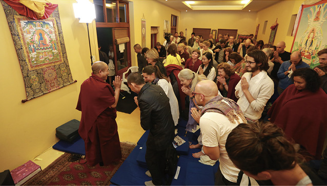
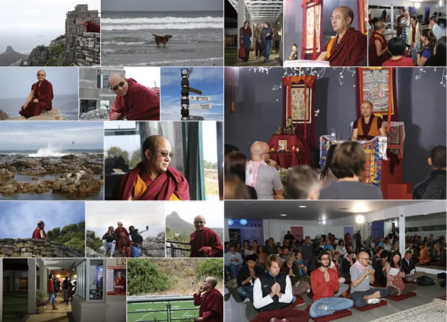
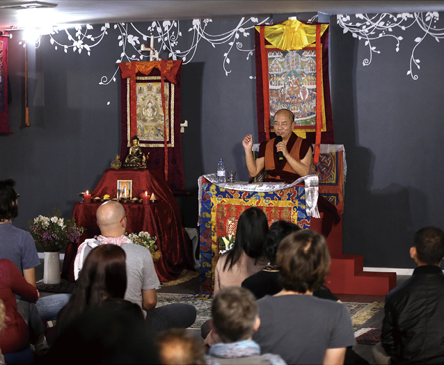
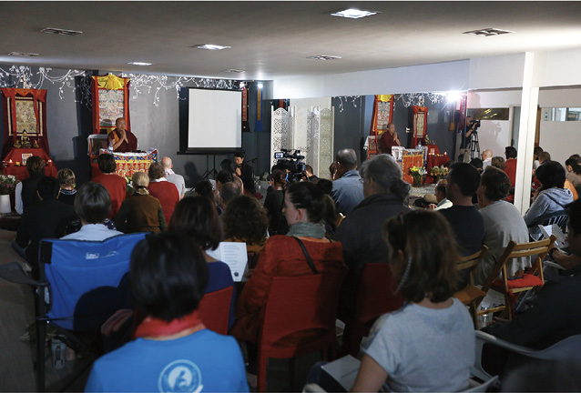
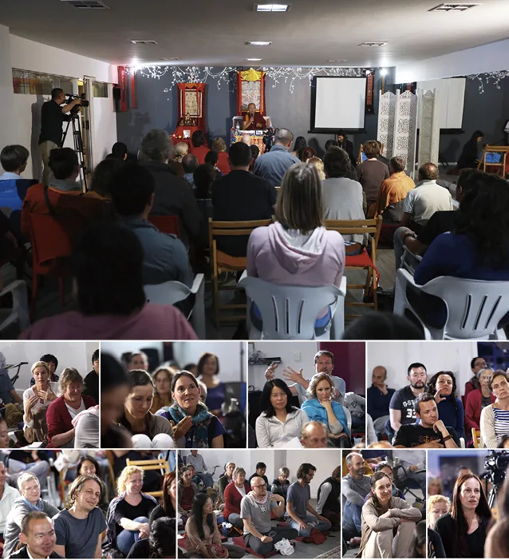

皈依佛教的真正目的，  
是为了悟心性的本来面目。

第43场

南非开普敦禅修中心

Cape Town Meditation Centre, South Africa

南非·开普敦

2015 / 10 / 31

## 佛教的皈依及其功德

## Refuge and its Merit

主持人：

各位晚上好，让我们诚挚地欢迎索达吉堪布仁波切！今天很荣幸邀请到这位具德上师为我们做开示，指导我们如何做一个好人。非常感恩仁波切！

索达吉堪布是喇荣五明佛学院的主要负责人之一，与此同时，他还在慈善等方面创立了诸多利他项目。尤其是，堪布翻译了大量佛教典籍并不辞辛劳地在世界各地传法，使无量众生获得了利益。

堪布师从法王晋美彭措，而法王也是我们上师仓楚仁波切的上师。能听到同一传承上师的法音，我们感到非常欢喜。谢谢堪布，谢谢大家！

大悲摄受具诤浊世刹，尔后发下五百广大愿，

赞如白莲闻名不退转，恭敬顶礼本师大悲尊。

这个偈颂是本师释迦牟尼佛的祈祷文。内容是说，大慈大悲的释迦牟尼佛，为了度化末法时代无量无边的众生，发下五百个广大誓愿。有幸听到世尊名号的众生，会在菩提道中不退转。若以这个偈颂来衡量，在座各位应该都与释迦牟尼佛非常有缘。

## 皈依的涵义

今天，我与大家探讨的话题是“佛教的皈依及其功德”。在座很多人都信仰佛教或者对佛教有好感，这样就会接触到“皈依”这个词。事实上，不仅佛教有皈依，其他宗教也有，比如基督教的洗礼，就是一种皈依形式。

佛教的皈依有多层涵义。有些人皈依是为了自己今生安康幸福，不受痛苦。虽然这也是一种皈依，但发心范围有点狭窄，因为于我们而言，最重要的是从轮回中解脱，这样才能生生世世离开痛苦，获得究竟安乐。若再进一步，皈依不只为了自己解脱，还为了让所有众生获得解脱，这才是佛教皈依的真正涵义。

世间也有很多皈依，只是人们不称之为皈依而已。比如，人生病非常痛苦的时候，会求助医生；学生为了获得知识，会寻找良师；孩子未成年之前，要依靠父母；世间男女为了生活不孤单，会成立家庭。这些都属于某种意义上的皈依。

所谓皈依，就是寻找一个安全处，依此获得安全感。现今，很多人因为生活不稳定、感情无着落，或者事业不顺利等原因，始终处于焦虑和忐忑不安的状态中。这时，他们就会想方设法寻找一个可靠的依处。

## 佛教，是殊胜的皈依处

特别要注意的是，我们一定要找对自己的依靠处，不但要考量物质层面，还要考量精神层面。

物质依处，是指我们需要有吃的、穿的、住处、车辆等等，这些都是生存不可或缺的。一个人若没有物质的依处或者资源，会陷入十分悲惨的境地。我们在街上常会遇到一些乞讨者，他们因为缺乏住处、饮食等生活保障，每天不得不在街头漂泊、流浪。

精神依处，是指把信仰、智慧、慈悲心、道德观念、贤善人格等等，当作内心的依处。一个人如果没有精神依处，即使物质条件样样具足，心也会像乞丐一样到处流浪，毫无自在，始终处于压抑、焦虑等负面情绪中，缺乏一种安全感。

要想拥有稳固的精神依处，需要不断积累精神财富。而在积累精神财富的过程中，也离不开皈依，就像农民向祖辈学习，才能学会如何种庄稼；工人经过一段时间培训，才能掌握生产技艺；乃至世间任何一门高深的学问，都是在皈依一位老师，得到他的教授之后，才能获得。

相较于世间的皈依，佛教的皈依更殊胜。因为佛教所说的皈依的目的、方法、结果，在普通人的日常生活中很少见，它是一股超自然、超想象的力量，也是一种非常抽象的能量。

## 皈依佛教，也需要因缘

皈依佛教，需要具足前世的因和今生的缘。一个人如果没有缘分，虽然好似对佛法感兴趣，却始终不愿意皈依。我觉得皈依佛教是一种非常特殊的因缘，现在全世界有宗教信仰的人非常多，但佛教徒与基督教徒或伊斯兰教徒比起来，人数不算特别多。

此外，还需要对佛教有不共的信心。如果一个人没有信心，即使佛法或者上师就在他眼前，他也不一定愿意接触。就像有的居士皈依几十年了，他的家人虽然不反对，但一直不愿意皈依。这属于信仰方面的问题。

## 三种信心

对佛教的信心有三种：

第一种是清净信，这是初步、简单的信心。一个人虽然对信佛的目的、佛教所讲的内容等不是很清楚，但他却非常喜欢佛教，就像有些孩童一进花园就特别开心一样。很多人都是依靠这种简单的信心而进入佛门，比如，觉得某位上师很慈悲、法会念诵的声音特别好听、佛像非常庄严，等等。

第二种是欲乐信。比较而言，具有这种信心的人，含有一些理性的智慧，他会观察不信仰有什么过失，信仰有什么功德，即会对功过进行分析。就像我们买一个产品时，会用智慧分辨它是真还是假、质量怎么样。具有这种信心，相对来说比较可靠，因为他不是随随便便信仰，而是对佛教与其他宗教之间的差别、利弊等观察之后，才决定信仰的。

第三种是不退转信，又称坚固的信心。一个人运用自己最深细的智慧，结合严密的逻辑推理，反反复复观察很久之后，才确认佛教所讲的道理千真万确，继而皈依佛教，即称为不退转信。不退转信并不像前两种信心那样，有退转的现象，它永远不会退转。所以，以这种心态皈依是最可靠的。

## 理性皈依，让信心更稳固长久

佛教并不要求所有人皈依佛教，而是认为每个人都有自由选择的余地。只要对自己的身心有帮助，选择世间哪个宗教都可以。不过，在真正皈依之前，最好用智慧反复观察，如果觉得所皈依的对境具有过失、不究竟，最好不皈依；如果觉得教义非常合理，对自己的生活也有帮助，则可以选择皈依。皈依的选择权完全掌握在自己手里。

皈依佛教的人大致有两种：一种人自身的智慧水平一般，但非常有信心，这时，可以随着自己的信心和意乐，在因缘成熟的时候皈依。另一种人有一定的智慧和世间学问，我觉得这种人可以先用智慧观察，觉得合理再皈依，觉得不合理，也可以不皈依。

以前，我见过一位科技大学的博士生，他皈依佛教很多年了。我问他：“你是科技大学的老师，也读过博士，能说说你为什么皈依吗？”他说：“我觉得皈依三宝心里很舒服，但从没想过为什么皈依。今天经您一问，我真的需要想一想了。”

很多时候，有智慧的人也不经思考，莫名其妙或者仅凭舒服、喜欢等感觉，就皈依了佛门。我觉得，如果自身智慧较高，最好先深入观察一下佛教的内容。如果不经观察，一旦听到别人说三宝的过失，或者有人向你发难，你可能就会摇摆不定。如果有所动摇，说明自己的信心并不稳固。

## 皈依的目的

在汉地，很多人都非常在意皈依证，听说美国也有这种现象。有些人办皈依证，是为了免费进一些佛教道场。以前，五台山和普陀山就有凭证免费的规定。

其实，皈依证有也可以，没有也可以。藏地99%的人都是佛教徒，但好像没什么人有皈依证。相较于证书，皈依的心更为重要，因为皈依是一种发自内心的决心，是一种坚定的誓言。

皈依的心态分为几种：有些人是为了身体健康、消灾免难、升官发财、家庭幸福等很多世间愿望而皈依；比这更高的是小乘皈依，即为了让自己从轮回中获得解脱；最究竟的是大乘皈依，即为了度化无量无边的众生而皈依三宝。

## 皈依的对境

皈依的对境是佛、法、僧三宝。佛陀是觉悟者，觉悟了万法的真相。佛陀所宣说的教法以及证法，叫做法宝，它可以引导众生远离一切痛苦，获得圆满智慧。僧众，是指与我们志同道合，乃至菩提果之间一直指引我们前往菩提果的助伴。藏传佛教还经常讲皈依上师。我们应该以这四宝作为皈依对境，即皈依师、皈依佛、皈依法、皈依僧。

以前，有位汉地的大和尚对我说：“藏传佛教经常讲皈依上师，这样依人不依法不太好吧。”我对他说：“好像你给徒弟取名的时候，都用你的名义，并且在他们的皈依证下面，都有你的签名，这不也是皈依师吗？”后来，我们又进行了一些辩论和分析。

## 佛陀以善巧度众

皈依佛教的真正目的，是为了悟心性的本来面目。如果直接对众生宣讲这些，很多人都难以接受。所以，佛陀先讲皈依三宝，到了一定的程度，才讲究竟皈依佛陀。继续抉择之后，佛即是自心的觉性，故而，皈依自心觉性，才是最究竟的皈依。也就是说，从最究竟的观点来讲，我们皈依三宝只是暂时的，并非最真实。

佛陀根据众生不同的根基和意乐，宣讲了了义和不了义法。针对不能接受深法的众生，佛陀首先讲了一些不了义的方便法，当他们根基成熟之后，佛陀才传授了义法，说出万法究竟的实相。

其他一些宗教或者世间科学家、学者等，很少在自己的论典中宣讲暂时引导众生的方便法，一般都直接说出自己认为最了义、最究竟的观点。

《法华经》里有一个很著名的故事：以前有位大富长者，膝下有一独子，此子幼时离家出走，长期在外漂泊，沦为乞丐。长者四处找寻，始终未能找到，伤感之情充塞内心，担忧丰厚家产无人继承。

五十年后的一天，儿子来至父亲舍宅乞讨，看到房屋装修华丽，一人威严地端坐在狮子宝座上，众人恭敬围绕。他怕自己招惹祸事，于是转身准备离开。正当此时，坐在宝座上的大富长者一眼认出儿子，心中生起极大欢喜，忙命人阻止儿子离开。儿子早已忘记了自己的父亲，忽见有人抓他，以为要丢性命，心生极大恐惧而昏厥过去。

父亲见状，知道儿子由于常年乞讨，心志下劣，强迫他恐会出事，于是心生一计。他先派二人雇用穷子来家里除粪，自己穿上破烂的衣服与他接近，然后逐渐提高他的地位。经过父亲的谆谆诱导，儿子心志逐渐增长，已能胜任管家等重要职务。

父亲临终之前，将真相和盘托出。此时，儿子已经心怀大志，完全能荷担起家业。

在这个故事里面，大富长者比喻如来，穷子比喻我等众生。也可以说，当我们尚未证悟，未达到觉性本位之前，佛是我们的导师；法是我们的修行指南和向导；僧众是我们的学伴。如果一直修下去，便会知道自己原来就是佛的亲子。

## 用智慧担负起双重责任

现今，很多佛教徒都面临着一些问题。一方面，自己作为修行人，需要完成学修任务；另一方面，自己也是家庭成员、单位工作者，需要处理各种事情。这个时候，一定要用智慧摄持，肩负起双重责任，既不能退失对三宝的信心，又不能耽误世间该做之事。

若一味忙于世间事而退失了对三宝的信心，是非常可惜的。因为信仰佛教之后，内心会有真正的归属感。现如今，很多人的内心都极度空虚，无论有钱还是没钱，始终感觉孤独无依，经常莫名伤感。如果信仰佛教并配合一些修行，内心就会生起一种归属感。有了这种归属感之后，无论自己身处何种环境，遭遇何种困难，比如事业不顺、家庭破裂、身体生病等等，都可以坦然面对，平稳度过。

我经常看到一些没有信仰的老年人，好像一直在等待死亡，他们对生活已经不抱任何希望，非常无聊、无助。但有信仰的老人则相反，活得非常充实，对来世充满希望。

可见，对于任何人来讲，精神依托都非常重要。一个人有了信仰之后，可以修行、祈祷、念咒语，也可以观想轮回痛苦、万法无常、因果不虚等法义，或者思维佛的功德不可思议、佛的加持不可思议等等。光从思想上讲，就被填得满满当当，根本不会感到孤独、寂寞，也不会整天打妄想、期待或者抱怨。

## 皈依是佛教最殊胜之法

古印度有位著名的班智达，叫阿底峡尊者。有一次，度母对他授记说：“你如果不去藏地弘法，可以活到92岁；如果去藏地，虽然能利益很多人，但你自己会减寿20年。”后来，尊者为了度化众生，毅然来到藏地，最后确实只活到72岁。

阿底峡尊者在藏地弘法期间，几乎天天讲皈依的功德。很多人对此生起了厌烦心，抱怨道：“您怎么天天给我们开皈依法会啊？”后来，他们还称阿底峡尊者为“皈依上师”。有些人甚至诽谤阿底峡尊者只会讲皈依三宝，不会讲其他法。尊者的弟子劝他说：“别人说您除了皈依以外什么都不懂，您还是讲些其他法吧。”尊者回答：“不用，我就讲皈依。所有的佛法中，皈依是最殊胜的。别人称我为皈依上师，是对我极高的称赞！”

## 以五条皈依戒守护皈依

大家皈依之后，应该遵守皈依戒。阿底峡尊者以前讲过五条皈依戒：

第一条，纵遇生命危险或者为了大的奖励，也不舍弃三宝。比如，有人让你放弃佛教徒身份，即使他威胁你的生命，或者许诺给你大量钱财、显赫的地位等等，自己也不应该答应。人类历史上，很多佛教徒都做到了这一点，始终没有舍弃三宝。

第二条，遇到重大的事情时，不寻求其他方法，唯一认为三宝能救护。

第三条，恒时忆念供养三宝，哪怕是一盏灯、一根香也尽量供养。作为佛教徒，应该经常念诵《随念三宝经》，并每天在佛堂做供养。

第四条，尽心尽力地令自他趋入佛门。很多基督徒都热心劝别人皈依，我们佛教徒在遇到有缘人时，对他讲一下皈依的功德，引导其入佛门，也是很有必要的。也可以给他讲一些佛法的道理，从智慧方面引导。

第五条，无论去往何方，都要顶礼佛陀。我出门的时候，一般都会随身带一些佛像。无论在宾馆还是寺院，方便的时候就会对佛像顶礼。作为佛教徒，如果自己去的地方有佛像，应该经常向佛像顶礼；如果没有佛像，则应随身带一些佛像，这样就可以随时礼佛。这一点非常重要。

## 皈依、供养三宝的功德

皈依三宝能为我们带来很大利益。《帝释所问经》云：“唯有佛世尊，是世间大师，善降大魔军，能度诸有情。”意思是，佛陀是大彻大悟者，堪称整个世间最殊胜的善知识，他用慈悲心摄持的善巧方便，降伏了贪嗔痴为主的一切魔军，令无数众生的心获得解脱。当心获得解脱之后，身体和生活等方方面面，都会随之发生很大变化。

经常供养三宝，对心的解脱有很大助益。《妙法莲华经》云：“若人散乱心，乃至以一华，供养于画像，渐见无数佛。”意思是，即使不是以很专注的心，而是以贪心、嗔心等散乱心，在佛像前仅仅供一朵花，功德也不可思议。渐渐地，就能见到十方如来，最终获得解脱。

大家平时可以在佛堂供养各种供品，这样做功德非常大。如果没有条件，做供水等微小的供养，也有无量的功德。

《妙法莲华经》云：“或以欢喜心，歌呗颂佛德，乃至一小音，皆已成佛道。”意思是，以欢喜心通过歌声来赞叹佛陀的功德，乃至一个很小的声音，也有无量无边的功德，会成为觉悟和解脱的因。

如果自己有能力演奏各种美妙的乐曲，并配以动听的歌喉来赞叹佛陀，功德更是不可思议。当然，也可以跟着念佛机或者自己唱诵一些礼赞文、佛号等来赞叹三宝，这样也非常有意义。

《妙法莲华经》亦云：“若人散乱心，入于塔庙中，一称南无佛，皆已成佛道。”意思是，一人入于寺院或者看见佛塔时，哪怕用散乱心念一句“南无佛”，此功德也不可思议。

所以，当我们平时遇到困难和违缘的时候，若能一心一意祈祷三宝，除了前世不可逆转的极个别定业以外，佛菩萨绝对有能力帮我们把厄运转变成好运，我对此深信不疑。

最后，我想对大家说一件事情。昨晚，俄罗斯一架载有224人的客机在埃及坠毁，机上所有人员现在生死不明。让我们一起念诵100遍观音心咒为他们祈祷好吗，嗡玛呢巴美吽……

现场互动

问：我觉得身语意的皈依比较容易，但不知道如何让自己的身语意成为帮助他人的三宝。另外，藏传佛教中讲皈依三根本，即皈依上师、本尊和空行。这应该是一种更深层理解佛法僧的方式，不过，我不太理解空行和修道之间的关系，不知道自己如何成为空行。请您开示。

堪布：我们应在寻求证悟的过程中成就利他。学了密法就会知道，三根本——上师、本尊和空行，是同一个本体。比如，修上师莲花生大士的时候，本尊、空行与莲师一味一体。三者虽是一体，但有不同的侧面或者特点，上师是加持的根本，本尊是悉地的根本，空行是事业的根本。

也就是说，我们修任何一个法，需要通过上师加持的力量才能成功，此外，想让他人的心得以改变，也离不开上师的加持；想要自己或别人的修行尽快获得成就，需要依靠本尊的力量；想让自己或别人的事业成办于各个角落，需要依靠空行的力量，因为空行有很多护法方面的助缘，成办事业非常迅速。总之，自己修行或者利益众生的时候，应该从三个不同侧面用功。

问：听了您的开示，我知道了藏传佛教还讲皈依上师，并把上师列为第四宝。我的问题是，藏传佛教有很多不同宗派，并且末法时代想找到一位真正的上师非常不容易。这种情况下，我们怎样才能找到适合自己的上师呢？如何判断一位上师能否带领我们从轮回中解脱，值得我们用生命去皈依？

堪布：藏传佛教非常重视依止上师。依止上师的过程中，首先要善加观察，中间要认真依止，最后就能真正得到上师的教言。怎样观察呢？显宗和密宗都专门讲过上师的法相和条件。对于弟子来讲，应该观察上师是否具有智慧和慈悲、戒律是否清净等等。如果上师具足这些条件，自己对他也有信心并希望解脱，就应该马上依止。

问：我看一些佛书中说：纵遇生命危险，也不能舍弃三宝。但如果出于一些原因不得不舍弃佛教时，要求人们放弃生命是否合理呢？这么做真的对佛教有利吗？请问在什么情况下，这么做是有意义的？

堪布：其实，这表达的是对三宝的热爱，或者说一种精神。以前确实有这种现象，在特殊年代，很多人会逼迫佛教徒放弃自己的信仰。据说当时有一位佛教徒说：“虽然我口头上可以放弃佛教，但内心绝不会舍弃，即使离开人间，我也是一名佛教徒。”后来，他并没有遇难，反而脱离了危险。

实际上，不仅是佛教，世间也有这种说法。比如，在很多国家的军队中，年轻人应召入伍时，都会以自己的生命来宣誓，表达一种顽强的意志和坚定的信念。

所以，“纵遇生命危险，也不能舍弃三宝”这句话，不是说一个人入了佛教，就必须为三宝放弃生命，就像加入ISIS组织那样，必须用自己的生命捍卫国家，并没有这个意思，它表达的是一种皈依的决心。

问：您刚才讲到三种信心——清净信、欲乐信和胜解信。我认为，胜解信的状态基本接近成佛了，也就是马上证悟心之本性的一个状态，这时才皈依是不是太晚了？您能否再详细解释一下胜解信。

堪布：不晚，这时候刚刚好。因为，如果你在生起不退转信之前就皈依了，中间很容易因为没完全了解三宝的功德而退转。如果自己通过辩论、研究，最后真正知道三宝是自己唯一的皈依处之后再皈依，是很好的。

当然，每个人的情况不一样，以清净信或欲乐信而皈依也很好。我最初皈依三宝的时候，也只有前两种信心，在翻译完三十多万字的《释迦牟尼佛广传》之后，觉得自己的信心已经转成了不退转信。所以，我刚开始虽然有信心，但后来这个信心才越来越坚固，逐渐转入不退转信。

问：我想问一个关于大圆满的问题。据我了解，宁玛派和噶举派都修持大圆满。如果可以的话，您能否讲一下噶玛巴与大圆满传承之间的关系？

堪布：噶举派和宁玛派都修大圆满法，两派之间的关系还是比较密切的。

米拉日巴尊者最初在绒顿拉嘎上师那里求得大圆满法，但没有修成，因为尊者觉得自己根器很利，当时有点懈怠。后来，他通过修持大手印而获得了成就。

在这之后，宁玛巴大圆满的主要传承上师是全知龙钦巴，而龙钦巴的上师之一就是第三世噶玛巴，让炯多杰。自那时起，噶举派的很多大德和弟子都在修大圆满，宁玛派也有不少弟子在修大手印，两派五十万加行的修法也基本相同。可以说，藏传佛教这两个教派都非常重视大圆满。

问：请问，对于出家人和在家人这两种不同层次的修行人，佛教的教授内容有什么不同？在教学方法上有什么差别？

堪布：首先，出家人和在家人在头发方面有差别（众笑）。我看到非洲很多黑人与我们出家人一样没有头发。有没有头发应该也算一个差别。

其次，在戒律方面有很大差别。出家人有一些特殊的戒律，比如，男女众出家人，各有不同的出家戒律。佛教内容包括戒、定、慧三学，以及经、律、论三藏。因为出家人和在家人的戒律不同，故行持方面也会有相应的不同。

现在我只能做一个泛泛的回答，因为说起出家人和在家人的修行差别，里面涉及的问题非常多，就像说非洲人和亚洲人有什么不同，用几句话很难讲清楚一样。如果你想出家的话，可以慢慢学习戒律，这样就会逐渐明白的。

问：我的问题很简短，但却是一个较大的问题。请问从本质上讲，大手印和大圆满有什么区别？我们在噶举中心都修习大手印，我不明白，为什么没有选择修大圆满呢？

堪布：虽然每个法门各有不同，但从究竟意义上讲，并没有什么差别。全知麦彭仁波切的《定解宝灯论》中讲：“于大圆满之心部，智者各修一窍诀，分别称为大手印，道果息法与双运，大中观等不同名，实则同为离心智。”说明了大手印、大圆满、道果息法，以及大中观等，只是名称不同，实际都是指超离心与心所的自然光明智慧。

当然，从不同侧面，也会有一些不同的讲修方法，比如，大手印里专门有一种寂止和胜观的修法，一步一步引导人们修寂止和胜观，这与大圆满直指心性的方法不太相同。

佛陀之所以三转法轮、宣讲八万四千法门，是因为众生的根基不同，以不同的法门才能度化。同样，虽然佛教各派的究竟意趣完全一致，但因为每个众生的根基不同，所以相应于各法门的程度也会不同。比如，噶举派的有些弟子通过修大手印可以开悟，有些则通过修大圆满才能开悟。当年，米拉日巴之所以没有通过大圆满开悟，而是依靠大手印开悟，原因就在于此。

问：您刚才讲到，男女众出家人学习的内容不一样，需要守持的戒律也不同。我想知道为什么？

堪布：因为女众比较敏感，所以针对这方面会多一些戒律。就像世间男子学校和女子学校的纪律不完全相同一样。

问：现代人生活非常忙碌，有家庭、工作等各种事情需要处理，这与藏民差别很大，与寺庙的僧人更是相去甚远。很多人抱怨最多的就是没有时间修行。您能否推荐一种适合现代人的修行方式，既能提升修行，又能很好地平衡生活。

堪布：我看非洲人工作好像不是特别忙，他们很多都是当日结算工资。如果当日不结算，周五之前一定要结清。我还听到一种说法，在非洲，一个人干一天休一天，属于非常勤快的；干一天休两天，属于正常的；干一天休N天，才算比较懒惰的。

如果非洲人以这种方式生活，跟藏民也差不多。藏民也不太讲究效率，每个人都比较放松，喜欢慢慢来。当然，我听说非洲有些华人和西方人也比较忙。如果有忙的，也有不忙的，那根据自己的实际情况平衡，可能会比较好。

问：您能否与我们分享一下佛教徒在喇荣五明佛学院开法会的情况，我对此很感兴趣。此外，我还想了解一些有关女性修行人住持、管理佛学院的情况。

堪布：若想了解喇荣五明佛学院的整体状况，可以登录国际佛学网，上面有详细介绍。喇荣五明佛学院始建于1980年，至今有35年历史。学院里女众出家人占大多数。佛学院现由一些堪布、理事会成员轮流管理，每年有两位法师主管。学院教学的主要内容是闻、思、修。

前不久，佛学院的所有僧众闭关了15天，然后开了8天极乐法会。从照片上看，参加法会的在家人和出家人确实比较多。在西方国家，很少会有这么多佛教徒聚在一起开法会的情况。

如果你想了解更多佛学院的学习和管理情况，可以登录相关网站看一些介绍。不过我觉得，最好的了解方法是亲自去一趟。从这里到成都，只需十二个小时；从成都到喇荣五明佛学院，只要一天时间。古人说：百闻不如一见。自己亲自去了之后，对于很多事情，都会清清楚楚。
