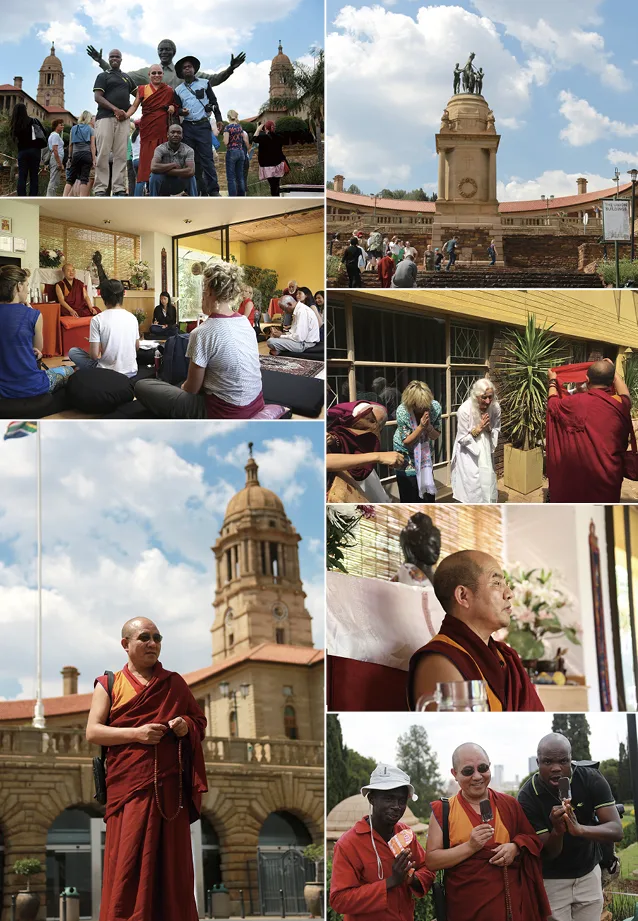
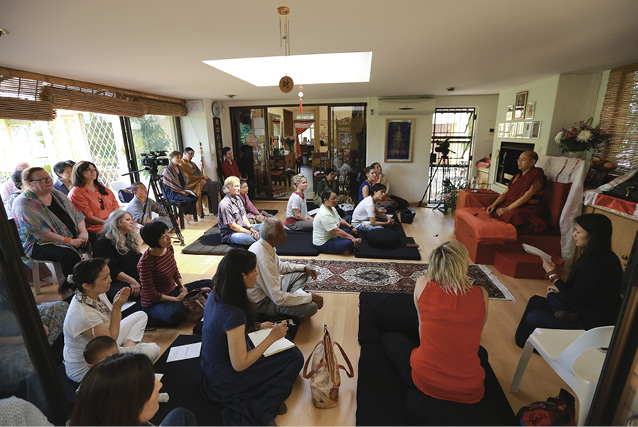
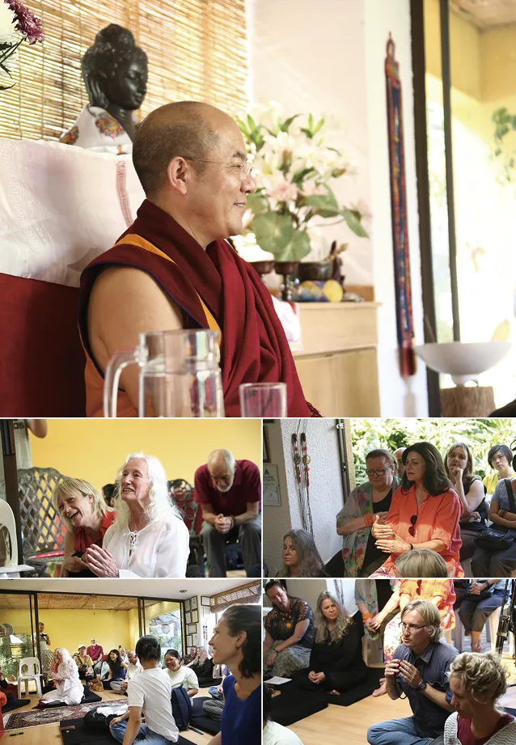
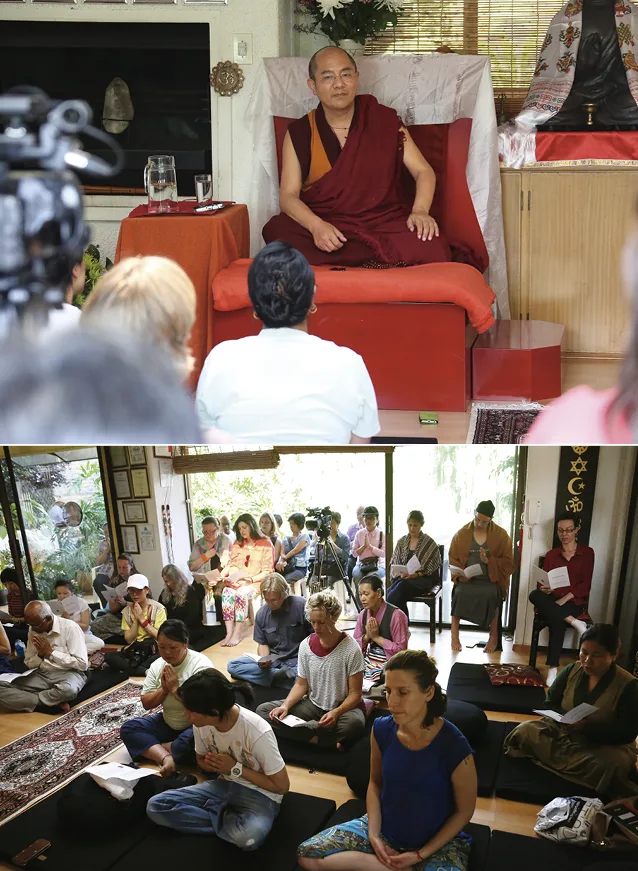

在世间所有的脚印中，大象的脚印最庄严；  
在所有的观念中，无常的观念最殊胜。

第41场

南非约翰内斯堡禅修中心

The Johannesburg Meditation Centre, South Africa

南非·约翰内斯堡

2015 / 10 / 27

## 四法印

## The Four Seals

主持人：

欢迎索达吉堪布仁波切！堪布是藏地最资深的佛教大德之一，您的莅临让我们深感荣幸！

我为大家简单介绍一下堪布。1962年堪布生于藏地东部的康区，1985年前往四川色达的喇荣山谷，在宁玛派的喇荣五明佛学院学习。堪布亲近依止了法王晋美彭措仁波切——法王是一位非常伟大的上师，也是伏藏大师列绕朗巴的转世。

索达吉堪布是一位藏族高僧、佛教学者和老师，也是一位多产的中文翻译家和现代佛教思想家。仁波切致力于传统佛教教法与藏族文化现代性的整合，也因此而闻名于亚洲和西方。他曾受邀到全球100多所著名大学演讲。堪布常说：“我不知道我能活多长时间，但只要有一口气，哪怕只有一个人听法，我也会尽心尽力用佛法饶益他。”

1999年，喇荣五明佛学院被《纽约时报》评为全球规模最大、最具影响力的佛教研究中心之一。喇荣五明佛学院为弘扬佛法做出了巨大贡献，学院不仅传授殊胜的教法，也致力于振兴藏族传统文化、促进各民族团结。目前该院的藏汉僧人共有一万余人。此外，学院在全球有数以万计的学员，他们通过线上课程来学习佛法，这些课程均由学院的资深堪布讲授。

另外，我还要感谢阿弥陀佛关怀中心邀请仁波切到非洲来。今天仁波切是首次到访这里，但我希望这不是最后一次。祈愿以后还有许多这样的机会，可以从如此尊贵的大德这里接受宝贵的教法。非常感谢阿弥陀佛关怀中心所做的各种工作，他们在世界各地都开设了儿童关怀中心，是一个非常有爱心的慈善组织。

仁波切经常到各个大学演讲，这一站后，他会去开普敦和莱索托的大学演讲，也会访问纳米比亚。希望大家享受这次教学，并有所收获。感谢！

很高兴今天来到中心，与大家一起探讨、交流佛法。我刚刚从英国伦敦过来，坐了十二个小时飞机，还没有来得及去宾馆。按照原计划，今天没有安排做讲座，但中心的佛学爱好者们对佛法交流很有兴趣，所以我没有拒绝他们的邀请，我也很愿意、很欢喜与大家结上这样的善缘。

虽然各位与我接触的时间不长，但大家对佛教很有信心，对净化自己的心灵很有兴趣。刚才有人希望我分享一些缘起空性方面的内容，也有人希望我讲一些唯识、中观的教义，还有人希望我分享一些佛教框架性的内容，并讲一下四法印。那么，我想先简单为大家介绍一下四法印，之后如果还有时间，再分享一下大家祈请的其他法义。

虽然我可以讲藏语，但今天我还是用汉语讲，配有英语翻译。

## 八万四千门，归为四法印

释迦牟尼佛宣说了八万四千法门，有弟子问佛陀，如果归纳出一个简单的修行方法是什么，佛陀回答说要修四种法。首先是诸行无常，一切法都是无常的；第二是有漏皆苦，即使现在感受到的快乐，其本性也是痛苦的；第三诸法无我，虽然每个人都觉得有“我”的存在，但详细观察后，会发现所谓的“我”确实是空性；第四涅槃寂静，当我们真正通达空性的时候，会获得解脱。今天，我就简单介绍这四种道理。

## 诸行皆无常，刹那不止息

第一，诸行无常。它的意思是说，所有造作的有为法都是无常的。外在的器世界、物质世界是刹那变化的，没有恒常不变的东西，而人的内心世界，起心动念也在不断变化。人们的家庭状况、工作情况在变化，年龄也在变化，人的一生从童年、青年到中年，再到老年，最后离开人间。

世间所有万事万物，全部在刹那变化之中，没有不发生变化的。对此，很多人都缺乏清晰的认知，这是因为人们有常有的执著，有常乐我净四种颠倒的观念——不干净认为是干净，不常有认为是常有，没有我认为有我，痛苦认为是快乐。几乎每个人都有这四种颠倒分别念，就像患上了严重的精神疾病。其实，对事物的真相无法了解，就是一种可怕的疾病。

如果懂得万法的本性皆无常，在面对生活时，你的心态会有许多变化。在人生中，以前喜欢你的人或许会变得讨厌你，曾经顺利的工作或许会变得不顺利。而你与最亲爱的人，也许会经历生离或死别，当他离开时，如果你没有观修过无常，会特别痛苦；如果观修过无常，或许你也会痛苦，但不会太执著。

在佛教中，对于无常法，需要长期、专注地修持。如果你的无常观修得很好，那么，生活中所发生的任何难以想象的事、一切恐惧和痛苦，你都可以轻松面对。相反，如果你的常执特别重，把一切都想象得很美好、永远不会改变，那么，等有一天生活突然发生变化时，你会无法接受，甚至会选择自杀或做出种种不好的行为。因此，在佛教中，一直着重强调好好观修无常。

大家在中心经常禅修，有些禅修者有信仰，有些没有信仰，但不管怎样，很多人喜欢通过修持正念禅修、瑜伽以及其他修法来调整自己的内心，这非常好。不过，在修行当中，观修无常是最有功德、最有效果的。如果修行其他法但不修无常法，那么，即使其他修法对你有暂时的作用，但长远来看，也不一定能有非常大的效果。

释迦牟尼佛在经中说，世间所有的脚印中，大象的脚印最庄严；所有的观念中，无常的观念最殊胜。因此，观修无常的功德是最大的。作为佛教徒，如果无常观修得很好，你一定会越来越精进，绝不会懈怠、懒惰，因为你知道自己的生命不会太长，总有一天会离开人世。当自己离开的时候，世间所有名声都带不走，世间八法都变得毫无意义，因此一定要精进行持善法，唯有善法可与自己生生世世相伴。

对没有信仰的人来说，有无常观也很有意义——当你做事情的时候，会自己安排妥当，不致过于懈怠。我听说有些地方的人效率比较低，可能一天只能办一件事情。其实从世间角度讲，这样也不太好，人还是应该有一种紧迫感。这就是观无常的作用。

## 有漏无常法，本性皆痛苦

第二，有漏皆苦。它的意思是，世间有很多无常的法。既然一切皆无常，那么，即使人生看起来很快乐、很开心，一切显得很美好、很庄严，但最终一切还是会显现出痛苦的本性。

有些人说佛教不应该讲轮回的痛苦、人生的痛苦，因为生活中有很多值得开心的事情，有非常快乐的日子。其实，佛教承认暂时显现的快乐，但佛教也告诉我们，在本质上，现有的一切美好，到一定时候，都会像水泡一样破灭。因此，所谓的快乐就像闪电、流水、彩虹一样，在极短的时间中便会逝去。当快乐逝去后，带来的将是长时的痛苦。

在人生中，看似美好的事物或许有很多，但其本性中却蕴藏着诸多痛苦。这些痛苦，有些已被我们感知，有些还未被发觉，但它们的本性都是痛苦的。已被发觉的痛苦自然是痛苦，而未被察觉的痛苦，则可能是产生未来痛苦的根源。

虽然动物看起来也很痛苦，但相比之下，人类的痛苦或许要更多。虽然动物对异性也有贪欲，但它们的贪欲不及人类复杂。人类贪地位、贪漂亮衣服、贪旅游观光……各种贪欲非常多。虽然动物也有嗔恨心，但它们的嗔恨心只是偶尔发作，不像人类经常跟同类吵架，无论是对敌人还是亲人，都生出很多怨恨、矛盾。动物的嫉妒心、傲慢心也没有人类重。由此观之，人类因烦恼而感受的痛苦，的确超过了动物。如果没有好好对治，我们的内心将一直被痛苦占据。即使你没有感觉到明显的痛苦，也不代表痛苦不存在。

前两天我看到英国的报纸上说，人的一生中有各种各样的担忧，比如感情、事业、经济状况等等。大部分人在一生中，每天都有几个小时是在担忧中度过的。等到了晚年，计算此生在忧虑中的时间，大约累计有五年。如果计算一下我们自己的，也许跟这个调查结果差不多。

佛教讲“一切有漏皆苦”，对于这一点，我们确实要明白。如果已经了知轮回中充满痛苦，同时调整好心态，那么，我们选择的生活方式将会更加合理。

## 诸法皆无我，遍寻终不得

第三，诸法无我。之前已经讲了诸行无常、有漏皆苦，那么，是谁在感受痛苦呢？是“我”在感受痛苦。但是“我”在哪里呢？在没有观察的时候，人人都说：“我就是我啊，这有谁不知道？”每个人都在为“我”奔波，这是一种普遍现象，但如果真正去寻找“我”，却怎样也找不到。

佛教中有一位那先比丘，他与弥兰陀王有一段对话，国王说：“我肯定是存在的。”那先比丘问道：“那你到底在哪里？手是你吗？头是你吗？脚、皮肤、身体的里里外外，分析下来到底哪一个是你呢？”国王便逐一分析，发现确实找不到“我”的存在，他说：“手不是我，头也不是我……如果说我是身体各部分的总和，但既然身体各部分分开时找不到我，那在总和当中，又哪里能找到我呢？”最后，国王承认所谓的“我”只是一个概念、一种妄执，一旦真正去寻找，根本找不到。

这就是“诸法无我”，或者说诸法都是空性的。但在现实生活中，每个人都把本来虚妄的事物执著为我——这是凡夫人普遍的执著。实际上，用世间公认的科学方法来观察“我”，让爱因斯坦、牛顿来寻找“我”，也根本找不到。可惜爱因斯坦、牛顿没有学过无我空性，如果他们学习过，至少能通达其中的一部分道理，那临终时也不会太痛苦。

对于无我空性法门，任何身份的人，都应当先学习，然后再观修，最后自己证得。但反观现实，大多数人每天都很执著我和我所，“这是我的东西、我的房子、我的车、我的家属……”但如果我们可以换另一种方式去看待一切，以佛教的中观般若思想为出发点去观察，就会发现佛教讲的不是传说，也不是谣言，而是千真万确的事实真相。每个人用自己的智慧去观察，会明白佛教说的“无我”并不局限在信仰层面，因为你自己会发现，所谓的“我”除了一个假象外，根本找不到。当你完全明白这一切，就可以感受到生活的意义所在。

因此，我也劝勉大家多学一些中观经论，比如《般若经》、龙猛菩萨的《中观根本慧论》等。这样一来，即使我们还是需要工作、上班，生活依然照旧，该做的事情仍会不懈怠地做，只不过在做事情的过程中，当你遇到困难时，不会再像以前那样脆弱、敏感。其实，有些人的痛苦源于过度敏感，有些人的痛苦由于过度脆弱，也有些人的痛苦是因为欲望太大。所以，很多痛苦是我们本不该遭受的——这些痛苦都是由自己造成的。如果可以学一些空性法门，至少可以使痛苦减轻。

## 涅槃得寂静，寂灭始安乐

最后第四个，涅槃寂静，或说寂灭为乐。当我们知道一切万法皆无常、无常则痛苦、痛苦的“我”为空性后，通过理论与实修最终会证得空性境界。此空性境界并非暂时获得，而是彻底明了、完全通达了万法实相。这时，之前心中诸多负面情绪，以及烦恼障、所知障一切障碍，都如火烧尽坏种子一般，被彻底遣除了。随之，心将完全处于没有执著的快乐当中，不再因任何执著而痛苦，获得了最究竟的安全感。

现在的我们，每天都患得患失，即使今天没有什么忧虑，明天又会开始担心、为各种事情痛苦。但通过循序渐进的修持空性，最终可以达到佛教的最高境界，这时你将没有任何烦恼，这就是寂灭、究竟的快乐。其实，每个人都可以证得这种境界。不过，证得的过程因人而异，有些人通过短暂的修行就可以到达修行的山顶，也有些人需要通过苦行积累资粮、长期与烦恼作战，才能达到修行的顶点。

在证得最高境界后，修行人不会停滞不前，不像有些富贵的人，有钱之后只顾自己享受。世间高尚的人有了钱以后，尚且不在乎个人享受，而选择帮助身边的人，那么，证得最高境界的大乘行者更是如此。

在佛教中，虽然有很多高层次的修行，但大乘佛教最究竟的思想就是利他。无论你获得了最高的禅定，还是任何殊胜的修行境界，都不可能一味耽著禅悦或快乐的境界，一定会自然而然度化、帮助众生，以利他为主。这时，你会真正感受到利他才是最大的快乐。

其实，稍微有一些利他理念的人，在现实生活中也会有同感。我就经常有这种感觉，通过享受而获得的快乐并不长久，但通过利益他人而获得的快乐，是没有任何语言能够诠说的，因为它是一种极致的快乐。大乘修行人的最高目标，就是以种种方式、示现种种善巧方便，帮助、利乐天下一切众生。

接下来可以提问，你们问的时候简单地说，我也简单地回答。所谓的“简单”，不是说问题本身简单，而是因为时间关系，要把语言尽量压缩，问题本身可以是尖锐的。

现场互动

问：我的问题是菩提心与空性之间的关系。佛教中讲菩提心可以去除所知障。但按照中观应成派所讲的道理，如果我们去观察“法”，也可以将其观为空性。那为什么必须以菩提心去除所知障呢？

堪布：在修行的过程中，始终都要发菩提心。而在成佛的时候，究竟的大悲心就会生起。但烦恼障、所知障的直接对治法，并不是一般意义上的菩提心。

法称论师的《释量论》中说，慈悲心与烦恼障、所知障并非直接相违。二障一定要以其直接的违品断除。那么，断除烦恼障、所知障的根本对治法是什么呢？就是空性智慧。空性智慧生起后，就可以断除这些障碍。自己断障生慧后，会对没有证悟空性的众生生起更强烈的菩提心。这是一种理解方式。

还有另外一种理解，所谓的菩提心，分为世俗菩提心和胜义菩提心。世俗菩提心即所谓的大悲菩提心，是希望帮助、利益众生的一颗心。而胜义菩提心，是一地菩萨以上的菩提心，它具足了无我的胜义智慧。按照法称论师的观点，世俗菩提心不能断除二障，那么，具足了无我智慧的胜义菩提心应该可以断除二障。不过，佛教中并没有说要以菩提心直接断二障。

问：有人说要想真正修行，首先要断世间八风，如果八风没有断除，再多的修行也是不圆满、不清净的。但作为在家修行者，没有办法断八风，在这种情况下，如果想继续修行，怎样才能达到圆满？

堪布：这种说法不太准确。即使没有完全断除八风，你也可以修行，因为八风就是要通过修行来断除的。断除了八风、平息了世间八法后，也需要继续修行。但对你来说，目前更为重要的是在未断八风之前，就开始修行。

问：我们都会有烦恼，而且烦恼生起时的力量非常强大。虽然在道理上我们懂得是执著产生了烦恼，也知道应该如何对治，但有时候烦恼太强大了，我们被它牵着走，就像卷入了漩涡。因此我想知道，断除烦恼最简单的方法是什么？

堪布：没有特别简单的方法，因为烦恼在我们心里串习得太久了。如果想断除它，一定要有强大的智慧，还需要长期修行。

有一个修行人跟我讲过，起初他的烦恼非常炽盛，即生中断除烦恼的希望渺茫。后来，他先拼命磕了四十万大头，然后再修其他法。在几年中，他强迫自己用全部的身心力量，修行藏传佛教的五十万加行——皈依、发心、念百字明等。之后，他的烦恼基本平息了，烦恼的力量不似之前那样强大。现在，他几乎不会再生起粗重的烦恼了。

我相信他所说的这段修行经历是真实的，因此，如果想很简单地断除烦恼，还是有一定困难。在修行上，一定要下功夫、花时间，最终才能将烦恼断除。

问：一方面我承认心相续的存在，众生有无始无终的转世；另一方面，我接受无常，也想通过修持无常提升修行。但我修无常的时候，总会想到我的相续还会流转到下一世，这似乎在告诉我无尽的流转不是无常的。如何克服这种心理障碍？是不是只有不承认生命的流转才能接受无常？

堪布：就整个心相续来讲，在没有得到解脱之前，是一直存在的，但这不叫“常有”。因为用智慧观察会发现，昨天的“我”肯定不是今天的“我”，今生的相续也不是后世的相续，否则，今生就变成下世，下世就变成今生。在中观法门中专门有这样的分析。一般来说，我们观无常的方法，与分析空行的方法是不同的。

认为相续常有，则是迷乱、错误的认识，在胜义中，这种结论一定是错误的。在观世俗无常时，也不能认为心相续是常有不变的。不过，现在人们最大的问题不是这个，而是认为“我”是常有的、“我”的身体是常有的，大部分人还没有想过“我的心是常有的”。至于说观修无常的方法，一般而言，观修现实当中的无常即可。

问：在修行方面，我经常会产生疑惑：“应该修什么？该怎样修？修行的效果如何？”您可以对此给予一些建议吗？老师不在身边，无法每天依止、定期请教，那如何知道自己的修行是否如理、有效呢？

堪布：如果有机会，最好依止一位通达佛教教理的上师，并至少在他座下听十几部法，有问题时就请教。如果没有系统学习过佛法，佛教徒很难懂得佛教的教义。如果没有因缘依止上师，那么，对你来说最重要的，就是反复阅读像《普贤上师言教》这样的书籍，之后你对修行就不会有怀疑，不会总想着：“我修没修错？到底怎么修？”

如果既不依止上师，也不阅读经论，只是依靠自己的智慧去修行，那么，即使你的智慧很高，也难以获得修行的窍诀。就像学开车没有师父教，也没有学习教程，即使你很聪明，握着方向盘也不一定能上路。所以，最好是依止上师，没有上师就依止可靠的法本，法本对有些道理也讲得比较清楚，之后再反复修持。

问1：我们如何找到老师并请他留下？这里没有什么老师，我也只认识这位堪布，但我们确实需要堪布、老师以及僧团。

堪布：找到一位好上师时，就把他的护照撕掉。

问2：您的护照在哪里？

堪布：我的护照在这里。（众笑）
