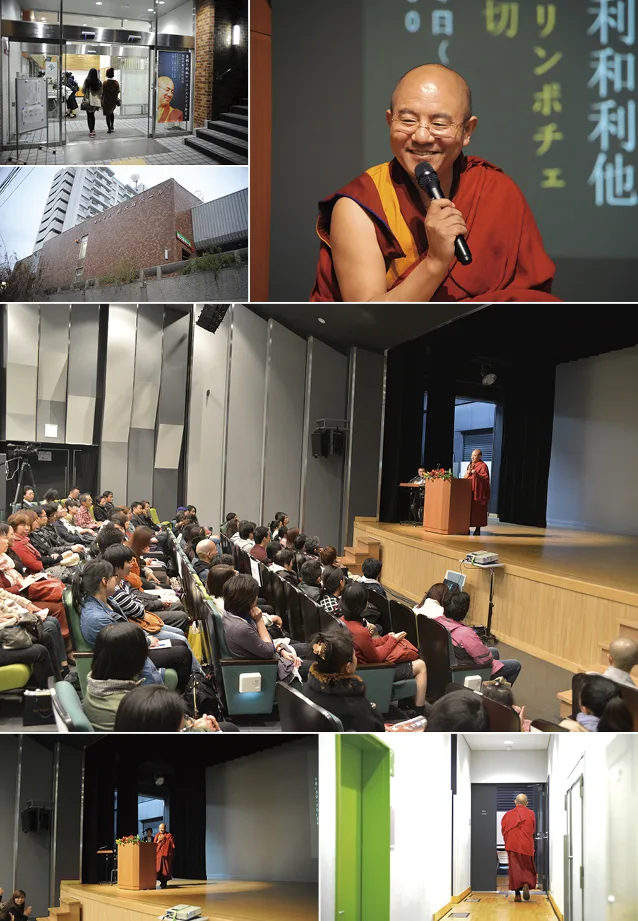
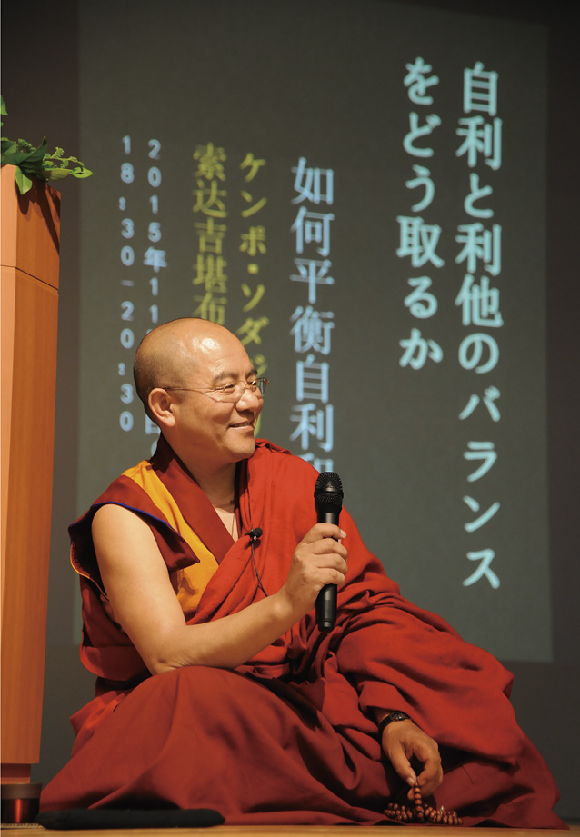
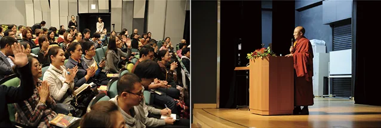
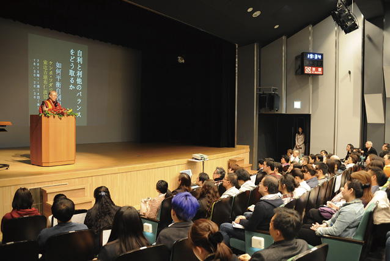
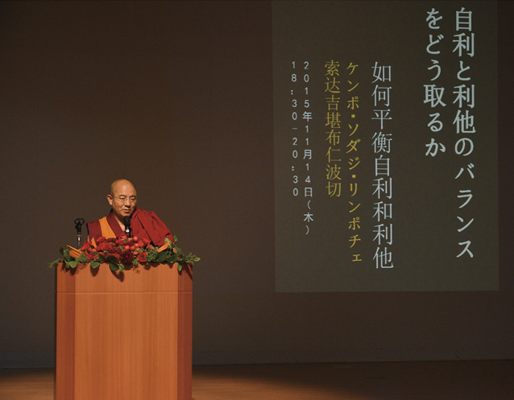
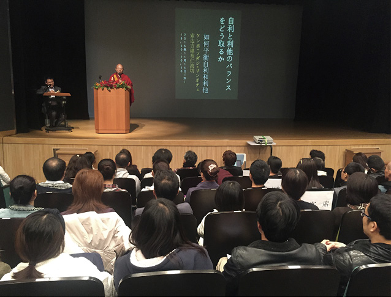
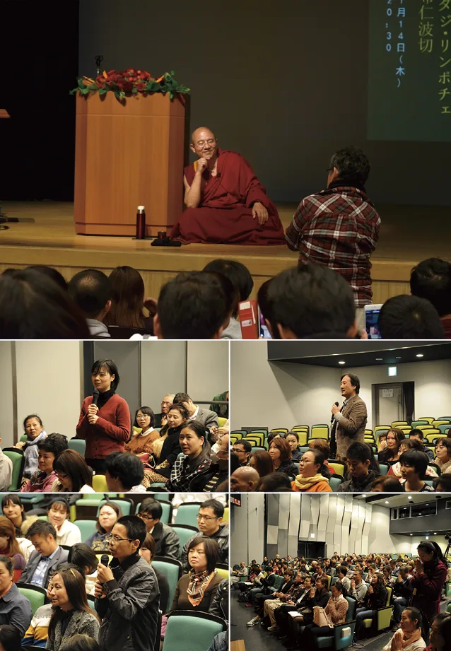
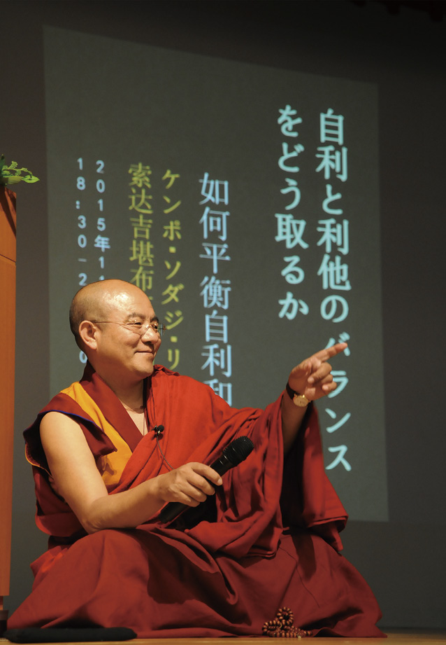
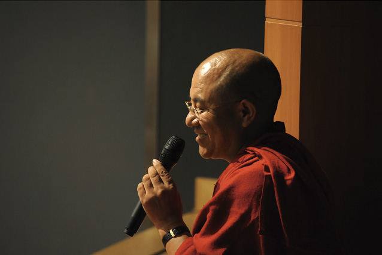
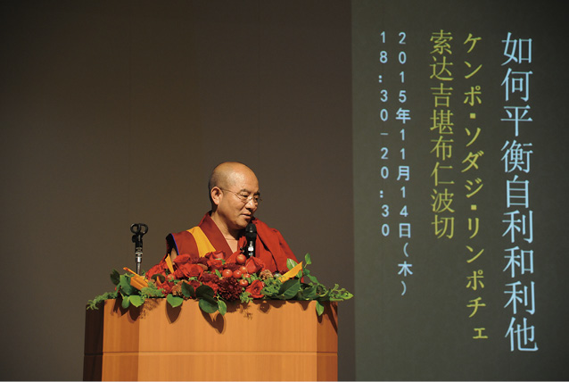

佛教并非不强调自利，  
而是强调，最好的自利方法是利他。

第48场

日本东京公开演讲

Public Speech, Tokyo, Japan

日本·东京

2015 / 11 / 12

## 如何平衡自利他利

## Balancing Self-Interest and Altruism

主持人：

各位来宾、各位朋友，晚上好！

在秋意浓浓的九月，索达吉堪布从喇荣启程，开始了又一轮环球巡讲之旅。一个多月以来，堪布弘法利生的足迹遍布了意大利、法国、奥地利。

今天，我们非常荣幸请来了尊敬的索达吉堪布，使我们在东京有机会聆听到堪布的法音。今晚堪布演讲的主题是“如何平衡自利利他”。让我们以热烈的掌声，欢迎堪布仁波切出场——

今天很高兴与大家一起谈谈自利利他方面的道理。所谓自利利他，有很多层含义，既可以从佛教的角度解释，也可以不用任何宗教概念，只从世间现实主义的角度阐释。

在生活当中，我们不可能不利益自己。每个人为了生活、家庭和事业，不断地工作和学习，其中可能很大一部分成分都是为了利益自己。当然，也会有为国家和民族奉献、为他人服务的成分。

有时候，利益自己和利益他人两者可以并存，有时两者又无法并存，如果帮助他人，就不得不放弃自己的利益，互相之间有一些矛盾冲突。

今天，我想把世间学者，包括一些经济学家的观点，和大乘佛教的利他思想结合起来，与大家分享。

## “利他”才是问心无愧的“利己”

现代很多人都秉持一种自利主义。究其根源，与两百多年前经济学家亚当·斯密写的《国富论》有一定关系。他在书中提出一些经济学理论，倡导人们用经济以及外在的物质文明，将自己提升到最高高度，并强调自我的发展。

这本书对世界产生了巨大影响。包括亚洲、欧美在内的很多学者、社会各界人士，也可以说我们上一辈人，都觉得该书的观点非常有理，于是拼命地展现自我，追求自我发展，这方面有了前所未有的突破。

亚当·斯密写《国富论》的时候，根本没想到它会产生这么大影响，就像以前达尔文写《物种起源》的时候，对其影响始料未及一样。

实际上，亚当·斯密真正的观点并非单纯利己，他也提倡利益他人。他还写过一本叫《道德情操论》的书，书中讲了一些做人的道德规范，认为无论做生意，还是搞世间任何项目，都要以道德底线为准则。但这本书的影响并不大，很多人都没有看过；即使看了，它对规范人们道德方面，也没起到很大作用。

美国著名经济学家米尔顿·弗里德曼，在1976年获得了诺贝尔经济学奖。他说：“不读《国富论》不知道应该怎样才叫‘利己’，读了《道德情操论》知道‘利他’才是问心无愧的‘利己’。”他的这句话，是对这两本书的精辟总结。

很多人可能产生疑惑：“人类是以自利为主，还是以利他为主呢？”按照佛教的观点，利益别人的同时，自己也获得利益，以利他的方式自利非常合理；如果为了自利而损害他人，或者通过各种虚假手段利益自己，则非常不合理。

## 自私并非人之本性

有些人认为，人应该是一个自利的动物。有一本叫做《自私的基因》的书，里面讲：“基因的本质是自私的，它们控制了生物的各种活动和行为，目的就是为了使基因本身能更多、更快地复制，只要能达到这一目的，基因是无所而不为的。”按照此书的观点，每个人都有一颗自私自利的心，这样的心是与生俱来、无法改变的。

如果自私是人的本性，无法改变，那么佛教所提倡的放弃自身利益、无私帮助别人的理念就不合理，永远都不能实现。但实际并非如此，虽然刚开始，每个人都有我执和我所执，很难做到对他人无私奉献和付出，但是经过不断修炼，最后达到佛教所讲的最高境界时，完全可以做到。

## 帮助别人，是最好的自利方法

其实，在帮助别人的同时，完全可以成办自利。如果我们很专注地帮助别人，这是一种最好的自利方法。这个道理，值得每个人认真思考。

这一观点与中国儒教思想非常吻合。孔子在《论语》中说：“己欲立而立人，己欲达而达人。”意思是，如果想自己成功，就应该帮助别人成功；如果想自己飞黄腾达、获得显赫名声，就应该帮助别人飞黄腾达，赞叹他人的功德。

受个别经济学家的影响，现代社会的很多人都想独自获得最高成就。我听说日本这边希求快速成功的人不是太多，但有些地方的人，尤其年轻人很希望能快速成功。不过，如果自己不愿对别人付出，特别自私，想凭单打独斗取得成功，不一定能实现。因为一个人的成功需要方方面面的资源，如果不帮助周围的人，最终自己很可能走投无路。

佛教并非不强调自利，而是强调最好的自利方法是利他。《中阿含经》中有一部《优婆塞戒经》，此经云：“自利益者，不名为实，利益他者，乃名自利。”意思是，每天只想自己的利益，不一定是真实的自利，帮助别人的行为，才是真正的自利。

有些人可能产生疑问，既然如此，那是不是就不能做自己的事情了，否则就违背佛教了吗？并非如此，《大般若经》中说：“自利利他道，是诸菩萨摩诃萨道。”既要自利，又要利他，这就是菩萨道。作为一名学修大乘佛教的人，成全、帮助别人的同时，成办自身的利益也非常合理。

## 在不扰乱的基础上，积极利他

日本这边由于教育的原因，每个人都特别守规矩，也很少扰乱、损害别人，这是非常好的。但在这个基础上，还应该尽量想到别人、帮助别人，不能仅仅不扰乱就可以了。

虽然现代社会推崇自利主义，但如果每个人都只想着自己，那么人与人之间，包括夫妻之间、父母和孩子之间，感情就会越来越淡，到了一定时候，甚至会形成一种凄凉和漠然的氛围。整个社会也会变得越来越没有人情味。

作为大乘佛教徒，这个时候需要营造一种温暖，用内心的热情为周围带来光明与和谐。随着自己境界的不断提升，到了一定时候，我们就会为他人完全付出，这时自利的心已不复存在。

听说日本有85%以上的人信仰佛教，他们都承认佛陀的故事，被佛陀舍身饲虎等行为所感动。

佛陀在因地的时候，有一世转生成摩诃萨埵王子。一天，他在山洞里见到一只母虎因生病无法觅食，饥饿难耐，正欲把刚出生不久的小老虎吃掉。受强烈悲心的驱使，王子先用一根尖锐的木头刺伤自己，让母虎喝自己的血，然后把身肉全部布施给了母虎和小老虎，拯救了它们的生命。整个过程，佛陀没有丝毫自私的心，这就是一种无私的利他精神。

我以前看过一些喜马拉雅山大成就者的故事，其中有一位名叫多喇·晋美格桑的大德，他在蒙古、汉地、新疆等地非常著名。一天他途经一个村镇，见到一群人把一个盗贼绑在铜马的马鞍上，然后在下面点火，准备把他活活烧死，盗贼哭喊着大声求救。尊者见状心里生起极大悲悯心，对在场的人说：“不要杀他，这个人是无辜的，真正偷盗的人是我。”最后，尊者代替盗贼受了死刑。

这位伟大的上师甘愿以自己的生命为代价，拯救一个素不相识的盗贼脱离痛苦。从尊者的行为可以看出，他对自己没有任何贪著，因为如果连最宝贵的生命都可以放弃，那对其他的名声、财富等，更不会贪恋。

世间当中也有这样崇高的英雄事迹，一些人为了国家和人民，可以付出自己最宝贵的生命，这种行为非常可歌可泣。

## 以教育提升利他心

在大乘佛教思想中，利他占据极其重要的地位。然而，我们从小接受的教育却不太相同，读了十几年、二十几年的书，所学的内容大部分都是围绕自利。比如我们学习各国语言、各种技能等，主要为了将来能找一份好工作、建立美满的家庭等等。

如果全世界的教育都能有所提升，给孩子们从小灌输一种慈悲理念，即不仅要提升自己的生活，也要真诚地帮助别人，比如，帮助身边一些受苦者、素不相识者，或者其他国家和民族的人，乃至鸟类、鱼类等野生动物，整个世界将会变得非常美好，人心也会充满温暖，不会冷冰冰的。

## 《入菩萨行论》的前世今生

我很喜欢大乘佛教的教义，尤其是利他思想。印度寂天论师写过一部《入菩萨行论》，这部论对利他思想在全球范围内的弘传，起到了无法衡量的作用。此论虽然只有一千多个颂词，但其中的思想对人类内心的改变，却是巨大的。

不过，寂天论师在世的时候，表面上根本看不出他是如此伟大的一位菩萨。以前，他在印度那烂陀佛教大学求学的时候，众人眼里的他，除了“想吃饭、想睡觉、想上厕所”之外，一无是处，由此，他被大家称为“三想者”。当时那烂陀寺的管家很想开除他，但苦于找不到合适的理由。

后来，管家们想出一个办法，要求寂天论师参加背诵考试，如果通不过，就名正言顺地开除他。考试那天，寂天论师端坐在高大的法座上对众人说：“你们想听我讲以前有的论典，还是想听以前没有的论典？”有些人戏弄说：“您还是给我们讲一部前所未有的论典吧。”听到这话后，寂天论师便开始为众人讲《入菩萨行论》。当他讲到《智慧品》第三十四颂“若实无实法，悉不住心前，彼时无余相，无缘最寂灭”时，他的身体开始慢慢腾空，越升越高，最终消失于空中……这时众人才意识到，他是一位非常了不起的圣者。

当时在场的班智达中，很多具有不忘陀罗尼，他们有的记下一千颂，有的记下七百颂，还有的记下更多。为了求证，他们四处寻找寂天论师，最终在印度南方的吉祥功德刹找到了尊者。他们祈求尊者回去，但尊者觉得缘分已尽，便婉言拒绝了。他告诉来者说：“我的《入菩萨行论》以一千颂为准。在我的僧舍里，还有《学集论》和《经集论》……”

现今，《入菩萨行论》已被译成英文等多种语言，并在全世界得到了广弘。不知道有没有日文版？有，是吧？那有没有人学过日文的《入菩萨行论》呢？有的话，等一会儿问答的时候，我想问你们几个简单的问题。

## 以理服人，故令人心悦诚服

《入菩萨行论》所宣说的利他理念，并非以说教的方式，或者从宗教意义上让我们帮助别人，而是从道理上让我们明白，为什么要帮助别人，为什么说帮助别人就是帮助自己。可以说，这是一部以理服人的殊胜论典。

藏传佛教派别众多，有宁玛、格鲁、噶举、觉囊、萨迦等教派，但每个教派都会学习《入菩萨行论》。学了之后，无论年轻人、老年人、出家人、在家人，都受益匪浅。

事实上，佛教所强调的自利利他，也可以说是一种自利。因为想成佛、想度化众生，是自利的一种最好方式。人类的习惯一般是以自利为主，利他为次，但如果从道理上真正分析，就会明白，在不损害他人的基础上，真正利益众生，才具有最高价值。

比如，《入菩萨行论》中说：“所有世间乐，悉从利他生，一切世间苦，咸由自利成。”意思是，凡是世间的安乐，都是由利他产生，世间所有的痛苦，均来源于贪图自乐。

现代社会，由于外界竞争等各种原因，很多人都会感到非常压抑、痛苦，内心绷得特别紧。其实，这也是因为对自己特别执著造成的。越执著自己，越会感到痛苦。如果我们一直想着别人，自己的痛苦和压力反而会减少很多。

## 佛教思想与世间生活，相融相通

在座大多数都是在家人，有些人可能想：自己在世间做生意、做企业等，是否与佛教的利他思想相违呢？其实不但不相违，有些时候，将利他思想融入生活、工作和家庭，还会在社会的方方面面、各个阶层中绽放光彩。

以前，我看过日本著名企业家稻盛和夫的书，他在书中讲了在经营企业的过程中，如何行持六波罗蜜多和十善。我觉得他作为一个世间人，讲得很有道理。

我曾看过杨澜对他的访谈，当时杨澜问：“1997年的时候您剃度出家，作为一名企业家，是在俗世当中追求利润、追求成功，而佛家的理念，却是放弃这一切的功名利禄，专心向佛，这样是否相违呢？”

稻盛和夫回答说：“很多人认为，做企业和学习佛法两者相矛盾，但这其实是一个很大的误解。佛教中有这样一句话‘自利利他’，教导人们不要只考虑自己的利益，也要让他人得益。日本有句话叫做‘人情并不是为别人’，意思是说，善待别人肯定有回报。中国有句话‘积善之家必有余庆’，做善事的人家子子孙孙都会得到幸福。就这点来说，我认为佛教不适应资本主义、不适应企业盈利的说法是错误的，学佛和经营企业可以并行。”

我觉得，像稻盛和夫这种学佛理念，以及乔布斯的一些禅修思想，如果在日本乃至全球范围内传播，会为社会输入真善美的能量。

## 利他，是改变人生的妙法

现代社会不但有金融危机，还有精神危机。金融危机不是太可怕，真正可怕的是精神危机。因为遭遇金融危机时，可以向国际救援机构或组织求救，但如果遭受了精神危机，即使来了很多医疗人员，也无济于事——很多时候，医疗队成员自身也有心理疾病。

最后，我希望真正想利益自己的人，以后都能尽量地帮助别人。在与任何人相处时，不但要时时控制自己的烦恼，还要真诚以待，关爱对方。

通过这样不断训练，想帮助别人的心就会慢慢培养出来。当内心盈满爱之后，自心会变得非常调柔，这时，即使你没有条件用金钱帮助别人，但你的这颗善心却会让周围人时时感受到温暖。渐渐地，自己的家庭和周围的一切，都会变得与以往完全不同，自己的人生也会过得非常有意义。

现场互动

堪布：有没有人能用日语简单介绍一下自己学习《入菩萨行论》的情况？

与会者1：在日本，学习《入菩萨行论》并不是很普遍。我是从一位藏族僧人那里学到的，学完之后，感觉这部论非常好。

日本佛教徒像中国佛教徒一样，很喜欢读诵《心经》，但很多人都不知道怎样才能达到这种境界。我觉得，在提升自我的过程中，改变内心才能真正理解空性，而学习《入菩萨行论》会对改变内心起到很大帮助。

现在有几种《入菩萨行论》的日文译本。我个人的感想是，虽然学了这部论之后，内心会有一些改变，但如果只靠自己看书学习，很难真正理解其中的意义，最好能依止一位上师，在他的带领下边修边学。

与会者2：如果没学过堪布您讲的《入行论讲解》，我根本无法理解《入菩萨行论》的意思。所以，我这次亲自来感谢堪布的恩德。

在日本，《入菩萨行论》有几种英文译本和日文译本。对于里面的内容，我经常会产生一些疑问，而这些疑惑通过阅读您的《入行论讲解》，已经完全解除了，并且修正了自己理解上的一些错误，走出了误区。

还有一件事我想说一下，每年都会有一些大德来日本传法，但很多时候他们突然就不来了，这使我们很难顺利听闻到佛法。恳请堪布以及其他的藏地大德，以后能经常来日本传法。

堪布：好的。下面大家可以提问。

问：刚才您提到，最好的一种状态是在自利的同时利他。但我觉得自利和利他也存在一个程度问题。比如，日本的葬礼大都是按照佛教的形式进行，人死之后需要取一个名字，取名的价格至少二十万日元，折合人民币大约一万多元。不止我自己，日本人也认为这个价格有点高。为亡人取个好名字，本身是一个利他行为，但由于价格比较高，使得自利程度显得更多一些。我想问的是，如何把握自利和利他的程度？

堪布：每个国家、地区都有不同的传统和规矩。在我们藏地，一个人死亡之后，他的家人会请僧众为其念经四十九天。这一方面是以悲悯心利益亡者，另一方面，有时也可能含有一点攀比的成分，因为有些家庭即使条件不好，也要请很多僧人来家中超度。

日本佛教道场为了维持自身的发展，使传承不断，需要一些收入，如果没有经济支撑，将很难为继，这样也就谈不上利他。但如果费用让人感到有压力，可能还需要找到一个平衡点。将佛教商业化之后，里面存在很多复杂的问题，这时需要我们再再地思考。

问：请问西方极乐世界在哪里？

堪布：在西方十万亿刹土以外的地方。

问1：我的职业是厨师。来日本几年之后，开了一家饭店，最近接触到佛法并做了皈依。学佛之后，我有了一些醒悟，觉得自己以前太愚昧了，很想改过，下决心以后不再吃肉、喝酒。但是，我现在因为要经营饭店，每天都会接触一些肉类，虽然它们并非我亲自所杀，送来的时候是半成品，但我还是觉得伤害了它们。所以，我每次都会为它们皈依并念一些超度的咒语。请您开示，这样做是否有悖于佛法？

堪布：如果是自己亲自杀生或者点杀，过失会非常大，应尽量远离这样的恶行。如果自己没有亲自参与杀生，只是从事接触肉类的工作，则不会有直接杀生的过失。

每个人都有自己的生活，这个过程很难完全清净。如果实在无法避免，可以通过念金刚萨埵心咒、百字明进行忏悔，同时尽量保持清净的饮食，像你刚才所说的吃素、不饮酒就非常好。

我不管到哪里，都会赞叹中国汉传佛教的素食观。汉传佛教中不仅是出家人，在家居士大多数也坚持吃素。但藏地和日本的很多佛教徒，这方面做得并没有那么好。

真正的佛教徒，一般都非常重视吃素。吃素一方面对自己的健康很有帮助，另一方面，对直接或间接救护众生的生命，也起到极大作用。以前，藏地没有现在这么好的条件，所以吃素比较困难。现在，藏传佛教也开始重视素食，不断培养大家的素食观。很多寺院已经不开许吃荤食，只能吃素。我们作为佛教徒，对于一些好的传统应该尽量学习和继承。

问2：也就是说，如果我暂时还无法脱离这个工作环境，可以继续是吗？

堪布：看情况吧。

问3：我还想替我夫人问一下，她也皈依了佛门。我妻子身体非常弱，三天两头招附体，虽然她通过念经、持咒等方法能暂时解决，但总是反复，请问这是什么原因造成的？

堪布：这可能与她的前世有关，可以多念一些观音心咒。此外，不要特别在乎、执著，这样就会逐渐好转的。

问：我是青海安多人。我想请问，藏传佛教的精髓是什么？

堪布：我觉得藏传佛教的精髓，归根结底是智慧和慈悲。如果没有智慧，无论出世间的解脱，还是世间的成功，都无法达成；如果没有慈悲，大至世界各国之间的友谊，小至父母与子女的亲情等等，都会化为泡影。

问：就您今天的议题，我想问一个很简单的问题。佛教怎么看待“借”与“还”这两个字的概念？

堪布：佛教认为，受戒之人如果不按时归还所借用的财物，属于犯戒或破戒，这与偷盗或抢夺没有什么差别。当然，如果两个人的财物是一体的，既是我的，也是他的，这种情况下不还也是可以的。除此之外，都需要归还。

问1：我想请教一个困惑我很久的问题。我来自真言宗总本山高野山，我在高野山生活一年多了，主要研究“入唐八家”带来的相关文献。

入唐八家在唐武宗灭佛前后入唐求法，当时请回了大量经书、经卷、曼陀罗、法器，以及造像等。在研究的过程中，我发现他们请来的这些文献，很多在中国大陆已经失传了，但它们在日本却被保存得非常好，无论是传抄本、复写本，还是原本，现在都完整地留存着。此外，这些法的传承和仪轨也被完好地保存着，但在汉地，这些法的传承早已经断了。现在，很多中国人都想来高野山求取传承。对于日本佛教的这种留存精神，我由衷地赞叹。

不过，当我在高野山生活一段时间之后，心中却产生了很大困惑。因为，虽然这里的文献和传承保存完整，仪轨和仪式非常摄人，但僧侣们戒律毁失得却异常严重。他们不但可以结婚、生子，还可以喝酒、吃肉。可以说，戒律对于他们没有任何约束性，其他人也不能谈论这方面的问题。可能里面还存在一些更严重的问题，但我承蒙高野山的恩德，在这里不方便说。

每当对此感到困惑的时候，我就会去听堪布您的法，然后对治自己的分别念，强迫自己观清净心。可是，这些问题又真真实实地存在。请问，您怎样看待这个问题？

堪布：这个问题让日本人回答可能比较好。因为我在日本只待两三天，很难深入了解和思考，所以让我回答会有一定困难。但我可以简单讲一下自己的看法。

对于日本出家人和在家人的具体状况，我不是特别清楚，以前只是略微听说过。据我了解的情况，唐朝的鉴真和尚将佛法带到日本时，戒律方面是以《四分律》为主，当时日本出家人一直严守这些戒律。以前日本净土宗个别大德行持过比较特殊的行为，但这并未对日本出家人的整体产生很大影响。不过近两百多年，日本佛教整体却发生了较大变化。如今，从全世界来讲，日本僧人在持戒方面确实比较特殊。

我个人的观点是，日本佛教在保存文献和传承等方面做得特别好。包括中国的有些陶瓷工艺、传统文化，在日本这个小小的岛国上都被完整地保存下来，这一点我非常赞叹。但日本僧侣在守戒方面，确实比较松懈。不过，这种守持方式可能也有其他必要，因为这样，人们“心中有佛”的理念，会一直留存下去。

希望大家不要对此产生邪见，应该随顺历史、随顺传统。如今是信息化时代，以后，很多地方守持戒律的人会越来越少，很可能逐渐变得与日本一样。

问2：不好意思，我补充一下。我感觉自己是一个矛盾体，困惑的同时，也很感谢日本现今的戒律状况。因为，如果往前推一百年，我作为女性只能止步于“女人堂”，根本不可能进入高野山。所以不可否认，现今的局面对于我们在家人接触佛法，确实方便了很多。总而言之，高野山的学问做得还是很好的。感谢您！

堪布：对。不管是宗教与宗教之间、道场与道场之间，还是每一个国家、每一个人、每一个佛教徒之间都应该和睦相处，因为各自都有自己的存在形式，每种形式都应该被理解和尊重。

并且，利益众生的方式不一定完全相同。两位上师的弘法方式可能就不太一样，两位牧师布道的方式也可能不同，两位医生的治疗方法也经常各异。世界上有很多不同的存在方式，我们不能用一个标准来衡量全部。

我年轻的时候，对于那些与自己想法不同的观点和现象，非常看不惯。但自从去了很多地方、见了较多现象之后，内心变得比较包容了。现在再看到不同的想法和行为，都能够理解对方。

问：很高兴再次与您结缘。我感觉为他人着想也是一种利他。但我发现，当我太为对方着想的时候，经常是自己想多了，对方并没有那么玻璃心。这时我内心会很矛盾，觉得以后是不是不用太在乎对方的想法？但这与我的性格又不符。我不知道这是一种利他心，还是一种我执？是不是因为我执太深，太在意自己感受造成的？这个问题困扰了我很久，祈请您开示。

堪布：对于某件事，如果我们做得太细、太在乎、太计较，就会经常被痛苦缠绕。虽然办事时，处理好细节很重要，但不能特别算计利他或利己的一些小事。

美国有位著名的心理学家威廉博士，他在32岁之前，做事特别细，也精于衡量利弊得失，很多人都觉得他很聪明。然而，他却经常生病，虽然奔波于各个医院，却始终找不到病因。直到有一次，他看到一个实验报告，报告上说：对小事过于在乎、计较的人，90%以上会患有心理疾病，并伴有心率较快，失眠、免疫力下降等各种疾病。他惊讶地发现，这与自己的病症极为相似。这时他才找到了真正的病因——自己发生了严重的内耗。

自此以后，他在生活中，不再过于专注一些微不足道的小事，尽量从大的方面考虑事情，也不再计较任何得失。改变思维之后，他的身体和内心都逐渐恢复了健康。

我们在与任何人交往的过程中，不必天天看对方的脸色行事，这样非常辛苦。只要自己问心无愧，凭良心做事，别人高兴或不高兴只是一种因缘，这就是我们的生活方式。

问：我知道您来日本，所以从北京赶过来。您如果在内地传法，现场肯定人山人海，我能挤进一个角落都很困难。今天有幸坐在这里并有机会提问，特别感恩！

我的问题是，我对一些师父，尤其比较熟悉的师父，恭敬心可能有点不够。其实我心里很难过，不知道怎样做才叫有恭敬心？前一段时间，我和一位师兄共同迎请一位讲法非常好的师父到内地传法。我觉得既然师父不远千里从国外来内地传法，最好安排师父多讲，这样能让更多人受益。但那位师兄对师父非常恭敬，说师父很辛苦啊，不要安排太多了。我们两人由此产生了矛盾。请问，怎样解决这个问题比较好？怎样才能平衡好自利和利他？

堪布：你从北京特意赶过来，也很辛苦。不过我今天没有直接传法，明晚才会念《佛子行》和《修心八颂》的传承。如果你明天晚上还在日本，可以过去听一下。这次你花了那么多路费，如果没有听到法，可能有点不值得。

你说的问题，我觉得随缘比较好，不要为了上师特别执著和痛苦。对上师有恭敬心也可以，没有恭敬心也可以，很多西方人都不太会恭敬。我昨天说日本人特别有礼貌，经常向别人鞠躬，但英国人好像不愿意弯腰。每个地方的人都有自己的习惯，佛教完全可以随顺。

问：我最近一段时间心里特别难受，学佛之后也知道心的重要性，所以一直告诉自己说没关系。但有时又觉得有关系，就是没办法安心。不知道自己该怎么办。

堪布：不管什么身份的人，内心都会有痛苦。美国是全世界第一大经济体，最高领导人是奥巴马，但他也经常感到痛苦，更何况其他人？

痛苦的时候，应该思维佛教所讲的“轮回是苦”的道理，同时思维无常之理，知道苦是因缘产生的，并非常有。今天的痛苦，明天可能就会变成光明，它不会永远存在，很快就会消失。尤其对于修行人，获得快乐应该非常容易。

我特别希望大家能用佛法的理论和修行，调节自己的生活。这样虽然偶尔也会有痛苦，但痛苦很快就会消失，不会达到极点。佛教当中有很多对治痛苦的妙药，除了思维轮回痛苦和万法无常以外，还可以思维因果不虚——想到自己现在受苦的业因是自己前世所造，感受一下也很正常，现在虽然难忍，但它并不会长久，是会间断的。

主持人：

谢谢堪布珍贵的开示，时间过得很快，这场座谈马上就要结束了。

堪布刚刚讲到，如果想成功，首先，应该培养内在的利他心与智慧，否则很难得到真正意义上的利益。堪布又说，执著是一切痛苦之根，利他是一切快乐之源。我认为这是佛法智慧的精华。

现在东京已经进入冬季，虽然今天外面非常冷，但听了堪布的开示之后，我相信大家内心得到了不少力量与温暖。希望大家将这种力量，如春风一般传递给自己周围的每一个人。

最后，让我们以热烈的掌声，再次向堪布表示感谢！
