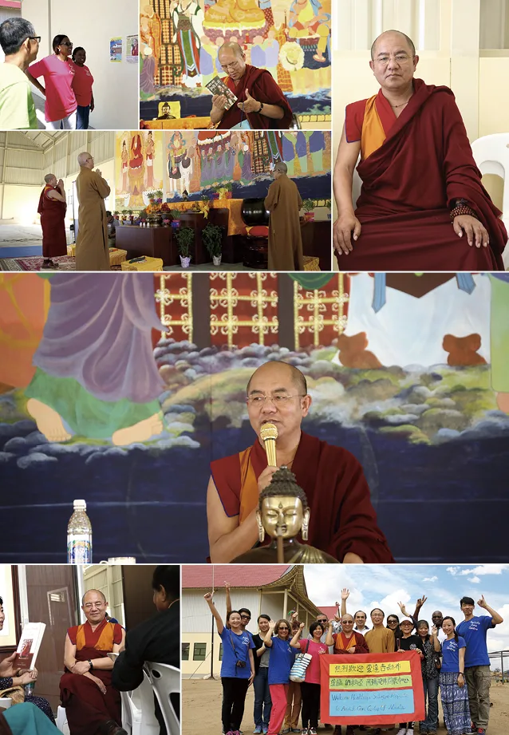
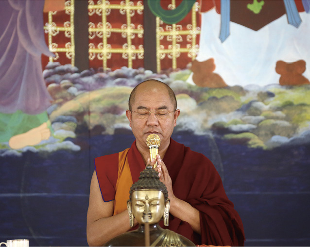
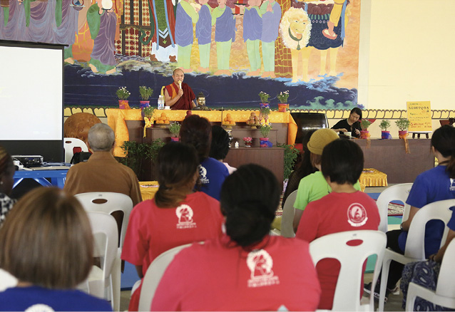
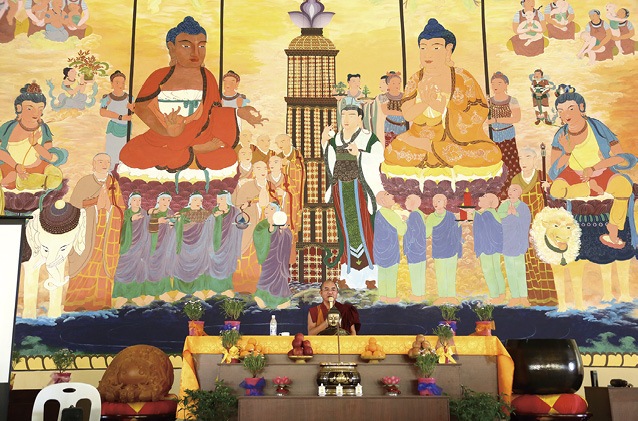
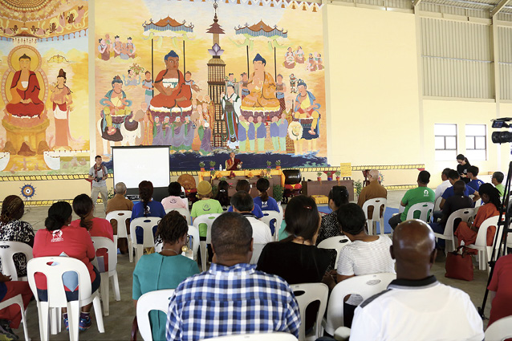
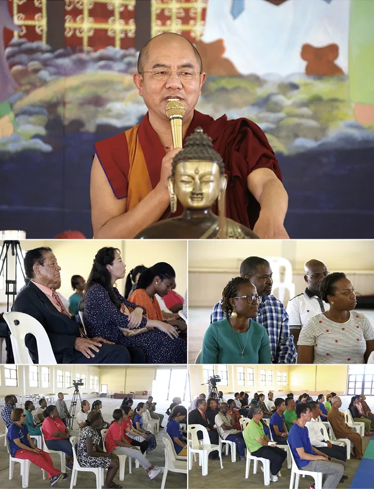

如果我们今天帮助他，  
他将来也许会帮助许许多多人。  
命运依靠善心是可以改变的。

第47场

纳米比亚ACC阿弥陀佛关怀中心

Amitofo Care Center, Namibia

纳米比亚

2015 / 11 / 5

## 改变自他命运的方法

## Ways to Change Your Fate

主持人：

大家早安！今天很高兴邀请上师到ACC为大家做演讲，与我们分享对生活与生命的感悟。一会儿听上师开示的时候，希望大家也能对生命做一下思考。

首先，邀请我们的大家长慧礼法师为大家做开示，让我们掌声欢迎——

慧礼法师：

今天我们纳米比亚ACC非常荣幸，也非常高兴有机缘见到上师。上师弘法心切，悲心悲愿，不请自来，主动跑到我们非洲纳米比亚ACC来，成为我们的不请之友。假如我们主动邀请上师，肯定是请不动的。

今天，仁波切不远千里来到这里，与ACC的成员以及在座每位有缘的佛友、朋友交流。相信一定会给大家带来喜悦、启示和加持。希望大家能不断地精进学法，在佛道上继续前行。

事实上，纳米比亚ACC的近况有点凄凉。因为我们面对政府的一些法令时，很多症结都无法突破，以致现在只剩下几只小猫。不过，只要有一个众生未度，绝不会逃掉，这是每一位菩萨的心愿。我相信，即使台下只有几只小猫，上师一样会非常珍爱。

希望大家能以千年不遇、千载难逢、极为难得的心态，珍惜这次机缘。也请上师一会儿给大家鼓励、加持一下。

在ACC处于非常低迷、很多事情无法突破的时候，请上师过来，我们心里很过意不去。但也想让上师知道，我们在非洲无论遇到再多困难，无论爬再高的山，都会一直坚持下去，一件事一件事地解决，一步一步地攀登。

虽然高山挡在面前，但只要我们坚持不懈，坦途终会到来。黎明到来之前总是黑暗，光明到来之前，必定要经历漫长黑暗的考验。

ACC倾注了很多人的心血，太多捐款人都对我们满怀期待。现在，这些压力都压在大家的身上和心里，一直无法释怀。今天上师来到这里，带给我们祝福、信心和勇气，这让我和工作伙伴再度燃起了希望，感谢上师！

下面，恭请上师为大家开示。阿弥陀佛！

大悲摄受具诤浊世刹，尔后发下五百广大愿，

赞如白莲闻名不退转，恭敬顶礼本师大悲尊。

尊敬的法师、在座的同修，大家上午好。以殊胜的因缘，今天我与你们在纳米比亚ACC相聚。

## 菩提心能超越一切违缘

由于一些原因，有些学生现在还没有到位，但以我的眼光来看，大家不畏艰难，对未来充满希望，并且拥有强大的团队精神，这些都非常值得赞叹。你们走过的路，不管从哪方面讲，都非常不容易，不仅需要跋山涉水，还需要越过重重险阻。在弘法利生的过程中，包括我本人也是，经常接触到很多阴暗面，遭遇各种阻碍，但不管怎么样，我们都应该勇往直前。

我来到非洲之后，看到这里有那么多孤儿和艾滋病患者，很多国际组织都在救援，而我们佛教徒做得确实不够。前一段时间我一直在打听，看看有没有佛教团体在发心救助。但除了你们以外，几乎没有。你们ACC整个团队，无论在纳米比亚、南非，还是莱索托，都无条件地付出和奉献，这种精神让人非常敬佩。

我一直在想，按照大乘佛教的发心，很多大施主和大法师都应该关注到这里的可怜众生，但为什么他们没有看到呢？昨天，我和一位熟悉的堪布通电话，我说：“真正的佛教徒在这里办学的寥寥无几，这非常令人遗憾。虽然在古人眼里，非洲这片土地离我们很遥远，但在科技发达的今天，去非洲也不算太远，坐十二个小时飞机就可以到达。”

有时我会想，这种现象，也许是佛教讲的因缘和业力现前，但更多可能是缘于大乘佛教徒发的菩提心还不到位。现在，很多伊斯兰教和基督教教徒，都在这里办学做慈善。既然他们能做，我们佛教徒为什么不能做呢？正因为我们做得很少，所以不少非洲人都对佛教抱有看法。

我非常希望，从现在开始，我们佛教徒也能在非洲办学校、医院、孤儿院，以及一些慈善机构，以此帮助更多人。我在纳米比亚和南非，见到很多ACC的义工，他们有些是佛教徒，有些不是佛教徒，只是佛教爱好者。他们救助孤儿并抚养这些孩子，非常不容易，因为不但要照顾孩子们的身体，还要培养他们的心灵，使他们的身心一点点成长，最后变成有智慧、有道德的人。这项育人工程非常庞大，我确实发自内心地随喜。

## 稳定团队，才能更好利他

接下来，我讲一下组建发心团队的重要性。如果佛教徒自己修行，在自己的寮房或者一个寂静处独修即可。但如果想做很多有组织性、社会性的慈善活动，则必须有很多人参与，构建一个团队。否则，单单一位法师或一个善心人不可能做成什么大事。希望在这个过程中，很多善男信女能放下自身的琐事，全心投入这项事业当中，这一点非常重要。

我发现，在ACC发心一两年的人比较多，长期发心的比较少。实际上，在一个灵魂人物的周围，需要有一些长期发心的人员，这对团队的稳定非常重要。

## “不离”上师

前一段时间，我去了英国阿贡仁波切的佛教中心，那里有些人跟随上师长达47年。我听后很惊讶，后来了解，他们从17岁就一直跟着上师，现在上师虽然已经圆寂了，但这些弟子继承了上师的事业，一直不断在做。

我很希望，ACC的人跟随法师的时间能长一点。这样法师就能了解你们的性格、信用和能力，彼此一起更好地做事。虽然你们一路上会遇到各种状况，有时非常快乐，就像走在开阔的草原上，有时特别痛苦，如同陷入危险的沼泽中，但不管怎么样，最好能陪伴法师一直走下去，按照佛教的说法，这是真正的依止上师、不离上师。

我在1985年见到法王晋美彭措之后，就一直跟随、依止法王。依止的过程中，也常会遇到困难，比如，上师显现上不高兴、自己受委屈等等，有各种各样的情况。但自己一直坚持留在上师身边，为上师的事业做各种发心。上师2004年圆寂之后，我仍然留在上师的道场一直努力发心。法王圆寂十周年的时候，我把法王的一些教言编成了一本书，名叫《不离》。最近，该书的英文版本也出版发行了，这次他们拿了一些过来。

以我个人的经验看，所谓依止上师，不一定是指上师活着的时候，向他供养好吃的、好穿的，或者钱财等，因为出家人的生活非常简单。更重要的依止是关心上师的事业，一旦上师离开之后，应将上师最在意、倾尽一生所做的事业继承下去。我认为这才是真正的不离上师。

这次我到非洲之后，好几次梦到上师。有时很高兴，有时则有些悲伤，因为看到非洲有这么多可怜的孤儿，自己却没能帮上多少忙。

## 历事才能练心

我以前去过很多发达国家和世界著名院校，现在只记得自己曾经去过，没留下太深的印象，但这次来非洲却给我留下了一生难忘的印象。

我觉得作为大乘佛教徒，很有必要来非洲磨炼一下自心，看看自己到底修得怎么样。我平时在课堂上，或者与别人交流的时候，经常劝大家一定要发菩提心、要度化无量无边的众生。当我面前真有一些苦难众生的时候，才能看出自己对他们的关心程度到底如何，进而检验出自己的修行。

大家这样发心虽然比较累，但我觉得，这样的付出非常值得。虽然最终结果有时成功，有时不一定成功，但只要自己付出时内心很单纯、清净，没有任何自私自利心，那么对自他来讲，都是一种安慰。

此外，坚持也很重要，刚才法师也说，曙光来临之前，天地漆黑一片。只要我们不断摸索、一直努力，最后肯定会有见到光明的机会。做任何一件重要的事，都很难顺顺利利，不遇到任何阻碍，正所谓“道高一尺，魔高一丈”，尤其我们在这种环境中做善事，更加不易。

## 善心终得善果

善心的力量不可思议，只要我们怀有一颗善心，有一种坚定的誓愿，并不断努力，成果一定会逐渐显露出来。就像在地里撒下种子，虽然暂时看不到什么，但因缘积聚之后，种子就会慢慢发芽、开花、结果。

下面，我为大家讲一个发善心得善果的真实故事。有一部名为《中央车站》的巴西电影，男主角名叫文尼斯基。这部电影在上世纪90年代上映，当时荣获了柏林电影节大奖等很多奖项。虽然电影很出名，但很多人都不知道男主角的身份及其背后发生的精彩故事。

为了筹拍这部电影，导演需要找一位看上去非常善良的小伙子做主演。他去了很多艺术院校，但始终没有找到合适的人选。

有一天，他从火车站往回走，这时路边有一名十多岁的男孩对他说：“先生，您需不需要擦鞋？”导演看到自己的鞋很干净，便摇摇头说：“不用。”男孩跟在导演的后面央求说：“先生，您可不可以借给我一点钱？我今天一整天都没有擦到鞋，所以没吃到一口饭，现在肚子特别饿。如果您能借给我一点钱，我会在一个礼拜当中使劲擦鞋挣钱，把钱还给您的。”

导演并不相信男孩会还钱给他，但他还是从兜里拿出几块钱给了男孩。半个月之后，这位导演又一次路过这里，这时他早已忘记了男孩向他借钱的事，因为他对这种事早已司空见惯了。然而，令他没想到的是，这一次男孩又跟着他，拿出几元钱对他说：“先生先生，我是来还您钱的。”

导演听到非常惊讶，转身仔细打量了一下男孩。这时他发现，这个孩子的长相基本符合他电影主角的各项要求。他被男孩讲信用的行为感动，便对男孩说：“你明天到我电影公司来一趟，我会和你分享好东西，给你一个惊喜。”接着，他就把公司具体地址告诉了男孩。

令导演没想到的是，第二天，男孩带了一群流浪孩子到他那里，祈求说：“这些孩子和我一样没有父母，在街上流浪乞讨。如果您有好东西可以分享，请先照顾他们好吗？我愿把机会留给他们，因为他们比我更可怜。”

本来导演找演员有很多考核要求，但最后，导演签字让男孩成为他电影的主角。他在审核一栏中只写了一句话：这个男孩具有善良的心，不需要考核。

后来，这个在火车站擦鞋的小男孩，成为一位国际知名的电影演员，并建立了一家影视公司。他还写了一本名叫《我的演艺生涯》的书。书中讲述了他怎样遇到这位善良的导演，由此改变命运的整个过程。

我很喜欢这个故事。表面上看，一个孤儿无依无靠，没有什么能力，但如果我们今天帮助他，他将来也许会帮助许许多多人。命运依靠善心是可以改变的。

## 给予帮助，也是给予重生机会

我们办学校或者做慈善，有时能看到结果，有时看不到结果；有时自己的付出后人会发现，有时后人没发现，甚至当事人自己都不知道。但不管怎么样，我们今天给予别人帮助，对方依此机会可能就会改变原先悲惨的命运。

按照机械论的观点，任何事物，包括阳光、温度，以及人的很多行为等都是注定的、不可改变的。但这种说法并不合理。佛教认为，人的命运主要是前世许多善业和恶业的延续，但今生当中，其他人对自己的帮助，外缘的变化等因素，对改变命运也会起到作用。

在座各位来非洲工作的目的，与那些来非洲创办公司、做生意的华人完全不同。他们是为了追求经济利益，而我们则注重爱的付出，希望更多人获得快乐。我们所希求的结果，也许今生能看到，也许今生看不到，但不管怎么样，我觉得这种付出非常有意义。

后天我就要离开非洲，途经日本返回中国。在非洲期间，给ACC各国家的团队添了很多麻烦，特别感谢大家！

## 愿大，力就大

我们结上特殊因缘之后，未来还要力所能及地进一步去做。佛教徒常说“愿大，力就大”，只要我们有共同的发愿，不存自私自利心，相信很多愿望都会实现。地藏王菩萨说“地狱不空，誓不成佛”，我们应该随学这种精神，在恶劣的环境中长期度化、利益可怜的众生。即使不能利益很多人，哪怕在很长时间中只改变一个人的命运，也是非常值得的。

当然，从个人安全和自我执著方面讲，很多人都不愿来这里，不愿长期待在这里。其实，这也是与自私心挂钩的。最近，我在佛学院讲弥勒菩萨的《大乘经庄严论》，注疏中说：作为大乘佛子，为使一个众生心里生起善心，在千百劫中苦行也不应生起厌烦心。这句话的意义非常深。我们作为大乘佛教徒，一定要好好思维。

最后，希望大家能继续不断努力。帮助和改变更多人的命运，这是我们每个人的责任。我们应该共同发愿，共同行持六度万行。谢谢大家！

主持人：

感谢以外，还是感谢！前面法师说，上师生生世世都在不懈努力地度化众生。上师慈心悲愿，今生不但在先进国家不断利众，乐说无碍，而且不舍任何一个众生，能够看到非洲众生的需求。上师不顾非洲的贫穷、破败，主动来到非洲，带给我们莫大的鼓舞。

希望ACC的团队成员，以及今天有缘听闻佛法的每位道友，都能以上师为楷模，未来在道业上、修行上、佛学造诣等方面不断努力，不断精进。

再次感谢上师！

现场互动

主持人：

今天，向上师介绍一位我们团队的成员。ACC能来到纳米比亚登记组织、取得土地，离不开他的牵线、鼓励和支持。下面我们请他说几句话。

嘉宾：

非常感谢慧礼法师，非常欢迎堪布来到纳米比亚。过去也有藏地的仁波切来到这里，您是第三位。十分欢迎您来我们的国家。

纳米比亚位于非洲的西南部，是非洲大陆最封闭的角落。在殖民统治时期，没有人进得来，也没有人出得去。我听了堪布昨晚和今天的讲座，我想您已经体会到这里的人们对于知识的渴望。

我们独立已有25年了。最初建国时，只有三个人能讲英语。您昨天与他们进行了交流，他们现在用英文交流已经没有任何障碍，这表明我们实现了一个飞跃。

我们希望堪布的非洲弘法也能实现一个飞跃。慧礼法师在这里建立了ACC，ACC主要面向小朋友，我们希望堪布能在此基础上不断扩展，将其打造成一个佛教资源中心，实现一种飞跃。

如您所说，在非洲，尤其在纳米比亚这个非洲角落，人们对佛法是很陌生的。慧礼法师曾说，要让这里的人们懂得佛法，还存在诸多问题。但难归难，只要有坚持不懈的决心，我们一定能够克服这些困难。

如果我们从全局出发看待问题，首要任务是要给所有的孩子提供教育，接下来需要让整个社区参与进来，参与的方式是将这里变成一个资源中心。我们团队里有大学教授，他们的知识资源比较丰富，会把书本里蕴藏的丰富知识，结合人们的需求加以广泛传播，我对此十分感激！因为除了通过学习，人们没有其他获取知识的方式。此外，我们还需要自我转变和自我发现，而佛教恰恰能提供这一切。

最后我想说，请堪布帮助慧礼法师，将这里打造成一个佛教知识中心，这样所有人都能从中获益。感谢您！

问：扎西德勒！我想请教一个问题。佛教所说的三宝，是哪三宝呢？

堪布：佛教的三宝是佛、法、僧。

问：请上师开示，什么是“法”？最后，我们该如何面对涅槃？

堪布：三宝当中的佛宝，是指觉悟者，如释迦牟尼佛；法宝，是指觉悟者留给我们的真言，它既是一种智慧遗产，也是一种慈悲遗产。这笔精神财富，即使到了现在21世纪，人们也享用不尽。所谓法，是改变的意思。佛法最主要的作用，就是改变我们的相续，解除我们心灵的烦恼和痛苦。

我们该怎样面对涅槃呢？普通人是面对死亡，成就者才会面对涅槃。成就者因为生死自在，故涅槃是自由的。作为一般世间人，应该提前对死亡做好准备。如果自己修行比较好，死的时候，可以自由自在地离开世间。
