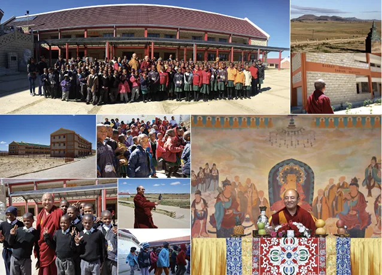
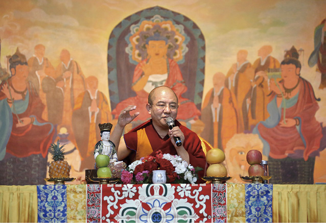
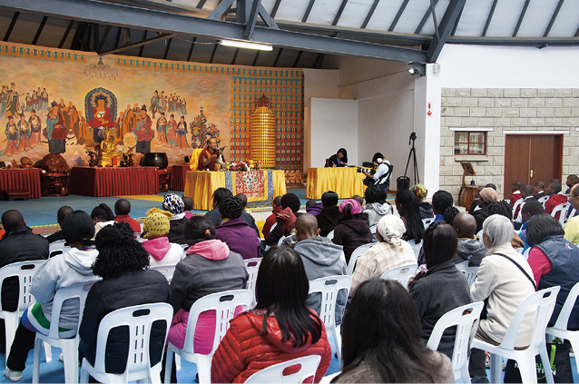
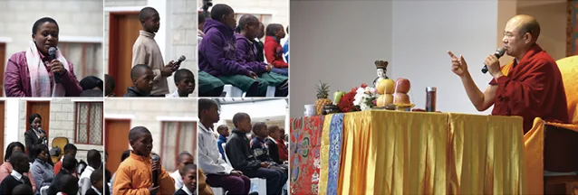
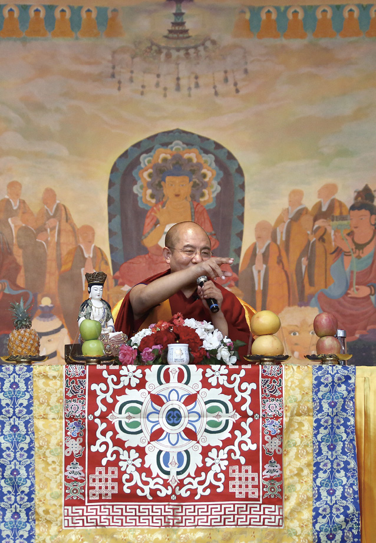
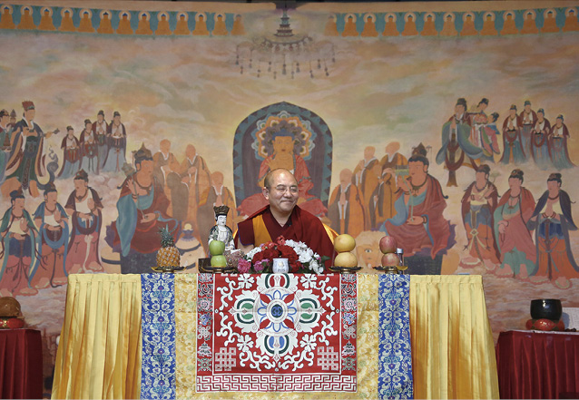

当我们亲身感受到，  
在同一片蓝天下，  
有人竟生活得如此贫困和艰难，  
悲悯之心便会自然增长。

第45场

莱索托ACC阿弥陀佛关怀中心

Amitofo Care Center, Lesotho

莱索托

2015 / 11 / 2

## 爱的传递

## Passage of Love

今天我们利用短短的时间，与ACC较高年级的学生、各位老师，以及发心义工们，做一次简单的交流。

首先，我很随喜来自各地的发心老师和义工团队，你们来到非洲这片土地，救助了这么多可怜的人。从大乘佛教的观点来讲，这种行为非常伟大。这种精神或者说贡献，不可磨灭。

## 让爱遍地开花

这次是我第一次来非洲。前些天我去了开普敦和其他一些城市，那里有很多华人，有些搞企业，有些搞其他投资。听说他们赚了很多钱，不过，我一点都不羡慕。我到这里之后，看到来自大陆和台湾等地的发心人员帮助了很多孤儿，发自内心地欢喜，觉得大家这样做非常有意义。

这种精神动力的重要来源之一，是你们的“和尚爸爸”。如果刚开始他没发这样的大心，很多孩子的命运不可能是今天这样。二十年、三十年，或者五十年之后，这些孩子的变化会更加明显。

也许到那时，和尚爸爸与在座的很多老师、义工已经离开了世间，但这些孩子却会分散在世界各地，有各自的家庭和事业。到那时，很多人才会知道前人付出的努力。

我看了孩子们学习和晨诵的内容。这些虽然现在看不出什么，但却是一笔无形的财富。在孩子未来的成长和生活当中，它们隐藏的珍贵价值将会愈发显露。

我认为，世界任何地方的人类，不管是黑种人，还是白种人、黄种人，都共同具有一个特点，即都需要爱。如果我们能传递爱、分享爱，就会让爱在世界每一个角落、每一个地方，开花结果。

当然，要培养一个人，说起来容易，做起来却非常难。就像对于任何一个艰深的道理，口头上夸夸其谈容易，实际去行持都会遇到很多困难。在座很多老师和义工长期在漫无边际、狂风四起的沙漠荒野当中，在资源极其匮乏的穷困地区坚持工作、无私奉献，非常值得赞叹。这种精神可称为菩萨精神，这种行为可称之为菩萨行。

在座有些发心人员很年轻，虽然自己的家庭、工作和生活都还没有确定下来，却来到这里为孩子们无私付出。我觉得这样做非常有意义。

## 发心，也是与人为善

不管你们能在这里待多久，都要学会与人融洽相处。我在佛学院从事管理工作，在管人的过程中，我觉得与人良好沟通、彼此理解和宽容非常重要。有了宽容心，才会有很好的发心利他机会。如果内心没有安忍力，无论在哪里，与人相处都会有一定困难。

希望你们不管在这里发心一两年、十年八年，或是更久，过程当中，一定要对上级领导随顺恭敬，与平级同事和睦相处，对学生或下属慈悲爱护。这是人与人相处的基本准则。你们来这里当义工的精神非常可嘉，但如果与人相处不好，也会给周围的人带来困扰。

## 苦难，给人带来更多启迪

我去过世界上很多繁华的城市，也去过不少大学，它们并没给我留下太多深刻的印象，但我去柬埔寨、泰国时，那里的难民、孤儿院和贫困学生，却给我留下了一生难忘的印象。所以我想，你们在非洲这种艰苦的环境中当义工，也许一生很难积累的经验，在这里都能得到。

一般来讲，当我们亲身感受到，在同一片蓝天下，有人竟生活得如此贫困和艰难，悲悯之心便会自然增长，前所未有的智慧和潜能也会被激发出来。所以，表面上看，很多人来这里是帮助别人，但其实自己才是最大的受益者，因为以此锻炼和提升了自己。就像佛教所讲的布施得财富的道理一样，每个人得到的，往往是帮助别人的过程中，无形的一种回馈。

我对世间各种甚深的道理，都很感兴趣，所以，非常愿意接触科学界和宗教界的顶尖人物，与他们一起探讨。在渴求真理的同时，我也喜欢接触一些非常贫穷、可怜的人群。大约十多年前，我走访过家乡一个极度贫穷的家庭。当我进门之后，眼前除了很小一袋糌粑和床上的病人之外，什么家具、食物、日常用品都没有。自从亲眼见到那种场景后，我在吃饭方面再也不挑剔了。我以前对饮食比较挑剔，经常觉得这个好吃，那个不好吃。从此之后，我觉得无论在哪里，只要有一口饭吃，无论好坏都可以。

不仅在我的家乡，在世界的其他地方，也有很多人过着那种生活。相比之下，我们对自己所拥有的一切应该感到满足，不应再有什么挑剔和抱怨。

所以，当我们走访一个贫困家庭，或者接触一个孤儿的时候，可以从他们的身上和生活中，得到一辈子在大学里都学不到的人生感悟。

## 善学立身

下面，我讲一下大家以后在学习过程中，需要注意的几点。

第一点，你们本地的老师和学生，一定要继承莱索托的本土文化，包括语言、文字、传统歌舞等，保留本民族的宗教思想、传统文化、风俗习惯极为重要。昨天，我看了男生和女生表演的传统歌舞，感觉非常精彩。

第二点，希望学生们以及本地的老师，都能尽量学习汉语。希望你们学汉语，并非想用汉文化冲击你们的文化，而是觉得这对你们的未来可能会有帮助。我曾去过美国和欧洲的一些国家，这些国家的很多人，包括一些王室和国家高层领导的孩子，上大学都会选择学汉语和英语。

英国著名的汤恩比博士，被誉为上个世纪最伟大的历史学家。他认为，未来汉语很可能成为世界通用的语言。如果到那时，你们都熟练掌握了汉语，将会为自己的人生开辟出更广阔的发展空间。

第三点，精通英文也非常重要。现今，不管到世界哪个地方，都可以用英文交流，包括坐飞机的时候，机组人员也会用英语做介绍。可以说，英文是全世界非常重要的主流语言。

孩子们学习语言时，不能只会说一些简单的口语就可以了，一定要深入进去，打好英文基础，加强口语和写作能力。希望我们的英文老师能够重视学生们的前途，在这方面多下功夫。

我昨天看表演时，发现孩子们的身体功夫确实不错，超乎想象。英国很多学校也有这样的练习。练就这样的功夫非常不容易。事实上，我们的语言和智慧，也可以这样磨炼出来。磨炼之后，世间任何困难、阻碍都可以被我们轻而易举地超越和接受。

总之，很有必要先从你们莱索托本民族的语言、文字、传统等学起，然后学习汉语、英语……按照学校总的要求去做。

## 以佛法提升自己

人全面开发自己非常重要。我听说在座的学生、义工，包括本土的教职人员，经常参加早上的念诵，并学习一些佛法方面的道理。这样做非常好，因为，佛教是调整心灵的一种非常实用的工具。

我刚刚去了英国一些著名的大学，比如牛津大学、剑桥大学和伦敦大学等。这些学校都设有佛学禅修中心或研究社。学校的许多教授、学生，以及其他工作人员，每天都会按照佛教的禅修方法做正念禅修。这样的禅修，给他们的人生带来了很大利益。

以前我听别人说过欧洲很多大学都有禅修，一个月前我去欧洲的时候，看到的情况的确如此。我采访了很多教授和学生，他们说佛教的教育真的改变了他们的人生。

我很希望我们这里的学生和老师，也能用佛法来提升自己。这里的创始人是佛教徒，现在安排了专门的法师带领大家唱诵和修行。这对你们来说是很难得的机遇，这种机遇花多少钱也买不到。

## 佛教具有圆融性

有些老师信仰本土宗教或者基督教等其他宗教，担心学佛会与自己的习惯或者所信教义冲突。其实不会冲突。佛教思想完全可以与任何宗教相圆融。我是一名佛教徒，又是佛教徒中的出家人，但我也会去基督教教堂，有时还与他们一起祈祷、点灯。

我觉得一个人不管信仰什么宗教，具有一颗超越的心非常有必要。因为，所有宗教都提倡“尊重、和平、关爱”等善的理念，劝导人们断恶行善。佛教亦是如此，佛经云：“诸恶莫作，诸善奉行，自净其意，是诸佛教。”意思是，尽量不做任何坏事，行持一切善法，将自己的心调整得非常清净，这就是佛教。

如果你是基督徒，可以看看这句话是否符合你们的教义；如果你信其他宗教，也可以衡量一下。只做好事，不做坏事，净化自己的内心，我觉得佛教的教义可以与世界所有真正的宗教相融合。当然，世间还有一些对人类身心有害的邪教，这个教义不一定与之契合。

很希望当地的老师能够了解、学习和修行佛法。这样，当你们在生活中遇到困难的时候，就会想到“这是业果造成的”“万法是无常的”“三宝会给我加持”等等。这些佛法的道理可以平息内心的烦恼和痛苦，使心变得安详和快乐，最终转变我们的人生。

## 两点希望

最后，我提两点希望：一是希望发心老师能每天写非洲工作日记，这会对你们的人生很有意义。包括我们的学生，以后听讲座的时候最好学会记笔记。我在藏地几所学校当中，都要求高年级的学生，不管任何老师讲课，都应该记笔记。这对学习很有帮助。

我们经历过很多精彩的瞬间，但过一段时间大多都忘记了。如果你们能把在非洲期间经历过的事情每天记录下来，哪怕跟别人吵架也写下来，几十年以后再翻看，也会觉得很有意义。如果最终写成一本书，后人看了也会受启发。

第二点，希望我们佛教老师，能为其他的老师、孩子以及义工们讲一些佛学方面的课。我们不但要念诵经文，也要懂得意思。我昨天看到你们《心经》念得非常好，但是否懂得经文的含义呢？如果不懂，就会产生很多疑惑：“为什么《心经》说眼耳鼻舌身都没有呢？我们明明有啊？佛教到底讲了什么呢？”所以，老师懂得佛经的内容非常重要，自己理解之后，就会向孩子们解释：胜义当中，眼耳鼻舌身都没有，但在世俗当中，一切都存在，我也有，你也有。

孩童时期的教育非常重要。希望法师们带领孩子念诵的同时，也能为他们一步一步解释经文的意义，并且讲一些十善、六波罗蜜多等道理。这样孩子们长大之后，自然而然就会理解佛法的教义。

念诵有时就像唱歌一样，虽然有功德，但更重要的是理解佛法的教义，而这需要从教育入手。所以，很希望我们的法师和其他老师，能让孩子们了解佛教所说的基本的做人道理和一些佛学常用名词。最好能让孩子们从小就学，否则，他们很快就要毕业了。

如果一年当中没讲任何课，只是一起念《心经》，就会像现在很多佛教徒一样，虽然一辈子念《心经》，但却不懂其中的意思。我遇见过一个人，他念了二十多年《心经》。我问他：“为什么经中说没有眼耳鼻舌身呢？这怎样解释？”他回答：“我也不知道，反正喜欢，就一直念。”这样学佛是不够的，希望大家一定要懂得经文的意思。

一会儿是提问环节，很期待非洲人向我提问题，当然，中国人有问题也完全可以提。大家提任何问题都可以。

现场互动

问：我在ACC工作，非常感谢您为我们做的一切。我们很想听佛法，但有时不那么容易，现在，您为我们创造了这个机缘，非常感谢！您教授的佛法内容，对于我们自身的问题很有启发。我还想知道，佛教本身除了是宗教，还是什么呢？因为您刚才提到，佛教和其他宗教是相融的。

堪布：佛教的确可以与任何宗教相圆融。佛教不但是世界五大宗教之一，从某种意义上讲，它也是一种教育。这种教育可以启迪人的内心创造奇迹，在洗掉心灵垢染的同时，引导自心向真善美的方向发展。

问：请问佛教里面讲过猫头鹰吗？它是一种好的鸟，还是坏的鸟呢？

堪布：世间有些人认为猫头鹰是好的动物，因为它很有善巧方便，会根据不同的境遇，发挥自己不同的特长。比如，它看到鸟类时，会向鸟儿展示自己的翅膀；看到野兽时，会向它们伸出自己的爪子。但有些人认为，猫头鹰是很假的两面派，比较坏。也有些人说它是一种比较特殊的鸟，有各种不同的说法。佛教认为猫头鹰是一种比较好的鸟。

问：我们经常对孩子们说：如果你们唱诵佛经，生活中就会受到龙天护法的保护。请问佛教到底有没有龙天护法？它们是什么样的众生？

堪布：佛经当中经常讲天龙八部。天龙八部里面有一部分世间神，他们是以一种非人的形象来帮助我们。包括四大天王以及很多天子，都会保护我们的国家和人民。佛教寺院当中，一般都有四大天王的塑像及其修法。

天龙八部中还有一些龙王。佛经中有专门对龙王们讲的经，如《海龙王请问经》等。每一个水泉都由大大小小的龙掌控着，就像每一方土地都由土地神掌控一样。龙特别喜欢干净，我们保持水源干净，是对龙王的一种尊重。

佛教徒做供养和布施的时候，需要念一些专门的偈颂。念这些偈颂，会对整个天龙八部有所帮助。这个世界上无形的众生非常多，虽然我们眼睛看不见，但要相信他们的存在。

堪布：请校长帮我问这里的一位老师，让他讲一下对佛教的看法好吗？另外，我还想请一位学生告诉我他的理想是什么？这是我对本土的老师和学生分别提的两个问题，希望有人能回答。

校长：OK！大家好！我是这里的校长。我觉得佛教不仅可以规范孩子们在校园的行为，更能教导孩子们怎样做一个好人。

这些孩子是七年级的学生。刚才上师问你们，长大了志愿做什么？谁能回答一下？不要害羞啊，来，站起来说说你们的理想。

一位学生：我以后想当护士。

校长：为什么要当护士？当护士很累哦，你不怕累吗？

学生：不怕。

校长：很好，谢谢你。希望大家不要害羞，大声说出自己的理想。昨天很多人跳得那么高，你们不但身体要超越，心也要超越知道吗？要大胆，用英语或汉语说都可以。

另一位学生：我以后想当一名医生。

校长：为什么？

学生：我想帮助生命。

校长：噢，很好！汉族这边的义工老师，你们有什么问题也可以跟大家交流。

堪布：今天大家变得好害羞噢，可能突然涉及提问，没有提前做准备。有一次，我在我的学校里面，让老师和学生们提问，当时谁都不提。我说，下一次也可以向我提问，这样你们就能提前做一些准备。结果下一次他们的问题多得不得了，最后我都回答不完。

校长：上师，他们原本有很多问题，可能现在一下子想不出来。

某老师：感谢您！我是一名老师，刚才听了您的开示之后，我认识到佛法教言非常珍贵，它不仅对我们的当下有利益，还能帮我们打造美好的未来。我对佛法非常感兴趣。请问怎样才能学到佛法？

堪布：我学习、研究佛法很多年了，与此同时，对世界其他宗教以及科学原理，也很感兴趣。我深深感到，佛教对于人的一生非常重要，它可以引导我们前行，让心中描绘的美好蓝图最终成真。

佛教与现代心灵科学、人文科学，包括量子物理学等各种科学理论，都可以融合，这说明，佛教完全跟得上科学的脚步。

学习佛法应该循序渐进，最好从基础的人身难得、寿命无常、轮回痛苦，以及大乘佛教的发菩提心等学起。虽然学佛需要花费一些时间，但这对你们的生活非常有帮助。很希望我们的老师们以后能够多了解。

你们将来也许有很多赚钱机会，每天非常忙碌，但内心却不一定快乐。现在很多人都是这样，越有钱越感受不到快乐，而通过佛教的禅修等方法，却可以使自己真正快乐起来。

学佛，不仅可以使我们今生快乐无忧，通过对未来的一些殊胜发愿，比如念《普贤行愿品》，可以使自己生生世世都不离快乐。

《普贤行愿品》是最大的愿王，如果理解起来有一定困难，可以从《十善业道经》学起。此经劝导人们断除十不善业、行持十善法，以此规范自己的身语意。

虽然这些是佛教的说法，但实际上，任何国家的人都应该行持十善，断除十不善。否则，不管什么人都会遭受痛苦。所以，从《十善业道经》学起，对你们的今生来世将会非常有帮助。
