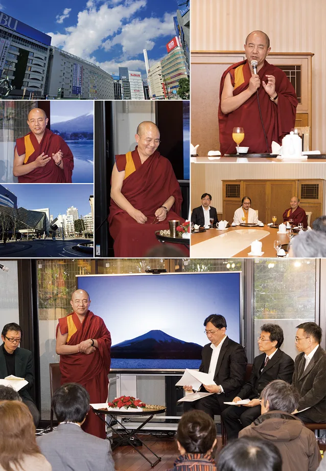
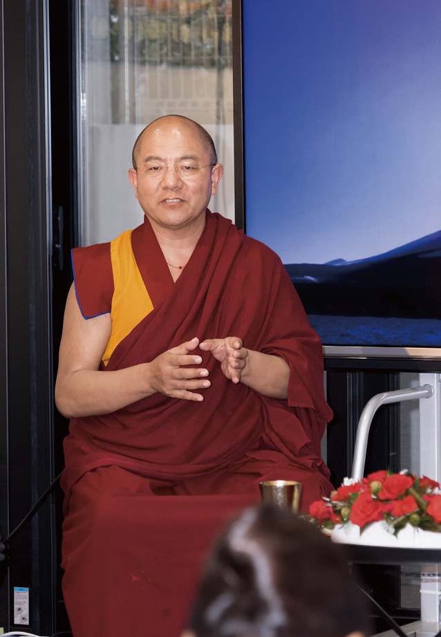
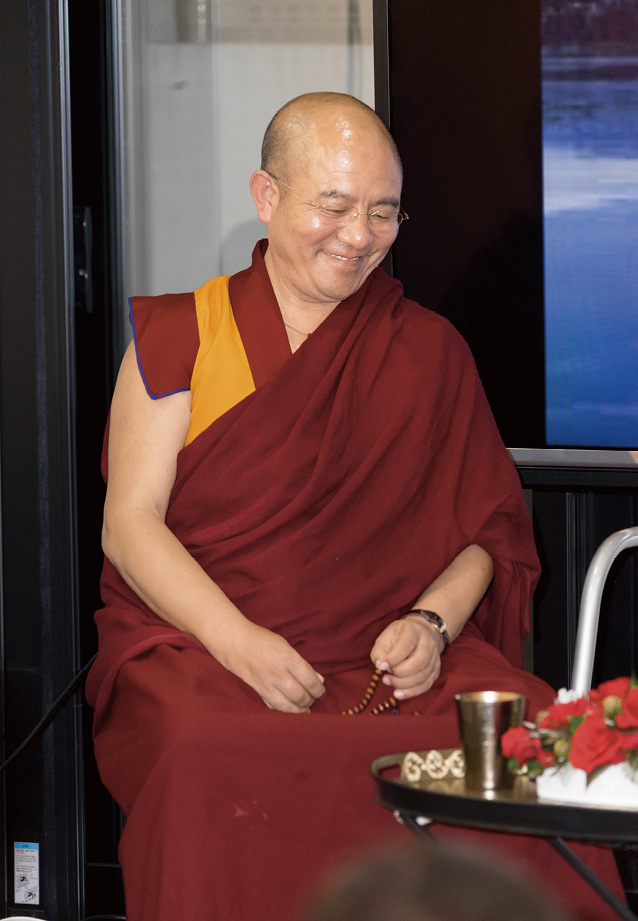
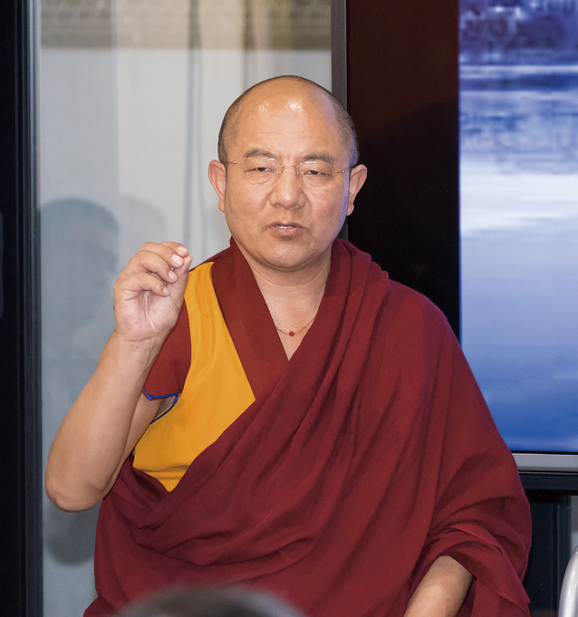
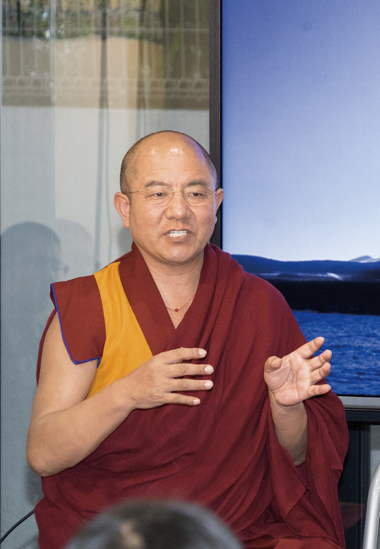
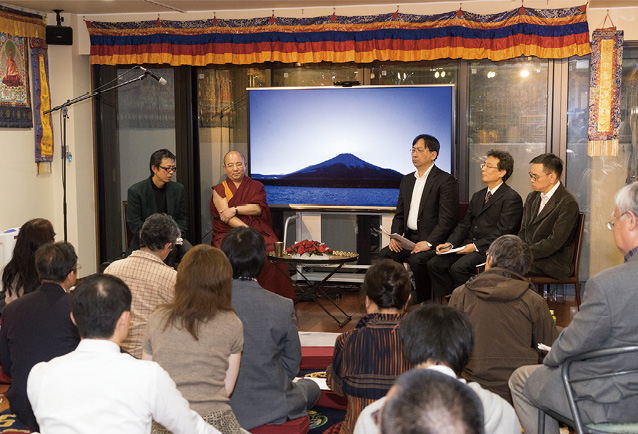

减少对自我的执著，  
扩展帮助别人的爱心，  
自杀的念头自然就会消失。

第50场

日本自杀者论坛

Suicide Forum, Japan

日本·东京

2015 / 11 / 14

## 珍爱生命的玫瑰花

## Cherish Life: a Rose Story

主持人：

今天我们非常荣幸邀请到索达吉堪布。早上我们接受了堪布的建议，请来三位精神科方面的专家和医生，为大家汇报来自日本第一线的情况。这可以让大家对日本自杀者的现状有一个了解。

索达吉堪布：

我这次来日本，有机会和大家一起探讨“生命的珍贵性”这个话题，感到很高兴。

我虽然生活在中国藏地，但接触过很多其他国家、民族的各界人士。过程中，感觉每个人都对“生命的珍贵性”非常关注。我想，如何对自他唯一具有的生命进行保护，应该有很多方面可以研究，值得医学界、宗教人士，以及其他各界人士共同探讨。

今天的机会非常难得，我特别想听听各位专家和医生的观点，因为你们在这方面有专门的研究和实践经验。多年以来，我也非常关心人类和所有动物的生命，所以你们讲完之后，我也想谈谈自己的观点。

川崎医生：

我先做自我介绍，我叫川崎，来自京都宇治，是一位精神科医生，我旁边的言角先生是从大阪过来的。

我们准备了四张表，它们是日本厚生劳动省发布的日本目前自杀情况的资料。首先，让我们看一下自杀的人数。现在日本每年有很多人死于自杀，并且数字一直攀升，最多一年超过了34,000人。最近几年，由于国家做了一些努力，自杀人数有所减少，但即使这样，每年也有25,000多人死于自杀。虽然现在没有战争，却有这么多人非正常死亡，这是非常令人遗憾的。

虽然最近几年，自杀的人数降低了，但企图自杀的人数却处于上升趋势，每年有7万多人。他们因被及时送往医院抢救，才得以幸免。这些人为什么想自杀呢？70%都是精神上遇到了很大障碍，比如，得了抑郁症、综合失调症、无法适应社会等等。

现今日本没有战争，人们生活得也不错，但很多日本人精神上却出了大问题，这导致自杀率高居不下。我们不知道怎样改变这一现状，很希望得到仁波切的开示。

下面，让我们看一下来自医疗第一线冈崎医生的报告，他来自京都宇治，毕业于医科大学，现在是一名精神科医生，做了三年精神方面的临床研究。他们医院的精神科现有200张床位。

1991年日本经济泡沫破灭，整个日本社会陷入一片恐慌，自此，自杀率开始不断上升。其中，男性自杀率的上升幅度显著高于女性。

在日本，人们生活和工作都特别忙，起初，这件事并未引起大家注意。过了很长时间之后，人们才渐渐意识到，日本的自杀率已经这么高了。政府对此采取了一些措施，比如，建立精神病医院，医院设立精神科、急救中心等等。

自杀属于精神科的治疗范围。京都医院的精神科收治了很多自杀患者。医院会为患者提供基本的咨询，同时承担急救任务，此外，还会提供一个轻松、良好的环境。救助方式基本上是在医院短时间治疗之后，回去继续做康复治疗，让患者逐渐恢复原来的生活。看得出来，这样治疗的效果还是不错的。

冈崎医生认为，最好探讨一下人为什么会得抑郁症，为什么会自杀。虽然长时间工作、家庭压力、酗酒过度等是一部分原因，但可能还有其他原因，应该是很多因素综合在一起导致人抑郁或自杀的。

通过专业人员治疗之后，很多人的病情得到改善，有一定效果，但也有很多复发的。若能及时发现、及早治疗，整体效果还是不错的。

不过，企图自杀的问题并不容易解决。政府部门、各个机构、医院精神科的所有努力，并没有使企图自杀的人数减少，新的自杀者一直不断出现。此外，很多自杀患者都没有得到根治，他们处于顺境还好一些，一旦遇到不顺，马上又想自杀，承受不起一点挫折。尤其日本的男性，这种倾向特别明显。日本一向有切腹自杀的独特文化，这对他们多少会有一些影响。

冈崎医生观察发现，人一旦得了抑郁症，就会不停地思考，身体特别容易疲劳，晚上睡不着觉，内心深感绝望，最后，很多人选择了自杀。

此外，日本饮酒多的地区，得抑郁症而自杀的比例都比较高。在日本买酒很容易，在便利店就可以轻易得到。很多人在遇到工作压力或其他难题时，就会喝点小酒来麻醉自己，这样逐渐就会养成酗酒的坏习惯。很多抑郁症患者都长期依赖酒精，心情一不好就喝酒，造成一种恶性循环。

再者，内心的创伤也是导致自杀的一个主要原因。从自杀数量看，男性比较多，但从企图自杀的角度看，则女性占多数，可能因为女性治愈创伤的能力比较弱。

很多人在童年时，遭受到过较大的精神创伤。比如，小时候遭受了家庭暴力，身体受过一些伤害；父母关系不好，经常吵架；父母有一方酗酒或者得了抑郁症，郁郁寡欢；父母对孩子漠不关心，没有家庭温暖，等等。这些对孩子的伤害都很大，会影响他们的一生。

当然，还有很多内心的创伤是由综合因素造成的。比如，有些人内心一直处于紧张不安的状态，这造成了他们对自我的否定，觉得“我不行，没有这个，我活不下去……”很多时候，他们会通过喝酒来缓解内心的紧张和焦虑。但这不但解决不了问题，反而是一种伤害。因为喝酒之后，人容易丧失理智，这种情况下，长期蓄积的痛苦会一下子爆发出来，瞬间产生自杀的想法并付诸行动。对于有精神创伤的人来说，药物治疗好像没有什么效果，只有治愈心灵的创伤，才能打消他自杀的想法。

其实，这个问题也可以从日本共有的传统文化和地缘价值观方面分析。2011年的日本海啸和大地震，给日本人的内心刻下了一道很深的伤痕。海啸摧毁了核电站，造成了核泄漏，整个日本社会对此深感不安，恐慌和紧张情绪一直延续至今。最近，由于全球气候变暖，台风和大规模水灾频频出现。按照佛教的观点，出现地水火风的灾害，也是由人心不安导致的。

事实上，这些天灾并非最近才降临日本，日本是一个岛国，自古至今自然灾害就一直不断。伴随灾害而来的，是人们内心和精神上的不安，这种不安一直渗入到日本人的生活。

因此，日本人在面对自然灾害的时候，会有一个共同的意识，即要相互帮助，以家族和家庭为中心，所有人形成一个命运共同体……彼此有一种心理上的链接。用日本话来讲，就是求“和”。

日本是一个求“和”的国家，即以和为贵。相互协调是日本人信守的思考和行为模式。正因如此，大多数日本人并不像欧美人那样，追求自我主张，或者张扬自我个性。日本人的生活方式基本是以一个群体为主，齐心协力、和谐共处。从日本语言具有的共通性，也可以看出这一点。这样的生命群体，基本上是以一种同种、同治的方式生活，所以，日本不太可能变成一个移民社会。

对于一些约定俗成、共同信守的价值观，大家都会很自觉地遵守。稍微出现一些不和谐或者不一样的主张，大家就会非常警惕和不安，这就是日本的特色。在这种社会氛围中，只要自己顺从，就能与大家和谐相处，而一旦哪一天你与这个群体不一样了，就很容易遭到排斥。到那时，你连跑的地方都没有，因为日本国土很小。

虽然日本人以和为贵，但每个人都不想成为生活和工作的失败者，故而也会相互竞争，彼此牵制，这是日本社会的一个潮流。在这样的社会氛围中生活，人的内心很容易紧张，精神也容易出现问题。日本人的紧张度和不安情绪，可能比其他国家的人都要高一些。

以上是日本的一些传统现象，但随着大众媒体的影响，近几年也有一些变化，比如，出现了很多喜欢待在家里的“宅男宅女”。他们在家里通过电脑、手机就可以与外界沟通，与有共同兴趣的人组成一个小团体，进入一个虚拟、非现实的空间，在里面找到一种共同需要。这种现象被称作大众文化。

本来社会交往需要人与人面对面地交流，但现在，大家更愿意待在家里，通过网络进入一种虚拟空间与人交流。但这种沟通方式有自身的弊端，会使人心变得越来越狭隘和脆弱。因为在虚拟空间中，大家很容易得到自我满足，这虽然看起来还不错，但实际上，基于一种共同爱好而形成的共同体，其意识是很狭隘的。当他们认为这种虚拟空间比现实生活好，长此以往习惯之后，再面对现实生活，内心就会变得非常脆弱，难以承受压力，并且行为也会逐渐与社会背道而驰，表现出强烈的攻击性。在这种情况下，很容易出现杀人或者自杀的现象。

如今在日本，追求自我、自私自利的人越来越多，这已成为日本社会一个很现实的问题。

以前，很多日本人都住在乡村，群体意识比较强。但现在，年轻人为了追求理想，获得自由，彰显自我，通常喜欢去城市生活。然而，城市人的共同体意识相对比较薄弱，人情也比较淡漠。一旦自己遇到经济问题，或者感到无助的时候，不能再依赖原有乡村式的共同体，一切都得靠自己，这样渐渐就发展成了金钱至上的拜金主义，把金钱视作解决个人困难的主要途径。

另外，以前在乡村，长辈都会为年轻人举办成人仪式。通过这种仪式，年轻人会感到自己已经成熟了。但都市没有这样的仪式，没有人关注你，一切都要靠自己。这使得个人感觉不到共同体的存在，连自己成长的确认，也成了一件困难的事。虽然最初来到城市，是为了追求理想，成为一个自由的人，但结果，反而变成了“自由的奴隶”，这是很多日本年轻人的现状。

传统上，日本人对于学佛的人、佛教徒或出家人，都非常尊重，但现在，想做到这一点似乎越来越困难了，因为多数人更崇尚自我。据统计，在整个亚洲，日本有信仰的人比例非常低。

日本传统社会共同体意识的淡薄，以及宗教信仰的缺失，导致日本社会越来越缺少规范性。日本人的精神承受能力也变得越来越弱，不但对自己缺乏信心，对整个社会也深感不安，经常陷于一种消极的意识当中。

虽说日本是一个民主自由的国家，但人们在实际生活中，却有很多不自由，受到很多约束和限制。大家比较容易排斥异端、异己，比如在说话、穿着等方面，稍微表现得不一样，就很容易受到大家的排斥。这是一种广泛的现象。

日本人在面对死亡方面，也存在一些问题。大家都比较忌讳谈论死亡，尽量回避这个问题。一般那些无法治疗、临近死亡的人，都会被送到养老院，在那里结束自己的生命。所以，人们在日常生活中，不容易看到人的死亡过程，不知道死亡到底是什么样。

日本人一般喜欢吃肉和海鲜，或者因为没有意识到那些是有生命的，或者因为对死亡痛苦了解的比较少，没有同理心所致。

大多数日本人都没在现实生活中看过死亡的过程，基本上都是从电影、电视或游戏当中了解的。但这与自己亲身体验的相差很大。因为缺乏这方面的学习和经验，导致我们不知道该怎样面对死亡，也不知道该如何关怀临终者。

总而言之，日本人已经逐渐远离了传统的生命共同体意识。这一现象会使人的内心产生很多困惑，不知道自己到底为什么活着？人生的价值和目标在哪里？这也是刚才两位医生的观点之一——日本人精神上的不安，也是由日本社会深层原因导致的。

对于这些深刻的问题，我们迫切希望得到仁波切的教诲，希望从中找到解决办法。

索达吉堪布：

我听了三位医生的经验报告之后，感觉我们很有必要在这方面进一步学习和研究。这样虽然不能完全断掉所有的自杀现象，但通过一些干预，应该会有机会降低自杀率。

在很多年前，我就听说过日本的自杀率很高，对此比较关心，也思考过这方面的问题。但在短短的时间内，想要解决这么大一个问题，肯定会面临诸多困难，因为它的因缘是综合性的，并非单一。

我对这一现象的调查、分析和研究，与几位医生的观点有相同之处，也有少许不同之处。下面我说一下自己的想法。

如今，整个日本的自杀现象确实令人触目惊心。刚才听川崎医生讲，日本每年自杀的人数有三万左右。这样算下来，每天都有八十几个人因自杀而失去生命。因为他们分散在各处，不被人们看见，所以人们感触不大，如果他们聚集在一起，我们能够看见，就会感到非常震撼。就像刚刚发生在法国巴黎的恐怖袭击事件，因为一百多人同时失去了生命，故而成为全世界极为关注的一件大事。日本一个人口不到两亿的岛国，如果每天都有一百多人自杀或企图自杀，细想起来是特别可怕的。

## 自杀率高的原因

日本自杀率这么高，依据我的分析，可能有以下几个原因：

一、个别人的自杀行为，也许与宗教有一定关系。

佛教对自杀行为有严厉的遮止，佛法中强调：一个人如果自杀，会产生一种堕罪，即有堕地狱的过失。基督教也不允许自杀，认为自杀者犯了杀人罪，以后不能上天堂。

但据我所知，日本有些原始圣教，对此不作任何遮止，甚至有些传承宣称自杀之后可以入于圣道，成为圣者，自此便会获得自由和幸福，如同进入天堂一样。因此，有些人选择了这条道路。

二、可能与日本的文化元素有一定关系。

这种文化元素，在中国的很多少数民族，包括我们藏族当中，经常出现。

比如，有些民族认为，在战场中不能失败，失败是一种耻辱，还不如死了好。他们持的观点是：光荣地死，胜过耻辱地活。

又如，藏地对出家人非常尊敬，一个家庭当中，如果孩子出家了，父母会特别高兴，但如果他后来还俗了，父母就会极其伤心，觉得宁可见到他出家身份的尸体，也不愿意见到他在家身份的活人。这是藏地的一种普遍文化。

中国还有一种文化，认为白发人送黑发人很不光荣。其实，不一定非要老年人先死，哪里都没有这样的规定，但这种文化已经深入人心。每个人都害怕这样耻辱的事情发生，一旦发生，就觉得没有面子活下去。

日本可能也有这样的文化，我以前看过一些日本电影，里面有切腹自尽的情节。从中可以看出，日本人对于所谓的“英雄”“光荣”特别崇尚，尤其一些老年人，认为这种文化至高无上，千万不能被毁，一旦毁坏，还不如死了好。现在的日本年轻人，虽然不一定像老一辈那么崇信，但也会受他们影响。一旦走投无路或者违规的时候，也会选择自杀。

三、与教育也有一定关系。

日本能在二战后迅猛崛起，离不开自身强大的战略思想。执政者为了维护统一的目标，必然要统一人们的思想，教育每个人一定要墨守规矩。

孩子从小就接受这样的教育：“我不能扰乱别人、麻烦别人，所有的事情必须自己承担。”因为被父母、老师、长辈不断灌输这种思想，他长大之后，即使自己实在承受不了，也不愿意扰乱别人、麻烦别人，这使得自己连一个哭诉的对境都没有，什么事只能闷在心里。最后实在承受不了，只能选择自杀这条路。有时候，我们的教育需要稍微放松一点，这样心就不会绷得那么紧。

四、与压力和社会竞争也有关。

当今时代，压力和竞争不仅在日本，在世界各地都存在。每个人，尤其是年轻人，需要面对各种竞争。在校学习要竞争，找工作要竞争，上班要竞争，升职也要竞争……一直竞争不断。而日本人都特别守时、守规则，非常认真努力，这样压力就会格外大。在这样艰难的竞争中，自己一旦赶不上别人，成了失败者，就会倍感耻辱。这时如果另寻发展，对于短暂的一生来讲，又有很多困难。很多人因为不愿以一个失败者的形象活着，所以最终选择离开这个世界。

五、很多人认为自杀、死亡是一种解脱，将其视为一种成就。

他们觉得活在人世间非常痛苦，有许多烦恼和困扰，一旦死亡，就可以获得解脱。这也许是受到宗教、文化，或者自己思想价值观等方面的影响，是综合因素造成的。

日本著名小说家川端康成，就是一个代表。他在1968年获得了诺贝尔文学奖，成为获得该项殊荣的第一位日本人。然而，他在获奖后的第三年，却采用口含煤气管的方式自杀，突然离开了人世间。

他在自己的传记中讲，他在三四岁时父母双亡，后来又接连遭受了很多痛苦，这些创伤给他心理造成了阴影，心情经常苦闷忧郁。为了摆脱痛苦，他一直刻苦学习，最后成为一名非常优秀的作家。他曾说过“无言的死，就是无限的活”，认为默默无言地离开人间，这是无限的光荣、最高的艺术。这是一种比较特殊的想法。

以上五点，是我分析的造成日本自杀率高的主要因素。

其实，现今不仅是日本，很多国家的自杀率都很高。我也关心过中国的自杀率。对此有不同的报道，有些说每年有十几万人自杀，有些说二十几万、三十几万。欧美国家的自杀率也在不断攀升。去年我去美国讲课的时候了解到，美国的自杀率也特别高。当今时代，各方面的压力非常大，这导致患抑郁症的人越来越多。不仅仅日本，乃至在全世界，自杀都成了越来越普遍的现象。

## 降低自杀率的几种方法

该怎样解决这个问题呢？我想，完全阻止自杀现象的发生，以前没做到，现在和以后同样做不到，但尽量减少，还是有办法的。以下几种方法也许会起到一定作用。

第一种方法，是刚才三位医生所讲的，即采用药物治疗、心理咨询等医疗方法，对患者的身体和心理进行治疗和调节，以恢复他们的身心健康，这样做非常重要。

第二种方法，是转变人们的观念。不管是在宗教当中，还是传统文化当中，凡是提倡主动结束自己生命之后，很快能获得解脱和快乐的观念，都应该摒除。应鼓励人们无论发生什么，都要努力活在世间。在学校、家庭或者社会各个群体当中，这样宣传非常重要。长此以往，应该会逐渐转变一些人固有的观念。

以前，有些少数民族认为，一个人战死沙场非常光荣，甚至在二十世纪的时候，很多人还认为战死是一件很荣耀的事。但到了二十一世纪，人们的思想发生了很大转变，绝大多数人都不愿意打仗，即使一些少数民族也觉得为了打仗而死不值得，活着才是最重要的。

因此，如果我们努力，以前一些不太好的观念也可以改过来。这对很多年轻人而言，是延续生命的一种助缘。

第三种方法，是多对人们讲一讲人情的真假。所谓人情，到底是真的，还是假的呢？之所以要分析，是因为人们通常会被一个虚假概念所蒙蔽。虽然不扰乱别人是很好的，但更重要的是，应在维护自己生命的基础上不扰乱。如果自己特别痛苦、伤心，在父母、师长、朋友或亲友面前诉说并询求一下解决方法，这不算什么大的扰乱。对于这个问题，我们应帮助人们尤其年轻人认清真相。

你们有些人可能见过我的上师——法王晋美彭措。他在圆寂的时候，给弟子们留下的最后一句教言是“莫舍己道，勿扰他心”。上师虽然也强调了不能扰乱他人，但前提是“莫舍己道”，即不要把自己的道德、人格、文化、乃至生命舍弃。这一点非常重要！我们作为上师的传承弟子，现在不管是为人处世、为别人传授佛法，还是自己修行，都以这句话来衡量，把它作为自己人生的准则。

在孩子小的时候，就应该时常教育他，千万不能舍弃自己的生命，因为这是对别人更大的扰乱。据统计，一个人自杀，至少会给六七个与他关系密切的人造成伤害，让他们感受难忍的痛苦。

可能有些人想“自己默默地走”，但实际上，你并不是默默地走，你的家人、亲朋好友、领导、同事等等，都会受到很大影响。

这样的教育和劝说，需要提前进行，而不是在一个人得了抑郁症、准备自杀的时候才去做，如同提前打了某种疾病的预防针，以后就不容易得这种病一样。一旦极端的情绪已经形成，化解起来就非常困难，就像面对癌症晚期患者，任何医生、宗教都没有办法一样。

第四种方法，对别人奉献爱心，也可以防止自杀。自杀的念头是由内心操控的，主要由内心的不安所导致，不一定是因为外在物质的缺乏。如果生起了一颗关爱别人、帮助别人的心，自己的心结便会解开。

为什么呢？因为，人有自杀的念头，大多都是因为对“我”执著得太深所致，觉得“这对我不公平”“别人对我不好”“我在别人面前没有面子”“我以后怎样生存或工作”等等，因为太过执著“我”的得失，最后把自己逼上了绝路。如果减少对自我的执著，扩展帮助别人的爱心，自杀的念头自然而然就会消失。

第五种方法，为了使自杀现象不再延续，最好请人经常在以前发生自杀的地方，念一些观音心咒、阿弥陀佛名号等。念经咒非常重要。

过两天，我们准备开一个和平法会，这次法会主要有两个目的：

一是二战时期，日本遭受了原子弹袭击。日本是全世界唯一遭受核武器轰炸的国家。原子弹的破坏力前所未有，造成了数十万人死亡。前几年的海啸和地震，也夺去了很多人的生命。从历史上看，日本的灾难比较多，痛苦经常接踵而至。通过开佛教法会，大家共同念诵观音心咒并一起回向，无论对生者，还是亡者，都会有很大利益。

人们去藏地时，经常会见到带有观音心咒的石堆或经旗。一般在藏地，一个路段发生车祸之后，人们都会在此挂经旗。这样不但能使遇难者脱离恐怖，也可以防止以后再发生类似事件。以宗教的方式帮助、超度亡者，是非常重要的。

按照佛教的观点，人类看不见的有些鬼神，有时确实会给我们带来一些危害。比如，在自杀频发的地方，自杀现象一直不断，听说日本富士山下就有一片“自杀森林”。以前有些佛教徒想邀请我来日本，当时我说：“如果这次去富士山，我想到这片森林念一些经。”作为僧人或者佛教徒，对经常发生事故的地方做加持、念经，是非常重要的。

尤其对那些上吊而亡的人，更要做特殊加持。一般要请修行境界较高的人砍断绳子，若一般人砍，鬼神很容易附在他身上。藏地如果发生这样的事，大家都会请有一定修行、不太害怕、不太执著的人来处理。

有一次，别人请我去砍绳子。当时正值黄昏，我看到亡者好像站着一样，心想，他是不是没有死啊？后来确认是死了。刚开始我也有点害怕，不过后来念一些般若空性的咒语就好了。

按理来讲，安住在般若空性的境界中砍断绳子，鬼神就不会危害你。如果随意砍断，也有各种说法。虽然这是一种民间的说法，但也含有一些佛教的意义。当然，在唯物论者眼里，这些说法不一定合理。

我看到日本的很多祭典都会祭拜地神、海神、树神等诸神。藏传佛教的一些仪轨里也会提到很多神。有些人认为，这些神只是宗教或古人的一种说法，并不真实存在。实际并非如此，在我们生活当中，包括做恶梦、突然发生交通事故、突然出现意外等等，不一定都是人为造成的，可能也有很多非人在搞破坏。自杀也是如此，经常会涉及一些无形力量的损害。对于这些，我们也需要用无形的正能量来降伏它、对治它。

第六种方法，虽然我们身边有些人现在不会自杀，但将来会发生什么很难说，因为人的分别念怎样起现，谁都说不准。现在，我们应尽量把“珍爱生命、关爱他人”的价值观，推广给身边的每一个人。

与此同时，我们也要鼓励他们，在心情抑郁的时候，尽量把心里话说出来。在藏地，我们会要求大家在上师或导师面前，把心里的困惑说出来，这样心情很容易平复。很多人自杀都是因为一些小事想不开，一直钻牛角尖。当身边有人不开心的时候，我们很有必要对他做心理疏导。当对方把心里话说出来之后，我们千万不能轻视或蔑视他，而应想尽一切办法帮助他。

第七种方法，可以去外面的世界走一走，这对恢复心情也有帮助。听说日本人有钱后，经常去欧美国家旅游。我去到这些地方之后，除了觉得欧洲的建筑比较不错、美国的科技发展很快以外，没有其他太深的感触。

我建议大家，如果经济条件允许，可以去非洲看一看。去了就会发现，那里人的有些价值观与我们恰恰相反，他们有“三种不值钱”的说法。

第一是生命不值钱。非洲不仅艾滋病、疟疾等疾病泛滥，还频频出现战争和饥荒。这些因素经常夺去人们的生命，由此，非洲人普遍觉得生命不值钱。到非洲后的确有这种感觉，我那时也经常想：自己死就死了吧。第二是土地不值钱。非洲有广袤的土地，而干旱气候使土地荒漠化非常严重，根本不像日本这样寸土寸金。第三是时间不值钱，日本人习惯遵守时间，一个人迟到一分钟，都会被大家另眼相看，而非洲人基本没有时间概念，和一个人约好三点钟，他四点钟到就已经非常不错了，算是OK了。

如果大家能去非洲感受一下，就会觉得，哇，原来人还有这样特殊的活法。在那里一个人不用自杀，也会很快死去，真切体会到生命的短暂。

想自杀的人，也可以去藏地看一看。藏地气候比较恶劣，有些人年收入只有几百元人民币，无论自然条件，还是生活条件，都远远没有大城市优越。但因为藏地全民信佛，佛教文化已经深入人心，所以长久以来，人们始终保持着内心的宁静与祥和，脸上时时挂着幸福的微笑。

如今，很多人都愿意到藏地旅游，一方面，是被藏地蓝天、白云、雪山等自然风光吸引；另一方面，是被藏地老人和孩童的微笑所打动。他们的微笑透露出心灵的热情与欢悦，这种欢喜的自然表情，是表演不出来的。很多人拍到之后，内心都被深深触动。

为什么藏民在如此恶劣的环境中，都能开心、自在地活着，而我们很多人生活条件如此优越，却痛苦地想自杀呢？其实，人有很多种生存方式，并非一个愿望没有达成，就走投无路了。人每时每刻都站在十字路口，这条路走不通，四面八方还有很多路能通向光明。

非常希望我们每一个人都能珍惜自己和他人的生命。向外，多看看世界；向内，多观察自心，这样自己的一切都会逐渐圆满。

主持人：

今天仁波切的演讲，带给我们很多珍贵的启示。仁波切入乡随俗，严格遵守演讲时间，是我们的典范。非常感谢！

现场互动

问：按照佛教的观点，自杀属于犯了很重的罪，其果报说出来会让人觉得很恐怖。请问用什么方法开导自杀者的家人会比较好呢？

堪布：对自杀者的家属应该以安慰为主，既然人已经离开了，再说什么也没有很大意义。按照藏传佛教的观点，一个人尚未自杀之前，周围的人应该经常对他讲一些这方面的道理。一旦不幸发生，就要好好超度亡人，劝他的家人不要伤心，多想想无常的道理。

问：在中国藏地或汉地，高僧大德们在平时的很多开示中，都会告诉大家自杀的危害性及其严重果报。人们接收到这种信息之后，便会有所警惕。但在日本，人们平时很少关注这方面的事情。只有当人死亡了请寺院僧人超度的时候，才知道自杀是一种重罪，这时很多人都接受不了。我对此感到非常遗憾，但也没有办法，可能是日本文化与中国汉藏文化不同所导致的吧。

堪布：不仅日本人，包括汉地在内很多地方的人，都不愿意提及死亡，对此非常忌讳，但这并不是一件好事。因为人在死亡之前，知道一些事情会比较好。

藏地人一般对死亡比较了解。因为藏地实行天葬，家人会亲自把亡者送到附近的尸陀林，并目睹整个天葬的过程，知道每个人的身体最后仅此而已。

人类的传统可能对死亡比较忌讳，但从真正意义上讲，一个人很有必要知道自己最后的去处是什么样，最终要面对的死亡是什么样。

藏传佛教经常提醒大家观修无常，因为死亡随时会降临，说不准自己明天就会死。如果提前做好准备，当自己面对死亡或者面对亲人死亡的时候，内心就会比较坚强。所以，我们非常有必要在这方面提前学习，这也是一种文化。

问：我先生是从北京来日本的，现今在一家电力公司工作，我是台湾人，我们在日本生活了二三十年。二十年前我得了抑郁症。有统计显示，抑郁症的治愈率为90%，但实际上，治疗的时候选对医生非常重要，如果医生与自己很相应，治疗效果就会好，否则就不太理想。但即使与医生相应，治疗过程中也会出现医生去世或者换工作等情况，这样也会影响治疗效果。

幸运的是，我通过学佛，同时配以医生的药物治疗和心理咨询，现在已经完全摆脱了抑郁症的困扰。

回顾以往，我发现自己以前的人生观比较狭隘，每天只考虑家庭、丈夫和孩子，生活圈子非常小。此外，我喜欢日本文化，融入日本社会之后，思维方式与日本人很相近，不愿意麻烦别人，很多事情都自己独自承受。

我学佛之后看了堪布的很多书，逐渐意识到，爱人是一件非常重要的事。我开始反省，发现自己的心很狭小，只关心自己的家人和孩子。当意识到问题之后，我开始调整自心，试着关爱身边更多的人，这样做之后，内心的确收获了幸福和喜悦。我现在从事医疗工作，每天需要照顾很多病人，这让我觉得自己是一个有用的人，从中找到了人生的价值。现在，我每天生活得很充实、很开心，爱心也在不断扩展。

我以前自杀过好几次，现在回想起来，感觉自己当时太可笑了。以前听过堪布的一句话——“爱别人，自己会得到幸福；给予别人，自己会收获喜悦”，这句话帮助我走出了人生的低谷。

堪布：现在得抑郁症的人很多。在英国，约有五分之一的人遭受抑郁症的困扰。得了抑郁症不要害怕，人类以前也发生过这种情况，只不过现在人们把它当做一种疾病而已。

你刚才讲述了如何运用佛法治愈自己抑郁症的过程，这是一个非常好的例子。每个人的内心都会有烦恼，只是烦恼的程度不同而已。所谓抑郁症，其实就是烦恼稍微多一点，经常处于一种担忧、焦虑、恐惧的状态。

通过学习佛教的慈悲和智慧，可以转变自己某些固有、狭隘的观念，再结合实际修持，就可以逐渐恢复健康。反之，如果没有运用佛教的方法，也没有好的医生指导，最后很可能会转变成另一种状态，这是很危险的。

