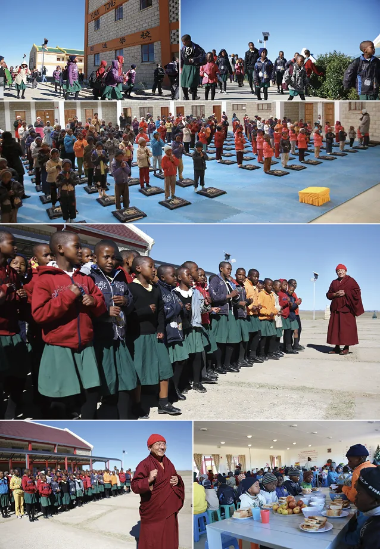

我办学校大概十年了，

看到这些有一种共鸣，

觉得这边做得非常棒。

第46场

莱索托ACC阿弥陀佛关怀中心

Amitofo Care Center, Lesotho

莱索托

2015 / 11 / 3

## 莱索托ACC早餐开示

## A talk during breakfast at ACC Lesotho

慧礼法师：

我们非常感谢上师能悲悯非洲的众生，专程到非洲来！在我们几个ACC里，莱索托ACC算是比较有福报的，有这个因缘，能够排上行程。其他三个ACC就没有这个福报，没有这个因缘了。

上师的学识、涵养可以说是才德兼备，四处弘法，乐说无碍。这种普度众生的悲愿，值得我们每一个人学习。作为佛弟子，都应该把上师当作榜样，作为自己学习的典范。

我相信，每一个人对上师到来，除了感谢，还是感谢！在佛教中，可以说大家都是在不同的因缘、不同的角色、不同的定位上，为了众生的需要，为了佛教的需要，不忍众生苦，不忍圣教衰，在不同的岗位上努力。

大家一起向上师学习，一起为佛教、为法界、为众生，付出我们每一个佛弟子应该奉献的心力。其实，在奉献的过程中，大家也在自我成就。佛道上的成就，就是在这种奉献中，慢慢完成的。

现在我们有这个机缘，恭请上师为大家做开示。谢谢，阿弥陀佛！

特别感谢慧礼法师，还有院长和其他义工老师！

第一个我要感谢的是你们的团队。这次我所有的行程，不是一个地方，而是好几个地方，各方面的安排，都是你们团队支持的。给大家添了很多麻烦，我心里有些愧疚，非常感谢！

我以前去过很多地方，但非洲是第一次来，这边有一些苦难众生，我想具体了解一下，虽然我可能也做不了什么。这个愿望不是这几年才有，很早以前我就想来。这次来非洲，虽然时间比较短，没有看得特别细，但基本了解了现在的状况。

第二个我要感谢的是在座所有的奉献者，你们确实不容易。我也和慧礼法师说过，我办了三所学校，两所小学、一所中学。其中，两所小学办了十年，有1600多名学生；一所中学，有700多名学生。我们的老师，很多都是半公半私的，也就是我负责一半，政府负责一半，建筑则全部是我在负责。在这个过程中，以前我觉得自己很伟大、很厉害，要关心老师，又要关心学生，还要操心所有事情。到非洲以后，我觉得我的付出也好、发心也好，确实非常渺小。在这里，慧礼法师是不断在不同的非洲国家建立孤儿院和学校，发这样大的愿，特别特别值得随喜！

我来这里，和其他人的参观不同，我还是做了比较细致的观察，包括厨房、宿舍、学校等，在院长的带领下看了很多。因为我办学校大概十年了，看到这些有一种共鸣，觉得这边做得非常棒，非常有意义！

今天，我对慧礼法师的团队、在座的各位，提一个希望：人在很多时候，发心可能会有一些退失，或因工作不顺，或因各种焦虑，或因种种情况，但不管遇到什么，最好都能继续坚持。你们来到非洲，把个人的想法、私事都抛之脑后，一心一意为这里的孩子们做事，这样的精神，的确可以改变很多孩子的未来，这将是你们最大的收获。

我在开普敦等地方，看到一些中国企业家，在非洲待了很多年，赚了很多钱，我一点都不羡慕，如果不能利益到众生，钱再多也没什么意义。但在这里，按照世间的说法，你们抓住了一个很好的机遇，按照佛教的说法，这是一个真正利益众生的平台，这种机会非常难得。你们在这里是真正的付出，不只是口头上说说而已。对一般人来说，不要说教书、做事，连待都待不下去。这两天我口干舌燥，喉咙痛，还感冒了。本来我认为自己比较坚强，到哪里都能适应，很能干，但到了这里才发现，如果让我待个一两年，可能都有点困难。所以，你们在座各位非常伟大。

这是我第一次来非洲，只要我们有度众生的愿力，以及各种因缘，大家互相帮助，携起手来可以一起做很多事情。非洲这里的众生确实需要帮助，尤其是到了莱索托，我感触很深，经常在思考这些人怎么活下去，他们国家实在太穷了。所以，我们能做的，一定要尽量做，哪怕能帮上一点忙也可以。

以前，我经常讲一个故事：海滩上有一个小孩，他看到很多鱼马上要死了，就顶着太阳跑来跑去，把它们一一扔回海里。有个人嘲笑他：“鱼这么多，你能救几条？谁在乎啊？”小孩扔一条就说一句：“这条鱼在乎！这条鱼在乎！这条鱼也在乎……”

看了这个故事，我很感动。我们可能无法帮助所有人，但只要能帮助哪怕一个孤儿，也是这辈子最好的修行。学佛不能停留在口头上，整天夸夸其谈，只顾自己享乐。

此外，前两天我跟大家也讲过，义工老师在这里不管待多少年，都应该把自己的经历真实记录下来，在未来，这将是你们人生中最美好的回忆。

最后，特别感谢大家对孩子们的付出，非常非常随喜！
