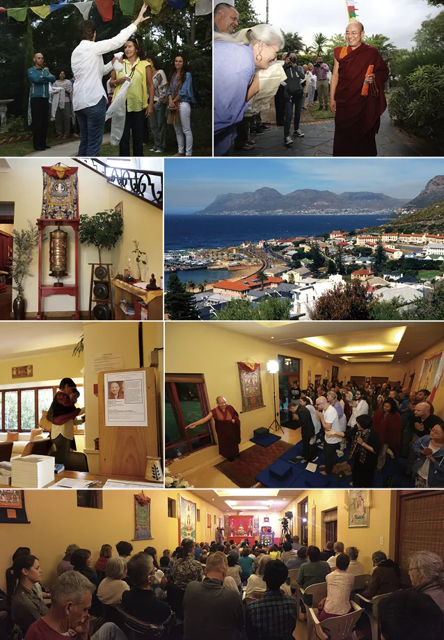
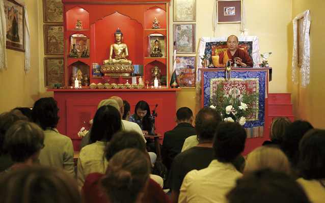
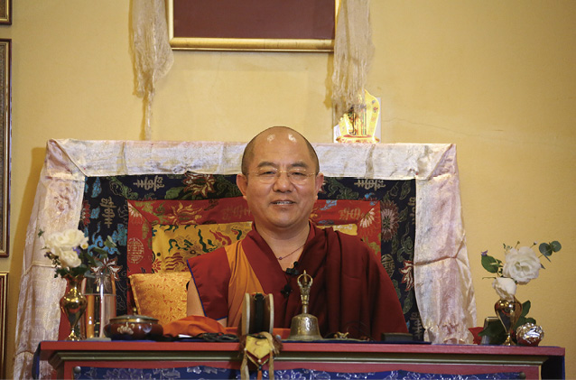
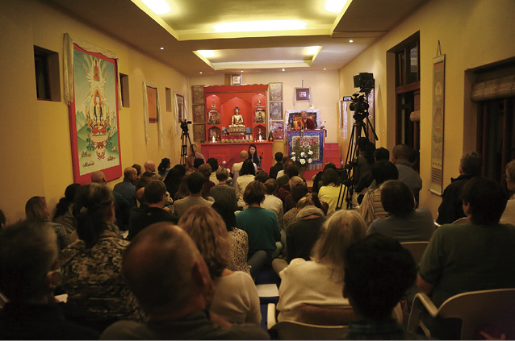
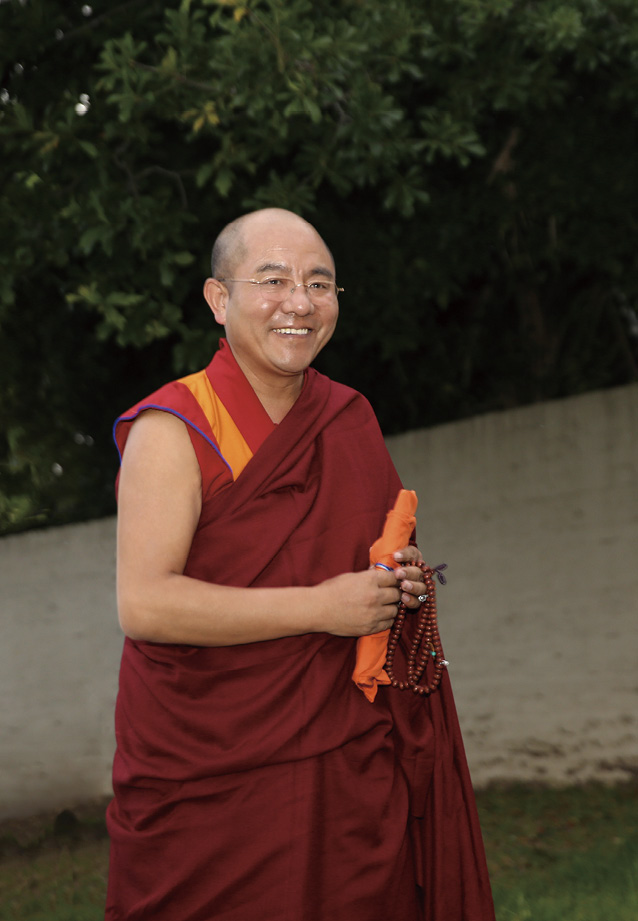
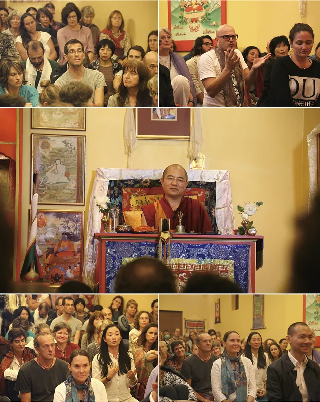

如果可以将上师弘法利生的精神，  
延续十年、百年乃至千年，  
就是对上师最大的报恩，也是最大的供养。

第42场

南非开普敦桑耶林中心

Kagyu Samye Dzong, Cape Town, South Africa

南非·开普敦

2015 / 10 / 30

## 菩提心·觉醒的心

## Bodhicitta - the Mind of Awakening

主持人：

仁波切，我谨代表开普敦噶举桑耶林中心，欢迎您的到来并感谢您为我们做演讲！

能够邀请到您，我们深感荣幸。之前益西喇嘛和桑木喇嘛都发邮件嘱咐我，您到开普敦后，一定要邀请您到中心来，很高兴您真的来了。也非常感激您为阿贡仁波切的尽快转世，念诵了上千遍祈祷文。

希望今晚您能为我们慈悲开示，如何继承阿贡仁波切在非洲的事业，以及如何实现仁波切在非洲的弘法之梦。再次感谢您，祈愿您此行吉祥圆满！

今天我用汉语讲，配有英语翻译。我是第一次来南非的开普敦，很高兴在这里与大家交流有关菩提心的内容。

对于菩提心，在座的大多数人应该比较清楚，或许也有个别人不是特别明白。释迦牟尼佛宣说了八万四千法门，所有法门的醍醐、精华就是菩提心。因此，无论是在理论学习还是实际修行中，菩提心的教义对每个人来说都非常重要。它的重要性不仅是对大乘修行者而言的，实际上，对世界上的所有人类乃至所有生命，它的价值都无法估量。

## 自他皆平等，修时应相换

在这个地球上，按照人类的不同肤色划分，有白种人、黑种人、黄种人等；按照不同大洲划分，有非洲、亚洲、欧洲、美洲、大洋洲五大洲；按照不同国家划分，有两百多个国家；按照不同文化划分，有千差万别的诸多文化。从这些不同来看，似乎大家在地球上不必存在什么共同的连结，因为每个个体都有自己的文化、语言等。

但其实并非如此。在印度著名的寂天论师所造的《入菩萨行论》中，有一个很重要的偈颂：“首当勤观修，自他本平等，避苦求乐同，护他如护己。”虽然此偈颂诞生于8世纪，但其中的思想，在21世纪仍然适用于全人类，我们依然能够从中汲取思想的精髓。

这个颂词在现在的时代背景下，所要表达的意义是：虽然人与人之间存在着诸多差异，但在“避苦求乐”这一点上，所有人都是相同的。我们首先要明白这个道理，并进一步思维：人与人、自与他之间是平等的。无论是东方人还是西方人，都努力追求快乐，并尽力避免身心痛苦，这是所有人的共同点。

那么，我们应当像保护自己一样去保护他人，这是一个基本原则。虽然从表面看来，这个偈颂的意思很简单，但当我们静下心来去思维时，会发现其中蕴含的意义尤为甚深。

在大乘的菩提行中，思维自他的共同之处，其实就是修行“自他平等”。之后更进一步，我们要学会换位思考，也可以叫“自他相换”。比如，在杀生的时候，要站在被杀众生的角度去思维：“如果我是被杀的众生，他人来杀害我、断我的性命，我会感受怎样的痛苦？”通过这样的观察，你会发觉对方的生命极其可贵。“自他平等”与“自他相换”，是修持菩提心最根本的修法。

## 应生菩提心，善巧辨是非

研究、修行佛教，有甚深的意义。虽然现在有很多人也在宣扬慈悲、善良的理念，但只是这样还不够，应该要修行菩提心，因为它直接关乎每个众生的解脱。如果佛教徒不懂这个道理，说明对佛法学习得还不够深入。

菩提心可以分为愿菩提心和行菩提心。所谓愿菩提心，是发愿从现在开始度化无量无边的众生，让他们获得究竟觉悟的果位。相信大家在理论上可以明白这样的发愿。发愿后就要有实际行动，在具愿菩提心的基础上，修持行菩提心，通过布施、持戒、安忍、禅定、精进、智慧六种波罗蜜多不断努力。

如果你真正发了大乘心，就不会再有理由贪图个人享乐、放任自己的懒惰和懈怠，甚至过度的自我保护都是不适宜的。或许有些人认为，利益他众虽然很好，但个人自尊、自强、自信的心态也需要被保护。所以，在利益众生时，还是无法接受很多事情，常常感觉自私心与利他心之间有冲突，没办法行持利他的事业。这时，你就要观察一下自己的心态到底正不正确。

不仅自己的心态需要观察，人类历史上所发生的一切都需要观察。通过观察，你会发现有些本以为是正确的事情，其实是错误的。对于个人来说，如果一种习惯、观念是正确的，它值得被保留下来。但如果一种习惯、观念是错误的，它对个人乃至全球所有生命都不利，那么，即使这种习惯、观念延续了千百年，我们也要去改变它。

从道理上来讲，全球的人类都应该是平等的，理应实现平等的共同发展。我相信这个观点很多人都接受。但在几十年前，或许有相当一部分人不认可这个观点——从当时白人与黑人之间的种族冲突、种族歧视就可以看出来。

我昨天刚到开普敦时，很多人给我介绍说，前总统曼德拉在海岛监狱里被关了很多年。他在三个不同的监狱中，总共被监禁了27年。我以前看过他的传记，我当时一直在思考，人类历史上所发生的很多事情都能证明：人类的观念，有些是正确的、有些是不正确的。当然，对这个问题，如果你们有不同观点，等会儿问答的时候可以提出来。不过，曼德拉被监禁，确实是历史中真实的事件。

白种人对黑人实行隔离，在当时的白种人眼中，可能是正确的。但是到了今天，各国对此可能会有其他看法。现在，大多数民众对“人类都具有避苦求乐的特点”，应该是有共识的。而在那个时代，所有事情的发生，自然无法脱离当时的政治、宗教背景，无法不受执政理念和其他因素的影响。

1984年获得诺贝尔和平奖的图图主教，曾在纽约演讲时说：“白人传教士刚到非洲的时候，他们手里拿着《圣经》，我们黑人手里有土地。白人传教士让我们共同祈祷，于是我们闭目祈祷。可是睁开眼睛的时候，发现情况颠倒了，《圣经》在我们手里，而土地在白人手里。”

今天的听众有很多是白人，你们或许对图图主教的观点有不同看法。但如果从自他平等、自他相换的角度去看这个问题，不知道大家会不会有一些共鸣？

三十年过去了，如果图图主教再次看，可能会看到很多黑人手里的《圣经》不见了，很多白人手里的土地也不见了，这些土地回到了黑人手中。1994年，曼德拉在就职总统演讲中说，每位国民与祖国大地密不可分——遗失的土地再次回到了他们手中。但遗憾的是，现在无论是黑人还是白人，手里拿着《圣经》的人越来越少，很多人都放弃了自己的信仰，这是一种普遍现象。现在在英国、美国、非洲等地，就基督教、伊斯兰教、佛教等宗教来看，信仰的人逐渐减少。所以，如果图图主教再次观察这个世界，会看到很多状况都发生了变化。

虽然人类本应是平等的，但在某些时代背景下，或者说当人类被某些观念驱使时，现实情况就会发生变化。我听说以前在非洲以外的某些国家，对黑人的残暴行为非常可怕。像我知道的一些地方，也存在民族歧视，以及对仆人虐待、杀戮的行为——主人杀仆人就像杀动物一样。如果以自他平等的菩提心去判断这些行为，可以认定它们完全是错误的。

## 众生皆平等，赞叹素食观

人类对动物的虐待、对其他众生的杀戮，完全违背了大乘菩提心。但在很多人的观念中，认为除了人类、和平鸽等少数动物外，其他动物都应该被杀害、食用，比如牛、羊、水生动物、飞禽等。人类没有想过动物与我们同样会感受痛苦，也没有想过它们同样需要快乐。虽然人类自诩为高等动物，自以为智商很高，却没有思维过这个道理。

如果只想自己即生中获得快乐、拥有健康的心态，这根本谈不上是菩提心。所谓菩提心，是要让所有众生获得究竟的快乐，这是菩提心真正的核心所在。在当今时代，这些被杀害的动物，其实就像几百年前被杀戮的弱势族群一样。当时，这些民族的人们，遭受了各种虐待，甚至被夺去最宝贵的生命。站在大乘佛弟子的角度去看，每天在世界上发生的残害众生的行为，都是非常残酷的，也是极其可悲的。

凡是学习大乘佛教的人，无论是西方人还是东方人，都应该对保护一切众生的主题进行深入思考。一些藏传佛教的佛教徒，还有一些西方不同教派的教徒，都需要改变食用肉食的习惯。实际上，吃肉是直接或间接损害众生的生命。如果实在不能长期吃素，至少也要在一个月中的四天或半个月里吃素，以这种方式来改变观念。因为食用动物的肉，与夺走众生的生命没有什么差别。

在《楞严经》和《涅槃经》中，都不提倡食用肉食。佛教一直有吃素的传统，在这方面我最赞叹的就是汉传佛教。在汉传佛教上千年的历史中，一直保持着这一优良传统。我认为全球所有具有慈悲心的人、所有宗教徒都应该学习这一点，并进行反复思考。

我以前研究过汉地的素食观，实际上，吃素的传统与汉地的文化有关。汉地有一部著作叫《黄帝内经》，经中有云：“五谷为养，五果为助。”意思是说五种谷粮是身体主要的营养来源，而五种果实则用于辅助补充营养，令身体更加健康。吃素这一传统的形成，也受到了儒家孔子、孟子等思想家的影响。

到梁武帝时期，汉传佛教正式建立了吃素的制度。公元511年，梁武帝亲自撰写了《断酒肉文》，告诫佛教徒断除酒肉。他于全国下令，凡是出家人，均不能食肉、饮酒。改革由出家人开始落实，并随着时间的推移，将影响扩大至所有佛教徒。改革取得的成功，可以部分归功于梁武帝的执政能力。而且，梁武帝的家族很有佛缘，他的公主是在达摩祖师座下出家的比丘尼。

到今天，梁武帝这一改革的影响已经持续了1506年，也就是说，汉传佛教吃素的传统，从一千五百多年前保存至今。我有些好奇，为什么这个传统能够延续下来？其他一些思想，尽管也能传播，但在执政者死后，旧有的制度又会被恢复。但汉传佛教的素食观却一直被传承至今，凡是在汉传佛教的寺院，包括在家居士在内的所有佛教徒，几乎都不吃肉。

我刚才问了开普敦的汉传佛教徒吃不吃肉，他们回答说“吃得不多”。也许他们受过其他佛教宗派的影响，虽然吃得不是很多，但还是会吃一些，我想这应该不是汉传佛教本身带来的影响。

我以前也喜欢吃肉，尤其喜欢吃肉包子。后来我戒掉了，但戒肉后有一次忘了，中午又吃了肉包子，晚上才想起来，但也没办法，因为已经吃了。但从那以后，我一直努力地坚持吃素，到现在已经十多年了。

由于习气使然，一般人刚开始很难断肉。而且我们很难意识到肉与其他食品的区别，因为市场上卖的肉有很多是有包装的，看起来跟其他包装的产品，比如水果，没有什么差别。但你可以去思维，实际上肉食就是某个众生身体的一部分，当身体被切割时是很痛苦的，那么当众生被作为肉食杀害时，要感受什么样的痛苦？付出什么样的代价？这是值得我们去思考的。

有些人认为不吃肉营养不够，自己身体不好所以一定要吃肉。但令人意想不到的是，吃肉反而会让你患上很多疾病。关于吃素对健康的影响，我以前专门进行过研究，其实素食足以补充身体对蛋白质、脂肪等营养的需求，因此吃素在营养学和医学上，也是站得住脚的。

在佛教意义上，一方面，吃素是一种间接放生，另一方面，吃素也是在实际行持菩提心。这就是我认为汉传佛教很伟大的原因之一。一个吃素的人，无论你是否用语言宣说，都已经在行动中实践了菩提心。仅在中国就有一亿个佛教徒，如果这么多人都吃素，相当于放生了多少个生命？这是值得佛教徒去思考的。

## 佛子依胜勤，成熟有情众

无论是否已经发起了大乘菩提心，我们都应该以大乘思想去帮助众生，这是非常重要的。弥勒菩萨的《大乘经庄严论》中有一个偈颂，令我印象很深刻：“佛子依胜勤，成熟有情众，为他一善心，久劫亦不厌。”意思是说，作为大乘佛子，发了菩提心之后，应该以最大的努力成熟众生、度化众生。哪怕为令一个众生生起善念，自己在千百万劫中做他的仆人也不能生厌。在现实生活中，就要这样去做，为了帮助一个人，哪怕在多少年或更长的时间中去努力，自己的内心中也不应生起厌恶心和疲倦心。这种精神值得我们去思维和学习。

很多人认为自己在座上修菩提心修得不错，好像真成了菩萨一样。但真正去实践时，比如救助可怜众生——像麻风病人、艾滋病人、患疟疾的病人、孤儿、无家可归的老人、穷人、乞丐等，那时自己的大乘菩提心不一定能生得起来，可能除了自私自利外，根本想不到对方需要你的爱。

在世间，有一些没有信仰的人，无条件地做了很多伟大的慈善事业。我会通过这些事例反思自己：我虽然自诩为大乘佛教徒，但跟他们比起来，真的非常惭愧。尽管自认为已经发了大乘菩提心，但在面对一些事情时，自己的行为还不如没有信仰的爱心人士。这时就会觉得自己还需要不断学习和修行。

## 追忆仁波切，愿众齐努力

这里是阿贡仁波切的道场。仁波切在西方弘扬佛法时，给很多年轻人无私地提供了帮助。从上世纪八九十年代起，到仁波切示现圆寂之前，他为许多贫穷的藏族年轻人提供了学费。同时，他为保护藏族的语言、文字，做出了非常大的贡献。

作为弟子，从上师那里获得了加持、得到了传承，从皈依开始，一直领受上师法恩的我们，对上师的恩德难以报答。上师为众生示现无常而离开人间，这对大家来说，的确是非常痛苦的事情，但我们更应该把悲哀化成动力。作为他的传承弟子，应该更加团结、更加努力地学习上师所传下来的教法，并弘扬他的传承，这是非常重要的。

十多年前，我的上师晋美彭措法王示现圆寂。当时，在学院追随法王的弟子有上万人，学院以外的传承弟子遍布各国。那时，对于每一位弟子来说，法王的圆寂就像心中的红太阳落于西山，内心被笼罩上一片黑暗，不明方向、不知所措，仿佛世界只剩下黑暗与空虚。但随后弟子们共同商量，发愿要继承上师的遗愿，因为我们知道伤心与哭泣是没有用的，我们要做的是把上师传承的教法弘扬下去。后来，学院所有堪布、活佛反复商量、开会，希望将法王所创办的佛学院，管理得像法王在世时一样好，并决定为此终生努力。到今天，十多年过去了，我们还是一如既往地在学习和弘法。

如果大家希望听一听我的建议，根据我自身的经验，我建议仁波切所有的传承弟子，长期共同商量、探讨如何继承老人家所传的法要、如何弘扬他的传承、如何维护他的道场、如何延续他弘法利生的精神。如果可以将上师弘法利生的精神，延续十年、百年乃至千年，就是对上师最大的报恩，也是最大的供养。修一座塔或做其他供养，对一位上师来说不一定是最重要的，而把道场的法脉延续下去，是最重要的。

我曾看到有些上师圆寂后，道场就关闭了，弟子们也各自散了，甚至弟子之间还发生了各种矛盾和不愉快的事情。这种行为对上师不是报恩。

上师的离开是正常的，佛陀也会离开，我们每一个人都会离开。即使上师离开了，我们也不要忘记，将最具价值的真理，传递给千千万万的有缘人，这就是我们的责任。

下面我用藏语念《佛子行三十七颂》的传承，之后半小时留给大家提问。

现场互动

问：刚才您提到不应该吃肉，但种植蔬菜时，也会由于使用化学药品和杀虫剂，杀死蔬菜上的生命。这样一来，杀害的生命数量远远超过杀害一头牛。另外，是否最好也不要食用奶酪和牛奶呢？因为它们来自被虐待的动物。您为什么没有说要成为纯素食者，而只是说要成为素食者呢？

堪布：奶酪不吃当然也很好，我没有要求一定要吃奶酪。如果吃没有农药的蔬菜，当然更好。但即使不得已要吃有农药的蔬菜，农药也不是我们让农夫添加的。而且如果连蔬菜都不吃，也有一定困难。

人为了获取肉食而选择杀害动物，这一动机与选择吃素有非常明显的差别。杀生有直接杀与间接杀，不得以吃添加农药的蔬菜，是一种间接杀，因为添加农药是农夫的行为。当然，最好不要吃有农药的蔬菜，但即使吃了，我们吃的也是蔬菜而不是肉。因此，在佛教中，吃素与吃肉在发心上还是有一定差别。但不是说吃素就完全没有过失，间接来讲肯定也是有过失的。

问：我在学习的过程中，了解过菩提心，您今天也谈到了。我知道出离心同样很重要，所以我想了解一下出离心与菩提心的关系。我认为它们的关系应该是很紧密的。而且我觉得理解好它们之间的关系，有助于更好地发菩提心。那么如何更好地发菩提心自觉觉他呢？作为没有证悟的凡夫，目前的心态还是很自私的。

堪布：关于出离心和菩提心，在宗喀巴大师的《三主要道论》中有宣讲。论中说，无论白天还是晚上都想获得解脱，对获得解脱有持续而强烈的希求，就是具备了出离心。我们应当明白，三界轮回中没有什么是真正快乐的，因此一定要远离一切痛苦而获得解脱，有这样的心态就是有了出离心。

菩提心是愿一切众生获得佛果的心，既有悲心，也有智慧。对于想深入佛教的研究者与修行者，出离心与菩提心是非常重要的。在此基础上，还需要生起无二慧，对万事万物、一切法都通达空性。

出离心、菩提心、无二慧即是三主要道。在修行过程中，需要具备此三者。否则，善法的修持很有可能成为人天福报、在人间获得快乐的因，而不是佛教最高层次的修行。

问：您多次提到快乐、痛苦这样的字眼，我想知道快乐是什么意思？

堪布：有吃有穿，没有什么身心压力，沉浸在一种喜悦的状态中，可以叫做乐。所谓的苦，可以分为身体的痛苦和心灵的痛苦。身体的痛苦，比如罹患疾病、在监狱中身体受到折磨；而心灵的痛苦，比如有吃有穿但一直不开心，甚至想自杀。

每个众生都希求快乐，不愿感受痛苦。但很多人由于思想与行为的颠倒，反而给自己带来痛苦。印度的法称论师在《释量论》中说，依靠可爱的对境产生快乐，因而生起贪心；依靠不悦意的对境产生痛苦，因而生起嗔恨心。因此，嗔由苦生，贪由乐生。

问：您能否再多讲一些关于宗喀巴大师的内容？

堪布：在藏地，宗喀巴大师是公认的三大文殊之一。三大文殊分别是萨迦派的萨迦班智达贡噶坚赞、宁玛巴的龙钦绕降、格鲁派的宗喀巴大师。他们都撰著了非常珍贵的论典。

宗喀巴大师的智慧极其不可思议，他所造的论典有《菩提道次第论》和《密宗道次第论》，将此二者进行归纳的论典就是我刚才提到的《三主要道论》。

《三主要道论》的内容并不多，前面主要讲生出离心的必要、如何修出离心，中间讲缺失菩提心的过失、菩提心如何运用，最后讲如果没有无二慧，即使具备了出离心和菩提心，也不能获得真正的解脱。最终，我们一定要生起无二的智慧来通达佛的教言，而且，证悟单空还不够，一定要证悟大空性。

问：您刚刚讲到了宗喀巴大师，据我所知，他是藏传佛教格鲁派的创始人之一。我认为有三个宗派在南非具有一定影响力——格鲁派、噶举派和宁玛派。南非的僧众很少，传法也不多，所以很多修行人会去听不同传承上师的法。但我知道对传承专一很重要，因为在修上师瑜伽或其他一些修法时，都应该专一。那么，在闻法机会很少的情况下，我们应该如何做呢？是坚持一个传承、跟随一位上师，还是只要遇到好的上师和法就去跟随修学？

堪布：这个问题问得很好。对于老修行人来说，在不舍弃自己宗派的前提下，多学一点也可以。如果是初学者，可能先随学一个传承好一点。否则，今天依止这个，明天依止那个，最终背叛了自己的上师和宗派都不知道。

在中国也有这样的现象，有些初学者像新闻记者采访一样，到处都去依止，结果什么都没得到。如果一个人能安住一个道场修学，那么，他的信心不会轻易被别人改变。在这样的前提下，有必要的时候，其他善知识来访，再以清净心去依止。

接受很多上师的教言并不是不可以，但在原则上，不能舍弃自己的宗派，要长期依止自己的上师，这也是人格稳重的一种表现。我之前了解到，阿贡仁波切在英国的一些弟子，已经依止他四十多年了，我非常惊讶，也很随喜，这样去依止上师是非常好的，不知道南非有没有这样的情况。无论是做事还是修行，终生坚持才能获得成就。
