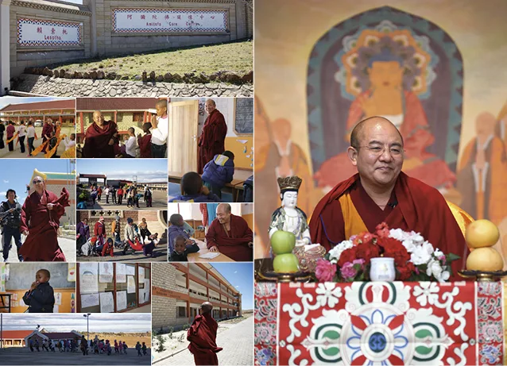
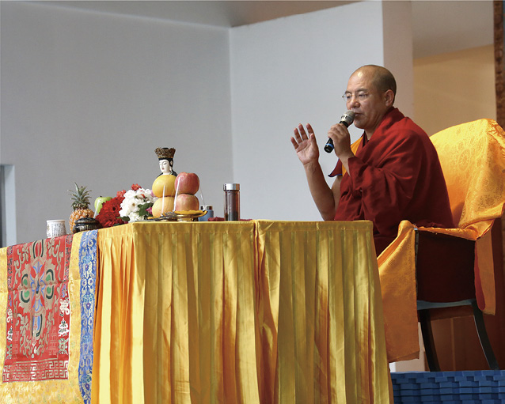
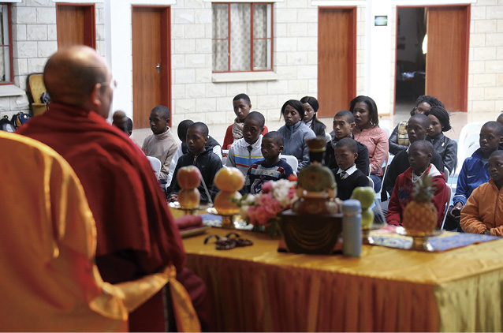
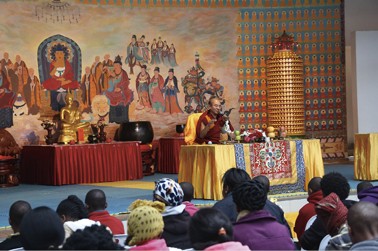
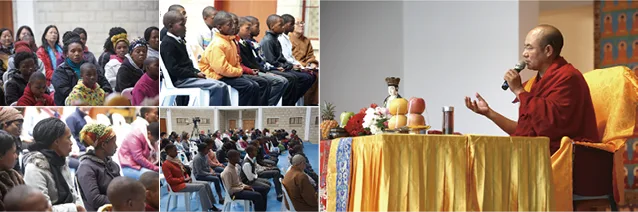
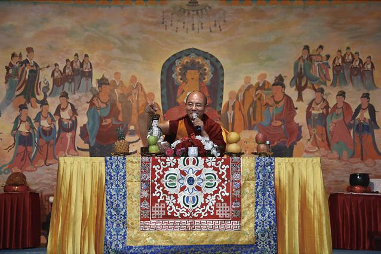

现在网络已经覆盖了整个世界，  
你们会看到、听到、学到各种各样的知识，  
这时一定要学会选择。

第44场

莱索托ACC阿弥陀佛关怀中心

Amitofo Care Center, Lesotho

莱索托

2015 / 11 / 1

## 锻炼强壮心灵的重要性

## Importance of Mind Training

今天有机会在ACC学校与我们的院长以及各位老师、同学们一起交流，我感到非常高兴。你们刚才表演的节目，包括中国功夫、歌曲《青藏高原》，以及民族舞蹈等，都非常精彩，不但蕴含丰富的传统文化，还融入了一些现代元素，特别吸引人、打动人。

今天，我与各位朋友分享的内容比较简单。我们来到世间，每个人都需要爱。不过，关于什么是爱，有些人比较清楚，有些人认识得不一定很深。今天我们就聊聊爱的话题，在佛教当中，爱被称作慈悲。

## 爱需要感受，更需要传递

你们在学校能接受到良好的教育，这样的学习机会，对自己的未来非常具有意义。每个人都有不同的未来，就像每个人都有不同的过往一样。你们有些人的父母仍然健在；有些人的父母已经离开了世间。但无论怎么样，他们的爱都会一直陪伴你们。

我的父亲早已离开了世间。其实，每个人到了一定时候都会失去父母，这时自己一定要坚强地面对生活，不断努力学习。

我童年时家境比较困难，没办法读书，常年在山上放牧。那时我没有鞋穿，衣服也是破破烂烂的，每天都要跟着牛羊爬上高高的山顶，一直在这样的环境中成长。我和弟弟身无分文，父母常对我们说：“如果你俩听话，到了冬天，就可以让你们去附近的城里玩。”其实，他们所谓的城市，就跟你们附近的乡村差不多。

有一次，我和弟弟拿着父母给的一元钱去城里玩。我们用一毛钱买了十颗糖，一人吃了一颗之后，便把剩下的八颗糖收起来，准备拿回家分给妹妹和其他家人。那天，我和弟弟并没有玩，而是一直挖垃圾，因为很想在垃圾里找些玩具或者吃的东西带给家人。

每个人都有不同的生活经历，都会遇到不同的苦难。我在藏地办了几所学校，收了很多学生。我很喜欢和孩子们在一起，与他们谈话、吃饭，做许许多多的事。

## 学习，才能真正变强大

在座的同学们，都是莱索托人，不久的将来，你们当地的文化很可能会受到一些影响和破坏。我很希望你们年轻一代，从小就能学习自己的语言和文字，包括民族歌舞、宗教在内的传统文化和思想。

此外，也有必要学好中文，因为将来在非洲的大地上，可能会有许多中国人在这里搞开发。到那时，会讲中文肯定对你们的前途有帮助。此外，学好英语也非常重要，因为，现在世界通用的语言是英语。每一位学生、每一位老师都应该熟练掌握。

将来，你们如果掌握了这三种语言、三种文字，就会变得非常强大。刚才很多学生练功夫，看起来确实很厉害，但一个人不仅要身体强大，更需要内心强大，应该不断摄取知识，让自己的智慧愈加深厚。如果胸中有学问，心灵充满了智慧和悲心，内心自然就会变强大。如果身心都强大了，人生中的任何问题都可以迎刃而解。

## 以智慧引领人生

大家在学习的过程中，可能会遇到一些困难，这时千万不能自暴自弃。《弟子规》云：“勿自暴，勿自弃。圣与贤，可驯致。”在生活中，无论我们遇到任何困难的事、痛苦的事，或者压抑的事，都不应该逃避，而要用一种善巧的智慧方法去面对，这样自己才能不断进步，拥有一个美好的前程。

另外，我还想提醒在座的同学们，现在网络已经覆盖了整个世界，你们会看到、听到、学到各种各样的知识，这时一定要学会选择，应该多看古圣先贤的书。《弟子规》云：“非圣书，屏勿视。蔽聪明，坏心志。”意思是，不是先贤圣哲的书，千万不要看得太多，否则，你的智慧会被遮蔽，心志会被毁坏，最终，自相续所有高尚的道德都会消失殆尽。希望你们长大以后，能保持一个平和的心态，过一个智慧的人生。要做到这一点，需要现在就开始努力。

我特别感谢这里的义工老师，你们非常不容易。你们对孩子们的付出，虽然暂时看不出什么结果，但这对他们的一生却有莫大的帮助。

你们有些人是佛教徒，有些人是非佛教徒，不管怎么样，我们的目标是一致的，就是帮助众生，这也是大乘佛教的究竟思想和理念。在非洲这片贫瘠的土地上，能有这种具高尚精神的佛教文化中心，确实非常难得。

## 念佛，可以获得究竟的快乐

在座的朋友和小朋友们，应该都会念阿弥陀佛。念佛非常重要，依靠阿弥陀佛不可思议的加持力和愿力，无论身体的疾病、心灵的痛苦，还是生活中的各种困难，都可以灭除。更重要的是，依靠阿弥陀佛的发愿力和加持力，将来我们可以往生极乐世界，永远摆脱生老病死的痛苦。

拥有这样的人生理念，比得到任何世间知识更为重要。为什么呢？佛陀告诉我们：生际必死。无论是黑皮肤、白皮肤还是黄皮肤的人，一般在百年之内都会离开世间。当人最终离开的时候，最需要的是精神上的依托和归宿，那时候如果能依靠阿弥陀佛，自己能获得一切所需。

希望大家都能经常念诵阿弥陀佛。如果口口声声称念阿弥陀佛，不仅会身心愉悦，也会获得无量的功德。
