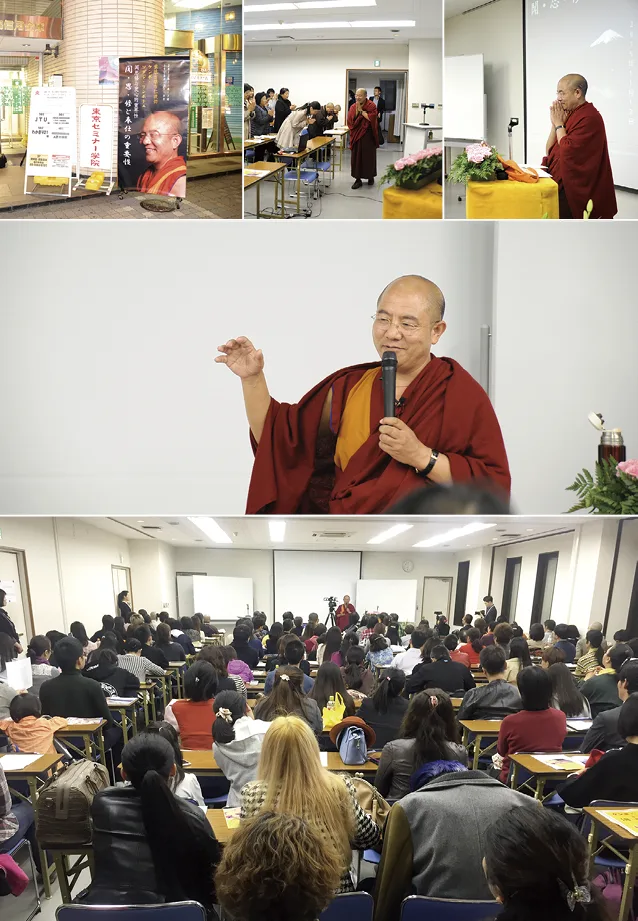
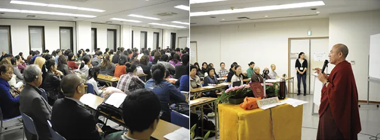
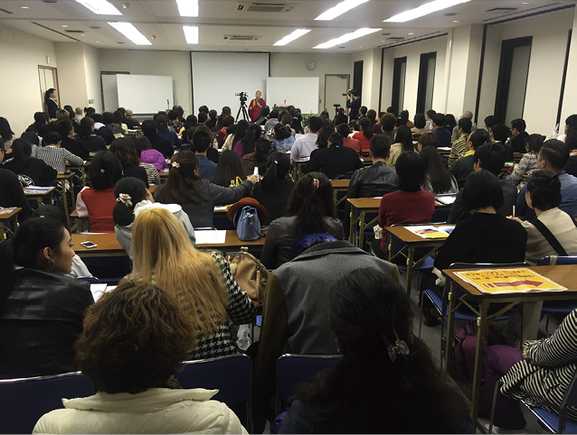
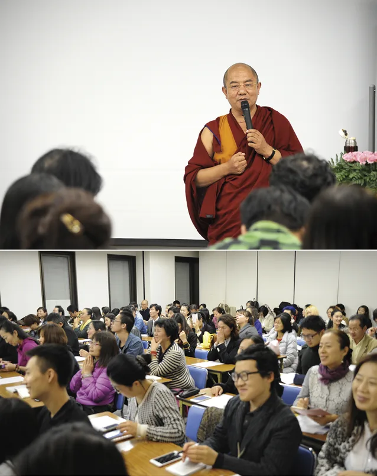
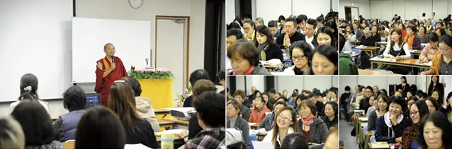
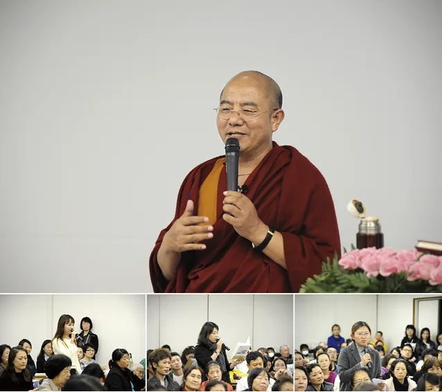
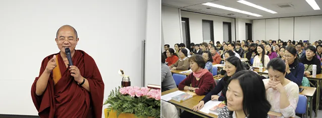
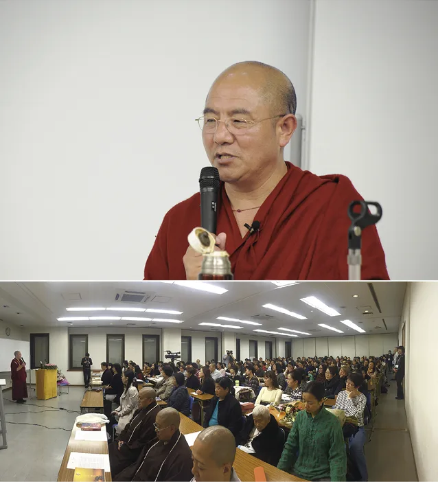

现在佛教已经变得越来越形式化。

表面上看，很多寺院装修得特别庄严，

但里面除了佛菩萨像以外，几乎没有什么修行人。

第49场

日本东京池袋公开演讲

Ikebukuro, Tokyo, Japan

日本·东京

2015 / 11 / 13

## 闻思修与发心的重要性

## Taking Initiative: a Buddhist Practice

主持人：

朋友们，晚上好！首先，非常感谢大家百忙之中抽出时间来到这里，聆听堪布仁波切的开示。

索达吉堪布仁波切本次海外弘法，足迹遍及欧洲和非洲，途经九个国家。为了利益各个国家、民族的有缘众生，堪布不辞辛苦，历时一月有余，飞越万水千山弘扬佛陀教法，利益有情众生。在日本弟子的再三祈请下，堪布终于在全球弘法的回程中，来到了日本东京。

堪布依止晋美彭措法王系统闻思修行三十余年，传讲佛法二十八年，期间还翻译了大量藏文佛教论著。不仅如此，堪布还曾先后受邀，在全球一百余所著名学府做了精彩演讲。

堪布循循善诱，教诫弟子应树立以闻思修为主的正知正见，发菩提心，为弘扬正法、救度众生而精进修学。这使我们深刻认识到，不能空耗暇满难得的人身，应该精进修行。我们发愿跟随堪布，为弘法利生的伟大事业添砖加瓦！

不过，发心占用了很多闻思修时间，有些道友不禁犹豫，不知道自己的闻思修重要，还是发心重要，该如何平衡两者之间的关系。下面，有请尊敬的堪布，为我们慈悲开示——

很高兴今晚与大家见面。前面的一些讲座主要针对学校和社会各界人士。今晚的讲座，参加的人主要是佛教徒和佛教爱好者。我们利用两个小时的时间互相交流。有些听不懂汉语的佛友，可以听日语同传翻译。

今晚的交流比较随意，我会给大家讲一下《修心八颂》，它是藏传佛教著名的修心法，极具加持力。此外，我还想简单讲一下闻思修和发心的重要性。

## 不断学法，才会持续提升

其实，你们不一定能从我讲的内容中学到很多知识，但我从你们身上，包括表情、眼神、一举一动当中，却能学到很多，这是一种无形的财富。我们的财富有些是有形的，比如美金、人民币、日元、黄金等；有些是无形的，虽然无形，却会给内心留下深刻的印象，给人生带来很多帮助，其价值有时超越了金钱、感情等人们希求的外在事物。

我觉得人在任何环境、时代当中，都要不断学习。一旦停止了学习，前进的步伐就会戛然而止，也很难有提升机会。

今晚的交流也算和大家轻松聊天。如果佛教思想对整个人类有益，我会不断地弘扬、学习；如果对人类没有什么意义，或者只对少数佛教徒或者对我个人有利，我不会不辞辛劳地到处为别人讲说、传递。但我经过三十多年不断研究、思考和体验之后，内心的感触是：佛教思想的确会为整个人类带来不可估量的利益。

## 佛教修心法，让心真正强大

现在是一个信息爆炸、压力巨大的时代，人们的内心会受到各种冲击。不管是欧美人还是亚洲人，都很需要精神上的一些调整和修行。而仅仅依靠世间知识或者外在的科技、财富等，很难满足内心的需求。我非常希望，大家尽量学一些佛法，学的时候，不要停留在表面形式上，一定要真正地研究、思维和修行。

日本虽然国土面积不大，只相当于中国的二十五分之一，人口也只有一亿多，但日本的经济、科技等，却在世界两百多个国家当中位居前列，占有很重要的地位。以前我也思考过这个问题，觉得国家是否强大，并不完全取决于国土面积和人口数量，就像人并不是身体强壮就一定强大一样。真正的强大取决于内在的力量。

虽然依靠内在的智慧和力量，日本现已跻身世界强国行列，无论外在的科学技术，还是民众的生活水平，都达到了一个很高的水准，但人们的内心是否快乐呢？可能很难说。如今，日本的自杀率高居不下，也能反映出人们内心的痛苦。明天我会和一些自杀未遂者、自杀者家属，以及心理医生，就自杀方面的问题做一次会谈。

现在不仅在日本，世界各国的自杀者都非常多。为了使我们自己能平安、开心、顺利地度过一生，学习佛教强大的修心法门非常重要。

此外，我们作为有智慧的人类，一定要知道确实存在来世，不应只想今世短短的几十年，还要考虑自己来世几百年、几千年、几万年，甚至几亿年的长远前途。如果只活成一个今生的动物，只关心今生的吃喝拉撒，即使科学再发达、物质再丰富，思维方式也不一定会提升、超越。

在未来时代，每个人都需要一种使自己内心真正强大的法门。因为，我们不但会感受个人业力所造成的痛苦，也会遭遇全人类共业所带来的危害，这时内心一定要有一种强大的力量支撑，这不是军事强大或国力强大所能解决的。

让内心强大的方法，在佛教中的确存在。如果很系统地学习，完全可以获得。在藏汉两地，我们这方面有较丰富的经验。通过系统学习，无论年轻人，还是老年人，都离开了痛苦的网罟，寻到了解脱的绿洲，生活得非常有意义、有价值。

## 学佛团体，为系统学佛保教护航

我很希望在日本能有一个系统、认真学佛的在家人佛教团体，因为想在日本建立一个出家人团体，确实有一定困难。

我大概十年前就想过，最好在日本能有一个系统学佛的团体，但那时自己确实无能为力。虽然以前也有很多人组建过，但一段时间之后就消失了。

如果没有以团队的方式系统、认真地学习佛法，只是短时间学一下，虽然暂时来讲未尝不可，但从长远来讲并不究竟，因为学佛不像打麻药，不是暂时停止你的压力和痛苦就可以了，必须从根本上解决问题。我们每个人都像得了烦恼和痛苦的慢性病。想治好这种慢性病，吃一两副药很难根除。因此，我很希望大家能有次第、有组织、有纪律地学习佛法。

## 系统闻思修，才能树立正见

我不知道你们这样学佛能坚持多久，但我相信，很多人的决心是坚定的，不会出尔反尔或者半途而废。世间人学习科学技术都需要十年、二十年，甚至终生。学修大乘佛教，更不会一蹴而就，极少有在十年八年就修成的，按照大乘佛教的理念，在三个阿僧祇劫当中，都要不断地度化众生。希望我们很多佛教徒，都能认真、长期地学习佛法。

现在很多佛教徒都觉得供养上师特别有功德，认为做好供养就可以了；有些认为跟上师朝拜寺院，到处旅游，就算已经依止上师了，就OK了；有些认为在微博上、微信上和上师聊聊天，就已经成了上师的弟子；有些觉得给上师寺院捐款，就成了上师的弟子；还有些认为，简单看一下上师的法本，去一下他的寺院，或者彼此认可：“你是我的弟子，我是你的上师……”就可以了。其实，这样承诺只在佛陀住世时期可行，除此之外，一定要通过闻思修行与上师结上法缘，才能形成师徒关系。

既然如此，做这些有没有用呢？还是有用的，可以说，上师与弟子之间，始于一个很偶然的因缘，然后依此可以结上善缘。不过，依止上师最根本的目的是闻思修。现在佛教徒主要是缺乏系统的学习，我不管在哪一个国家、哪一个道场，都会一而再、再而三地强调。

我之所以这样强调，是因为现在佛教已经变得越来越形式化。表面上看，很多寺院装修得特别庄严，但里面除了佛菩萨像以外，几乎没有什么修行人。即使有，也鲜有讲经说法，这使得很多佛教徒不要说大经大论，连基本的道理，比如什么是三宝、供养、布施、六波罗蜜多都不清楚。我不是指责哪些地方不好，而是希望我们要有自己的特色。

什么特色呢？作为在家居士，可以先学一些基础法门，如人身难得、寿命无常、因果不虚、轮回痛苦、依止善知识、皈依、发心等。首先在善知识面前听受，然后真正去实修。

有些人可能想：“哦，前行法很简单，对我来讲不重要，我要求最高的大圆满法。”有这样的希求虽然很好，但很多人可能连基本的因果都不相信。如果基础不稳固，高深的法将很难修起来。

今天有个人对我说，他虽然相信人有来世，但却不想关注它，只想关心自己的今世。我说：你如果真的相信，就会像关心自己的明天或下半生一样，关心自己的来世。

我听说日本相当一部分人，并不重视自己的来世，但对各种宗教仪式却非常重视。很多父母会抱着新生的婴儿去教堂接受洗礼；年轻人经常在教堂举行婚礼；死亡之后，家人会把其灵牌放在佛教寺院……在一个人的一生当中，会融入几种不同的宗教仪式，这其实是很开放的。

我并不反对日本信徒搞各种仪式，但我觉得学习佛法更为重要。在懂得佛法的基础上，参加佛教仪式才更富有意义。我对其他宗教不是很了解，没有反对或赞叹的权利，所以不破也不立。但从佛教的角度讲，今天在座很多人都是佛教徒，各位目前对佛教的认知程度怎么样呢？

在十几年前的中国大陆，佛教徒整体的佛法水平并不是很高。以前我去过中国很多省市，有些地方去过多次，也算比较了解当时的状况。现今中国的佛教徒已与以前完全不同，很多年轻人通过系统闻思，已经变得很有智慧。这些年轻人大多是大学生、研究生、博士生，或者学校的老师，整体素质比较高，学起来非常容易。我觉得如今汉地的年轻人，还是很有希望的。

很希望我们佛教徒的相续当中都能够具有教法和证法。所谓教法，就是所听闻的佛教经论。所谓证法，就是通过闻思修佛法，内心当中真正通达了这些道理。比如，对于佛教所说的万法无常之理，光是口头上说说肯定不够，一定要在修行中体现出来，最后在生活当中，无论发生任何事情，都能以无常观来摄持，这就是真正的证法。

## 系统学修，可以做到

如今，我觉得中国很多佛教徒都比较有希望。因为在汉地有很多学佛团体，他们十多年以来，一直非常认真地学习佛法，基本上一周集中一到两次共修。

他们大多数人也很忙，尤其在北京和上海，人们生活节奏和日本差不多，早晨走路速度都非常快，急急忙忙去上班，司机开车速度也很快，虽然不是高速公路，却像在高速公路开车一样。尽管他们很忙，但一直坚持学习，通过不断努力，现在确实学到了一些佛教知识。

我对日本佛教徒的现状，不是特别清楚，但以前与我有联系的一些佛教徒，都不是很稳定，每次学到中间的时候不是不学了，就是跑到别处去了，但他们在别的地方也没有很好地学法，这是非常可惜的。前两天我就这个问题和个别佛教徒谈了一下。我直接对他们说：“像你们这样学佛，其实是在浪费时间……”当然，我知道日本也有一部分佛教徒非常虔诚，学得相当好，并非所有人都不爱闻思。

## 做有内容的佛教徒

希望以后能有更多道友爱上闻思修行。为什么我这样强调闻思修呢？因为，如果没有闻思修，佛教徒只是一种形象，如同包着一个外壳一样。没有内容，只依靠外相而显示的任何仪式，都是不完美的。希望大家都能认识到闻思修行的重要性。

目前，虽然整个日本的佛教徒特别多，但不管是出家人，还是在家人，佛教水平到底怎么样很难说。我相信成长在这个国土上的人，世间智慧应该非常不错，为人处世也很善巧。但我更关心的是出世间智慧是否有所提升。

希望大家不要一听别人说什么，就马上跟着跑，而应该长期、稳定地学习，这样才会知道怎样调整内心、怎样修行、怎样从生生世世的轮回中解脱。

不知道日本有多少人想解脱？希求解脱非常重要。很多人都说自己相信来世，如果真的相信人有来世，肯定会关心来世的解脱。但真正希求解脱的有多少人呢？每个人可以扪心自问。

也许有些人不太在乎来世，觉得有也可以，没有也可以，无所谓，只要自己这辈子活好就够了。如果抱有这种心态，不一定能获得很高的境界。希望我们佛教徒，在有些方面还要深入思考。很多道理通过闻思才能真正明白。

## 闻思修的几个关要

一、需要在具相的上师面前听受。如果身边没有这样的上师，也可以在网上听受。现在网络非常方便，很多上师都在网上授课或组织大家共修，如果想听，完全可以听到。

以前，藏地出世过很多高僧大德，比如萨迦班智达、宗喀巴大师、龙钦巴尊者、麦彭仁波切等。我经常想，如果有他们的录音或录像该多好啊，一定极其珍贵。包括我的上师法王晋美彭措，他的录像和音频都特别珍贵。有时我在看上师传法的录像时，觉得好似回到了从前，亲自在上师面前得授此法的传承。虽然以这种录音或录像的传承，为别人传授有一定困难，但自己得到、接受应该没有问题。

二、学佛需要精进。我们虽然处于一个特殊时代，但并不是没有学法的机会，只不过很多人忙于世间法和各种琐事，喜欢散乱而已。有的人对我说：“在日本生活太累了，一天工作很长时间，下班后累得不行，不要说学习，连喘气的时间都没有了。”但我想，喘气的时间肯定还是有的，否则怎么活下去呢？

我来日本，每天都要讲课，有很多事情要做，确实有点累，但如果精进一点，还是会有修行的时间。我想你们很多人不一定像我这么忙，但我多年以来，基本没有放弃自己的学习和修行。我不是很精进、坚强的人，但对自己短暂的人生应以什么方式获得真正的实义这个关键问题，却非常清楚，所以我才会坚持下来。

三、学佛要有耐心和毅力，并且最好有组织地学。否则，今天学，明天不学，很难坚持下去。我特别感谢参加学习的道友们，你们顶住了各种困难和压力，一直坚持学习非常不容易。我听说很多人都退了，心里有一种说不出的感觉。本来有些人很有智慧，但可能因为人格不稳，或者烦恼深重，或者被其他事物引诱，没能坚持下来，这是非常可惜的。

如果有人对我展现他世间的功德，比如赚了多少钱、现在拥有多少亿、买了多少房产、开了什么公司等等，我听了都没什么感觉。但任何国家的人，如果告诉我，他认真学修佛法很多年了，我听到之后都会非常高兴，觉得他很了不起，随喜他的勇气，也很想多看看他。也许这是我的习气吧，自己对这方面比较执著。

当今时代，人们生活水平越来越高，但长期闻思修行的人却越来越少。藏地也是如此，除了我们佛学院人数不断增加、需要控制以外，其他很多寺院的出家人都越来越少，越来越世俗化了。

以前，藏地百分之九十九的人都信仰佛教，但现在，年轻一代由于受西方思想的影响，很多人已对佛陀没有很深的感觉了。他们看到影视明星时，眼睛会睁得大大的，而见到释迦牟尼佛像的时候，却经常打瞌睡。

这一现象是怎样造成的呢？应该是科技信息化导致的，它使人们变得越来越世俗化、低俗化。这个时候，我们能否把握住自己呢？如果不能，第一次、第二次别人会帮你，但如果一直依赖别人，最后自他都会失去信心。如果发愿，无论在什么环境中，自己都要坚强地站起来，也许到了一定时候，你的内心就会变得坚强起来，无需再依靠任何人。

四、学佛需要明确以解脱为目标。

希望大家好好地闻思修行，这并不是为了我，而是为了你们自己将来能够从轮回中解脱。轮回里充满了烦恼和痛苦，如果不用一些佛教的理念调整内心，确实难以面对。不要说为社会做贡献，自己可能连活下去的勇气都不一定有。

其实，闻思修行的重要性从很多方面都可以讲，但我有感而发，觉得希求解脱非常重要。

## 肩负起弘法利生的责任

此外，我还希望大家，尤其一些年轻人能尽量发心，不能仅求自己离苦得乐，还应肩负起弘法利生的责任。

所谓发心，不是让你们做供养，而是自己一边学法，一边做弘法利生的事情帮助大家。比如，大家共修时需要辅导员，当自己稍微有点智慧的时候，就要勇于担当，而不要推脱“我不行，不敢讲”“《入菩萨行论》的内容太深了，太多了，太难了”等等，这样以很多理由来推诿没有必要，行持善法需要勇气。每个人都应该争取当辅导员，这不仅对自己有帮助，也可以帮助其他人进步。道友之间一定要互相关心、互相帮助。

## 团结，才能成办利生事业

想做成任何一件事情，最好以组织的形式来做。日本虽然国土面积不大，但人却很厉害。我认为主要原因是日本人有一种组织观念。同样，如果佛教团体的组织性较强，大家彼此配合、团结，就会形成一股很强的力量。藏地有句俗语“五个指头握在一起，就变成了拳头”。一根指头的力量很弱，但五根指头握成拳头之后，力量就会变得非常强，可以打少林拳或太极拳。

同样，一个人想弘法利生很难，但如果五个人组成一个小组，力量就会变得很强大。希望大家在弘扬佛法的过程中一定要团结。

怎样才能团结呢？内心要时刻提醒自己：我所做的一切不是为了自己，而是为了大家。任何一个道场，如果利他心培养得不好，闻思修行不好，道友们就会每天讲很多无聊的事情，或者人与人之间的是非，互相拉扯。如果一个道场非常重视闻思修行，每个人都特别发心，齐心协力做事，里面就几乎听不到是非，即使偶尔有，大家也不会把它当回事。

其实，道友之间有矛盾也很正常，互相稍微说一说就过去了。夫妻之间也经常产生矛盾，比如，一个日本人和一个中国人在一起生活，新婚宴尔特别甜蜜，但慢慢就会因为习惯、爱好等不同，产生很多摩擦。两个中国人在一起生活也是如此，刚开始难舍难分，但慢慢互相就没什么感觉了，相处久了，甚至还会互相讨厌、看不惯。

人是比较奇怪的动物。有时候和喜欢的人分开了，心里很难受；但长时间在一起，又会闹矛盾。最初觉得，对方是全世界七十亿人当中，自己最喜欢、最合得来的，但到了最后，又觉得他是七十亿人当中最坏、最令人讨厌的一个。

有时佛友之间也是这样，刚开始非常和睦，但慢慢地互相都不理不睬，甚至因为一点点小事就互相吵架、生气。这说明自己还没有学好《入菩萨行论》。我到日本后听到了一些民间故事，说某个道友和某个道友关系不太好，为什么呢？因为当时一个人说了什么话，后来对方知道就不高兴了，从此之后再也不理他了。其实事情很小很小，如果真正学好了《入菩萨行论》《大圆满前行》，就不会产生这样的矛盾。

## 心法需要用心体会

一会儿，我为大家讲一下《修心八颂》。《修心八颂》所说的道理，并不是很难理解，但因为大家学得不多，可能觉得不可思议。

按理来讲，像在座各位这样有智慧的人，五部大论、密宗续部等深法都应该学习，不应只求一些灌顶。以前中国汉地也是这样，弟子们在上师面前求一个灌顶、舔一下加持品就特别开心，觉得这些酸酸甜甜的加持品很不错，对此特别执著。事实上，他们得到的只是舌头上的味道，不一定能得到法味，因为一般人只有闻思修佛法，内心才能真正感受到法的味道。

当我们内心真正得到法味之后，世人难以面对的很多问题，比如，遭遇突如其来的灾害、别人对我们的严重伤害、身体的病痛等，都能坦然面对。这会令世间人非常惊讶，觉得不可思议。

反之，如果内心没得到法味，世人轻而易举能面对的事情，有些佛教徒反而难以逾越，非常痛苦。一些非佛教徒经常向我抱怨说：你们佛教徒很坏，我们都不计较的事情，你们却斤斤计较。有些修养较好的世间人，确实很宽容、豁达，根本不把一些小事放在眼里，更不会计较。但我们很多佛教徒，却经常为了某个道场、某位上师、某位道友的一些小事吵来吵去。听说你们这边学藏传佛教的有几百个人，可能大多数都是中国人。如果里面分成几派，互相排斥，彼此都会不开心，这样没有任何必要。

希望大家能保持一种和睦的气氛，增进彼此的团结。有必要时可以在一起，没必要时也无需跑来跑去、拉来拉去，彼此洗脑宣传。每个人都有自己的生活方式和存在方式，都是合理的。我们作为佛教徒，应该包容，调整好自己的心态。

## 成为名副其实的佛教徒

另外，希望大家能认识到学习佛法的重要性。如果学得不够，很容易变得不伦不类，既不像世间人，也不像真正的佛教徒。世间人有他们自己的生活方式，每天喝酒、打牌、吃肉等等。我们不吃肉、不喝酒，与他们的类别不同。而真正的佛教徒，有自己的闻思修行，严守戒律，如果我们没有做到这些，与真正的佛教徒也不是一类。

希望我们佛教徒有一种内在的佛教素养。我相信你们在世间都有很强的能力，否则很难定居日本。你们可能也懂很多种语言。昨天，我拜见了一位日本出家人。他精通好几种语言，刚开始讲梵语，但我带的几名翻译都不懂，后来他又接连讲了巴利语、藏语、日语和中文。我相信你们很多人在语言、文字等世间学问方面都下过很大功夫，这一点我要特别向大家学习。但在佛学专业上，可能我花的时间稍微长一点，因为我出家的时间较长，出家以后也没有天天为了吃饭而活着，基本将自己所有的时间都用在研究佛法上。

我的想法是，若真想成为一名佛教徒，最好不做名义上的佛教徒。中国有句成语叫做“名副其实”，意思是，名称与实际相符。既然成了一名佛教徒，理应懂得佛教的教义，内心具有戒定慧三学。否则，即使有了皈依证，也不一定是真正的佛教徒。一些道友有五六个法名，每遇到一位上师，就让他给自己取一个。虽然法名取了一大堆，但这些上师的法自己却没有得到，内心依旧空空如洗，这样不能叫名副其实。

如今，不管在世界哪个角落，都有名副其实的佛教徒，也有徒有虚名的佛教徒。我有时非常担心，害怕自己变得徒有虚名，所以一有时间就会学习各种知识，过程中深深感到，人确实不能离开学习。我听说日本人也特别喜欢学习，很多人坐车的时候也在看书。希望大家对佛法也能这样，通过不断闻思修行充实自己。

我今天最强调的是，希望大家能长期地闻思修行，同时发起一颗利益众生的心，力所能及做一些有意义的事。

## 随学佛陀，为求法而苦行

在场有些道友好像是从北京、广西，以及附近一些国家过来的，很多是为了求法而来。不过，我最近一直在大学演讲，在学校讲佛法不是很方便。无论在中国、日本，还是美国，很多大学不仅限制弘扬佛教，对基督教、天主教、伊斯兰教等其他宗教的传播，也都有所限制。其实这样也很好，如果大学变成了弘扬宗教的道场，不知道培养出来的人会变成什么样。

这些道友从很远的地方过来，如果没有得到法，确实有点可惜。如果得到法，这一趟也算值得了。

《贤愚经》里讲过一个公案：释迦牟尼佛在因地时，有一世转成一位国王，他为了向婆罗门求得一个偈颂——“积际必尽，高际必堕，聚际必散，生际必死”，在身上挖了一千个洞，点燃一千盏灯，经受了极大苦行。在《释迦牟尼佛广传》中也记载了佛在因地为一个偈颂而付出宝贵生命的公案。比较而言，远道而来的道友，为了八个颂词花费一些时间和精力，也是值得的。

## 略释《修心八颂》

今天比较方便，所以我给大家传一下《修心八颂》。学过《大圆满前行》的人，都知道这部法的殊胜性。自古以来，很多人通过了达其中一个颂词，便获得了成就。《修心八颂》的字面意思很简单，没什么不懂的，但修起来并不容易。我一边用藏文给大家念传承，一边稍微解释一下。

《修心八颂》极具加持力，我每去一个国家，都会尽量给当地信众传一点法，包括《佛子行》《修心八颂》等。下面，我就简单讲一下。

第一颂：

> 愿我以胜如意宝，饶益他众之意乐，

> 时时刻刻倍珍爱，轮回一切诸有情。

我们应当发愿，要以胜过爱如意宝般饶益有情的意乐心，时时刻刻倍加珍爱轮回中的一切众生。

一般来讲，世间人都有爱自己父母、孩子等家人的习惯，但将所有众生都视为老母有情，以胜过爱世间最珍贵的如意宝那般爱他们，刚开始会比较困难。日本人还算好一点，欧美国家的很多人都难以理解，觉得为什么要爱他人呢？应该爱自己、爱自己的家人才对。不过，学习佛法以后，很多人不但理解了，而且菩提心修得特别好。

希望大家刚开始不太适应的时候，不要急着诽谤，而要多思考一下，为什么要爱所有众生？也许你一年、两年想不明白，但再过几年可能就会豁然开朗，觉得自己确实应该爱所有众生，这才是所有思想中最有价值的。

第二颂：

> 愿我交往何人时，视己较众皆卑下，

> 诚心诚意又真挚，尊重他人献爱心。

我们在生活中与任何人交往时，不管对方是高层人物，还是低层人物，或者与自己同等的人，都不应该傲慢，要把自己看得比对方卑下，并且从内心深处尊重他人，诚心诚意地提供帮助，奉献爱心。

我去大学演讲的时候，有些老师特别傲慢，尤其一些擅长学术研究的老师。当然，也有很多老师谦虚有礼，非常尊重别人。我这次来日本看不太出来，也许有的人内心比较傲慢，但表面上对别人还是恭敬地行弯腰礼——这是一个很好的礼节。

我在家乡办了一所学校，我告诉学生们每次看到老师，都应该行礼。我觉得礼节非常重要，当然，更重要的是心里要恭敬。如果心里特别讨厌对方，只是表面上低头、弯腰，也不是很好，应该真诚地尊重别人，奉献爱心。

与任何人交往，都不应该傲慢，因为不管什么身份的人，即使是最发达国家的总统、世界最富有或最美丽的人，如果仍是一个凡夫，都会有诸多不可告人的缺点，内心也会隐藏着各种烦恼和痛苦。

我本人常有这种感觉，当别人说我时，我会觉得很爽快，因为觉得自己确实没做好；而当别人夸我时，经常感觉夸得有点过了，因为我知道自己是什么样的人。所以，人最好不要心怀傲慢，而应谦逊有礼。

我想，这一颂在日本讲应该会得到认同，在其他地方讲可能有点困难。前些天我在一个国家讲了之后，一个老外特别不高兴地问：“我为什么要尊重所有人呢？”

第三颂：

> 愿我恒常观自心，烦恼妄念初生时，

> 毁坏自己他众故，立即强行而断除。

我们应该时时刻刻观察自心，当内心的贪、嗔等烦恼刚刚萌生，即将危害自己与他人之时，应该想尽一切办法立即强行斩断。

今天我在早稻田大学的时候，听一个人说，他的母亲从未产生过烦恼。我很想见一见他的母亲，问问她是怎样做到的。

心生烦恼，不仅令自己痛苦，也会恼害别人。比如，一个家庭当中，如果一个人性格暴躁，经常发脾气，那所有家人都会感觉不舒服。一个团体当中，如果一个人性格不好，会影响所有人的情绪。尤其出去旅游的时候，如果游伴性格很好，这趟旅游会让人非常开心，留下难忘的记忆。如果游伴性格不好，经常抱怨、计较，在住宾馆、吃饭等过程中，就会与人产生各种矛盾，特别麻烦，整个气氛都会被他搞坏。

我们应该时时观察内心，在烦恼刚刚萌生时，就立刻将其斩断。如果实在无法断除，也要尽量控制，不在别人面前显露，以防扰乱他人的心。《入菩萨行论》云：“如树应安住。”当自己特别生气的时候，不要说什么，应该像树一样安住不动。如果能做到这样，也算不错。

第四颂：

> 愿我目睹恶劣众，造罪遭受剧苦时，

> 犹如值遇珍宝藏，以难得心爱惜之。

当目睹恶劣众生对我们制造各种违缘进行加害，内心遭受剧烈痛苦的时候，我们应该像值遇珍贵的宝藏一样，以难得之心来爱惜、保护他。

在生活中，我们经常会遇到性格不好、修行不好的人，他们做出各种让人讨厌的事。这时我们不应为此烦恼、痛苦，而要像获得如意宝一样，开心地接受。

第五颂：

> 愿我于诸以嫉妒，非理诽谤本人者，

> 亏损失败自取受，利益胜利奉献他。

如果有人以嫉妒心对我非理诽谤，我愿将一切痛苦、损害、失败自己代受，把胜利和利益奉献给他人。

《大圆满前行》里有这方面的公案，大家方便时最好看一看。如果自己对某人很好，而他却因为嫉妒在众人面前诽谤自己，说自己坏话、过失。这时，我们能否不但不以牙还牙，还以欢喜心把他视为上师呢？

如果自己修行比较好，可以找一位脾气很差、性格不好的人作为自己最亲近的朋友。如果非要找一个性格特别好的人做朋友，从某个侧面也说明了自己修行不好。我们不应该害怕坏友，因为他会对自己的修行很有帮助。以前，阿底峡尊者就找了一位脾气特别差的弟子给自己一直当侍者。

现在，很多佛教徒都有一个毛病，就是不敢接触性格不好的人，常常避而远之。其实这没有必要，应该勇敢地面对，如果经常对别人有种抵触情绪，别人也会如此待你。长此以往，自己的世界将会变得越来越狭小。

希望在座的每位道友，至少能与一两位性格不太好的人交朋友，不要看到某人参加活动，就远远地躲开。看到他在之后，应该更积极地参与，这样才能更快地提升自己。

第六颂：

> 愿我于昔曾利益，深切寄以厚望者，

> 彼纵非理而陷害，亦视其为善知识。

我以前饶益、帮助过某人，对他寄以深切的厚望，然而，他却恩将仇报，对我无理陷害，此时愿我能真正视他为善知识，毫无怨恨之心。

第七颂：

> 愿我直接与间接，利乐敬献诸慈母，

> 老母有情诸苦厄，自己默默而承受。

愿我能以直接或者间接的方式，将一切利益和快乐奉献给所有的老母有情，而老母有情的种种苦痛，我愿独自默默取受。

虽然做到这一点确实困难，但我们还是应该朝此方向不断努力，尽量修自他交换。平时最好经常想，将自己的快乐和善根奉献给所有的众生。在菩提心的修法中，修自他交换的功德非常大。

利益众生的时候，可以直接去帮助，也可以通过念经、念咒或回向等方式，间接地帮助。

第八颂：

> 愿我所行此一切，不为八法念垢染，

> 了知诸法皆如幻，解脱贪执之束缚。

这是最后一颂。愿我所行持的一切行为，都不被名闻利养等世间八法染污；愿我能了知万法的实相——究竟胜义谛中，一切皆为空性；世俗谛中万法如梦如幻，现而无自性，以此断除所有的执著，最终脱离四边戏论的束缚而获得究竟解脱。

希望大家都能修持以上这些善法，修的时候需要以如梦如幻的智慧摄持，不要被有毒的实执束缚，最后很好地回向。

《修心八颂》是藏地非常著名的朗日塘巴尊者所著。虽然只有短短八个颂词，看起来很简单，一张纸就可以写下，但做起来却非常困难。

我在三十年前，无论到哪里，都喜欢传讲这部法，三十年后的现在依然如故，以后无论自己能活多久，有生之年应该还会继续传讲。我不仅为人传讲，自己也在每天修，不过修得确实不太好——每次出门都会找脾气好的随行人员，害怕路上出问题。

这部法的意义和加持力非常大。我虽然会讲，但做起来确实感觉很困难。很多人可能也是如此，口头上自称为佛教徒，但行为却经常没跟上。这时候，需要一种强有力的加持来刺激自己。一般来讲，没有刺激，修行是不会进步的。

现场互动

问：我十二年前来到日本，这次是从大阪过来的。我五年前接触佛法的时候，在网上偶然看到堪布在五明佛学院的一个开示，从那时起便认识了您。

我来日本以后，吃了生鱼片等很多海鲜，现在身上经常过敏，并伴有其他病症，体质与在国内时很不一样。

我听闻佛法之后，便开始念诵《地藏经》，现在基本吃素，不再碰这些海鲜了。不过，我先生还在吃这些东西。有时候，我们会去日本人家里做客，发现日本人经常请本地的法师来家里诵经，而这些法师也跟着大家一起出去吃生猛海鲜。我经常劝我先生吃素，但他总是说：“哎呀，我吃完了向它们说声对不起就可以了。”

我对此很困惑，不知道应该怎样把佛教的因果观在日本弘扬和传播。请上师开示。

堪布：对于任何一个科研项目，想要研发成功都需要做一个试点。你可以拿你先生做个试验，看看他能接受的点是什么，然后循序善诱，向他传播因果观念。

在座很多道友以前都是学汉传佛教或藏传佛教的。汉传佛教历来倡导吃素。个别佛教徒以前坚持吃素，但在日本住了一段时间之后，也学着当地人吃肉和海鲜了，其实这样不太好。我觉得汉传佛教吃素这一点，值得全世界佛教徒学习。

日本佛教的一些习俗，我们很难改变。既然来到这里，就不要说他们的过失，最好用一种善巧方法来应对，否则，自己可能很难待下去。与此同时，我们也要有一种自我认知，保持原有的好传统。自己做好之后，慢慢会对周围人起到潜移默化的作用。

问：我以前看过您的一篇文章，里面讲述了肯德基和麦当劳的共业问题。请问，吃肯德基和麦当劳里面的点心和薯条，有没有共业？如果有，该如何忏悔呢？因为我以前经常吃这些东西。

堪布：吃点心和薯条应该没有什么共业。如果吃了麦当劳或肯德基里面的肉食，会有一些共业。这些业障可以通过念金刚萨埵心咒来消掉。

问：吃蛋奶素究竟吗？有没有果报？

堪布：事实上，即使我们汲取的是植物精华，也会涉及一些损害生命的现象。如果我们在一种食品的说明或介绍当中，没有发现直接损害众生的情况，食用之后，即使里面有一些罪业，佛教认为不会构成很严重的罪。

问：我是一名学生，想请教您关于传授大圆满资格的问题。请问是不是得过大圆满灌顶的人，就具有了传授大圆满的资格呢？藏地一般对此有什么要求？

堪布：为别人传授大圆满，包括灌顶和传讲，资格要求非常高，不是那么容易。并非得过一个灌顶就可以了，也不是某个人说你能传就能传了。

最关键要考量四点：一、自己在修行过程中，是否获得了证悟大圆满的一些验相；二、虽然得过灌顶，但如果没有得过所有大圆满教授的传承，也不行；即使得过传承，但没有修过，尤其没有完成五加行为主的基本咒语和修行，也不行；三、更重要的是，需要传承金刚上师直接或者间接对你认可和认证；四、不仅要对大圆满有所了悟，还要对所有的密宗法要，包括玛哈约嘎、阿努约嘎、阿底约嘎三种无上瑜伽的教义，有所掌握……诸如此类很多条件具足之后，才可以为别人灌顶或者传授大圆满。

问：我现在正在修出离心，过程中我会看淡、放下一些东西，但与此同时，我对家人和朋友的感情好像也越来越淡薄了。我想请问，从修出离心到生起真正菩提心之间，需要一种怎样的过渡？我现在是不是有点修偏了？需要同时修什么法来补正一下呢？

堪布：其实，修出离心以后，人情不一定会变淡。因为当你很想从轮回中解脱的时候，自然会想到，与自己有缘的众生同样可怜，也需要解脱。一般来讲，仅仅有个出离心还不够，还需要生起菩提心。

人情或亲情淡了，不一定是修出离心导致的，也可能是自己在某些地方有些疏忽，没有特别关心他人造成的。

问：大乘佛教引导一切众生趋向解脱，但在现实生活中，轮回的许多众生一直在互相啖食、互相厮杀，而佛教徒却对此无能为力。我们应该如何面对这一现象？是否应该对他们说：请你们等我，等我成佛之后，来救度你们。

堪布：大乘佛教的发愿，对象极为广大，修行时间极其漫长，但如果我们以真诚的态度，猛烈地发起宏愿，并精进修行，有些人短短的时间内也可以成就。

藏地有位名叫克珠诺桑嘉措的修行人。我看过他的传记，他闭关四十年修菩提心，在短短的一生当中就获得了成就。这样的修行者还有很多，比如，格鲁派宗喀巴大师的一位弟子——僧成论师，他在传记里讲述了自己修行的经过。著名的米拉日巴尊者，也是在一生当中获得了金刚持果位。汉传佛教当中，也有很多一生成就的故事。

表面上看，成佛离我们非常遥远，但如果内心发起了特别强大的誓愿，比如，发愿度化无量无边的众生，只要轮回中还剩一个众生，自己就不取涅槃，继续度化……这样一来，在众生未度尽之前，自己就已经获得了成就。

问：于您而言，佛教是一种工具，还是其他什么？

堪布：可以从两方面理解佛教：从词句角度讲，佛教是一种工具，依靠这种工具可以领悟佛法的意义；从所学角度讲，佛教是一种所得，即我们完善生命之后，最终得到的果位。

问：我看过您的很多讲座。很希望能在您座下学习。请问，想成为上师您的徒弟，需要做到什么？

堪布：想做上师徒弟的话，需要闻思修行。

问：第六世尊者仓央嘉措的诗非常有名。我刚才看到您的书里引用了他情诗里的一句话“不负如来不负卿”。请问上师，您如何看待或评价仓央嘉措？他的诗为什么会流传得这么广？

堪布：我看过仓央嘉措的广传和密传，对他的很多介绍都有所了解。表面上看，仓央嘉措是一个非常自在、洒脱和浪漫的人，写了很多优美的诗。他的经历也比较特殊，超越凡人。从其密传来看，他是一位了不起的预言家，把未来发生的很多事都写在他的诗里。此外，他还是一位伟大的修行人，获得了超凡的成就。他的有些修行法门和次第，现在人很难想象，无数人因修持他的法门而获得了利益。

对于他的诗歌，世间人只懂得词句，并不了知其中真正的含义。比如，他写过一首诗：“洁白的仙鹤，请把双膀借给我，我不会远走高飞，到理塘转转就回。”表面上看，这首诗是在抒发一种感情，表达想去理塘的心愿。直到后来人们才明白，这是他的一个授记，说自己不久会离开人间，后一世，即第七世尊者会在理塘降生，很快返回人间。还有很多诸如此类的神奇故事。

问：我来自早稻田大学，现在正在读研究生。我今年7月份去过五明佛学院，并参加了地藏法会。我想请问，如果不出家，在世间从事什么行业对修行最有帮助？

我学佛是受父母影响，但我父亲只是烧香拜佛，信得并不深。他经常对我说：学佛不要太入迷了。我母亲则非常虔诚，现在正在学《菩提道次第广论》，我也跟着她在一个佛教团体里共修。

我很希望自己既能学好佛法，又能在事业上取得成功。但我越来越发现，世间的成功人士经常造恶业。我研究的是亚洲流行文化，但现在的传媒界非常商业化，盛行一种不太好的风气，行业人士普遍造很多业。我很担心将来自己也会变成这样，心里常会有一些障碍。

堪布：对于年轻人来说，多思考人生的重大问题非常有必要。一般人都觉得成家立业很重要，虽然这一点不可否认，但我觉得更重要的是思想定位。人在一生当中，尤其在年轻时很需要明确两个问题：一是信仰的问题；二是自己修行的问题。

有些人一辈子忙于事业，当大限来临时，根本来不及思考，最后手忙脚乱，追悔莫及。反之，作为在家人，为了学佛而抛弃自己的工作，也不太合理。即使想出家，也不要特别着急，没有必要马上把所有的事情全部放弃。

每个人都应该认真对待自己的工作，过程中，一定要学会善加取舍因果，按照佛教所说的道理和世间正理行事。如果觉得做某事确实造业很重，担忧自己的未来，那不一定非要去做，可以用一种善巧方法解决。

你现在不要对此过于担忧，可以从每件事上锻炼，最后就会发现，如果在佛法方面有很好的见地，那既不会违逆你的父亲，也不会违逆你的母亲。走好中间道，不但修行会圆满，事业也会成功，最后一举两得、十全十美。这样不是更好吗？

问1：我听受您的传承已有两三年了，但一直没有皈依。一个原因是，我听您说过，皈依上师之前需要好好观察。我今天想皈依您，可以吗？

堪布：你现在观察好了吗？

问2：观察好了，所以想今天皈依您。

堪布：在座有些人可能也想皈依，有些暂时还不想皈依。一会儿我念皈依偈的时候，不想皈依的人不用害怕，因为皈依是自愿的。

下面，我会按照《大圆满心性休息》的要求，念三遍皈依偈。请大家坐在原地不要动，也不用合掌。如果这次想皈依，就在心里默默想：从今天开始，我要皈依三宝。

我为大家做皈依，并不是将你们收为我的弟子，我只是在三宝面前做一名代表，证明你们自此以后皈依了三宝。就像佛教僧尼受具足戒时，有“三师七证”的规定一样。所谓三师七证，是指三位阿阇黎授戒，七位比丘作证。

下面我念三遍皈依偈，想皈依的人跟着念即可……

问：您是对我法恩最大的一位上师，非常感恩您。今天，我替我的孩子问一个问题，他在持咒的时候，经常会有一些杂念，而且这些杂念是与佛像有关。他想知道为什么？

堪布：持咒的时候，心里想着佛像或咒语，是件很好的事，这不是杂念，而是佛念，这些念头也具有功德。一般在修行过程中，如果产生了各种分别念，应尽量把它们转化为佛念。

念佛有两种含义：一是念诵佛号，二是心里一直忆念佛陀、观想佛陀。如果经常观想佛像、佛的功德，这也是一种功德。

我觉得不论孩子还是大人，心里经常观想佛像是很好的事，不用特意排除。当然，修行过程中如果产生了一些杂念，则应该尽量去除。

主持人：

非常感恩大恩上师的慈悲开示！让我们再次以热烈的掌声表示感谢。
