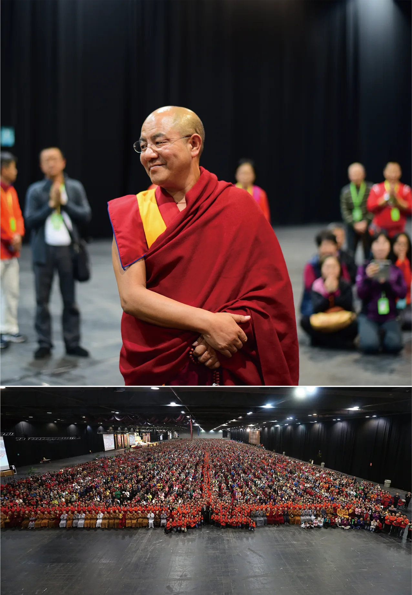

输和赢，  
只是一种颠倒分别念。

第56场

新加坡普耀礼堂

Singapore shine Auaiforium, singapore

新加坡

2016 / 7 / 20

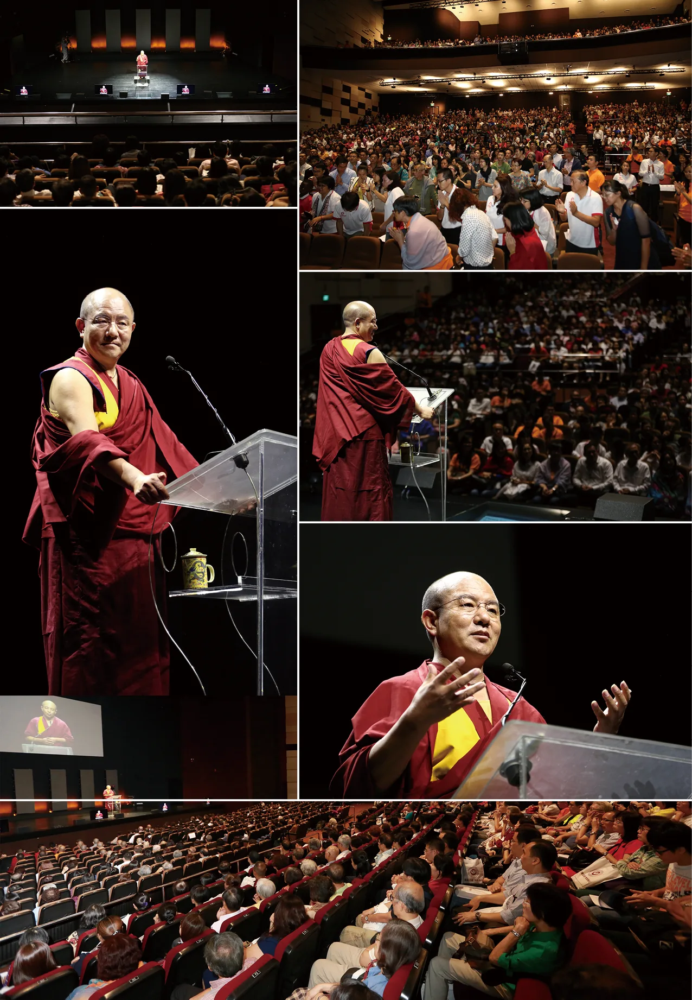

## 人生岂止输与赢

## Beyond Win/Loss

主持人：

晚上好！当大家从城市的四面八方赶来这个会场时，夜幕已经徐徐降临。高楼上的灯陆续亮起来，路灯、车灯、霓虹灯也汇入这流光溢彩的夜幕中，为美丽的新加坡注入了新的华彩。

就如人们每天繁忙工作之后，城市的灯光会照亮他们的归家路一样，佛法的智慧明灯为暗夜中摸索、寻求心灵归宿的人，照亮了前进的道路，带来了光明和安宁。《华严经》云：慧灯可以破诸暗。今晚，新朋老友齐聚于此，缘于一个共同的愿望，即祈盼索达吉堪布仁波切，以甘露妙法为我们洗涤心灵的尘垢，开启永恒的光明。

堪布仁波切与新加坡有着深厚的因缘。自上世纪90年代至今，仁波切三次莅临本地弘法。2013年11月，仁波切在新加坡国立大学举办讲座，但因仁波切行事低调，很多佛友过后才得到消息，只能扼腕叹息，翘首以盼殊胜机缘再次降临。

正如我们订票系统中的一则留言：“我们等堪布等了太久了！”终于在今晚，仁波切再次慈悲地来到我们中间。让我们用最热烈的掌声，恭请仁波切——

今天，能在这里见到我二十年前就认识的佛友和一些新面孔，并与由不同宗教、民族、文化体系所组成的多样化人群共同探讨生命的真相，我感到非常高兴。

上世纪90年代，我曾和我的上师晋美彭措法王一起来过新加坡。在我的印象中，新加坡的确是一个难以想象的清净刹土。当时，法王如意宝在新加坡停留了大概一个月。期间，法王讲了一些甚深的密法并做了灌顶，也讲了很多浅显易懂的显宗法。

我相信今天的听众中，有不少人曾聆听过法王当时的教言。也许有些人不一定感到特别稀有，因为每天在新加坡办讲座的人比较多，但对我而言，在真正的大成就者、证悟心性的人面前得过教言和窍诀，修行时完全有不同的感觉。

## 以包容之心面对世界

今天，我想与大家分享一些大众化的道理，因为在座可能80%的人是佛教徒，有一部分信仰其他宗教，包括印度教、伊斯兰教、基督教等，还有一部分自称“自由思想者”，即没有真实信仰哪个宗教，他们自由自在，想信的时候就信，不想信的时候，不愿受任何约束。不管大家的信仰情况如何，我们都应该用一种尊重、恭敬、真诚的态度包容一切思想。

地球上的人各有不同的生存方式，每个人都有不同的信仰和价值观。对于他人的选择，我们应该持有一种包容的态度。如果鼠目寸光、孤陋寡闻，以一颗狭隘之心加以排斥，恐怕会在这个世间自讨苦吃。我现在的心态和二十年前已经完全不同。

二十年前，我唯一赞叹自己所信仰的佛教，虽然并没有诽谤、诋毁其他宗教及其教徒，但真心认为，佛教是世界上唯一最好的宗教。后来，我看得多了、听得多了，觉得这种想法也值得反复思考。因为，在人类漫长的历史长河中，很多留存下来的宗教都有三四千年以上的生命，能存在这么久，必然有其魅力所在。而世间包括人文、自然科学在内的很多新思想、新思潮，留存于世的时间并没有如此漫长。

我们应该用开放的心态，接纳世界各种不同的思想、不同的人群，以及他们的生活方式、穿戴习惯等等。这样非常有意义。

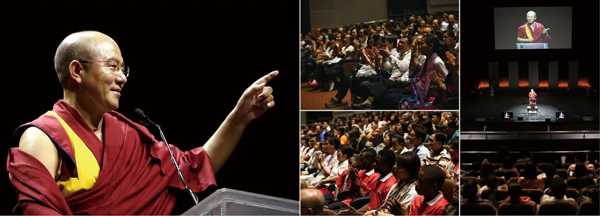

## 竞争心束缚了我们的心

今天交流的话题是“人生岂止输与赢”。我对这个话题很感兴趣，因为每个人都不愿输在起跑线上，都想成为人生的赢家。在新加坡，大家经常说“kiasu”，即“怕输”之意。可见，这个话题被很多人关注。

我们自幼儿园开始，到小学、中学、大学，再到社会，都怕输给别人。大部分人都想成为赢家，在学校里考试不能输，在工作中业绩不能输，在认识的人面前，面子不能输……为了不输，很多家长都让孩子读最好的学校，为他找最好的老师，学习成绩要达到最好，音乐、美术、外语等补习班也都要上。父母已经把孩子逼到了极限，这使得很多孩子内心非常痛苦。

德、英、法等西方国家的教育方式与我们有些不同，他们提倡自由、开放的理念，倡导自然开启学生的想象力和创造力。虽然作为凡夫群体，他们也有攀比心，但不像东方有些国家和民族那样严重。也许与这种教育方式有关，德国虽然只有不到九千万人，但德国人和德裔获得诺贝尔奖的人次却占了全世界的一半。

我去德国的时候问当地一些教授：“德国在文化保存方面、在学术逻辑方面，为何这么具有开创性？”有些人说：“二战之前，德国这两方面做得非常好，但之后也没有那么好了。”即便如此，德国的教育方式与我们的仍然有些不同。

大家在竞争激烈的社会中生存，有时会非常烦恼、痛苦。若把人生比作一场马拉松，很多人从早到晚、从小到大一直都在不断奔跑、不断竞争，直到临终闭上眼睛，才算退出赛场。

## 探究竞争心产生的原因

产生这种心态的原因，可能与“竞争学说”有一定关系，如达尔文的“物竞天择、适者生存、弱肉强食”等观点。其实，达尔文的观点是基于生物学范畴提出的，意即生物之间互相竞争时，适应者才能留存下来，失败者会消失于这个星球。以达尔文为主的生物学家认为，这样的物种竞争是一个自然规律。后来，这种观点从生物学领域延展到了现实生活。

受此观点影响，很多人如同物种竞赛一般，拼命地竞争、攀比，觉得“他有了好车，我也要有”“他家孩子上了名校，我的孩子也要上”“他家买了一套高档住宅，我家也要买”……甚至一些老年人也在互相比。而这种攀比只会让自己活得无聊、心烦。

产生攀比的另一个原因，可能与凯恩斯的经济学理论有关。他主张加大消费，刺激生产力。很多经济学家认为自己对世界的贡献很大，但在宗教徒眼里，以各种方式吹捧某种产品，刺激人们消费不一定是好事，因为这一方面会促使人类的欲望不断膨胀，另一方面，会对全球的环境造成破坏。

不久前，我们在泰国召开了“世界青年佛学研讨会”，期间一名德国教授在报告中说：“如今，消费主义的思想理念，经由网络在全球范围内广泛传播，这让很多人的欲望膨胀到了极点。在西方国家，一些小学一年级的学生，甚至知道世界两百多个品牌。”如果这么小的孩子都知道两百多个品牌，那么当他读大学、进入社会、组建家庭的时候，脑子里装的物质肯定更多。若对物质的欲望越来越大，就不会有满足感。如果没有满足感，内心会不会快乐呢？

一个人要想快乐，首先要有一个非常健康的心态；有了健康的心态，才懂得知足；知足，才能常乐。不过，凡夫人要想做到知足有时比较困难，因为本身具有贪嗔痴等烦恼。

## 若看不清真相，就如疯子般颠倒

世人因受到贪嗔痴烦恼的扰乱，根本看不清万法的真相。从这个角度讲，凡夫人与疯子没有什么差别，现在的情况愈发严重。寂天论师的《入菩萨行论》云：“自迷痴狂徒，呜呼满天下。”意思是，自己欺惑自己的愚痴狂徒，充斥着整个天下。很多人把不干净的认作干净的，无常的认作常有的，空的认作不空的。这种颠倒意识让世人无法看清这个世界。

《中观四百论》亦云：“若识不正住，世说为癫狂，则住三有者，智谁说非狂。”意思是，如果有人意识不正常，世人都叫他癫狂者或精神病人，但三界大部分众生都不了知事物的真相，被外在的事物迷惑，智者谁会说他们不是疯狂者呢？

如今，很多人的价值观确实出了一些问题。比如，特别重视输和赢，自己不想输给别人，一定要成为赢家。其实谁赢、谁输，只是凡夫人的一种颠倒分别念，即自己的想象而已，这种分别念并不成立。

很多人对于世间流行的说法，并未认真思考过。事实上，世人认为正确的，不一定真的正确。他们的依据是什么呢？因为眼睛能看到，耳朵能听到，或者手能触摸到？但这些不一定能作为真实的依据。因为，眼睛观察的范围非常有限，对于过去、未来的色法，或者微观世界、大如银河系天体的广大色法，都无法看见。我们认为柱子、瓶子恒常不变，但实际它们刹那刹那都在变化，只是我们看不清楚，觉得它们恒常不变而已。所以，我们的感觉不能作为判断的真实依据。

大家也可以结合自身想一想：自己年轻时的很多想法，中年时会发现它们不一定正确；上午觉得这么做是对的，下午可能就改变了想法。现在，很多家庭离婚的原因，也是当时自己认为这个人很好，但过了几个月或几年之后，发现他原来很坏，并非自己理想的伴侣。以上种种心态说明，以分别念来判断事物，不一定很准确。

此外，我们自己的心态也难以捉摸，可能上午还挺开心，到了下午就莫名地烦恼、痛苦，甚至无缘无故发脾气。可见，我们不能完全相信自己的心。

“你为什么不信任我？”是人们常说的一句话。其实，不要说别人不相信自己，有时我们自己都不相信自己。佛陀在《三摩地王经》中说：“眼耳鼻非量，舌身意亦非，若诸根为量，圣道复益谁？”我们的眼耳鼻舌身，都不是正量，如果它们是究竟的，那超越分别念的圣者境界有何用呢？就没有用了。所以，我们需要寻找一个最正确的道。

不过，现在社会上很多人都行持疯狂的行为，即使少数人知道万法的真相，也很难改变整体。月称论师在《中观四百论注疏》中讲过一个故事：很久以前，某国有一星相师向国王进言：“七日之后，必有雨降，饮此雨水者必然发狂。”国王听罢，便把自用的水井口盖得严严实实，不让一滴雨落入井中。但他的百姓没能力这样做，于是都喝了雨水，变成了疯子。举国上下，只有国王一人心智正常，全民的言谈、思维都与国王不同，他们都说国王疯了。最终，万般无奈的国王只能喝下雨水，变成和他们一样。

与之相同，在现今大多数人热衷攀比的时候，若有个别人不攀比，大家都觉得他精神有问题。断恶行善亦如此，当大多数人精于算计、自私自利的时候，若有人宽厚善良、无私奉献，很多人都觉得他迷信、可怜，甚至阴险，继而欺负他、侮辱他。生活在这样的世间，有时确实很无奈。

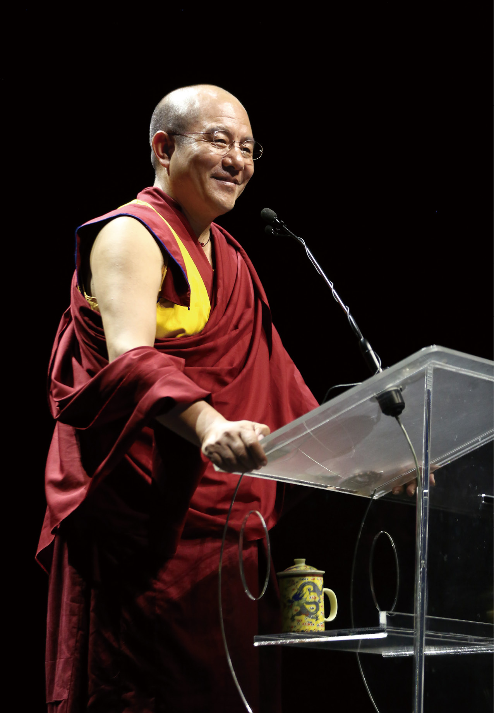

## 输赢可以相互转换

赢和输，如同阴阳并存一样，只要有赢，肯定有输。

20世纪90年代，有一部名叫《美梦成真》的电影。片中有一句很经典的台词：“有时候你以为你输了，其实你赢了。”实际上，这句话也可以反过来说：有时候你以为你赢了，其实你输了。

世间一切皆是如此，在一场考试或其他竞争中，你认为自己输了，别人赢了，但其实不一定。对比赢和输，有时输了更好，赢了不一定很好。为什么呢？因为，赢的背后有输，输的背后有赢，就如中国传统文化太极图中的阴阳鱼，白鱼之中有只黑色眼睛，黑鱼之中有只白色眼睛，表示阳中有阴，阴中有阳，阴阳不断转换。

古人亦云：“祸兮福之所倚，福兮祸之所伏。”福和祸、得和失彼此跟随。福到来之后，物极必反，祸很快也会到来。佛经亦云：“高际必堕，聚际必散。”当事物到达顶点时，必然反转下坠，因为物极必反，就如月亮上行到圆月，就会开始亏缺。反之亦如是，如果我们现在输了，正处于谷底，经过不断努力之后，必然会有起色。

赢和输的转换是一种自然法则。很多人不明白这个道理，只一味追求成功，却不知其背后隐藏着许多危险、失败和痛苦。

佛教教导我们随缘。所谓随缘，并非不竞争、不追求。适当的竞争和追求是可以的，但过分、极端的竞争和追求则不可取。因为该来的自然会来；得不到的，再怎么苦苦追求，也难以得到。

## 接受诸法的两面

无论团聚、快乐，还是其他福报显现的法，其中都隐藏着不利的一分。《中观四百论》云：“若喜彼集聚，何不喜彼离，集聚与分离，岂非俱时有。”这句话意义很深，意思是：如果你喜欢和亲朋好友欢聚一堂，那你为什么不喜欢他们全部离开你？因为集聚和分离是不可分割的，比如，今天自己和朋友见面吃饭，吃完饭之后，彼此马上就会分开；现在自己和家人在一起，但迟早彼此都会分开。如果你喜欢团聚，为何不喜欢分离？喜欢快乐，为何不喜欢痛苦？理应都接受，因为二者本不可分。

在轮回中，快乐和生老病死、爱别离等痛苦，不断交替出现，我们会品尝到酸甜苦辣等各种滋味，但大多数人只追求正面的，希望负面的不要发生。其实，有时候发生一些不好的事，也是很好的。俗话说：“生于忧患，死于安乐。”忧虑祸患可以使人发奋而得以生存，安逸享乐可以使人懈怠而导致灭亡。

有部论典记载：在古印度，有个人按照当时的传统祈求吉祥神帮助自己。他虔诚祈祷后，面前果然出现了一位神。他问：“您是不是我求的吉祥神呢？”神回答：“我不是吉祥神，我是不吉祥神。”此人生气地说：“我祈祷的是吉祥神，为什么你这个不吉祥神出现了？”神说：“你难道不知道吗？吉祥和不吉祥始终在一起。只不过我先出现了，吉祥神暂时藏着而已。”

当一个人有名声、有财富、各方面都很成功的时候，其背后正隐藏着失落和痛苦。比如，有的演员因一部剧一炮而红，不仅赚到了钱，还获得了很多奖项。他获奖时特别开心，眼睛笑成弯月一般，但随后，压力便如潮水般倾泻而来，被心怀嫉妒的人诽谤、攻击，被各种谩骂声包围。可见，有钱、有地位不一定就会快乐，反而会遭受更多痛苦。

我们经常看到，美国总统、英国首相等领导人大选获胜时激动万分，旁人也羡慕不已。然而从当天开始，他们就不得不承受超过普通人数倍的压力和痛苦。但人们只看到他们风光的正面，看不到他们痛苦的背面。

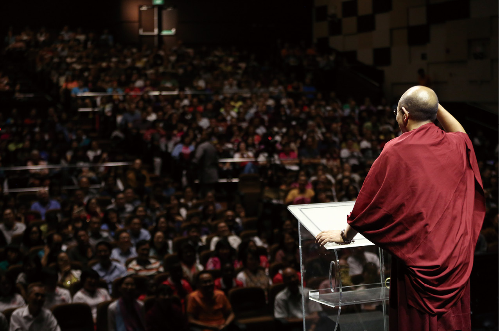

## 利益胜利奉献他

关于输赢问题，佛教的观点与世人不太一样。佛教认为，即使自己有能力赢，有时也要把机会让给别人。藏传佛教有位非常著名的朗日塘巴格西，他在《修心八颂》中讲了一个特别著名的修行窍诀：“亏损失败自取受，利益胜利奉献他。”意思是，对于亏损或失败，自己心甘情愿地接受，而把机会和胜利让给别人。

一般人很难做到这一点，大部分人都认为，自己一定要赢、要成功，凭什么把机会让给别人？即便把机会让给了别人，对方也不会感恩，并且这样自己岂不变成弱者了吗？

“亏损失败自取受，利益胜利奉献他”的观念到底合不合理呢？也许在某个时段、某个群体当中，朗日塘巴的窍诀不一定能发挥出真实的价值，但我们应该知道，真正的赢家，必定是拥有善良品格的人。通过一些技巧赢了，只是很小的赢家；通过实力获胜，是中等的赢家；在良心上、品格上胜出，才是真正的大赢家。

有智慧、有能力的人通常会把机会让给别人。左宗棠是晚清重臣，著名的政治家、军事家。有一次他出征打仗，途中看到一间茅屋的门上贴着“天下第一棋手”的字幅。左宗棠也喜欢下棋，心想：“此人口气不小，棋艺真有这么厉害吗？我来会会他。”于是，他找屋主下了三盘棋，结果都赢了。左宗棠得意地说：“你最好把门上‘天下第一棋手’的字幅摘下来，因为三盘棋你都输了，没有资格号称天下第一。”说完便兴高采烈地打仗去了。

左宗棠凯旋时，看到这间茅舍的门上仍挂着“天下第一棋手”的字幅。他有点生气，又找屋主下了三盘棋，这次左宗棠都输了。左宗棠不解地问：“为什么那天我都赢了，这次却都输了呢？”屋主答：“上次是我有意让您，因为您出征很不容易，我不杀您的锐气，是想创造一个吉祥的缘起。既然您已经凯旋，我当然要拿出自己的真本事了，这样天下第一的招牌才能保住啊。”从这个故事可以看出，有些人并非真的没本事，只不过把一些机会让给了身边人，但大多数受益者不一定会知道。

当今时代，人道主义逐渐被功利主义取代，而功利主义者又逐渐变成了投机分子。如果继续这样演变，到最后，人们的很多梦想都会变成空想，很多愿望都会变成失望或绝望。在这样一个时代，我们把机会、胜利让给别人，也许对方永远不会知道，但对提升自己的品格而言，却是一桩好事。

## 莫成“被牵着的兽”

日后，很多年轻人都要创业、发展事业，过程中有没有必要努力进取呢？非常有必要。我们不能过于极端，要么特别懒惰、懈怠，不愿工作，整天靠别人养活；要么过于拼命，连自己的健康、生命都不管不顾，眼里除了成功、金钱、名声以外什么都没有。我们应该行持一种中道。

如今，钱把很多人的思想系在了一起。新加坡的新币、中国的人民币、美国的美元，欧洲的英镑或欧元等等，虽然只是一些纸，但无形当中，已把所有人拴在了上面，控制了起来。

有一幅叫《被牵着的兽》的画比较出名，画上有一处悬崖、一片青草、一群羊和几只狼。画面表达的是“欲望之束缚”——几只狼一直盯着羊，很想吃掉它们，这群羊则贪恋眼前的青草，它们彼此之间被“欲望”这条无形的绳子紧紧连在了一起。

人类也是如此，被欲望紧紧束缚着。当人们贪执金钱、地位、某人等自己所求的对境时，对正向的价值观不一定能理解和信守。有些人虽然理论上讲得很好，但仍旧贪执，不顾一切地竞争和奋斗。很希望大家在追逐欲望的过程中，不要太过执著。

## “败”的启示

弘一大师在《南闽十年之梦影》中说：“我的性情是很特别的，我只希望我的事情失败，因为事情失败、不完满，这才使我常常发大惭愧！能够晓得自己的德行欠缺，自己的修善不足，那我才可努力用功，努力改过迁善。”我们很多人可能都不这么想，只希望不要遭受任何失败。

在这方面，曾国藩和弘一大师持相同的观点。曾国藩把其书斋取名为“求阙斋”，因为他觉得圆满和完美对自己很不利，因为锋芒展露之后，就会树大招风，殃及自身，带来各种痛苦。与其这样，不如保留一些缺点。所以，曾国藩在一生当中即使遇到困难、遭遇失败，也觉得很开心。

以前，藏传佛教很多大德听到别人赞叹时，也不太高兴，马上用空谷声喻将其转为道用；在遭到别人诽谤、攻击、伤害的时候，反而觉得修行机会来了，特别开心。我翻译的《释迦牟尼佛广传·白莲花论》中，也讲了个别修行人不愿获得正面利益的公案。

这种观念与大多数人的价值观背道而驰。世人都希望自己幸福，去寺院祈愿也都是希求正面的，如希望平平安安、顺顺利利、快快乐乐，等等。谁都不会祈求失败、生意亏损、疾病缠身等负面的“加持”。

## 心头无事，便是净土

实际上，即使我们不愿得到负面的加持，人生不如意事也十之八九。一会儿家人病了，一会儿生意不顺，一会儿失业了……尤其现在全球经济处在下滑阶段，每个人在工作、生活等很多方面，都没有安全感。

去年我去英国的时候，结识了一位很自信的英国人。不久前我又遇见了他，我说：“现在英国已经脱离欧盟了，你们感觉怎么样？”他有点沮丧地说：“哎，现在没有安全感了，只能好好工作，否则以后会过得比较拮据。”从他的表情便可以看出，短短几个月英国已经发生了很大变化。英国脱欧给民众的生活带来很多不确定的因素。

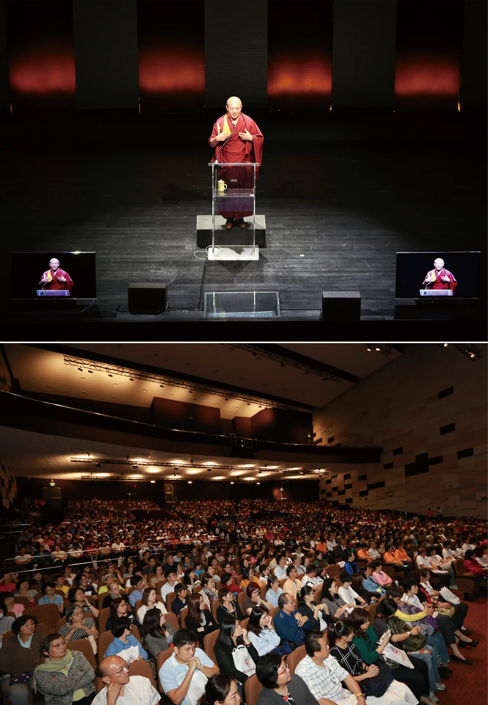

希望大家能知道，一切都不是恒常的，也许你现在很有钱，但有些不可控的事情可能会让你一夜之间变得穷困潦倒。为了应对这种情况，在生活中，我们对正面和负面的因素都需要考虑。

作为大乘佛教徒，我们对所谓的胜利与失败、赢和输，不应该特别执著。输了一两次，也输不了多少；赢了一两回，也赢不了多少，在漫长的人生中，谁都不可能做常胜将军。年轻时非常成功的人，到了老年可能特别悲惨，而年轻时历经苦难的人，却可能白手起家获得成功。

量子物理学中有一种“不确定因”，人世间也有很多不确定的因素，包括名声、财富、感情、相貌等都是不确定的。我二十年前来这里的时候，见过一位很帅的帅哥，刚才再看到他时，觉得他有点老了，我自己同样也老了。

无论我们的身体，还是心态，很多方面都是不确定的，这时，运用佛教观念调整心态非常重要。如果心态摆平，即便遇到很多困难也能泰然处之。正所谓“眼内有尘三界窄，心头无事一床宽”。如果眼里有沙，会觉得整个三千大千世界也特别窄；如果心中无事，哪怕一张床也觉得非常宽。可见，人的心态很重要，如果心能放开，发生再大的事情，也能安然度过。

我很喜欢宋代无门慧开禅师的一首诗：“春有百花秋有月，夏有凉风冬有雪，若无闲事挂心头，便是人间好时节。”大自然中，春天有绚丽的百花，秋天有皎洁的月光，夏天有徐徐的凉风，冬天有皑皑的白雪（在新加坡好像看不到雪景，有点可惜噢）。如果没把纷繁杂乱之事挂在心头，便是人间美好的净土。有些禅师确实能做到。

## 心若不净，幸福难觅

人如果只依靠物质来充实、满足自己，身心必定很忙、很累。这次我去泰国的时候，参观了一些出家人的僧房和闭关房。南传佛教僧人托钵乞食，他们的家里除了袈裟、坐垫和几本书以外，一无所有，但他们照样活得很开心。而我们即使已经有了很多财物，仍然觉得不够，心理压力越来越大，烦恼和痛苦越来越重。其实，这都是心不清净导致的。心若不净，幸福难觅。

以前有位良宽禅师，常年居住在一间空无一物的茅棚里。他喜欢坐禅，也喜欢出去讲经说法。一天晚上，他讲法回来发现有个人正在他茅棚里偷东西。禅师笑言：“你应该没找到什么东西吧，要不要把我的衣服给你？”说完，他就把衣服脱下来送给小偷。小偷惊慌失措，拿着衣服撒腿就跑。这时，屋外月光皎洁，禅师自言道：“好可惜啊！我很想把美丽的月亮送给他。”对于禅师的这句话，后人有不同的解释，我觉得其深层含义应该是说：这些众生整天忙着造业，好可怜，如果能把真正认识心性的窍诀给他，让他证悟心性该多好啊！

古代禅师的生活非常简单，与我们有着天壤之别。现代人有车、飞机等各种交通工具，也有高楼大厦、商场等各种现代设施，尤其像新加坡这样商业发达的国家，更是一应俱全。这一方面是福报的体现，说明民众的生活条件都很好，但另一方面，如果没有调整好心态，也会活得很累、很苦。此外，新加坡资源有限，水、粮食都要从马来西亚等国进口，为了这些，也需要额外付出很多。

## 闻思修的重要性

我希望大家闻思修，并不是让所有人必须学一个很深的法，而是希望大家至少懂得一些佛教的道理。虽然拜佛、当义工，或者做其他善事功德也很大，但真正的佛教徒不能离开闻思修行。如果没有闻思修，再过十年、二十年也不一定有进步。

1995年法王来新加坡的时候，曾传过大圆满。过了将近二十年，2013年我来新加坡的时候，了解到有些人还没有修加行。这一方面也情有可原，因为这些人比较忙，另一方面也说明，他们对世间的贪执太多了，没有好好闻思修行。

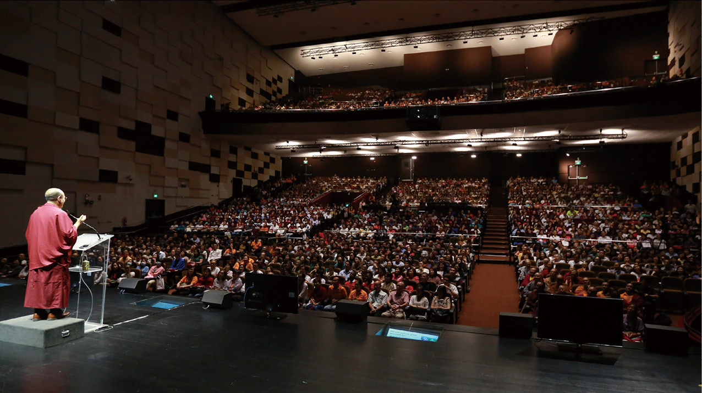

作为一名佛教徒，如果光有一个信仰，没有学习寿命无常等佛教的道理，将很难解决自己的生死大事。我昨天在新加坡国立大学也说，搞个简单的活动，如禅修、观想佛陀、去寺院当义工，或者做其他善事等，虽然很好，具有无量的功德，但这些难以解决我们的生死大事，因为没有从根本上断除烦恼。当我们产生贪心、嗔恨心、邪见，包括无明引发的嫉妒、傲慢、虚伪等各种烦恼时，如果没有坚实的闻思基础，将很难对治。

很多佛教徒都非常优秀，值得赞叹，但也有个别人一直没有进步，始终停留在表面、简单的层面上，今天跑这个寺院，明天跑那个寺院，只求做做功德。新加坡是一个非常开放的国度，佛教中心很多，但有些居士却由此成了“跑跑居士”，学得不深入，这是非常可惜的。

我很希望，新加坡佛教团体的整体观念能有一些转变。现今，中国大陆百分之六七十的佛教徒都喜爱闻思修行，甚至能背诵一些论典。我们佛学院有很多汉族出家和在家众，大多数人都能背五六部论。他们对学习经论兴趣浓厚，很多人发愿学习中观、因明等五部大论。学习《前行》、修五十万加行于他们而言，是件非常简单的事。相比之下，我们这里的个别佛教徒比较懒散，在闻思和修行方面一直没有进步。希望以后能逐渐改变这种风气。

作为佛教徒，首先要知道皈依的重要性。皈依之后，自己就成了一名佛教徒。这时如果连“什么是三宝”都说不清楚，理论上一点都不懂，是非常可惜的。其实，学习佛法也不是一件很难的事情。

我第一次去泰国的时候，看到当地大多数人都信仰三宝，特别羡慕，感叹那里是真正的佛国。但泰国有些佛教徒也不太重视闻思修，藏地有些地方也是如此，藏地虽然全民信教，信徒们特别虔诚，在供养、念咒、祈祷、修加行等方面做得非常好，但很多人都不重视学理论，且不说密宗的最高见解，就连一些简单的道理都不是很明白。

总之，我希望我们佛教徒，不要仅停留在表面的爱好上，一定要深入进去，最好每年对自己的闻思做一个计划，比如，利用三年时间学习《入行论》，两年时间学习《前行》，等等。

古人可以静下心一本一本地看书，一本一本地写书，但现代人却很难做到，因为在信息爆炸的时代，每个人的心都变得很浮躁。现在，大家都不愿意看或写博客，因为字数太多了，更愿意看微博，因为微博最多140个字。即便这样，很多人也觉得累和烦，于是又开始流行“标题党”，即只看一个标题，其他什么都不看。很多广告把标题写得特别吸引人，骗取点击，打开之后里面都是空的。

在这样一个时代，大家要系统地闻思修可能有一定难度，但我可以负责任地说，闻思修对于佛教徒确实非常重要。我们都知道皈依佛、法、僧三宝。那什么是佛？什么是法？什么是僧呢？这些基本的道理一定要懂，倘若不重视，以后佛教教义不一定能长存于世。

我想其他宗教徒应该也需要闻思修的智慧，只有浅显的身份认同是不够的，还要了解所信宗教的一些教义。比如，基督徒需要懂得基督教所提倡的“信、望、爱”；儒家学者需要懂得儒教所提倡的“仁、义、礼、智、信”；伊斯兰教徒需要懂得伊斯兰教所提倡的“信真主、信阿訇”。

总而言之，我提倡大家闻思修行，是因为暂时来讲，虽然做供佛、礼拜等善法很好，但如果某一天自己的亲人死了或者发生其他意外，自己因为没有深入闻思，不懂无常的道理，可能会特别伤心痛苦，不知所措；此外，不知道轮回痛苦、因果不虚等道理，不知道发菩提心的功德，想要真正帮助别人、利益众生也非常困难。

## 转迷信为正信

从某个角度讲，不懂佛法、不爱闻思的佛教群体，也是一个迷信的群体。很希望大家把迷信转为正信。

要想生起正信，必然要有所付出，并不是今天来了一位上师，去他那里简单听一下，听的时候或者打瞌睡，或者胡思乱想，或者玩手机，不做任何记录，上完课什么都不记得了。这种态度是不行的，虽然上师们经常到新加坡传法，大家听闻的机会很多，但应该珍惜每一次机会。每一天、每一分钟都是我们的生命。听一堂课，其实是用自己生命的一部分来接受教育，我们一定要对自己负责。

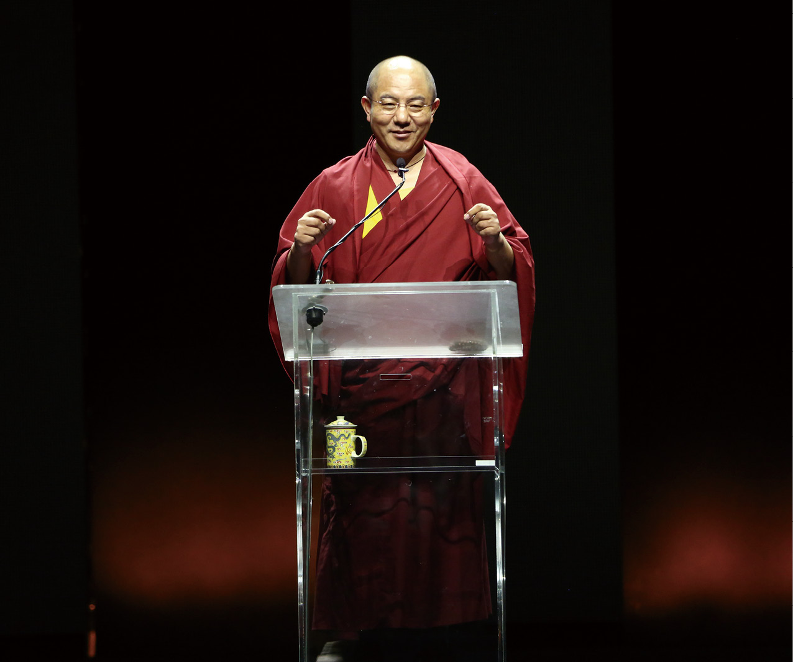

该怎样闻思修呢？首先，应在善知识面前听受，就像学生在老师那里听课、学知识一样。通过听闻，可以逐渐产生闻慧；之后，需要把所听闻的知识再三思维，就像理解世间知识那样，通过思维，可以逐渐产生思慧；最后，对所得到的知识反反复复串习，付诸行动，这叫做修慧。

今年“世青会”举办了四天。会上有些普通大学生也做了演讲。对于他们所讲的内容，有些我能接受，所以记了下来，有些虽然不能接受，但也记了下来，因为想着以后有机会可以破斥。我是以这两种心态来听受他人的发言。我觉得作为佛教徒，不断学习非常有必要。

## 关于弘法和修行的三点嘱托

关于大家个人修行和对外弘法方面，我还想说三点：

第一，我们学习和弘扬佛法需要科学化。所谓科学化，就是要通过逻辑推理、理论依据来证明自己的观点，不能以说神通、打卦、算命等方式进行论断。因为加入这些内容之后，很多人不一定会相信。佛教戒律规定不能说大妄语。所谓大妄语，就是自己没有神通说有神通，没有得果说已经得果。说这种大妄语非常不合理。

第二，佛教的弘扬和修行一定要现代化。2500多年前传下来的佛法，包括仪轨，大多是用古代语言表述的。现在我们弘扬的时候，应该适应当代人的认知和习惯，这一点很重要。

第三，佛教的学习和弘扬需要生活化。所谓生活化，是指佛法不能仅限于在寺院或道场中学习，也要不离我们的家庭和工作单位。无论你是医生、军人、学生、老师、公务员，还是其他身份的人，都可以在行住坐卧等生活的方方面面运用佛法。无论你出差、上班，还是在家里，都可以学习和修行佛法。像藏地有些修行人，无论坐车还是开车，都可以用念珠或计数器念咒语，非常方便。

佛教的很多内容都可以用在生活上。运用的时候，一定要人性化，适应人心。比如，在新加坡弘扬佛法，就要适应新加坡人的心态；在非洲弘扬，就要与非洲人的心态相应。

佛教的本意不能更改，但弘扬的方式方法却可以更新。像昨天中午，我们佛学中心准备了很多好吃的，有马来西亚、新加坡等各地的口味，大家来这里不但能学到佛法，还能吃到很多好吃的，这样做非常人性化，我看到之后很高兴。

以生活化、人性化的方式弘扬佛法非常有必要。很多宗教都会组织一些特别吸引人的活动。这样做不但让教徒们生起欢喜心，也会让一些没有任何信仰的人，自此开始信仰，这会对他们的人生非常有帮助。我们佛教徒也应该学习这种人性化的弘法方式。

对外弘法的同时，我们自己也要好好修行。佛陀告诉我们死期不定、死因不定，每个人死的时间定不下来，死的因缘也定不下来。2013年我来新加坡的时候，有位道友全程为我们做介绍，这次得知他已经得癌症离开了。

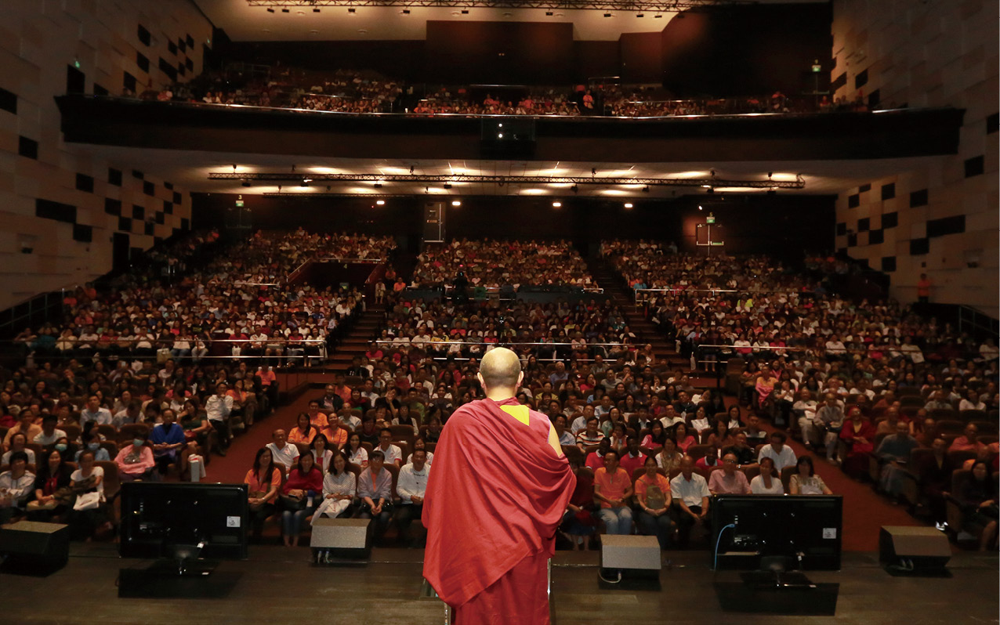

人的生命极其脆弱，何时离开世间很难说。当我们离开的时候，“万般带不走，唯有业随身”，任何事物都不可能跟随我们，只有善业和恶业如影随形。

对于因果不虚的道理，并非口头上说说就可以了，应该发自内心、从骨髓里深信不疑，然后在实际行动中如理取舍，这样才会真正有意义。

现场互动

问：我学习佛法之后，烦恼明显减少了。在工作和生活中，对曾经执著不放的东西，抓得也不那么紧了。但随着生活和工作条件变得越来越优越，我对佛法的信心、对人生目标的追求心，却好像减淡了。请问，应该怎样平衡世间的生活和出世间的修行？

堪布：很多人都想一边工作生活，一边修行，但因为受到各种逼迫和干扰，经常不能如愿。

我建议大家最好不要堕入极端。若一直忙着家务和工作，对生老病死和修行的问题一点不在乎，是很可惜的。作为一名佛教徒，如果现在没有修，死时肯定会后悔。反之，若把所有的时间和精力全部放在修行上，对家人和工作不管不顾，在竞争如此激烈的现代社会，恐怕很难生存下去。所以，作为一名在家信徒，最好不要堕入两边，既要努力工作，关心家庭，也不要放弃自己的修行，我想二者应该可以兼顾。

问：在当今21世纪，我们应该怎样修行？

堪布：现今是一个很复杂的时代，与以往任何时代都不同。父母不理解孩子为什么天天上网、看手机，但也束手无策。如今网络铺天盖地，几乎控制了全世界的人，有时我们只能随顺这样的时代。

这个时候，我们仍要不断强调善良、真诚等美德，使之不被遗忘，否则，整个社会都会被负面信息笼罩。每个人应该凭自己的良心，在善的轨道上不断努力。

接下来，我想特别介绍一下ACC（非洲阿弥陀佛关怀中心），他们在新加坡有一个中心。我传法三十多年从来没有宣传过谁。去年由于特殊的因缘，我去了非洲的莱索托、纳米比亚和马拉维等几个地方，见到了“和尚爸爸”和他的发心团队。他们做得非常辛苦，因为很多非洲儿童都需要帮助。

藏地虽然也比较穷，需要很多人支持，但与非洲国家比起来，情况要好很多。前不久，我们邀请一位非洲小孩参加“世青会”。孩子告诉我们：非洲艾滋病感染率很高，最严重的国家有近40%的国民感染。虽然现在艾滋病在很多国家都可以控制，有不少治疗方法，但在非洲却很难医治。不仅如此，非洲还频频发生战争、饥荒和瘟疫。

以后如果有机会，我还想去非洲。当然，去那里有很多不确定的因素，心里也比较害怕。去年我去莱索托的时候，所乘飞机的坐垫都破了，机场的马桶还需要自己倒水来清理。以前我从没坐过这样的飞机，当时心想，如果这次飞机坠毁在沙漠里，关注的人可能不会太多吧，一个月都不一定能找到，应该不会像马航失事那样受到全世界的关注。虽然自己会有一些担忧，但可能习惯后就没什么了。

去年，我第一次踏上了非洲的土地，以后如果各方面因缘具足，我还想多去几次，希望这会对自己的修行、对当地的众生有一点利益。

问：在日常修行中，该如何保持内心的平静，安住当下？

堪布：我们喝粥的时候，可以边喝边观察自己的念头，开车或做其他事情时也是如此。禅宗这样讲，密宗亦如是。

譬如，你正和家人吵架的时候，如果观自己的念头，当下就能安住，马上不想吵了。如果家人问：“你为什么不跟我吵了？”你可以回答说：“就像手机没电会突然关机一样，我的分别念突然没有了，所以当下安住。”对方听到后，可能会希望你以后经常禅修。（众笑）

问：我的爷爷生前信佛教，念阿弥陀佛，也做过很多善事。我想知道他死后去了哪里？另外，我的一个家人得了癌症，做了全切手术，现在恢复了三个月。我需不需要带他去藏地祈福？

堪布：前一段时间，我的母亲去世了，现在我也不知道她去了哪里。建议你给爷爷多做一些善事，这样无论他转生哪里，都能帮到他。

我觉得不一定非让你的家人去藏地，关键看他自己的想法和兴趣。如果他很有意乐，在身体允许的情况下，去也是可以的。不过，藏地海拔比较高，你们需要考虑他的承受能力。

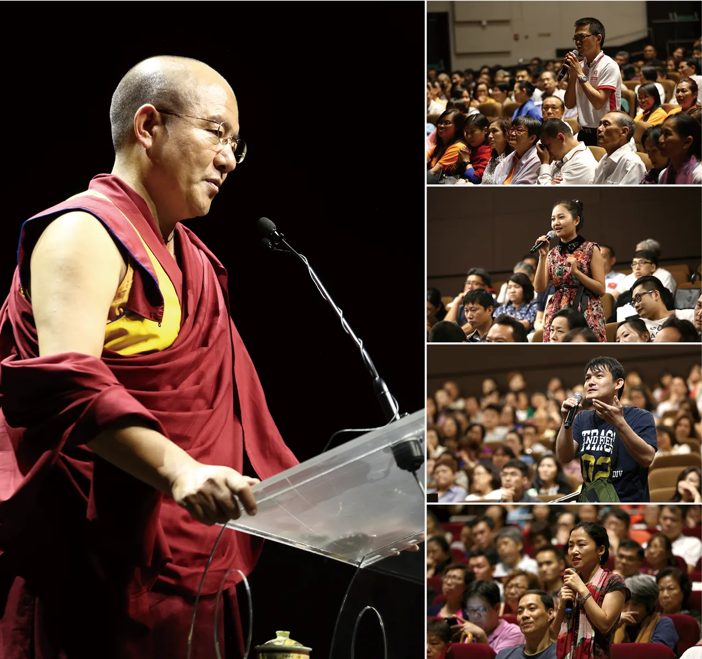

问：台湾有个人自称观世音菩萨的化身，他提倡神通，创立了“心灵法门”。请问，如何引导初学者辨别真伪？

堪布：哪个地区都有不同的宗教，每个宗教和传教士都有不同的引导方法。判断某教派是不是真正的佛教，主要以佛教的经论来衡量。若符合经论所说的道理，就是真正的佛教；若不符合经论的内容，也非传承上师的教言，则说明不是真正的佛教。我们应该学会观察，以智慧观察得出的结论才是正确的。

问：我之前修过五十万加行，但不是在菩提学会修的，请问，这样可以直接进学会的密法班吗？

堪布：希望大家参加某个团体之前，最好详细了解它的学习方法、管理架构和各项要求，斟酌自己的情况之后再确定。学习密法也是如此。

我们为大家传密法，有一些比较细致的要求，听受者必须达到才行。如果条件具足，不管是什么样的人，我们都欢迎他听闻正行法门，但若只是说自己修完了加行，要听正行，恐怕有一定困难。我刚才讲过，有些人以前得过密法，但加行一直没修，这样就好似空中楼阁，对自己不一定有利。所以，这方面我们要求得比较严格。

你说自己以前完成了五十万加行，但对于你的修法和修量，我们还需要了解具体的情况才能定。

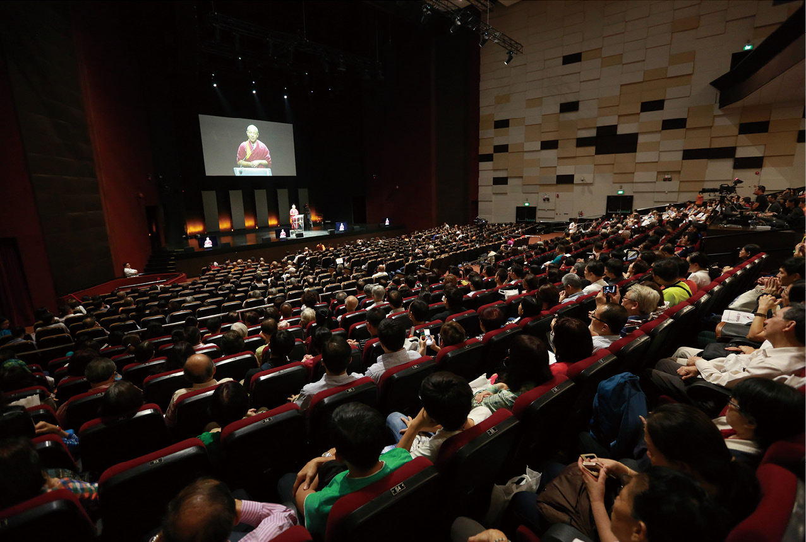

问：您作为长辈，在看到年轻人虔诚学佛、放弃一些世间的追求和享受，甚至产生出家念头时，如何判断他是因为年少冲动，还是真的佛缘深厚？是支持他，还是以其他方法引导他？我很想听您的分享。

堪布：《佛说出家功德经》中说，出家有很大的功德，如果我们制止别人出家，过失非常大。

有些人认为，出了家便一身轻松，但其实出家并不那么容易。出家人的路比在家人更难走。出家人不仅要经历守持戒律等诸多苦行，还要长期闻思修行，更关键的是，真正的出家人需要利益众生，但利益众生并不那么容易，刚强难化的众生很不好度。

有些人因为在生活中遭遇了挫折和痛苦，比如，在破产、失业、亲人离世，或者与家人吵架、离婚的时候，便想去寺院剃度出家。这样出家并非好事，因为他不是由真正生起出离心而出家的。

所以，很多人在我面前表达出家意愿时，我都会让他考虑两三年，不要一时冲动。佛教戒律中也说，在一个人因为家人离世等痛苦而心生忧愁之时，不准许他出家，如果这时出家了，他在忧愁消散后，很可能会还俗。

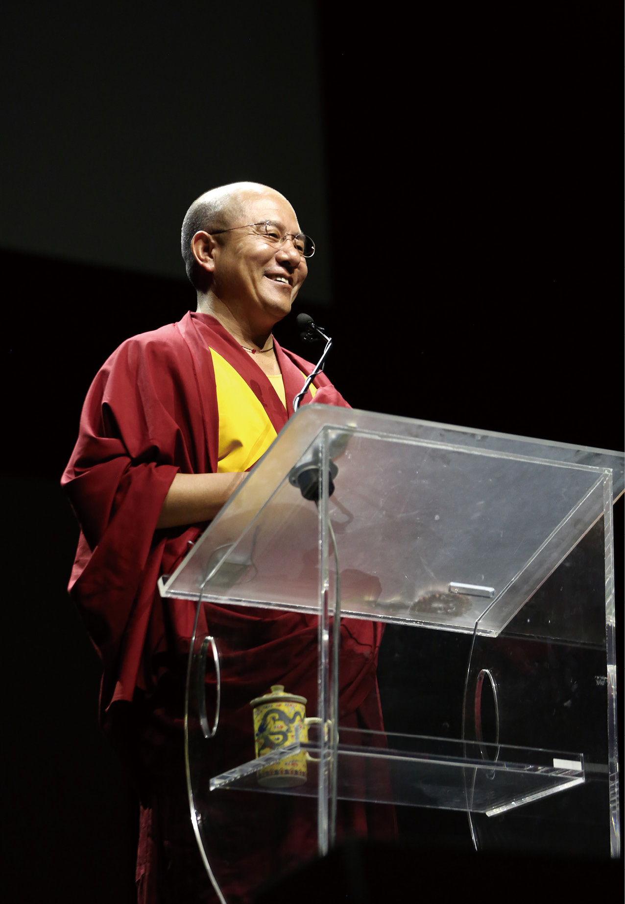

现今，有些出家人对出家生活不习惯，这个寺院待不下去，便跑到另一个寺院，折腾一番之后，又变回在家人；还俗后在世间混不下去，又想出家。人生这样翻来覆去，就像演员换了很多套衣服一样。我觉得这种生活态度不是太好。

对于是否出家的问题，自己应该深思熟虑，如果真的各方面因缘具足，作为长辈也可以支持。

问1：刚才您提到闻思修行，我想请问有什么经论适合初学者阅读？我现在只看过《金刚经》，不知道下一本可以读什么？

堪布：接下来你可以看《妙法莲华经》。

问2：祈请您继续传讲《妙法莲华经》，感恩！

堪布：我会继续传讲的，只不过传的方式会有些不同。

我觉得除了看《妙法莲华经》以外，更重要的是学习《大圆满前行》。以前我来新加坡的时候，刚好把《大圆满前行》的“共同加行”部分翻译完了。我从新加坡回去以后，翻译了“不共加行”。当时，我在这里讲了《大圆满心性休息》中的密法。法王如意宝当时讲了《等性自解脱》，我相信今天在座很多人都听过，也得过法王的金刚萨埵灌顶。我建议你们学《大圆满前行》，因为这部法确实非常重要！

问：您能否举一个生动的比喻，说明什么是明空无二？

堪布：有一个非常好的比喻：月亮的影子映入水池时，你可以看到水面上的月影。它有正在显现的明的部分，但这个明的部分，实际却是空的。

这个比喻来自14世纪藏传佛教伟大的修行者——全知龙钦巴尊者所著的《大圆满心性休息》。明空无二可用水月作比喻，水月虽有显现，但却是空性的。同样的道理，我们的心虽有光明的显现，但其本体却是空的。这个比喻非常好。

问：人生的输与赢，可否从因果的角度观察？

堪布：刚才我是从输和赢的正反面，以及现实生活中人们的迷茫、执著等方面分析的。当然，从佛教因果的角度观察也是可以的。

我们至少要做到儒家所倡导的“己所不欲，勿施于人”，若想进一步提升，则要学习大乘佛教自他交换、自轻他重的精神。也就是说，在输和赢方面，自己站在别人的角度，别人站在自己的角度，换位思考。

按照佛教的观点，一个人今生当中赢了，来生很可能会输；今生当中输了，可能因为前世曾赢过。现在很多人打官司时也经常说：这次官司输了，可能是前世的因缘，否则不可能会这样。

所谓的输和赢，有概念上的输赢，有现实层面的输赢，也有大众价值观方面的输赢，很多方面都值得分析。

主持人：

感谢堪布！转眼间，今晚的演讲已经接近尾声，最美好的时光总是最短暂的。虽然短暂，但堪布的智慧法语，却让今夜的灯光分外璀璨。

让我们共同祈愿仁波切法体安康，长久住世！请求仁波切能够慈悲应许，以后能经常莅临狮城，为有缘众生指点迷津，开启每个人心中的智慧明灯。

感谢各位今晚的参与！
