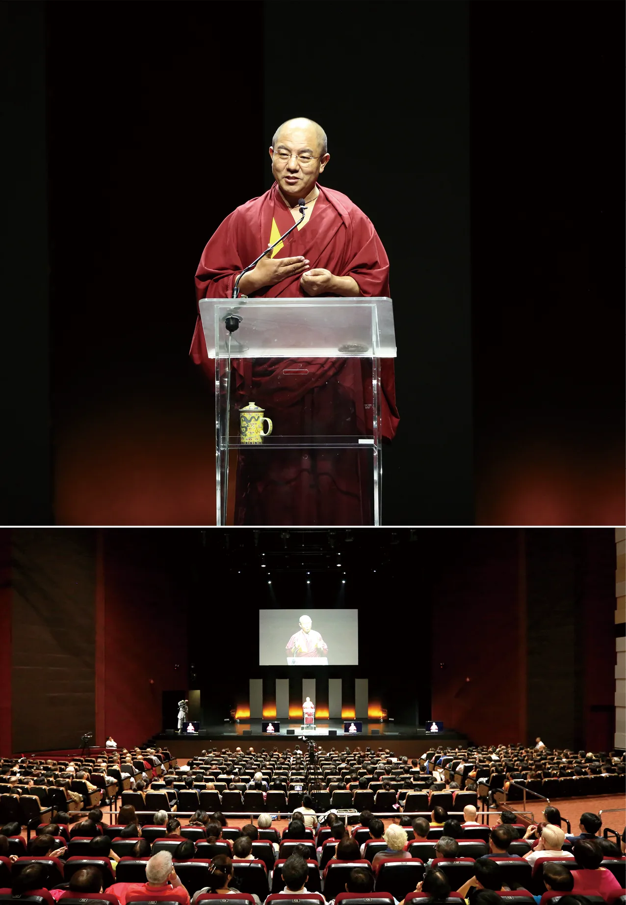

行善，是企业家的最高境界。

第57场

青岛慈善论坛

Qingdao Philanthropy Forum

中国·山东

2016 / 11 / 15

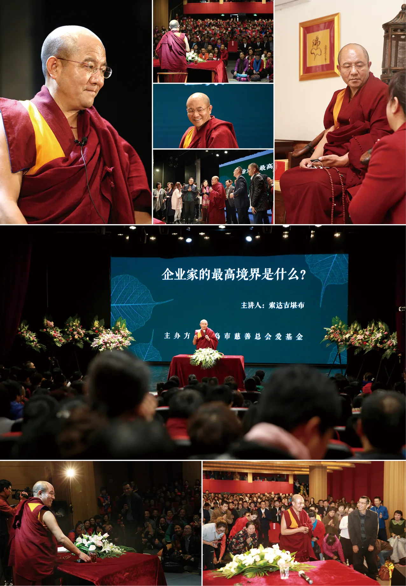

## 企业家的最高境界是什么

## Ultimate Inner Attainment of an Entrepreneur

主持人：

尊敬的各位来宾，大家下午好！

我来自青岛市慈善总会爱基金。首先，请允许我代表爱基金，对我们尊敬的堪布和所有嘉宾的到来，表示最最热烈的欢迎和感恩！谢谢大家。

今天来到慈善论坛现场的，有来自全国各地从事慈善的成功企业家、热心公益事业的爱心人士，以及很多甘于奉献的志愿者。我看到这个剧场已经爆满，达到了其有史以来能容纳的最大量。这里不仅人满爆棚，我们的爱心、正能量同样爆棚。

首先，恭请我们慈善总会爱基金的陈会长为大家发言——

陈会长：

尊敬的索达吉堪布、各位爱友，下午好！

伴着今天的旭日阳光，我们再次邀请到著名的高僧大德、佛学大师索达吉堪布莅临爱基金企业家慈善论坛。2015年6月，同样在这里，堪布大师曾用一场精彩的演讲——“因爱结缘 向善而行”，将我们带进了一个善的世界。大师的慈悲感召力，让更多人更坚定地加入行善的队伍当中，追随善的指引。

爱基金在助学帮教之路上走过了九年。九年来爱基金累计募捐善款四千多万元，爱的足迹遍及山东、贵州、四川、内蒙古、青海等省份的贫困地区，受益人数达到八万多。

众所周知，2007年堪布老人家发起了“启动爱心”的号召，这与爱基金的成立几乎同时。也许正是这样的因缘，自2015年堪布首次在爱基金演讲后，爱基金也参与了堪布的助学帮教事业，特别是“爱心午餐”和“爱心助教”项目，在四川甘孜地区已经深入展开。

总有一份力量感召我们前行。昨晚，一轮68年以来最接近地球的明月，让我们感受到了亲近的力量。今天，我们有幸与堪布大师面对面，接受一份信仰的力量。这份力量是一束光，能驱走我们身边的黑暗；这份力量是前行的方向，让我们走得更加坚定，更加无畏。

下面，让我们以热烈的掌声，欢迎尊敬的索达吉堪布为我们开示“企业家的最高境界是什么”。

尊敬的陈会长、爱基金的所有朋友，以及来自各地的企业家和慈善家们，大家下午好！很高兴今天与各位一起学习。

首先，我特别感谢以爱基金为主的很多慈善机构，对我们藏地一些贫困的孩子奉献爱心。你们许许多多的善举，都会对孩子们的人生、命运起到转变作用。同时，我也特别感谢爱基金的所有工作人员和发心人员，你们在短短几年中做了很多很多善行。你们所做的一切，对我们整个社会，乃至整个人类都非常有意义。

今天我与大家探讨的话题是“企业家的最高境界是什么”。

## 人类追求的三层境界

每个人的境界都不相同。我看过丰子恺的一幅漫画，画面以三层楼为喻，展现出人类的三种境界：第一层楼代表物质生活；第二层楼代表精神生活；第三层楼代表灵魂生活。

很多人都非常关注物质生活，沉溺于各种物质享受；也有一部分人享受精神生活，如艺术家、企业家、文学家等；还有一些人追求灵魂生活，它涉及宗教和哲学。

在整个人类历史上，不仅佛教徒关心灵魂生活，非佛教徒中也有很多人热衷于此。其中就有一位名叫德谟克利特的古希腊哲学家。今天我在微博上还发了他的一句话[^1]。

德谟克利特生于公元前460年，他是原子唯物论的创始人之一。他提出，我们幸福与否来自人类的灵魂，同样，我们的善和恶也来自人类的灵魂。他认为，每个人的性格、生活状况都是独一无二的。

虽然德谟克利特的学说被公认为唯物论，但我认为，他的有些观点特别接近我们传统文化和佛教当中的因果论，即提倡“善有善报，恶有恶报”。佛教的因果论也认同“积善之家，必有余庆；积不善之家，必有余殃”。德谟克利特的学说很奇妙，也许有些佛教徒、慈善家也会认同他的某些观点。

我最近就在研究德谟克利特的学说。据有些历史记载，他有五十二种学说，涵括了天文、地理等不同领域。但因为他的学说与柏拉图的思想有冲突，所以很多著作都被烧毁了，现存于世的不多。

德谟克利特晚年时把自己的眼睛弄瞎了。很多人问他为什么这样做？他回答：“我是为了更加看清一切事物。”可能他的意思是要内观，更加接近内心吧。外在的事物会让人目盲耳聋，正如老子所说“五色令人目盲，五音令人耳聋”。他认为把自己的眼睛弄瞎后，就不会再受外在的色法迷惑，这样就可以追求最高的灵魂生活。

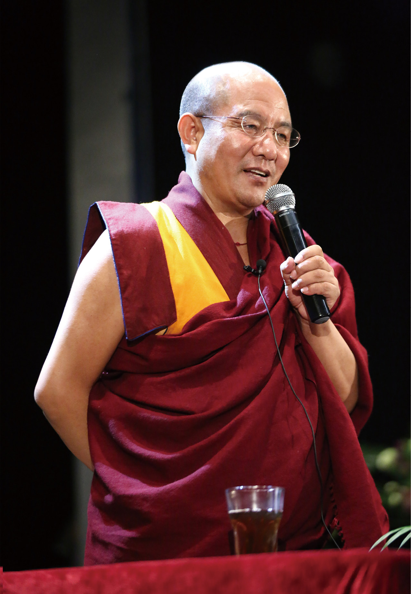

这样的灵魂生活，现在的很多慈善家、企业家不一定认同。今天，我只是想通过这种方式引发大家思考：为什么有些人只能从物质层面获得快乐，有些人可以依靠精神层面得到快乐，还有些人会依靠更高的灵魂层面获得满足？这三者有什么不同？

这三种人的分布就像一座金字塔，越往上，追求的人越少。我今天想表达的第一点是：每个人的个性、意乐和价值观不尽相同，因此，他们追求的事物也迥然有别。有些人觉得，获取越来越多的物质才是最重要的；有些人认为，不断提升精神境界才有价值……虽然我们不能要求所有人都有相同的价值观，但可以思考，哪种价值观更值得追求？

## 未来之路，危机四伏

现今，企业对整个时代、整个社会都有巨大的影响。以前，各国高层领导出访时，陪同者大多是外交部长、国防部长等官员，而如今，从电视等媒体报道便可看出，陪同者大多是不同层次的企业家。现在国际之间交流，大多数也是通过企业家这条线来对接。可见，企业家的影响力越来越大，很多时候已经超过了思想家、文学家和科学家等。

当前，我们经济生活所发生的巨变，与以往任何时代都不同。前两天是“双十一”，当天阿里巴巴集团的交易额高达1207亿元，其中81.87%是无线交易额。很明显，社会资源正在向线上倾斜。不过，在很多人特别羡慕阿里巴巴的同时，很多传统企业却备受打击，面临着巨大的挑战和困难。

面临这种困难的原因，一是他们经营的是传统行业，现今，传统行业都面临很多不确定的因素；二是受全球经济不景气的影响。不仅美国这几年经济低迷，欧洲同样陷入了这种窘境，非洲更不用说了。

非洲有五十多个国家，我去过的一些国家里，除了南非以外，大部分经济都不好。有人总结非洲有三种不值钱：一是人命不值钱，二是土地不值钱，三是时间不值钱。

为什么这么说呢？因为，非洲疾病特别多，不少人年轻时就死了，在很多非洲国家，人的平均寿命只有三四十岁，所以生命不值钱；非洲土地面积极为广大，在哪里都可以盖房子，所以土地不值钱；非洲人没有时间概念，有时飞机抵达停机场半个多小时后，机组人员才会慢慢打开机门，让乘客下机。上飞机的时候也是这样，一般都没有固定的起飞时间。去非洲确实与去其他地方感觉不同。

现在，很多国家的经济都特别困难，尤其传统企业，面临倒闭、关门或者发不出工资等诸多现实问题。有时候，我看到一些大型商场里面，很多服务员一直站着、等着，但却鲜少有消费者，因为现在大部分人都用手机购买商品。有些餐厅大门一直开着，但里面却冷冷清清，因为不少消费者都通过“饿了么”等外卖平台下单，很少光顾餐厅。包括传统的旅游公司、出租车公司的生意也不好，被线上的“Uber”“滴滴”等抢占了不少市场。

很多企业在过去的一二十年都非常成功、稳定，但进入网络时代以后，危机便随之而来，不确定的因素此起彼伏。许多企业家们虽然原来特别成功，但一夜之间会变成什么样却很难说。

## 佛教思想，助我们度难关

这个时候，很需要用佛教的思想来调整身心，比如无常观。懂得无常非常重要。如果不懂高际必堕、生际必死、聚际必散等无常的道理，出现危机时，企业家和商人们可能很难承受。有报道称，过去二三十年，有将近三十万中国企业家自杀，还有很多得了抑郁症、焦虑症，这样的例子比比皆是。这种状况下，很需要调整自己的心态。

前一段时间，我看了马云在清华大学管理学院的一段讲话。他说：“你生意做到一定程度，没有佛家那种思想，不行。”我很赞同这句话，像马云这样的成功企业家，也有许许多多烦恼，也许比一般人更痛苦、更焦虑。即便现已家财万贯，但将来如何也很难说。

所以，大家很有必要现在就调整好心态，可以经常用佛教的无常观观察生活，观察万法的本体。

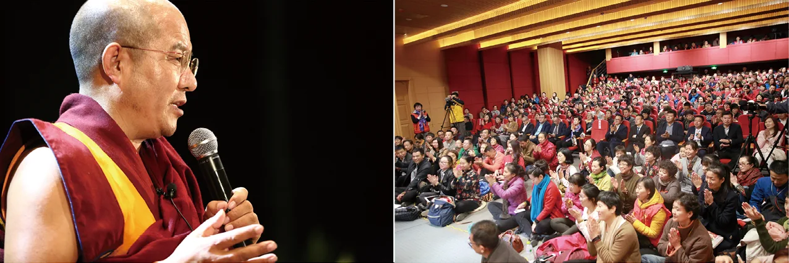

此外，也有必要了解佛教因果不虚的道理。生活中人们有时特别快乐，如置身花园一样，有时又特别痛苦，像投身地狱一般。人世间的生活就像一场戏剧，快乐和痛苦不断交替。为什么会这样呢？这都是由自己往昔所造的善业和恶业引发的。善业才能让自己快乐，恶业只能令自己痛苦。

虽然很多时候大家想办成事情，中间不免掺杂一些欺骗、诱惑、贿赂等恶业，但一定要知道，这样为了生存而不断造恶业，会使自己陷入一种恶性循环。

佛陀的伟大思想，历经2500多年而不衰，对于现代人来说，它仍然不可或缺。尤其像在座这样的成功人士，也许更加需要。因为你们虽然不必为衣食住行等基本的生存而担忧，但内心却不一定真的快乐，过得不一定真的幸福。

今天，我并不是想借此宣传佛教，只是特别希望，企业家们能以佛教的思想和智慧观察自己的人生，这对个人的生活和成长会有很大帮助。

## 行善，是企业家的最高境界

今天，我想放松、随意地与大家探讨一下“企业家的最高境界是什么”这一话题。

首先要知道什么是企业家。企业家是对推动整个社会经济发展起积极作用的人。如果只是为自己的家庭和个人生活而奋斗，最多称为商人或者买卖人。加上“家”字之后，比如文学家、科学家、佛学家等，就代表他受到了很多人关注，也为整个社会带来了利益。企业家亦是如此，他们为整个社会带来了经济效益。

我听说今天在座的很多人，包括爱基金的一些成功人士，非常关心我们的社会，尤其对偏僻地区的孤寡老人和失学儿童、各地服刑人员的家庭等等，都特别予以照顾。这样做非常好。作为企业家，确实应该关注身边的弱势群体。有些人可能认为，现在经济不景气，有些企业自身都难保，何必还做慈善呢？实际上，即便如此，做慈善也非常有必要。

我们的很多理念与西方国家不太相同，尤其是美国。在美国，慈善几乎是每个人、每个家庭必须做的事。对大多数美国人来讲，从孩童时期开始，就树立了做慈善是理所当然之事的理念。但在很多中国人的观念中，慈善只是富有者的“专利”，其他人不需要做。事实上，这种观念是错误的。

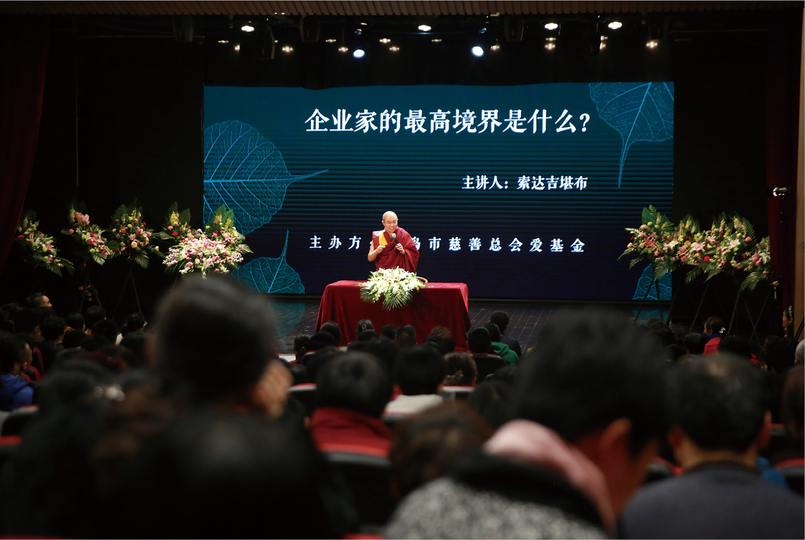

很早以前，我在一个慈善论坛上提过“慈善是心”的观点，即每个人拥有一颗慈善的心最重要，不一定非要捐很多钱、很多物品。当然，如果自己比较富有，捐一些财物改变很多人的命运也是非常好的，我特别随喜，但更重要的是，每个人应对团体、对社会有一种责任感。佛教称这种责任感为善心。

我认为，对企业家来讲，具有这种善心是慈善的最高境界。这也是我对今天题目的回答：行善是企业家的最高境界。美国的卡耐基也说：“富贵人的唯一目的就是行善。”这句话极富深意。

人们都觉得有钱特别好，是有福报的一种体现。但很多人有钱后只考虑自己的父母、爱人、孩子等亲人，除此之外，对社会没做过任何贡献，这样其实并不光彩。此外，自己拥有的许多资源，其他人丝毫没有得到，这对自身来讲，也是一个很大的损失。

## 如何行善

我们应该培养在日常生活中为社会做贡献、做慈善的理念。培养这种观念非常重要。有了行善的理念之后，还要实际行持。对此佛教讲了六波罗蜜多，其中第一个是布施波罗蜜多。

布施波罗蜜多包括财布施、法布施和无畏布施。财布施，是指以财物做慈善，帮助别人；法布施，是指教授别人知识、传授真理，这也是一种慈善。有些人从经济上帮助他人有一定困难，这时可以把知识、真理传授给有缘人，比如，当支教老师、给人讲解儒释道的思想等，这些都是法布施。做法布施的人也可以称为慈善家。第三种是无畏布施，即看到众生生命受到威胁的时候出手相救，比如，从屠夫刀下解救动物的生命，这是一种慈善，也是一种布施。

布施，是佛教六度万行当中的第一个。依照佛教的观点做慈善，会更加有次第。一名北大教授说过：到目前为止，我还没有听过以“儒商”这个名称发起的论坛，但“佛商”论坛早已有了，而且很多佛商慈善论坛正在不断兴起。

很多企业家在赚到一定钱的时候，就会把部分财富用在布施上。当然，我不建议企业家们都拼命地捐钱，如果你们在自身难保、员工工资都无法保障的时候不断捐出财物，也不一定合适。我提倡的布施，是在自己拥有一定富余的资源，且没有吝啬心的情况下，随意地捐出一部分。

《告别土豪》这本书讲了很多中国慈善家的经历，包括俞敏洪、王石、牛根生等人。我觉得其中有些人做得非常好，有些不一定那么好。但不管怎么样，内心有了慈善观念之后，所言所行就会与以往崇尚自我享受的时候有所不同。

## 爱万物，也会被万物所爱

从刚才播放的录像能看出，在贵州、云南、西藏等地，有些人的生活确实非常困难。我们普通的一顿饭、一件衣服，在那里都成了奢侈品。用城里人眼中很少的钱，就能让失学的儿童重返校园，让无助的病人继续生存。而这一切，依靠布施的力量都可以实现，因此，我特别随喜真正的慈善家。

古大德常说：“天地有好生之德。”天地有滋养万物的力量。有些人像太阳一样，不管到哪里，都会给周围带来温暖和滋养的力量。当然，这需要内心真正有爱，这种爱能改变周围的环境，改变许多可怜人的生命状态，也能改变我们自身。比如，有些人加入慈善团体之前比较自私，烦恼深重，加入一段时间之后，不知不觉发生了改变，不仅慈悲心得到了很大提升，烦恼也越来越少了。

从佛教层面讲，慈悲心被称作大慈大悲菩提心。有些人念经念得特别熟练，给别人讲法也滔滔不绝，但利他的行为却难以持续。刚开始做慈善特别有热情，一段时间之后，热情就退却了，再也不愿参与了。当然，内心真正有爱的人，这种力量不容易消退。

我看过一本叫《力量》的畅销书，书里讲了很多佛教的道理，但并没有使用佛教术语。书中一个主要观点是：宇宙中最大的力量，不是太阳、月亮、地球等自然万物的力量，而是爱的力量。这种爱并非男女之间的情爱，而是无条件包容所有众生的大爱，它是一种慈爱万物的博爱，是一种付出。

其中还提到，我们在人生中感受的一切，都是自己曾经对别人是否付出爱的一种反馈、回应。这个观点很有意思。我们都知道，种了什么种子，便会结出什么果。同样，我们在生活中只要对别人付出，必定会得到某种真实的力量。也就是说，如果自己爱所有众生，所有众生也会直接或间接爱自己；如果自己不爱众生，众生也会直接或间接不爱自己。这就是因果规律。

## 善的力量不可思议

我觉得，无论什么身份的人，只要拥有博爱、无私奉献的精神，就是一个很伟大的人。

美国的洛克菲勒，在上世纪全球财富排行榜中位列首富。他在53岁的时候疾病缠身，身体变得像木乃伊一样，特别痛苦。后来，他放下了与企业相关的所有事务，一心一意做慈善，直至98岁离开世间。很多人认为，是慈善的力量，让他多活了45年。

可见，无论任何身份的人，拥有一颗爱心，愿为别人付出，都非常重要。洛克菲勒乐善好施，不仅使自己受益，还惠及子孙。中国有句古语“富不过三代”，但洛克菲勒家族至今已繁盛了六代，从未衰落。

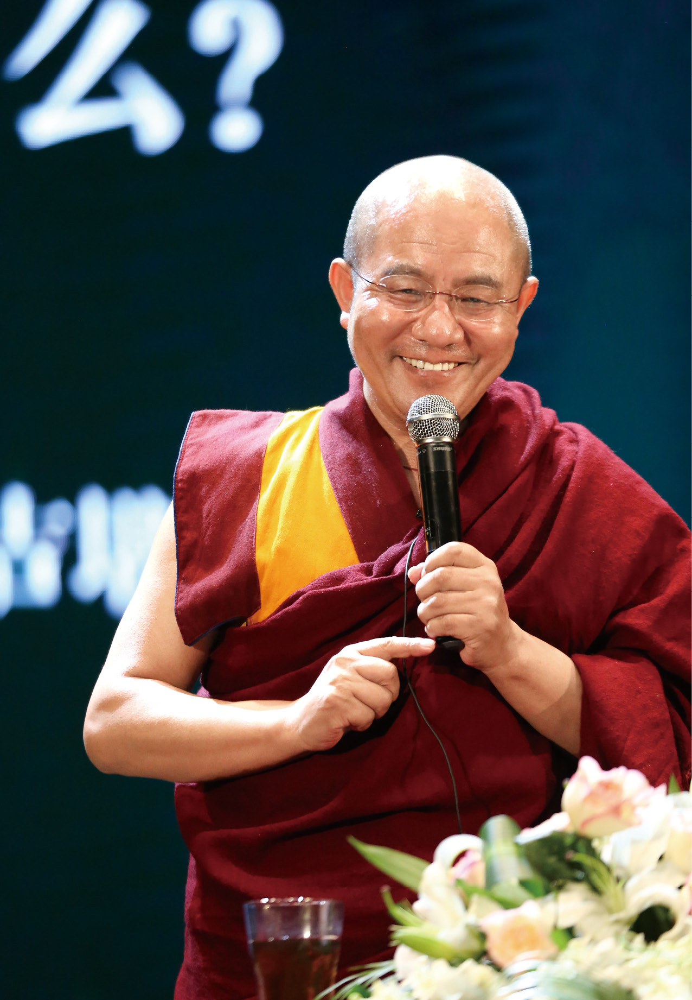

西方国家的企业家做慈善，有些是受宗教影响，有些不一定有宗教信仰。但不管怎么样，他们大都越布施，财富越滚滚而来。像比尔·盖茨和巴菲特，他们虽然在去年和前年捐了很多钱，但在今年（2016年）全球财富排行榜上，仍然位居前两位。

去年12月，Facebook创始人扎克伯格的孩子出生了，他给孩子写了一封信，告诉他，自己要把99%的Facebook股份捐给社会。我们很多人不一定能做到这一点。按照普通人的观念，宝宝出生后，自己愿把所有的家产留给他，让他以后衣食无忧。但扎克伯格的观念与一般人差别很大，他把自己99%的财富，当时相当于450亿美金，全部捐给了社会，而给孩子留下的则是精神财富，比如爱和布施。

## 为何说企业家需要信仰的力量？

未来，很多企业还会面临诸多变化，作为企业家，很关键的一点是要有信仰的力量。

如果懂得了佛教所说的“一切皆是因果”“万法都是无常”等道理，在特别成功的时候，不会傲慢，不会不把别人放在眼里，因为知道“高际必堕”；在经营失败的时候，也能乐观面对，不至于崩溃、绝望，因为知道“一切有为法，如梦幻泡影”；即使晚景凄凉，谁都看不惯你，也不会伤心绝望，因为知道万法都是无常的，亲情亦是如此；当你离开世间的时候，会平静安然，因为知道有漏法没什么可贪著的，死时带不走一分一毫……总之，不管自己遇到什么情况，都能泰然处之。

如果企业家内心有了这种信仰的力量，自己一方面会把所得财富的一部分用来帮助可怜的众生；另一方面，也会爱护、关照自己的员工和周围的人。

昨天我去了一家企业，企业老板对我说：“有名员工跟了我十几年，我不但要关心他的生活，还会关心他的孩子和父母，我给他们都发工资。”他的这种理念，我完全认同。一个企业若有一百名员工，就有一百个家庭，一百个家庭当中，有父母、孩子，这些直接或间接都需要企业照顾。因此，在某种意义上，企业家对于整个社会而言，相当于国家总统一样。

有些时候，各个国家的政府直接解决人们生活上的问题相当困难。刚才我说过，当今时代，相较于文学、艺术、宗教而言，人们更重视经济，喜欢在互联网上购买各种产品。这种时代下，作为企业家，应该怀有一种崇高的意念，愿意对身边的每一个众生、对整个社会，乃至对整个人类负责。并且在经营的过程中，尽量不用造恶业的方式赚钱，否则会形成一种恶性循环，到了一定时候必定会招致祸患，感受痛苦。

我觉得在所有价值观当中，利益众生最有意义。各位爱心人士在爱的发心力量催动下，都有利益众生的潜能。很希望大家用爱心无偏袒地饶益所有众生，这样我们整个世界将会变得更加美好。

主持人：

感谢堪布老人家为我们带来的精彩演讲和慈悲开示。非常感恩，让我们再次掌声感谢！

我相信大家都有醍醐灌顶、如雷贯耳的感觉，内心法喜充满，收获满满。相信在堪布老人家的加持下，我们未来的人生会更加成功、幸福和圆满。

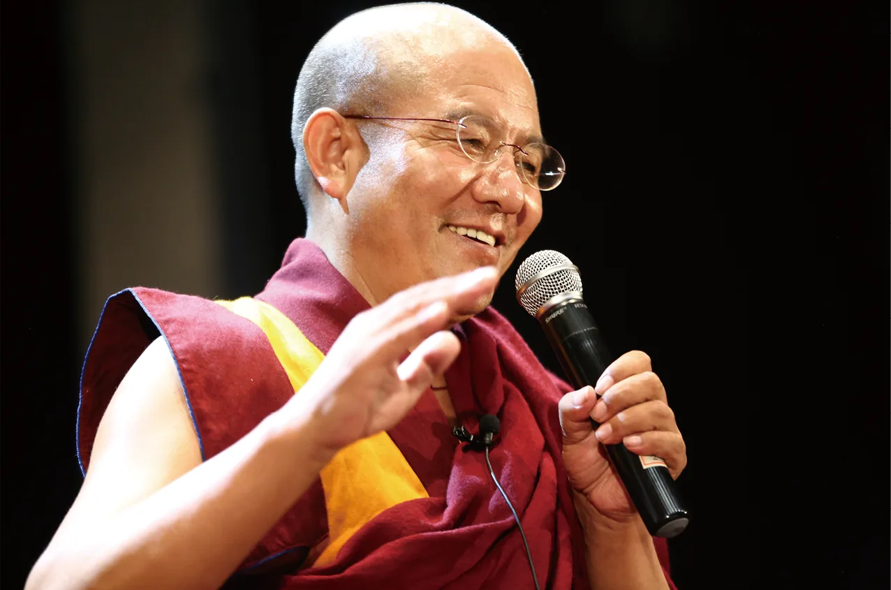

现场互动

问：如何经营企业才能远离不善业？

堪布：在经营企业的过程中，要想完全远离所有的不善业有一定困难。经营过程中，可能会有说妄语、偷税、漏税，或者心存不合理动机等现象。

有些高僧大德讲过，世间人过的都是一种有漏的生活，一直感受着行苦。苦有三大类：变苦、苦苦、行苦。行苦是指人们在生活中，表面看没有造业，实际却在造业，而这又是一种必然现象。比如，农民种庄稼会伤害很多众生，牧民挤牛奶也有一些罪业，但这些罪业都相对较轻。人为了生活，可以正常从事农业、牧业、商业等，佛陀在有关经典中对此都有开许。

生活在人世间，想完全不造恶业，固然有一定困难，但若故意伤害众生，比如，明明知道这个产品对人体有害，但为了赚钱而制造、贩卖，则肯定不合理。

大家在经营企业的过程中，也肯定会造一些善业，这些善业的力量也很强大。比如，有些民营企业帮助很多人就业，有时甚至连国家都难以安置的人，企业也能接纳；还有许多企业的产品满足了大众的所需……这些善业具有很大功德。从某种意义上讲，功德和过失也可能互抵。

此外，通过忏悔也可以消业。我们今生造的一些不是特别严重的罪业，平时通过念百字明、金刚萨埵心咒便可以忏悔清净。

问：在家修行人如何平衡闻思修和积累资粮这两种善根？

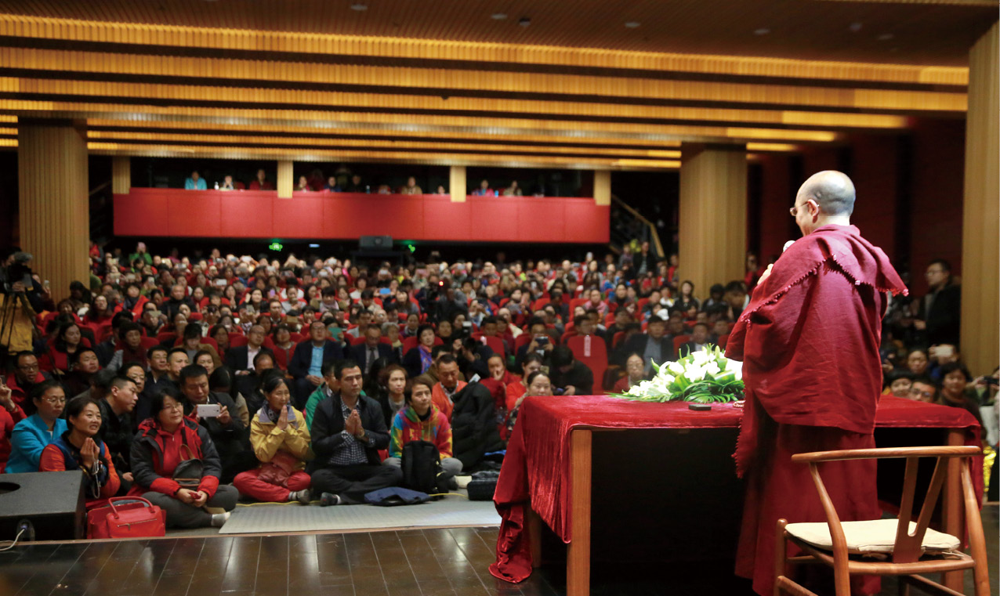

堪布：如果自己没把时间安排好，闻思修之间也会有冲突，不知到底该听闻，还是修行。我们佛学院一般都会安排大家早上听闻佛法，下午思维佛法，傍晚辩论佛法，晚上修行佛法，这样依次闻思修。

对于在家人来讲，闻思修非常重要，不可或缺，同时也可以做一些其他有意义的事。实际上，很多人也并没有将一周七天、一天24小时全都用在闻思修行上面。一周当中，自己可以安排几天闻思修行，几天做对社会有利的事情。

总之，时间掌握在自己手里，自己可以安排，就像手里握着遥控器，按哪个键全由自己决定一样。一个成功的人，既可以很好地闻思修行，也可以同时做慈善事业和发心工作。能否做得圆满，关键在于我们自己。

问：我们在经营企业的过程中，会遇到恶人、恶事等诸多违缘，这个时候，需要随顺吗？

堪布：在人世间做事情，遇到违缘是很正常的现象，因为违缘是生活的一部分。违缘会以多种方式显现，有时便会以恶人、恶事的形象出现。这时我们该如何面对呢？

一般来讲，不学佛的人或者世间人，如果能力足够强大，可能会用以牙还牙的方式对待。但按照佛教“沙门四法”的观点，别人害自己的时候，自己要尽量不害他。也许这样做会显得软弱，但实际上，自己已经间接战胜了对方。无论任何时候，我们都尽量不要损害他人。

当然，在如今恶人恶事猖狂的时代，在有必要且没有恶意的情况下，用另一种方式对待，比如显现上吓唬一下，有时也是有必要的，否则很多事情都难以成办。

不管怎么样，自己的内心一定要坚强，要勇敢地面对任何事情。其实，恶人恶事都是阶段性、暂时性的，都会自生自灭。

问：仁爱、菩提心与我们现在做的公益、慈善有什么区别？

堪布：儒家虽然提出了“仁、义、礼、智、信”五常的理念，但并没有很明确地讲如何将其落实在实际行动中。佛教与之不同，刚开始讲发愿菩提心，发心之后，是以行菩提心和六波罗蜜多的方式践行，对于践行的过程，讲得更加实际。这方面佛教比儒家更具有特点。

我们现在做慈善、公益，会介入现实社会，这其实是传统文化当中仁爱、慈悲的一种延伸。也可以说，我们是在仁爱、菩提心的基础上做慈善。一个人如果没有仁爱和慈悲心，就会只顾自己，不顾及身边的人。因此，我们很有必要将这种爱延伸到世界的各个角落。

问：企业管理经常使用目标管理，尤其是预算目标管理，请问，这如何与佛教的随缘思想圆融？

堪布：任何企业都有自己的目标、愿景和战略，而佛教在有些经论中讲随缘而行，这两者在不同环境中有不同的作用。

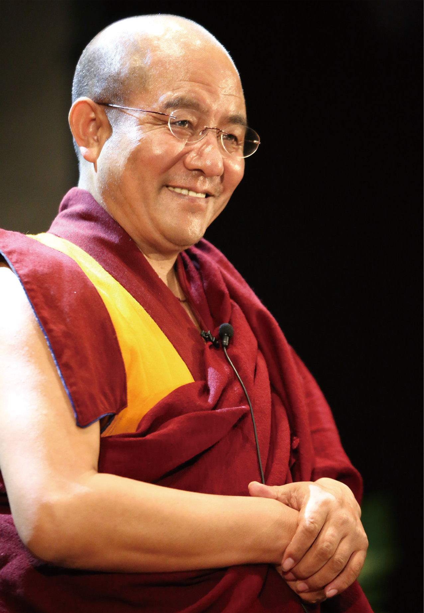

佛教所说的随缘，是指修行人达到一定境界时，具有一种随缘的心态，不再有任何执著。但对于在世间做善事、经营农商事务等方面，佛教并没有说随缘，反而经常讲，不能懒惰、懈怠，要努力精进。

所谓精进，分为披甲精进、加行精进、不退转精进。以经营企业为例，首先要有披甲精进，即做好目标和预算，这种准备就好比上战场前先披上盔甲；之后，要有加行精进，即做事过程中非常认真努力；最后是不退转精进，就像李嘉诚那样赚了很多钱、企业规模很大的老板，会把多数事务授权给专业人士来做，以使企业稳步发展。这时他们也算获得了不退转精进。

佛教为何讲随缘呢？修行人修到一定境界时，就如密法所说，会行持疯狂的行为、流浪者的行为。因为这个时候，他已没有任何执著。在他的境界中得也可以，失也可以，乐也可以，苦也可以……这就类似济公和尚的境界一样。整个世界在成就者眼中，如梦幻泡影一般。

我们现在虽然达不到这种究竟的随缘境界，但在处理一些世间法时，到了后期，随缘也很有必要。比如，有些人经过长期努力，生意仍不成功；苦心经营婚姻，最后还是离婚了。这个时候，以随缘的方式调整自己的心态很有必要。当然，如果还没到最后，而是在开始或中间的时候，佛教并不提倡随缘，而是提倡三种精进。

因此，我们应该把实践的过程和最后的心态调整区分开。

问：您作为一名修行人，在传法布道的过程中已经殚精竭虑了，而您又付出这么多心血，为贫困地区的孩子们修建学校。我想请问，世俗教育对这些孩子重要吗？您做这些教育的目的和意义何在？背后的动力是什么呢？

堪布：我出家后最初的二十年里，在学院里心无旁骛地闻思修行，那时看到别人办学校、搞慈善，我会觉得这些都是世俗法，没什么意义，自己好好修行才对。后来我去家乡的一些学校时，看到那里的教育特别落后，失学率非常高，觉得自己以佛教徒的身份做一些事，也许能改变当地教育落后的现状。

大概在2006年，“爱基金”开始运作，我这边也开始搞“启动爱心”的活动。两个项目都有“爱”，创建时间也基本相同。从那时开始，我发心做一些助学方面的事情。

我办中学也好、小学也好，至今都感觉非常开心。如果自己当年没有启动这些项目，如今很多牧民的孩子可能连字都不认识。现今是信息时代，如果他们是文盲，那连发微信都不会，这样的生活还是挺可怜的。

我捐助的并非佛教学校，而是世间的普通学校，因为觉得世间智慧对于孩子们的一生也不可或缺。其实，我没有想过让孩子们将来一定要出家，或者让他们一定要获得佛教的高深境界，只是希望，他们至少能得到初中或高中的教育，因为这会给他们的人生打下很好的基础。

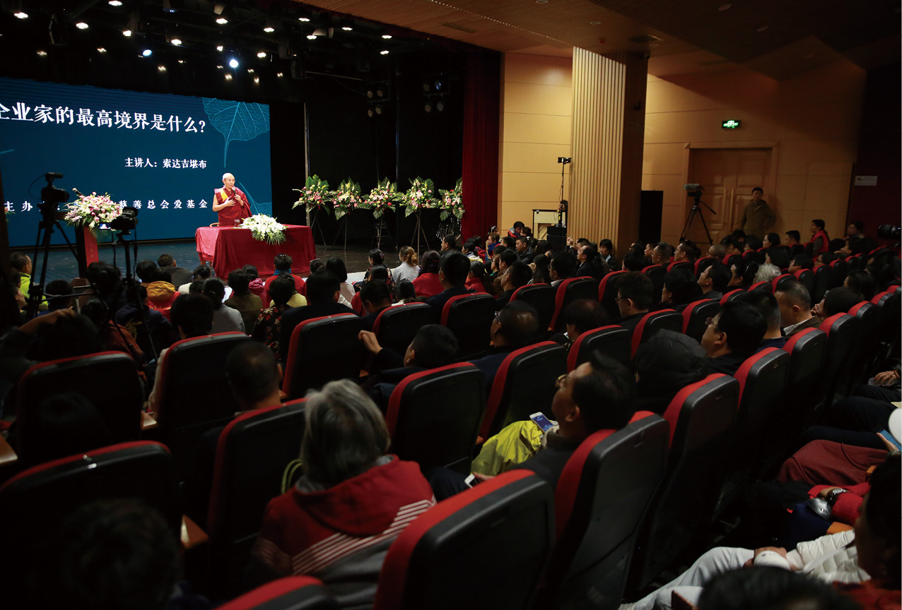

在办学校的过程中，有时自己难免会与很多世俗人交往，陪他们吃饭等。累的时候，我也会反问自己：你作为一个出家人，好好修行、好好念“嗡玛呢巴美吽”就行了，为什么要去忙这些呢？但一想到这些孩子将来的命运会得到转变，又觉得自己的付出很值得，很有必要。

作为佛教徒，应该看看自己身边人的状况，如果能改变他们的命运，就要坚定地去做。发了大乘菩提心的人，别人想什么、说什么都不重要，重要的是，自己要以一颗善心做该做之事，并坚持到底，这非常有意义。

问：我的老公经营一家企业，现在正在学习佛法。他说，经营企业的过程中，可能会造作一些恶业，所以他现在不敢受菩萨戒，想等明年把公司交给别人再受戒。请问这样可以吗？

堪布：若用智慧观察，发现自己现在受戒的因缘不太成熟，想等因缘成熟的时候再受，对于这种观点，我是赞同的。

问：为什么说好人要经过九九八十一难才能成佛，而坏人却可以放下屠刀立地成佛呢？

堪布：好人成佛需经过九九八十一难，而坏人放下屠刀立地成佛，这仅仅是世间人的说法而已。若想开发自心最深处的觉悟智慧，不管是好人还是坏人，都要历经千辛万苦。

好人经过九九八十一难而成佛的说法，主要来自民间或者《西游记》等文学作品，佛经中并没有这种说法。如果好人都要历经九九八十一难，那坏人更要历经翻倍的劫难。事实上，不管是好人还是坏人，只要不断闻思修行，最后因缘成熟的时候，都会瓜熟蒂落，获得成就。

当然，很多禅宗公案中也讲，当觉悟的上师、虔诚的弟子等殊胜因缘聚合，会有当下开悟的情况。因为每个人的根基和因缘不同，所以开悟的经历也会有所不同。

问：我和朋友有时候会做一些助学活动。有一次我儿子对我说：“小朋友们如果不上学，会活得非常快乐，你们帮助他们上学，他们就会因为不好意思而必须去上课。你们以后助学之前，能不能先征求一下小朋友们的意见，问他们愿不愿意去上学呢？”儿子的话引发了我的思考，我想知道成功的概念到底是什么？我们该用什么标准衡量人生的成功？

堪布：有些小朋友不爱读书，觉得放荡特别快乐。但一般有智慧的父母都会劝诫孩子，告诉他们这只是暂时的快乐，如果在最宝贵的青春时期没有读书，一辈子就可能荒废。我们不应该顺从孩子们幼稚的心态，让他们只得到暂时的快乐。这一点，作为家长应该都知道。

现今，大多数人所认为的成功，都是用金钱来衡量的。谁拥有花不完的钱，谁就算成功了；如果谁没有钱，即使他其他方面很优秀，也被视为不成功。机场里卖的所有成功学的书籍，都在谈金钱；播放的大部分视频，都是马云的演讲。很多人都想成为像马云一样的人，但想再多也没有什么用。

我认为，衡量成功的标准是获得一种自我满足感。无论你在什么样的平台，如果觉得自己做得很好了，这时于你个人而言，就已经成功了。当然，在别人眼中不一定，正所谓“仁者见仁，智者见智”，不同的人有不同的标准，这也是理所当然的事。

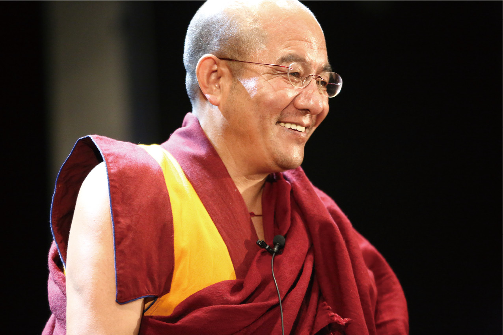

问：我们在山东成立了一个往生净土的平台。我是晚课音视频的制作人，也发心做晚课播放工作，但我始终对自己不抱信心，想请您指导，看一下我的晚课安排是否合理。

堪布：你所说的平台我不太清楚，等会儿我具体了解之后，再给你回答。你们发心推广净土法非常好，一些具体操作大家可以共同商量。

我还想提醒一下，你刚才说对自己没有信心，其实，信心于每个人而言非常重要，你如果对自己都没有信心，也很难信任别人，希望你能在这方面努力。

最后，希望我们一起发愿往生西方极乐世界。做慈善是在发菩提心利益众生，这也是往生极乐世界的四因之一。

[^1]: 索达吉堪布2016年11月5日微博：身体的美，若不与聪明才智相结合，是某种动物性的东西。——古希腊哲学家德谟克利特
