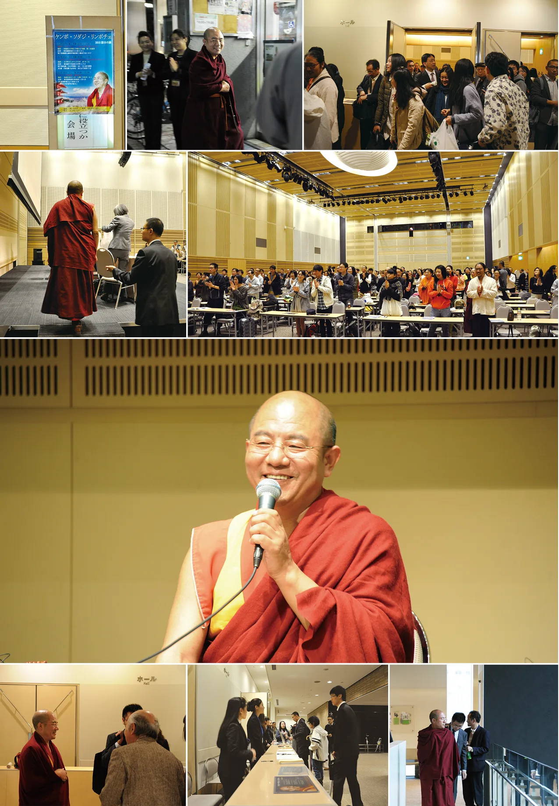
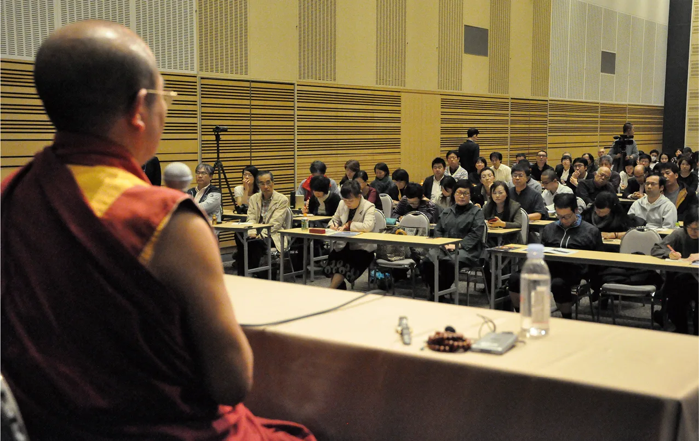
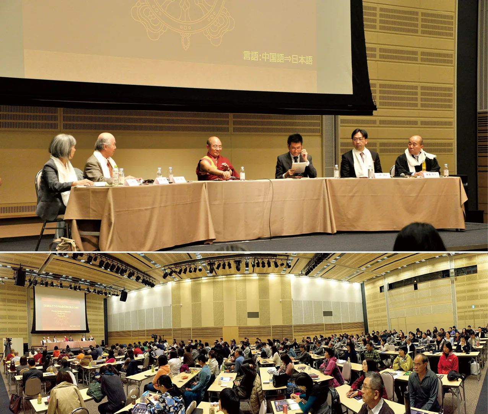
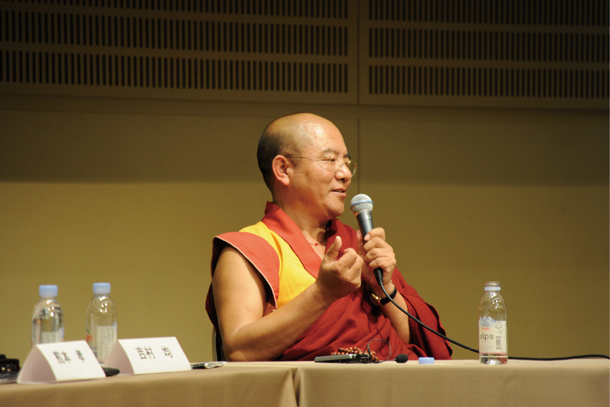
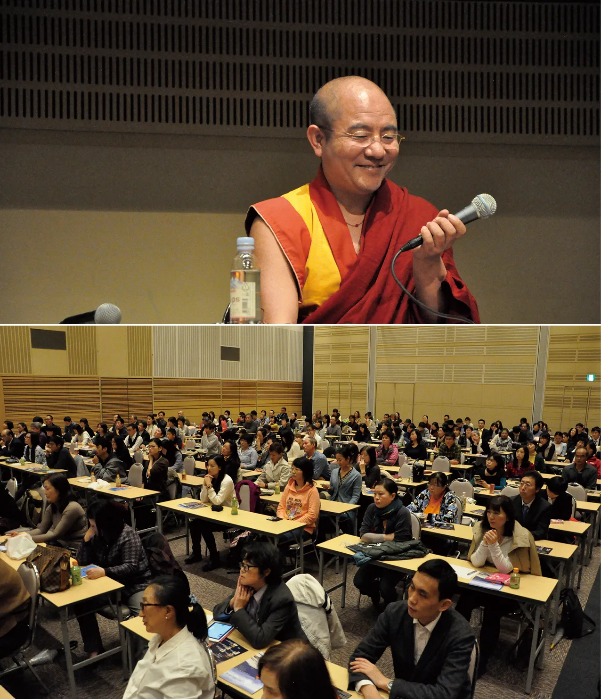
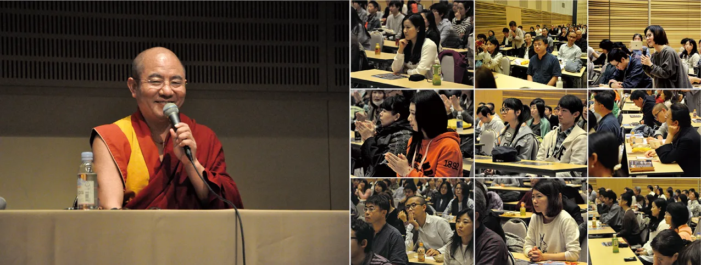

心如果没有定下来，  
每天浮躁散乱，  
会滋生很多烦恼。

第51场

日本东京公开演讲

Public Speech, Tokyo, Japan

日本·东京

2015 / 11 / 15

## 佛教如何帮助日本社会

## How Buddhism Benefits Japan

主持人：

今天我们有幸邀请到索达吉堪布，这是堪布第一次来日本。堪布来自西藏高原，在国内外具有很高的知名度。他不仅在世界最大的佛学院——喇荣五明佛学院从事教学管理工作，还以流利的中文为汉族广大信众传法，此外，堪布还将诸多藏文佛教经论，如《俱舍论》《因明》《中观庄严论》等翻译成了汉语。这些经论都是藏地传统寺院和道场的必学内容。

这次座谈，我们首先请几位日本人向仁波切讲一下他们的观点，然后请堪布仁波切做一个二三十分钟的开示。

今天由我担任主持，我是中村元东方研究所的一名研究员，请大家多多指教。首先有请山田孝子老师发言，他是京都大学的名誉教授。

山田孝子：

谢谢主持人的介绍。我是从事文化人类学研究的，曾研究过许多地域的文化。如果我们在日本做一项调查，询问大家的宗教信仰是什么，可能大多数人都会回答：我没有什么信仰。日本的现状就是，很多人都视自己为“无宗教信仰者”。

有时我会想，这些人真的什么信仰都没有吗？可能也不是。反观日本的精神领域就会发现，近年来，日本的佛教已被揶揄成“葬礼之教”，人们在彼岸节或盂兰盆节的时候，会对亡者进行追悼或供养，这种习惯已与人们的生活紧密相关。又或者，人们在过年时会去参拜神社，虽然很多人是去游玩，但当他在神明前双手合十的时候，内心会将自己的愿望嘱托其中。又如，最近常听人说，在富士山看到今年初光的那一刻，内心非常感动，好似全身都被洗净了。这些人看上去是在观光或游玩，但我感觉，他们这种精神上的喜悦，也含有一些宗教情感。

我觉得，日本人心中的宗教情结并未完全泯灭，很多人在日常生活中仍存有佛教的观念，就能说明这一点。所以，对“多数日本人无宗教信仰”这个说法，可能还需要重新审视。

最近我经常想，日本人并未完全失去佛教的思维模式，只不过很多人对于祖辈传下来的精神文化，已经习以为常了。比如，对于难能可贵的日本礼仪、与他人交流的方式等等，我们都没有在意过，但这种传统规范和价值观很多来源于佛教，它们非常利于维持社会秩序，若不一代一代传承下去，整个社会就会变得不稳定。

所以我认为，弘扬佛教或其他宗教的普世教言，应该会对建立人与人互相关心的和谐社会，起到很好的作用。

以上是我对今天话题的一些想法。谢谢大家！

主持人：

谢谢山田孝子老师。接下来有请番场雅文老师发言。番场先生是日本佛教协会的理事，也是真言宗智山派多门寺的副住持。

番场雅文：

大家早上好！一提到日本的佛教和僧人，很多人印象最深的就是与丧事或法事有关。但这种认知肯定不合理，那已是50多年以前的事情了。

当时很多日本年轻僧人（现在已经七八十岁了），看到基督教等其他宗教被引入日本并得到了快速发展，觉得再这样下去，日本佛教就会被毁掉，于是他们建立了一个青年会，有时候自己学习，有时候举行全国大会，当时做了很多事。

最初，大家在一起学习主要为了自利，1995年“阪神·淡路大地震”之后，大家更关注如何帮助别人。当时很多同修的寺院都被毁坏，我们亲自到地震现场进行救援。现今，一旦有自然灾害发生，每个人都会主动报名当义工，但当时人们普遍没有这种意识，只能我们自己备好饮食，帮助灾民修复受损的房屋，对他们进行救助。之后，僧人团体对社会其他方面也做了很多贡献。

我们寺院的僧人在帮助他人方面，也做了一些事情。现在正在组织童子军活动。以此作为因缘，市政府的人委派我做青少年德育教育环节的工作，为当地孩子的健康成长做一些事情。后来，他们又邀请我担任市青少年德育教育协会的委员。主要负责在各个地区以较小规模，组织孩子们做游戏、开一些料理教室等等。过程中我们对孩子们的健康成长做了很多引导。此外，我们会经常提醒大家维护社会治安、注意消防，并协助警察做一些事情。每一个月，所有辅助人员都会分散到各个地区做一些辅助工作。目前，很多工作尚在摸索中。

以上就是我的报告。谢谢！

主持人：

谢谢番场老师。接下来，有请川崎清嗣老师为我们做演讲。川崎老师是一位精神科医生，也是医疗团队“新生会”的理事，同时在明星大学担任客座教授。

川崎清嗣：

大家早上好，我是一名佛教徒，我的专业是精神医学，现在是一名治疗心理疾病的临床医生，其实就是在诊所工作的普通医生。

我从事这份工作已有三十年了，在此过程中感触良多。简单来说，我主要是对患者做精神方面的治疗。我最初工作的时候，诊所的病人就不少，这几年寻求精神或心理治疗的人一年比一年多。诊所数量也随之增多起来。

前些年，人们鲜少知道精神诊疗所，只知道精神病院，觉得那是一个将病人关在笼子里的可怕地方。现在，精神诊疗所随处可见，乃至每个地铁出站口，都有可以做心理咨询的地方。

我在倾听很多人讲述自己烦恼的过程中，发现他们都有一个共同点，就是觉得在日本社会生存非常苦，内心被各种烦恼缠绕，有来自经济方面的，有人际关系方面的，也有自然灾害方面的……他们不知道自己该怎么办。从中能够看出，日本是一个压力巨大的社会。

学生在学校常会遇到校园暴力。只要自己的形象或言行与别人有些许的不同，就会成为被欺凌的对象。很多人以为进入社会便可以摆脱噩梦，但其实上班也是同样，公司内部会分很多帮派，自己一不留神，就会受到排挤。就算一直努力工作，如果不幸患上重病，也会被淘汰下来。可以说，在哪里都找不到一个安心之处。

日本被称为“自杀大国”。据统计，日本每年有三万多人死于自杀，虽然最近几年人数减至两万五千人左右，但自杀未遂者的数量却在逐年递增。

我对这一现象真的有点迷惑不解。因为自己对佛教感兴趣，所以经常去印度、尼泊尔、中国西藏等一些国家和地区。当地人在物质上并不富裕，比日本要差很多，但每个人都非常开朗活泼，脸上经常挂着善意的微笑。而我回到东京看到的却是，每个人都面无表情，匆匆忙忙朝着各自的方向奔走，看起来特别紧张，不是很开心。这一现象是什么原因造成的呢？一直以来我都想不明白。

今天，我是抱着向堪布求教的真诚态度来到这里。我认为佛教不仅可以改善日本的现状，也可以帮助日本人解除痛苦。非常期待堪布的开示。

主持人：

谢谢川崎老师。如今，大家都知道日本面临很多问题，比如刚才川崎老师提到的自杀、校园暴力等社会问题，以及频繁的自然灾害等现象。2011年的日本大地震，对东北地区破坏极大，直到现在，那里还没有完全恢复。当时东京的震感很强，也有一些人不幸身亡。海啸引起了核电站爆炸，灯火通明的东京瞬间陷入一片黑暗。当时的悲惨景象，铭刻在每个人的心中。

基于此，人们对佛教的期望也在逐渐提升。我认识的日本僧人里面，很多人都在从各个方面帮助世间人，努力解决自杀、校园暴力等社会问题。我作为一个俗人，只能默默地祈愿，希望佛法能够帮到更多人。

我很期待日本佛教能够重视儿童教育。现在很多日本人都认为，人死的时候才用得着佛教，佛法与儿童教育毫不相关。但事实并非如此，佛教并非只为亡者存在。

日本人在皈依时，念诵的第一句话是“人身难得今已得”，人身是极为难得的，现今，我们如此幸运得到了珍贵的人身，应该值得高兴。现在很多日本寺院建了一些幼儿园、保育院来教导孩子。如果这些孩子从小就知道人身难得的道理，将来当他遇到一些困难，比如在学校受到欺凌，在社会遭受打击或侮辱的时候，他不会受到影响而认为自己真的没有价值，或者选择舍弃生命。因为他知道，虽然自己的很多愿望没能实现，但生而为人已是最大的幸运。

非常希望，精通藏传佛教并在中国极具威望的索达吉堪布仁波切，能告诉我们“如何运用佛教帮助日本社会”，我们对此非常期待。

索达吉堪布：

刚才，很多学者专家分别从自己所研究的人类学专业、医学、宗教，以及东亚文化等层面，对“佛教如何帮助日本社会”这一主题发表了自己的看法。虽然各位讲的时间不长，但却极有针对性，也提出了一些具有深远意义的建议，我听了受益匪浅。

## 佛教的真正内涵

首先，我想简单介绍一下什么是佛教。所谓佛教，就是提倡“诸恶莫作，诸善奉行，自净其意”的一个宗教，或者说这样一种教育。佛教既有理论，也有实践的体验和修炼。

曾在印度那烂陀寺求学的世亲论师曾说：“佛之妙法有二种，教法证法之体性，持教法者唯讲经，持证法者唯修行。”可以说，哪里有佛教的闻思和实修，哪里就是佛法兴盛的地方；如果缺少了这两点，就不能算兴盛。

## 回顾历史，反思当下

我来日本的这几天，拜见了一些高僧大德，也与很多宗教人士和社会各界人士进行了交流。我感觉对于现今的日本佛教，我们确实有必要重新思考，从根本上做一些调整。今天我本来不想说，也不敢说，但刚才大家已经把存在的问题讲得非常清楚了。既然你们自己也发现了，那我就开诚布公地讲一下我的观点。我觉得我们每个人都有责任，有义务，在这方面做一些努力。

历史上，日本曾是佛教非常兴盛的国家。公元538年，佛教从中国经由朝鲜半岛传入日本。日本的圣德太子虔信佛教，受持过《妙法莲华经》《维摩诘经》《胜鬘经》等诸多佛典。

他不仅自己研习佛典，还经常为他人讲经说法。整个日本社会受其影响，形成了闻思修的传统。此外，他还派很多人到中国学习佛法。这些举措使佛教在日本的影响力越来越大，逐渐成为日本的国教。

之后两百年左右，鉴真东渡，历经五次失败，第六次终于来到日本。在日本期间，他重新弘扬了《四分律》。那时，日本出家人不但严格守持戒律，也有讲闻、修行佛法的传统，很多人都获得了很高的智慧和修证。当时，鉴真和尚虽然双目失明，但他凭着超凡的记忆力对日本《大藏经》进行了校对。当时发生了很多这样精彩的故事。

可能是众生福报的原因吧，后来亲鸾大师等人的特殊情况，使得日本佛教发生了风风雨雨的变化，最终演变成刚才各位所说的那样。

目前，日本佛教被称为“葬礼之教”，因为日本人觉得佛教对活着的人没有什么用，对死去的人才有用。我以前看过美国《国家地理》的一篇文章，里面说，日本的佛教徒是“葬礼佛教徒”。当时我非常不理解，觉得这一评价特别过分。但这次我来日本后，发现日本佛教的现状的确如此。很多人都不知道佛教对于人生的真正意义，也不重视佛教的闻思修行，我对此感到非常遗憾。

现如今，日本佛教寺院越来越少。今年，我看到美国《纽约时报》的一篇文章说，现在日本每年约有一百座寺院正在消失。十年前，大约60%的人会在寺院举行葬礼，30%的人在殡仪馆。现在正好相反，约60%的人在殡仪馆，30%的人在寺院。可见，日本佛教的现状非常不乐观。

## 如何复兴日本佛教

实际上，不仅仅日本的佛教寺院和信徒正在减少，全世界的宗教徒都在逐年减少。尤其在欧美国家，很多教堂都被迫关闭。这时，我们作为佛教徒，是一直等待佛教慢慢灭亡，还是在尚有希望的时候，想尽办法把她救回来？无论是出家人还是在家人，在宗教面临危机的时刻，很有必要做一些思考。

我最近常在想，日本不但有高素质的民众，还有高瞻远瞩的战略思想，这样一个国家，要恢复佛教真正的理念，应该不是非常困难。虽然尊重历史和传统文化也有必要，但在此基础上，适度做些补充应该也可以，这样一来，佛教的整体形势就会逐渐好转。

补充什么呢？可以从戒、定、慧三个方面考虑。

一、恢复戒律。如果日本僧人暂时不能像藏汉出家人那样，受比丘戒或沙弥戒，那至少受一个三皈五戒。如果连三皈五戒都不能受，确实很难成为人天供养处。

如果因缘具足，日本真言宗、净土宗、禅宗等各教派的高僧大德们，可以共同商量，倡导僧人守持三皈五戒。我想作为出家僧众，这一点应该可以做到，只不过因为历史原因，没有整合好而已。

在家佛教徒最好守居士五戒。如果不能守五戒，守其中的不杀人或者不妄语戒也可以。无论印度、中国，还是美国，各个国家的佛教徒，都会根据自己的情况守持一些戒律。有些守两分以上，有些守圆满的五戒，有些只守一个皈依三宝的戒。守持戒律非常重要。

戒律就是规矩。我想，对于特别守规矩的日本人来讲，守戒应该不是难事，只不过最初的传统中断了，现在没人带头恢复而已。

二、修习禅定。定学非常重要，无论出家僧侣还是在家人，若因缘具足，一年最好闭关一百天；如果没有时间，可以闭关一个月；如果这样也做不到，就闭关七天。这样禅修非常重要。

听说日本有一些寺院倡导禅修的理念和修行，这是非常好的，但可惜不具有普遍性。作为佛教徒，心如果没有定下来，每天浮躁散乱，会滋生很多烦恼。每个人最好根据自己的情况，定期或不定期地修习一些禅定。

刚才主持人介绍，我所在的喇荣五明佛学院，是世界最大的佛学院。近些年来，我们要求学院僧众每年都要严格闭关半个月以上。作为一名佛教徒，以闭关的方式修行非常有必要，否则，很难调伏和控制自心。如果日本的僧人或在家人，每年能以闭关的方式修行一段时间，效果应该也会非常好。

三、修学慧学。“慧”即戒定慧当中的慧。如果没有长期学习佛法，佛教徒根本不像一名佛教徒。作为寺院，应该有长期闻思的传统，否则僧人很难真正明白佛教的教义。作为在家人群体，也应该系统、认真、次第地闻思，否则，对佛理也是一窍不通。如果不懂佛法，所作所为就会与真理背道而驰。

这几天，我看到日本一些学者在研究佛教方面下了很大功夫，有的人为了学习藏传佛教，还专门学了藏语，非常值得赞叹。在日本弘传的《大日经》和《金刚顶经》等，其教义与藏传佛教的有些内容比较相近，我看到有些日本大德在研究和学习。不过，这只是少数现象，从整体来看，我觉得日本佛教徒的智慧还有待挖掘。

日本虽然是一个面积不大的岛国，但却站在了世界科技创新的顶峰，像索尼摄像机等众多产品，遥遥领先于行业竞争对手。可见，日本人具有很深细的世间智慧。但在出世间的佛法方面，为什么频频遭到非议呢？对于这一现象，日本佛教徒确实应该认真思考。

我很希望日本的各个寺院，不仅仅关心亡者的事情，如灵牌怎么放、怎么处理等等，更应该关心生者的问题，如怎样运用佛法帮助人们断除烦恼，提升智慧和慈悲；怎样把佛教教育与世界教育结合起来，让孩子从小就能了知佛教的精神等等，这些都值得认真思考。

我们现在不能一直抱怨、观望、等待，应该自己一点点去做，否则不会有任何改观。在这方面，每个人都有一定责任。对于那些经常被人诟病的传统和观念，可以稍微调整一下，这样各个方面就会逐渐有一些起色。

实际上，现在世界各地的很多年轻人，都特别喜欢佛教。尤其在中国，学佛的年轻人非常多，对此我有亲身的体会。很多人在学佛之后，生活、工作等各方面都有了较大转变。

其实，日本民众的信仰底子非常好，是一种心中有佛的群体。在此基础上，如果从戒定慧三个方面进一步提升，相信日本佛教一定会有很大起色。

以上就是我的一些观点，谢谢大家。

现场互动

问：刚才堪布讲，在家人即便时间很少，最好也能坚持每天禅修，以此控制自心的紊乱。虽然我明白禅修的重要性，但日本的现状是每个人都特别忙，如果时间等条件不允许，很难每天坚持。我觉得这不是一个人的问题，而是整个日本社会的问题。请问堪布，您怎样看待这个问题？

堪布：我觉得无论在家人，还是出家人，都可以坚持禅修，只不过我们没去做而已。像大家熟知的池田大作，他不仅自己禅修很好，还把对佛教的感悟写成文字，弘扬到全世界；稻盛和夫在他的书中也说自己会经常禅修；美国的乔布斯也每天禅修，他对苹果软件的很多创新灵感，都是依靠禅修力量获得的。这样著名的人物肯定很忙，如果他们都能抽出时间禅修，我想其他人应该也可以做到不同程度的禅修，得到一些禅修体验。

一位听众：我想稍微补充一下，现在日本有些禅宗寺院经常举办“接心”活动。活动期间，在家人可以在寺院住几天进行禅修。很多净土宗寺院也为在家人举办了在寺院住一晚的念佛活动。如果有人感兴趣，可以上网查一下相关资料，实际体验一次。

问：现在佛教教学理论的传承，主要来源于古印度的那烂陀寺等地，这一点佛教各派基本相同。我想请问，除此之外，藏传佛教有没有其他比较突出的特点？或者说，如果站在藏传佛教的角度给日本佛教提建议，藏传佛教特有的亮点有哪些？

堪布：从藏传佛教的角度看日本佛教，我的建议是，不管是在家团体，还是出家团体，都应该系统地闻思。此外，藏传佛教还有辩经的传统，通过互相辩论，可以开启智慧，遣除疑惑，开发自己的潜能。

尤其在21世纪，佛教徒只有一个信仰并不足够，还需要跟上佛教的智慧。这几天我感触很深，觉得日本的年轻人如果能从理论和逻辑上认识佛法，该多好啊！因为，佛教有甚深的智慧，一般人解决不了的很多问题，通过佛教最深的智慧，都可以轻而易举地解决。

学佛时还要注意，不能仅仅停留在理论上，还要通过修证深挖自己的智慧。当然，这需要长期闻法、思维和修行，并通过辩论来遣除疑惑。

此外，我有一个补充建议。我看到日本很多佛教徒特别爱吃肉，虽然我也理解，但作为佛教徒，最好尽量减少吃肉，以吃素为主。因为一方面，日本佛教来源于汉传佛教，而汉传佛教现今仍保持着吃素的好传统，另一方面，吃肉会直接涉及危害众生的生命。

问：我在东京大学研究亚洲思想文化。我认为现在日本年轻人之所以疏远佛教，是因为佛经中的汉文太难懂了。即使看了，也不明白，只知道佛教是倡导人往生极乐世界的。请问，应该如何让日本年轻人更好地理解佛经的意义？

堪布：我觉得日本年轻人不学佛法，文字难懂不是最主要的原因。因为中国汉地的很多佛经同样难懂，但现在很多中国年轻人都在学，美国也有不少年轻人特别喜欢研究佛经。

学任何一门知识都不容易。要想让人提起兴趣，必须让他知道学了之后，会为自己的生活和整个人生带来什么利益。年轻人都有一定的思考能力，当他了解之后，就会主动地学习。

所以，我觉得最关键的是，大多数日本人都不知道学佛的重要性。这方面引导的人比较少，整个社会缺乏闻思的氛围和传统。

如果有一部分人真正去引导，很多人都会从中受益，之后，他们就会一传十、十传百……这样即使佛经再难懂，也会有很多人学习。

虽然佛经有些内容比较难，但也有一些简单的道理，比如寿命无常、业因果等等。学的时候，可以根据自己的情况，选择难易不同的经典。

主持人：

谢谢仁波切珍贵的开示！希望通过这次交流，日本佛教界与社会各界人士，能与仁波切结上善缘。愿大家心中的善根、佛缘不断增长，在未来能够帮助日本以及整个世界。希望这次座谈能成为这样一个契机，也期盼仁波切能再次来日本为我们传法。
