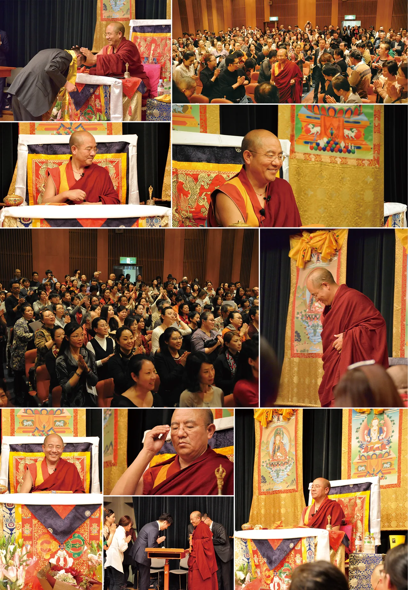
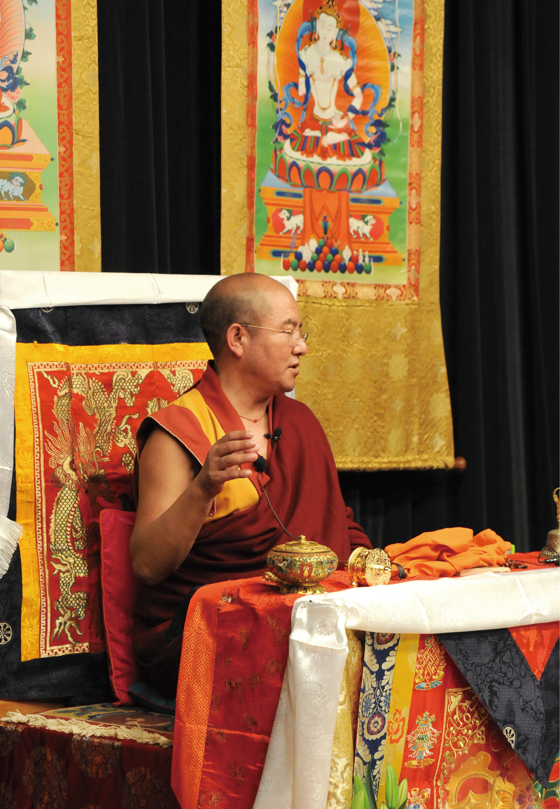
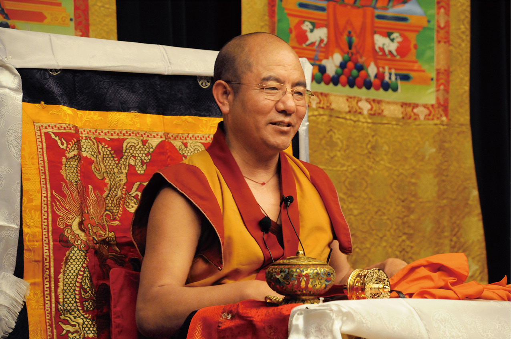
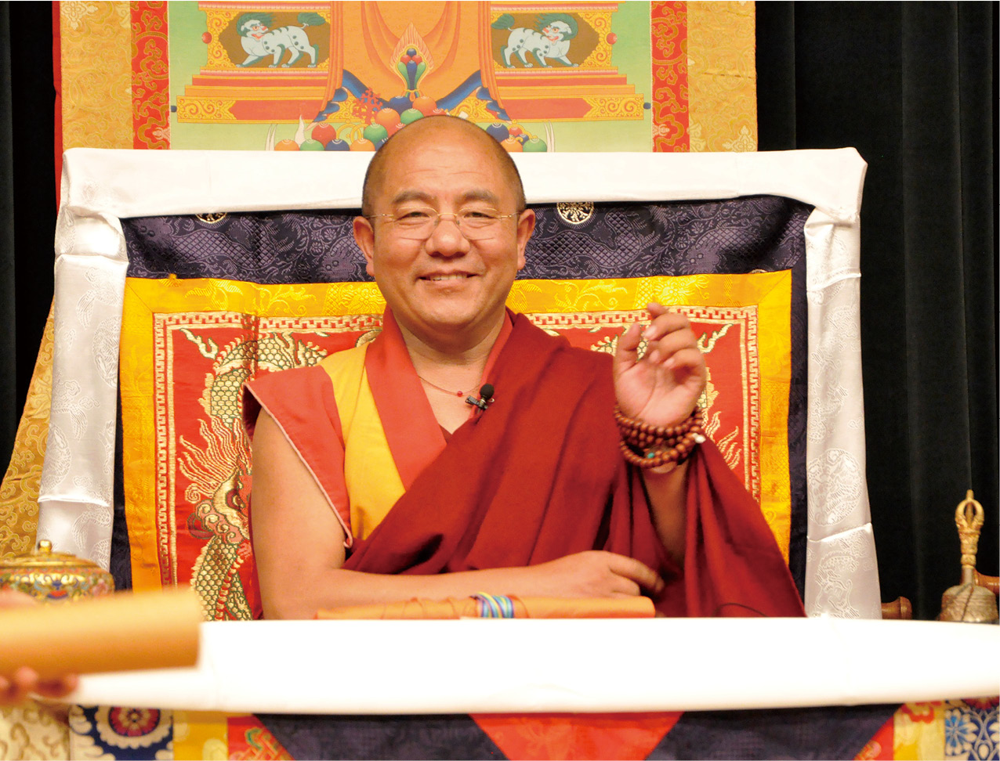
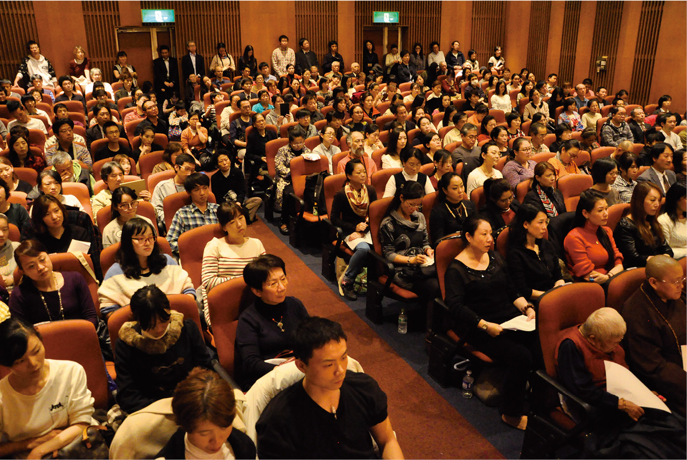
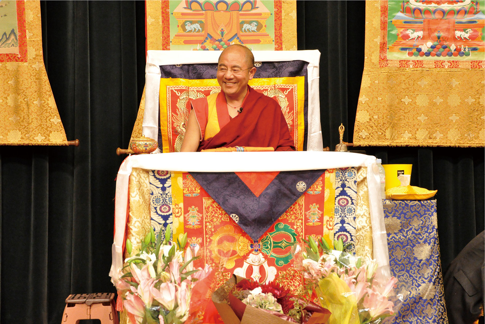
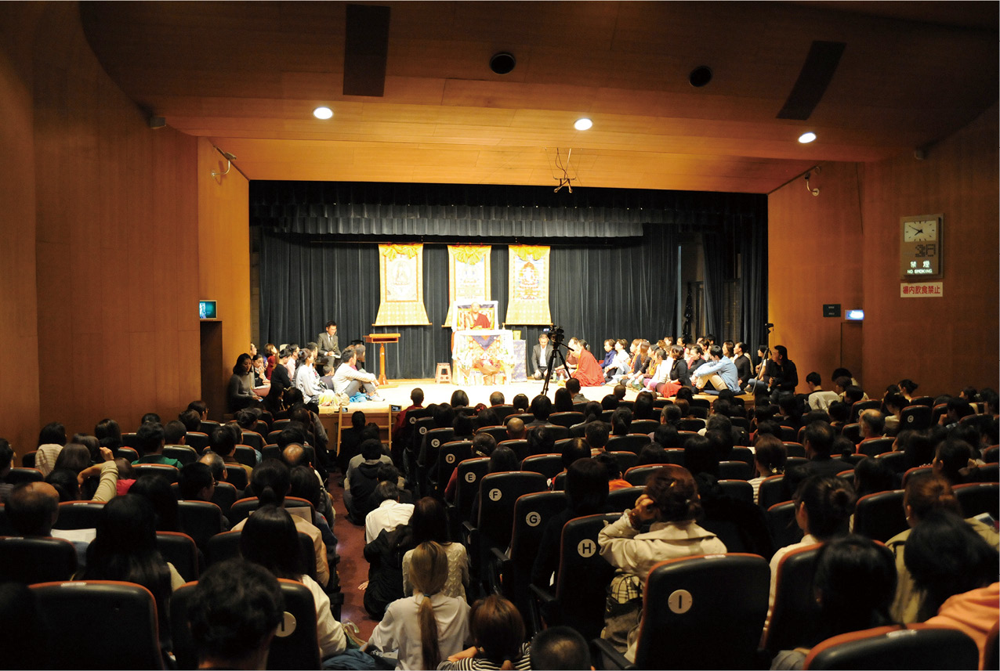
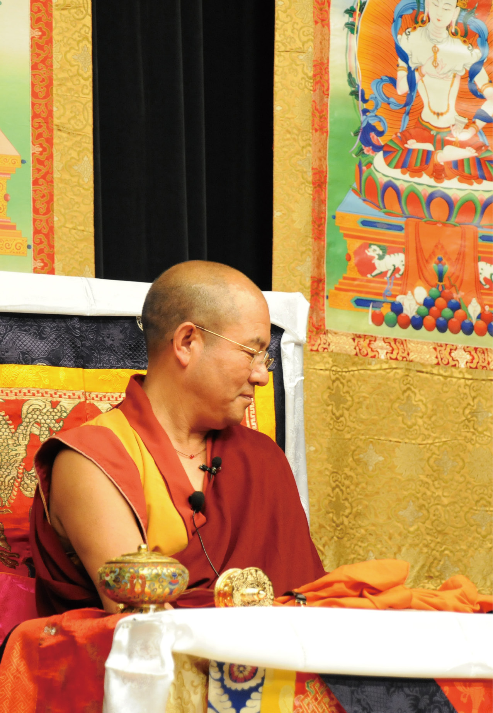
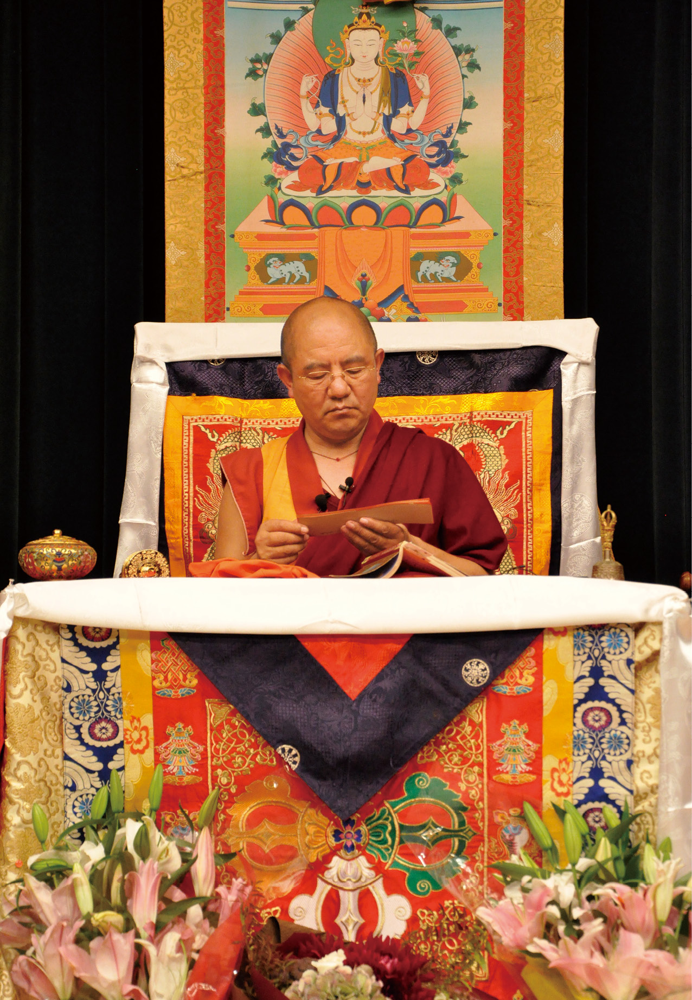
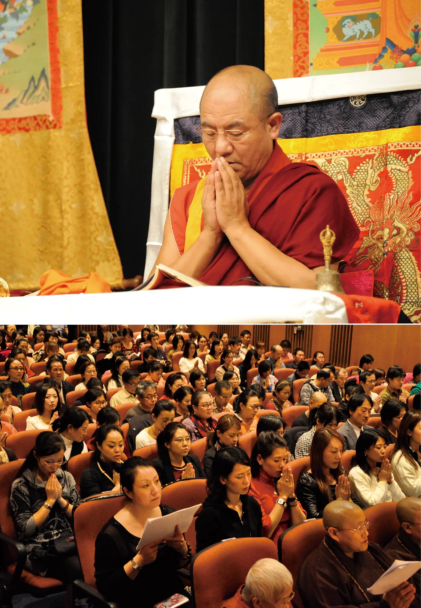

很多人忙了一辈子，  
但真正对他来世有利的，  
只有今生所造的极少数善业。

第52场

日本东京观音法会

Avalokiteshvara Puja, Tokyo, Japan

日本·东京

2015 / 11 / 15

## 和平祈愿

## Peace Monlam

主持人：

感谢大家在休息日远道而来参加这场开示。我是今天的主持人，也是活动的主办者之一，请大家多多指教！

这次我们有幸邀请到索达吉堪布仁波切。堪布是世界著名的藏传佛教高僧，曾受邀在哈佛大学、牛津大学、剑桥大学等世界很多知名学府做环球演讲。

这次是堪布首次来日本，今天是他此行的最后一天。在此，我代表主办单位和大家，向堪布敬献哈达——

按照今晚“和平祈愿”观音法会的流程，我先给大家做一个简单的佛教开示，然后我们一起开祈祷法会。

今晚来到这里，是我这次在日本的最后行程。我来日本的整个过程中，很多人都在中间做了各种筹备工作，一些单位和学校也提供了很多支持。特别感谢大家，你们辛苦了！

在开法会之前，我想给大家讲一下取舍因果方面的道理。当今社会，无论佛教徒，还是非佛教徒，正确取舍因果都非常重要。有些人根本不信因果，有些人虽然表面信，但在实际断恶行善方面，做得并不合格。我想，这方面稍微提醒大家一下，还是很有必要的。

## 善恶业，决定来世

当今时代，大部分人整天忙于积累物质、积累钱财，这方面花费了大量的时间和精力，很少有人真正内观自己的生命价值。事实上，对我们生生世世真正有利的，并非财富，而是善业；真正有损害的，并非贫穷，而是恶业。每个人在这方面，很有必要做深入细致的思维。如果人生真像无神论所说，只有短短几十年，那思不思考也无所谓，可实际并非如此，人的确有无数个来世。

我们今生努力获取的很多事物，在来世都用不上。房子、车子，银行存款等各种各样的财物，死的时候一丝一毫都带不走。唯一能带走的，就是今生所造的善恶业。它们在我们的阿赖耶上，即心灵的深层，以种子的方式去往来世。

很多人忙了一辈子，但真正对他来世有利的，只有今生所造的极少数善业。所以，希望大家一定要谨慎取舍因果，多多积累善业。

《百业经》云：“众生之诸业，百劫不毁灭，因缘聚合时，其果定成熟。”意思是，众生所造诸业，历经多少万年也不会耗尽，一旦因缘具足，定会感受恶业之果带来的痛苦，或者善业之果带来的快乐。

我们作为佛教徒，如果不信因果，对因果也不善加取舍，那只是形象上的修行人。也可以说，一个人修行好不好，关键看他如何取舍因果。若能善加取舍，即使看上去做的善法不多，也是一个好修行人。

## 人和万事兴

接下来，我想讲一讲和平方面的话题。我个人特别赞叹这样的世间理念：人与人之间、民族与民族之间、国家与国家之间，要和平共处，互相尊重，互相理解，互相学习。若从佛教观念来讲，则是以慈悲心、爱心互相帮助。

这样的和平理念或者说爱心，家庭具足之后，就会变得温馨快乐；团体具足之后，就会变得温暖融洽；国家具足之后，就会变得稳定和谐。

总之，小到家庭，大到国家，都离不开爱。如果没有爱的光芒照耀，愤怒和嗔恨的阴霾就会逐渐笼罩每个人乃至整个世界，之后各种恐怖的灾难就会接踵而至。

## 开和平法会的目的

今天之所以开和平法会，一方面，是因为日本多年以来时常发生地水火风等灾难，很多人由此失去了生命，需要我们超度；另一方面，是为了祈愿世界各国人民，未来能在和平、安宁的状态中生活。

历史上发生过很多令人触目惊心的灾难。比如，上世纪40年代，人类历史上第一颗用于实战的原子弹，落在了日本广岛，第二颗落在了长崎。时间分别是1945年8月6日和9日。两次轰炸分别造成了十四万和七万多人死亡。在短短的时间当中，日本失去了这么多生命，不得不让人感叹战争的恐怖。

前些天我在非洲时，听说日本一个地方晚上和白天都发生了四级地震。不过，很多日本人对这样的地震已不会感到恐慌，无常修得特别好。

1923年，日本发生了8.2级强烈地震，造成了巨大灾难。从那时起直至2011年，期间发生了几十次大的地震。每次地震，多至上万人、数千人失踪死亡，少则几百人、几十人失去生命。

面对这些灾难事件，我在深深感叹生命脆弱的同时，有时也会想，这些众生可能以前造过一些比较特殊的业。所以，此次我们开和平法会，为亡者和生者祈福，应该非常有必要。

今天，全世界很多人也在祈祷和召开各种法会，为昨天法国巴黎枪击案造成的一百多位亡者和几百位伤者超度、祈福。

此外，叙利亚战争造成了四百多万人无家可归，其他地方发生的战乱或灾难也造成了很多人伤亡，这些可怜众生都需要我们为之祈福，需要世界各国人民关注。

前段时间我去欧洲的时候，看到那里有很多难民在寻求庇护，这些人看起来非常可怜。非洲也有很多难民，因为非洲一些国家盛产钻石，很多富庶国家觊觎钻石珍贵的价值，在那里通过发动战争进行抢夺。有些非洲国家战争已经平息，国家也独立了，但有些国家三十多年以来一直处于战乱当中，局面非常恐怖，五六百万人因战争而沦为难民，饱受各种痛苦。

有时候，我们也有必要去这些有战争、饥荒等灾难的地方看一看。亲身感受之后，才会知道生命是如此脆弱，生存是如此不易。

很多日本年轻人因为压抑得了抑郁症，有些甚至选择自杀。其实，这些年轻人无论吃的、穿的，还是工作、住处等各方面条件都非常不错，相比难民们要幸福太多。如果有这么好的生活条件，还想自杀，还感到抑郁，确实有点不可思议。也许，当这些年轻人目睹了难民们的艰难生活之后，才会明白自身生命的宝贵。

总之，今天我们通过开“和平祈愿”观音法会的形式，祈祷阿弥陀佛和观世音菩萨，目的是让世间所有人身心快乐、让战争和灾难平息，同时超度在各种灾难中逝去的人们，愿他们获得究竟的安乐。此外，也要超度被人类宰杀的无数动物。人类为了满足自己的口腹之欲，剥夺了很多无辜的生命。若以动物的视角看，人类其实与恐怖分子无异。任何生命都有生存的权力，随意杀害它们的行为，非常不应理，应该需要一一忏悔。

## 祈祷的方法

大家开法会的时候，需要一边念观音心咒，一边观想观世音菩萨。观世音菩萨是集一切诸佛菩萨大慈大悲于一体的本尊。无论什么人，只要一心一意祈祷观世音菩萨，一定会得到菩萨慈悲的加持，获得无尽的力量。

现在很多人只爱学习、研究佛教，不太重视实际修行。我认识的一些朋友很喜欢看佛书，喜欢了解佛教各种甚深的观点，但他们可能连十万遍观音心咒都没念过。

如果单纯为了研究，那就另当别论，如果不但想在理论上研究，还想获得一些感受和体验，就应该长期修持一个法门。就像一个人获得一枚昂贵的钻戒之后，会经常佩戴，并爱惜一辈子一样，我们作为修行人，也应该用最珍贵的法门来庄严自己，并长期修持，珍藏一生。

今天我们念诵的观音心咒和观音仪轨，功德非常大。全知麦彭仁波切在《百咒功德》中说：“仅仅讽诵（观音心咒），就不被业惑所染，与七地菩萨具有同缘分，被誉为见解脱、闻解脱、忆解脱、触解脱。”也就是说，只要见到观音心咒的形象、听到它的声音、心里观想它、身体接触它，就会获得解脱。

大家一会儿开法会的时候，应该怀着一颗真诚的心来祈祷，心里想着那些在灾难中失去生命的可怜众生，对他们生起悲心，这是以祈祷观世音菩萨的方式念诵。也可以以清净心安住在空性境界的方式念诵。最后，大家一起念《普贤行愿品》回向，祈愿世界和平，众生获得暂时和究竟的安乐。

## 皈依

听说今天有些人想皈依三宝。皈依有三种，上等者为一切众生获得究竟解脱而皈依；中等者为自己的解脱而皈依；下等者为自己的健康、平安等皈依。

下面，我先为大家念一些咒语，然后念四皈依的偈颂。大家跟着我念三遍。

“嗡啊吽 班匝儿格热巴玛色德吽，嗡玛呢巴美吽，嗡班匝儿萨埵吽，嗡阿Ra巴匝那德，嗡达瑞度达瑞度瑞所哈，嗡玛玛吽呢娑哈……”
