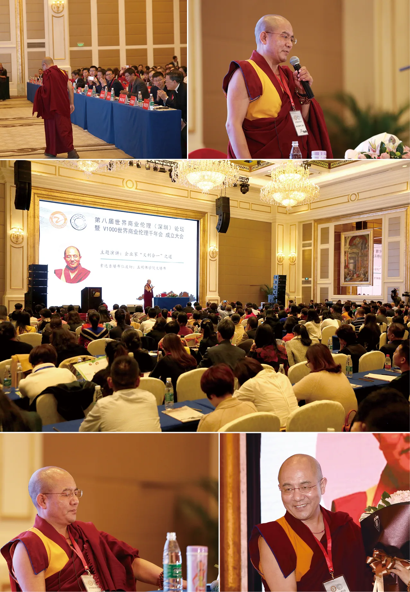
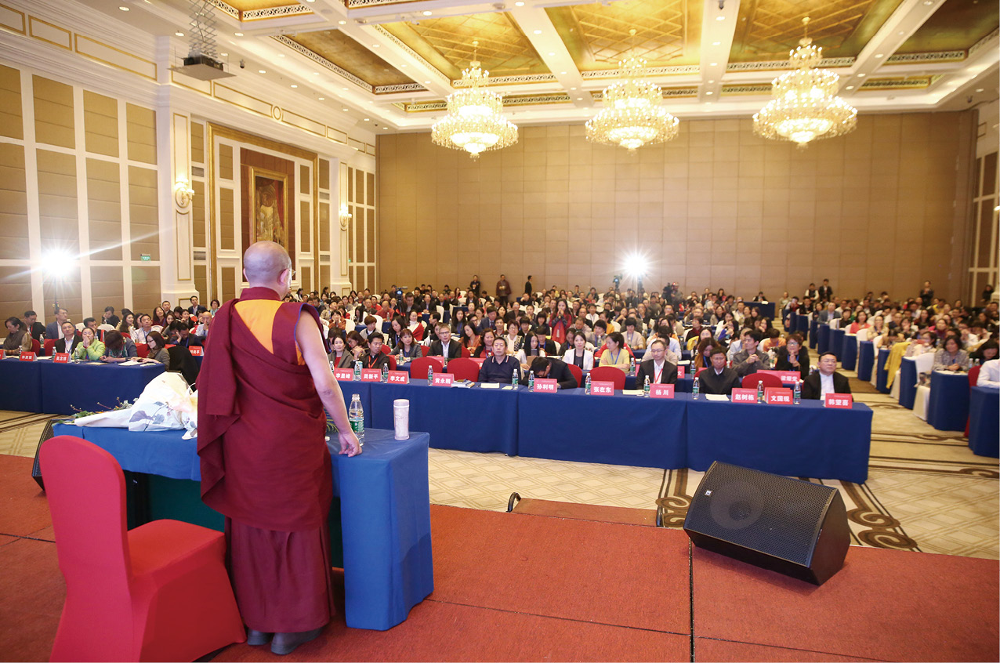
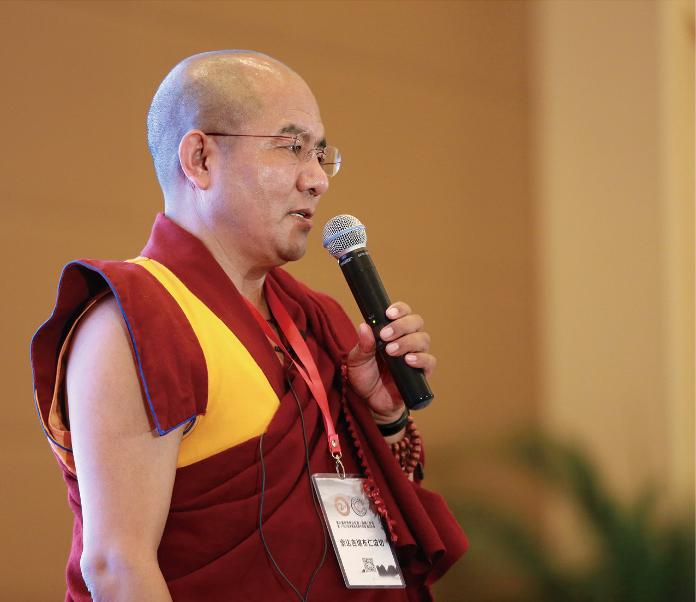
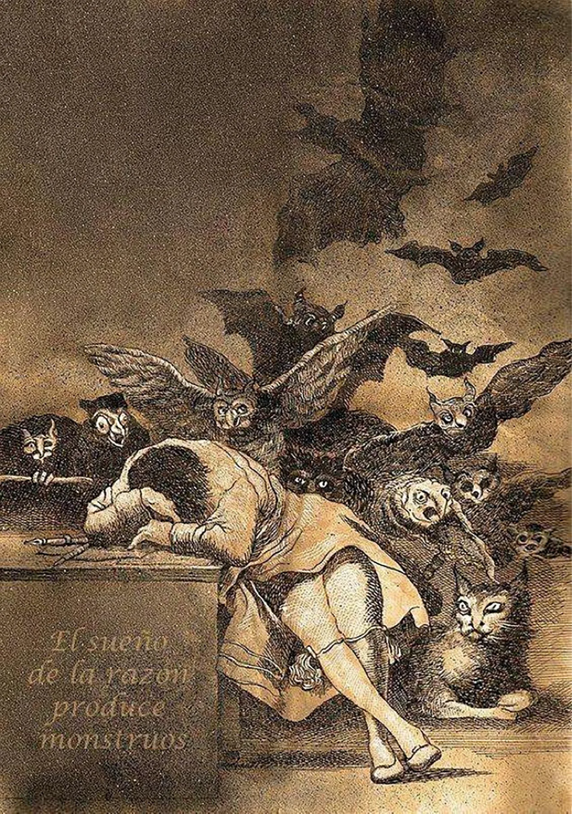
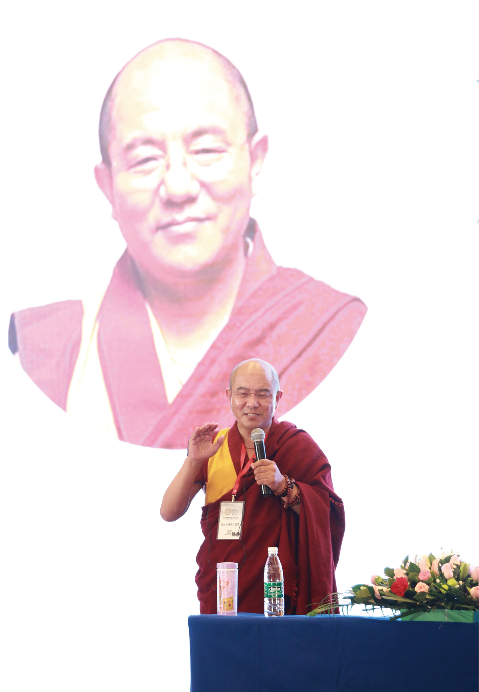
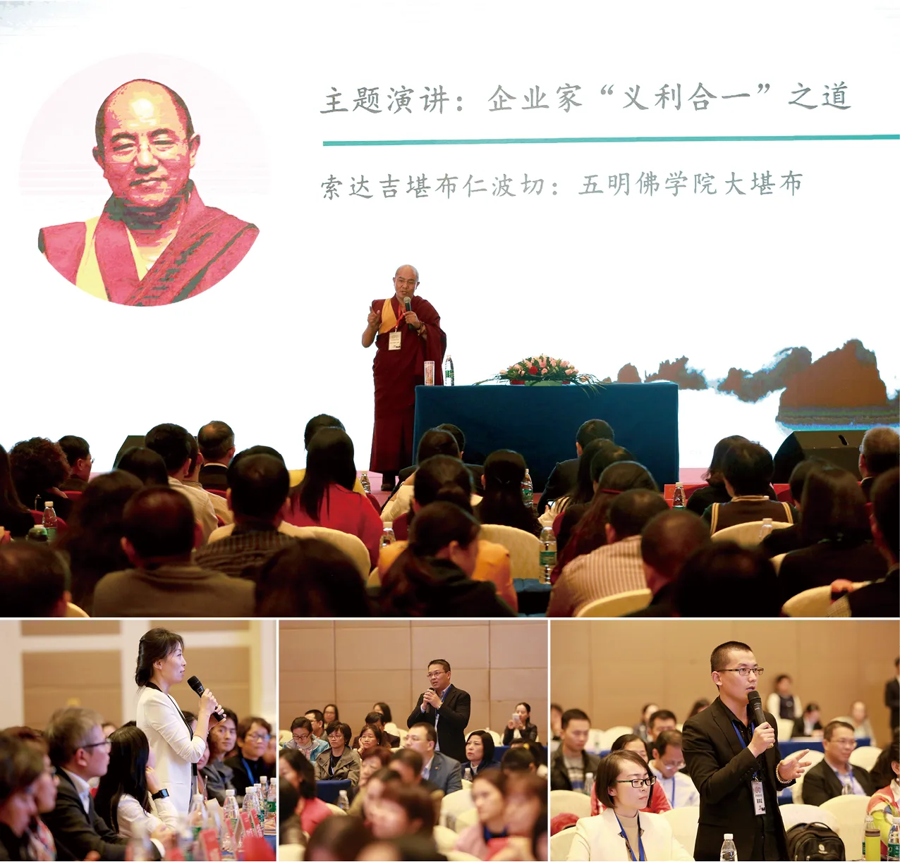
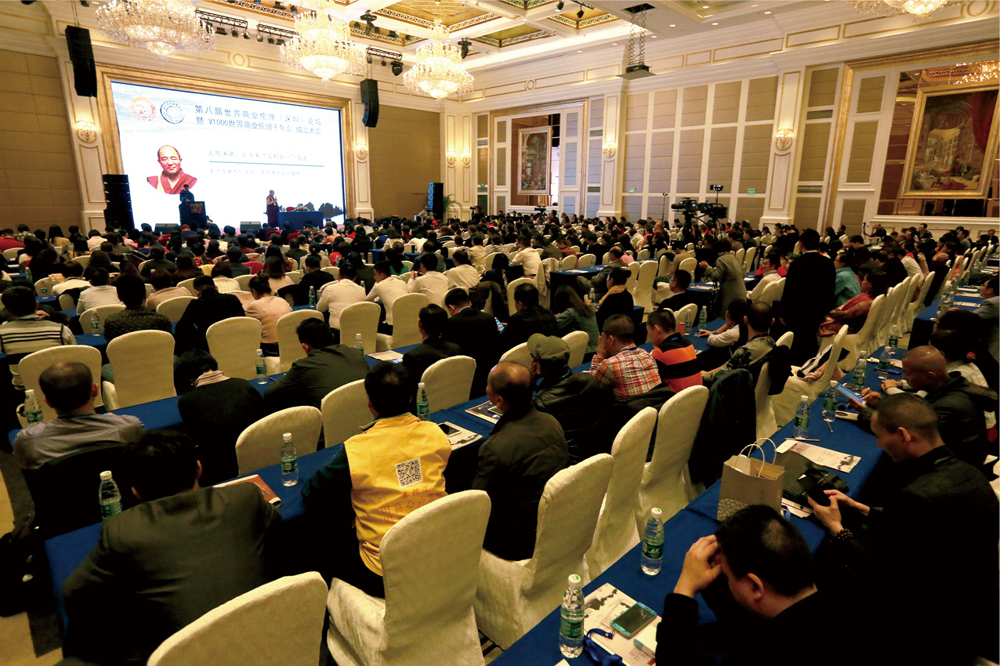
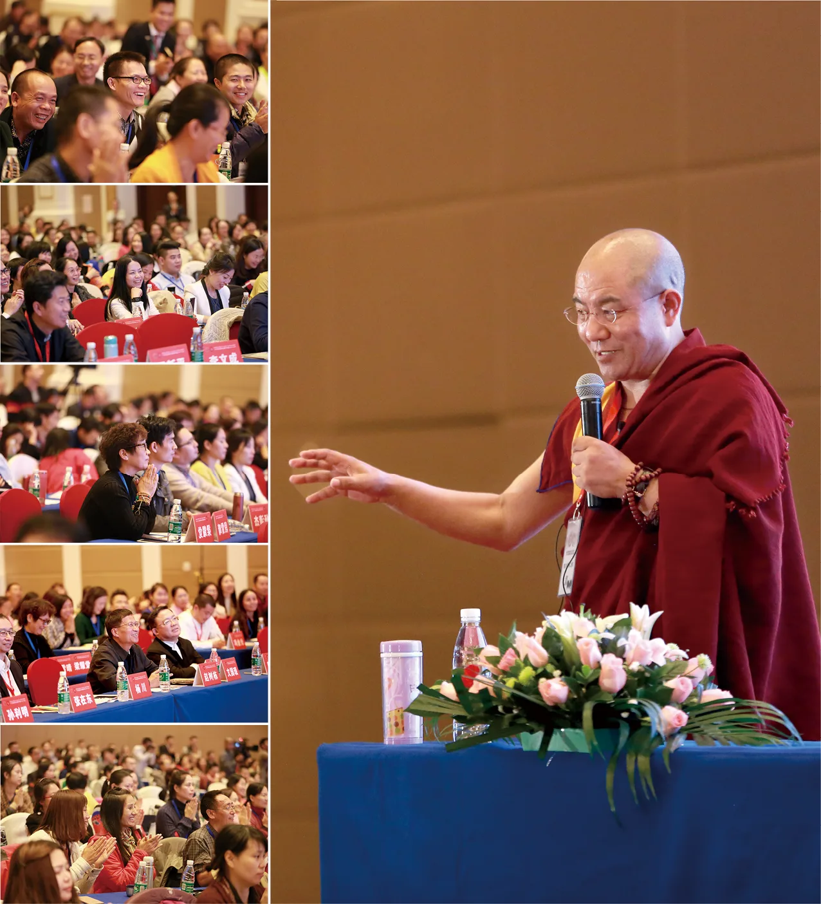

世界上最赚钱的秘密，叫布施。

第58场

深圳V千年会

V1000 Business Ethics Forum, Shenzhen

中国·广东

2016 / 11 / 25

## 商者“义利合一”之道

## Business Ethics for Profitability

主持人：

大家晚上好！

在座大部分都是企业家朋友，我们经营企业的主要目的是为了获利。在商道与棋艺之道中有一个很重要的铁则：不是比谁赢得多，而是看谁错得少。你做对了很多事情，也犯了很多错误，虽然看起来有赢的一面，但离成功却越来越远。

每一位企业家在经营企业的过程中，或多或少都有过迷失。我们研习佛法、学习商道，实际是在学习明理，知道自己在追求盈利的过程中，需要担负起社会责任，知道当自己的利益与道义发生冲突时，该如何平衡……

今晚的课程重点在于“义利合一”，不是叫你舍利取义，而是二者兼有。做到这一点虽然困难，但却是我们应该学习的。

接下来，邀请索达吉堪布为我们讲“义利合一”之道。堪布虽是密宗上师，但他学贯儒释道三家，对三家经典都有很深的体悟。堪布的弘法足迹遍及全球，从美国、英国、德国等西方国家，到尼泊尔、印度、不丹等亚洲国家，都有他弘法利生的身影。

让我们以最热烈的掌声，恭请堪布为我们解读“义利合一”之道——

今天，我很荣幸参加“第八届世界商业伦理论坛”。我相信在座的是一群非常有智慧、有慈悲心和感恩心的年轻人，从你们的眼神和言行举止也可以看出来。

我是出家人，为企业家演讲看起来有点奇怪。其实，我虽然长期学习和研究佛教文化，但对世间管理学也很感兴趣，在管理佛学院的过程中也有一些心得体会。所以，今天我想借此机会，与大家做一次轻松的交流。

## 解析“义”和“利”

这次，我与大家交流的主题是“义利合一之道”。我们先对“义”和“利”稍作分析。通常来讲，“利”既有贬义，也有褒义。在佛教当中，说“自他二利”或者“利益众生”的时候，“利”是正面的词；说“名闻利养”或者“为了自己的利益不顾一切”的时候，“利”带有一点反面色彩。

我们可以把“义”作“正义”解。儒家文化中“义”是“仁、义、礼、智、信”五常之一，它有慈悲、责任、道德、伦理等意。

另外，从“义”的繁体字（義）字形上看，上面是“羊”，有慈悲之意，如善良的“善”，美德的“美”等；下面是“我”，上下合起来就是“我要善良”之意。而“利”的字形，“禾”旁边一个立刀。“禾”是指庄稼、财富，“刀”是一种武器，合起来是说，为了获得财富而带着武器，引申义是为了自己的利益，不惜伤害他人。

“义”和“利”二字的意义完全相反，分别代表了慈悲和不慈悲，显示出利他与自利的对立。由此可见，将“义”与“利”合一还是比较难的。尤其当今时代，很多人为了自利，甚至不顾道德底线。这时，把道德和获利两者结合起来更为不易。

在竞争异常激烈的社会，有时候企业家越善良，越遵守道德规范，越难把企业经营下去。在这个特殊时代，既要对社会和个人负责，不失自己的良心和伦理道德，又要在竞争激烈的市场争得一席之位，如何平衡这二者，是当前许多企业家面临的难题。

面对这样的难题，我们需要用智慧深入分析。分析的时候，很有必要了解中国的传统文化，并把传统文化与市场经济相结合。这样才会明白，自己作为一名优秀企业家，到底应该如何做。

## 见利忘义的时代，注定悲剧丛生

现今是一个见利忘义的时代，整个世界都以经济为中心。很多人为了自己的利益，忽视了正义和道德底线，毁坏了世间很多有价值的理念和精神。

前几个月，山东女孩徐玉玉考上了南京邮电大学，她家生活贫困，全家人好不容易为她筹到了9900元学费。然而没过多久，这些钱却被网络诈骗团伙以教育部的名义骗走了。女孩由于伤心过度、自责过甚，在报警回家的路上猝死了。

不法分子利用诈骗手段骗取贫困生的学费，可以说毫无道德底线，此事在全国引起了轰动。

不仅十几岁的学生会被骗，甚至连清华大学一位53岁的教授也上当受骗。这名教授也是因为接到诈骗电话，最后被骗走了一千多万元。

上海交通大学信息安全学院的院长曾说：网络诈骗、电话诈骗已经形成了一条黑色产业链。据统计，2016年从事这一产业的人已达160万，诈骗金额高达1172亿元。

这次我出来不到一个月，就收到了三个诈骗电话。有一个人在电话里亮明身份是成都市公安局的，想与我核实名字、手机号、银行卡等信息。我对他说：“我刚好在成都，可以直接去公安局找你。”他听后马上把电话挂了。

从徐玉玉的案子可以看出，骗子根本不会想这个人的钱是怎么来的、用来做什么，他们为了自己的利益，可以使用极其卑劣的手段，没有任何道德底线可言。这些人为什么会变成这样？这个问题很值得我们思考。

## 自利主义的起源

在这个世界上，如果“为了自利可以不顾一切”的理念盛行，将是非常可怕的。东方文化强调集体主义，强调人与社会的和谐发展，而西方文化更强调以自我为中心，不断扩大经济利益。

实际上，西方文化所倡导的理念是一把双刃剑，一方面促进了生产力和人们生活水平的提高，另一方面，由于很多人依照西方经济学鼻祖——亚当·斯密的理念生活，故而变得非常自私，只关心自己的事情，甚至不择手段地突破道德底线。

很多人对亚当·斯密非常崇拜，我专门研究过他的一些论著，包括《国富论》和《道德情操论》。在《道德情操论》中，亚当·斯密认为，人们的言行应该有人格和伦理界限。该论虽被译成多国文字，但鲜少有人提及其中的理念。真正对世界产生巨大影响的是他的《国富论》，此论特别强调一切以经济为中心。

很可能是受《国富论》的影响，以英国为主的许多西方国家特别强调自利。亚当·斯密住世的时间是18世纪，那时全世界的经济、文化正经历一场前所未有的变革，并且可以明显看出，当时，西方人的自我意识猛烈迸发，对全球利益的霸占欲显著提升。

《国富论》虽然对强化自利思想起到了一定作用，但不可否认的是，其理论也有自身的力量和价值。正因如此，才会受到这么多人欢迎。

## 自利主义，终不长远

去年，我在英国和一位教授聊天的时候说：我去过世界很多地方，相较而言，感觉英国人特别强调自利。英国人曾认为全世界都是自己的殖民地，都属于英国，自诩为日不落帝国。他们之所以这么想、这么做，究其根源就是“利”字当头。

昨天是感恩节，在我看来，这是一个很奇怪的节日，好像从良心上也说过不去。因为英国人最初登陆美洲的时候，是印第安人救了他们，可他们不但不感恩，反而在发现美洲有很多宝藏后，便无情地杀光了印第安人，霸占原属于印第安人的土地。英国人自己也承认，印第安人对他们有恩德，为了感恩而设了感恩节。现今，美国很多博物馆都有感恩印第安人的展览。

现在很多人都在学感恩的理念，从“感恩”两个字的角度解释，感谢对自己有恩德的人，当然是对的，但不能像英国人屠杀印第安人这样，以恩将仇报的方式来“感恩”。

那时，英国妄想称霸全世界，包括美洲大陆，但1776年美国签署了《独立宣言》，这意味着美国成了一个独立的国家。由于存在利益冲突，直到1783年，英国才勉强承认美国独立，这是英国历史上的一次重大失败。

日不落帝国从15世纪以来，确实有称霸世界的野心，战略上也有将全球设为殖民地的布设。我以前去印度时了解到，英国实际控制印度的时间是1849年至1950年间的一百年，若包括半殖民地状态，英国总共霸占印度将近两百年的时间。

英国之所以霸占印度，是因为印度有很多资源，而且印度本地的民族、宗教之间不够团结，容易被外来势力分化。当时，西班牙、荷兰、法国等国家也在争夺印度领土，但英国最后成了赢家。之后，英国为了自身的利益，在印度肆无忌惮地掠夺各种资源。

除了印度，英国还强占了澳洲。当时，英国监狱里人满为患，为使新西兰和澳大利亚成为英国囚犯的流放地，他们杀了很多当地的土著人。

我去非洲的时候，了解到当地很多悲惨的历史，看到了西方人为了争夺利益侵占非洲的现实。非洲有五十多个国家，有一部分国家的黑人原来没有任何自由，曼德拉上台后，他们勉强获得了一些自由，但大多数资源仍掌握在白人手里。美国、俄罗斯、法国、英国、荷兰、匈牙利、葡萄牙等国家，给一些非洲国家提供资源和武器让他们打内战。谁夺得政权后，支持他们的西方国家便可以明目张胆地获取该国的资源。

中国在非洲搞开发是采取较文明的方式。我去了几个非洲国家，了解到中国并没有参与和支持当地的武装斗争，只是老老实实在那里投资办企业，还是比较不错的。但很多西方国家经常怂恿两个国家或两个部落打仗，给其中一方提供武器，一旦他们赢了，支持他们的西方国家就会马上运输各种高科技设备前去挖矿。

人类历史是一部血腥史，血腥的背后是利益的驱动。上世纪日本侵略中国、朝鲜和东南亚地区，也是为了利益，即为获取被侵略国的各种宝藏。

当时英国有种说法：印度人为我们供茶，中国人向我们买烟，我们把犯人流放到澳洲……整个世界都在为我们提供丰富的资源，其中也包括非洲。英国从15世纪到19世纪在非洲殖民期间，并没有把当地的黑人全部杀掉，因为觉得黑人有利用价值。从15世纪开始，他们便把很多黑人当作专门的挖矿工具，以此牟取暴利。

可见，人类大至国家，小至企业、个人，自私自利的心还是比较严重的。当极端自利主义者管理国家的时候，为了达到目的，他们会吞并其他国家，残害他国人民。启蒙运动之后，人道主义理念开始兴盛，有些残酷的行为才被逐渐制止。回顾这些历史的时候，西方人可能很难高兴起来。

作为一名企业家，应该经常观察自心，看看自己的所作所为到底是为了帮助身边的人，还是为了垄断所有的资源？同时要明白，为了扩大自身利益而不顾一切，垄断、吞并所有资源，让别的企业无路可走，这种观念是错误的，也是非常可怕的。

## 利他心是成功企业家的标配

刚才温先生提到，他的企业实在没有订单的时候，就让员工四天上班、三天休息。对很多新企业来讲，这也是关怀员工的一个好方法。

我始终觉得企业家非常伟大，你们不仅为自己创造了财富，更重要的是担起了很多社会责任。每个员工都有一个家庭，每个家庭都是社会群体的一部分。一名企业家如果帮助了一百个人，就等于帮助了一百个家庭；帮助了两百个人，就等于帮助了两百个家庭。

作为成功的企业家，不仅要给员工发薪水，更重要的是对员工开展道德方面的教育，或者传给他们一些世间智慧，使员工不仅得到物质财富，还能获得精神财富，一举两得。总之，企业家对于员工而言至关重要，利益不可尽数。

当今时代，企业家也是社会主流思想的引领者。最近，美国正在进行总统选举，我作为出家人，也很关注竞选者的一言一行。特朗普作为商界成功人士，此次能够赢得大选，也是社会发展的一种趋势吧。这也向全世界释放了一个信号：现如今，文学家不一定很重要，艺术家也不一定很重要。谁比较重要呢？企业家和他们的金钱。

企业家如果有了大量金钱，在短短的时间当中，什么事情都可能做成，这时千万不能得意忘形，而应该用这些钱去帮助更多的人，否则，很容易从高处跌落。

## 世界上最伟大的赚钱秘诀

历史上，日本也盛行过自利主义，譬如把从德国学到的高端科技用于研发武器，发动战争危害了很多国家，但日本也保存下了很多好的传统思想。

日本有家酿造酱油的企业“龟甲万”，它诞生于17世纪中叶，距今已有三百多年历史，经过不断研发，龟甲万的产品在市场上取得了成功。1950年前后，因受到经济危机的冲击，很多制造酱油的中小型企业濒临倒闭。这个时候，龟甲万公开了自己酱油的秘方，很多竞争对手因龟甲万的善举免于破产。

在当时经济危机的情况下，可能很多人都会乘胜追击，占领更多市场份额，绝不会公开自己的配方帮助竞争对手。大家可能觉得，龟甲万这么做肯定有损失，但奇迹却发生了，龟甲万的善举不但没使自己遭受损害，反而发展得越来越兴盛。如今，龟甲万产品已经畅销世界一百多个国家。

龟甲万的成功，正如一本书里所说的“世界上最伟大的赚钱秘密叫布施”。布施，佛教称“布施波罗蜜多”，即通过布施无条件地帮助众生，让众生得到利益。

## 善恶有报，是自然规律

行布施，果报必会回馈给自己，令自己得到真实的利益，这是一种自然规律。当然，大家现在还不一定能完全了解这种规律，可能还需要通过思考和观察，让智慧进一步提升。

我看过一幅西班牙的漫画，名叫《当理智沉睡时，心魔会出现》。漫画里一个人趴在书本上，将头埋进双臂睡着了，他的背后有一群猫头鹰和蝙蝠，它们像噩梦一样纠缠着他。漫画表达的意思是，当人的良知沉睡时，自私自利、愚痴无知的心已经覆盖了他，暂时来讲一切还算安稳平静，但心魔和违缘已不知不觉来到了他身边，伺机攻击。

正如古人云“福中有祸，祸中有福”，当觉得自己是世界第一强者，没有任何人能与之抗衡时，违缘、障碍正在酝酿并逐渐显现。

很希望大家在经营企业的过程中能遵循“善有善报，恶有恶报”的因果规律。当然，在座有些人相信这一规律，有些人不一定相信。即使不信，也应该明白，做人过程中具有良知，做事过程中具有惭愧心，于自身而言非常重要！

## 正视成功

我认为人活在世界上，人生的价值不应该仅限于追求个人利益。现在全球大部分人都以自我发展为核心价值观。城市人心心念念想的，大多是买套豪宅、买辆豪车、在银行多存一些钱、把孩子送到美国、英国等发达国家读书、家庭幸福、晚年健康，可以到处游玩……但仅止于此并不足够，更重要的是，当我们自己有了吃的、穿的之后，还要帮助身边的人。比如，不仅送自己的孩子到国外念书，也帮助亲朋好友的孩子，或者与自己毫无关系的偏远山区孩子读书。在自己有能力的时候，哪怕是一个孩子，也愿意帮他完成学业。

我们不一定都能像比尔·盖茨、巴菲特、马云那样在商业上取得巨大成功，毕竟这种人屈指可数。即使你看他们的自传、定下成为超级富豪的目标，但自己的福报不一定能跟得上。很多年轻人想得很美好，实际自己有没有这个能力和福报很难说。与其这样，还不如脚踏实地，面对现实，从自己的群体中选择优秀的人作为榜样，假以时日，你可能就会像他们一样优秀。

此外，作为企业家，一方面要做身边人的榜样，另一方面也要关心他们。如果漠视身边的人，只一味固守自我发展的理念，永远沉溺在自利当中，除了把员工当作发财工具以外，没有为他们做任何事情，当你离开世界以后，可能会被定义为“不成功的企业家”。

考量一位企业家是否成功，我认为不是看他年薪有多高，或者企业规模有多大，即便他有成千上万名员工，也不一定算成功。所谓成功，是要看他在维持自己生活的情况下，还能帮助多少人。当然，在利和义发生冲突的时候，也可以从较小的方面去关心他人。

## 邪命养活不可取

佛教认为，人活在世界上，不能以邪命养活，而应以正命生活。大乘佛教所讲的八正道，是一地菩萨以上的境界，对于我们来讲比较遥远。适合我们的是稍低一点的《阿含经》所讲的正业、正语、正道。正业，是指工作的时候不能超越伦理道德规范；正语，是指说话、做事要堂堂正正，不愧良心；正道，是指在生活中不做违背良心的事。

佛教讲，出家人要远离五种邪命养活。

第一种，诈现威仪。自己本来不是一个很好的修行人，但为了获得某种利益，在别人面前装作闭关、禅修或者念经，即以一种假威仪来蒙骗别人。

第二种，谄媚奉承，为了达到某种目的故意赞叹他人。比如，对别人说：“你做的善法功德特别大、你是个非常好的居士、你的福报太大了、你供养我们寺院功德无量、你生生世世都会变成很有福报的人……”为了获取自己的利益，说诸如此类赞叹他人的言辞，即属于谄媚奉承。

第三种，旁敲侧击，是指不从正面阐明本意，而从旁边影射，转弯抹角地说，目的是希望对方给自己好处。比如故意说：“我最近身体不好，因为吃得不太好；我最近身体可能受凉了，因为衣服不太够；我想去很多地方弘扬佛法，但没有车，特别不方便；寺院生活非常苦，因为资源太欠缺了；高原上条件有限，我准备在汉地城市住下来……”这种旁敲侧击，也是邪命养活的一种。

第四个，巧取讹索，是指当某人对他不供养的时候，他用一种敲诈的方式索取供养。比如，对别人说：“你为什么不供养？如果不这样供养，你会下地狱的；你要是不做的话，我就不要你了……”即以这种讹诈的方式让信众供养自己。

第五个，赠微博厚，给信众一点点东西，希望他们回馈大的利益。比如，给对方一个加持品，然后说一些欺骗性的语言以获取利益。

以上五种都是邪命养活。它们完全违背了佛教的精神。

虽然五种邪命主要针对修行人讲的，但商界应该也有类似的情况。希望大家在世间生活、工作的时候，对于违背良心和道德的所有行为，都能够远离。

当然，作为一个世间企业家，要做到完全不违背人类的道德规范，可能有一定困难。佛经论典也说，人在做生意的时候，难免掺杂妄语、绮语等不善业，但通过念诵一些经咒，就可以在相当程度上忏悔清净。但也要注意，故意伤害、欺骗别人非常不合理，应尽量制止。事实上，真正优秀的企业家，不但不会伤害他人，还会尽心尽力照顾身边所有的人。

## 从东方文化中汲取营养

我们身处这样的时代，应该肩负起历史的使命和时代的责任。可以经常学习一些古代传统文化思想，倡导诸如“君子爱财，取之有道”这样的理念。

获取财富应该遵循一种道，有一种行为规范，只有这样，才能推进整个社会的健康发展。在如今道德滑坡的时代，每个人都应该发挥自己应有的力量。

汤恩比博士曾说：“人类未来的希望在东方。”他所谓的东方，是指以大乘佛教和儒家思想为主的理念，这与西方新经济学派的思想不同。人类文明发展到一定程度之后，就会追求良心至上。东方文化有逾千年历史，具有强大的生命力，它根植于每个人的血液和基因当中，生生不息，传承至今。东方文化及其理念，值得每一个年轻人认真思考，如果未加思考而随便舍弃，是非常可惜的。

现在很多人包括在座有些企业家，对佛教很感兴趣，在居士群体当中，我们提倡“生活佛教”，其主要理念是知足少欲。人到了一定的时候，需要有一种满足感。永无止境的欲望膨胀，不但会破坏自然环境，还会腐化我们的身心，令自己的安全和健康受到威胁，产生诸多不利影响。

值得注意的是，佛陀提倡的是少欲，并没说让我们断绝所有的欲望。少欲的意思是，不让欲望过度膨胀，即不追逐过分的欲望。有些人认为，经济发展需要有欲望。我认为，适当的欲望可以带来适当的发展，但若欲望超出了自己的能力范围，就会引生诸多弊端。

现今，地球上的资源越来越少，这是人们在自身强烈欲望的驱使下，不断大规模攫取造成的。不过，美国的矿产储量全球领先，他们并未大量开采，反而保护得很好。我和一些德国、英国教授交流的时候，称赞他们文化保存得好，他们表示，二战之前还可以，二战之后很多文化都被破坏了，文化和经济中心都转移到美国去了。美国在二战后迅速崛起，其原因，一方面在于美洲大陆远离欧洲主战场，免受了很多侵扰；另一方面，美国不断卖武器给参战国，大发战争财。

你们如果到英国、德国、法国的博物馆参观，就会发现，二战之后只有少数文物保存下来，大部分已经毁于战火。二战期间，英德签署了一项协议，规定英国的剑桥大学、德国的哥廷根大学等少数几所学校可以免于战火。除此之外，双方的很多名胜古迹，都在战争中被摧毁了。欧洲各国在二战中元气大伤，很多资源都被转移到美国。

前一段时间，我遇见一位预言家。他预测，未来美国经济会出现比2008年更严重的金融危机，美元将贬值成泡沫，全世界会进入新一轮恐慌。虽然这些话不一定可信，但我们也可借此反思一下：当看到全世界大部分人都在为了自身利益互相竞争、冲突的时候，我们作为企业家，应在其中扮演什么样的角色呢？是袖手旁观，还是出手相助？

## 观无常，心自在

当然，我们自身也会卷入各种竞争当中。人生本就起起落落，今天自己是一名成功的企业家，过一段时间企业也许就倒闭了。既然生活在无常的世界，理应做好面对无常的思想准备。

前不久，我去了一个城市的“破产协会”，很多企业破产的时候，都由他们收留和处理。我问会长：“你们做得怎么样？”他说：“我们现在做得特别好，很多破产企业最后走投无路，只能让我们帮忙处理。”虽然这不是一个好现象，但却印证了佛教所说的“万法无常”之理。

人生就像一条上下不定、起伏弯曲的路。每个人都在追求幸福，但在追求幸福的路上，痛苦却时常来袭。没有任何人的一生能完美无缺，要想找到一个从小到大，在感情、生活、工作上从未遇到过挫折、从未感受过痛苦的人，恐怕非常困难。

作为企业家，应该学会接受生活的全部。我们的生活是由黑白、苦乐、成败等各种不定因素组成的。自己今天变成万人瞩目的成功者，到了明天，可能就会遭到众人的谩骂和诋毁。我刚才问一位韩国人，怎么看待朴槿惠事件？他说：朴槿惠当总统的时候，很多人拥护她，为她高兴、欢呼；当她落难的时候，这些人又开始骂她，恨不得她马上下台。

所以，在看待世界历史和个人境遇的时候，具有佛教的无常观非常重要。有了无常观，当企业蓬勃发展的时候，你不会特别傲慢，因为知道，虽然现在风光无限，但以后不一定总这样；当企业经营惨淡的时候，你会提醒自己：光明就在黑夜之后，黎明前的天空最黑暗，未来总是有希望的，这样就不会把自己逼上绝路。

明朝的罗状元写过一首《醒世歌》：“急急忙忙苦追求，寒寒暖暖度春秋。朝朝暮暮营家计，昧昧昏昏白了头。是是非非何日了，烦烦恼恼几时休。明明白白一条路，万万千千不肯修。”

这首诗所讲述的醒世理，在当今时代同样适用。我们每天都在急急忙忙、辛辛苦苦地追求着，在这样的追求中，度过了寒冬、暖春等很多个春秋；我们每天都在朝朝暮暮地想着家人，想着怎样发财，结果，在不知不觉、浑浑噩噩当中，已经白发苍苍，人生走到了尽头；每天，我们都在各种是非、烦恼中度日，无休无止。事实上，道理明明白白，所有人都走在前往死亡的路上，百年之内均会离开人间，但因为我们不懂无常之理，谁都不肯去修，照旧盲目追求。

这样追求，到底合理还是不合理呢？非常值得我们观察。观察的方式多种多样，希望大家能够深入探究。

最后，希望大家在“利”和“义”发生冲突的时候，不要舍弃底线，用自己的智慧和慈悲摄持，做有意义之事，尽量把“利”转为自他二利。

今天能与在座很多佛教爱好者、企业家一起交流、分享，我感到非常高兴。谢谢！

现场互动

问：很多企业学习《弟子规》只是虚有其表，并未真正学到里面的精神。您如何看待这一现象？

堪布：《弟子规》在中国数百年传承不断，我以前也宣讲过，感觉里面的理念特别适合中国人。它所提倡的感恩心、知足等观点，无论对于个人还是群体，都很有意义。也可以说，《弟子规》与亚洲文化特别相应。所以，从亚洲文化的角度讲，学习《弟子规》于企业而言很有必要。

不过，西方人不一定能接受《弟子规》中的理念。在中国，很多条件较好的人都会把孩子送去西方读书。西方文化比较开放，留学可以开阔孩子们的眼界，对增长见识、开发智慧很有帮助。不过，出国留学也会对孩子有负面影响。你们作为父母，用辛辛苦苦赚来的钱送孩子出国留学，而他们接受西方教育之后，不一定会报答你们的恩德。西方的孩子普遍比较自私，到了18岁就已经独立，大多数父母老了都会被送进养老院。

按照西方人的思维模式，对父母、老师或企业老板，不必有感恩心。他们有一种特别好听的说辞——民主、平等、自由。和西方的孩子讲尊师重道，他们不理解，觉得师生是平等的；和他们讲服从领导，他们说要民主；和他们讲孝顺父母，他们谈自由，认为子女应强化自我个性。因为东西方的文化理念完全不同，所以《弟子规》很难被西方企业接受。

如今是西化的时代，好莱坞电影及其思维模式影响着全世界。这种背景下，想用《弟子规》这样的东方文化来感化西方人，可能有一定困难。

在很多东方国家，包括新加坡在内，西方文化的影响显而易见，这对中国传统文化的冲击是巨大的。尤其年轻一代，到西方留学归来后，不一定能接受《弟子规》文化。正所谓“近朱者赤，近墨者黑”，任何人在某种环境生活一段时间之后，其行为都会受到不同程度的影响。

问：有位大师曾对我讲，人生来脸上就是一个“苦”字。请问，您怎么看待人生的苦难？此外，人到底有没有来世？

堪布：我写过一本叫《苦才是人生》的书。人降生到这个世界做的第一件事就是哇哇大哭；最后离开这个世界时，通常也会流下几滴眼泪，这说明人的一生苦难相随。

佛教讲，人生有三大苦——苦苦、变苦、行苦；细分则有八支分苦——生苦、老苦、病苦、死苦、怨憎会苦、求不得苦、爱别离苦、五阴炽盛苦。每一种痛苦，我们在人生的旅途中都会经历。

在座的各位，尤其年轻人，懂得人生是苦很重要。当然，生活中的苦和乐是交替出现的，但相较而言，乐要少很多，并且，正在感受的快乐很快就会变成苦。可以说，整个生活的底色是苦的。

《中观四百论》里有句著名的颂词“集聚与分离，岂非俱时有”，意思是，集聚与分离难道不是同时俱有的吗？但人们往往只喜欢集聚，不喜欢分离，比如，任何人都不喜欢与家人分开，不喜欢死亡。然而，团聚和分离、生和死都是自然规律，任何事情都有正负两面，只接受一面，而不接受另一面，是不现实的。

佛教并不是教导我们一味追求快乐，或者一味排斥痛苦，而是告诉我们：快乐的时候，要对将来可能出现的痛苦做好准备；痛苦的时候，不要绝望，要相信一切终会过去。尤其现在很多年轻人稍微遇到一点挫折，如公司倒闭了、经济不景气、感情受挫了，就想自杀。包括一些腐败分子，在走投无路的时候经常选择自杀，我觉得这样做是不明智的。

一个人只要活在这个世界上，即使跌到谷底，也不会没有出路。今天你觉得自己很可怜，但不久之后你可能就会翻身。翻开历史，这种情况屡见不鲜。

总之，我们应该学会接受人生的苦与乐。你刚才说人的脸上写着“苦”字，其实，“笑”字也可以写在人的脸上。

关于人有没有来世的问题，我的回答是，人绝对有来世。我以前翻译过一本叫《前世今生论》的书，里面以大量的科学依据和可靠的案例，论述了人存在前后世的道理，你如果有时间，可以找来看一下。

问：世界上有没有神？《圣经》和《薄伽梵歌》里说，财富来自神。佛教怎么看待这种财富观？

堪布：各个宗教的思想都非常深。对于这样的神，我不能肯定地说没有，因为以我的智慧无法衡量到底有没有；也不能肯定地说有，因为没有任何证据可以证明财富是神赋予的。

当然，用一些合理的推理推测，也可以帮助我们理解。比如，比尔·盖茨、洛克菲勒等世界顶级富豪，大多诞生在美国，是不是神特别喜欢美国呢？以前神还喜欢英国，后来神喜欢日本，近年来中国替代了日本，成为了神的新宠，因为有不少富豪都诞生在中国。西方宗教的这种说法，应该具有甚深的宗教意义。

按照佛教的观点，人有前生后世，前世所造的福德对后世的财富状况有着直接的影响。一个人若前世造的善业较多，他今生财富方面就会比较圆满；若前世造的福德不多，今生就会比较贫穷。但今生能否发财，也并非完全依靠前世的善业，与今世的努力和勤奋也有关。

具体来讲，前世的业是因，今世的勤奋是缘，两者是一组因缘关系。若前世的福报具足，今生当中也努力，因缘集聚，就会有发财的机会；如若缺少了一个，则很难如愿。比如，有些企业家虽然有智慧也很努力，缘已经具足了，但因为前世没有积累福报，因不具足，故而始终不能成功。任何一个果的产生，都要具足因和缘。

总之，佛教并不认为财富完全由神所造，也不认为，获取财富不需要现在的勤奋努力，而是认为，前世的因和今生努力的缘都要具足。

有些人虽然非常优秀，但始终赚不到钱；有些人尽管比较笨，经营方式也无特别之处，但突然就发财了，他自己都不知道什么原因。其实，这背后确实有一种因缘在起作用。

正因为佛教财富观的基本思想是“财富与因缘有一定关系”，故而倡导人们多做布施，这样今生也会有发财的机会。即使今生没发财，来世乃至生生世世都不会贫穷，这是一种因果规律。

未来的你，是现在的你的一个延续，如果你爱自己，现在就要多做善事。我们若用智慧分析，就会发现佛教的因果观特别符合自然规律。

问：全球各地的高校和企业正在兴起一股慈悲和正念禅修的热潮，我也希望在中国传播正念与脑科学结合的理念。请问，您怎么看待这种做法？在中国怎样开展比较好？

堪布：西方有些企业和学校虽然弘扬利他的思想，但参与者并不多，规模也不太大。我去过一些西方学校的佛学研修中心，感觉利他思想对西方社会的影响极为有限。

在西方国家，很多人觉得发慈悲心是天方夜谭，要慈悲的话，应先慈悲自己。尤其对于大乘佛教所提倡的无条件利益众生的说法，他们觉得非常可笑，认为我们是在空谈。

现今，西方文化已在全球盛行，很多中国年轻人受其影响，思想变得比较复杂。他们一边接受传统的大乘利他思想，一边接受西方以自我为中心的思想，但两者经常发生冲突。

不过，正念禅修现在的确在很多知名企业和高校中盛行，包括谷歌、波音等公司，以及哈佛、哥伦比亚、斯坦福、牛津等大学。通过正念禅修，很多人都把自己的心态调整得非常好。

你刚才说的“正念与脑科学结合”的理念，与很多西方人的观点较一致。他们也认为，禅修是在人的脑神经上进行。事实上，真正的禅修并不在我们的神经或大脑上进行，而在自心上，这是佛教修行最大的特点。西方很多科学家研究禅修的时候，只关注到人的大脑。其实，人脑对于禅修只是起到助缘的作用，即身体只是一种外缘，直接的因是我们的心，真正要改变的也是我们的心。

通过正念禅修，人的情绪会逐渐稳定下来，这时，无论做判断，还是做事情，都会比较合理。很多企业家有了钱之后，心态变得比较浮躁，经常发脾气，如果能像乔布斯那样坚持禅修，心就会逐渐沉静下来。当完全调整好之后，无论做任何事情，效率都会非常高。现在，中国很多企业都会定期或不定期地开展禅修培训，这对提高员工的工作效率很有帮助。

其实，禅修不一定非要贴上宗教的标签，如基督教的禅修、佛教的禅修，等等。因为宗教标签在没有信仰的团体中不一定很适合。去掉任何标签的禅修，会让没有信仰的人感到轻松，也会让有信仰的人获得一个开放的空间。

问：我从事的是玩具制造业，合作伙伴常在产品上偷工减料，请问，我如何应对比较好？

堪布：我比较关心孩子们的玩具。现在，很多孩子都不好好学习，整天看iPad、手机，玩各种玩具，以此度过自己最美好的童年。我觉得，玩具产品最好能有一些教育导向，引导孩子的身心健康成长，这一点很值得我们关注。

21世纪是一个信息爆炸的时代，虽然改变一些事情很难，就像冲浪，当浪的力量超过自身力量的时候，自己只能顺势而行，但在这个过程中，也要尽量多为孩子们着想。

关于合作伙伴的问题。我觉得，在经营企业的过程中，当利和义发生冲突时，应以智慧更细致地观察：如果自己要求对方遵守道德底线，他们是否还会与自己合作？如果自己要求了，但对方没有良心，仍采取各种方式偷工减料，自己能否找到其他供应商替代？

你以前因为信任他们，才选他们做供应商，现在既然他们不能满足你的要求，其行为还可能造成产品质量不过关，损害到消费者，这时替换供应商当然是可以的。不过，替换的时候不能以牙还牙地报复对方，要在无害的原则下重新选择。这样做无论从佛教信仰的角度，还是从道德观念上讲，都是合理的。

问：我们在生活和工作中，应该怎样行持佛法？如何使自己念念不离六波罗蜜，时时远离贪嗔痴慢疑？

堪布：佛教所提倡的是一种非常清净、纯洁的利他主义。作为佛教徒，运用这种思想时不能过激，应有一个渐进的过程。首先应该关爱自己的父母、爱人、孩子等亲人，然后关心朋友、同事等身边的人，再关心周边的群体、社会，乃至整个国家、世界……将爱心不断扩展开来。

人都是生存在现实生活中，有些人认为学了佛就应该背离世界，舍弃家庭和单位等所有的一切，到深山老林里修行，这其实是一种错误的观念。

佛教与生活息息相关，我们一直提倡“生活佛教”。事实上，在生活当中完全可以修行，在修行的同时也完全可以生活。藏地的老百姓，都是在行住坐卧等日常生活中贯穿佛教的修行。他们在走路、放牛、务农的时候，可以一边做事，一边念咒语或修慈悲心；开车的时候，可以边念咒语边开车；吃饭的时候，可以边吃饭心里边观想利益众生，等等。今天在场的有些企业家也信仰佛教，很希望你们能培养在生活中修行的习惯，这样不需要脱离世间也可以修行。

很多人学佛之后，行为和以前大不相同，学佛之前很注重自己的仪表，学佛之后，不打扮也不穿漂亮衣服了。这种变化不仅让周围的人觉得奇怪，也让他们对佛教产生了误解。其实，佛教提倡的是拥有一个健康良好的心态，内心充满真善美，行为随顺世间人。若能这样行持，不但自己过得很快乐，也会让周围人感觉舒服。

在有些佛教徒的观念中，教派之间是相违的。比如，个别学净土宗的人经常看不惯学密的，个别学密的人也常看不惯学净土宗的。他们认为净密是矛盾的，并非无二。实际并非如此，佛陀的教法中，净土宗和密宗完全可以融合，最终都能往生极乐世界。

同样的道理，我们的工作、家庭等都可以与修行相圆融，义和利并不会发生冲突。作为在家人，上有老下有小，需要肩负很多责任，学佛之后，应该更加关爱家人。如果对家庭漠不关心，对工作敷衍了事，只是自己一味念佛、修行，那等于放弃了自己的责任，这并不符合佛教的利他精神。

当然，佛教也有较高层的看破红尘之修行方式，但一般世间人很难达到这种要求。达不到的时候不必勉强，佛教也没有要求每个人刚开始就要看破红尘，但现在很多人却误认为，学佛以后就要立刻看破红尘，什么都不能要了。

我们首先应该具有一般在家人的行为，然后根据自己的情况量力而行，逐渐开发如来藏的功德。不能刚开始就舍弃家庭、工作等一切，这种做法与佛教真正的理念并不相合。我们提倡和弘扬的是，在生活中处处展现修行的庄严。

问：我想请教两个问题：一、合作很久的客户一直拖欠货款，我该怎么办好？二、怎样才能快速纠正一名非佛教徒的邪见？

堪布：关于拖欠货款的问题，有必要的时候，我可以去催一催他（众笑）。如果实在不行的话，你就心里存着善意，然后表面上“威胁”一下。佛教有不了义的方便说法，你可以用方便语对他说：“如果你老是不给我付钱的话，我们就绝交，下一次不和你做生意了！”以这种方式处理，不知道能否有点帮助。

第二个问题，扭转他人邪见有两种方法：一、可以经常与他沟通，讲一些道理，也可以送他一些书看；二、如果他认为自己具有正见，而你持的是邪见，那你们沟通起来肯定有冲突，这种情况下，需要用时间和因缘慢慢磨合，摸索着解决。

问：您一直提倡“生活佛教”，请问，怎样才能把佛教思想融入公司的经营里面？另外，怎样才能稳定自己的情绪？

堪布：今天在座的很多人都具有利他精神，也有很多人具有信仰。我们的团体当中，不仅有很多老面孔，也增加了不少新面孔，我感到非常开心。我一般都是以光盘和网络的形式讲课，较少这样面对面与大家沟通，今天我们这样近距离接触，是一个很好的因缘。

第一个问题，我建议，最好为员工提供一些学习传统文化的机会，比如，学习佛教的《二规教言论》，这样做很重要。

企业员工如果不断学习佛教的思想，就会逐渐具有稳重、智慧、正直、知惭有愧等优良品德。这些对于企业来说非常重要。比如，很多员工不稳定，经常为了高薪而跳槽，彼此不欢而散，如今这种情况不在少数。若在企业文化建设中引入《般若波罗蜜多心经》《二规教言论》这样的经典，以此引导员工，就能很好地解决。

第二个问题，你们是企业和家庭的灵魂人物，在生活中有些小情绪、与人吵几句嘴在所难免，也是正常的现象。我想，控制自己情绪的最好方法，是提起正知正念。应想到自己是一名佛教徒，是企业员工的老板，是家庭的顶梁柱。常提起这样的心念，就会知道自己该做什么、不该做什么了。这种正知正念无论对企业、员工，还是家庭，都能带来正面的影响。

有了正知正念，就很容易控制住情绪。像我每次心里不舒服想发脾气的时候，一想到自己是一名讲法的法师，很多情绪就自然化解了。

总之，我们应该用智慧控制好情绪，这样很快就能学会修心、调心的方法，当修炼到一定程度之后，所有的烦恼都会荡然无存。

问：我作为一名佛教徒，在企业经营困难、自己又没有能力改变的时候，常会产生这样的心念，觉得这一切都是业因果，出现这种状况很正常。请问有这样的心态对不对？应该怎样更好地面对？

堪布：现在不管中国、日本还是美国，哪个国家的经济都不景气。前不久我去了一趟哈尔滨，听有些人说现在企业很难做，没办法；后来我到了山东，也听大家说经营企业很累，吃不消；我到江苏的南京和苏州，与很多企业家、大学老师沟通的时候，他们也觉得现在做事比较难；之后到了上海，也听很多人说经营企业很难、很累。

也许这几年全球经济的确出了一些问题，尤其是美国、欧洲的金融危机对我国造成了很大影响，使不少企业经营困难。我觉得这个时候，作为企业家，应尽量保住自己的资金。

按照佛教的观点，人应该合理安排自己的财富，佛陀在《阿含经》中以四句偈来指导在家人如何使用金钱：“一施悲和敬，二储不时需，三分营生业，四分生活用。”偈颂的意思是，在家人应把收入分成四份，一份用于上供下施；一份以备急用；一份用来经营事业；一份用于平时生活。也就是说，不能把全部资金都用于投资，否则一旦出现灾难，自己将会措手不及。

按照佛教的经济观，在条件允许的情况下，自己最好保留一部分资金，一旦出现灾难，可以用来应急。现在，很多媒体只宣传好的一面，这让很多年轻人觉得创业很容易，常把自己的钱全部用于投资，甚至向朋友借钱融资，最后血本无归。这样的例子太多了，我作为出家人也看到过很多，你们肯定更加了解，深知投资有很多不确定的因素。

关于面对困难时的心态问题，我觉得，作为佛教徒，在相信因果的同时，应该以正知正念摄持内心，以正确的方式待人处事。如果自己这样做了，别人仍不讲道理，那就尽量避开他，但前提是不伤害对方。

此外，大家经营企业的过程中，无形当中经常会造一些恶业，这时可以通过念诵一些经咒来忏悔清净。

问：我想请教两个问题：一、作为佛教徒，我是应该把企业做到一定规模后再陪伴父母、闻思修，还是一边工作，一边陪伴父母、一边修行比较好？二、培训师曾对我们说，你们应该把自己的梦想告诉所有人，但佛教认为，未成之事不能说出来。请问到底说还是不说好呢？

堪布：第一个问题，我觉得你作为企业家，下面很多员工都要依靠你。你如果放松了企业经营，经常陪在父母家人身边，陪他们游山玩水等，不一定很合理，偶尔玩一玩应该就可以了。

一位哲学家曾说：人无事可做是最大的痛苦。前段时间美国总统大选，两位老人经过激烈竞争，最终70岁的特朗普当上了美国总统。相较而言，在座每一位都很年轻，成办事业应该不成问题，希望大家还要继续努力。

你们作为企业家，到了一定时候钱就赚够了，但身边的员工在你们离开后，生活不一定会有保障，因为接管者不一定会像你们一样把企业经营好。我最关心的是企业家身边的人过得怎么样。

所以，为了企业的员工，你们经营的时间越长越好。在管理企业的同时，应该也可以挤出一些时间陪家人、闻思修行。

第二个问题，现在很多企业家经常讲自己的梦想、愿景、未来规划等。按照佛教的观点，一个人讲自己的梦想是可以的，但有些事情在尚未做成之前，最好先放在心里，当有一定把握的时候再告诉别人。很多企业家也是这么做的。如果自己一点把握都没有就对别人讲，这不叫梦想，而叫空想或幻想。

问：如何把圣贤的智慧运用在企业的创新、创造方面，使其转换成生产力和财富？创新和创造在佛教智慧中的实相是什么？

堪布：佛经中说：作为世间人，可以从事商业、农业、牧业等各种行业。以圣贤智慧来讲，在创新、创业的同时不违背因果，实际就具有了一种利他精神。我们可以把这种利他精神转换成有形的生产力，并在有形的产业链中践行。当然，也可以将其变成智慧的产业链。

很多企业家都会在企业中传递孝文化。之前我遇到过一家企业的员工，他告诉我：他跟着企业的董事长干了将近二十年，企业虽然不大，但员工和老板之间的关系特别好。老板不仅对他很照顾，还给他的孩子和父母发一些工资，并且不但在物质上给予帮助，还会定期安排他们学习。他特别感恩老板，觉得自己这辈子不仅获得了物质财富，更重要的是获得了无形的精神财富，在信仰、智慧上都得到了提升。

你们作为成功的企业家，在工作之余，也可以借鉴上述事例，在精神、文化方面，为员工提供一些学习机会。

人不但需要技能，更需要智慧和德行。你们作为企业的主要负责人，应该尽量为员工提供这种学习机会，比如，你是一名佛教徒或者基督徒，若觉得这种宗教文化对自己的人生很有帮助，就可以在企业中推广。这样不仅会让员工拥有坚强的生命力和意志力，也会增强他们的精进力和智慧力。

有了精进力和智慧力，员工的创新和创造能力自然会得以提升，由此，企业才会长久地发展。这就是圣贤智慧带来的最主要的生产力。

总之，在东方古德圣贤的文集中，有许许多多智慧和慈悲的财富。每个人可以依靠自己的机缘获取这些财宝，这对自他都非常有意义。
