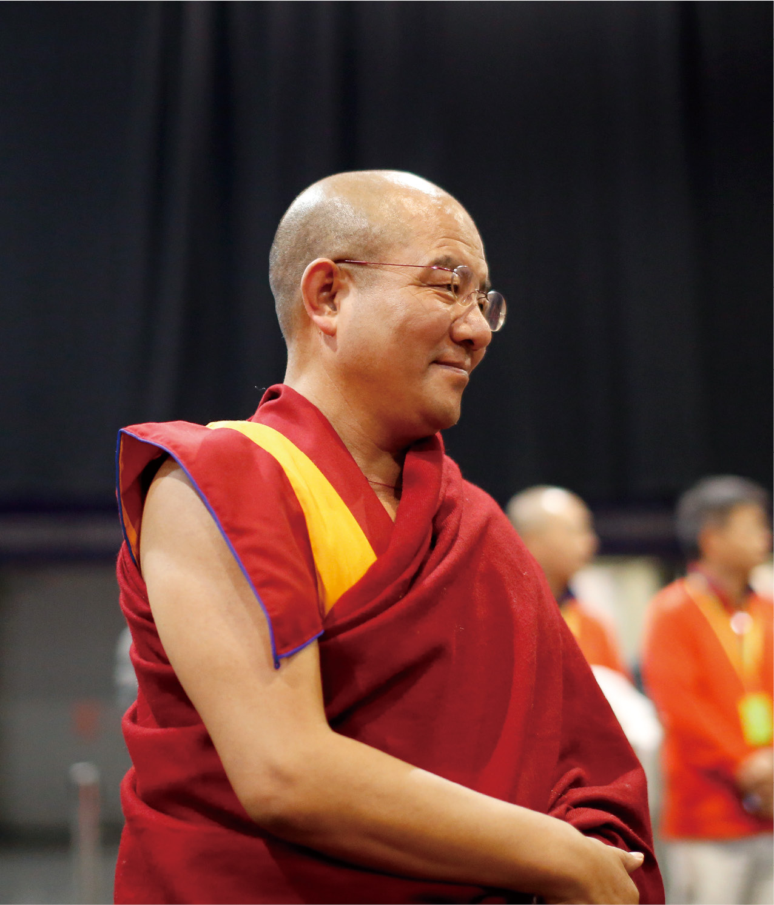
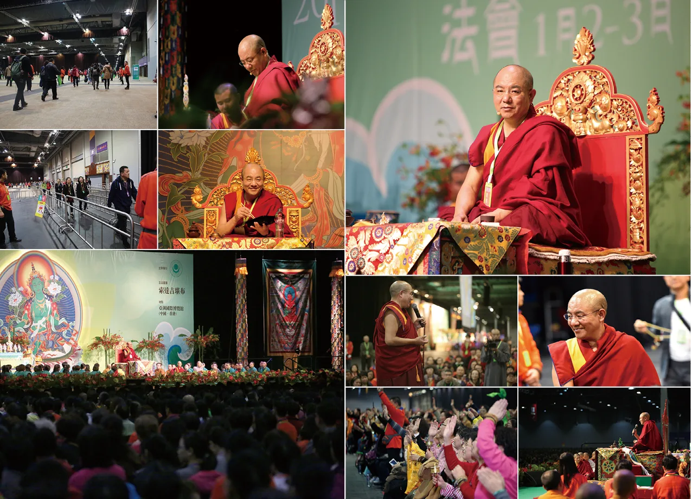
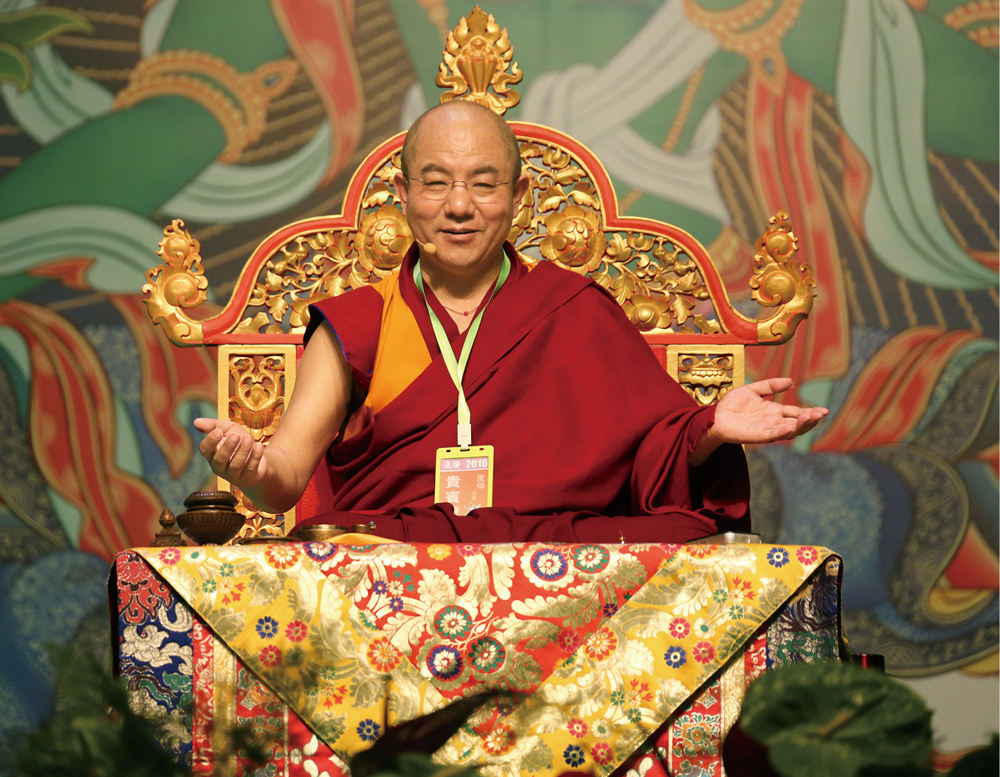
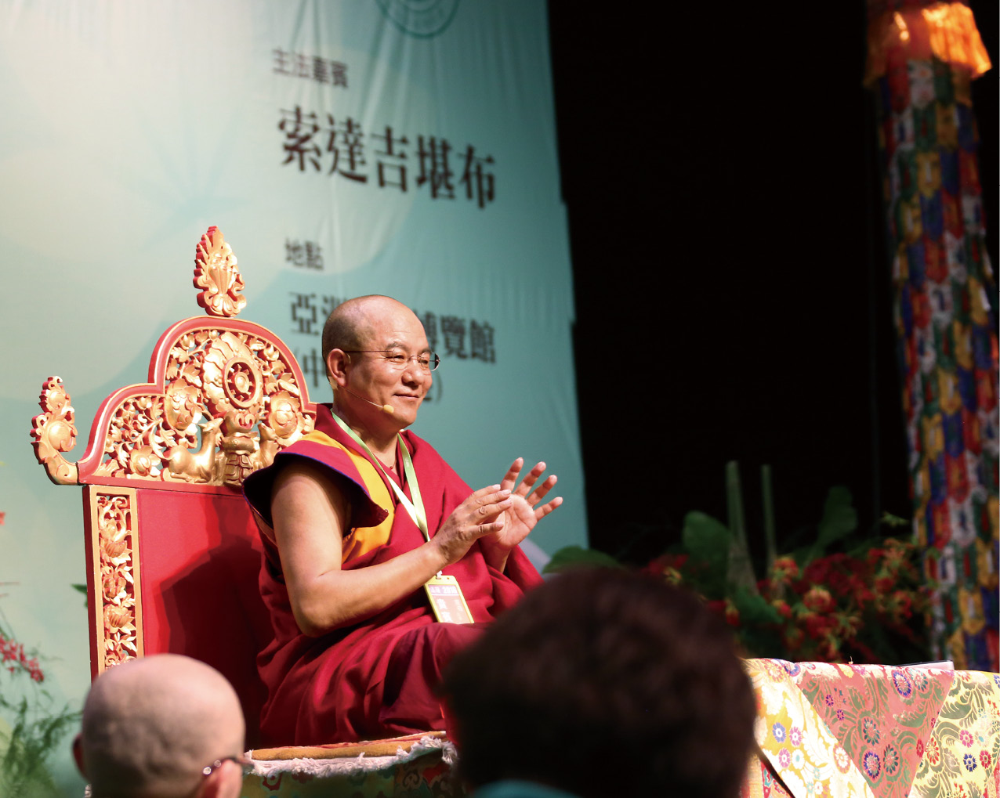
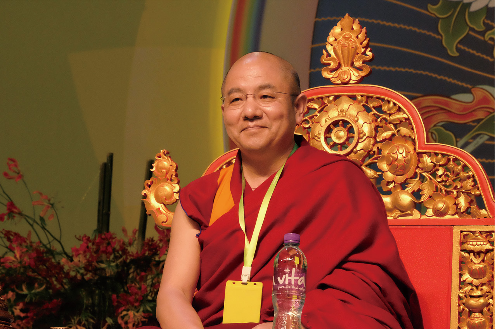
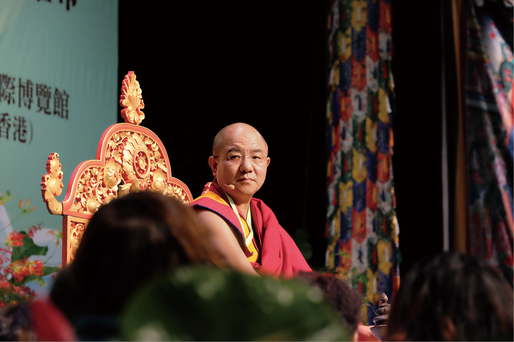
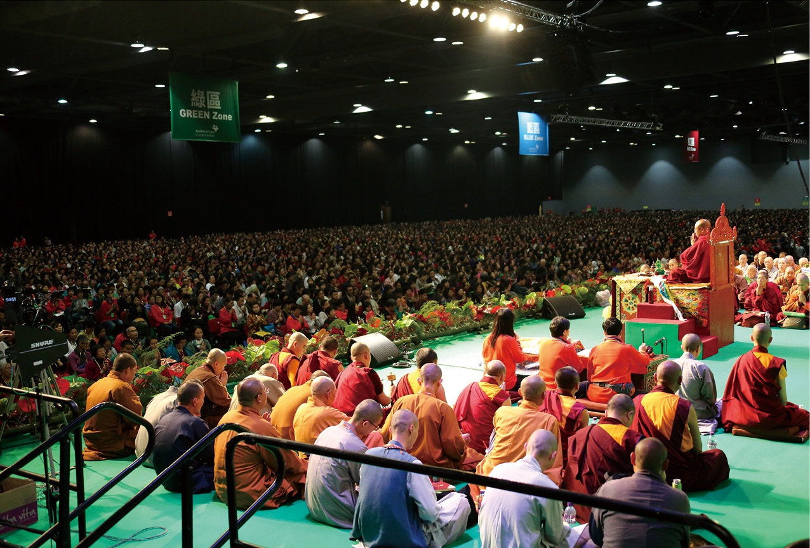
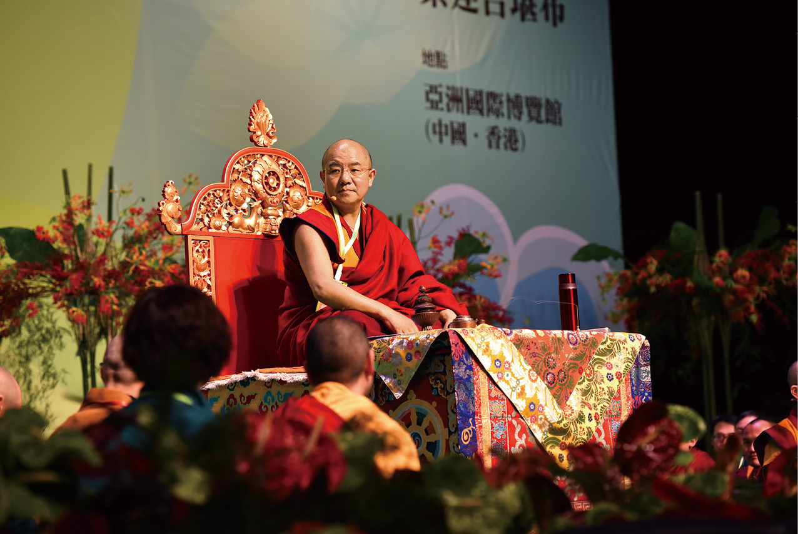

祈祷，就会得到。

第54场

香港度母法会

Tara Puja, Hong Kong

中国·香港

2016 / 1 / 2

## 度母法门的功德

## Merits of Tara Practice

大悲摄受具诤浊世刹，尔后发下五百广大愿，

赞如白莲闻名不退转，恭敬顶礼本师大悲尊。

在座大部分人应该都修过度母法门，很多人还得到过度母不同程度的加持，获得过相应的悉地。今天，我想利用一个小时时间，给大家讲一下修度母法门的功德。

## 弘扬佛法，自利利他

21世纪是信息化时代，人们的生活方式与以往完全不同。不管是佛教徒，还是非佛教徒，都非常依赖电脑、手机等高科技产品。但如果长期沉迷于此，很容易迷失方向、丧失道心。一旦失去信仰，不但无法找到解脱之路，还容易与恶友同流合污，白白虚耗自己短暂而宝贵的一生。

在这种大环境下，我们更需要努力、认真地对待自己的人生，不但不被新科技所转，反而利用它们饶益自他。作为佛教徒，也有必要学习网络知识，学习如何使用微信、微博等沟通工具，因为通过这些可以把很多佛法知识、自己学佛的心得体会和感应等，与身边有缘人分享，大力弘扬正能量。

我们的朋友圈里有各式各样的人，包括一些没有正见的友人，这时，很有必要把佛教智慧和慈悲的理念，用一种让所有人欢喜的语言和方式传递出来，这也是一种弘法利生。

我们弘扬佛法的目的，并非为了统治、束缚其他教徒或无信仰者，唯一的目的，是希望身边人通过学习佛法的真理，人生能往好的方向转变。

人如果没有任何信仰，不知修行，即使再有财富，再有名望，也不一定过得开心，反而容易陷入痛苦、焦虑等负面情绪当中；如果信仰佛教并懂得佛法的道理，顺境自不必说，即使生活中遭遇挫折、逆境，也能勇敢地面对，如法地处理。

我们弘扬佛法，并不是为了搞自我宣传、自我吹捧等世间八法，而是为了真正利益众生。倘若动机不纯，迟早会被别人发现，招致身败名裂。这样做毫无意义。

总之，现在很有必要运用现代工具推广正能量。推广的时候，应以清净心、恭敬心和对三宝、众生负责的态度，用大部分人能接受的语言，传递出佛陀的智慧和慈悲。这会使整个世界都获得不同于以往的安宁。

## 度母法门的起源

度母是三世诸佛身、语、意、事业、功德总集的佛母。在汉传佛教当中，度母被称为多罗菩萨。祈祷度母是一种非常重要的修行。

佛教历史上，在世间度众的男性觉悟者比较多，女性相对较少。很早以前，有一位慧月公主（益西达哇），她发起了无上殊胜的菩提心，并在鼓音如来面前发愿：自己将来愿以女性身份获得成就，并以女性身份利益无量无边的众生。鼓音如来对她做了授记。后来，慧月公主圆满了自己的誓愿，示现成就，十方诸佛菩萨称她为“卓玛”。卓玛是度母的意思，即度化无量无边众生的女性。

还有些历史记载，以前有位修行人在不空成就如来面前发愿：愿自己将来成为一名具有广大智慧、悲心和事业，并且加持迅速的佛母；无量众生遇到灾难时，只要祈祷她，就能从灾难中获得解脱。后来她如愿成就，人们称她为卓玛（度母）。还有些史书说，观世音菩萨化现为两位圣尊——白度母和绿度母，在整个娑婆世界，观音菩萨依靠白度母和绿度母的形象，利益了无量无边的众生。

## 学佛，需要理性与感性相结合

当今时代，大多数人都信仰科学，崇尚现实、理性的智慧。我们宣讲佛教一些神秘、甚深的道理时，很多人都觉得云里雾里，不知所措，半信半疑。当然，具有正信的人完全能接受。

我们生活在这个世界上，确实需要理性，否则很难找出事物的真相，但同时也需要感性，因为只讲理性会显得盲目、死板，与现实脱节。况且，我们都是有情，并非无情之物。作为有情，我们需要有信心、悲心等情感。正因如此，对于某位佛菩萨的智慧和能力，很有必要以信心来接受。如果烧毁了信心的种子，白法功德的苗芽将无法生长。

大家参加今天的圣度母法会，不但需要理性和感性相结合、智慧和信心相结合、传统和现实相结合，而且外在的事物与自己的内心也要相结合。当这些因缘聚合时，我们才能找到自己所需的真正财富。

在座各位都受过包含唯物论在内的世间教育，所学具有一定的深度和广度，而接受宗教教育的时间并不长，深度和广度也不够。这种情况下，我们应该不断增长出世间的智慧，学会接受真理，并时时对治自己的邪知邪见，这样才能使分别念逐渐趋入正道。

印度佛教中，度母是一位非常重要的菩萨、佛母。有些经典讲，她是过去、现在、未来三世诸佛之母，也有些经典讲，她是度化无量无边众生的本尊菩萨。总之，度母是超越我们分别念、具有不可思议功德和能力的圣尊。

大家在修行的过程中，既要用自己细致的智慧去探究、闻思修行，也要以一种虔诚的信心来接受佛菩萨的加持、上师的加持，以及世间很多护法神、空行母的加持。与此同时，也要用慈悲心来利益、度化众生。这个过程中，理性和感性不能脱离。

现今，有些偏重学术的人对感性经验一律排斥，而有些虔诚的佛教徒对理论研究一概拒绝，这两种态度都有点极端。

今天这里有很多年轻人，希望你们不要只依靠信心来学佛，而放弃研究佛理和科学，这样不是很好。因为现今是崇尚科学的时代，我们应该学会用科学来诠释佛教。这样佛教生存的空间才会越来越大。我们的朋友圈里，大多数人都有科学思维的头脑，如果我们完全依靠信心来抉择，想要在这个群体中发挥作用，恐怕会非常困难。

## 度母法门的兴盛历史

在《大唐西域记》中，玄奘大师曾两次提及他在印度见到的度母像，书中称其为“多罗菩萨”。

第一次是在距离摩揭陀国首都王舍城西南方大约两三百里的一座寺院，寺里供奉着很多佛像，其中就有多罗菩萨和观音菩萨的圣像。唐玄奘第二次见到度母像，是在那烂陀寺附近的一座寺院，里面有一尊特别高大的多罗菩萨像。当地人每年元月一日都会召开为期七天的法会。法会期间，国王、大臣、民众，以及很多邻国人，都会纷纷前来朝拜。由此可见，度母对印度佛教的影响非常深远。

这一次，我们这么多人在此召开为期三天的度母法会，缘起非常好。此情此景，宛若《大唐西域记》所载的度母法会盛况再现一般。

度母像影响印度佛教的公案还有很多。印度金刚座的大觉塔附近，有一尊著名的度母圣像。据说，以前阿底峡尊者转绕的时候，这尊度母圣像对尊者宣说过一些教言。法王如意宝去印度朝拜的时候，把自己的念珠供养给了这尊度母圣像。

从印度高僧大德的传记来看，他们很多人都得过度母的加持。比如，寂天菩萨就得到过度母的授记，让他舍弃王位出家；度母也曾授记过阿底峡尊者，让他舍俗出家，不要当国王。后来，阿底峡尊者很想寻找一个最快速的成就法，度母化现成老妇、美女、乞丐三种形象，劝尊者发菩提心。阿底峡尊者来藏地，也得到了度母的授记。当时，度母对尊者说：“你如果去藏地，会减寿20年，但会利益无量的众生。”后来，阿底峡尊者摄受仲敦巴为弟子，同样得到了度母的授记。

阿底峡尊者的度母修法传承来自龙猛菩萨。龙猛菩萨的传记中记载，在他之前，有五千人依靠修度母而成就；龙猛菩萨在世时，也有五千人依靠修度母而成就；龙猛菩萨圆寂后出现了一位国王，在此期间同样有五千人依靠修度母而成就。可见，修度母法门非常殊胜，得加持也非常迅速。

麦彭仁波切在《八大菩萨传》中说：末法时代，具光度母和文殊菩萨的加持最迅速。我们遇到困难时，最好马上祈祷度母。藏地人念诵度母的时候，一般都念得特别快，汉地人念得也很快，有时我会让他们慢一点，但好像念着念着就自然而然加速了。我想这可能与度母的事业力有关，没办法慢下来。

## 度母与娑婆世界众生有特殊因缘

娑婆世界的众生，想完全依靠自力修行成就有一定的困难。我个人也是如此，我至今仍未舍弃出家相，还跟很多众生结上善缘，其中的缘起与度母法门也有一定关系。

在我很小还不识字的时候，别人教我《二十一度母赞》，我很快就能记住。那时我天天放牦牛，每次牦牛跑丢的时候，我就马上祈祷度母，然后便能奇迹般地找到。虽然小时候还不太懂事，但当父母、亲友或身边其他人生病的时候，我都会诚心祈祷度母让他们早日痊愈。可以说，我从小到现在，都虔诚信仰、不断修行度母法门。

我上学之前，有人送给我一尊度母像。这尊像很小，我得到后非常欢喜，从读小学、中学、师范，再到后来出家，一直带在身边。那时是上世纪七八十年代，大环境仍旧很紧张，若被老师发现我带着佛像，是一件很危险的事，可能会被学校开除。但即便如此，我还是一直把度母像藏在隐蔽的地方诚心祈祷。

所以，这次我为大家传授度母法门，应该不算空口传授。从我自身的角度讲，从小就与度母的因缘比较特殊，也得受了度母的加持。如果我从未修过度母法，对本尊一点不熟悉，这样传的话不是很好，但实际并非如此。

其实，不仅仅是我，藏传佛教格鲁派、萨迦派、宁玛派、觉囊派和噶举派的僧人们，都经常念修度母。所有藏民，包括一些不识字的老阿公、老阿婆，也经常念诵《二十一度母赞》或者度母心咒“嗡达咧 度达咧 度咧梭哈”。

藏地的度母法门，始于国王松赞干布时期。有些史书说，藏地人类的起源，与度母和观音菩萨有关，是度母的化现与观音菩萨的化现繁衍了人类。不管怎么样，在藏地，度母法门确实一直没有衰败，始终兴盛。在藏地各大寺院，度母像随处可见，而且许多圣像都有非常稀奇的故事，如阿底峡尊者的聂塘说话度母的故事、哲蚌寺度母的故事、宁玛派很多寺院度母圣像的故事，以及刻在石头上的说话度母的故事，等等。这样的故事多不胜数，我就不细讲了。总而言之，希望大家今天能与度母结上善缘。

度母与汉地最初结缘，是在公元7世纪藏王松赞干布向唐太宗提亲的时候。当时，松赞干布用十二斤黄金打造了一尊精美的度母圣像，将其作为礼物带到了汉地。后来，这尊度母像一直被供奉在开元寺[^1]。作为回赠，文成公主把汉地的觉沃佛像带到了藏地。

汉传佛教也有很多度母法门。有一部叫《佛说大方广曼殊室利经》的佛经，里面讲了很多多罗菩萨（度母）的名号功德和修行方法。宋朝法贤译师翻译的《佛说圣多罗菩萨经》，专门介绍了圣多罗菩萨（度母）。蕅益大师的《阅藏知津》中，讲了108尊度母的名号和咒语。这个咒语比较长，我以前看过。总之，汉传佛教的很多经典中都提到过度母，其名号早被译成汉文，流传于世；汉地一些高僧大德也曾赞叹过度母法门的功德利益，只是该法门在汉地没有像在印度和藏地那么兴盛而已。

## 祈祷度母，可获得不可思议力量

现今是一个弘扬度母法门的时代。我相信，若度母法门兴盛，以此缘起的力量，佛教也会随之兴盛。

兴盛佛教确实需要一种力量，个人信仰也需要一种力量。如果力量不足，将难以为继；如果力量充足，遇到再大的困难，也不会倒下去。就像“文革”时期，很多人的信仰都被彻底摧毁了，但有些心力非常强大的人，即使外境再怎么严酷，他也不会放弃，反而愈加坚强。

我们的内心很需要这样一种力量，而这种力量离不开诸佛菩萨的加持。诸佛菩萨的加持力遍于世界的每一个角落，就像日月普照整个大地一般。

在如今这样不平凡的年代，我们更应该共同祈祷诸佛菩萨。可能有人问：“祈祷哪尊佛菩萨对世界、对个人特别有利呢？”我觉得祈祷度母非常好。以前，我们学院经常需要应对一些特殊事件，包括遣除某些违缘等。这时法王通常会要求大家一起念诵度母。祈祷之后，顺缘迅速具足，违缘立即遣除，快乐纷至沓来，经常出现这种神奇的瑞相。这次我们能在此召开度母法会，也是依靠一种不可思议的力量，我相信这种力量我们每个人都可以得到。

## 祈祷度母的四大功德

最后，我简单介绍一下阿底峡尊者所讲的祈祷度母之四大功德。

一、祈祷度母能让远行者顺利返回。很多人出门时，经常担心路途不顺，或者所办之事不能圆满。这个时候，如果祈祷度母，一切就会顺利成办。

二、祈祷度母能消除战争和疾病。这在当今时代非常需要。你们如果去欧洲，就能明显感觉到战争的可怕、难民的可怜。现今，战争和瘟疫在世界各地频发。要想让可怕的战争和疾疫消失，就需要虔诚祈祷度母。

三、祈祷度母可以遣除自相续的烦恼。每个人都被贪嗔痴控制着，虽然有时自己很想摆脱它们，但却没有办法。要想逐渐减少自相续的烦恼，乃至彻底将其根除，就要祈祷度母，这一点非常重要。

四、祈祷度母能成办息、增、怀、诛四大事业。

息业，就是遣除疾病、痛苦等障碍。

增业，即增上财富、名声等福报。世间人一般都希求升官、发财。藏地许多人念度母的主要目的也是为此。这当然也是可以的，毕竟大部分人都希求世间的利益。如果完全脱离世间的财富、权力、健康等利益，只讲解脱，很多人都难以接受。

事实上，度母的加持力非常大，世间与出世间的利益都能成办。比如，度母也是长寿本尊，很多人参加法会都希求长寿，毕竟大部分世间人都有这种执著。依靠度母的加持，个人在延寿方面会获得一定的增上力。

祈祷度母还能圆满怀业，令祈祷者身心自在，自在怀柔很多人和非人，轻松驾驭他们。

祈祷度母也能成办诛业，使我们超离怨敌和魔众的损害。

另外，一些和日月星宿有关的不吉祥征兆，也可以依靠念修度母来遣除。比如，自己的星座与家人的生辰等有冲突，或者出门的日子不吉祥，等等，都可以依靠念诵度母来化解。

我外出的时候，从来不看当天是不是吉祥日。因为如果那天我非出门不可，日历却显示不吉祥，心里也会有一些分别念。所以，我每次念完21遍度母礼赞文之后，便直接出门了。

关于度母的功德，还可以讲很多很多，但为了尊重大家的时间，就象征性地介绍到这里。希望大家一定要好好祈祷度母，祈祷非常重要！

[^1]: 公元1703年，康熙皇帝巡历到西安，在西安敕建了广仁寺，将开元寺的这尊绿度母像移供在广仁寺。于是，广仁寺就成了汉地唯一的绿度母主道场。在汉地寺庙的大雄宝殿里，一般供奉的是释迦牟尼佛祖，而广仁寺的主殿里主供本尊绿度母。
