包容是一种智慧，  
也是一种慈悲。

第53场

香港度母法会

Tara Puja, Hong Kong

中国·香港

2016 / 1 / 2

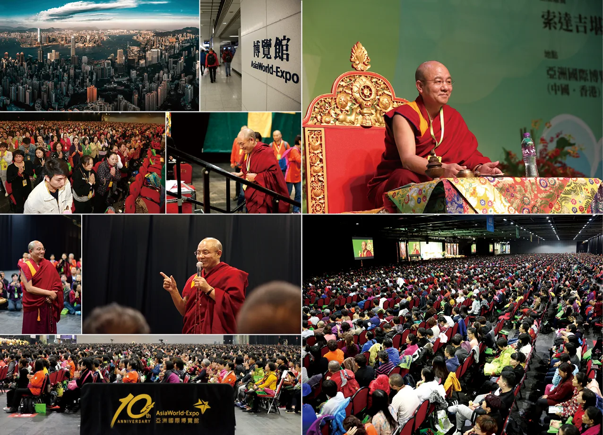

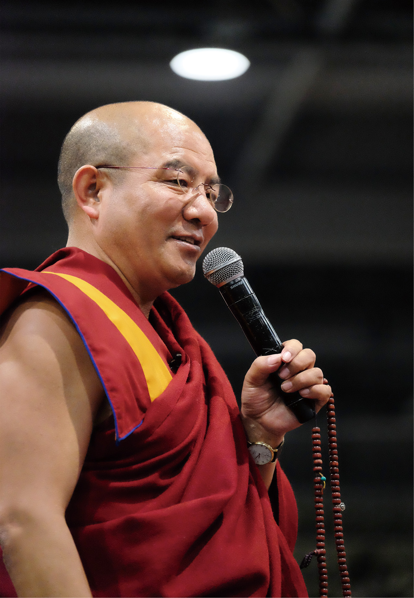

## 当今时代如何弘法利生

## How to Spread the Dharma and Benefit Others

这次我们一万多人齐聚一堂，确实不容易。昨天有人对我说：“您的粉丝很多，这一万多不算什么。”我想，自己也许有一些粉丝，也许并没有那么多。其实是不是我的粉丝不重要，我内心真正希望的是每个人都能认真学习佛法。

## 学佛，是智慧的选择

当今时代，虽然有一些战争、饥荒等不稳定、不安全的因素，但我们毕竟处在一个相对自由、快乐的年代，并没被束缚在战争的硝烟当中，也没被束缚在牢狱当中，并且我们六根齐全，又遇到了佛法。获得这样暇满难得的人身非常不容易。我很希望每个人在这个时候，能真正地闻思修行。

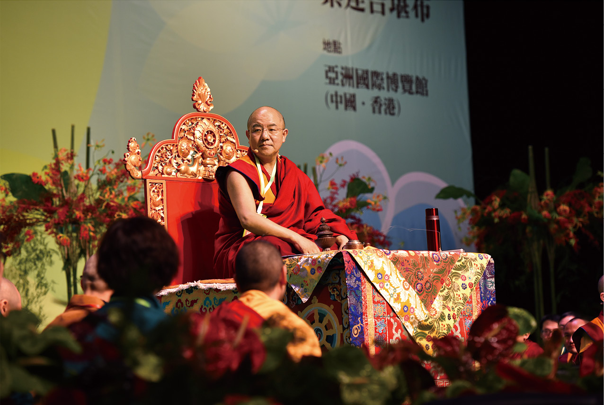

我去一些学校、企业或机构的时候，一般都会用世间的语言和他们交流，因为他们并不都信佛教，有些信其他宗教，有些没有信仰，但今天的环境不同，在座百分之八九十的人都是虔诚的佛教徒，而且百分之七八十的人都非常年轻。

我相信在座每个人都很有智慧。如果你们用自己的智慧去观察、分析，就会知道，哪些知识对自己的人生有用，哪些知识可以让自己真正离苦得乐。当用智慧观察、抉择，并加以取舍之后，人生才会变得真正有意义。

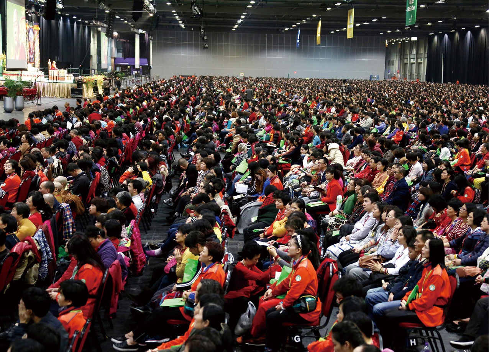

## 团结，才能共荣

我这次来香港，有一些跟以往不同的缘起，包括过两天因缘具足的话，我会去拜见净空老法师。

昨天，很多佛教徒都在转发老法师对我的一个评语。其实，我对别人的赞叹或诋毁并不是很在意。虽然作为凡夫人乍一听到，心态上也会有一丝变化，但我知道，对于一个人来讲，有正面和负面的评价都很正常。不过，昨天老法师的有些话，我还是比较认可的，所以这次我准备前去拜见一下。

近几年，我去过国内外很多大学，包括一些世界顶级大学，还去过一些孤儿院、监狱和企业。我很愿意付出自己的身语意让世界上各个层次的人接触到佛法。与此同时，我也非常重视佛教徒内部的团结和合。

净空老法师一辈子讲经说法，尤其难得的是，他在汉传佛教净土宗几近垂危之际挺身而出，从上世纪六七十年代开始大力弘扬。经过他几十年的努力，现在学净土的人已经多不胜数。我觉得藏传和汉传佛教非常有必要团结一致，共同学习。

## 佛教各派一脉相承

前一段时间，我跟随一个佛教团队去了台湾，一起拜见了星云大师。星云大师对藏传佛教代表团说：“所有的佛教，不管是藏传佛教、南传佛教，还是汉传佛教，都是释迦牟尼佛传下来的，就像一只手的五根手指一样。如果把五指握起来，就形成了一个拳头，这样做事情才有力量、有能力。”这个比喻，宁玛巴的全知麦彭仁波切也用过。

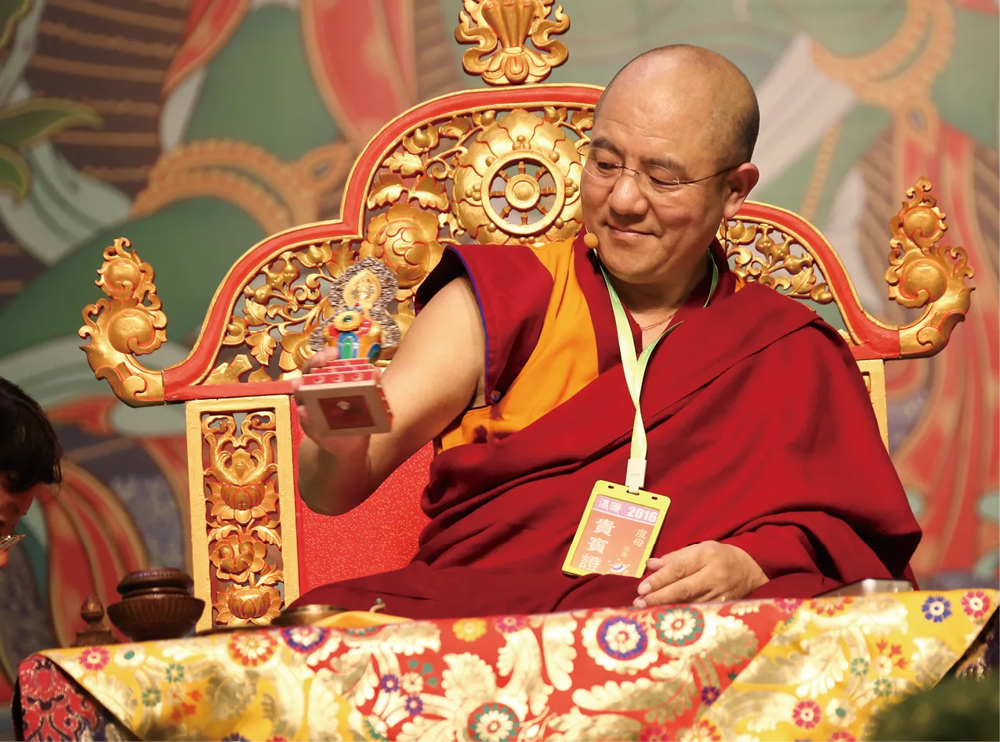

汉传佛教的净空老法师和星云大师，经过一生的辛勤努力，将全世界无数信徒引入了解脱道。如果上师如意宝在世，现在也是八十多岁，与这些老法师的年龄相仿。无论藏传佛教还是汉传佛教中，都有很多高僧大德一辈子弘扬佛法。南传佛教亦是如此，去年，我们在清迈召开“第五届世界青年佛学研讨会”的时候，也迎请了许多南传佛教的大德。

所以，我很希望藏传佛教、汉传佛教，还有南传佛教的佛教徒能够团结起来，共同学习，共同修行。

如今，很多佛教团体经常与其他宗教一起合作、对话或者学习，包括基督教、天主教、伊斯兰教、摩门教、犹太教、印度教、耆那教等。如果我们与其他宗教都能和睦相处，那佛教内部更不用说了。

现在佛教内部分出了很多派系，今天在座的就有很多不同上师的弟子，学习不同教派的传承。仅藏传佛教的宁玛巴、格鲁派、萨迦派等教派，就有很多分支。其中，觉囊派还有很多人学习苯波教。

虽然佛教教派众多，但都属于佛教，都是佛陀传下来的。所以，很希望南传、北传和藏传这三大语系的佛教徒们能够共同学习，和睦相处，就像老一辈大德们所做的那样。只有这样，佛教才能兴盛。

## 以开放和包容的心态，接纳世界

虽然有些大德所持的观点，显现上与其他教派略有不同，但这也是正常的。我年轻时就驳斥过藏传佛教其他教派的观点，也与他们辩论过，与我们佛学院的一些高僧大德也辩论过。但辩论和驳斥不等于不承认，不等于有矛盾。就像我虽然批评某人的一些想法或行为，但这不等于我推翻他所有的观点。我们需要用一种开放、包容的心态，接受世界许许多多不同的思想和理念。

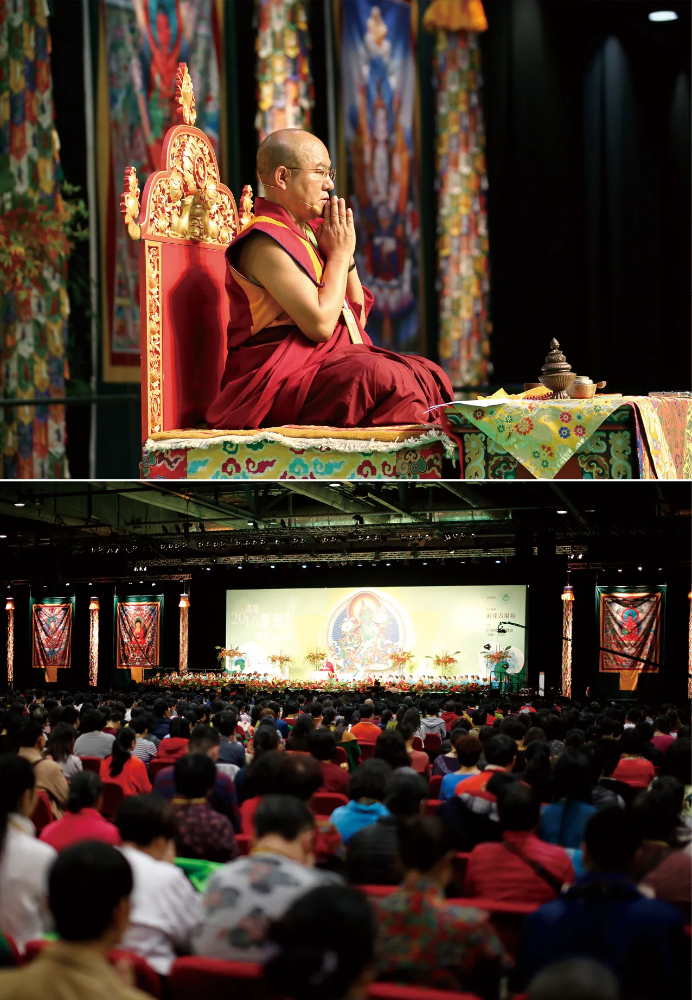

与此同时，我们还应该用一种善巧、智慧的方法，来接受其他宗教徒和非佛教徒，比如，对于没有任何信仰的年轻人，有时要随顺他们的某些言行举止。

阿难尊者、迦叶尊者和文殊菩萨，在释迦牟尼佛座下学法的时候，大家公认文殊菩萨最有智慧。为什么呢？因为文殊菩萨常去一些外道道场，与外道徒们一起吃饭、睡觉、聊天，共同生活。当他们逐渐对佛教感兴趣后，文殊菩萨才开始教他们佛法的真理。

所以，我们不应该非常固执地强迫所有人接受佛法。开始的时候应该随顺，随顺的同时，用一种智慧方法逐渐让对方接受。

有些道友看到自己的家人和朋友不信佛、造恶业，心里特别着急。其实，我们可以用一种缓慢的方法，先暂时相合他们的意乐，然后鼓励他们行持善法，再逐渐令其趋入解脱道，这即是一种善巧方便。

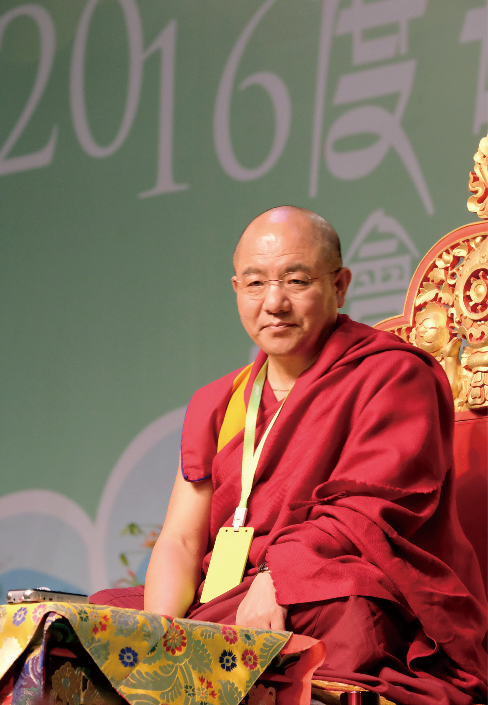

现今，全世界人的思想都在不断变化。尤其80后、90后、00后的很多心态和行为，像我这个年龄的人都搞不懂。他们说的很多话都是网络语言，我们根本听不懂；他们的有些想法和兴趣，我们也理解不了。所以，与他们接触的时候，随顺和包容非常重要。

## 祈求佛菩萨的加持，至关重要

人们的生活方式随着时代不断变化，但这种变化并不会减轻我们的痛苦，反而可能徒增很多烦恼。我之所以劝大家学习佛法，是因为学佛之后确实可以断除烦恼，使内心产生很大变化，这样生活才会逐渐转好。

诸佛菩萨的加持不可思议，包括这次我们一起修度母，我自己都有亲身体会。藏传佛教很多大德在修一位本尊的时候，首先要与本尊做一个深交，即通过灌顶、听受窍诀，与之深深地结缘。就像两个人通过其他朋友介绍一起吃饭、一起参加某个活动最初认识了，熟识之后，就会随叫随到。修本尊也有同样的缘起。

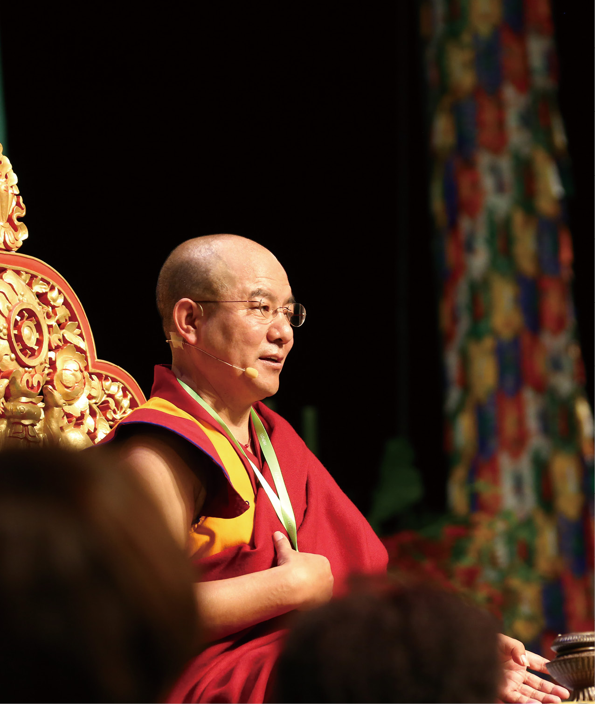

在座有些人可能以前不知道度母。在佛教当中，度母是一位极具加持力的本尊，只要经常祈祷，就会得到不可思议的感应和加持，这是真实不虚的。关于这方面的道理，我下午会给大家简单讲一下。

现在我想对大家说的是，我们现在学习正法非常不容易，刚才主持人引用过寂天菩萨的一句话：“犹如乌云暗夜中，刹那闪电极明亮，如是因佛威德力，世人暂萌修福意。”事实的确如此，我们的慈悲心、智慧、信心等善根，就像黑夜中的闪电一样一闪而过，转瞬即逝。虽然这几天因为蒙受诸佛菩萨的加持，自己很想将来好好修行或者利益众生，但这种兴趣可能在离开香港，回到家里，被各种杂乱事情扰乱之后，就逐渐消失了，变成和以前一模一样的凡夫，无法很好地修行。

这次我们这么多人集聚一起很不容易，有了这样殊胜的因缘，大家一定要好好祈祷度母，并好好发愿。发愿也非常重要！希望大家能发愿将来生生世世一起修行。当然，下一次不一定是在香港的亚洲国际博览中心，每个人的身体也不一定还像现在这样，但有了这种愿力，我们的心还会在一起修行。

## 做名副其实的修行人

在座很多人都是学藏传佛教的。今天灌顶以后，我希望大家能修五十万加行。你们都还年轻，应该可以修完对吧？

昨天，我们乘机从成都飞香港，在机上遇到了来自北京、成都、德阳、绵阳的很多道友。当时我看到不少人都在修加行，有些在念皈依偈，有些在念发心偈，还有些在念上师瑜伽。昨天有个人还发照片给我，说他们一到香港，就开始磕头。有些人甚至一边参加法会，一边磕大头。

这样修加行非常好。你们现在还很年轻，如果到了八九十岁，就很难修得动了。如果现在修完了五十万加行，自己就成了名副其实的修行人。

要知道，只办一个皈依证，或者当一名“跑跑居士”，只是整天求灌顶、见上师，不好好闻思修，不懂佛教的道理，也不修加行，不能算一个很好的修行人。

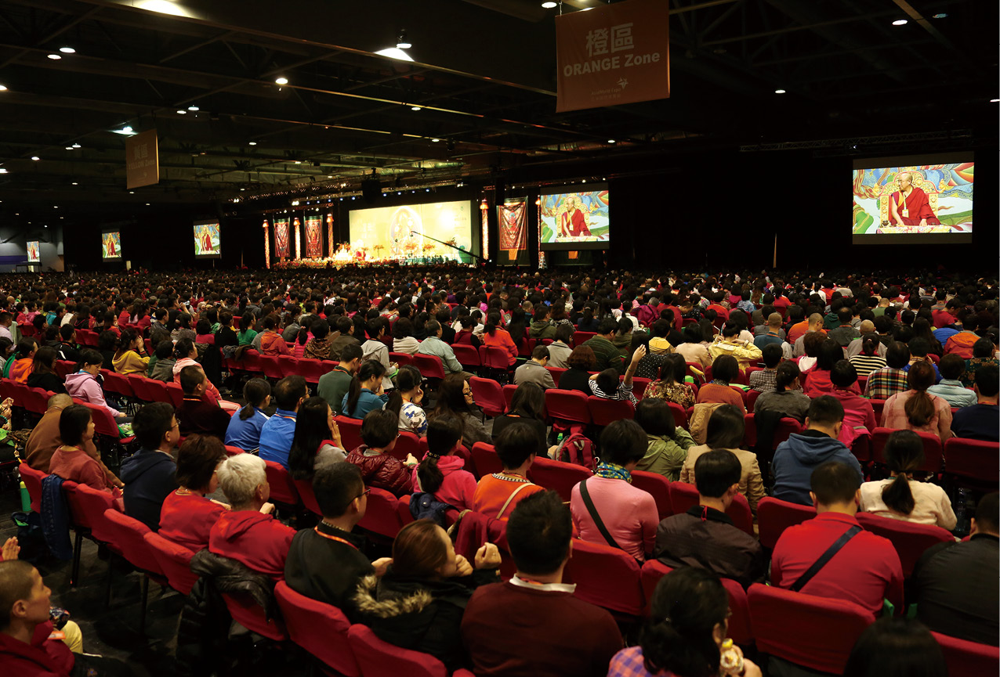

## 怎样正确依师

你们拜见一百位上师，或者依止几十位上师，都是可以的，但更重要的是，自己应该认准一两位上师，遵循他们的教言闻思修行，这一点至关重要。

无论我们依止藏传佛教、汉传佛教，还是南传佛教的上师，都是可以的。但要知道，依师的主要目的是向上师求法，上师也要能为你传授佛法。以前也有一些特殊的上师用身体为弟子指示，令其开悟，但这种情况极少，现今有没有也不知道。其实，上师最能利益弟子的方法，就是为其传授佛法，采用其他方法还是很难的。

就像一名老师，他最能利益学生的方法，就是为学生讲课。如果作为一名老师，一堂课也不给学生上；作为一名学生，一堂课的知识都没从老师那里学到，那两人之间的关系是什么样呢？

所谓上师，从某种意义上讲，即上等的老师。这是我的解释方法，不知道合不合理。何谓上等的老师呢？就是他不仅会讲世间的知识，更重要的是，会讲出世间解决生死大事、超越轮回的法。我们与这样的上师结成师徒关系，才不会虚耗人生，才是合理的。

现在，很多佛教徒都比较迷茫，整天忙于各种外在形式。因为不好好闻思，连基本的人身难得、寿命无常的道理都不懂，更别说中观、因明、般若，乃至密法了。而很多上师则整天忙着化缘、搞各种仪式……

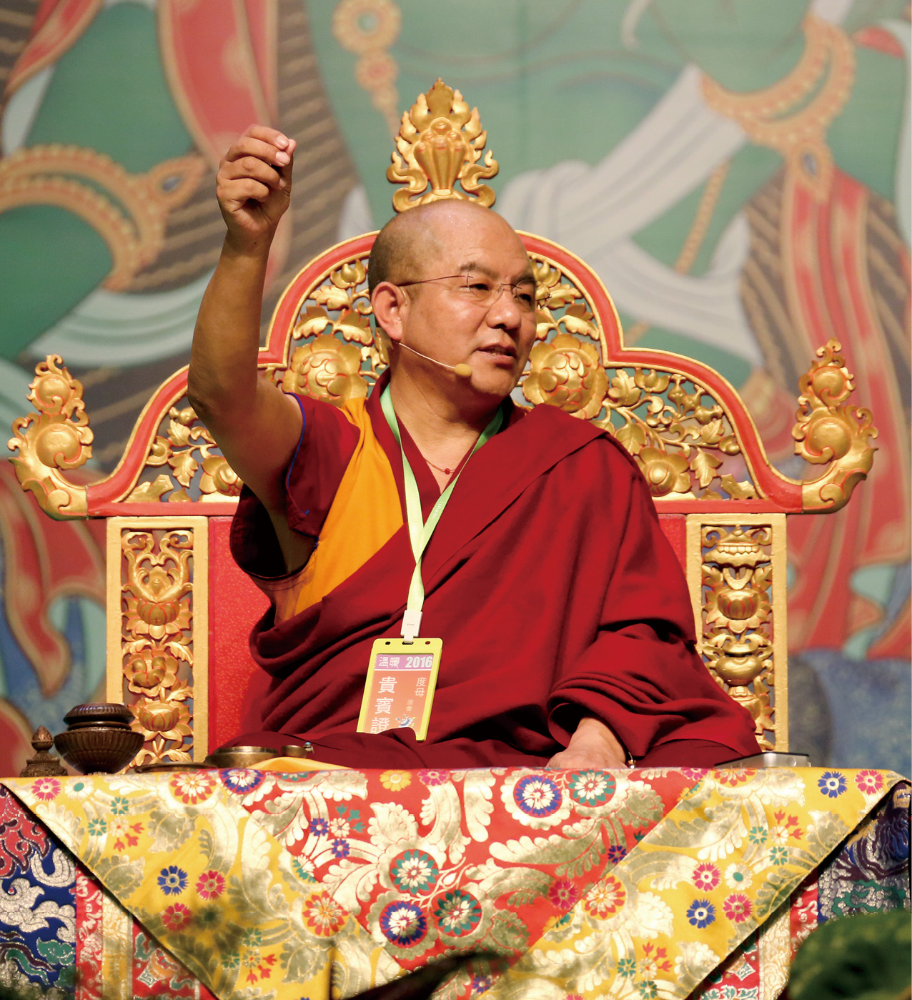

去年（2015年），媒体上了出现一些对藏传佛教，乃至整个佛教不利的新闻报道。从一方面讲，出现这种现象很不好，但从另一方面讲，佛教中一些不如法的现象早点暴露出来，也非常有必要。不管哪座寺院，哪位仁波切、法王、上师、活佛，以及堪布、格西，谁做得不如法，个人应该承担全部责任，不应该让纯洁的佛教受染。利用佛教蒙骗别人、做各种自我宣传和自我吹嘘，没有任何必要。

## 智信而不迷信

我想，出现这种现象的根本原因，在于佛教徒缺乏智慧，而缺乏智慧的根本原因，是欠缺系统的闻思修。

这几年，我们在汉地推广了一些系统学习的模式。可以说，自古以来，在系统学习方面，我们算是规模较大、比较有序的一个学佛团体。当然，现在的发展还不足够。如今这么多年轻人信佛，我们千万不能让他们变成迷信。其实，无论迷信佛教、迷信科学，还是迷信其他宗教，都是非常可怕的。

今年，我去了世界五大洲的很多地方，里面既有宗教兴盛、科技发达的国家，也有特别偏远，瘟疫和战乱不断的地区。去了之后，我深深感觉到，人活在世间的确需要智慧，而要想有智慧，必须不断学习，尤其佛教徒，一定要花大量时间学习佛教知识。有了智慧之后，我们就能看清真相，就不会被人利用。

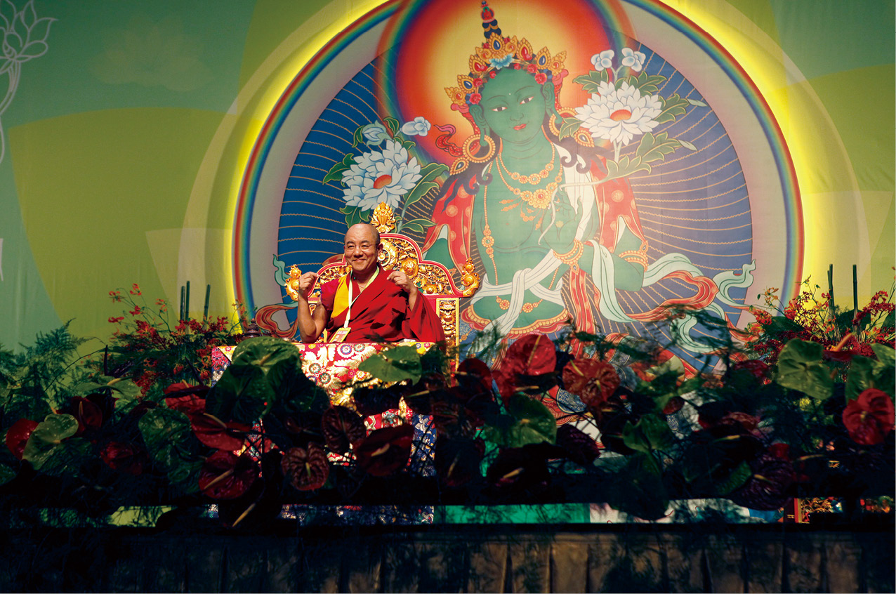

学法到了一定程度，即使没有上师，也可以自度度他。就像我们刚学车时，必须有教练教我们怎么把方向盘、怎么踩油门，否则自己很难把车开走。但教练不可能永远坐在副驾驶位置陪练，当我们熟练之后，自己就可以轻松驾驶了。

学佛亦是如此，刚开始需要在上师面前听法，经过若干年闻思之后，我们便能修行自理了。希望大家能快快成长起来，不要一直处于一种迷信的状态。

## 学佛的同时，不放弃世间知识

现在，很多年轻人都开始学佛，他们素质比较高，喜欢闻思，这让我觉得佛教的未来很有希望。其实，我们不仅要明白佛教的理论和修行，最好也能了解一下世界主要宗教的教义，懂得科学与佛教之间的关系。

我接触的佛教徒，有些太保守了，只对佛教的学修有意乐，对科学等世间知识毫无兴趣。前天，我和一些佛教徒见面，当我讲修行法门的时候，他们非常专注、认真地听，后来我讲佛教与科学之间的关系，这时他们的态度马上转变，开始打瞌睡，不想听了。其实，在科技发达的今天，佛教徒很有必要了解一些佛教与科学简单对应的道理。

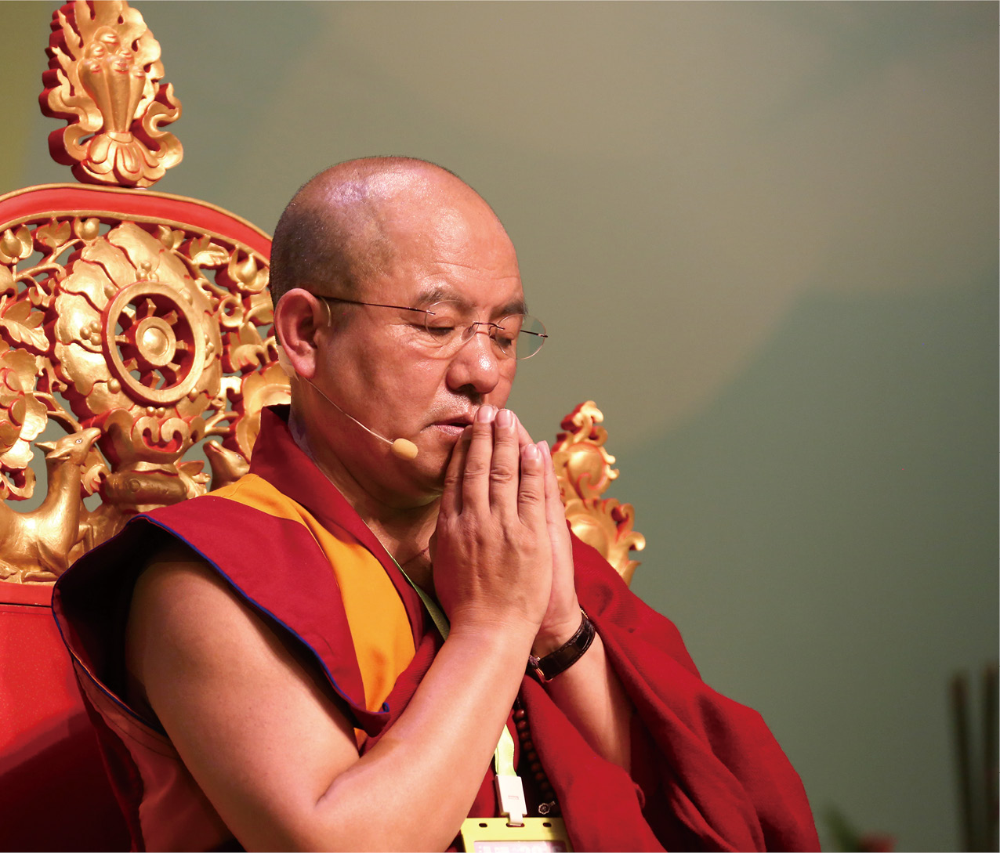

接下来还有十几分钟，我们一起来念度母。刚才因为害怕大家犯困，所以讲了这些。有些话我在不同场合也说过，但现场说有一种气氛，感觉上与在光盘、书本里不一定相同。

## 结语

刚才讲的第一点是，最近，汉传佛教净土宗与藏传佛教有一些不同于以往的特殊缘起。希望从今年开始，佛教各派能更加团结，尤其是净土宗和密宗。我个人一直在学修净土宗和密宗，但有的佛教徒以前可能不是这样。希望大家能有一种佛教各派究竟一体的清净观，这一点非常重要。

还有一点是，希望我们佛教徒从现在开始，能够学会自己学习，并且学得扎实，不要只听了一两堂课或参加一两个法会以后，就拼命地玩。我们得个人身非常不容易，不能太过形式化，也不能玩得太多了。要知道，人的生老病死苦唯有通过修行才能真正得以解决。
