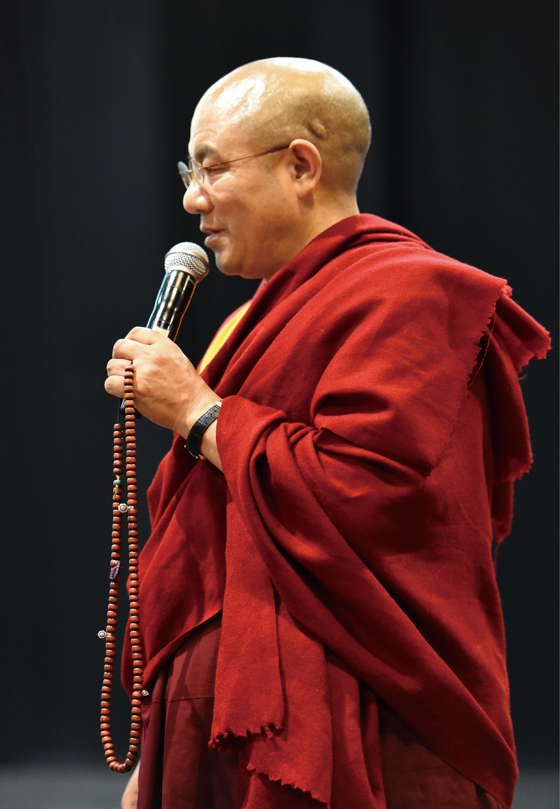

离四贪，得自在。

第55场

香港度母法会

Tara Puja, Hong Kong

中国·香港

2016 / 1 / 3

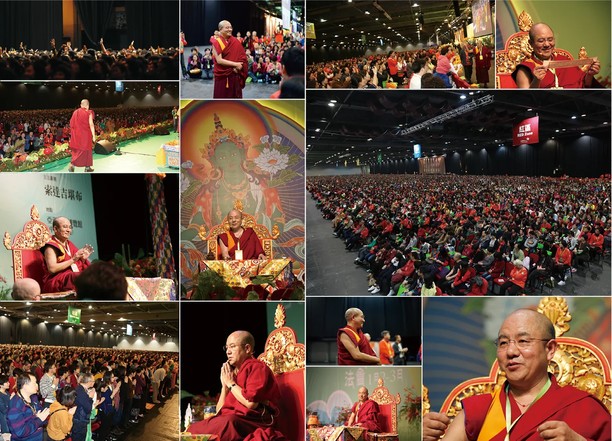

## 离四贪教言

## Parting from the 4 Attachments

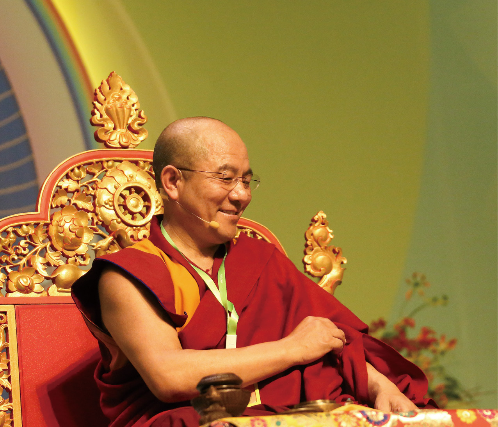

大悲摄受具诤浊世刹，尔后发下五百广大愿，

赞如白莲闻名不退转，恭敬顶礼本师大悲尊。

自大圣境五台山，文殊加持入心者，

祈祷晋美彭措足，证悟意传求加持。

和平法会已经举办了两天，现在是最后一座。整个过程中，我看到大家不仅彼此配合得很好，而且个人在修行上也特别有意乐，听课、念诵的时候非常专注，对念诵和闻法轨理也明明白白。从中能看出，现今我们佛教徒的修养非常不错。

在未来的十年八年，如果我们不懈怠，不中断，努力行持善法，不仅会对自己的心灵和生活非常有益，也会对整个世界产生不可估量的影响。因为，每个人就像身体里的一个细胞，如果都能从内散发出正能量，就能清除整个身体的负能量，让智慧和慈悲充满整个身心；每个人又好似一盏灯，虽然一盏灯的照耀范围不大，但无数灯盏集聚之后，其力量和作用就会变得无比强大，可以照亮整个世界。

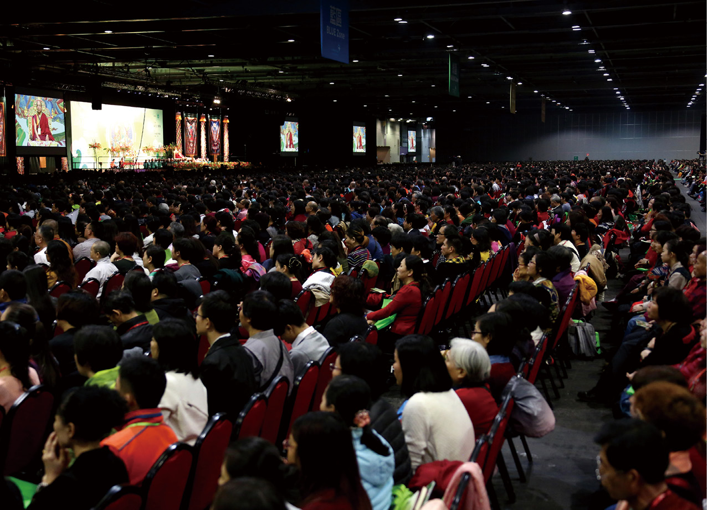

修行度母法门，可以遣除我们今生当中的很多违缘和障碍，来世转生到极乐世界。乔美仁波切的《极乐愿文》中说：“法身无量光部主，右手放光化观音，复化百俱胝观音；左手放光化度母，复化百俱胝度母；心间放光化莲师，复化百俱胝莲师……”事实上，阿弥陀佛、观世音菩萨、度母，以及莲花生大士，这些佛菩萨和本尊，都是无二无别的。

## 《离四贪教言》概述

今天我想利用最后一堂课，给大家讲一下藏传佛教中非常著名的《离四贪教言》。此教言来自萨迦派的初祖——根嘎酿波。他16岁时修了六个月的文殊菩萨，亲见了菩萨尊容，之后，文殊菩萨传授给他这部《离四贪教言》。

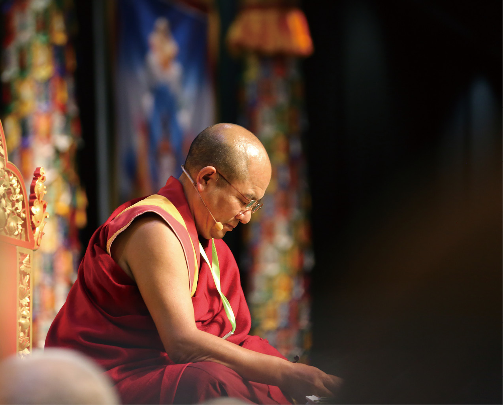

表面上看，这个教言很简单。所谓离四贪，就是“若贪执今世非行者；若贪执轮回非出离；若贪执自利非菩萨；若出现执著非见解。”尊者劝诫我们，一定要远离这四种贪执。

修任何法，有正面的修行方法和窍诀，也有反面的窍诀。这部《离四贪教言》并未讲什么是世间正见、出离心、菩提心和无二慧。因为，若从正面讲，凡夫人多多少少都可能执著一个东西。比如，讲空性见时，很多人都认为有一个空的东西存在；讲大光明见解时，有些人认为有一个明亮的东西存在。为了破除这些执著，在《离四贪教言》中，文殊菩萨从反面建立我们的修行，这样也很有必要。

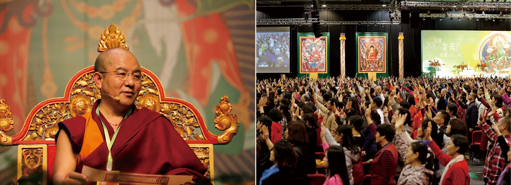

《离四贪教言》中的四个教言，与很多大德所讲的基本一致。比如，宗喀巴大师的《三主要道论》讲了出离心、菩提心和无二慧；上师如意宝在《胜利道歌》中讲了四方面内容——贤善人格、出离心、菩提心和无二慧（大圆满的智慧）。可见，对于修行的精要，大德们都会用归纳的方式宣讲。

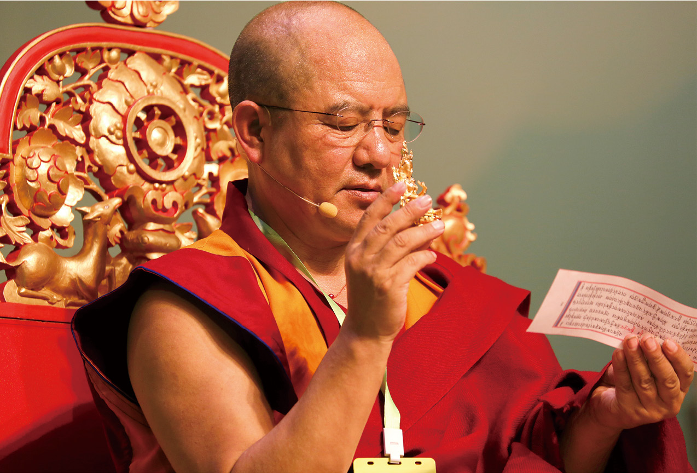

如果没有上师归纳性的窍诀，修行时很容易迷路。若懂得这些窍诀，不管是男性还是女性修行人，都可以称为大丈夫。《大般涅槃经》云：“善男子，一切男女若具四法则名丈夫。何等为四？一善知识，二能听法，三思惟义，四如说修行。善男子，若男若女具是四法，则名丈夫。善男子，若有男子无此四法，则不得名为丈夫也，何以故？身虽丈夫，行同畜生。”意思是，修行时需要先依止善知识，然后听闻、思维和修行。如果具足这四法，不管是男人还是女人，都可以称为大丈夫；如果不具足这四法，即使身体为丈夫，但行为却可能如畜生一般。

从中可以看出，要想懂得佛法的道理，首先需要有善知识的开导，否则很难真正领会。就像这部《离四贪教言》，善知识稍微给我们讲解之后，我们便能明白其中的意义。

第一句：

> 若贪执今世非行者

意思是，作为大乘佛教真正的修行人，需要看破今世。

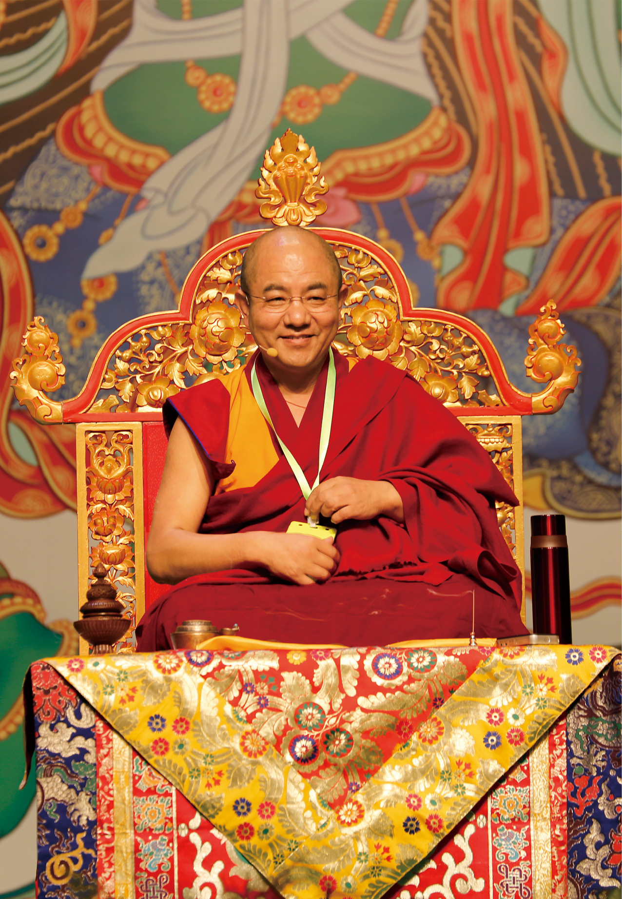

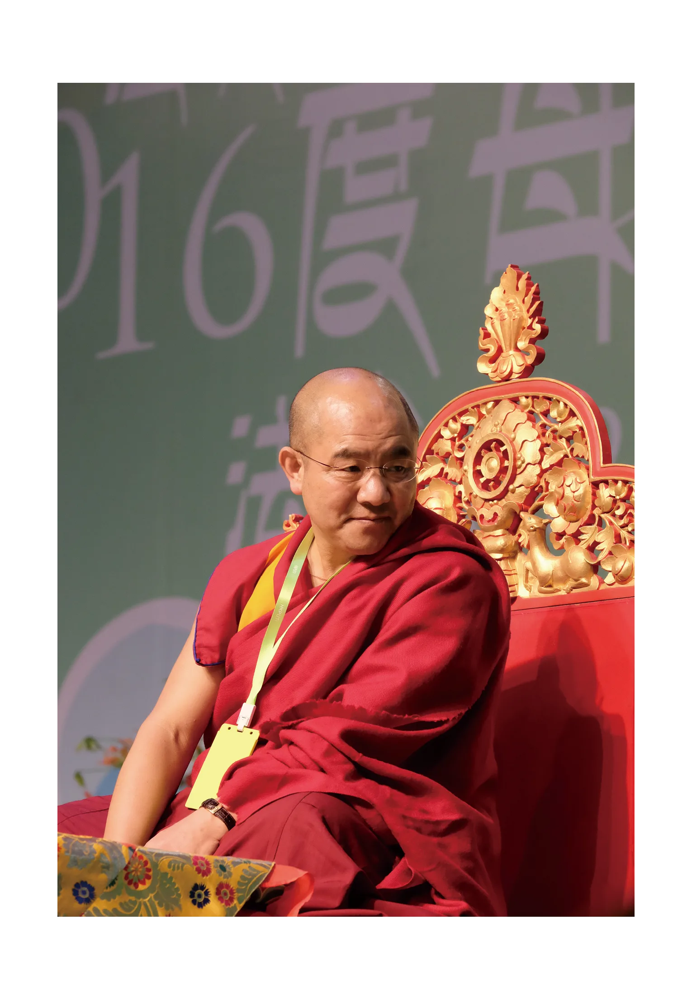

包括禅宗在内的很多汉传佛教大德，经常讲“看破、放下”，意即看破、放下今世的一切。我们作为凡夫人，一般都比较执著今生的财、名、利。很多人参加灌顶、听法的目的，就是为了健康、发财等今世的利益。现在有些佛教徒搞活动时特别会宣传，人们喜欢什么，他们就迎合需求主打什么，使得很多人都乐于参与。

作为一名修行人，首先应该懂得什么是“看破”。虽然一开始我们很难将世间所有的人事物全部抛弃，但要想成为一名好的修行人，就不能太执著今世，因为这样是无法解脱的。

你们有些人以前学过《山法宝鬘论》和《开启修心门扉》，里面用了大量文字说明贪执今生的过患。如果我们贪执今生，就无法领悟甚深、究竟的佛法。

很多佛教徒觉得今生很重要，应该着力弘扬人间佛教。虽然暂时来讲，对人们讲些增上现世福报的道理、弘扬人间佛教的确有必要，但如果只讲人间佛教，不重视解脱的话，世人很可能对名声、财富、健康等世间法越来越耽著，忙忙碌碌中虚耗了自己短暂的一生。

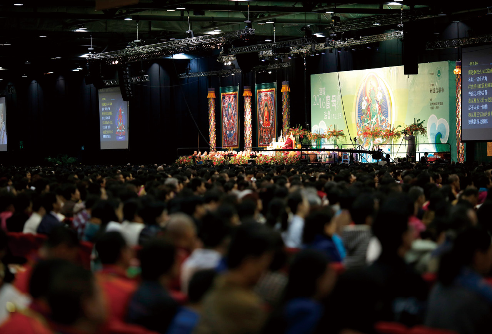

在座大多数人都超过了二十岁，在人间的时间或许只剩下四五十年或六七十年。像很多老法师那样，活到九十多岁或一百多岁的，可谓凤毛麟角。

我们所贪执的今生，只有短短几十年，而未来的生生世世却极为漫长。如果我们现在所做的一切，只为了一个转瞬即逝的今世，显然是不合理的。因此，作为修行人，看破今世非常重要。当然，作为在家人，对家里的事情不管不顾，把所有工作全部放下，也是不行的，我们应该行持中道。总之，希望大家明白“贪执今世非行者”，这样的人不是好修行人。

我以前翻译过《离四贪教言》，那个版本好像比这个版本要广一点，里面还说：守戒时，不能为了今生而守护戒律；闻思修行时，不能为了今生而闻思修行……所行的一切都应该考虑来世。

如今全世界的佛教徒当中，大多数可能都放不下今世。从他们的宣传、理念，以及所做之事就能看出，对来世考虑得很少。若按最高修行标准衡量，看不破、放不下，就不能算很好的修行人。

现在是一个网络时代，我们会被许许多多事情迷惑、缠缚。如果自己一直贪执今生，很可能会沉溺于某个幻象而难以自拔，虚度光阴。五年前，我看过一个广告，讲一位英国女人一辈子喜欢逛街买衣服。当她总结自己的一生时发现，自己花在逛街买衣服上的时间足足有三年。另外，有一位官员喜欢刮胡子，后来他发现，自己一辈子当中有七年的时间用在刮胡子上面。

我们当中的很多人，无论出家人还是在家人，也会经常沉迷于很多无聊的琐事，耽误自己的修行，想到来世的人相对比较少。而真正的修行人，会从生生世世长远的角度去思考、修行。

总而言之，第一句教言“贪执今世非行者”，是在提醒我们，如果贪著今世，就不是真正修行人。这对于我们来讲，既是一种提醒，也是一种刺激。

第二句：

> 若贪执轮回非出离

我们虽然不会贪执地狱、饿鬼、旁生界的生活，但会贪执人天界的财富、名声、快乐等福报。如果有了对今生或来世的贪执，将很难真正生起出离心。

作为真正的修行人，相续中一定要有一颗出离轮回的心。什么叫出离心呢？就是不贪执轮回中的一切，包括世间的荣华富贵、名声地位等等，一心只想获得解脱。

三界轮回犹如火坑，因为不离苦苦、变苦和行苦。也可以说，苦才是轮回的本质。我们要想真正从苦海中解脱，一定要有出离心。如果不具足出离心，即使剃度穿僧衣，也不算真正出家。《过去现在因果经》中讲：“一切造善恶，皆从心想生，是故真出家，皆以心为本。”意思是，一切善恶业，皆由心造作而产生，是故真正的出家，是以修炼自心为根本。

我最近出了《没什么放不下》和《有什么舍不得》两本书。书里讲了一些学院出家人的经历，这些都是我十年前整理的。听说很多人看了之后也想出家。

其实，身出家心不出家，也是没有用的。现在有些出家人虽然身体已经出家了，但心里仍然贪执今生。最近，我听说有的出家人到处化缘，还有的炫耀自己有各种资具等。当然，这只是极少数现象。希望大家，以后不管见到穿汉装还是藏装的出家人，最好都不要生邪见，但也不要认为所有显现出家相的人都非常清净，有些是为了挣钱故意剃光头的。

所以，如果没有真正的出离心，穿僧服也不一定是真实的出家人；如果内心真正厌离了轮回，即便是在家人，有头发、戴耳环、戴项链、染发、做各种打扮，也可以称为真正的出家人。

我看到这次参加法会的很多人都挺时髦，看起来像港台明星一样，这样也是很好的。其实，表面怎么样都可以，只要内心真的想从轮回中出离，就算是真正的出家人。“是故真出家，皆以心为本”，这句话很重要。

希望大家能发自内心地想修行、求解脱。现在很多人表面上学汉传或藏传佛教，实际特别贪执今生的钱财、地位、情感等虚无缥缈、如梦幻泡影般显而不实的东西。其实这样贪著没有什么意义，因为这些法如同泡沫一样，到了一定时候都会破灭。即使你再有权、再富有、再出名，长得好似天人天女一般，离开世间的时候，也带不走一丝一毫，所剩财富只能由五敌共享[^1]。所以，世间法没有任何可靠性。

我们应像华智仁波切和他的上师那样，对整个世间不生刹那贪恋。宗喀巴大师曾说：对世间的荣华富贵，一刹那的贪念也不生，这才算真正生起了出离心。

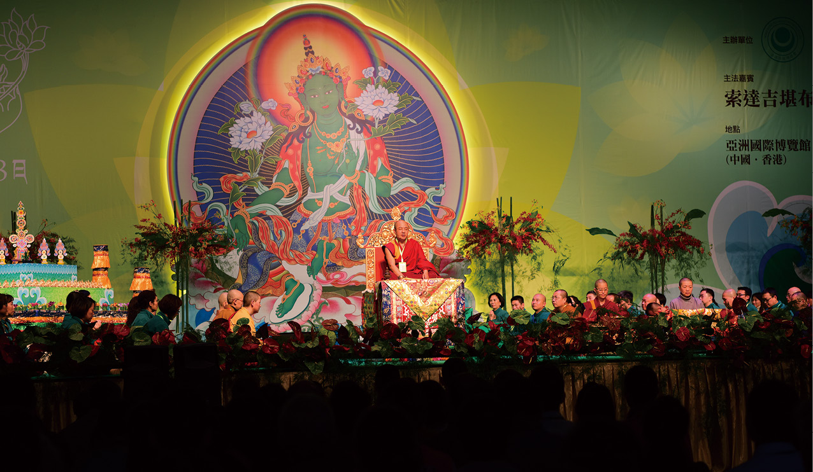

以上第二个教言告诉我们，贪执轮回就没有真正的出离心。大家若想知道自己有没有出离心，可以看看自己是否还贪执轮回。

第三句：

> 若贪执自利非菩萨

菩萨（菩提萨埵）具有勇敢的心识，在无量劫中利益无量众生的过程中，心不会滋生一丝怯弱，也毫不贪执自己的利益。

如果贪执自利，即使你修大乘佛法，修最深的密法，也不一定能获得佛果，甚至可能落入声闻道中。

阿底峡尊者有一位弟子修喜金刚，看起来非常了不起。有一次，尊者对众弟子说：“我的一位弟子今天堕入声闻道了。”弟子们不解地问：“他修喜金刚，怎么会堕入声闻道呢？”尊者回答：“因为他修的时候，寻求自我解脱的心很坚固，没有发起菩提心，存有很多自私自利的念头，这样即使他修最高的密法，最后也会堕入声闻道。”可见，发菩提心至关重要，很希望参加法会的每位道友，都能发起真正的菩提心。

今天，我给大家念了《入菩萨行论》的传承。希望你们每个人至少学一遍，学了之后，还要反反复复看颂词和讲义。我刚才念传承的时候，念每一颂开头的一句，就会想起后面的三句，因为我以前在《入菩萨行论》上花的功夫比较多，在很多上师面前都听受过。

我刚才念传承的时候，脑海中浮现出很多上师传授这部法的情景：对某个颂词，某某上师是怎么解释的，其他上师是怎么解释的，法王在国内外传法时，怎么引用教证解释的……包括我自己以前是怎么分析的，都特别容易想起来。

你们很多人都学过《入菩萨行论》。昨天我了解到，这次法会的主持人也刚刚学完。其实，只听一遍、两遍是不够的，通过反复学习，才能生起无伪的菩提心。

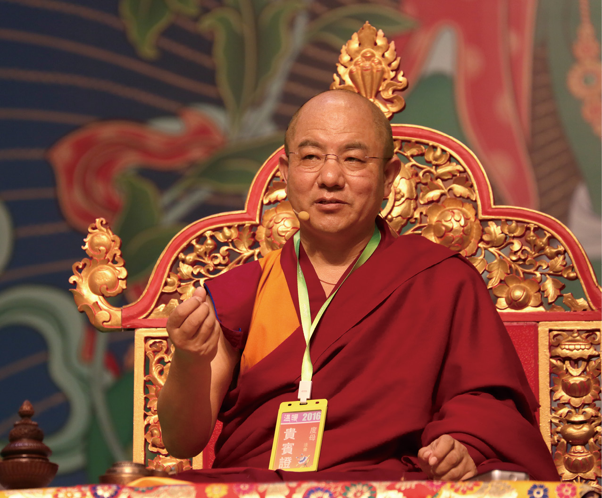

如果真正发起了菩提心，不但不会贪执轮回，也不会特别在意自己，只想全心全意利益天下无边的众生。有了这种精神，即使世间所有人都诋毁你、迫害你，你也不会伤心。为什么呢？因为你的所作所为并不是为了自己，而是为了利益众生。帮助众生的时候，肯定会出现各种情况，但对于修行人而言，这些都是极好的修炼。

总之，无论修行，还是做任何事情，如果天天想着自己，都不是很好。

希望大家以后在一起时尽量不讲别人的过失，而要多讲他人的功德。按理来讲，作为佛教徒，应该多谈论怎样帮助别人、怎样弘扬佛法，这样自己的未来才有希望。如果每天都讲是非，讲个人的事情或痛苦，并没有很大的意义。

一个佛教团体要想兴盛，长久存在，一方面团体要有凝聚力，能够团结和合，另一方面，成员们也要有利他心，能够互相帮助。若没有这些精神作为推动力，到了一定时候，很可能会自生自灭。

纵观人类历史就会知道，那些提倡自我吹捧、自我维护的思想或组织，都不会长久存在，到了一定时候就会毁灭，而对整个人类、社会有利的思想和组织，却会长久留存，随着历史的演变，愈发显露出其存在的价值和意义。

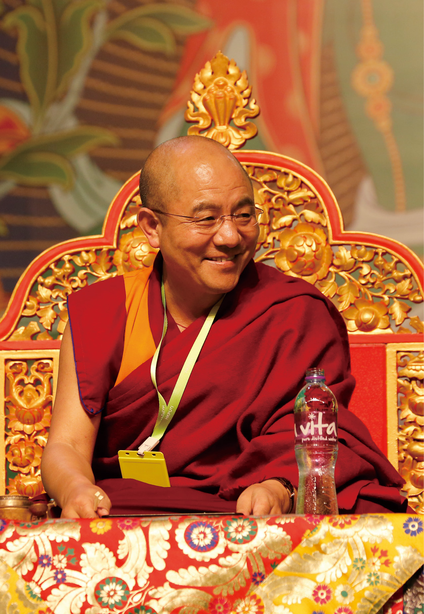

虽然我们现在显现的是凡夫相，会有自私自利心，但要知道，对我们而言，最重要的是有菩萨一般的利他心。自古至今，很多人一生所有的付出，并不是为了自己，而是为了众生。这样的菩萨，出家群体中有，在家群体中也有，各个民族和各种社会群体之中也大有人在。

我们作为追随释迦牟尼佛的随学者，一定要了解利他心的重要性，并努力将其发挥出来。这是我讲的第三点，“若贪执自利非菩萨”。

按理来讲，在座很多人都是发了菩提心的菩萨，因为《入菩萨行论》里的很多偈颂都讲了怎样发菩提心。我觉得念诵这部论的颂词都是一种享受。我看很多道友经常带着《入菩萨行论》的法本，这样非常好。

寂天菩萨还劝我们多看一些其他的大乘经论，如《虚空藏经》《学集论》《经集论》，以及龙猛菩萨的论典等。以后大家有机会的话，在这方面还要多看、多学。

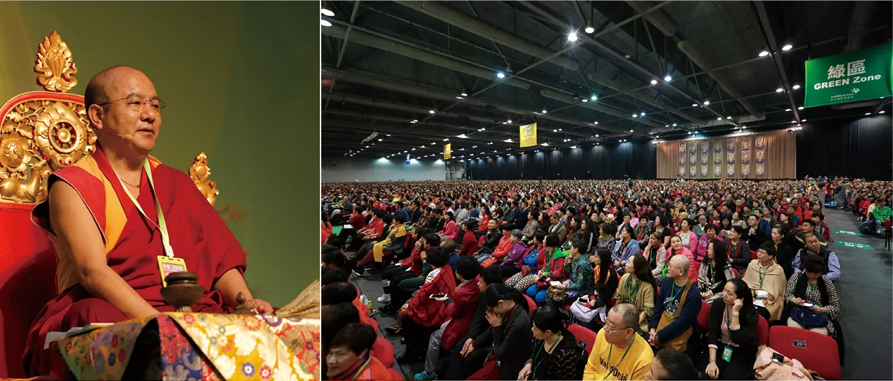

第四句：

> 若出现执著非见解

最后一句：如果出现执著，则不是正见。虽然暂时来讲，我们需要执著空性、光明、清净等见解，但修到最高境界时，无论汉传还是藏传佛教，究竟的观点都是远离一切戏论、远离一切执著。

“般若”“到彼岸”是一种不可思议的境界，是修行所证悟的万法实相。它是分别念无法揣测、语言无法描述的，因为凡夫的分别念不究竟，语言表述同样不究竟。

禅宗的最高境界是“不立文字”。很多禅宗行者连“佛”字都不说，有时说了一个“佛”字，就要漱口七天。《中观根本慧论》也对于执著如来、涅槃、解脱等概念做了一一破斥。按照密法大圆满的观点，刚开始，我们需要磕头、念咒、观想本尊，身口意的善根都要不间断，到了最后，则需要将所有的善恶念全部抛弃，即连磕头和念咒的执著都不需要，这是一种最高的境界。

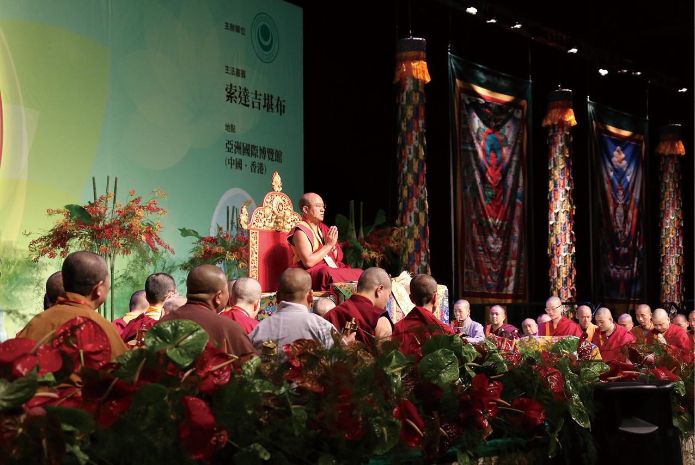

也就是说，我们所执著的光明、空性，或者说如来藏、明心见性、心不散乱等等，都是语言文字、分别念的境界，证得最高境界时，这些都会被一一摧灭。因为在真正的解脱境界中，找不到任何一种执著。

这一点，以密法和禅宗的有些教言进行直指，或者通过中观推理来论证，也可以了解。这时自己已经完全明白，世间的万事万物没有任何实质性，最后连语言亦无法描述，这就是真正的实相。何时达到了这种境界、何时悟出了这个道理，即是开悟。

开悟的境界非常奇妙，在此境界中，什么执著都没有。以前，帝洛巴尊者对那若巴尊者说：“你面前所显现的任何东西，都不会障碍你，但如果你去执著，就会被束缚。这时你的见解已经出问题了。”总之，最高的见解就是没有任何执著。

当然，就像过河时需要船只，到达彼岸后才不需要一样，我们尚未达到最高境界前，仍然需要有贤善人格、道德修养等世间为人处世的品德，也需要有“善有善报、恶有恶报”这样取舍因果的执著，更需要有出离心、菩提心的执著。希望大家一定要区分清楚。

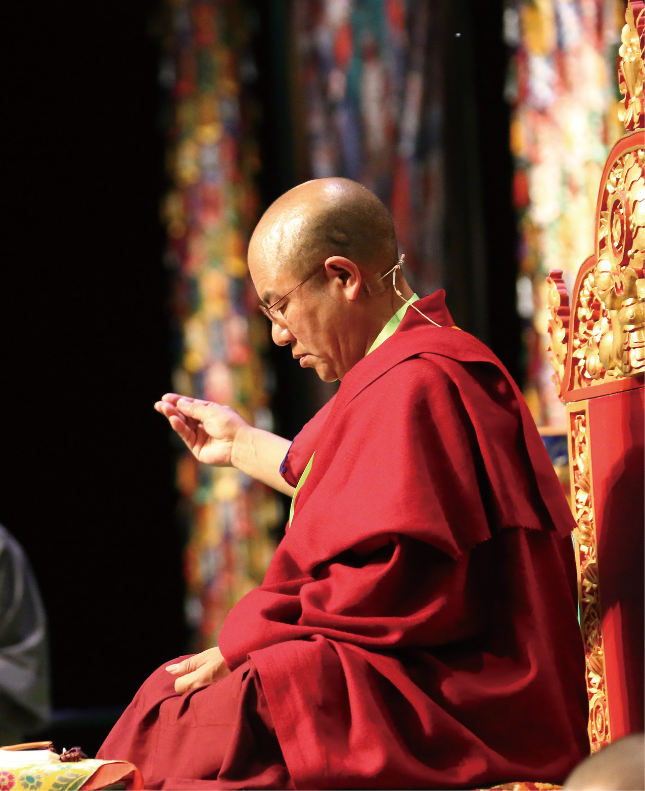

综上所述，较高层次的修行人，不会贪执今世，不会贪执轮回，不会贪执自利，也不会有任何执著。他们因为生起了真正的出离心，故对来世特别重视，希求将来能往生极乐世界等清净刹土。

那我们该如何修行呢？通过观修人身难得、寿命无常、轮回过患和因果不虚这四种修法，可以让我们的相续中生起出离心；再通过行持不共加行的皈依、发心、积资净障、上师瑜伽这几个修行引导，可以让我们生起利益众生的无伪菩提心；最后，通过安住中观无二慧的见解，或者上师直指本性等正行法门，就可以现出赤裸裸的觉悟境界。

以前，很多大德是以窍诀的方式为弟子传讲。其实密意都是一味一体的，只不过在方式方法上有所不同而已。

## 结语

非常希望大家通过这次学习《离四贪教言》，变成一名真正的修行人。如果你们心中没有修行的境界，人再多也没有很大的意义；如果内心有了一些修行境界，即便人数不多，也会对弘扬佛法、对自他的解脱有意义。

我们作为修行人，既要懂得世间随顺众生的方法，也要掌握出世间更高层面的修行窍诀。否则，人身那么难得，寿命如此短暂，在这千钧一发的关键时刻，如果没有抓住修行要点，浪费了宝贵的人身，是非常可惜的，以后很难再有这样的机会。这次各种因缘聚合，我们才能举办这样难得的法会。

最后，让我们一起发愿：愿世间千千万万众生都能离苦得乐，愿世界和平，愿每个人不仅能获得暂时人天的一切圆满，最终还能达到离四贪的最高境界。

希望大家以后能经常思维《离四贪教言》，这样我们的人生就会像如意宝一样具有价值。非常感恩你们！

[^1]: 谓世间财物为王、贼、火、水、恶子等五家所共有，以其不能独用，故无须强求。
