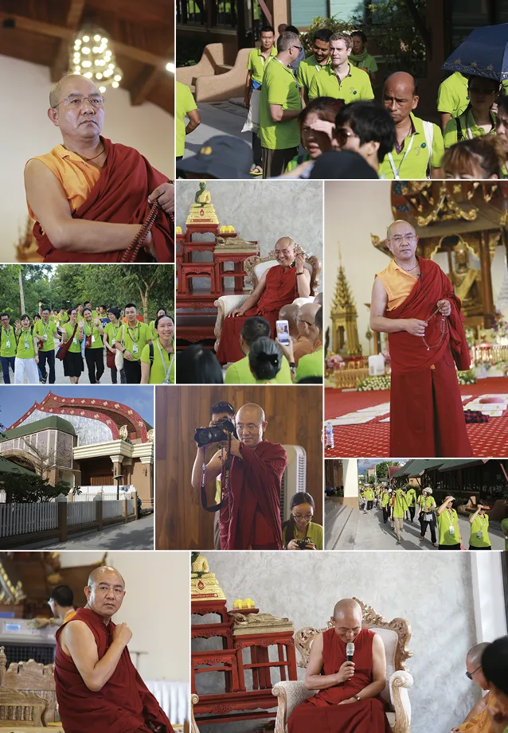
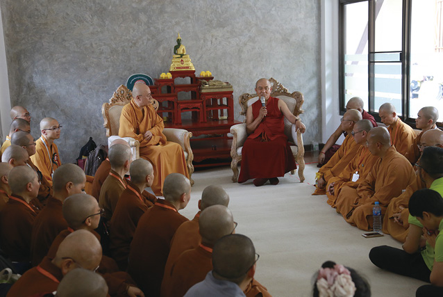
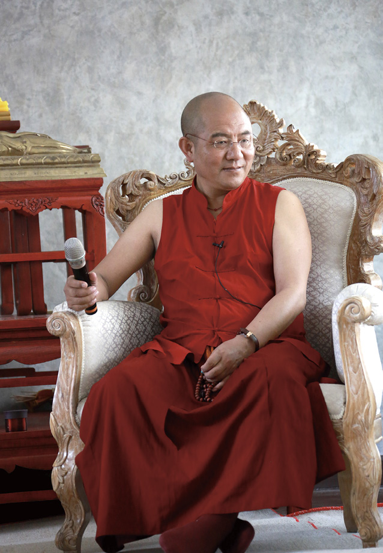
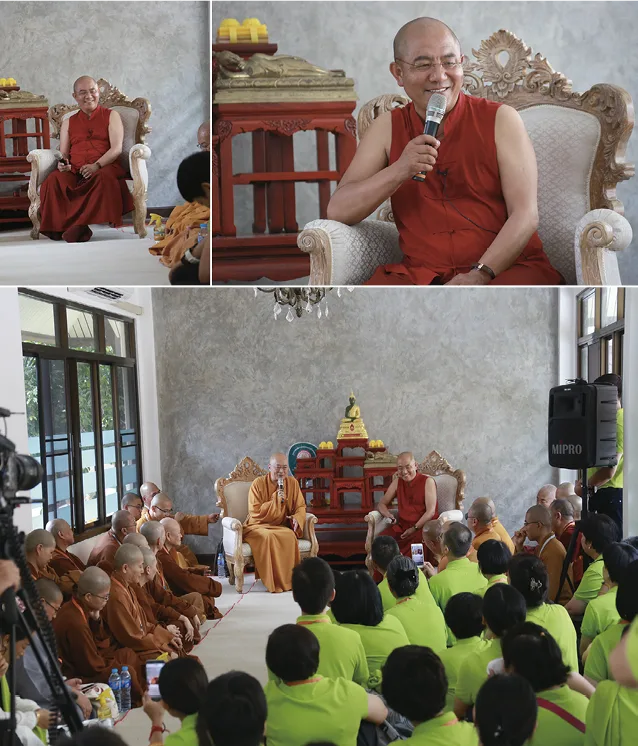
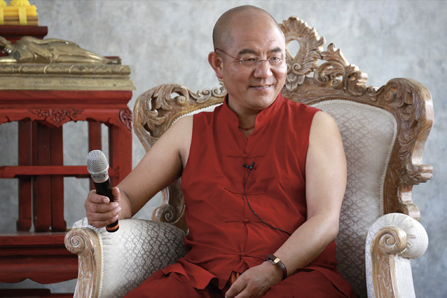
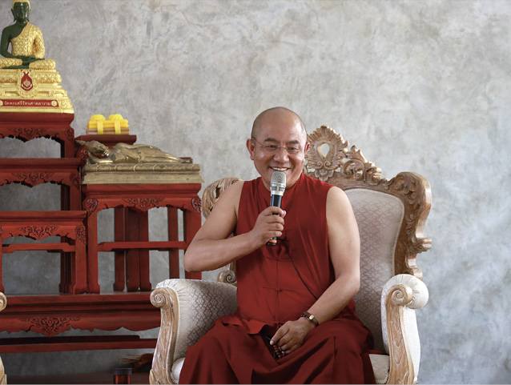
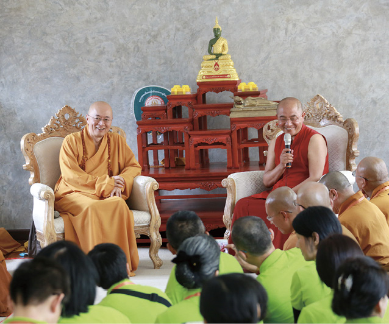

各教派都有各自的理论和窍诀，没有高低之分。

第60场

生命电视台

Life TV

泰国·清迈

2017 / 8 / 1

## 与时俱进的慈悲

## Compassion in Evolution

海涛法师：

堪布大慈大悲，不浪费任何慈悲利益众生的机会。这两天从堪布身上看到很多值得学习与借鉴之处，我回去要更努力一点，不断地关心他人，去为别人安排任何一件事情，我想这就是最好的帮助众生的方式。大乘思想就是怎样在利他心与智慧的摄持下把事情做到最圆满。

刚刚有几位居士在餐厅喝水，但不知道那边有舍利子，堪布就像母亲一样，以金刚语告诉他们：“赶快去看舍利子，等等再喝水，拜舍利子比较重要！”

我想，人要有热忱，只要为对方好的事情都要去做。各位等一下有任何问题都可以向堪布请示。让我们鼓掌欢迎堪布开示——

今天在这里见到海涛法师很高兴。我和海涛法师已相识多年，海涛法师是我最佩服的汉传佛教大德之一，弘法利生的事业极为广大。

## 与时俱进，海纳百川

如今，能相应于时代、看准时代特点、看准众生心态和社会动态的人不多，但海涛法师尤其能够与时俱进，对每个国家、民族的人们的爱好、烦恼、痛苦等，都看得极为透彻。为了对治众生的烦恼，法师也采取了不同的善巧方便，这是我佩服他的原因之一。

其二，多年以来，无论是藏传佛教、南传佛教，还是汉传佛教的各个教派，海涛法师都以非常包容、开放的心态来对待。只要有利于众生、有利于佛法兴盛，海涛法师都不分教派来弘扬。同时，与法师相关的传承弟子们，都以轻松、开放的心态来弘法，而不是用孤陋寡闻的狭隘心胸来排斥其他思想。如果我们所有的佛教徒都只承认自宗、排斥他宗，在这个时代将很难走出去。所以，我非常佩服海涛法师开放的弘法精神。

其三，海涛法师很坚强。我经常关注他的法讯，全世界范围内，只要有讲经说法、弘法利生的因缘，他都不辞辛劳前往。你们很多跟随海涛法师的弟子们，因为需操劳之事众多，确实较为辛苦，但在法师精进利众的带领下，我相信每个人的能力都会得到大幅度的锻炼与提升。

昨天跟法师聊天时，提到我休息时经常生病，他说自己也有类似情况，好像一闲下来身体就不舒服。

## 缘起性空，慈悲利众

以海涛法师为代表的台湾法师们，通过电视、网络、新媒体等平台传播佛法，将各种资源整合起来，形成系统化来弘法利生，此种因缘在现代确实很需要，这比传统的方式具有更为强大的力量。最初我在这方面缺乏经验，后来也学了些皮毛。

我尤为看重生命电视台，自电视台兴世以来，以其开放性的姿态，在多国利益广大众生。如今是网络时代，若是没有占据网络空间，则其很有可能会被各种魔、各种具有吸引力的散乱因素所占据。此时，在座的团队、不在场的诸多幕后工作者挺身而出，付出了自己很多时间与精力。即使在电视上仅播放三分钟，背后的工作量也非常大。

此次借“世青会”的殊胜因缘，与法师强大的团队相聚，特别感恩。希望各位还要跟着法师不断努力，虽然在弘法过程中每个人都比较累，但此事意义重大。

## 发菩提心，护持正法

作为大乘佛子，为众生而流泪、出汗受累，这对每位发了菩提心的菩萨而言异常珍贵，且非常值得，大乘菩萨的责任和义务也正在于此。所以，我希望大家要好好地护持法师的教法，实际上这就是护持佛法。每个教派都有不同的缘起，缘起虽不同，但依靠缘起力所传播的佛法无有差别。每一个人依靠现阶段自身的能力，想要如同法师那般广弘佛法有一定困难，无论愿力、智慧、善巧方便，都不一定达到如此高度，但依靠我们整个团队的力量，可以成办个人无法企及的效果。团队的法师们都非常有智慧、能力，从各方面看都非常优秀，将来我们做任何一件事情都要一直坚持下去，不能虎头蛇尾。

之前我看过有人采访生命电视台，问海涛法师最担忧的是什么。法师说：“生命电视台何时会停止，这是我时常担心的。”庆幸的是，已过去多年，生命电视台仍在持续稳定地发展。现在的媒体环境，无论是电视还是网络，竞争都很激烈。特别是想要真正利益众生时，违缘也较多，但我们还要坚持不懈地做下去，这是非常殊胜的因缘，也是前世共同发愿的善果。

很多人也想利益众生，但光心里想不行，有钱也不一定能实现，有智慧和技术也不一定行，需要因缘和福报同时具足。真正要想走得远、走得长久，需要有福报、因缘、发愿力，这些都是不可缺少的。

今天，我们在清迈这么殊胜的地方，这么多出家人、四众道友都非常棒，特别感谢大家！

现场互动

海涛法师：

首先向堪布介绍下，此次来参加活动的大部分都是我们“慈悲志业”的干部，在海外各个国家我们以“慈悲协会”登记，合起来叫“慈悲志业”。

既然我们的定位在“慈悲”，就会着重去做慈悲关爱众生的事情，比如关怀老人、助念、施食、放生、烟供、诵经等，佛教所倡导的一切利益众生的事情，基本我们都在做。

请堪布给我们开示，这些干部们怎样去圆满我们的事业？各位一会儿有什么问题，也可以请示堪布——

堪布：

确实很好，海涛法师的很多行为，与大多数的佛教徒、甚至非佛教徒都很相应。为什么这么讲呢？一些高深的理论研究，包括昨天有些专家讲的，我们都不是特别明白。当然，佛教深层次的研究是有必要的，但更重要的是，世界各地很多人更需要世俗善根，比如放生、护生、慈善、助念等行为，大多数人暂时对这些方面非常有缘。

佛教从深广两方面看，想做得深，需要有一些研究团队，像佛学院；想做得广，在世界各地以慈善、慈悲作为契入点非常合理。

我们行善、弘法，要了解各个国家、民族的传统文化、风俗习惯，以当地人需要的方式来契入，不能太死板。比如说汉传佛教推崇的“阿弥陀佛”，不一定非要按照汉地的习惯来念；藏地兴盛的“观音心咒”，也不一定非要按藏地的方式念诵。越南有越南的习惯，新加坡有新加坡的习惯，台湾和马来西亚各有不同的风俗习惯。佛陀的教法可以善巧方便地呈现为他们喜闻乐见的方式，而重点实际上是让他们行善断恶。各地的义工菩萨们，在坚持佛教共同理念的同时，还要在各自的道场、中心，各自的佛教团体中，以适应当地的方式行善、弘法。

很多台湾的法师、藏地的法师，为了弘法而融入社会，这很重要。刚才南传佛教的有些法师也说，南传佛教有点可惜的是，很多高僧大德在山里闭关修行不出来。我们完全承认他们自身的修证很了不起，可是如果没有培养弟子，没有融入社会、帮助社会上的可怜众生，的确佛法只是存留于山洞里、寺院中。

因此，想把佛法带到世间，一定要有很多化身。如果只有海涛法师一个人，想在各个地方待很长时间也很困难。我这边的发心团队也是同样如此运作的，只不过我们做得比较简单，尚未形成系统化。总之，佛陀的教法很需要去弘扬。

我看到《慧光集》中罗列了生命电视台在世界各地的联络点，其数量之多，令我发自内心地特别随喜！现在是网络时代，国与国之间的距离已经很近了，但仍需要我们努力创造弘法机缘，所以特别感谢各位菩萨的付出！

这次你们参加“世青会”，也许能感觉得到，好多教授在理论上很会讲，但落实到行动中却不会做。因此，希望我们慈悲志业协会的道友们、菩萨们，还要在实际行动中不断地努力。

问：我前几天听您讲，您的师父传了一句话，让您坚持了三十年，我想知道传的什么话？

堪布：其实那句话很简单。我们去五台山时，我的汉语很差——到现在我还分不清普通话的三声、二声，但当时我的师父说，让我回佛学院以后，负责汉族这边的教学。这句话我坚守了三十年，从未改变。

我自身背过五部大论，给藏族讲课是我的兴趣所在，而对汉族的居士、出家人，要管理又要讲课就很复杂。但当时上师说“你以后是汉族这边的负责人”，这句话我坚持了三十年。

问：作为显教跟密教的弟子，如何更加融合地完成慈悲的事业？

堪布：首先，藏传佛教的大德们在讲法、做事的过程中，应发自内心地配合显教的大德们，这很重要。

另外，显教的弟子和上师们也要多了解密宗，大家一起配合。在各自的团体当中影响很大的法师和上师，有责任让彼此了解显密。有能力的显密大师、弟子，在各个地方要发自内心地互相帮助。

本身显密没有差别，完全圆融，藏传佛教每一个寺院都是显密双修。我们以后多沟通，多在这方面努力。

问：在不久的将来，我们可否在非洲这样穷困的地方举办佛学研讨会或夏令营？这样可以让更多的青年佛子有机会亲身体验人间的痛苦。

堪布：这倒不是特别难，大家都在做这些事情，包括慈善、助学、建校、教育，我们对这些方面都很重视。

我去过一次非洲，感受确实比较深。这次我们“世青会”也特意邀请他们参与，让我们这边的人了解非洲的情况。可能与在其他地方发心、做义工相比，到非洲还是困难得多，因为非洲有一些毒虫、毒蛇，还有各种疾病、瘟疫、战争，对自身的生命构成威胁。但正因为条件恶劣，更有必要关心这些地方。所以，将来因缘具足时，我们可以考虑在这些地方开展更多活动。

问：请问两位大德，本菩提院有办佛学班，很多家长怕孩子出家，因为他的孩子不吃肉，且每天早上礼完佛才去学校。我安慰这些家长说：出家要看因缘。请问，要如何开导他们的家长？

海涛法师：

有时候我只能说“以心传心”，因为有些人没办法用嘴巴跟他讲，但你可以用心跟他沟通。这一点我觉得很重要。某个人很喜欢喝酒，我会在内心跟他说法，然后将功德回向给他，我发觉他会有一些改变。就算没改变，至少我做到了我该做的。但如果你嘴巴不肯跟他讲，然后心也没跟他讲，你就被卡住了，会感到有一点压抑，这样对自己也不好。

当然，佛教的现代化，以及“出家才是真正孝顺父母”的观念，如何落实到汉人身上，是个难点。因为汉人太重视孝顺和祖先，一定要让他们知道，你的儿女出家才真正能够孝顺你，出家是最大的孝顺，而且对你有帮助，从这里入手比较容易。

出家不是离开父母，而是为父母好，这是南传佛教的思想，所以父母很喜欢小孩子赶快去出家几天，这样才对父母有利，才会发财。

堪布：对，法师的观点我完全赞同，我也是这样的意思。（众笑）

问：在现今社会，如何用科技和媒体的力量来帮助佛法兴盛？

堪布：现在是信息时代，一定要掌握高科技，我们佛教团队也是如此。幸好海涛法师很早就醒过来了，我醒得比较晚。我也用了一些网络等媒体手段弘法，我们没有电视台，最多是微信和Facebook，如果没有掌握这些传媒手段，弘法会很困难。我们的技术人员要不断学习，这很重要，因为设备和媒体日新月异，更新换代很快。

除了技术手段以外，我们要用智慧来抉择哪些可以说、可以做，哪些是不被允许的。我们不仅要懂得佛法，也要了解各个国家的政策导向、风俗习惯等。否则，在网络上发一条信息，对全世界的人都可能造成极大影响。

所以，我们的发心人员，尤其是总策划的人，或者审核的人，一定要懂世间法和出世间法。佛法方面要懂，否则内容会偏，对大家影响很大；世间法方面也要明白，包括大陆的趋势、美国的趋势，以及很多世间道理都要明白。在这方面，法师用的人才确实都很优秀。这个世界日新月异，希望大家还要不断地提升，不能停留在一个层面。

问：尊贵的堪布，您一直关注我们生命电视台，可不可以在电视台的节目上给一些建议？我们也希望能够突破，做更好的节目。

堪布：以前我经常看生命电视台，这几年比较忙，看得不多。生命电视台的影响力的确很大，不管在加拿大、美国，还是在英国、法国等国家，大家都经常看，从中学到很多佛法。作为在家人，平时需要接触现代媒体，同时自己作为佛教徒，也需要佛法的滋养。生命电视台确实在佛法传播上给很多人带来了利益。

我今天没有什么新的建议，但有两点想提醒各位：第一，我们做媒体或是其他任何事情，要做细。做事情时间长了会比较累，这时很容易散乱、马虎。大家使用现代媒体在网络上交流、弘法，一定要用很严谨的逻辑思维来抉择。

第二，大家要长期发心，人要稳重。作为工作人员、发心人员，技术学完以后直接离开，无论是对个人还是对整个集体都不太好。

我最喜欢心很稳重的人。有些人特别聪明，但学了两三天就走了，这种人我不喜欢。作为技术人员和工作人员，自身要稳重；作为观众，对自己喜爱的、有信心的媒体，应长期作为自己的课诵本一样，经常看，从中你会得到很多正面的智慧和慈悲。

在当今时代，依靠电视等媒体来获取智慧和慈悲极为难得。我特别随喜你们有这个平台，有这么好的善知识。说起来是电视台，实际就是一个24小时不断弘扬善法智慧的善知识，可以说是活生生的诸佛菩萨的化现。所以，我们要珍惜这种机缘。

海涛法师：我插播一个问题，我想要问堪布，您觉得您现在最痛苦的是什么，或者您最困难的是什么？

堪布：“最痛苦、最困难”，好像也算不上吧。时间总是不太够，这也不算痛苦吧。

我现在所做的，都是自己愿意做的事情。作为出家人，弘法利生也可以随缘，自己能做多少就做多少。其他好像想不出有什么很困难的。

海涛法师：太好了！不过堪布的很多弟子跟我反映，他们很担心堪布的身体，希望堪布永远健康！

问：顶礼堪布，也想问海涛法师，我觉得好像藏传佛教在度化外国朋友以及年轻的朋友方面，给人感觉比较容易。我想请问堪布果真如此吗？我们现在跟随海涛法师，不知道怎样可以度化更多年轻的朋友？

堪布：我个人并不觉得年轻人和外国人对藏传佛教特别有信心。不过这几年，不管是汉传佛教，还是藏传佛教，学佛的年轻人越来越多，这是事实。

现在经常看到，佛教徒当中有很多80、90后的年轻人，他们中有不少本科生、博士生，学历都比较高。我自己觉得藏传佛教在吸引年轻人方面没有什么特别，汉藏在这方面应该是相同的。

海涛法师：

关于向外国人弘法这个问题，我觉得首先就是语言的障碍。藏传的，特别是在印度、尼泊尔的很多堪布在学院里面一定要学英文，而且他们必须要到国外发展才有护持，解决了语言问题就比较容易融入，这是汉传要加强的。有时我跟我们发心团队规定，年轻人一定要全部讲英文，希望通过这种强迫训练提升他们的英文水平，但他们讲几天就不讲了。

当然，会讲英文也不见得就能推动弘法，比如新加坡、马来西亚的人这么会讲英文，也不见得向外国人弘法的效果就好。自己有愿力很重要。

外国人不容易度，他每天跟你讨论问题，但就是不修行。有时我们汉人会觉得，向外国人弘法太浪费时间，因为他只是一直跟你纸上谈兵，问很久的问题。比如关于我出家的问题，外国人可能就会问一两个钟头，我说：“你又不出家，问我这个问题干嘛？”他觉得很好奇：“你怎么离开你太太……”其实这些问题跟他没什么关系。（众笑）汉人如果问我，那是因为他想出家，但他有太太，有这种情况，他才会来问我这个问题，一般不会问。我们和外国人的生活习惯还是不太一样。

问：南传、藏传、汉传都强调打坐，可入手处好像不一样。海涛法师强调，在生活中做每一件事情时都在禅修；堪布强调观想释迦牟尼佛融入自己；南传强调把念头放下，念无念。所有的方式听起来都很不错，但入手时应该怎样结合？

堪布：因为时间关系，海涛法师还没有开始讲。（众笑）

南传佛教跟汉传佛教、藏传佛教，相同点是都强调放下、放松。汉传佛教的禅堂里有很多禅修方法，比如打禅七，只不过他们对正念禅修比较重视。他们也有观佛的修法，今天早上做翻译的阿尼也说，将自己的心和佛观为无二无别。南传的部分大德也开始提倡这样的禅修方法。

在生活中看你适应哪种方法，哪种方法对你自己对治烦恼、分别念起作用，那就修这个法。或者你对哪个传承感兴趣、有信心，也可以修这个。

问：对一个念佛人来说，我们平时行住坐卧都会想去利益众生，但我们心里面只是一句佛号，或者嗡玛呢巴美吽，或者在禅修过程中只是念佛，这样会有冲突吗？是应该有佛号呢，还是要放下佛号去禅修？

堪布：这些都不矛盾。如果你打坐时完全禅修，跟今天我们刚开始讲的一样也可以。如果你修到佛教里面讲的出定和入定的境界，在入定时可以安住于禅的境界中，出定时——出定以后的行为叫做“后得”，观想将佛和菩萨的加持融入自身，自己所有的行为与佛菩萨的慈悲心无二无别。总之，当你在参禅时入于清净的定，出定后的行为不离开诸佛菩萨的加持。

当然，有些境界比较高的修行人，他们可以做到出定和入定无别，那时念咒语也是参禅，参禅时也可行持各种事业。但我们一般人可能只能行持一种——入定时无法念咒，念咒语时无法入定。

问：藏传佛教首先强调要有出离心，但没有受过挫折的人、学者或年轻人，以哪个点契入度化他们比较好？

堪布：出离心很重要。昨天海涛法师也讲了出离心在佛教入门阶段的重要性。藏传佛教中归纳的三主要道——出离心、菩提心和空性智慧，出离心是基础。

但不一定每个人刚开始就有出离心。就像难陀，最初出家时没有出离心，后来看到地狱的状况，才生起出离心。所以，刚开始要产生真实的出离心有一定困难，但要说明的是，出离心是所有三传佛教的基础。

当然，我们要度化年轻人、学术界的人，让他们产生出离心有一定困难，对他们用思辨、逻辑推理的方式可能比较合适，一定要通过辩论让他心服口服。如果不通过辩论，依靠信心、出离心和菩提心的教法，很多年轻人分别念特别重，很难度化。

我们现在开“世青会”，有些人可以听到很多善知识的语言，也许能在他们的相续种下一个善根。如刚才海涛法师所说，有些外国人更“牛”，他们的分别念特别重，而且大多数人都有其他宗教的背景，一时间更难以接受佛教的观点。所以我们在组织的过程中，在他们耳边念一些佛号，让他们知道，原来佛教团体有很多科学界的人、非常有智慧的人，通过此种方式，逐渐压制他们的烦恼和傲慢。

问：《西藏生死书》讲到，在中阴的四十九天中，每一天都有不同的情景。如果是修藏传佛教，他应该能看到这一个个景象。那我们修汉传佛教，能否看到这些景象？

堪布：你应该问索甲仁波切。问我们两个都没用，书不是我们两个写的。（众笑）

其实这些景象在中阴阶段会产生，只不过很多人不认识而已。不管你修什么法，都有这种恐惧，也会显现忿怒本尊，但若是以前没有与此法结上善缘，这种显现很快就过了，你没办法认识。

即使索甲仁波切来了，大抵也是如此回答。

问1：禅宗的明心见性跟藏传佛教的大圆满或者大手印的圆满境界，到底有什么差别？

堪布：差不多吧。

问2：显教里面有很多修行者证得金刚不坏身，密教有虹化身，这点上好像密教更殊胜一些，您能不能解释一下？

堪布：各教派都有各自的理论依据和窍诀，没有高低之分。每个教派都认为自己是最殊胜的，只要修行有成就，都可以说是最殊胜的。

问：众生真的很苦，每次有法会，我就把地球观在中间，法师围绕在旁边，借助法师的力量给他们种一个善因，等时机成熟，就有佛可以帮助他们。这样观想可以吗？

堪布：可以，这样观想很好。依靠法师的智慧、慈悲，融入自身，然后发愿度众生，这样有特殊的力量。

藏传佛教中时常提到上师瑜伽的修法，所谓的上师瑜伽，就是将上师的事业、智慧、慈悲融入自身，获得与上师无二无别的力量——上师瑜伽确实能令修者具备此种强大力量。

昨天在现场，索甲仁波切的幽默以及对上师们的信心，与会者有目共睹。24年前（1993年），我随同法王晋美彭措一起去过索甲仁波切的道场，当时我的感受很深，他对上师们的信心非常非常大。我们从《西藏生死书》中也能看出，他一般不会直接称呼上师，而是冠以“伟大的上师”之尊称。所以，作为一个成功的弟子，对自己的传承上师、法师，要有强大的信心，这是种很强大的力量。
