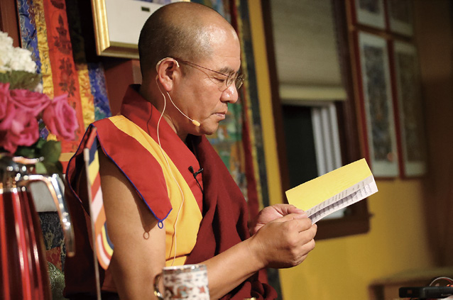
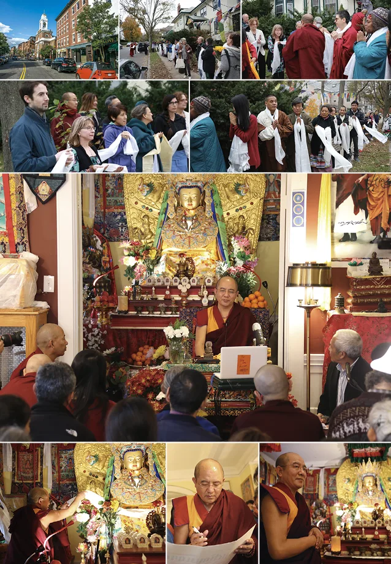
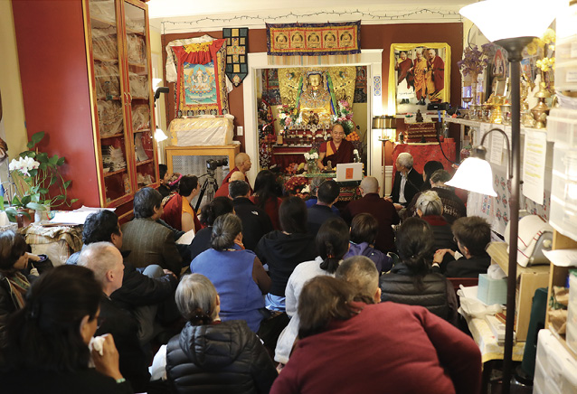
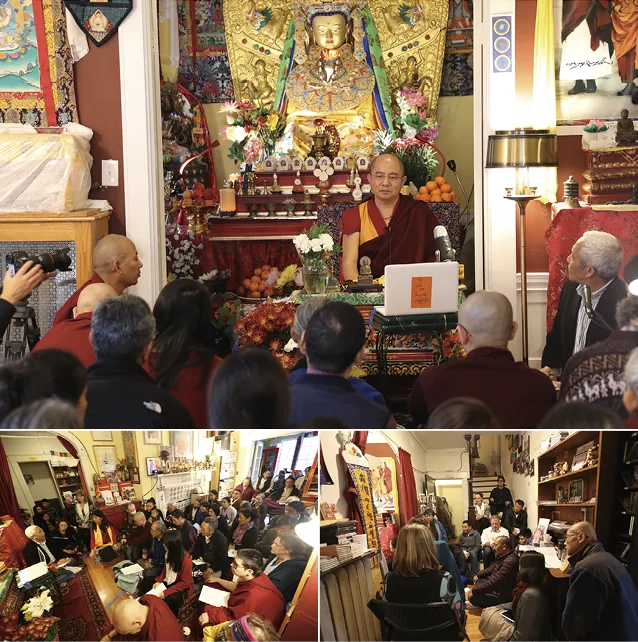

在短暂的人生，  
好好修行，  
这就是我们人生的价值核心。

第64场

美国波士顿噶举佛教中心

Drikung Meditation Center, Boston, USA

美国·波士顿

2017 / 11 / 5

## 佛教精要的修法

## Essential Buddhist Practice

今天，我们相聚在噶举佛教中心。时间不是很充裕，为了表示缘起，跟大家结个法缘，我先简单讲几句。之后，我会给大家念朗日塘巴格西所造《修心八颂》的传承。

今天要结的法缘，是关于修行方面的。昨天佛教中心的喇嘛们，希望我在这方面简单讲一讲。之前，我想讲冈波巴尊者《胜道宝鬘论》的部分词句，后来考虑到时间不够，放弃了。接下来，我想到什么就讲什么吧。

今天在座的，大多数是藏族人，也有很多美国人。我是第一次到这里来，对你们的情况不是特别清楚。但看上去，大家都很有信心，也有利他心，平时应该在很好地修行。这里确实是不离佛法的修行之地。这主要是噶举上师们的恩德。

## 学佛，怎么可以不依止善知识呢？

藏传佛教的中心虽然有很多，像噶举、宁玛、萨迦等，但在修行方面没什么分别。你们这个地方给我的印象是，胸襟开阔，心量宽大，各个宗派信徒之间没有嫉妒，上师们同心同德，团结和合，弟子们互相聆听佛法，并对此非常重视。比如噶举、宁玛的佛教中心，大家都在相互学习，确实非常好。

虽然各个宗派的上师都没什么差别，但作为修行人，还是要依止相对固定的一位上师。如果没有依止上师，只是依靠自己的力量，随随便便翻阅佛法书籍，可能会懂一点点，但却无法圆满通达。为什么呢？世间人学习的时候，也会次第上小学、中学、大学，而且所有学校的老师，都要专门给学生授课。没有老师的引导，学生自己看书，最后完成所有的课程，并达到毕业目标，这在西方和东方的任何地方，都是没有的。

既然世间的学习也需要依止老师，而佛法与世间知识相比较，更为甚深和广大，学习佛法怎么可能不依止上师、善知识呢？而且，在刚开始学佛的时候，就要依止那些闻思修行过、有经验的上师。这对任何修行人来讲，都是一样，没有民族和国家的区别。

## 闻思修，三驾马车缺一不可

修行佛法，不能迷信佛法。怎样才能懂得修行呢？藏传佛教的教法，归纳而言就三个字：闻、思、修。首先，听闻佛法非常重要。必须在上师面前听闻大量的教言。我们藏族人，在上师们讲法的时候，都会好好地听闻，这是一个很好的传统。

其次，在上师、善知识面前听闻之后，还要在心里反复思维所听闻的法义。通过这样的思维，最后能生起智慧，所以也很重要。

我在美国接触到很多的大学老师。他们最初没有听闻，最后也没有修行，只有中间的思维——翻阅很多书籍，然后通过逻辑推理，对佛法进行研究。在我个人看来，既没有前面的听闻，也没有后面的修行，只用中间的思维来研究藏传佛教，是得不到什么利益的。

正因为这样，他们研究得出的种种观点，有时会比较奇怪。比如在密法方面，有些教授认为清净观不太合理，有些教授怀疑伏藏法是上师们自己编造的，等等。另外，他们对道的次第，如果不懂得如何修持，研究佛法不但对他们的相续无利，反而可能会带来危害。

宗喀巴大师讲过：“始初多求广大闻，中于教理现教授，后于昼夜精勤修，普令回向教增长。”首先要多听闻，中间把听闻的教理融入自己的相续，最后，所有显密经续的内容，都以窍诀的方式进行实修——不管是哪位智者所讲的窍诀，都可以用，以此平息自相续的烦恼和恶分别念。

## 不实修，得法再多仍是凡夫

获得证悟的因，就是闻、思、修。所以，修行也非常重要。我们虽然可以通过文字了解佛法的内容，但如果没有长期的禅修，对于根除自相续中的贪欲、嗔恨等烦恼，以及无始以来串习的轮回习气，是起不了多大作用的。要想压制并彻底断除烦恼和习气，一定要进行长时间的禅修。否则，想让佛法对自相续有利，非常困难。

不管是谁，人生都很短暂。一个人能活到100岁左右，已经算很长寿了。大多数人活到五六十岁、七八十岁，就会离开人间去往后世。遗憾的是，很多人虽然遇到了佛法、上师、善知识，却将佛法放置一边，不好好修行。最后死亡来临，仍然是一个凡夫的相续。

总有一天，我们每个人都会离开这个世界。那个时候，如果回顾自己的一生，虽然听闻了很多法，但却没有真正融入自相续——这样死去，确实非常令人遗憾、悲哀。

现在，全世界有很多地方、很多群体，非常重视禅修，尤其是观修禅定。其实，观修禅定也好，其他禅定也好，基本都涵摄在藏传佛教的禅修当中，属于藏传佛教禅修的一部分。对真正的修行人来讲，还有更深、更广大、更详细的观修方法。然而，大多数修行人由于没有禅修，自相续生起贪欲、嗔恨的时候，仍然会被烦恼所转——生贪的时候生贪，生嗔的时候生嗔。

禅修具有一种特殊的力量，能压伏并根除我们相续中的烦恼。如果长期坚持禅修，就如历代上师传记里所讲的那样，虽然最初会生起很多分别念，以及贪欲、嗔恨等各种烦恼，但总有一天，这些烦恼会被彻底根除。

其他的一些禅修群体，依靠禅修能暂时压制分别念，让内心处于安乐幸福的状态——禅修具有这样的力量。而我们藏传佛教，还有历代上师传下来的比这更为超胜的窍诀。对这些窍诀，我们一定要去实修。否则，在散乱中虚度人生，非常可惜。

## 无常和因果——必须实修的两大硬核

修行的时候，有两个最主要的修法。第一个是观修寿命无常。不管是谁，生命都容易出现无常。美国的史蒂夫·乔布斯，也就是苹果手机的创始人，是一个信仰佛教的人。他曾说，在长达33年的时间里——从17岁遇到佛法，到身患重病，他一直坚持修行。临终的时候，他说，自己没什么恐惧，因为他一直把每一天都当作生命的最后一天。这一天也一样，是他最后一次做事情。

乔布斯是得癌症去世的。他因为经常观修无常，所以临终没有太大的恐惧。他的传记中提到，他不像我们藏族人，从小就遇了到佛法。可见，即便是其他民族或国家的人，只要修行大乘佛法，相续中也能生起无常的境界，临终的时候不那么痛苦。

第二个是修因果不虚。在轮回里，无论经历多少世生命，业因果都是真实不虚的。如果现在好好修持佛法，后世会圆满具足幸福和安乐。如果这一世行持了不善的黑法，相续中会留下不好的习气，后世必定感受无量的恶趣痛苦，不可能得到善趣的安乐。

什么叫做业因果？在人类社会里，如果有人违越法律，造下罪业，今生可能会受到法律的制裁。为什么说，是“可能”受到惩罚呢？因为，造罪如果没有被发现，法律就不会制裁他。但业因果不是这样。不管别人知道不知道，只要造了业，迟早会成熟于自己的身上，这就叫做业因果。我们这一生很短暂，最多活一百岁左右。在这短短的一生里，应当警惕罪业，护持因果，好好修持正法。

希望大家认真观修寿命无常，好好思维业因果，谨慎取舍。这两点可以说是佛法的核心，非常重要，可以作为主要的观修。

## 理论研究，尝不到佛法的妙味

现在，有很多知识分子在研究佛法，或者批判佛法。东方的知识分子以安立为主，强调信心和清净心；西方的知识分子以批判为主，他们对所有事物都要批判。但无论东方还是西方，在这个世界上，追寻佛法真理的人还是很少的。

客观地讲，佛法经得起任何人的批判。不管是谁，想批判佛教，推翻佛教，只能暴露自己的幼稚和狭隘，对佛法没有一丝一毫的损害。正因为如此，那些知识分子不管怎样批判，符合真理的观点也是非常少的。

对真正的修行人而言，能闻思修行佛法，心里是非常欢喜的。所以，作为藏族人，不论在家、出家，都要通过闻思，了解佛法、懂得佛法。有了这样的基础，再结合现代的科学和文化，尽量弘扬佛法。如果能够做到这样，其他知识不一定需要懂太多。

在座的很多藏族人，都手持念珠或转经轮。昨天我去格西的佛教中心，也看到很多藏族人拿着念珠。虽然离乡背井，但本民族的信仰和慈悲并没有丢弃，这非常好。人生很短暂，在短暂的人生里好好修行，这就是我们的价值核心。

现在，西方很多人都在修行佛法，并生起了较好的定解。他们之所以能生起定解，最主要的原因还是坚持禅修。如果没有禅修，是不可能做到这样的。这里有一些大学老师，不分昼夜地研究佛法，看了很多书，但因为没有禅修，尽管分析了很多的修法引导文，相续中仍然没有生起定解，甚至起了邪见，宣说很多诋毁的语言。以研究的态度来观察修行，不可能有太大收获，对自己没什么好处，对佛法也不会有利益。

而我们佛教中心的学生还是不同，大家都在认真地修行。

现在我念《修心八颂》的传承。这部法非常深奥，有很大的加持力，非常需要融入自己的相续。希望你们多多串习。

（堪布念传承）

除了噶当派的《修心八颂》，噶举派的一些修心法门，我也准备翻译成中文。现在我出国的同时，也在翻译你们的《胜道宝鬘论》。我们喇荣不偏堕宗派，并不是光在口头上讲，而是发自内心，愿意向大家学习。《胜道宝鬘论》的中文译本很多，但如果我将来要讲，还是用自己的译本方便些。

最后总结一下我今天的发言。藏传佛教的各个宗派，在学习方面都要有开放和包容的精神。比如，我是噶举派的，但不能只修噶举派的法，还应该学习其他宗派的教义，翻阅各种不同的资料。在座的各位，不管是藏族，还是其他民族，坚持长期学习都非常重要。希望大家好好努力。
