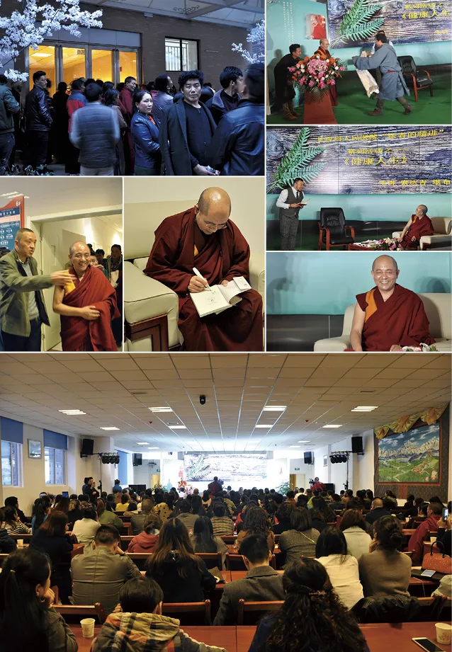
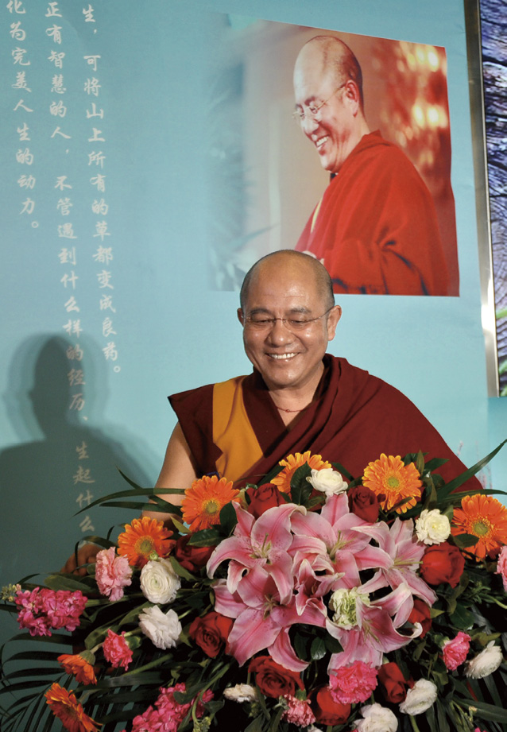
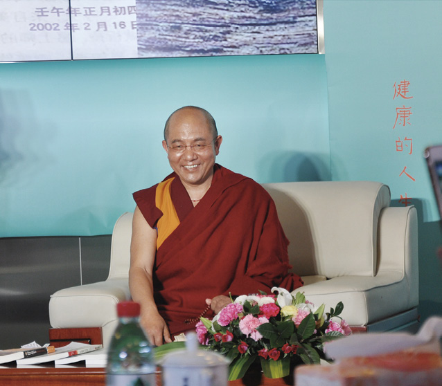
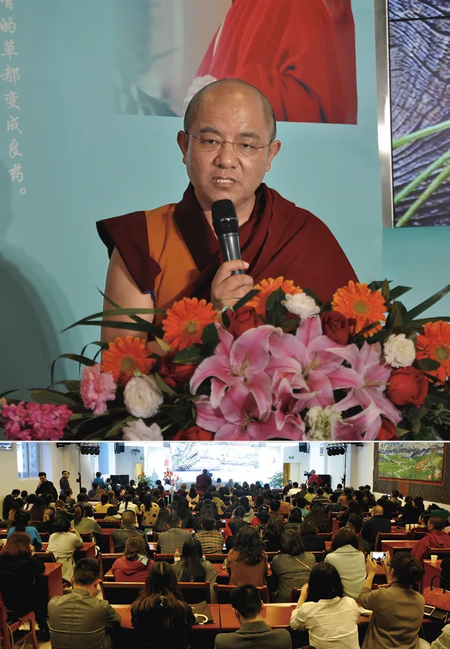

健康人生，离不开智慧与慈悲。

第59场

甘孜州康定人民医院

Kangding People’s Hospital, Garze County

中国·四川

2017 / 4 / 9

## 健康人生

## A Healthy Life

主持人：

欢迎大家来到由甘孜人民医院工会主办，院办、外联部团委协办的“医者的精进——索达吉堪布与您畅谈健康人生”的活动现场。

索达吉堪布对藏传佛教的传统教义学修甚深，为了让更多人了解佛法的精髓，他采用现代的方式宣讲佛法，为人们揭示出生命的真相。堪布认为，虽然时代在变迁，但佛教的宗旨却始终未变，人们可以从中找到解决现代问题的真正答案。

随着社会经济的飞速发展，人们的物质生活得到了极大改善，但与此同时，很多人的内心却变得急功近利。我们时常抱怨医患关系势同水火，行医如履薄冰，将患者视为洪水猛兽，谈之色变，但我们是否意识到，目前医患关系的恶化，乃是医患双方共同造成的恶果呢？提高医者的素养，改善医疗环境，必须从我们自身做起。

医院是大部分人生命的起点和终点，医院的墙壁承载着比教堂还多的祈祷。在这个距生死最近的地方，人世间的悲欢离合、艰难选择，随时都在上演。

很多时候，我们都把疾病医学化了，认为它只是一个个需要攻克的医学问题。然而，人在面对疾病或接近死亡的时候，所需要的不仅仅是医药或治疗，还需要丰富而充实的精神力量。

今天，我们甘孜州人民医院非常荣幸地邀请到著名的藏族学者——敬爱的索达吉堪布，与我们一起畅谈健康人生。

各位专家、医生、护士，大家好！今晚我们相聚于此，共同探讨一个非常有意义的话题“健康人生”。

人若想幸福地活在世间，离不开健康的身心，因为有了健康的身心，一切才会变得非常美好。英国文学家狄更斯说：“一个健全的心态，比一百种智慧更有力量。”

在座各位医务人员，不仅自己拥有健康的身心，更难得的是，你们依靠自身的力量，把千千万万遭受疾病折磨的患者，从痛苦的深渊里解救了出来。无论医生还是护士，你们每一天、每一月、每一年所做的事情都非常有意义，特别神圣、伟大。

世间有千千万万种职业，所有的职业当中，我最羡慕、最喜欢的有两种：一是教书育人的老师；二是治病救人的医生。从事这两种职业的人，都具有不可思议的力量，依靠他们，人类的智慧和身体可以延续下去。如果没有老师这个伟大的职业，整个世界都会陷入迷茫、无明的黑暗当中；如果没有医生这个神圣的职业，世界上很多人的生命都无法延续。

今天，我很高兴与你们这些非常有才华、有智慧、有能力、有爱心的人，共同探讨健康相关的话题。

## 从医很辛苦，但很有意义

当今时代变化特别快，人类从远古社会一直到工业革命之间，几千年的变化都没有这个时代变化迅速，仅仅经过十年、五年、三年，甚至一个月，之前的很多事物就已面目全非。正如成语“日新月异”所说，每天都有新的情况发生，每个月都有不同的变化。这种现象在古代不一定有，而如今，这种巨变已出现在了我们面前。

处于这种时代，我们不仅要总结过往的历史，也要不断学习和研究新的知识，这样才能更好地迎接未来种种挑战，使自己的人生更加有意义。

治病救人是很高尚的行为，但也非常辛苦。我看过一个小故事：有位感冒患者找医生看病，医生给他开了一周的药，患者吃后不见好转，后来通过输液基本康复，病人抱怨医生说：“你为什么最初不给我输液？让我吃一周的药有什么用啊？”之后，医生看另一位感冒患者的时候，先给他输液，这个人不满地说：“明明吃药就能好，你为什么给我输液呢？”后来，又一位感冒患者看病，这位医生吸取了前两次的教训，先问他：“你是想吃药，还是想输液？”这个人听后抱怨说：“你是医生，为什么问我呀？”

这名医生可能比较倒霉，三位病人都抱怨他，但从这个小故事也能看出，很多时候，无论医生怎样努力、付出，病人也不一定满意。

现在医患关系比较紧张，这与新闻媒体的片面报道也有一定关系。有些新闻媒体，不是把医生的崇高精神展现在人们眼前，而是大量报道个别医生的不良行为。在如今信息爆炸的时代，通过网络不断发酵之后，更加激化了医患矛盾。

前几年，哈尔滨一家医院发生了一起医患冲突，病人把医生杀了。按理来讲，应该有很多人同情被杀的医生，但网络调查显示，百分之六十五的人拍手称快。这种现象非常可悲。

我身体经常不好，在全国各大城市，包括上海、北京、成都、杭州、广州、云南等地几乎都住过院。虽然目前还没住过你们医院，但周边马尔康、炉霍和色达的医院都住过。住院期间，我看到很多医生、护士都非常敬业，日日夜夜为病人付出，工作量大到常人难以想象。

医护人员也是有血有肉的人，并非机器。现在，随着病毒种类的不断演变、进化，病人越来越多，医护人员经常超负荷工作，特别疲累。一天二十四小时当中，多数时间都要跟病人打交道。本来自己是一个身心健康的人，但因为经常接触身心不健康的病人，到了一定时候，自己也会受到影响。

大多数医护人员都非常了不起，工作能力和精进程度是一般人难以想象的。老师和医生是世间非常累的两个职业，但还被许多人指责抱怨，这确实有点不合理。

其实，网暴针对的不仅仅是医生。信息时代，很多人只看到极个别现象，就以偏概全地谩骂、诽谤。这是21世纪与以往完全不同的一个特殊现象。

这个时候，无论别人想什么，说什么，我们医务工作者都应该奉持高尚的行为，继续不断努力，这是我们的选择，也是我们的工作和职责。

## 不应忽略的现实

当然，现在也有不少医护人员比较懈怠，不好好学专业，也不认真对待工作。我在汉地看病的时候，经常看到有些医护人员对待病人的态度和行为不是很好，有时甚至可以用“虐待”来形容。对于这个事实，我们也没办法忽略。

十多年前我在厦门住院两个月。不知道是什么因缘，负责我这边的一名护士好像特别讨厌我，看见我的时候，脸色都变了。她每次给我打针都特别粗暴，就像对待动物一样，扎的时候特别用力，用不到一秒就把药全部推了进去，拔针之后扭头便走。因为特别疼，每次她给我打针，我都很害怕，但也没有办法。

之前我从未遇到过这样的护士，她给我打了整整两个月的针。她每周休息一天，当天由别的护士替班，这一天我就感觉特别轻松。不知什么原因，她每次看到我都充满了恨意。刚开始我还随顺她，后来也不随顺了。打水的时候若看到她值班，也会狠狠地回瞪她一眼。我在厦门的那段时间，每天都写日记，日记里记录了这名护士的一些行为。后来，我将这些日记集结成一本书，叫《旅途脚印》。

## 严肃的职业，需严肃对待

在座大多数人都是医学专业毕业的，你们工作之后还需要不断学习专业知识。实际上，不管从事任何行业，都需要不断提升专业知识。当今时代瞬息万变，医学研究、医疗设备都在不断更新，如果没有勤学的精神，到了一定时候，自己的智慧就会停滞，无法跟上时代。

我去成都一家医院看病的时候，看到有些六七十岁的老专家身旁排队的人较多。这些老专家戴着老花镜，费力地在电脑上打字。他们打字速度特别慢，写一个人名需要敲半天，这使排队的人越来越多。我问一位老专家：“您为什么不手写呢？”他说：“我们一辈子都手写开方，但现在已经联网了，一定要输入电脑，没办法。”可见，这个时代确实不断在变，我们不应满足于已有的医学学士、博士等头衔而停滞不前，这样很容易跟不上时代。事实上，不仅医护人员需要不断学习，任何行业的人都需要，因为世界各个领域的知识都在不断更新，只有通过学习，才能更好地适应这种变化。

在座有很多年轻人，年轻人更需要学习。因为，指导你们的老专家不可能永远陪着你们，可能再过五年、十年，重担就会落到你们的头上，那时就要自己独自面对。如果从事其他行业，那么学得好也可以，不好也没什么，但是，你们从事的是一份极其严肃的职业，是与人命打交道。如果自己医术精湛且认真负责，那每天都在救人，从佛教的角度讲，功德无量无边。但如果医术不精，不负责任地以相似智慧抉择，那珍贵的生命交到你的手里，后果将不堪设想。

昨天，我去一所学校时对老师们说：老师培养人才、教书育人确实非常了不起，但如果没做好，不但毁了自己，更毁了一代人。一名老师一生会培养上百名，乃至上千名学生，如果老师不负责，很多学生的青春都会被毁掉，自此人生变得黯淡无光。同样，如果没有当好医生，确实会对人的生命造成直接危害。

世界上有两种职业直接掌握着人的生命，一是法官，二是医生。一般人会把金子、钻石等珍贵的物品藏好，不轻易示人，更不会轻易送人，可一旦自己生病了，在无可奈何的情况下，也会把它们变卖，用来治疗疾病。虽然舍不得，但也毫无办法。每个人都无法摆脱生老病死的自然规律，生病的时候不得不去看医生。

作为医生，一方面对社会的贡献非常大，但另一方面风险也比较大，尤其有些医术不精，或者医术精湛但心浮气躁的医生，在治病救人的过程中，经常会出现一系列问题。世界各地可能都有这样的医生吧。

当然，也有一些国家的医生工作非常细致。我去日本的时候，看到那里的医生做事比较慢，但的确非常细致。日本人口不多，医生每天看几位病人就可以了，因此诊断得非常仔细。我对他们说：“你们以这样的态度做手术，让人比较放心。”去年我做了六个小时的手术，是在中国做的，我个人对医生没有什么不放心的。不过，当人生病的时候，的确很在意医生的技术水平和工作态度。你们作为医生和护士，在自己亲人生病的时候，也会寻找可靠的医生。这个时候应该更会意识到优秀医生的价值。

我想，在座各位都对工作认真负责，非常虔诚，但从事一个职业久了，很容易变得麻木，没有感觉。有位医生曾对我说：“我刚从医学院毕业，上岗当医生的时候，觉得自己的职业非常有意义，但后来与病人打交道时间久了，感觉自己的诊治对象好像跟动物、植物没什么差别，已经没有以前那种感觉了。”

这是人类常有的一种“疾病”，包括我自己也是，有时出去放生，刚开始几天，看到一个个鲜活的生命在屠刀下被杀，心里特别难过、焦急，但放生时间长了，最后好像也没有那么强烈的感觉了。

但作为医生，还是应该时时提醒自己，自己的职业与其他职业涵义不同。应该说，医生在人类社会中具有极其重要的价值和意义。

我想特别劝勉在座的年轻人，现在你们身边有老师和专家，一定要抓住这个机会，多学多记。我看到有些医生和护士把在前辈面前学到的东西，每天以日记的方式记录下来，不断地研究，这样做非常好。不过，也有个别人好像不太喜欢这个职业，感觉无所谓。这种情况下，你坐在这个位置不一定很好。

跟随老师认真学习非常重要。我经常想，自己以前在很多位上师面前听过法，正因为当时非常努力，所以在上师们离开之后，对于很多佛法的道理，自己基本都能解释。

希望在座的年轻人不要认为专家和老师会永远陪伴你们。到了一定时候，你们就会成为最主要的专家和医师，而现在，你们就要思考这个问题，不断提升自己的技术水平和责任心。

## 不学习会被时代淘汰

再过几十年，专业水平不高的一些医生可能会被淘汰，也要做好这种心理准备。现在美国好几家大公司，包括IBM、谷歌、微软等，都发明并掌握了许多人工智能技术。可以说，人工智能是当今世界上高端知识的代表，被运用在各个行业领域，包括医学。

2016年，诺贝尔文学奖得主鲍勃·迪伦到IBM公司参观。当时，IBM公司的科技人员刚研发出一款名叫Watson的人工智能。Watson短短几秒钟就分析了鲍勃·迪伦所有的文学作品，然后得出结论说：你所有的文学作品总结起来，就是讲述流逝的光阴和枯萎的爱情。鲍勃·迪伦完全认同这一结论。

此外，Watson还为一位日本女孩提供了诊疗建议。全球很多医学专家都曾给该女孩会诊，但都未能治愈她的病，Watson用短短十几分钟就分析了全球约两千万篇医学文献。若把这些资料全部堆在一起，有四千多米高。Watson分析之后做的诊疗建议，最终帮助女孩战胜了病魔。从这个案例可以看出，像人工智能这样的高科技很可能会促进医学等多学科的升级迭代。

以前实体店铺非常多，而现在大家都在网上买东西，所有的货品都在空中交易，大型商场门可罗雀。康定这边现在的出租车还比较多，但在一些大城市，现在已是滴滴、优步等网约车的天下，这导致传统出租车越来越不好做。包括医学在内的很多传统学科，同样面临现代科技的冲击。这个时候，我们很有必要提高自己的专业水平。

美国Google公司做过一项测验，用研发的人工智能技术与一些顶尖的乳腺癌专家同时分析130张切片，专家用了30个小时，准确率达到73.3%，而人工智能只用了几分钟，准确率高达88.5%。可以说，包括医生在内的很多岗位正在被人工智能替代。

未来世界会变成什么样，我们很难了知。大家在这方面可能没有特别研究过，现在还没有什么概念，但我们迟早都要做一些准备。

前一段时间，我们学院内部做过一次研讨，主题是：如果所有的宗教内容都可以通过人工智能来传递，那么讲经说法的法师是否会下岗？

如今，很多传统方式都被新技术手段取代，这个世界以后会变成什么样的确很难说。电影《黑客帝国》里的很多科幻内容，已在现实世界中不断出现。这个时候，我们更要努力学习新知识。

不知道大家爱不爱学习？昨天我跟有些老师交流的时候说，一个人既然选择了自己的职业，无论是医生、老师、法师，还是民警、公务员，理应掌握该职业的专业知识，也应积累与之相关的其他领域的知识。

昨天我开玩笑说想去看看老师们家里的书多不多，如果没有什么书，说明不太爱看书和学习。当然，现在很多人都看电子书，不一定购买纸质书。我们所学的知识都是有限度的，如果不能一直提升，的确很难在行业中长久立足。

## 重视学习的深度和广度

也许有些医生认为：“学不学无所谓吧，我对自己科室的专业已经很精通了。”

这种观点可能还有待分析。一方面，按照西医的观点，精通某个科室的知识就很好了，因为西医是把人体拆解成很多部分，通过各个不同专业的科室进行研究。但从中医或藏医的角度看，这种分法不一定合理，比如，我今天眼睛不好，按照西医的观点，会以“头痛医头，脚痛医脚”的理念，针对眼睛进行治疗，但按照佛教的观点，一切万法都是依因缘而产生，眼睛不好，可能是眼珠的问题，也可能是神经或经络的问题。

有些医生一辈子专学自己科室的知识，就像挖地洞一样钻得特别深，这样虽然很好，但在知识的广度方面却有点不足。如果我们了解中医、藏医，或者印度、非洲的传统医学，就会知道，这些医学都是将人体视为一个整体，结合起来进行研究。这种思维也许会对你所研究的专业有一些帮助。

我们佛学院有几位在汉地特别出名的医生，他们一辈子只看眼睛、神经等，只对自己科室的知识特别精通，对其他科室的内容却知之不多。他们虽然毕业于知名的医学院，在单位的时候，在单个学科的深度上也非常有建树，但在学识的广度上确实有点不够。

我感觉这样不一定很合理，就像一个灯泡不亮，只修灯泡未必能解决问题，或许是电源、电线出了问题。同样，一个人的肾或肝出了问题，西医专家们通常针对这个器官进行治疗，但中医和藏医则是把人体视作一个整体进行治疗。特别是藏医，在治疗疑难杂症时，还会建议患者通过念经、忏悔等方式辅助治疗，这样确实会起到一些作用。

希望大家不要满足于自己的专业，认为自己一辈子都会在同一个科室，学习本科室的知识就足够了。事实上，很多事情都是不确定的，也许你前半生在外科，因缘际会下，后半生转去其他科室了。如果自己在年轻、有机会的时候没有好好学，或者所学的知识比较局限，会给一生留下很多遗憾。

此外，学习西医在内的任何一门知识，不仅要在广度上下功夫，也要在深度上下功夫。为何这样讲呢？上个世纪，谁能展示知识的广度，大家都会赞叹他广闻博学，而现在是信息时代，提升知识的广度并不难，想知道什么，上网一搜就可以了。以前，我们通过查《新华字典》或《辞海》等才能获取很多知识，现在基本不用这样了，只要在百度、Google上一搜索，包括医学在内的各种各样的知识，无论汉文还是英文，都会一一呈现。

所以，现在一个人懂得很多知识，并不很稀有，因为谁都可以在网上获取到这些内容。那现在我们需要怎样做呢？需要从深、广两方面同时拓展知识，这对年轻人非常重要！

再过十几年，在座的年轻人就会成为世界的主人，到那时，现在的院长、科主任就会退居二线。这种变化即是佛教所说的无常。大家现在就应该思考，自己成为世界主人的时候，有没有达到前辈的知识水平，具不具备像他们那样的经验和敬业精神呢？

## 提升医德医风

现如今，整个社会的设施条件越来越好。以前，我去过你们的老院区，今天来到这里之后，感觉在硬件设施上，这里比老院区提升了好几个档次。这种提升当然很好，但更重要的是，内在的专业技术也要跟得上。希望我们的年轻人能继承和学习前辈医师们的医德医风，不断提升自己。

医学界的情况我不太清楚，但佛教徒如今却一代不如一代。老一辈修行人的佛学涵养和修证相当了不起，但新一代修行人的心普遍很浮躁。尤其现在网络时代，很多喇嘛也经常拿着手机看。

现今，很多人整天沉溺在网络中。从某个角度讲，网络已成了世界最大的盗匪，它抢夺了我们的时间和智慧。本来我们可以做很多事情，但却耗费了大量时间在网络上，包括晚上在网上闲逛、熬夜看连续剧等等，这使得自己第二天像病人一样，提不起精神，心情浮躁，很难聚精会神地工作和学习。

医护人员除了学习专业知识以外，也要重视自身的医德修养。我读中学的时候，特别佩服我们那里的一名藏医。任何人在任何时候，甚至三更半夜找他看病，他都特别乐意，并且，这位医生的表情极为和蔼可亲，让每位病人都倍感温暖。

医生和护士的表情对于病人来讲，确实很重要。北京大学的一位教授说：“你的一个冷漠表情，很有可能会伤害很多人。”我住院的时候，医生和护士来巡房，我也特别在意他们的表情。如果表情好一点，我的心情就会非常愉悦；如果表情特别冷淡，对我的病漠不关心，应付了事的话，我会感觉很不舒服。有时候，我会不断追问自己的病情，有些医护人员只是勉勉强强作答。当然，他们的病人很多，精力也有限，答不上来我也理解，但以温和的表情向病人解说，表达一下关心，我想应该可以做到。这对病人来说非常重要。

每年的5月12日是国际护士节，这是为纪念英国人南丁格尔而设立的节日。伦敦设有她的纪念馆。南丁格尔具有良好的家庭背景，从小接受了非常好的教育，热衷帮助他人。

克里米亚战争爆发后，南丁格尔带领38名救护人员到战场上帮助伤员。1860年她回到英国，开始建立护士学校，开创了全球护理事业的先河。她的父母曾想帮她解决婚姻问题，但她说：我是一个漂泊的人，我要把自己纯洁的青春和生命奉献给需要帮助的人。她终其一生没有成家，践行了自己奉献的誓言。

今天我们怀念南丁格尔，是要学习她的奉献精神，以她的思想醍醐滋养心灵，使自己成为真正的“白衣天使”，而不是仅仅拥有一个虚无缥缈的称号。

藏地全民信教，包括医生、护士也有自己的信仰。正因为他们有信仰，所以懂得善恶因果的取舍，并会以行善的心态帮助病人，这与仅仅把医生当作一个职业完全不同。在汉地，很多医护人员都没有信仰，这使得“灰色收入”一度盛行，医患矛盾越来越突出。

现今，汉地的商业气息非常浓重，在某些地方，甚至佛教也染上了经济色彩，这其实是佛教被毁坏的一种表现。同样，行医治病本是一个纯洁、美好、特别有意义的事业，但因为现今已成了金钱时代、网络时代，故而出现了很多不尽如人意的事。虽然这个时候我们保持纯真、善良的心有一定困难，但要知道，这种心是世界上最需要守护的。

爱因斯坦在普林斯顿大学时，接受过校报记者的采访。记者问：“作为当代最伟大的科学家，您觉得这个时代最重要的科学问题是什么？”爱因斯坦沉思了四五分钟后说：“如果真有什么最重要的科学问题，我想就是这个世界是善良的还是邪恶的？”记者不解地问：“这难道不是一个宗教问题吗？”爱因斯坦答：“不是。因为如果一个科学家相信这个世界是邪恶的，他将终其一生去发明武器等伤害人的东西，制造壁垒将人们隔离开来。但如果一个科学家相信这个世界是善良的，他就会终其一生去挖掘人心的善良，以科技创造链接，使人们联系得越来越紧密。”

当然，科学研究的目的并非挖掘邪恶，若是挖掘邪恶，核武器早已把世界摧毁殆尽，但这样的事情并未发生。科学研究的目的应该是挖掘人心的善良，这一点与佛教所讲的道理非常吻合。

现在，我们既需要传统的医学知识，也需要新的科技知识，而吸收新知识不能离开良知和道德。一旦离开，人就与动物没什么差别了，这将是非常可怕的。藏地盛行大乘佛教的慈悲理念，这种理念与医学所倡导的理念完全相合。在治病救人的过程中，我们若把慈悲理念很好地展现出来，无数病苦者都会有获救的机会和希望。

## 《药师经》的力量不可思议

最后我想补充一点，大家作为医学界的人士，最好能学一下《药师经》。去年，我做完手术后讲了《药师经》，这部经的力量不可思议，对治病救人的医生来讲特别重要。

《药师经》里有一个咒语：“嗡纳摩巴嘎哇得 贝卡匝耶格热贝哲雅 扎巴Ra匝雅 达塔嘎达雅 阿哈得桑雅桑波达雅 达雅塔 嗡贝卡匝耶贝卡匝耶 玛哈贝卡匝耶 贝卡匝耶Ra匝雅 萨么嘎得娑哈”，平时我们也可以念“嗡 贝卡匝耶贝卡匝耶 玛哈贝卡匝耶 Ra匝萨么嘎得娑哈。”《药师经》云：如果念诵此咒语108遍加持病人，很多疾病都可以被治愈。

我想，在座各位医护人员，尤其有信仰的人，在不同环境以药师咒或《药师经》不可思议的力量默默加持病人，非常有意义。我经常看到一些藏医或中医用自己的方法医治病人。其实，医生治病的时候，不仅可以使用传统的医学方法，也可以使用一些佛教甚深的窍诀和教言，这样医治的效果可能完全不同。

## 结语

真正成功的医生，不仅能医治人的身体，也能医治人的心灵。医护人员不是仅仅给病人打针、敷药就可以了，如果有时间，以言语安慰病人也很重要。

每位病人都特别在乎医生的话，对他来讲，哪怕医生多说一句与自己疾病有关的话，尤其一些安慰的话，都非常重要。因为这时的他很无奈，只能听医生的，医生于他而言是生命唯一的救护者，就像上帝或佛陀一样。

对于没有信仰的人来讲，这时即使佛陀来到他面前，他也不一定很重视，但却非常想见医生，渴望听到医生的安慰。尤其文化程度不太高的病人，医生如果说他没问题，他就会感到很安心，获得了极大的安慰；医生如果说有一些问题，他就像要面临生死攸关的大事一般。

这个时候，医生需要凭着医德和智慧来应对，即世人常讲的情商和智商都要高。情商是指为人处世、待人接物的能力；智商是指技术、知识和智慧。

最后，希望在座的医师们不仅自己身心健康，而且能在有限的生命中，把自己最圣洁的爱心奉献给病人，令无数患者离苦得乐。谢谢大家！

现场互动

问：随着现在医疗技术、医疗理念的发展，器官移植手术已经普及到一些普通的三甲医院。今年卫生部提出，全国将推出三百家肝移植试点医院。

在藏地，堪布也是治疗肝包虫病的宣传大使。藏地很多人因受包虫病的侵害，肝脏已完全损坏。这时唯一解决的方法就是做肝移植。但我们国家在2014年12月已经宣布废除死囚捐肝，现在，肝源全部来自公民逝世后的捐赠。

我的问题是，捐赠人体器官与佛教的教义是否冲突？很多方面是否还需进一步解决和完善？请堪布开示。

堪布：肝移植或者说器官移植手术，在台湾、新加坡等地发展了很多年，属于比较成熟的医疗技术。

大约五年前，我在上海仁济医院遇见过一位肝移植患者，他已经成功存活了五年。他告诉我，他现在恢复得很好，刚做完手术的半年，他几乎每晚都会梦到一个人，但半年之后基本就梦不到了。现在，他的状态跟手术前基本差不多。

我个人认为，从佛教层面讲，无论做肝移植还是其他器官移植，如果捐赠者生前自己完全同意，而非在其他因缘触动下捐赠，从佛菩萨的有些传记来看，是非常合理的。

现如今，我们经常看到自愿捐献器官的现象，很多明星也写过器官移植承诺的遗嘱，从法律上讲，这种行为是合法的。当然，这个时候国家也需要制定相关规则，让这种行为有适当的尺度，否则依此也可能发生一些不如法的现象。

总之，从佛教教义来讲，合理的移植没有什么不可以的。

问：我是一名耳鼻喉科医生，我对佛的感悟是，佛法无边，心有佛，佛无边，心静则明，心燥则烦，且行且悟，方得圆满。想请上师开示，我心中所悟的是否正确？

堪布：你说“佛法无边，心有佛”。按照佛教的观点，每个众生都有如来藏，而且依靠如来藏，到一定的时候都可以觉悟。事实上，人达到最高觉悟的阶段，就叫做佛。

为什么我们只要不断地学知识，就可以不断挖掘出智慧呢？因为，每个人都有觉悟的种子和觉悟的力量，正因如此，我们才可以挖掘出来。

耳鼻喉科是一个很重要的学科。前一段时间，我认识的一位老师因过敏性鼻炎去成都看病。医生诊断后让他马上做手术，手术费用五千多元钱。后来，他又找了另一位医生看，医生告诉他这是简单的过敏，是由感冒和低原反应引起的，只要输一天液就可以了。他输了一天液之后，鼻子的确不塞了，完全恢复了正常。

希望专科医生们在诊断过程中，一定要认真观察。这位医生能深入研究佛教，提出众生有没有佛性的问题，是非常好的。

问：我是做护理工作的，护理工作又苦又累，收入也不高，请问怎样才能调整好心态？

堪布：这个问题很实在，也是很多人比较关心的。不仅仅是护理人员的工资，包括有些医生、老师的工资，与其他行业的工资比起来，也不算很高。

现在是经济时代，人们需要买房、买车，还要买一些奢侈品，这时经常感觉钱不够花，对此我非常理解。但从另一个角度看，护理工作的工资应该也算可以。如今一个人在藏地打工，一天做八小时体力劳动能挣一百元左右。比较而言，你们现在所做的工作并没有那么累。

人的欲望永无止境，很多烦恼都是由攀比造成的。比如，自己的工资涨到四千元时，刚开始觉得还可以，但如果发现身边人比自己高，又会觉得工资不够。

北京、上海等大城市的工资虽然较高，每人每月能挣六七千元，但那里的消费也特别高，很多人都觉得钱不够花。相较而言，康定这里的消费不算很高。今天早上，我们几个人在炉霍吃早饭，花了一百三十多元，还是很贵的，中午在康定吃午饭，才花了九十三元钱。我觉得这里的消费比炉霍要低一些。

问：医生本身是一个社会人，有来自家庭收入、工作晋升、医患关系等方方面面的物质压力和精神负担，请问怎样正确面对这些问题？

堪布：这个问题很好！身为一名医生，扮演着多种角色，面对领导时，自己是下属；面对下属时，自己是领导；在家里，自己是父母或子女；在病人面前，自己是医生；从养活家人的角度讲，自己是赚钱者，或者说经济支柱……

因为要扮演好各种角色，所以在为人处世方面，需要有一种善巧方法。有些人对家里的每个人都照顾得很好，在工作上也特别敬业，在周围的人眼里，他是一个非常善良、优秀的人。

为什么有些人能做到，有些人做不到呢？其实，关键看自己有没有智慧，而智慧来源于爱学习的人格。如果我们还没有这种人格，就需要努力培养。

现在很多人都把价值观放在了金钱上，觉得一个人很有钱，就代表很成功，这其实是非常偏执的。所谓成功，并不等同于有钱。有一个良好的心态，不管在家里，还是在单位，每天都开开心心，热心帮助别人，认认真真做事，这就是一种成功。

人的心态很重要，若有一种安然的心境，工作再累也不会觉得累。我个人很喜欢讲经说法，但在学院需要参与管理，每天开很多会。虽然时间很紧，但我一直很努力地做。我觉得自己的心态还好，再累也没有什么。

就像刚才那位博士所说，我昨天早上四点钟起来，然后奔赴学校，在那里做了一整天演讲，晚上为了学校的事情开了很多会，今早返程途中，又处理了很多事情……看起来确实特别忙。这个时候，如果我心里没有一种力量，可能已经倒下去了。

所以我想，一个人只要坚强而平和，家庭可以撑得起，工作也可以撑得住，这样才会过得幸福快乐，否则，就会每天患得患失、惶恐不安，心态逐渐崩溃。如果心被毁坏了，那什么力量都不会有，什么事情都搞不好，最后一败涂地。现今，全世界抑郁症患者特别多，情况已经非常严重。

问：您知识渊博，刚才提到了抑郁症，前天恰好是关爱抑郁症日。希望以后能有更多人关心抑郁症患者。

随着社会的不断发展，医学也在不断发展。这样一来，现在的治疗方法，在未来可能会被完全否定，现在我们所做的，对患者可能不是治疗而是伤害。请问，这是不是一种违缘？我们该怎样避免这种情况？

堪布：虽然科学一直不断发展，但再发展，也不会把现今所有的治疗方法或技术全部推翻。我想这样的时代应该不会出现，只不过某些治疗方法有所改进而已。比如，以前在藏地，人们生了病就吃止痛片，但现在很多医生都不提倡；以及有些西医的治疗方式，在西方国家并不提倡。这一点你们也很清楚。

就像佛教的因果观、四谛等道理，在任何时代都不需要革新。所谓的与时俱进、跟着时代发展，是指要以一种信息化的方式加以传播，否则会被时代淘汰。

现在有很多网络远程教育，我建议大家多关注我们这里的医学讲座，也可以关注一些国内外高端医学讲师或有丰富临床经验医师的课，跟着他们不断学习。

学习是一种很好的习惯。一个集体若天天只谈钱，不谈知识，最终肯定会失败；一个成功的群体，会通过不同的方式不断学习和提升。

问：您怎么看待“可怜之人必有可恨之处”这句话？

堪布：从某种意义上讲，我认可这句话。我去过很多监狱，里面的囚犯看起来特别可怜，但他们每个人都做过坏事，如杀人、偷盗、强奸等等。佛教认为“善有善报，恶有恶报”，一个人如果前世造了很多恶业，今世他的长相、财富，或者能力、人格等方面，将会非常差。

当然，是不是所有可怜之人都可恨呢？也不一定。每个人在一生当中，都会有高低起伏的时候。包括我们在座的人，虽然现在各方面都不错，但到了年老的时候、下岗的时候，或者生病的时候，也会变成可怜之人，这个时候，我们应不应该被恨呢？也不一定。

人的一生有很多无常显现，无常一旦出现，人就会变得非常可怜。纵观世界，更能看出这种变化。最近，我看到关于韩国前总统朴槿惠的报道：几年前，韩国人民是用掌声和鲜花拥戴她，但前不久，她却锒铛入狱，每天被审讯八个多小时，期间连一个女子的发饰都不让戴。

每个人的因缘和命运都不相同，我们应该一分为二地看待该问题。

问：做医务工作有时很忙很累，家人需要我们的时候，我们没在身边，导致他们满腹怨言；面对患者的时候，我们也要谨小慎微。有时候感觉自己里外不是人。请问，是不是医务工作者上辈子是十恶不赦之人，这辈子才要这样辛苦地偿还上辈子所造之孽呢？

堪布：你可能今天比较累，所以提出了这个问题，也许明后天身体好一点，心情好一点，天气好一点的时候，又觉得生活是幸福的，那时不一定会觉得现在的一切是偿还上辈子所造之孽了。人的心态会不断地变化。

作为医务工作者，工作强度与一般人比起来确实大一点，但与外面打苦工的人比起来，还是轻很多。那些人每天挖地、背石头，一干就是十几个小时，特别辛苦，但他们很多人都挺开心，笑容比我们灿烂很多。

希望大家不要总觉着自己工作很累，家人对自己稍微有点怨言，就感觉世界好像变成地狱一般，实际不一定真的如此，因为每个人的世界都是自己心造的。如果自己心态很好，即使被关进监狱，监狱也会像天堂一样；如果心态不好，即使工资再高、待遇再好，物质再丰富，尝到的也只是苦味。

所以，关键在于我们的心。如果心不累，做现在的工作就不会觉得累。不管怎么样，我觉得你们从事医务工作非常有意义。

问：我是肝胆二科的医生，在临床工作中，我们经常遇到这种情况：一些适合手术诊治的肝包虫病患者，其家属在打卦之后，放弃了他们的手术治疗。然而，在数月或者数年之后，患者们往往再次入院，但这时他们已经痛失了手术机会，危及生命。请问，我们应该如何与患者及其家属沟通，争取到最佳的治疗时机？

堪布：这个问题很有意义。现在一些人确有这种情况，虽然通过医学观察，患者必须做手术，否则会危及生命，但在他们的传统观念中，还要去这里或那里打卦，这样做其实非常不好。

我去年做手术的时候，有些亲人也建议我打卦。我想卦象万一不好，也比较为难，所以没有采纳他们的建议。我们藏地这种现象非常多，确实需要转变一下。明明现在自己不得不做手术，否则非常非常危险，却以这种理由而放弃，最后离开人间，是非常可惜的。

我在不同的场合也讲过，我并不认为打卦完全是迷信，它有自身的一些特点，我曾经也喜欢对某些事打卦，而且翻译了一些打卦的仪轨，但在治病的时候，万一卦象不好，可能会失去活下去的勇气。

在传统观念上，我们可能需要做一些转变。既然有眼见为实的科学依据，就不必用打卦的方式来推测。打卦其实是一种推测，在已经看得非常清楚的时候，就无需这种推测，应该寻找一种更安全可靠的方法来解决问题。

问：我是肝胆科的护士长，我的问题是关于肝包虫病的。所谓包虫病，实际是无数寄生虫集聚在一起而形成的病症。医生治疗的时候，需要杀死这些包虫，请问这是否犯了杀生戒？算有心还是无心？

堪布：这几年，我对肝包虫病稍微做过一些了解，但并没有深入研究。

对于肝包虫这种小生物，我没有特别细致地观察过。如果它是真正具足五蕴的生命，那可能的确会有杀生的过失。但如果它不是这样，就如细菌一样，按照佛教的观点，并没有杀生罪。

我们手上有很多细菌，洗手时会不会有杀生的过失呢？不会有。我们喝生水或未开的水时，水里也有一些细菌，但佛陀在戒律中并没有说，喝这样的水犯了杀生罪。所以，分析的时候，还需要进一步观察包虫的生命体系才能确定。

问：刚才您谈到医务人员应该勤学，请问有什么好方法可以改掉拖延症？您如何看待勤学？

堪布：在信息爆炸的时代，勤奋学习是最有意义和价值的事。

我看过一位藏传佛教研究者的传记。他的书房里有六千多本书，他在38岁的时候，已经看完了一半，约三千本书。

我看到英国等西方国家，以及一些非洲国家的医生和护士，特别爱学习。他们不管坐火车还是坐汽车，乃至在公共场合休息的时候，都会捧着一本书看。

我去非洲的时候，有一次在一栋破旧的建筑物里，看到好几名医生正在边走路边看书，这时才知道这里原来是一座医院。我当时心想，虽然这所医院外在的建筑远不如我们的医院，但医生们内在的学习精神，却好像胜于我们。

希望我们每个人都能在一年当中看一些书，包括自己专业方面的书籍，这一点非常重要。今天是2017年4月9日，大家可以扪心自问，前四个月自己看了多少本书？再有八个月2017年就过完了，到年底，自己计划看多少本？

有些人可能想：“我没有时间啊，工作累得很，回家后身体像尸体一样，哪有时间和精力看书呀？”其实，只要自己有看书的喜好，在工作过程中也是有机会的。在日本，企业、机构各个部门的员工基本人手拿着一本书，一有空就会看一下。

很多中国人都没养成爱看书的习惯，这是非常可惜的。很希望大家能爱上看书和学习，这样自己的人生会过得非常充实、有意义。

问：人为什么往往对他人宽容，对亲人苛刻？怎样才能拥有一颗宽容的心？与身边的家人、朋友怎样相处比较好？

堪布：对亲人苛刻，实际是一种自私的表现。我们与家人吵架的时候一般都会说：“你对我不好，对我……”这些都是站在自己的立场做出的评判。因为我执很重，所以不愿包容对方。

佛教教导我们破除我执，即不要太在意自己。如果太在意自己，就会看不惯别人的言行；别人的言行也会给自己带来某种刺激，继而生出很多烦恼。现今时代，得抑郁症、自闭症的人特别多，这都是由不良情绪引起的。

我个人认为，我们现在的生活，只是几十年的一段经历，如过眼云烟一般，不必太在意。佛教常讲，心一旦放松下来，就能看到广阔的天空。

从全世界的角度看，每个人很渺小，就如同我们看一只小虫一样，何必与家人朋友争吵不休呢？真的没有意义。今天自己特别痛苦、伤心、愤恨，但到了明天，今天的一切便和梦没有任何差别了。为了人生中的一个噩梦而一直难过，没有任何必要，应该给自己、给别人留下一个美好的回忆。

问：“葛文德医生三部曲”包括了三本书，一本是《医生的精进》，一本是《医生的修炼》，还有一本是《最好的告别》。这三本书讲了很多内容，包括病人、医生、患者、家庭的关系，以及如何看待死亡等问题。

在汉地，人们普遍对死亡抱有一种恐惧心理，没有人愿意了解死亡，觉得死亡降临在自己身上，是一件很恐怖的事情。请您开示，我们应该如何正确看待死亡？

堪布：佛教讲人有生老病死苦，而贯穿生老病死的全部环节，在医院里最容易看到，一目了然。

有些民族和地区因为没有信仰，所以，人们常觉得自己的一生应该快快乐乐、平平安安地度过，对死亡等一系列的事情却从未做过任何准备。这样一旦遭遇死亡，不管发生在自己身上，还是在自己的亲人朋友身上，都会非常痛苦、绝望。如果像藏地一样，孩子自出生开始就通过父母的教导、老师的教育，了知了人要面对生老病死、人生有这样的循环轮转，一旦他遭遇死亡，虽然也会有一些痛苦，但因为早已做过准备，所以不会像没有信仰的人那样绝望。

我们作为医生，经常会接触到死亡。我以前说过，医院和天葬台一样，是观修无常的最好地方。大部分人最后都是很无奈地离开世间。一个人的生命如果到了尽头，医术再高明的医生也无力挽回。佛教中讲，如果一个人寿命已尽，即使药师佛来到他面前也没有办法，谁都无能为力。

我想在座各位，不仅要懂得专业知识和世间知识，更重要的是，应该对死亡有所了解。

藏传佛教讲了很多关于死亡的教言。有一本叫《西藏度亡经》的书，上世纪八九十年代，它被誉为欧美最受欢迎的藏传佛教书。上世纪20年代，《西藏度亡经》由桑珠格西和美国学者伊文斯·温兹合作译成英文。该原始译本现保存在英国剑桥博物馆里。这本经书对西方国家的影响非常大。

此经书最初来源于何处呢？就来自我们这里——青藏高原的康区。大家应该都知道《西藏度亡经》伏藏的来源吧。我有时候想，我们生长在青藏高原，尤其生长在《西藏度亡经》的故乡，对于死亡的认知，应该会有一种超越的智慧，当死亡现前时，也会坦然地面对和接受。

我们这里的很多医务人员都信仰藏传佛教，这种信仰非常有意义。希望你们能不断学习生死救度方面的知识，学习的同时也要不断修炼。

问：我听说藏传佛教认为，在人最后死亡的时刻，女人不能触碰他。我作为一名女性医务工作者，在抢救临死患者的时候，触碰他好不好呢？

堪布：我研究藏传佛教已有三十年了，从未在经论中看到过“人死时女人不能触碰”的说法。

按照医院的方式抢救病人，当然是有必要的，只是对于有修行境界的人，按照一些佛教仪轨，这时让他安详地死去可能比较合适。

很多高僧大德或有修行境界的人，在自己生命的最后时刻，都不愿待在医院，而愿回寺院或去寂静地。当然，也有一些大德是在医院圆寂的，包括我们的法王晋美彭措。法王在成都一家医院示现圆寂时，我不在现场，后来听法王的侍者说，当时医生们也做了常规性的抢救。

我想藏传佛教应该没说过“女性不能触碰临终者”的教言，只不过要注意的是，医生在抢救过程中，需要看看患者还有没有希望，如果已经没有什么希望了，做过多比较粗暴的抢救也不一定合适，这时让他安静地离开也是可以的。

主持人：

感谢堪布百忙之中抽出宝贵时间，为我们传授健康的人生观。感谢您通过旁征博引的精彩演讲，给我们指明了人生的方向。

最后，让我们用一句话圆满今天的活动：一花一天堂，一草一世界，一树一菩提，一笑一开怀，一方一净土，一世一尘缘，一念一清净，心如莲花开。

谢谢大家今天的到来，让我们携手并进、努力向前，为甘孜州人民医院美好的明天，为甘孜州的卫生事业，奉献自己的力量！谢谢。
