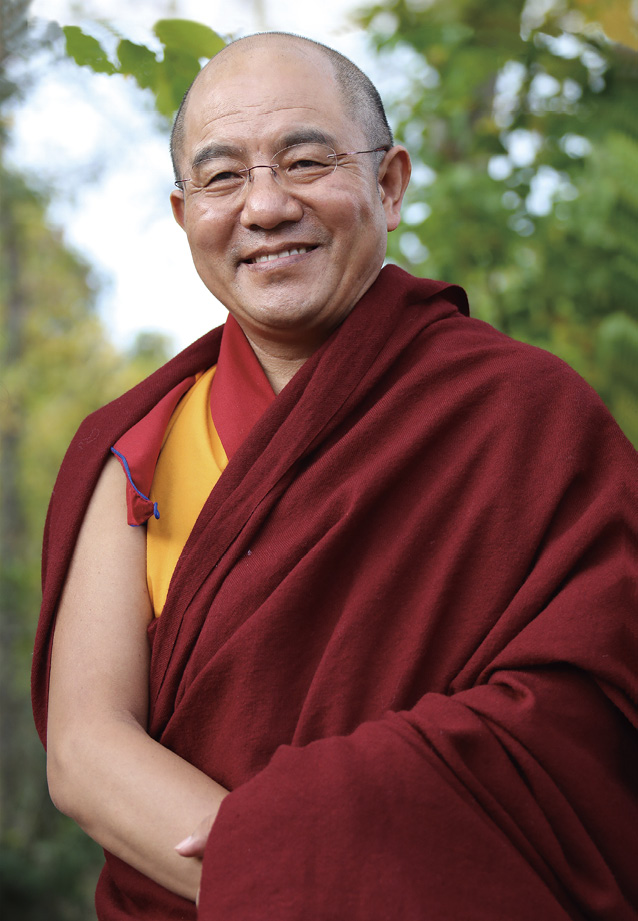
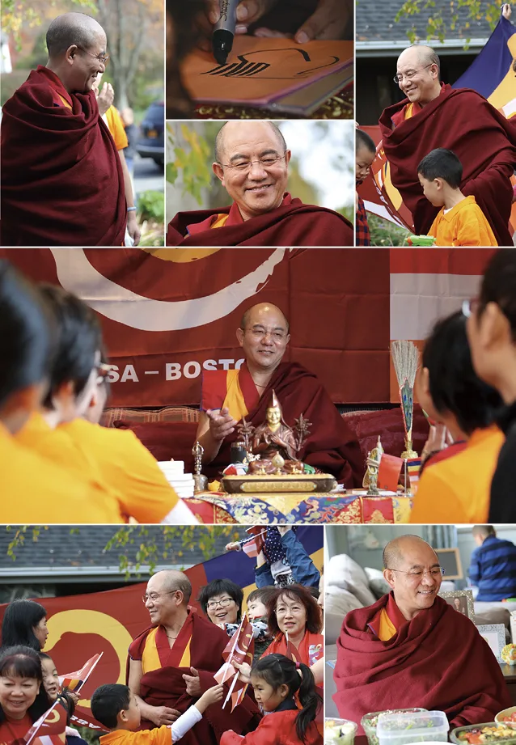
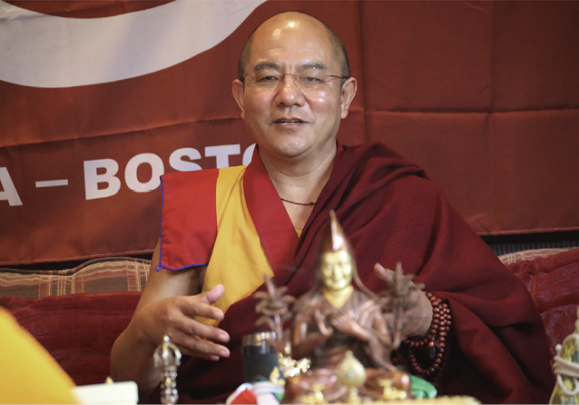
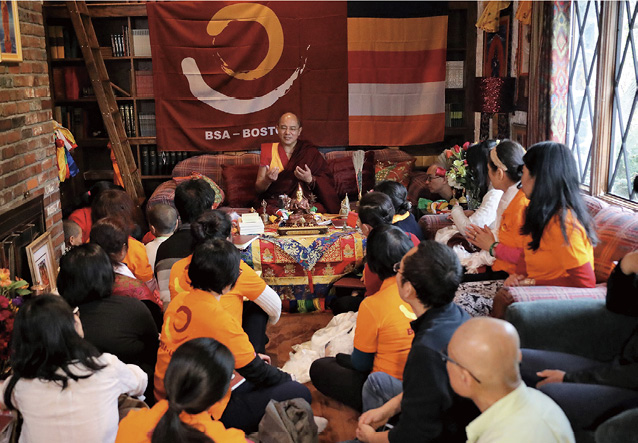
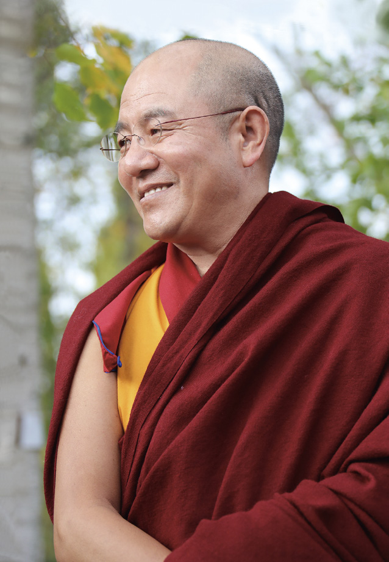
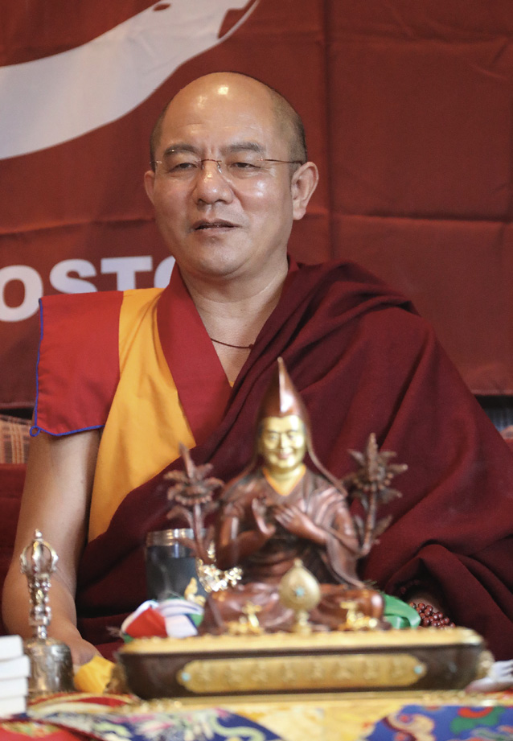
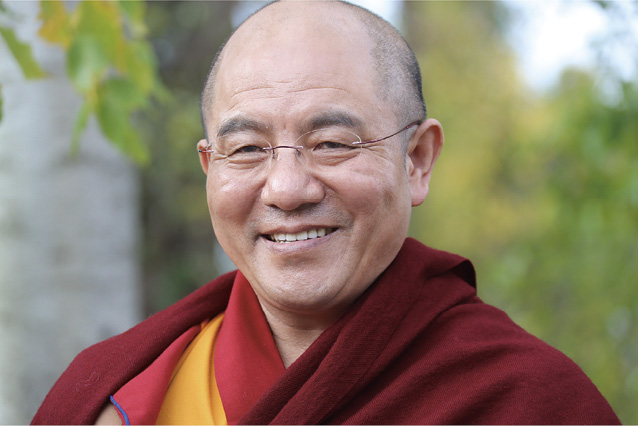

凡是日月光芒照耀的地方，  
愿我们都能弘法利生。

第65场

美国波士顿BSA

BSA Boston, USA

美国·波士顿

2017 / 11 / 5

## 坚定的信仰

## The Unshakable Faith

今天在这里，利用这点儿时间，跟大家讲一下菩提学会现在的“BSA”标志。你们衣服上印的这三个字母，是从芝加哥开始用的。昨天我到了波士顿，看到你们也穿上了印有新标志的衣服。这是一个很好的缘起。将来在国内和世界各个地方，这个标志可能会出现得比较多。

刚才有道友说：“有日月的地方，就要有利益众生的心。”还有一句是怎么说的？“在有日月的地方广弘佛法。”这样很好。我们最初的发愿也是这样：“凡是日月光芒照耀的地方，愿我们都能弘法利生。”

不管我的地位处于什么状态、财富处于什么状态、身体处于什么状态、内心处于什么状态，世间所有的无常变化都不管，只要我存在，今生乃至生生世世，凡是日月光芒照射的地方，我都发愿弘扬佛法、利益有情。这是我们学会的原则。

现在用的BSA，B指的是菩提，S指的是学，A是会的简称。这个标志带有现代气息，用在各种场合都比较方便。如果用佛教的什么学会，不信佛的人也许会有所排斥，或者出现各种各样的情况。穿上这件衣服，我们一看，就知道是自己人，其他人基本上看不出来。

这个日月图案，我既是特意写的，又是随便写的，结果好像成了一件艺术品。我当时发愿，在日月光芒照射的地方，愿我们都能成办利乐有情的事业。我希望大家也发这样的愿。今天的因缘很好，很难得！

今天时间不多，大约半个小时，我简单给大家讲一讲。也没什么特别新鲜的内容。在任何一个地方，佛法都可以应机施教，我们今天从多个方面来了解佛法。

在座各位的世间福报都还不错。不然，光是到这里来一趟，可能都有困难。出世间的福报也不错，在西方各种顽固思潮中，拥有了自己的信仰。

刚才有道友讲：“如果没有闻思修行，人生会充满孤独，没有方向和目标。因为有了对佛法的系统学习，我们的人生不但不孤独，而且充满活力，变得很有意义。”我觉得很有道理，大家可以从这方面去认识。

## 物质富足与精神苍白

我到西方国家来过很多次。每一次来，都非常感慨。为什么呢？因为这里的环境、科技、建筑等，发展得非常成熟，远远超过了世界上的其他地方。别的一些地方，还在不断地搞建设。你们这里，除了极少数房子以外，其他的基本上建好了。

20多年前，我第一次来，波士顿就是现在这样，非常安静。2013年我再次来，这里依然安静，没什么变化。今天的波士顿，还跟过去一样。感觉一百年来，波士顿一直都是这样——因为早就建好了。不仅波士顿，纽约和华盛顿等其他城市，也是这样。发展中国家与发达国家相比，某些方面的差别还是很大的。这方面我们很随喜。

这里的财富和物质水平确实很高，可精神层面却非常苍白，有很多人甚至非常绝望。西方的科技发展，确实改变了人类的命运，这是一件好事。但另一方面，大家可能感觉得到，住着豪华房子，开着豪华轿车的那些人，内心没有安全感，每天都生活在恐惧当中，甚至需要吃安眠药。而且，自杀的人越来越多，恐怖袭击事件越来越多，各种不安全因素也越来越多。你们住在这里，对这些情况应该很清楚。如果观察其中的诸多因缘，会明白许多道理。

## 当了佛教徒，连一部论也没学完

总的来讲，希望在座的佛教徒不断地闻思修行。学会对所有的学员，都强调三个字——闻、思、修。如果具足这三个字，就是一个虔诚的佛教徒，也是一个合格的学会学员。否则，名义上虽然是学会的，但有些方面还需要分析。

为什么一定要听闻佛法？因为不听闻，就没办法明白佛法的教义。世间的小学、中学、大学等任何一所学校的教育，都要依靠老师讲课才能完成。而且，除了听老师讲课，学生自己还要做作业、研讨、考试等。东方是这样，西方也是这样，各个国家都是这样。

藏地传统的寺院也是这样。每一所寺院，都有上师善知识为弟子宣讲佛法。佛法的道理非常深奥，如果没有善知识的讲解，我们不可能懂得其中的意义，根本没办法学佛。

因此，我们要求每一个学员，都自觉地闻思佛法。你们不要因为有这个硬规定，才学习；也不要因为月底要交学修表，才听课；也不要认为，听了一部论典，就可以了。学习《入行论》《大圆满前行》，是对你们最低的要求。佛教的基础教育，光靠现在的课程是完不成的，因为学不了太多东西，没法真正深入佛法。当然，跟其他一些团体的课程比起来，我们这里的门槛也算是比较高的。

为什么现在很多佛教徒不懂佛法？就是因为没有系统闻思。虽然有一点点信仰，但信心很不可靠。没有听闻善知识的教言，不懂佛教的内涵，光有感性的信仰，很容易退失。

世间人学习物理化学，学会计，学电子计算机等，都必须听专业老师的课，才能掌握相关知识。没有专业老师带领，自己拿几本书，打开电脑，随便学一下就会了，这种自学成才的人，在人类历史上并不多见。

既然世界上所有学知识的人，都要长期或短期地依靠老师，而佛法包罗万象，深奥广大，怎么可能无师自通呢？佛教不仅会讲现实生活的世间现象，更重要的，还要讲很多眼睛看不到、双手摸不着的出世间道理。佛法涉及的，是我们六根无法感知的深广领域，或具有隐蔽性的真相。没有足够的知识和智慧，学着学着，最后生邪见都不知道。

现在有些佛教徒，学着学着就失踪了。电话打不通——始终都是关机、关机、关机，Email也不回，发信息也没用，怎么也联系不上。不知道是转生天界，还是下地狱了，或是依然留在人间。学会里也有这样的人。

原因是什么呢？法没有融入心。学着学着，觉得这就是一般的知识，没意思。但当面说离开，面子上过不去，经过反复观察，觉得最好的选择是关机。关掉所有的朋友圈，这是他唯一的“明智选择”。最后，他跟没有学佛的时候一样，继续在世间迷迷糊糊地混日子。因为闻思不够，佛法没入心，没有生起定解，最后成为一个不伦不类的人。

我不是批评他们，而是觉得他们可怜。当了一回佛教徒，却连一部论典都没有完成。人身这么难得，佛法这么难闻，遇到了这么好的机缘，却没有珍惜，随意地抛弃和放下。对他个人来讲，这是一件非常遗憾、非常可惜的事情。但这样的命运，谁也没办法帮他扭转。主要的原因，还是自己没有好好地听闻佛法。

## 一种无法言说的欢喜

我自己一个人的时候，有时特别欢喜。原因是什么呢？上个世纪90年代，我跟上师去过很多国家。那个时候，出国是一件非常荣幸的事情。但我并不觉得这件事本身有多么幸运。真正让我感到幸运的，是自己年轻的时候，曾在上师面前听过特别好、特别多的佛法。而且每一部法，自己在修学过程中都特别欢喜，特别认真。

我们听闻佛法的时候，不像现在有些人那样，只停留在口头上，今天稍微听一下，明天稍微学一下，然后就抛弃、放弃。我们那个年代的佛教徒，是将自己所有的精力、所有的时间、所有的一切，全部用来学习佛法。对吃饭、休息甚至睡眠，基本上都不在意。

那时候，生活和学习条件非常简单。大家都知足少欲，过着真正的“低碳生活”，都很节约。当然不节约也没办法，因为也非常穷。这样的环境，对我个人的成长非常有意义。现在，自相续中对佛法的定解扎实、坚定、牢不可摧，与当年的成长环境，密不可分。

世界各地学会的道友，都要有坚定而自觉的信仰和信心。有了这种自觉，不需要法师天天鼓励你、请求你，也不需要道友天天告诫你，“不要退啊，好好学啊”。

如果一条鱼，在烈日的沙滩上辗转、翻滚，突然被人救回清凉的水中，它会自由自在，游来游去，有一种无法言说的欢喜。同样，我们无始以来，一直在轮回中挣扎，在红尘中辗转。当我们值遇如意宝般的佛法，内心获得甘露和清凉时，也会得到无法言说、难以想象的快乐。那个时候，不需要别人整天劝勉、安慰、请求，自然而然，水到渠成，会全身心投入对佛法的闻思修行。

所以，刚开始学佛的那几年，大家一定要打下坚实的闻思基础。如果基础不稳，后面的思维和修行，都可能成为纸上谈兵、冰上建筑，比较危险。

## 做一个理性的随法者

对初学者来说，“闻”字至关重要。不好好听闻佛法，只凭一种单纯的信仰来接受佛法，不是真正的信仰，而是迷信。什么叫迷信？对自己所学的道理，根本不懂，只是盲目、冲动地接受。站在科学的角度，人们特别反对迷信。实际上，佛教本身也是反对迷信的。

佛陀在佛经中讲，学佛的人有两种，一种是随信者，一种是随法者。许多随信者只随着自己的信心走，不深入学习，可能过不了几年，就慢慢退失了。随法者在善知识的引导下，认真闻思教理，真正懂得了佛法的甚深意义，所以信念比较坚定，一般不会退。

“文化大革命”期间，藏地很多高僧大德被关进监狱，遭受了常人难以想象、无法描述的折磨和摧残。人间一般的痛苦，根本不能与之相提并论。但是，在那样的恶劣环境下，他们不但没有退失信心，而且在监狱中将自己的修行境界不断提升。这一类的真人真事，在藏地比比皆是。

所以，我们从现在开始，就要有学习佛法的意乐、准备和计划，这个很重要。我最近在芝加哥大学看到，那些老师的藏书特别多。有些研究藏传佛教的教授，一个人就有好几百本、好几千本。再看看我们这些佛教徒，却只有两三本。天天只拿着这两三本书，可能不太够。

## 自己广闻博学，才能对他人应机施教

当然，能天天拿着两三本书，一方面也很好，说明有虔诚的信心，就像基督教徒整天拿着《圣经》，伊斯兰教徒整天拿着《古兰经》一样。有些人的书，因为经常翻阅，已经磨破了。

但另一方面，有了虔诚的信心，我们还需要广闻博学。作为佛教徒，如果你想利益众生——像刚才有些道友发愿那样，不管自己是出家身份还是在家身份，都要利益众生，那就必须明白古代和现代、世间和出世间的许多道理。众生的根基千差万别，各种各样，要对他们应机施教，不懂这些道理恐怕很难。尤其是，西方国家盛行批判主义，没有一定的智慧和善巧方便，根本没办法度化他们。

我个人觉得，西方的有些教育特别不好。他们给孩子从小灌输的，就是什么都“破”，天天都“破”。所以我到了西方，经常祈祷上师三宝，加持自己不要对上师三宝生邪见。其实，真正的批判主义思想，出现的时间只有几十年。它的原则是，人们在智慧成熟、合情合理的前提下，有权力驳斥不合理的东西。但现在很多学校提倡的却是，不管有没有道理，你只管驳斥。

西方人讲究创意，重视对孩子想象力的开发。这种教育有一个好处，孩子想象力丰富，不会形成封闭的思维模式。最不好的是，孩子对谁都没有信心，对谁都不恭敬，看谁都想破，都想批判。这样的孩子长大之后，很难有真正的快乐。

我最近接触了很多学术界的教授。他们看起来过得很好，工资比较高，住的房子也好，各方面都比较优越——不像我们内地的有些老师。人一旦有了金钱、相貌和地位，傲慢心自然就出来了。因为从小在批判主义的教育氛围中成长，他们过得并不快乐。对家庭也好，工作也好，同事也好，他们都非常地以自我为中心。每个人都要保护自我、肯定自我，最后大家心里的弦，都绷得越来越紧。

西方有很多好的口号，比如自由、平等、博爱。但真正进入西方人的生活，发现他们并不是那么自由，也有很多限制。东方人对某些规矩不太懂，但大家都很开心，很放松。我个人觉得，到了华人和藏人的群体，心会比较放松，比较自在。到了西方人的群体，却很难自在起来。因为每个人都特别紧张，表情都绷得紧紧的，“这个是我的隐私，不能说”“那个又是什么什么，也不能说”。所谓的自由、平等，最后可能都沦为了文字上的宣言。

有时候，因为文化的差异，一件事给人带来的，到底是快乐，还是痛苦，真的很难说。对于诸如此类的道理，作为大乘佛教徒，也需要学习和了解。

总之，我们在听闻阶段，内容要尽量地广博。首先要听闻佛法的道理，这是最重要的，因为和修行有关，和解脱有关。除此之外，如果还有机会和能力，应该学习包括东西方文化和思想差异在内的很多知识。大乘佛教徒度化众生，既要知道东方人是怎么想的，也要知道西方人是怎么想的。对不同地域和民族的思维模式、价值观念和生活习惯等，都要了知。否则，可能会在无意中触犯禁忌，犯下很多不该犯的错误。以上讲的是听闻方面。

## 思维法义，不能只停留在表面上

对佛法进行听闻之后，还要反反复复地思考、辩论、研讨。这一点特别重要，藏传佛教也特别强调。

我刚才在格鲁中心讲到，现在学术界有些研究佛法的人，闻思修三个环节，只取中间的思维，前面没有听闻，后面也没有修行。手里拿着很多的资料，整天搞理论研究。我看到一个人，专门做传记方面的研究。先是看很多的传记，然后再自己思维。其实，如果没有听闻相关的体系，也没有得到传承，光是自己思维，有时候很麻烦，对相关的修行道理会很头痛。

真正的佛教徒跟这些人完全不同。我们会先听闻佛法的道理和框架性知识，然后再反反复复地思维，最后在心中生起定解。法王如意宝晋美彭措在《忠言心之明点》里讲过：光有听闻，不能遣除我们相续中的怀疑，也不能让我们对上师三宝产生真正的信心。而通过辩论、研讨等各种途径，我们能生起真正的智慧。

作为佛教徒，大家经常烧香、拜佛、放生，这是很好的。但这些善法，毕竟是外在的，只是佛教的一部分。要真正地弘扬或者修行佛法，做这些远远不够。更重要的，我们还要静下心来，对某些问题进行深入思维，比如取舍因果、菩提心、中观空性等。在这方面，大家一定要互相研讨，这非常重要。

如果没有深入地思维法义，只是每天做一点善事——这当然很好，作为在家人，你们确实不容易，但是，真正的佛教徒，行善不能只停留在外在的行为上，还要深入思维佛法的深义，让法融入自己的心。

这是我讲的第二点，思维佛法的教义。

## 不实修，断不了烦恼

在座的各位都需要修行。如果没有修行，我们相续中的贪嗔等烦恼很难除掉。这些烦恼，无始以来就在我们的相续中存在，根深蒂固，断起来不是那么容易的。光是听一听佛法、思维思维，却没有好好地实修，肯定断不了烦恼。所以一定要修行。

为什么有些人控制不了嗔恨心，经常跟金刚道友发脾气，跟家人发脾气？修行不过关。座上修的时候，感觉很好，就跟弥勒菩萨一样，特别慈悲，特别安详。可是一遇到事情，就开始生嗔恨心。

生嗔恨心其实特别痛苦，可能会摔东西——不知道西方人生气是什么样的。你们生气时候，可能也有一些西化的味道。不管怎么样，生嗔恨心的时候，自己痛苦，他人也很痛苦。

明明已经学了佛法，甚至学了很多年，为什么还在不该发脾气的时候发脾气？“很惭愧啊，很不好意思。”有些人这样给我讲。其实没什么好惭愧的，要是没有修行，佛法在生活中用起来肯定很难。

现在，我们非常强调修五十万加行。是不是修完了加行，就没有烦恼了呢？不是。五十万已经圆满，却仍然喜欢发脾气的人，有很多。修五十万加行其实不算什么，修完加行就想断掉所有的烦恼，不太可能。当然，修加行和不修加行，差别还是非常大的。总之，通过实修，相续中生了一定的境界，我们才真正具有利益众生的能力。

这次为了缘起，凡是有学会的城市，我都尽量参与活动。在国内没办法，人太多，每个城市的道场都要去一下，不太现实。这边人比较少，也为了满足大家的愿望，所以过来，给大家讲一堂简单的课。

闻思修三个字，我以前在其他场合也讲过。今天结合美国的国情，再讲一次。

## 珍惜共修共学的机会

法王如意宝以前在波士顿待过几天，地点是在香巴拉中心。当时好像先到的纽约，然后是波士顿，再到加拿大，之后又从加拿大回到波士顿，从这里飞往法国。就我个人而言，一到这里，就有一种不同的感觉。金刚上师加持过的地方，确实非常殊胜。

我希望，以后各方面因缘成熟的时候，道友们不但要放生，还要做一些更重要、更有意义的善法，也就是共修共学。每周或每半个月集聚的时候，大家一定要闻思佛法。这比其他的任何聚会都重要。

会供也好，放生也好，供灯也好，举办沙龙也好，虽然都是佛教内部重要的善行，但却没办法跟共同闻思修行的功德相提并论。这些行为，谁都可以做。只要有钱，买几盏灯就可以供，买一些生就可以放。但学习必须依靠善知识的因缘，这是百千万劫难遭难遇的，大家一定要珍惜。

在美国，芝加哥、波士顿、纽约以及西部的好几个城市，都有实地共修。这是非常难得的机缘。其他地方，大多是网络听课。虽然网络听课也很好，但面对面地相聚，共同学习一些传记或教言，更有意义。希望我们波士顿的道友们，以后能够做到这样。

## 殊胜的发愿

今天的相聚，是一个很好的因缘和缘起。大家可以这样发愿：“凡是日月光芒照射到的地方，我们的菩提心和利他心也要遍及。”如今的环境，有很多不利的违缘和障碍，不过也是正常的。我在学院的时候，有时候身体不好，有时候心情不好，有时候各种因素带来困扰，有时候听课的道友让人厌烦，有各种各样的情况。但我一直在坚持，一直在努力。能走到今天，自己觉得特别不容易。

那天有人问我：“你现在有什么想法？”我说：“上师如意宝让我给汉族弟子传法，我一直坚持，走到了今天。这样的环境，这样的身体，能坚持传法30年，我自己也觉得不是一件容易的事。”

你们在国外生活、修学佛法，也不容易。有时候是家庭的原因，有时候是外部环境的原因，尤其是现在，全世界的经济趋势不太好，政治的动荡让人不乐观，社会安全也不是特别有保障，总之，有很多不确定的因素和担忧。

人生就是一段痛苦的经历。不管怎么样，只要我们的身心还在，就要发殊胜的利他大愿。所以，我们今天的发愿是：“将来，在日月光芒所照射的世界，我们要用各种善巧方便，利益无量有情。”我们一起发这样的愿！

最后，为了让大家相续中生起真正的菩提心，我念一下法王如意宝《上师瑜伽》和《佛子行》的传承。这是我们今天聚会的重要意义。特别感谢这边的道友给大家提供道场。在美国，能有这样的道场，非常不容易。

（堪布念传承）
