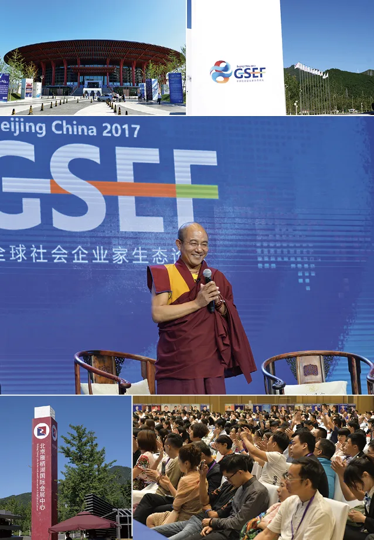
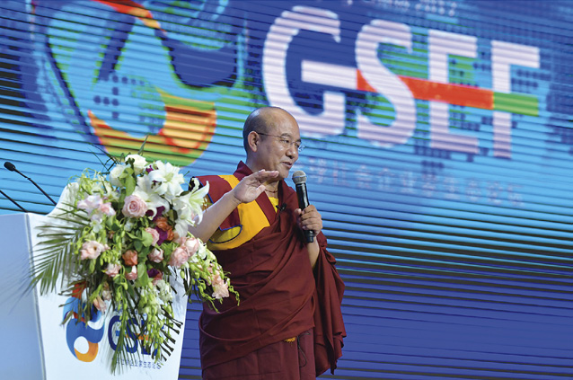
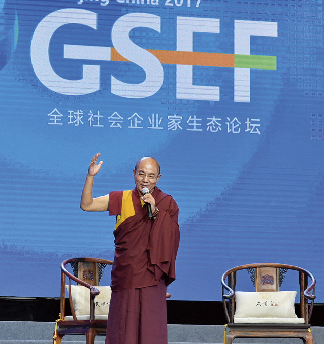
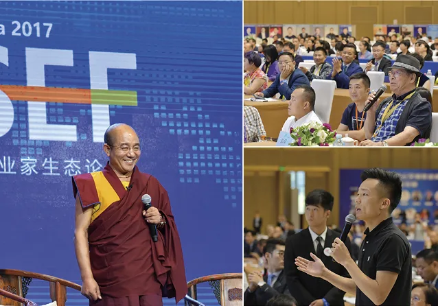
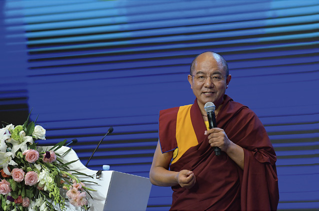
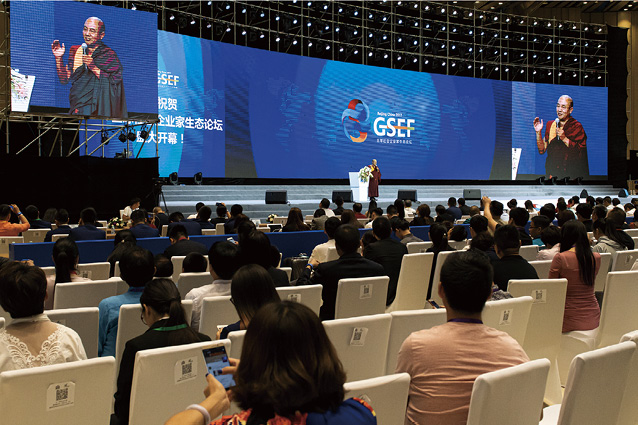

当怨恨的敌人来到面前时，  
将自己的善根回向给他，  
这是大乘佛教最伟大的精神。

第61场

北京第三届“全球社会企业家生态论坛”

3rd edition, Global Social Entrepreneurs Forum, Beijing

中国·北京

2017 / 9 / 11

## 心灵的诺亚方舟

## Noah's Ark of the Mind

主持人：

接下来我们邀请的嘉宾，是一位藏传宁玛派的高僧。

他将佛教真理与当代科学相结合，引导世人正确面对学业、情感、工作和人生。他通过光盘、网络等现代化的方式，将大乘妙法传至千家万户。从2010年至今，他受邀在哈佛大学、耶鲁大学、哥伦比亚大学，及香港大学、北京大学、中国人民大学等众多著名学府演讲，发起并参与主办多届“世界青年佛学研讨会”。

他发出“启动爱心”的倡议，救助那些可怜的人们，并大力倡导加强对少年儿童的品德教育。他所写的《苦才是人生》《做才是得到》等书籍，深受读者欢迎，畅销不衰。十多年来，他对放生不遗余力，也被尊称为“放生堪布”。

下面我们掌声有请五明佛学院大堪布——索达吉堪布，他给我们分享的主题是“心灵的诺亚方舟”。

今天是“全球社会企业家生态论坛”的最后一天，我是最后一位讲者。但我很惊讶地看到，这么多企业家还没有走，一直留到最后，说明此论坛有其意义之所在，大家应该从中学到了很多知识。我不是企业家，对企业的管理、技术都不懂，只不过有兴趣与各位企业家一起学习、交流。

在这三天，大家听了很多嘉宾的演讲，每一位演讲嘉宾都很棒，脱稿演讲仍能滔滔不绝，讲者大多数都是发自内心，且分享的内容很丰富。通过这几天的观察，我觉得你们是一个有人生经验、有社会价值观和个人理想的成功企业家群体。

## 一切诸法皆无常

我们正处于一个极为特殊的时代，很多人在短时间变得非常成功，比如刚才课题开始前几十分钟，就已达成上亿元的合作项目；另一方面，也有些企业会在短时间内破产、倒闭。可以用“难以想象、不可思议”来形容这个时代，有时自己也不知是现实，还是在做梦。

佛教时常讲“一切诸法，如梦如幻”，的确，在现今时代，我们可能如梦幻般地变成一个万人之上的人，有钱、有地位、有能力，有成千上万的人赞叹你、恭敬你、追捧你、喜欢你；也很有可能因为某些事情，在短短的时间，从众人眼前消失，此时，可能有无数的人开始质疑你、毁谤你，甚至抛弃你、讨厌你。

人是很现实的动物。当你成功的时候，哪怕是和你拍张合照、吃一顿饭，也觉得荣幸之至；当你某天沦落了，受到人们歧视时，也许没人敢提认识你，甚至这时有人与你接触，他都怕被牵连而觉得危险。

佛教的观点认为，一切诸法皆无常。若是每个人都有无常的观念，对人生的的确确很有帮助。很多人以前生活特别贫寒，但今天各方面都超越别人，其实这也是一种无常；也有些人今日财产丰厚、锦衣玉食、声名鹊起，但到了明年此时还能否拥有也很难说，自己也不一定有安全感，因为这也是无常的。

在座的各位企业家，内心可能有各自不同的烦恼，包括企业经营过程中面临的人才、资金短缺，政策、环境等各方面的问题和挑战。也许这些烦恼，不一定能跟家人、同事倾诉，表面上还要装着有信心、有安全感。故而，我们特别需要调整好自己的心态，排遣压力。

当然，我今日并非劝各位都学佛，但我作为一个佛教徒，多年以来通过修行、通过利他的思想来调整自己的人生，确实有非常大的收获。在眼下如此特殊的时代，如果我们都有一个依靠处，能用信仰来调整自心，让心变得更为坚强，也许我们会做得更好。这一点，在座的各位，要重新思考一下。

## 以利他心回馈社会

每个人都有贪嗔痴慢疑等诸多负面情绪，也有诸如信心、智慧、精进、禅定等很多正面能量。传统文化中讲“人之初，性本善”，只要有一颗善心，我们所做之事自然会成功，这就是所谓的“善有善报，恶有恶报”。

我不担心各位企业家的个人生活，也不担心你们赚钱多少。但作为一位社会企业家，每个人应饮水思源，你今天的成功其实来自社会。当然，有相当一部分人的成功是依靠自己的勤奋、创造力和智慧而获得，但实际上，这与整个社会的环境、资源，乃至他人的支持，也是密不可分的。因此，在我们拥有巨大财富时，一定要以感恩的心来回馈社会。

今天，我对在场的五千多名企业家提一个很小的建议：每一个人能不能在一年当中，在你所在的地方资助一位贫困大学生？当然，若是你没有这个因缘、没有这个想法，则另当别论。如果每个人都能帮助一位贫困大学生，我们就能解决五千个人的学习问题，这对社会是一份重大贡献！

成功的人、有能力的人，也许掌握了许多资源，但若是没有回馈社会，我觉得不一定很好。懂得回馈社会的人，会越来越成功，越来越发财，这样对整个世界也有利益；如果一个人非常自私，拥有很多物质和精神的资源，但却不愿分享，这对全球七十多亿人来说也是一种损失。

我经常听到，某个人赚了多少个亿，给身边的成百上千名员工发了很多钱，能让身边跟随自己的员工受益，这很好。但在拥有如此大的资源和机缘时，能否将这样的利他心扩大至整个社会？

现在很多企业家的思想来自亚当·斯密的《国富论》，但此论主要是讲自利。其实，亚当·斯密还有一部重要的著作《道德情操论》，这部论最究竟的观点实际是讲利他。若有利他精神，我们的企业会在很长时间产生积极的社会影响。

日本的稻盛和夫在一个商业论坛中说：“自利，就是生存；利他，则能成就。”这一点很多人应该有所体会，这与大乘佛教的究竟思想非常吻合。

## 从帮助一个人做起

我今天并非与各位讨论管理和技术等方面的内容，我想说的是：我们每一个人都有社会责任。这种社会责任，并非口头上说：“等我赚了很多钱以后再回馈社会。”我们现在很多慈善公益的理念，与西方国家相比有一定差距。我们习惯将资源、力量汇聚在自己手中，这是一种自信，从某个方面看也很好。但大多数时候，我们更提倡把资源分享给身边的病人、穷人，包括读不起书的人等很多可怜人。这群人的可怜虽然不是我们造成的，我们也不一定全部能救得完，但每个人应该要有一颗善心来至少帮助一个人、两个人、三个人……

特蕾莎修女非常热衷于慈善事业。有一次她在帮助穷人时，印度一个官员对她说：“我们现在有上千万的贫穷人，你怎么能救得完那么多人？”她说：“千万人，这个数字的基础是什么？”

这个政府官员对她说：“这不是数字的问题，你救不了那么多人，既然救不了，你最好少管一点闲事。”特蕾莎修女再三地问：“你说一千万，那么数字的基础是什么？”

这个官员不得不说：“一千万的数字基础是一、二、三、四。”她说：“那我从救一个人、两个人、三个人开始。”

确实如此，虽然我们救不了一万个穷人，但可以从帮助一个人做起，随着行善的人越来越多，善的力量不断壮大，整个社会的面貌将会焕然一新。

我们不一定能改变所有的社会状况，但作为一个成功的企业家、慈善家、学者，思想里一定要有利他精神。若缺乏利他精神，只是一味自私地挖掘别人的资源，那可能只是表面上的成功。有时我们口头上讲利他、利益众生，但部分佛教徒很自私，只关心自己的事情；儒家传统文化也经常讲为仁、做善事，可有时信奉儒家思想的人也很自私，只要自己成功，可以不顾一切，甚至会损害身边的人和事。

现在环境破坏越来越严重，可见人类是以何种心态在抢夺资源。你们作为企业家，应该是现代社会最主要的一股力量，但这股力量若是缺乏利他心，这样的社会是很糟糕的。

## 学会调整自心

今天这个时代，对每个人来讲既是机会，也是挑战。每个人应该有种观察自己、认识自己、认识世界的智慧。若是缺乏智慧，盲目地人云亦云，随波逐流，不一定很合理。

当今社会的变化让人眼花缭乱，以前的社会过了几十年、几百年才有变化，但现在却是日新月异、瞬息万变。处于如今快速发展、快速变化的时代中，很多企业家可能比较累，因为我们对社会、对自己的企业付出了很多心血。我的建议，无论是成功还是失败，都要经常调整自己的心态。人生如梦幻泡影，再过十年、二十年、五十年，我们会不会存在于世也很难说。如果太执著于自己的事业、工作，也许给你带来更多负面的影响。所以，我们始终都要保持平静的心态。

心态决定姿态，姿态决定生态。如果我的心态很好，不管遇到什么事情，都用微笑来面对，那我的语言和身体的姿态，也是让人舒服、快乐的；如果我的心态、姿态都很好，那我对整个生态环境自然而然起到和谐的作用。反过来说，生态对我们的心态，也有直接的作用。

建议我们每一个人，无论遭遇任何事，不要对自己的家人、同事发脾气，要用智慧、理性来解决问题。如果我们用暴力的、非和平的方式来处理，即使表面看起来你解决了这件事，但实际上它带来的副作用可能更大。

佛教讲慈悲为怀，即使竞争对手伤害了你，甚至让你家破人亡，当怨恨的敌人来到面前时，还是用和平的方式处理，将自己的善根回向给他，将所有善的力量赐予他，这是大乘佛教最伟大的精神。（众人鼓掌）

当然，在座的人毕竟不是全部都学习大乘佛法，但我很希望你们能够有一种信仰，用信仰来调整心态，这是很好的。如果你有信仰，按照你所信仰的藏传佛教、汉传佛教，甚至以其他宗教的方式调整自心；没有信仰的人，也要经常通过自己的方式调整心态，通过冥想、禅修等方法，清除内心贪嗔痴慢疑等负面情绪。我们的身体需要经常沐浴，清除许多不干净的东西，同样的道理，其实我们的心也需要清净，从早上起床到晚上睡觉之间，在与人交往、接人待物时，都很需要调整自己的心态。如果我的心很健康、很平静，那么与人交往、办事都很容易。

我作为佛教徒，也许跟你们的生活方式不同，但我也会遇到很多事情。我不是企业家，你们很多人不一定认识我，我只是一名普普通通的佛教老师。昨天是教师节，我给自己发了一条微博说，从1985年至今的33年里，我从简单的佛学知识开始，每天都在讲课[^1]。

我作为一名老师，跟学生交流的过程中，也有许多不开心的时候，但我会调整、保护自己的心态。如果一个人的心态很好，即使自己家中、周边，甚至国际、国内发生了很多事情，但依然可以用坦然的智慧去面对。如果我能面对自心，即使遇到非常大的事情，都能轻而易举地处理好；如果我的心态调整不好，那么即使遇到很微小的事情，也可能带来巨大的痛苦和压力。

当今社会，从一方面看，确实是无法想象的快速、便利，以往任何时代可能都跟不上现在这么快的速度、这么多的信息、这么好的机遇。但是，从另一个方面也不难看出，现今时代所要面对的问题也是前所未有的。我们每一个人所承受的压力、遇到的挑战，以及心里的各种痛苦，古人不一定有。古人的生活很简单，虽然他们没有我们今天这样丰富的物质资源，可他们有非常纯洁的心态。

在这样一个特殊的时代，我们需要用特殊的方法经常调整自心。调心有几种方法，一种方法是通过冥想或禅修，这是国内外很多企业家非常受用的；还有一种方法，藏传佛教中讲的大乘菩提心的修法，它能直接让心安静下来——任何时候要有一颗帮助他人的心，这样即使你的工作、生活不太成功，也不会有怨言和后悔。

## 给后人留下精神财富

我们作为企业家，应该对人类社会做出贡献。我建议做一些与智慧相关的贡献，比如建图书馆。你们可能认为中国的图书馆非常多，已经足够满足需求，且喜爱阅读的人很少。其实也并非如此。

我的建议，图书馆应该收集许多古文化。以前我去过德国的哥廷根，那里有四百多年历史的图书馆，馆藏的图书涵盖上千年的古文化，非常珍贵。我们这个城市，或者你们的家乡有没有这样的图书馆？新出版的书籍虽好，但更重要的是要收集一些宗教学、社会学，以及民间的知识。把这些有价值的书籍收集在你的家乡，或者自己家中，建立一个私人书房，当你离开人间时，也是一笔巨大的精神财富。很多欧美国家的人特别喜欢看书，他们中的一些人甚至拥有别具一格的私人图书馆。

相较于物质而言，智慧给人传递的力量更为强大。亚历山大君王曾经统治了以三个文明古国为主的很多国家。他当时的梦想是统治全世界，可未能如愿。经过十三年的战争，确实统治了以欧美为主的许多国家的领土。武力的征服，后人不一定能记得，唯一记得在埃及有一个亚历山大图书馆。此图书馆珍藏了许多全世界最珍贵的书籍，这是亚历山大君王给世界留下的最珍贵的智慧遗产。

也许有些企业家不一定喜欢看书，觉得办图书馆的投资回报率太低，无法实现利润最大化。但我觉得，作为一个有智慧的人，给子孙后代留下的不一定是物质财富，而要留下与智慧、精神有关的财富。

现在你拥有权力时，如果没有留下有价值的财富，也许不一定很合理。大多数人认为，我要给自己的孩子、亲人留下很多金钱。当然，当今时代金钱很重要，但更重要的是，要为他们留下精神财富。以何种方式留下精神财富，这是非常重要的话题。

这样的企业论坛，是一个很好的学习平台，也是一次难得的交流机会。我这次来的目的，是希望每一个人都能发自内心地帮助他人。在此之前，可能很多人想着只要自己成功就可以，这与我的理念不同。若是缺乏利他心，你的能力不一定非常卓越；如果你的能力超越了一般人，那理应对社会有所贡献，这是真正有意义的。

现场互动

问：佛学强调内心平静，与推动社会发展是否相违？

堪布：佛教讲“自净其意”，也就是自心要清净，要调整自己的心。禅修入定时心要寂静，但并没有说出定时不能产生任何分别念。佛教强调“精进波罗蜜多”，其中包括：铠甲精进，就像士兵上战场时要穿上铠甲一样；加行精进，将口头说的落实到行动中；不退转精进，不管做任何事情，不能退转，勇往直前。

这些概念在不同场合，有不同的解读。佛教并不是一味要求天天禅修，更加强调要有智慧、要冷静处理问题。我们不能太浮躁，如果太浮躁，任何事情都很难成办。

佛教的理念与社会发展表面上看来冲突，但实际上不但不冲突，佛教的理念还能与时俱进，协调社会发展。

问：年轻一代的80后、90后甚至00后，该如何选择自己的信仰？

堪布：如何选择宗教信仰，依靠自己的心来决定；如果有信仰，也需要用智慧来决定。按照佛教的观点，千万不能迷信。

信心分智信和迷信。通过自己的智慧观察，或通过有智慧的人帮你做决定，依靠智慧来判断的这种信仰叫智信；依靠盲目的信心，根本不知道这个宗教的好坏，只是随着自己的心，人云亦云而去接受，这叫做迷信。关于智信和迷信，以前梁启超也做过很好的分析。

作为80后、90后的年轻人，我建议有一个信仰比较好。有了信仰，精神上有一种依托，否则许多人都非常迷茫。很多年轻人，有钱迷茫，没钱也迷茫，不知道自己到底在寻找什么。如果有一个精神的归宿、智慧的依靠，即使做事情不成功，也会有一股坚强的力量让你在逆境中重新站起来。

总之，选择信仰主要靠自己，若自己的智慧不够，我建议请教一些有智慧的人。最好每个人都有自己的精神依靠处，这样人生才有方向，也会变得有意义。

问：我两次创业失败，现在还在苦苦挣扎，所以我希望您能给我一个方向，哪怕是一句话，对我可能都是极大的启发。

堪布：我们的人生都是无常的。有成功，也有失败；有快乐，也有痛苦；有阳光，也有黑暗；有从容，也有彷徨；有笃信，也有怀疑；有时候觉得人生有意义，有时候又觉得没有意义；有时候觉得前路通达无碍，有时候又觉得如临万丈深渊。总之，人应该有自信。当你快乐的时候，不要特别傲慢；当你痛苦的时候，不要特别绝望，还是要坚持到底。其实，人生也是一条随缘的路。

按照佛经的讲法，在我们的阿赖耶上存有善和恶的业。当然佛经并不是讲“宿命论”，并非所有的一切都是依靠业来支配。人生的际遇是因缘聚合的结果，与自己的创造力、坚持不懈的努力是分不开的。

在创业过程中，我们可能会患得患失。但不管怎么样，我们对人生、对生活、对事业，不要特别执著，你越执著，可能越不成功。但你也不要放弃，否则，会失去很多机会。

也许我说的话，你们不一定听得懂，但人生就是如此。互联网时代的虚拟世界已经呈现在我们面前，正如佛讲的如梦如幻的景象一般。在此之前的二三十年，我们不一定知道何为“如梦如幻”，而此刻我们都是整个时代变化的见证者。在短短的二三十年当中，全世界的生活方式、价值观，包括我们的文化，发生了翻天覆地的变化。

此时，有些人正在经历成功，有些人正在经历失败，有些人正在创业，有些人正在感受痛苦……每天都是如此反复。我们在座的人，有些会在未来的人生特别成功；有些今天很成功，但很有可能无常会到来。无论如何，我的建议就是，你要保持平静的心态。

问：汉传佛教和藏传佛教怎么区分？沿海发达地区怎样更好地帮助川西、甘肃、青海等藏区修行者？

堪布：汉传佛教和藏传佛教都是来自印度，印度佛教融入不同民族的文化中，后来就变成了当地的佛教文化。

佛教确实能从精神上给予我们心灵的妙药，在这方面，我一直尽自己的绵薄之力。我是藏传佛教的僧人，但我接触汉地的在家人、出家人，从1987年开始，到现在已经三十年了。虽然我讲得不好，有时候的表达也只是自己内心的分别念，但我想，地球上的所有人类，都有一个共同的希求——避苦求乐。

佛教总的教义强调“诸恶莫作，诸善奉行，自净其意，是诸佛教”，这样的原则一直流传到现在，已有两千多年的历史。很多人的生活、工作，从佛教的思想中得到了真正的利益，尤其是佛教强调利他心是最有价值、最高尚的思想，利他的思想在当今社会也起到了一定作用。

当然，你说怎么帮助甘肃、四川等藏区的修行者，这方面我也不是特别清楚。但一般来讲，我们需要有一个学习的机会，我自己一直认为，佛教徒一定要很好地学习，非佛教徒即使没有佛教信仰，但以开放和包容的心学习佛教的精神，也是很好的。

不仅是佛教，我们经常跟伊斯兰教、基督教、天主教的人有交流。如果我们了解这些宗教，会知道他们背后也有很深的道理。所以，我一直强调，现代文明应该从古文化中汲取营养。

作为企业家，我们不能一直追求网络上的新知识，还要考虑自己的民族文化、传统文化，包括古文化的书籍，这些都是很有价值的精神财富。我们为保存古籍做一些工作，这也是对人类的贡献。总之，我们能做的事情还有很多。

问：英国把佛教等宗教植入到小学教科书里了。在中国，我们能不能把佛教植入到教科书里边，潜移默化地起到弘法的作用？

堪布：在英国，以剑桥大学和牛津大学为主，很多地方推广佛教文化，尤其是在很多高等学校和大专、小学里面正在推广佛教文化。这样的传统文化非常有价值，在我们的教育体系中推广儒释道文化非常重要。

问：出家人在出家之后，会常常想念家人；而我们很多企业家每天飞来飞去，也会很想念家人，但我们挣钱的目的是为了家人，这个矛盾怎么调整？

堪布：作为出家人，也会经常想念自己的家人，比如我的母亲去年离世后，我经常思念她。但因为我们毕竟受过很长时间的“无常、爱别离苦、生死轮回”这样的教育，所以跟在家人比较起来，也许没有那么强烈的执著。

问：我的问题是，释迦牟尼佛信谁？

堪布：按照佛教的历史，释迦牟尼佛是贤劫千佛中的第四尊佛，在他的前面还有三尊佛，他所有的精神，以前并非不存在。还有一种说法，释迦牟尼佛是七佛之一。可以说，释迦牟尼佛所宣讲的这些知识，是万事万物的真理。这种真理，不同的佛曾经在不同场合以转法轮的方式为大家宣说过。

总之，释迦牟尼佛在娑婆世界是唯一的佛陀，而在大千世界中还有很多其他佛陀。

问：作为一个企业家，我们集团公司在产业规划里面会涉及杀生的行为，比如说建设养殖基地。面对这样的情况，应该怎么做比较好？

堪布：佛教真正的思想关键在利他。利他的思想在人类历史上可以创造奇迹。个人的成长和创业过程中，如果有一颗利他的心，它的作用是完全不同的。我们每个人都是明白人，很清楚到底是在利己还是利他。如果我们从事的是服务性的工作，对社会有帮助的话，这就符合佛教的思想，与现在很多企业的思想也非常吻合。

在创业或者竞争的过程当中，难免会有造养殖场或者杀生的情况，当然，从大乘佛教的思想来讲，尽量不要做危害生命的事情。如果实在是自己的事业和专业逼迫，没有扭转的余地一定要做，那需要经常通过念咒语等方式忏悔，也有必要参与放生来弥补罪业。

总的来讲，每一个生命都非常可贵，这并不是佛教的一家之言。每个明智者都清楚生命的价值，我们应保护生命、保护大自然和地球。

问：我们皈依上师，是只能皈依一位，还是能皈依多位？

堪布：佛教的观点，你可以依止很多上师。著名的阿底峡尊者依止了一百多位上师。当然，我并不是要接收很多弟子，我只是传播佛法。如果你的上师允许，你依止很多上师是非常合理的；如果上师不允许，我也没有这个资格开许。

问：现代社会的离婚率非常高，那是不是感情无常？每个人的最佳结婚伴侣是自己，最终的归宿也是自己？为什么现代社会女人越来越女汉子，男人越来越娘？

堪布：确实，我看到一条官方的新闻，说北京的离婚率是47.8%。若果真如此，那就比较可怕。离婚率居高不下的原因，很可能是我们缺少传统文化的教育和信仰。同时我们现在看得多，机会就比较多，人有一种喜新厌旧的心理，这样很可能导致自己家庭不和。不仅是中国的离婚率高，英国和美国更严重。在这个时代，确实如佛教所说，自己是自己的怙主，最后还要靠自己。

你的说法我比较认可，当然，我们还是希望所有人家庭幸福。我作为出家人，不太了解在家人的心理状况，但很多人离婚以后，整个家庭都破碎了，上有老下有小，真的很可怜。所以，这一辈子夫妻有缘的话，还是要好好珍惜。我每次看到非常祥和的家庭，都很随喜，应该要家庭和合。

你说，现在女汉子越来越多，但可能并非如此。大多数时候，男士应该是比较强势的。今天我们在座的很多企业家，大多数是男士，很多国家领导人也是男士，这比较符合实际情况。

问：习近平总书记在全国反邪教工作会议上，说要防止宗教的邪教化。关于宗教邪教化，您的看法是什么？

堪布：习近平主席在不同场合使用过很多佛教的比喻。比如他说过，共产党员应该像出家人念佛一样精进；还说过民政工作实际上是菩萨的行为。很高兴看到我们的领导人从正面角度来评价佛教。

关于反邪教，我觉得在人类历史上危害生命或者违背社会规律的宗教，也许是邪教。换言之，判别邪教与正教，要看它符不符合人类历史的发展，对人们的身心健康有无危害。若有危害，也许它是邪教；若是没有危害，并对促进社会进步、维护社会秩序等诸多方面，都有形、无形地起到正面积极的影响，并具有其无穷的正面力量，那应该值得我们保护、学习和弘扬。

主持人：

堪布回答得非常圆满，大家也听得非常喜乐！

今天最后一位演讲嘉宾，用他的慈悲和智慧给我们开示，让我们明了生命中很多的真谛，也让我们感悟了人生中修行的要义，相信对我们的事业成就、家庭圆满、幸福人生都会带来无限的加持！

所以，请大家用最热烈的掌声，感谢堪布今天下午精彩的开示！

[^1]: 微博内容：“从1985-2017年，我当了33个年头的老师，虽然当老师不轻松，但还是觉得非常有意义。今天是教师节，祝我的同行们节日快乐，继续努力，不要改行！”
