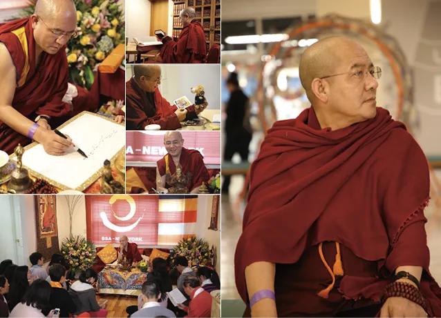
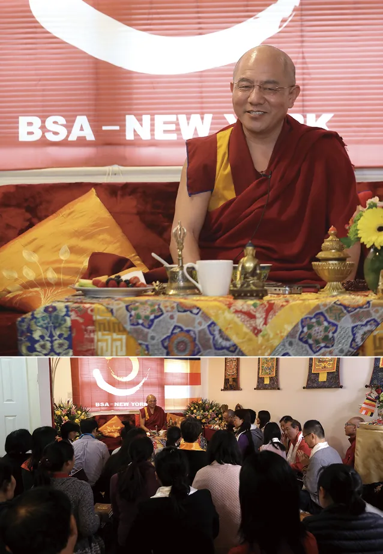
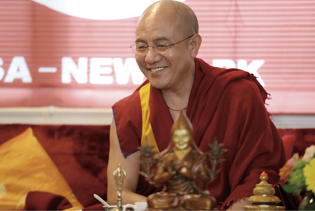
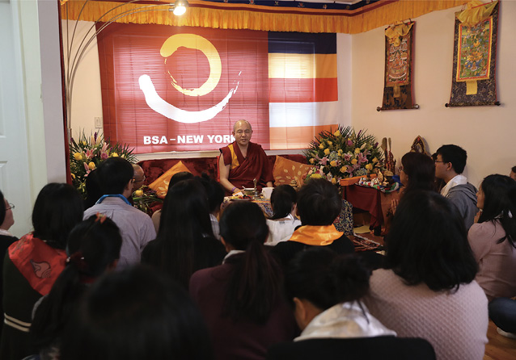
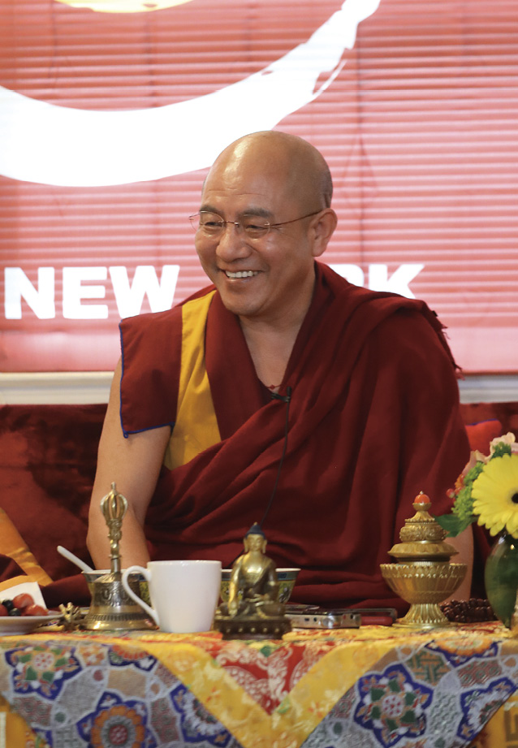
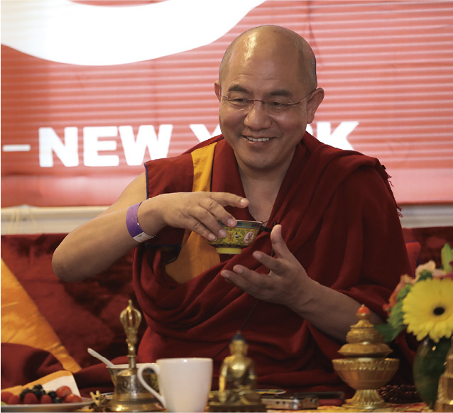
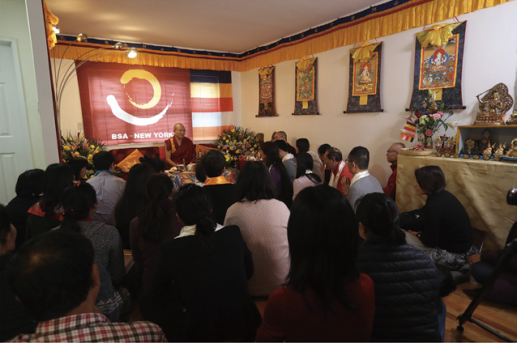

只要不放弃，  
最后一定有结果。

第66场

美国纽约BSA

BSA New York, USA

美国·纽约

2017 / 11 / 13

## 忆念上师

## Always Remember the Guru

今天，在纽约的实体道场、学会的中心，我作一个简单的开示。

## 20多年前，有一个喇荣显密中心

1993年，法王如意宝来到这里，希望建立一个修学显密佛法的中心或道场。依靠种种缘起，我们当时也建了一个，叫“喇荣显密中心”。相关信息，当时美国的一些媒体报道过，比如《世界报》之类。这算是一段小小的历史。

当时的人不是特别多，可能跟现在的人数差不多。我们想的是：以这个缘起，将来一定要在美国弘扬佛法，利益众生。其实，在这里办一个中心不那么容易。美国寸土寸金，买房子建道场特别贵。尤其在纽约，更是难上加难。所以，中心建立以后，法王非常欢喜，开心地加持他们。

中心虽然建起来了，但因为纽约跟佛学院联系非常困难，很多事情最后也就放下了。当时的通讯不像现在，现在不管国内国外，每天都可以通过视频、微博、微信等进行联系，非常方便。我们当时在国外待了3个多月，基本上没法跟佛学院联系。那时有一种电话，叫大哥大，大大的个头，黑黑的，一分钟好像要花几十美元。

当时，我们到了夏威夷，准备给佛学院打电话，报个平安。但是，那边只有甘孜州公安局局长才有大哥大，我就准备给那个人打。后来好像打通了，说了几分钟，大概说的是我们已经顺利到达美国了。随行的一个印度堪布说：“这个太贵了，你不要浪费别人的钱。”我也比较紧张。后来回到成都，我才知道打大哥大那么贵。

在那个年代，纽约的“喇荣显密中心”也维持了一段时间。后来因为通讯困难，我们便失去了联系。听说当时的那些佛教徒，包括主要负责人，比如副会长，都还在——当时我应该是会长。但这次没联系上他们，去年也是这样。

我准备找他们。20年前，我们在一起的时间虽然不长，但法王在美国期间，我们还是一起做了一些计划。虽然后来由于各种因缘，放下了，但心里一直惦记着这事。去年有人跟我讲，他们也在找我。

## 你不会像断线的风筝

2013年之前，我来美国的因缘一直没有成熟。2006年，学会的共修开始，这边道友的闻思修才慢慢跟上。这之前，我的重心在国内，因为国内的人比较多。国外的话，一是有时差，管理起来有一定困难，二是东西方思维方式不同，佛法中的有些修行方法和教言，暂时来讲，西方人不一定能接受。所以，我最初的发展意乐以国内为主。

后来看到，这边的中国人也特别多，而且中国人无论到哪里，都不会放弃自己的信仰，加上大家对佛法的信心很强烈、很坚定，所以就通过各种方式，在国外建立了学会。学会建立以后，闻思修的效果非常不错。

我个人的观点是，虽然有人的地方就有矛盾和碰撞，但学习和不学习还是有差别。我们的相续要发生转变，还是要通过学习。学会这样的组织，对大家学习佛法，具有什么样的意义呢？能帮助大家坚持下去。如果没有学会，很多人学到中间，就自然而然地掉下去了，最后就像海底捞针，或像断线风筝，根本找不到了。此外，如果没有学会，你们要和我直接联系，包括加持、管理、学习等，各方面都有一定困难。

其实，就我个人而言，要管理全世界这么多地方、这么多人，特别不容易。大家进了学会，并不是就马上变成菩萨，甚至有些人学了佛以后，变得更加痛苦。我们面临的问题，可以说既复杂，又繁琐。

为什么有的人学了佛，反而更痛苦呢？以前放任自流，不知道自己的行为哪些是错的，哪些是对的。学了佛以后，用佛法的镜子一照，发现很多地方都不如法，内心充满挣扎。本来，生活和工作就有压力，现在又增加了闻思修行的压力，加上行为上这个不如法、那个不如法，于是便觉得心情不好、状态不好。

总之，国内也好，国外也好，能有这样的学习平台，都特别不容易。在这个平台上，大家的身心会有很大的转变，所以要珍惜，也要有信心。

## 有了信仰，就该暗自庆幸

我个人觉得，大家的学习精神都很好。但我接触的很多道友，跟我讲的却是：“我修行不是很积极。”“我比较惭愧。”“不好意思。”强调的负面东西可能多了一点。

其实，我们的人生还是非常积极、非常有意义的。现在的都市人，整天忙忙碌碌，没有因果正见，没有善知识引导，没有系统学习，特别迷茫。而我们，却在这个迷茫的、云里雾里的世界中，找到了光明的道路，人生基本上有了着落、有了目标。虽然在实现目标的过程中，不是那么顺利，有大大小小的各种阻碍，但总体上讲，自己还是很幸运的。

如果没有遇到佛法，或者没有坚持学修，必定会不断地迷茫、沉沦。如果一直眷恋轮回、贪恋世间法，任何一个净土对我们而言，都将遥不可及。现在有了这样的机缘，我们应该感到庆幸，并对自己的人生，生起一种前所未有的感悟。

这样的感悟是来之不易的。在这个世间，大多数人都是依靠外在的物质，满足自己的贪欲，刺激自己的心。依靠内心的修证或调心法，获得满足和快乐的人，可以说微乎其微。在这样一个世界，我们找到了自己的信仰，找到了人生的皈依处，不管是纽约人也好，北京人也好——刚才有人说自己是成都人，我一听到“成都”，就感觉比较亲切。但你们说的好像不是成都话。会说成都话吗？那还可以。成都话，我听是听得懂，但不太会说。

我的汉语口音，好像有点不伦不类。我今天去时轮金刚的道场，自己给自己做翻译。后来拿到那个录音，我自己都不好意思听。我没有系统地学过汉语，16岁才上学，而且上学的时候天天打架。学校也没有真正的汉语老师，汉语课都是由藏族老师教的。

上个世纪，法王带我到这里来的时候，我的汉语其实很差。但是，我自己认为很好——我是懂汉语的人。当时有个人对我说：“你的普通话不太好。”我特别生气。回头看一看，还是现在好一点。也不知道期间是怎么变成现在这样的。如果还像以前那样，就太糟糕了。我的口音，不知道是成都话，还是什么话。

刚才讲到哪儿了？纽约人，北京人，对吧？昨天我跟一个大学老师聊天，他说自己和这边特别相应，已经待了20多年。我开玩笑说，他如果现在回国，可能很多理念都和国内不相应了。

你们比较适应西方文化，因为业力不同，有些人最开始不一定想在这里生活，后来却一直生活在这里；有些人上半生拼命想办法到美国来，下半生却拼命想办法回中国去。有时候，业力真的很不可思议，也许是因为大环境的改变吧。

不管怎么样，学佛对我们的人生是有用的。暂且不说未来获得圆满的正等觉果位，也不说来世转生善趣的福报和功德——学佛绝对会有这些不可思议的功德和利益，仅从今生来看，不管我们在东方，还是在西方，人生有了这样的信仰和修行，都不会轻易被环境动摇。

## 不要舍弃自己的信仰

昨天，我在教堂给藏族人作开示时说：有些藏族年轻人，到了西方以后，就完全被西化了。这是因为，他们没有护持好自己的信仰。真正维护信仰的人，即使到了西方，也应该坚持修行。

法王如意宝晋美彭措说：“莫舍己道，勿扰他心。”“莫舍己道”该怎么理解呢？作为一个修行人，不论在什么环境下，都不能舍弃应有的道德、行为、观念和信仰。西方人的思想，有些是基督教的，有些是无神论——不承认任何宗教信仰，有些则是批判主义。我们即使没有能力弘扬佛法、说服他们信仰佛教，也至少应该保持自己的信仰不变。

要保持自己的信仰，首先应该通过闻思，懂得佛学的基本道理。这一点非常重要。如果基础没有打好，不管是汉族的佛教徒，还是藏族的佛教徒，到一定时候都会动摇。

我们藏族人本来是全民信教的，但是，有个别人没有好好地闻思，只有烧香拜佛的信心，每天拿着念珠念“嗡玛呢巴美吽”。由于种种原因，他们从印度、不丹、尼泊尔来到这里，接触到西方的各种思想，受到跟佛教相悖的一些教育，再加上他们的孩子无论是上公立学校，还是私立学校，都天天说英语，自己又没有牢固的闻思基础，慢慢就变得没有信仰了。现在有些藏族人的信仰，退失得很厉害，有些中年人的信仰甚至快要变成零了——只剩下一点点。

所以，我比较婉转地批评他们：“你们自己应该想一想，为什么会变成这样？这么多年，我接触了各种各样的人，却从来没有动摇过自己的信仰。因为我深信，佛菩萨的加持也好，佛教讲的那些殊胜境界也好，都是千真万确的。先不说什么空性离戏、光明大圆满，仅仅是人生遇到了痛苦，我自己也能以前世因果的相关道理，轻松面对。

生活中的很多事情，背后确实有一种无形的业力，不是我们今生所能想到的。佛陀宣说的这些道理，符合事实，值得我们信仰。而且，遇到事情的时候，祈祷诸佛菩萨和上师，确实能得到不可思议的加持。对诸如此类的很多道理，我都坚信不疑。”我昨天跟那些藏族人是这样讲的。

## 活着，也是一种成功

在座的学会道友，还是有一定闻思基础的。每个礼拜，都一如既往地坚持学习《入菩萨行论》《大圆满前行》，这样非常好。非常感谢为我们提供道场的道友。

在这里学佛，如果没有集聚的场地，完全依靠网络平台，前进的力量不是很大。大家聚在一起，面对面地共修，一起喝茶，一起探讨，一起聊天，一起学习，就不容易掉队。在团体当中，有时候觉得自己很差，学得不好；有时候也觉得挺好，比上不足，比下有余。

现在很多人，学着，学着，就彻底退了。所以，每当有人跟我讲“我学得不好”，我都会问：“你是不是还在学？”他们说：“是，还在学。”只要还在学，就算不错。还没有死，还活着，也是一种成功。在纽约这样的大城市，有一个佛法的闻思修体系，非常重要，非常有意义。所以，不管怎么样，大家都不要退。

明后天，在学会发心人员的会议上，我也想讲一讲闻思修行的重要性。这方面的内容，我在不同的场合，说过很多次了。前一段时间，我给成都理事会的个别成员也讲过一些，可能你们很多人都看了。目前，可能这样的模式比较合适。

我们对国外学会的管理和学习，还要不断地推进，这是一个逐渐磨合的过程。在这期间，大家有时非常满意，有时又不满意，这都是正常的。我出来的时候，有很多人赞叹，也有很多人说不好，有时甚至无缘无故就有人不高兴。

你们这边也是这样吧？如果什么都不做，就这样坐着，大家都很欢喜，觉得你是个好人。你只要稍微做一点事情，大家就开始批评，说各种各样的话，抱怨、冤枉，甚至背后诽谤。这可能是人的固有习气吧，很多人都是这样的。

但不管怎么样，我们应该不退初心，不违良心，坚持发心，坚持学习，这是我们当前最重要的发愿。

## 用单纯的心，做免费的午餐

在纽约这样的大都市，有学会这样的平台，我特别开心。我有时会想：法王当年在这里建立道场，并取名为“喇荣显密佛教中心”，应该有殊胜的缘起。我坚定地认为，上师的加持不可思议，哪怕他开一句玩笑，也能让我们的人生得到非常大的利益和转变。

实际上，二十世纪六七十年代，藏传佛教就开始在西方弘扬。一方面，当时的弘扬可以说非常成功；但另一方面，大多以灌顶加持的方式弘扬，很少有提供免费闻思课程的。

20多年前，大家在纽约有了集体学习的因缘。我们当时的目标很简单，就想把佛法呈现在众人面前，让他们了解、修行。这几年，我们在这边免费授课，很多人都产生怀疑，不理解为什么要免费。

当然，免费并不代表我们就很伟大。在美国，很多上师传法是很艰难的。而且这些困难，一直跟道场的生存有关。在美国，维护任何一个道场，都非常困难，需要很多钱，用于水电费等各种开支。所以，各个地方的上师传法灌顶，都是收费的。

当初法王如意宝在美国传法，也是收费的，参加一次需要很多钱。我记得在华盛顿的KPC——贝诺法王的道场，法王讲了7天的法。有一个中国女孩子，好像是留学生，对密法很有信心。听到第5天的时候，她对我说：“我现在钱不够了。”当时听一堂课好像要70美元，还是比较贵的。她把自己所有的钱都拿出来听课了。最后课没听完，钱却不够了，特别伤心。

我当时不懂英语，只有她一个华人，所以有时候会跟她聊一聊。最后，我对她说：“你这么有信心，这200块钱我来出，你还是继续听完吧。”我帮她听完了课。不知道那个中国女孩子现在在哪里。

我们当时也没有办法。法王过来的时候，包括机票等，各种费用都很高。我们大多数时候住在道场，有时也住居士家。法王这么大的上师，也有过这样的经历。

所以，现在很多道场，如果不跟金钱挂钩，运转起来有一定困难。但我们学会，除了学员的公摊费用以外，其他方面尽量不跟金钱挂钩。我自己过来的时候是这样，听说慈诚罗珠堪布来的时候也是这样。我们希望以单纯的发心，开创一种新的佛法交流模式。

在这个过程中，包括我们藏传佛教徒在内的有些人，有点看不惯。我们的做法，从另一角度，可能会有不同的解读，所以会引发各种各样的说法。这也是正常的。

现在，大家聚在一起，就是为了闻思修行，非常单纯。这也是我们真正的希望。只要不断地学习，到一定时候，传承上师的加持入于自己的心，一种任何语言都没办法描述的境界，一定可以在你们的相续中生起。

昨天，我跟藏族人也讲，要多祈祷上师，要对心性有所认识。现在有些藏族人，不太承认佛教，也没有得过灌顶，所以我不敢讲得太深。但基本的，比如对空性的认知、祈祷上师的方法等，也讲了一些。

## 愿力大，一切皆会圆满

大家在学习的过程当中，肯定会遇到各种违缘和阻碍，比如家庭方面、信心方面、生活和工作方面的，等等。尤其是部分留学生，学着学着，又要回国。而一回国，很有可能就退了。各个国家的留学生都有这种情况，不是很稳定，尤其在学校里面。还有一些人，因为学佛和西方思想冲突，最后也不得不退。

实际上，不管遇到什么阻碍，我们都不要放弃。不放弃的意思，并不是要你们与家人同事背道而驰，因缘暂时不具足还非要坚持，而是说，自己在内心、行为和修行方面，一定要坚持不放弃。

像我个人，已经坚持了30年。在这期间，并不是没有违缘。尤其在翻译和修行方面，遇到过很多违缘。有时是身体的原因，有时是外在的原因，有时是自己智慧的原因。

刚开始，我很喜欢学五部大论。对背诵论典、和道友辩论等，特别有兴趣。给汉族上课，我最初比较反感，因为会遇到很多管理上的问题和复杂的事情。光是处理小事，也要花大量的时间。真要去学管理，又没什么可学的。我不太愿意过这样的生活。

但后来，上师如意宝要我带汉族道友。我便想：“上师这样要求，肯定有密意。不管怎么样，我不能放弃。只要不放弃，最后一定会有结果。”所以，中间不管出现什么，违缘也好，灾难也好，我都一直坚持。

这是我的心态，也是我的修行方式。

从我个人的经验来看，在学修的过程中，一定会发生各种各样的变化，有些甚至是自己根本想不到的。不过，生命本来就是无常的，这也许是一种规律。你们以后的工作、信心等，都可能发生变化。但只要不放弃，依靠强大的发愿力，我想大家各方面最后都会圆满。

## 眼睛是干的，眼泪是湿的

大家的信心应该没什么问题。否则，不会在上师三宝面前流眼泪。藏族有一种说法：“眼睛是干的，眼泪是湿的。”干干的眼睛里，要流出湿湿的泪水，不是一件容易的事。平时，你们应该不那么爱哭，但面对上师三宝，却自然而然地流出感恩的泪、信心的泪。这样的眼泪，不是语言能说清楚的。再多的语言，都会显得很苍白。

以前上师如意宝经常讲，我们对上师的信心，应该像世间人思念父母或恋人那样。世间人是怎样思念父母和恋人的，我想大家都有体验。如果对上师三宝，始终保持念念不忘的强烈信念，说明获得了一定的加持。有了上师的加持后，信心不容易退转。不管发生什么，都会坚持学习，也会努力利益众生。

所谓的利益众生，即在有生之年，因缘聚合的时候，坚持和大家共同学习，并力所能及地为众生做一点事。除此之外，恐怕也没别的了。谁也没办法把某个众生迅速安置在佛地，“看，他成佛了！发光了！”没有这样的。历代高僧大德度化众生，最初也是让他们发菩提心，好好取舍因果，尽量不造太大的恶业。

我们也应该用这种方式利益众生。在座的各位，如果能做到尽心尽力取舍因果，尽心尽力利益众生，尽心尽力闻思修行，就已经很好了。至于其他，比如戒律非常清净，闻思特别精进——每天晚上只睡一个小时，对大家来说并不现实，因为每个人都需要面对一大堆烦恼，以及各种各样的状况。

不要说你们在家人，即便是我们出家人，也有很多烦恼的事情。经常有人问我：“我现在特别烦，想出家。我可不可以去喇荣？你们收不收？”喇荣的出家人，确实有一部分在精进地闻思修行，但也有少数人过得很痛苦，比你们还痛苦。虽然因为某种因缘，到喇荣出了家，但还是解决不了问题，烦恼依旧一大堆。

对此，有些人觉得奇怪：“出家人怎么也有烦恼？怎么也有矛盾？怎么也吵架？”这其实很正常，任何一个群体，都难免会出现一些特殊的情况。

## 制度健全是有必要的

尽管已经出家，但我对世间知识依然很感兴趣，总想多看一看，多了解了解。我到了美国，甚至想了解美国的政治、经济、军事和科技。刚才去联合国总部参观，也学到了很多想要的知识。总之，我既要关注世间法，又要学习包括显密佛法在内的出世间法，还要参与学会的管理。

坦诚地说，菩提学会的确比较大。从总的人数和闻思修行的团队来讲，全世界不会有超过它的——国内有那么多，国外也有那么多。我这么说，不是傲慢，而是客观地介绍情况。这么大的团队，管理起来非常不容易。学会这边有一些制度，也能起一定的作用，但还不够完善。以后，人员的进出等，都要用制度来管理。

我回去以后，过一段时间——大概一月份，准备给全球的高层管理人员开个会。现在是冬天，马上放假了，我本来不想回佛学院，可是，学会管理有许多事情需要商量，还得回去。我下来的时候就定了，教务处的法师们要专门开三天的会，商量如何完善学会的管理制度。一下子要管理这么多人，真的不知道怎样才好。

在美国，各个方面都有完善的制度，国家的发展比较有保障。你们的特朗普上台以后，很多人都觉得他的某些行为有点疯狂，但因为在他的权力范围内，制度比较完善，所以民众也不会太担忧。

学会将来也有这方面的考虑：用健全的制度保障健康发展。至于具体怎么做，学院有70多个法师，我让他们提一些建议，同时自己也在思考。以后，国内外的负责人都要共同商量，参与制度的制定。学会是一个集体学习的平台，不管是地方管理也好，学院方面也好，都要有善巧方便，要考虑长远的利益。只有这样，我们才会有长期生存的因缘。

总之，大家一起努力，看用什么方法，能让佛法长久留存于世。作为大乘佛法的学修者，我们对名、利、财之类，没有任何想法，唯一的目标就是让佛法如意宝长久住世，并依靠它利益众生——不仅让众生的身心暂时得以平静，还要给他们种下解脱的种子，这是最为重要的。

## 自己不好好学，我来了也没用

西方有很多佛教中心，非常好，功德不可思议。但真正的闻思修行——正如有些道友讲的那样：“好像现在才开始，现在才知道佛法到底在讲什么。”

我非常认同这句话。没有闻思，就不会知道佛法在讲什么。不知道佛法在讲什么，一旦遇到退失的因缘，信心很快就会退光。如果在有生之年，在闻思上下了功夫，对佛法有所认识，那谁也夺不走我们对真理的信心，谁也毁不掉我们对上师三宝的恭敬与感恩。

佛法确实非常难得。有管理团队的辛苦付出，有我在背后的各种服务，加上你们前世积累的因缘福报和今生的种种努力，方方面面的因缘具足，大家才有机会在一起学习佛法。

而且，在美国听上师们讲课是要付费的。一节课要交100美金、80美金或50美金，最便宜的也要多少多少。虽然就佛法本身的价值来衡量，付出这样的费用也是值得的，但你们却不需要付出那么多，依靠信心和大家的共同努力，便拥有了这样的学习机缘。

以后不管怎样，大家都要好好学习。将来，如果因缘具足，我也可以过来。但到底能不能来，现在不好说，因缘总在不断地变化。

我不管到哪里，英国也好，美国也好，大家都有这样的心态：“上师，您要多来！您要是不来，我就不能好好学习！”你自己不好好学习，我来了也起不了多大作用。我也不是什么“见解脱”，见一下你就马上证悟。只不过，我来了以后，道友们可以聚一下，气氛稍微好一点。但如果没有自觉性，我头天走，你第二天可能就冷冰冰了。不管做什么，自己不努力肯定不行。

这几年我比较方便，一直到处走，各个地方都去看一下。不过全世界有那么多道场，除了极个别特殊的道场外，绝大多数都没法安排。像汉地的话，一个城市就有好几百个道场，如果一家一家地去，怎么样也安排不过来。在国外，也只能去比较重要的中心，鼓励一下大家。但仅仅是这样，对我来说也很不容易。

总之，对闻思修行，我们应该有难得之心。有了这样的心，做什么事情都容易成功。如果觉得佛法可有可无、可学可不学，最后肯定学不圆满。

## 少说是非，多做实事

以前我们来美国，看到很多佛教中心虽然小，但起的作用却非常大。因此，一座城市如果有一些佛教中心，非常值得大家共同维护。而维护道场最重要的一条，就是不谈论是是非非的各种事情。

我的家乡有一个居士林，有200多人。我给他们建好了经堂，然后安排一个堪布去管理。那个堪布管得比较严，要求大家到了经堂，只能念经，不准说废话——佛法以外的都不让说。堪布认为，如果说很多是非，佛教团体就变成了是非团体。因为堪布管理得好，那个居士林办得非常成功，念修的氛围特别正。

所以，大家在学会内部，尽量往好的方面努力，多探讨闻思修行的道理。我们在这方面越努力，做得越好，内心就越充实，得到的利益也就越大。在这里，大家都没什么私心，也没别的事，只要一心一意把闻思的事情做圆满，自然就会有学习气氛。学习有了起色，每个人都能从佛法中得到大的利益。

每一个道场都来之不易，大家要共同努力，共同维护。不管是培养人才，还是管理组织，都需要大家的参与和配合。为此，道友之间一定要相互团结，尽量减少是非。

当然，现在城市生活的压力那么大，对你们而言，坚持共同学习不是一件容易的事。不要说共同学习，哪怕集中一次，也不太容易。为什么呢？因为不一定有时间。“我生病了。”“我心情不好。”“老板不同意。”“家人不同意。”反正，可以找出各种各样的理由。很多地方都有这样的人，好像学习不是为自己，而是为了某个负责人、某个团体。

但在世间法方面，好像怎么集中都没问题。比如赌博啊，喝茶啊，聊天啊，只要一提起，很多人都有兴趣：“没问题，我一定来！”几十个人，每天聚在一起吃喝玩乐，大家既有兴趣，又有时间，什么因缘都具足。

但不管怎么样，希望大家能尽量坚持闻思，并在每一次聚集的时候，少说一些是非，多谈一些佛法，共同维护来之不易的道场。

## 一次特殊的开许

你们很多人，已经坚持学了很久，有的开始修加行，有的已进入密法班。对国外的人来讲，修加行确实很累，很麻烦。有些道友虽然很有信心，但不管是共同加行，还是不共加行，要按我的要求全部圆满，恐怕很长时间都没办法。我考虑了很长时间，如果必须修完加行才灌顶，不知道有些人这辈子有没有机会。

所以，这次对国外平台的道友，跟国内稍微有点不同。在国内，去年和前年的灌顶要求都比较高，不管什么人，都没有特殊开许。现在有些上师，什么要求都没有，直接给大家灌大圆满的顶，有些则非常严格，我算是介于二者当中的吧。

你们如果对《文殊大圆满》有兴趣，而且和工作不冲突，19号可以来接这个灌顶。这次灌顶，主要针对学会的密法修行人。加行没有修完的——不管其他上师怎么做，我这几年一直卡得比较严，但这次稍微有点不同，也开许参加。

最近有个别道友，18号从北京、黑龙江飞过来，19号接完灌顶，20号又飞回去。也可以吧，为了接法，我觉得也值。只要对密法有信心，不管怎样都可以。比较而言，你们不需要飞来飞去，很方便。

## 有了法王上师，已经足够

我大概讲这些，没有什么逻辑，想到哪里说到哪里。法王如意宝有一个《妙音天女》的修法，是以前在五台山造的，我前段时间刚翻译完。下面给大家念一下传承。你们可以自己印一下。

（堪布念传承）

## 妙音天女之修法

——赐语智德

> 谴世住世唯一事业十万殊妙功德之宝藏，

> 悦音绢索紧拥有寂边际妙语纤指之功用，

> 伪竞赐予总持辩才驱逐不明犹豫邪蔓延，

> 持有尽所俊俏福德无尘伪装有尘妙音女。

> 洁白容颜露出睨视利刃能勾入灭之禅定，

> 蹲坐双足游戏莲月姿态百般牵动润者心，

> 清晰明观汝以心咒祈请恩赐一切善妙德。

（上文诵一遍，之后随力念一字咒“舍”。）

所云舍一字，持诵八十万，启十万智藏，智者动心语，喉中自流露，胜共诸悉地，轻易速获得。

此文是为满晋美彭措活佛与空行达赖拉姆二人心愿，阿旺罗珠宗美于圣地五台山静处撰著，愿增善妙！

妙音天女的心咒只有一个字——“舍”，开智慧的。一般修生起次第，有“阿”字的念法，有“舍”字的念法，也有“吽”字的念法。虽然只有一个字，也是一种咒语，叫种子咒。

法王在这里用了诗学的手法。网上有妙音天女的法相，好像只有一种，照着那样观想就可以。先念一遍仪轨，观想清楚一点，然后以非常虔诚的信心，祈祷妙音天女：请开启我的智慧。心咒要求念80万遍。修到量以后，智慧自然会流露出来。

当年，法王在五台山为众生开启智慧，今天算是以此修法，跟大家结上新的法缘。其他的佛法开示，我以前讲《大圆满前行》和《入菩萨行论》的时候，都已经讲过了。

总而言之，大家要不断地学习。不要学着、学着，就生厌烦心。不管学什么，学佛法也好，学世间知识也好，包括企业管理等，最开始都可能是一件很苦的差事，感觉非常枯燥。

但学习也是一件很有意思的事。虽然刚开始比较辛苦，但学着学着，法融入了心，真正的兴趣就上来了，不学都不行。像我现在，学了这么长时间，到了这个年龄，还想学。对佛法的学习兴趣，我从来没有中断过，也没有减弱过。只不过，有时候时间有点儿不够。

在跟自己有缘的法脉或系统里学习，进步很快，收获也很大。尤其学得稍微深入一点的时候，你会变得稳重，不再东奔西跑。不会像有些人那样，一直四处奔走，最后什么利益也得不到。

确实有这样的人，今天跑这个道场，明天跑那个道场。所谓的跑跑居士，可能见得多一点、学得广一点，看起来广闻博学，最后却过于散漫，抓不住主线。人这一辈子，很短暂，不管做什么，抓主线都很重要。

我闻思的时候，藏地的情况跟现在有点不同。虽然像法王如意宝那样闻名十方、弟子云集的大德不是特别多，但附近还是有很多著名的上师。所以刚开始，我也想到处求学。后来觉得，既然已经依止了法王如意宝，就应该把心定下来。实际上，不管哪位上师传的法，都没什么差别。最重要的，是用智慧选择一位具有加持、跟自己投缘、跟自己的法脉相应的具德上师。这么一想，心就坚定了。

在我们学院下方，霍西那个地方，当时有一位曲恰堪布，非常了不起，有两三百个弟子。我很想去拜见一下。但又想：“有了法王这样的上师，已经足够了。”就没有去。他示现圆寂的时候，我有点后悔，觉得他活着的时候，应该去拜见一下的。当时太傲慢了。

因为对上师有信心，所以我求学的时候，没有东奔西跑。现在回顾自己的一生，也很好。如果跑得太多，学得太杂，自己现在不知道会怎样，也许已经晕了。

## 一个严格的系统工程

我并不反对你们学其他上师的法。不是这个意思。大家知道学会的章程：从个人层面来讲，你们学任何一个上师的法，都是可以的。我不限制你们信仰和依止其他善知识的权利，但在学会里面，还是要按统一的方式来。这是给大家的一点建议。另外，你们要依止其他上师，最好是合格的具相上师。如果不经观察就跟着跑，辛辛苦苦跟一辈子，最后什么法都没得到，可能会后悔。

将来，不管你们怎样选择，都要选择有系统性、被公认的学习方式。只有这样，才能得到不共的加持力和收获。我们这边的传承和法脉，以后应该有自己的独特风格，这样比较好。

世间人读完大学，如果还要读硕士或博士研究生，会给自己选一个好的导师。如果导师很优秀，毕业后和别人说起“我的硕士或博士导师是什么人”，仍然比较自豪。可见，世间人在学习阶段比较高的时候，也不会随随便便地选择。选择导师肯定是固定的一两位，不会是见一个就拜一个。

同样的，一个成功的佛教徒，一般来说，会有一两位根本上师。就像我的根本上师德巴堪布，他跟人聊天或修行的时候，经常忆念两位上师：一位是以前闻思时依止的上师，叫班玛堪布，第二位就是法王如意宝。德巴堪布依止的上师比较多，但对他恩德最大的就是这两位。我刚开始依止的是德巴堪布，他虽然不像法王那么出名，但他对我的恩德和加持，也很难用语言描述。第二位大家都知道，是法王如意宝。

世间人对工作，也会有相应的定位：“以后做什么？是学计算机，还是学经济，或是会计？如果学会计，晚年的人生怎么过？”会有一系列的打算和计划。我们作为佛教徒，如果对自己的学修，什么计划都没有，肯定不行。

在这些计划中，依止上师是一个非常严格的“系统工程”。希望大家根据自己的智慧、信心、因缘以及各方面的情况，综合考虑，善加取舍。

今天就说这么多，希望大家不断地努力。
