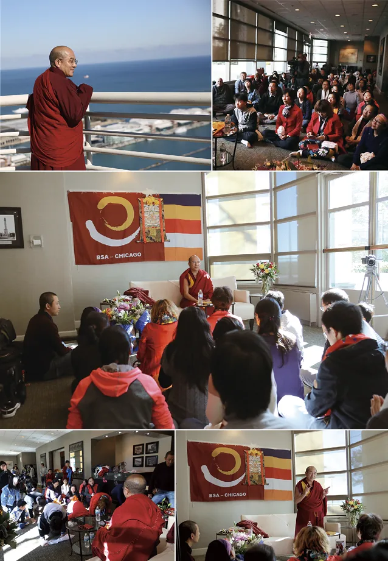
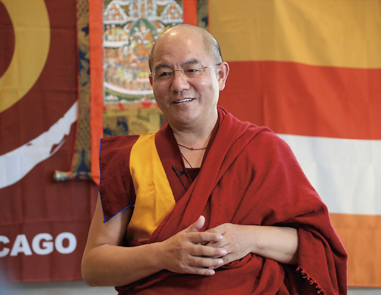
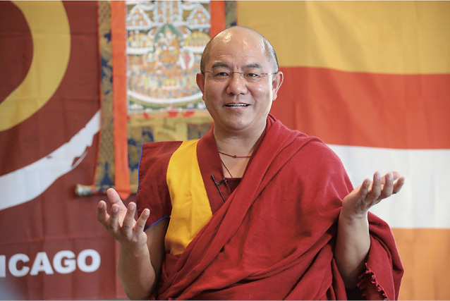
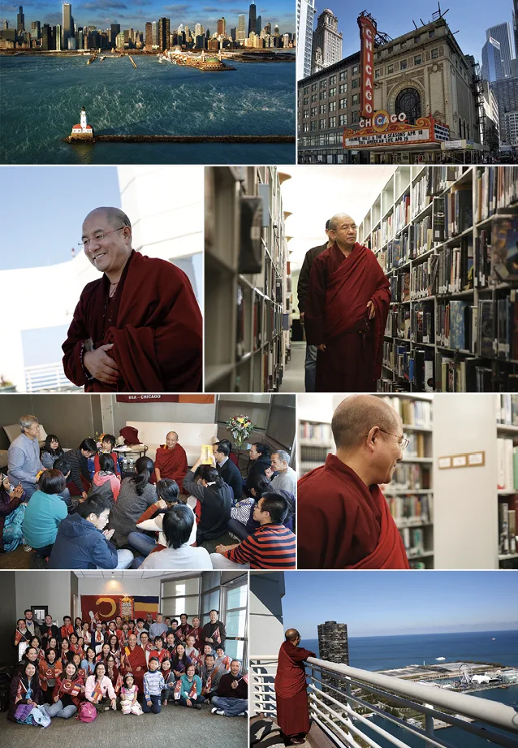
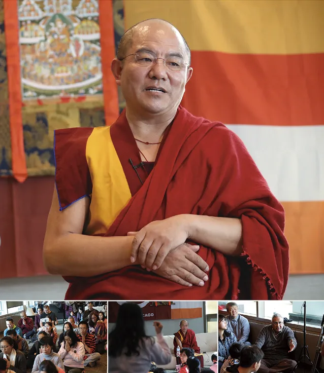
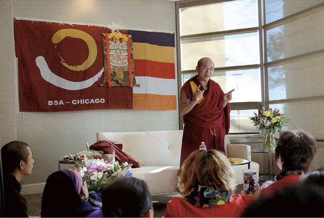

没有一个人是真正的非法器，  
因为每个众生都具有如来藏。

第62场

美国芝加哥BSA

BSA Chicago, USA

美国·芝加哥

2017 / 10 / 29

## 皈依的学处

## Commitments of Refuge Vows

今天，以芝加哥菩提学会为主的美国部分佛教徒，集聚在这里。我刚刚从中国过来，时差还没有倒好，这是一个巧妙的因缘。利用上午的时间，我给大家做个简单的开示。

## 人人都能成佛，佛教讲得最清楚

在座的各位，有些已经学佛多年，有些才刚刚开始。但不管怎样，每个人都有如来藏，都有佛性。《三摩地王经》里讲，如来藏遍于所有的众生。在这个世界上，没有一个人是真正的非法器，因为每个众生都具有如来藏。如来藏是成佛的因、成佛的种子，每个众生相续中的这颗种子，将来都能开花结果。

佛教还有一部重要的经典，叫做《喜金刚》，藏语发音是吉多吉。其中说，众生实际上跟佛没有什么差别，只是暂时被遮障了而已。一旦障碍遣除，就跟真佛没什么差别。

开头我为什么要讲这些呢？在座各位的智慧不同，福报不同，根基的利钝也不同。有些人的福报比较深厚，有些人的福报比较浅薄。有些根基比较好，是利根者，有些则是钝根者。包括我们的长相、财富、学历、对知识的掌握程度等，都不相同。虽然有这么多不同，但大家都有一个根本的共同点：都可以觉悟，都可以成佛。

人人都可以觉悟成佛的道理，世界上这么多宗教，唯有佛教讲得最清楚。对于这一点，我很有把握，很自信。我之所以觉得佛法殊胜，并不是因为自己是佛教徒，而是事实就如此。

## 没有信仰也可以，但不要反感

在这个多元化的时代，大家的信仰可以不同。对所有的宗教，我们都应该尊重。

刚才，我问一个在大学研究伊斯兰教的西方女孩：“你对神的存在怎么看？”她给了我一个巧妙的答案：“很多人相信神是存在的。我也认为，自然的神也好，自然的某种东西也好，应该存在。”

这种思维方式，对我们很多人来讲，都是值得思考的。你如果是佛教徒，对佛教的道理比较明白，但非佛教徒不一定明白；如果你是基督教徒，对上帝的概念比较清楚，但其他宗教徒不一定清楚；如果你是伊斯兰教徒，对真主的教义比较认可，但其他人不一定认可；如果你没有任何信仰，对无神论或者无宗派主义的观点比较认同，但有宗教信仰的人却不一定认同。

在这个世界上，不同的人有不同的立足点，每个人都可以寻找自己的信仰。对各种不同的宗教，我们应该站在客观、公正的立场，以寻求真理的态度加以分析；也应该以理性的智慧，进行思考、判断，最后做出选择。

但是有个别的人，不信仰任何宗教，甚至对任何宗教都比较反感。其实，没有宗教信仰是可以的，但反感就没有必要了。我自己是佛教徒，但我不会反感没有宗教信仰的人，也不会反感其他宗教的信仰者。我发自内心地尊重每一个没有信仰或信仰其他宗教的人。

做人，应该懂得包容。“心底无私天地宽。”如果我们每一个人，思想不狭隘，执著不过分，世界会变得更加广阔、美丽。如果心胸狭小，只容得下自己的观点，凡与之相违、相异或不相干的思想流派，全部排斥、诋毁，并不是一种客观的态度。

今天在座的，90%是佛教徒。但每个人对佛教的认识，却有所不同。有浅层次的，也有深层次的。自己属于哪一个层次，心里应该有数。像我的话，学佛有三四十年了，自己对佛理的认识程度如何，心里是比较清楚的。

佛经的数量，浩如烟海。光是藏传佛教，《大藏经》就有一百多函，论著有两百多函。加上各教派高僧大德所造的论著，数量更多。作为佛教徒，大家应该尽量深入经藏。此生来到这个世界，是选择智慧，还是蒙昧，是一个非常关键的问题。

但是，作为佛教徒，不管自己有多高深的智慧，都不要认为自己是真理的唯一掌握者。这样的说法，在今天的时代不一定合适。

## 不要只跟着感觉走，还得用脑

寂天菩萨在《学集论》中讲到，有人以信心入佛门，有人以智慧入佛门。大家皈依三宝的因缘，也不外乎这两种。一种源于信心和感性。因为前世的因缘，从小看到佛像、佛经、僧人等三宝所依，就自然被吸引，生起强烈的信心。在信心的牵引下，皈依佛门。

另一种是以智慧而入，并非源于感性和信心。对佛法的道理，他们先去判断、分析、探究，最后被其严密的逻辑和甚深的道理所折服，由此步入佛门。以智慧入佛门的，一般比较稳固，不容易退失。

佛教的智慧有哪些呢？简单而言，就是通达空性。佛教认为，外境的万事万物，依靠外在的因缘产生；内在的烦恼和智慧，依靠内在的因缘产生。内内外外的因缘，如果以智慧观察，会从最初认为实有存在，变成了达如梦如幻——只有显现，没有本体。如果继续深入观察，最后连如梦如幻的现象也不成立。那个时候，就是佛教所讲的空性。

不管你有怎样的教育背景和文化背景，如果用智慧分析，都不得不承认这样的道理。对我们每个人来讲，眼耳鼻舌身意的对境确实存在，但看似存在的色声香味触法，在智慧的观察下，都没有一个实有的体性。根识跟外境之间的关系，无论如何都没办法真正建立。

这样的道理，没有学过中观的人，不一定明白。对显宗建立般若空性、密法建立明空无二的理论体系，真正闻思过的人，内心一定会产生定解：佛教宣讲的这些义理，不是故事，不是神话，也不是无中生有的虚妄之谈，而是符合实相的真理。

但这样的空性，并不是什么都没有的单空。佛教有一部著名的论典，叫《中观根本慧论》，作者是龙猛菩萨。论中这样讲：“若有不空法，则应有空法。实无不空法，何得有空法？”如果不空的法存在，那空的法可以存在。实际上，不空的法是不存在的，那空的法又怎么会存在呢？空和不空，是相互观待的。既然能观待的法瓦解了，所观待的法也肯定不存在。就像常和断、左和右、你和我等法，因为二者相互观待，其中一个没有了，另一个也不会存留。

凡是因缘所生的法，都是空性的。这样的道理，是谁说的呢？以佛教本师释迦牟尼佛为主的成就者和觉悟者们说的。不管什么众生，依靠佛法的指引，都可以在迷乱幻化的世界，体悟这些甚深道理。

对“色不异空，空不异色，色即是空，空即是色”的甚深见解，每个人都可以用智慧去通达和体悟。有深度的人，用深度的方式通达；有广度的人，则用广度的方式通达。虽然大家的智慧有深有浅，有广有狭，但最后得出的结论，都是一致的。

这也是我自己的亲身体验。学佛这么多年，如今在世界的任何一个角落，面对任何肤色的人群，我都可以大胆无畏地宣讲如来的教法和证法。为什么？因为佛法的真理经得起观察和剖析。而且我也相信，只要理解了这些正理，大家都会发自内心地感叹：这个世界，的确只是一个幻觉。当我们真正证悟了“世界唯是幻觉”的境界，就叫做解脱。

今天，不算是正式的演讲或佛法课，只和大家随意地交流一下。在座的各位，智慧水平都挺高，通过这样的交流，应该能接受这样的事实：佛教不只是一个古老的宗教，也不只是依靠信仰而建立。如果它唯一依靠信仰，当我们抛开信仰，用智慧进行观察，它的教理是根本没办法安立的。

一个有智慧的宗教，经得起任何时代的考验，以及任何理性的观察。这样的宗教，在这个世界上，到底有没有？在座的各位，既有知识，又有学问，不会单单靠信仰就进入佛门。各位今天能坐在这里，一定用智慧观察过。

## 别人的过失，都是自己的问题

不管我们拥有虔诚的信仰，或是没有信仰，都应该拥有正直的品格。不能戴着有色眼镜看外面的世界。否则，结果不一定善妙。

比如，你刚才走进来，看到一个佛教徒，心里就想：“这是个佛教徒——佛教是骗人的，很不合理！”第一个念头，就把他排除在外，你将永远不能进入他的世界。再比如，我是学藏传佛教的，对其他教派一律排斥。看到南传佛教的信徒，就会想：“哦，南传佛教的，跟我没什么关系！”甚至还找出他们的很多过失——其实都是我自己的问题，他们身上并没有那些毛病。

如果心不正直，不仅宗教信仰会出问题，人际关系也会出问题。比如，我对某个人有看法，认为他很坏，每次看到他，心里都想：“坏人来了！”他说的每一句话，做的每一件事，我都看不惯，甚至他为我做了一件好事，我也想：“他是在欺骗我、诱惑我，我才不会上当呢！”

站在公正的立场，有一颗平等的心，对每个人都一视同仁，得出正确合理的结论，这应该成为我们做人做事的底线。遗憾的是，很多时候，我们都在用狭小的眼光看世界，给自他都带来痛苦。

有些年轻人经常说：“我是有自由意志的，不受任何人的阻挡和控制。我只跟着我的感觉走，跟着我的想法走！”你当然可以跟着你的想法走，但在你大脑坐镇的指挥员，却很可能把你引向歧途。当你察觉人生出现大的缺憾时，也许已经晚了。所以说，我们不能太任性，不能总随着自己的心意转。

曾子说：“吾日三省吾身。”佛教也强调自我反省，要求用正知正念，随时观察自己的行为、语言和心态。如果能够这样，我们会发现，自己口中的语言不一定善妙，心里的想法不一定合理，做出的行为也不一定妥当。假如没有正知正念，我们可能在自认为正确的时候，造下弥天大罪。

## 守护五学处，让自己与众不同

在人生的道路上，我们需要具有经验和智慧的引导。不要认为，我现在已经长大，不需要任何老师了。不是这样的。小的时候，我们以父母为老师；上学之后，接受学校老师的教导；走入社会，以长辈或有经验的人为老师；在闻思佛法的过程中，则需要出世间善知识的引导，这不仅需要，而且非常需要。

作为佛教徒，可以学习其他宗教的知识，也可以学习与信仰无关的世间学问。但不管怎样，内心对佛法僧三宝，要有坚定不变的皈依心。否则，不可能得到善知识的摄受和引导。

怎样才能具有坚定不变的皈依心呢？在佛教内部，有一套完整的皈依法则，懂得并遵守这些规则，就能坚定自己的皈依心。藏传佛教著名的阿底峡尊者，给我们宣讲了皈依的五个学处。下面给大家简单介绍一下：

第一个学处，遇到生命危险，或获得重大赏赐，也不能舍弃皈依境。

第二个学处，遇到人生的重大事情，要向佛陀祈祷，向佛陀求助。有些人可能会想：既然所有困难都要依靠佛陀，那以后生了病，是不是也不用去医院，光念念佛号就可以了？不是这个意思。生了病，该去医院的，还得去；遇到麻烦，该找人帮忙的，还得找。在这个过程中，不忘真诚地祈祷佛陀。

佛陀的力量超出了凡夫人的想象，我们根本没法触及。对这一点，需有一定智慧才能明白。作为佛教徒，我们应当对此生起信心，并懂得随时祈祷。

第三个学处，帮助有缘的众生趋入佛门。既然佛法是理性的智慧，那么接引更多众生皈依三宝，就是对自他都有利的善法。所以，我们应当义不容辞地尽量行持。

这么做，并不是抢别人的信徒，也不是拉人进来，扩充自己的队伍。如果我们所学、所修的不是真理，拉来的人再多，又有什么意义呢？人越多，越不好。正因为我们学的是真理，求的是正法，所以帮助迷乱的众生趋入佛门，皈依三宝，非常有意义，非常值得去做。

第四个学处，行住坐卧不忘对佛做供养。作为佛教徒，供佛的心念一定要有。至少每隔两三天，就要在佛堂做一做供养，比如供花、供香、供水等，或者意幻供养。这很有必要。

表面上看，这只是一种形式，实际上涵摄了广大的资粮和功德。《妙法莲华经》等很多佛经，都讲了供佛不可思议的功德。当你以虔诚的信心，认真学习佛法之后，才会知道其中的巨大利益。

最后一个学处，去往任何地方，都要向这个方向的佛陀顶礼。礼佛是佛教徒的重要行为，时时刻刻都不能忘记。有些道友好像不懂，很长时间都不做一次顶礼，真的很可惜。

我自己的话，不管到外面出差也好，弘法也好，都随身带着释迦牟尼佛像，作为顶礼和修行的所依。作为一个佛教徒，自己的言谈举止、所作所为，跟没有信仰的人相比，都应该有所不同。否则，应该是比较失败的吧。我是这样认为的：此生既然皈依了三宝，行住坐卧的一切威仪，就应该符合佛教徒的身份。

当时，印度东部和西部的所有智者，没有哪一位比得上阿底峡尊者。如此了不起的大成就者，为我们归纳的五条皈依学处，大家一定要好好遵守，终生行持。

今天这里，有一些二三十岁的年轻人。如果到了五六十岁，你们还在坚守这五条规则，说明今天的交流对你的生命是有意义的。相反，作为一个佛教徒，连五条基本的规则都不懂，确实比较遗憾，比较失败。

这五条学处，很多人以前都听过。但是，学习佛法并不只是理论上了解一下就可以的。更重要的，还要看在生活中能不能用上。比如，我们皈依三宝之后，遇到重大事情的时候，会不会舍弃三宝？会不会祈祷佛陀？行住坐卧有没有礼佛的习惯和意识？有没有尽力帮助别人进入佛门？这些问题，都需要反问自己。

总之，作为一个佛教徒，行为要跟其他人有所不同。如果跟其他人没什么差别，那你应该好好地问一问自己：我信仰和皈依的到底是什么？

芝加哥的个别道友，在学习佛法的过程中，经常和他人分享，非常好。像我的话，虽然从小就开始学佛，但真正依止善知识，还是长大以后的事。当时有一位上师，带我去皈依了法王晋美彭措。后来，我在晋美彭措上师那里得到了很大的利益。为了报答上师的恩德，我也一直尽心尽力，把跟自己有缘的人带进佛门。对这些人来说，这是一个重要的机缘；就自己而言，也有很大的功德。

现场互动

问：刚才上师讲到，每个众生都有如来藏，我们对其他宗教的信徒也要尊重，因为他们也通过自己的方式在寻找真理。弟子接触过一些真正的基督教徒——不是形象上的，他们认为，上帝就在他们的心里，每个众生的本质都是上帝，而上帝的本质就是爱。弟子想，他们也许是用这种方式，在寻找他们的如来藏，因为如来藏本身就是无尽的慈悲和无尽的智慧，也是我们的本质。当他们安住于爱的本质时，不会对其他众生有特别多的不平等。尽管这样，他们依然不究竟，因为他们没有空性的见解，没有明空双运。

弟子的迷惑在于，他们形象上的上帝，是一个拟人化的神——有些人说是大梵天。大梵天本人也是轮回中的众生，虽然可以给人间的众生一些爱或善恶的指导，但却不知道真正的解脱之路。他们怎么样才能解脱？而且他们的上帝到底是什么？感恩上师！

堪布：我没怎么学过基督教，只看过一些相关的书，知道他们也有一些好的观点。基督教所谓的上帝，主要有两种观点：一种认为，上帝是真实的世间万物的创造者；另一种认为，我们心中的爱就是上帝。此外，还有些人认为，上帝是超离语言、无法揣测、不可思议的，意思是，不管用语言怎样表达，都不究竟，都没法描述上帝的本来面目。具体的情况，他们应该有他们的解释。

我个人认为，作为佛教徒，的确需要尊重其他宗教。这种尊重，并不是为了达成某个共识、让世界和平或实现人与人之间的和谐友爱，口头上客气一下，而是发自内心的一种真诚。

退一步说，如果我们想反对其他宗教，那就要先把他们的教义了解清楚，否则便没有发言权，也没法反对。如果自己不了解，还非要反对，就是一种不合理的态度。

现在有些人，根本不了解佛教，就随便排斥：“佛教的说法不正确。”“佛教是迷惑人的。”“佛教是错误的。”说这种话的人，智慧恐怕比较有限。像我刚才讲的那样，佛教藏传的《大藏经》，光论著就有两百多本，个别大德的讲解也有一百多本。如果要学，每一本都要花很长时间。而且，由于内容极其深奥，学起来非常吃力。对此，我自己深有体会。当时偶尔会想：这么深的道理，那些知识分子应该来学一学，以他们敏锐的智慧，看能学成什么样？

如此博大精深的佛教，有人却用简单的一两句话判为不合理，这种智慧确实不怎么样。同样，作为佛教徒，我们对其他宗教也应该尊重，不能随便批驳。至于是否去皈依和依止，得看自己的情况。

问：请问上师，观想是不是一种迷乱？

堪布：观想是不是迷乱，要从两个方面来分析。站在最究竟的角度，可以说是一种迷乱；但从世俗角度来讲，观想不是一种迷乱。因为你观想文殊菩萨也好，观想观世音菩萨也好，观想释迦牟尼佛也好，都是一种正确的信念。虽然这也是分别念，但世俗中还有更差的分别念，比如相续中产生的贪心、嗔心、嫉妒心。这些属于烦恼性的迷乱，更为严重。

《释量论》中说，所有的分别念都是无明。因为所有的分别念，不论好的，还是不好的，都没有离开能取所取的二元执著。就这个层面而言，它一定带有无明的体性。这是从最究竟的角度来讲的。

在世俗当中，存在迷乱的现象和迷乱的智慧两种不同的法。迷乱的智慧是用来对治和推翻迷乱现象的。好比我们过河，需要有桥或者船，否则就没法过河。而一旦过了河，桥也好，船也好，都成了多余的东西，需要舍弃。

所以暂时来看，世俗中迷乱的智慧，我们还是需要的。如果没有它，就没办法推翻迷乱的现象。

问：您在寿命无常的观修引导中讲，无论做什么，都要提醒自己：“这是最后一次。”您自己出门或出国的时候，也经常说：“我出去后可能不会回来了。”但在我们国外，有一个视频叫做《吸引力法则》，认为我们的意识如果一直说不好的话，真的会把不好的事吸引过来。这两种观点，我们在生活中如何圆融？

堪布：观修寿命无常的时候，确实要经常忆念“最后一次”。我这次出来，也在想：“可能再也不会回学院了。”离开美国的时候，我也会想：“这会不会是我最后一次到美国？”

修无常的时候，这样的观想很重要。虽然每天观想的“最后一次”，不一定正确，但如果经常这样观想，总有一天会正确，总有一天会变成“最后一次”。

现在很多世间人，根本不知道寿命无常，所作、所为、所想都非常稳固，非常“长远”，好像自己有几百年寿命一样。和这样的颠倒想法比较起来，我们对寿命无常的观想，非常有意义。

所谓的“吸引力法则”，是西方心理学的一种观点。它强调的是，无论善念也好，恶念也好，如果不断地串习，依靠心的能力，个别事情真的会发生。但在现实生活中，不可能因为观想无常，就真的出现无常了。比如你开车的时候，因为观想无常，“我会不会死？”然后马上翻车，不可能的。

其实，我们每个人都活在无常变化的世界里。即使你不观想，万法的本体也是无常的，也是刹那生灭的。所谓的“吸引力法则”，跟无常变化没有什么关系。但是，如果你不懂无常，一直认为自己不会死，可能死到临头还一点察觉也没有。

在噶当派的教言里，一个弟子请上师给自己传一个最深的法，上师传的是什么？“你也会死，我也会死！”在我们看来，这个教言并不深。而实际上，对修行人而言，死亡无常的法非常深，也非常有意义。没有生起真正的无常观，任何修行也不可能成功。

总之，观修无常跟所谓的“吸引力法则”，有很大的差别。不过，二者在本质上也没有什么冲突。

问：如果寿命是无常的，为什么我们到学院的时候，法师跟我们讲“不要穿黑色的衣服”？无常跟黑色有什么关系？

堪布：可能这些法师对穿着的颜色比较执著吧。实际上，寿命无常也好、不是无常也好，穿黑色也好、穿白色也好，在某种意义上都没有什么差别。

不过，在某些传统和习俗中，有些人会觉得黑色是什么颜色，白色是什么颜色，各自代表一定的意义。藏传佛教的息增怀诛四个事业，息业是白色，怀业是红色，增业是黄色，诛业是黑色。不同的事业成就时，有穿着不同服装的，也有用不同颜色的。

但我们不能认为，穿黑色的一定是什么，穿白色的一定是什么，这是确定不了的。在万法无常的这条路上，颜色有时候能起到一些作用，有时候却不能。

问：我来自巴基斯坦。您的演讲给我的印象很深刻，您所说的每句话都令我感动。现在很多宗教都通过媒体等不同方式，向我们宣扬他们的教义。像您这样的人物能够亲自到访，令我非常感动。您能不能多给我们传授一些释迦牟尼佛的教法呢？我们小时候在课本上读过佛陀的故事，在大学的书里也看过，但还想知道得更多一些。

我从来没有机会面见像您这样伟大的修行人。我回家之后，该怎么告诉我的孩子们我在这里的收获？他们肯定会说：“你只是参加了一个佛教的会议而已。”我该怎么和他们说呢？比如基督教、伊斯兰教、印度教等，它们之间的根本区别是什么？我怎样才能简单地给他们解释清楚？

堪布：我觉得，给孩子的教育，最好从小就有一些宗教的内容。不管什么宗教，在人类历史上都有两三千年的历史，都具有强大的生命力，对人类社会的影响都非常深远。

现在很多年轻人，从小就对宗教有所排斥或反对，到最后，人生的某些问题可能没办法解决——再高新的科学技术也不行。人生的重大事情或者终极关怀，也许只能依靠宗教的力量。事实上，信仰宗教和不信仰宗教，生命的内涵会有很大差别。

你如果想跟孩子们介绍基督教和佛教的不同，那么，我们佛教对所有的众生——不管是人也好，动物也好，都会平等地爱，平等地帮助。只要是有生命的，我们都会去爱，去维护，去利益。而基督教的爱，是用来拥抱整个人类的。两个宗教在慈悲心和爱的范围上，有一些差别。

另外，佛教还有很多智慧方面的观察。当然，基督教在智慧方面也有很多特点。至于其他的区别，好像没有了。
