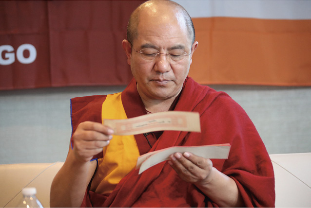
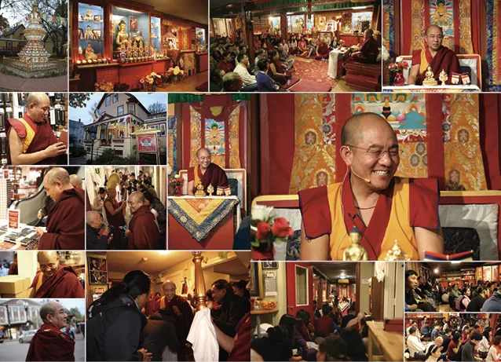
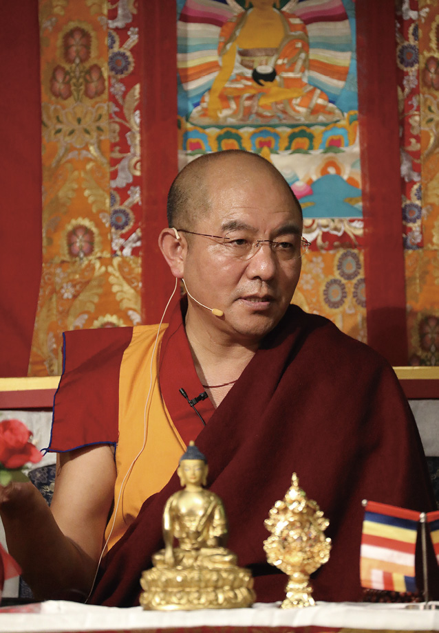
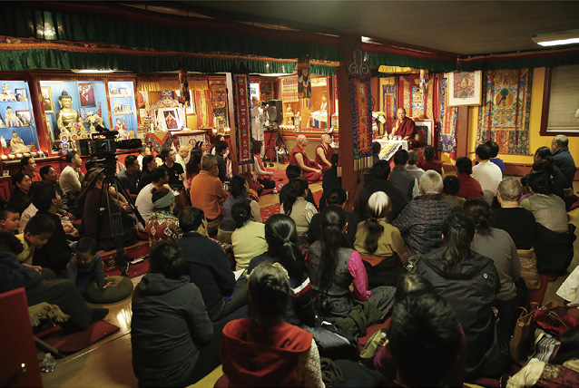
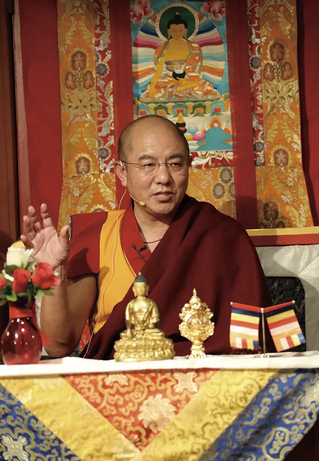
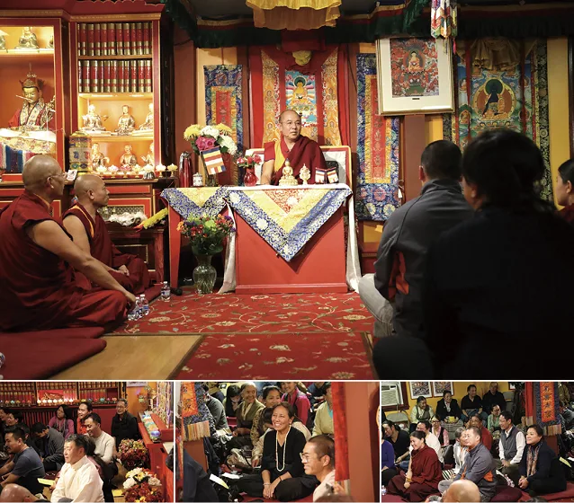

不论上师讲什么法，  
都要有信心。

第63场

美国波士顿格鲁佛教中心

Gelug Buddhist Center, Boston, USA

美国·波士顿

2017 / 11 / 4

## 藏语言和佛教的利益

## Tibetan Language and Benefits of Buddhism

住持格西：

感谢仁波切今天莅临我们波士顿的中心。作为出家人，仁波切以博学闻名于世。在我们藏地，仁波切现在有3所学校、2所养老院。学校里就读的，都是藏族的小朋友。仁波切将藏族的语言、文化，特别是不共的藏传佛法，传播到世界各地。尤其是对汉地，堪布仁波切有很大的功德。他在汉地的弟子，超过了800万。这些，都是他的事业。

堪布仁波切能来到这里，是我们的荣幸。我不浪费时间，不说太多。下面，有请堪布仁波切就藏语言、文化和佛教等话题为我们进行开示——

我个人并没有太大的功德。今天波士顿格鲁佛教中心的听众，大多是藏人，也有一些美国人和汉人。我用藏语简单地讲几句。美国的科学技术很好，但这个东西很奇怪[^1]。应该是个好东西，我们相信它是好东西。（众笑）

## 藏人是骨肉同胞，同根同源

在座的，很多是在这边常住的藏人。全世界的藏人都是骨肉同胞，同根同源。我们的语言文字是一样的，文化是一样的，大部分信仰是一样的，未来的前途和目标也是一样的。

不过从语言上分，有安多音、康巴音和拉萨音。其中，安多音又分很多种，康巴音在各个地方也不相同，比如牧区口音、农区口音。我所在的地方，虽然同在一个县，但山谷上方和下方的口音也不一样，上方是牧区口音，下方是农区口音。格西的家乡和我们县的大部分区域接壤，山谷上方都是牧区口音。虽然口音有很多，但我们都用同一种文字来书写，能诠的文字和所诠的意义也都一样。

我们属于同一个民族，使用同一种语言文字。虽然我在内地，你们在海外，相隔千山万水，但不论在何处相遇，心中都会同时生起“我们都是藏人”的喜悦。尤其是在异国他乡的大城市，藏人相遇就好像亲人相逢，心中会油然生起无造作的欢喜和快乐。

我这样说，只是表达此刻的感受，不是巧言令色。我事先并没有准备，心里想到什么，就说什么，没有刻意地褒贬。

## 不和睦相处，藏民族必定走向衰落

这里虽然是格鲁派的中心，但格西仁波切和中心的人都不分教派。持教者不论是谁，格鲁、萨迦的也好，噶举、觉囊的也好，到中心来，只要能护持善戒，弘扬藏族文化，都非常欢迎。在这方面，你们做得很好。

我们藏人有很多不同的传承，每个教派在不同的地方，发展情况也不一样。比如在有些地方，格鲁寺院实力雄厚，僧人众多；而在有些地方，则是宁玛、噶举、萨迦或原始苯教的寺院比较繁荣。寺院的规模有大有小，出家人的数量有多有少，信众的情况也各有差别。

这种情况下，不论在海外，还是在内地，藏人的和睦相处都显得极为重要。鉴于过去和现在藏族内部发生的各种各样的情况，如果我们这些有信仰、有文化、有能力的知识分子不和睦，各教派各寺院之间不和睦，老乡之间也不和睦，具体地说，如果在安多、康巴、卫藏等各个地方，教派之间、寺院之间、僧众之间、老乡之间，都不能和谐相处，那么，藏人的数量本来就很少，又因为外、内、密的三种障碍而遭遇各种情况，我们这个民族必定会走向衰落。

如果内部不和睦，弘扬佛法会变得非常困难。如果将佛教徒、基督教徒和伊斯兰教徒进行比较，佛教徒，尤其是藏传佛教徒相互争斗的情况是很罕见的。不过，虽然没有发生过大的冲突，但在藏地各教派、各寺院的历史上，宗派不和的事情还是发生过一些。以后，我们要吸取教训，尽量避免这类不和的事情。

就个人来说，我的家乡和格西的家乡离得很近。很久很久以前，我们就有一些联系。他的心量很大，不分宗派，不分寺院，不论持教者是谁，只要是藏人，只要是佛教徒，大家就一起努力，共同弘扬佛法。对此，我非常欢喜，并十分随喜。

你们中间，虽然出家人不多，但是藏人很多。不论你属于格鲁、宁玛、萨迦，还是噶举、觉囊等传承，经常来中心和寺院学习都很重要，不分别教派也很重要。

而且，我们不能只在口头上“不分教派”。对自宗的持教大德称扬赞叹，对其他教派的持教大德却满不在乎，这样的做法，只是口头上的不分教派，实际行为却并非如此。

总之，不论是内地的藏人，还是海外的藏人，不论是僧人，还是在家人，我们都有一个共同的目标：和睦相处。不仅要在口头上说好，还要在行动中真正地做到。这非常重要。

## 无论哪个教派，弘扬的都是正法

在学习佛法的时候，也要不分新译派和旧译派。在立足各自教派的修行上，如果能向其他教派学习，也许会有意想不到的收获。从前有位尊者说，他在庸增仁波切座下学习《密集金刚续》[^2]时，对“轮涅皆化为光明”一句的含义不太明白，虽然月称菩萨解释为如梦如幻，但仍难以通达。后来，他在阅读旧译宁玛派的大圆满续部时，看到原始心发出光芒，最后融入光明空性的窍诀时，之前对“轮涅皆化为光明”以及对月称菩萨相关释义不清楚的地方，都变得清晰明了了。

当然，不光是我们宁玛，大家如果去了解噶举和萨迦的教典，也非常有意义。同样，宁玛或萨迦的修行人，如果学习格鲁派的宗义，也有很大的利益。宗喀巴尊者的诸多经教对其他宗派而言，也是极其珍贵的。比如，在《缘起赞》中，尊者以自己的智慧讲到：万法由因缘所生，因缘生故，佛出世或不出世，都是如此。如是开显了佛陀的密意。

对于这样的缘起道理，我们在修法的时候，一定会有所体悟。一切万法都是缘起的，不是缘起的法根本不存在，作为一个佛教徒，不管学习什么，如果不能对此生起定解，要想深入佛法是很困难的。旧译宁玛派修行人也好，格鲁派修行人也好，都要如此了知。从前上师们的窍诀也都如此。

在我们宁玛派内部，也经常学习格鲁的宗义。而且不论在什么地方，都会传讲格鲁派的经典。1987年，上师如意宝晋美彭措堪布在五台山，讲授了格鲁的《道次摄要》[^3]和萨迦派无著贤[^4]的《佛子行》——并不是只传宁玛的法。和上师如意宝同去五台山的我们，平常也会读宗喀巴大师的《菩提道次第广论》《缘起赞》等经典教言，并向宗喀巴大师诚挚地祈祷。

藏传佛教的各个宗派，不论属于佛法的哪个源流，都是正法，都具有加持力，都值得我们对出家、在家的信众宣讲。在各教派的正法传承中，虽然在中观和密法方面有不同的安立，但许多在家信众都没有闻思的传统，只是念诵金刚萨埵心咒、观音心咒、莲师心咒、度母心咒等，实际上没有什么差别。如果在这方面区别对待，不是太好。

在藏地，虽然有不同的教派和寺院，但就像我们在不同的商店买同一个东西，表面上不同宗派的上师会传讲不同的法，实际上所有的这些法，都是首先发菩萨心，中间积累广大资粮，最后证得菩萨的果位、佛的果位，本质上并没有什么不同。

因此，不论什么地方的藏人，对宗派都不要有好恶之心；不论什么宗派的佛教徒，都要好好地修行佛法；不论自己属于哪个宗派，都是各自因缘的显现；不论上师讲什么法，都要有信心。

## 别人都在学，我们自己为什么不学？

在修行方面，藏族在家人一直没有学习的传统，仅仅是念念观音心咒，建一些玛尼堆，参加一下极乐法会，等等——美国这里是什么情况，我不太清楚。在未来，这种情况可能需要改一改。

现在，汉族人从藏传佛教接受了很多的佛法。不仅学习《普贤上师言教》、道次第，修持50万加行，还对中观、因明、俱舍、现观等五部大论生起欢喜，深入学习。在美国、英国、加拿大等各国的佛法中心，他们也从具相的藏族上师处得受灌顶，听取教言，并认真地修持。

这一点，我觉得值得我们藏人借鉴。不论是在波士顿，还是别的什么地方，不论是藏地的哪一位上师，如果能给具信的藏族大众，讲授一下大圆满、大手印等修法，讲解一下中观的见解，引导大家次第地学修，会非常好。我对你们这里的藏人寄予了厚望。

外国人学的是我们藏传的佛教，汉人修的是我们藏地的佛法，藏人自己有什么理由不好好学修呢？而且，藏传佛教都是用藏语和藏文来讲解的，藏人学起来更为方便。

（堪布改说汉语：今天我用的是藏语，你们大多数人可能听不懂。明后天在理工大学有讲座，你们可以去。明天中午也有一个汉语的开示。等会儿我会念《极乐愿文》的传承，大家都能得到。在我讲的过程中，你们都听不懂，只能忍着，没办法。今天是藏语的开示，汉族人和我们经常说的“老外”，只能干坐着。

堪布说回藏语：现场有一些汉人和外国人，听不懂我在说什么，所以给他们安慰一下。）

另外，我们藏人对修法还应该再精进一些。你们虽然在一个自由的国家，却不一定有修法的自由。在修行中，大家肯定会遇到一些困难，因为不论是谁，都有轮回的琐事需要做。

在异国他乡，都很忙，都有很多工作要干，而且住在别人的环境中，不能违犯他们的习俗。总之，谋生困难，时间不够，这些情况可能都会有。在藏地和汉地，也有一些人特别忙。加拿大、澳大利亚的藏人，也说自己没有空闲，忙得很。但无论如何，我们既然是藏人，就应该好好地修法。

其他民族和国家的人，有很多从藏传佛法中得到了利益，心中生起了定解，息灭了大的压力和痛苦，今生获得了巨大的快乐。所以，当他们见到持有藏传佛法的藏人时，会特别欢喜。

这有点像全世界的佛教徒对印度的感情。不论是谁，只要是佛教徒，对印度的诸位圣者，不论是月称菩萨、龙猛菩萨，还是圣天菩萨、寂天菩萨等，都非常喜欢。而且，因为学过他们的法，对他们所在的国度——印度，也有不一样的感情和信心。

因为很多外国人都在学藏传佛教，所以在世间法方面，他们给予了藏族很多的帮助和支持。而且，这样的人一天比一天多，修法的人也一天比一天多。我去到世间的学校、酒店等场所，很多人都由衷地赞叹藏传佛法，表现出很大的信心。我个人的经验是这样的。

学法最重要的因缘是什么？就是信心。藏地气候恶劣，天寒地冻，有很多不共的困难。尽管如此，他们仍然重视藏传佛教，精进地闻思修行。这种情况下，我们藏族人自己，却不珍惜、不重视自己的法，真的很奇怪。

## 不能随便他们怎么说

现今，世间的人心所向是什么呢？科学。他们只承认科学，对宗教信仰、宗教习俗、宗教的行仪等，越来越不认同。在家人的群体中，有这样的人。在出家人的群体中，在穿着佛教僧服的这些人当中，也有这样的人。认真修法的出家人越来越少，反对佛教的出家人越来越多。已经成了这样的时代。

海外藏人的修行情况怎么样，我没有专门研究过，不是很清楚。但是说真的，不论是格西，还是我自己，过去的二三十年，都在努力地学习佛法，尤其是藏传佛教。我虽然不懂英文，但懂汉语，而格西们懂很多的语言。我们对佛法都有比较深入的学习，都在用其他民族的语言传播佛法。

世界上有那么多的文字，要学的东西很多。而我们藏传佛教，不论谁去研究，都会觉得非常特殊。这并不是自赞毁他，而是通过智慧认真观察以后，得出的结论和事实。其实，能让我们对此生起定解的经论，有很多；能让我们生起定解的上师智者们，有很多；能让我们生起定解的密教的智者们，也有很多。

但是，现在美国有很多大学教授，比如哈佛的有些教授，却表现出很大的傲慢心。这些人尽管在学藏传佛教，却没有如实理解。学得并不好，却什么都敢驳斥。这样的人，越来越多。

我们不要认为，这是一位大教授——大教授直接反对，自己马上就心虚了、无言以对了。不要有这样的疑虑。佛法是有理有据、真实不虚的，经得起任何批判和问难。在佛法的真理面前，大学教授又有什么了不起的？

在我看来，这些大学教授，虽然在做佛法的研究，但却没有如实地了解藏传佛教。由于他们看过的书很多，所以敢说的地方也很多——这个对，那个不对，等等。他们对藏传佛教的指指点点，其实是不合理的。

我之前来过这里一两次。英国人和德国人好一点。在美国，很多教授会藏文和藏语——我们藏族的很多年轻人都不会自己的文字和语言，而这些美国教授却会。他们有些人研究得很不错，而有些人的表现就很奇怪了。

当这些教授对藏传佛教发表不合理看法的时候，我们出家人也好，在家修行人也好，藏族学者也好，都不要认为随便这些教授怎么说都无所谓。我们作为藏传佛教的弘扬者、护持者，如果“随便他们怎么说”，那就太奇怪、太不可思议了。

佛陀说过，出家人主要是修持佛法，研究真相。所以在传统上，藏地的寺院就如同学校一样。藏地的在家信众虽然没有这样的学习传统，但是海外的藏人应该和他们不一样。大家应该好好闻思佛法，护持佛法，弘扬佛法。

## 藏语言面临消失的危机

今天我想说的重点是，藏人要好好学习自己的宗教和语言文化。关于佛教，前面已经讲了。下面讲一讲关于藏语言和藏文化的问题。

我不太清楚藏语言在美国的处境怎么样。在藏地，大部分地方的小孩都不会说正确的藏语了。你们的孩子也不会，只能掺杂着英文说一些。父母都是藏人，小孩却成了外国人一样，不能好好运用自己的语言。已经变成这样了。

对此，我们可能也束手无策。因为在21世纪，世界上很多民族的语言和文字都面临着消失的危险。

美国有一位语言学专家，名叫梅阔尔（McConvell）。他本人是20世纪的人，却曾预言说，到21世纪，世界上50%到90%的文字和语言会消亡。现在真的是这样。联合国根据最近的研究发布了一个“全球濒危语言地图”[^5]。这里面指出，印度有196种语言面临着消失的危险，美国有192种，印度尼西亚有147种。

我们藏语也面临着消失的危险。你们父母那一辈，只会藏文，不会中文或英文；到了你们这一代，既懂中英文，也懂藏文；到了你们的孩子那里，只会英文，有一部分懂一点藏文——能听懂，却不会讲。变成这样了。

这样的情况，对我们藏人而言，真是太可怕。为什么呢？因为我们的语言文字真的要消亡了。只有少部分人还在为此操心。很多堪布、格西和喇嘛，到处弘扬藏文，让人们学习，为此做了很多工作。一些老师、作家、歌手，也在积极想办法，不论是庆典仪式、弹唱歌曲，还是动画片或影视作品，以及各种场合和节目中，都尽可能多地使用藏语。

表面看起来，处在自由环境中的外国藏人，学习和推广藏语应该有很多方便，可事实上，你们的藏语水平却比内地藏人还要弱一些。也许这样的判断无凭无据，不过在我自己看来，的确是这样。

去年，我去了澳大利亚、加拿大等很多国家。在那些国家，许多藏人的孩子对藏语一窍不通。他们作为父母，也一点也不担心。再这样下去，20年以后，就没有会说藏语的藏人了。虽然还是藏族的血统，但却没有一点藏族的文化。会有这样的危险。

我询问过这边的情况，据说孩子们每周日都会学习一两个小时的藏文。这非常好，但不能仅此而已。为什么呢？我们的孩子，上的都是西方人的学校，这会对他们的内心产生影响，慢慢地，就不讲自己的语言了。

藏地现在变成什么样子了呢？无论是小县城，还是大一点的城市，孩子们在学校，或和朋友在一起的时候，说的都是汉语。在家里，父母都是藏人，不太会汉语，彼此会说藏语，而面对孩子的时候，父母都要说汉语，否则孩子听不懂。孩子对父母，说的全都是汉语。你们在海外，可能以后也会变成这样。

内地的藏人，说话时掺杂着其他的语言，比如把藏语和汉语混在一起说。这边也是，很多人把藏语和英语混杂着说。我一个藏人遇到你们，却看到你们这些藏人都在说英语。懂英语的人还好，要是不懂英语，藏语和英语混在一起，完全不知道在说什么。你们的孩子也是一样，只讲英语，不说自己的语言。

为了改变这种现状，上师们、善知识们，在四面八方，做各种努力。

## 不能只知道建寺院，还要多建学校

推广藏文，学校非常重要。如果没有学校，推广藏文很困难。所以，我们应该在藏人比较多的地方，建立学校，里面要教藏文、英语或其他语言。在我家乡那边，有些学校就是这样的。但是，如果要建学校，和当地的政府有关系，和经济也有关系，也不容易。

现在，上师们在外面建立了不少的佛教中心。在台湾、美国等地，藏传佛教建了很多的佛法中心和庄严的寺院。但是，建学校比寺院更重要。我曾在哈佛大学见过一个喇嘛。他和尼泊尔的一位基督徒，有过一次交谈。基督徒说：“20年后，你们大多数藏人都会消失，而基督教将占领整个尼泊尔。为什么呢？你们藏族喇嘛只会建漂亮的寺院，却不在各处建学校。而我们在尼泊尔很多重要的地方，都建了学校。所以，你们没有接班人，而我们有。”

他说得很有道理。所以，我们在海外的喇嘛也好，商人也好，都要尽量多建学校，教授藏文。这一点非常重要。虽然有一点困难，但在有自由的国度，还是具足顺缘的。

我从前去过柬埔寨这个国家。那里有很多中国人。过去一段时间，当地中国人的汉语水平一直在衰退。为了挽救自己的语言，很多中国商人联合起来，共同建立了一些小学和中学，教孩子们学中文。慢慢地，那里的汉语言便兴盛起来了。所以，只要我们能建立学校，情况是可以改变的。

有些藏人看不起汉人。但汉人不管到哪个地方，都非常爱护自己的语言文字。从国内来的汉人也好，在西方国家的汉人也好，他们的英文都非常棒，但大部分不会忘记自己民族的语言和文字。我们过去说：“和汉人一样，什么都不会。”而现在的藏人，好像也有点这样了。

汉人有很强的民族意识，也许是因为，如今他们的经济越来越发达，在世界各民族中变得越来越强大。但不论如何，一到西方国家，就忘记汉语和汉文化的汉人，非常罕见。在藏地喇荣，有很多汉族学生，却没有一个变成藏人的。而我们藏人，去了汉地的天津、北京等大城市，过了四五年，甚至两三年之后，就变得只说汉语、不懂藏文了。这样的人有很多。

不重视民族的尊严，对民族文化没有自豪感，不热爱，别人说什么语言，自己也跟着说，照这样下去，10年、20年以后，我们的藏语言和藏文化会出现很大的问题。

在过去，我参访了西方的很多佛教中心。我们藏人有信仰，这很好。但是，这还不够。我们还要有爱护藏语和藏文化的赤诚之心。不论到什么地方，我们都要考虑长远的将来，平时多在一起商谈、讨论。这一点很重要。

未来，藏人的语言和文字会变成什么样？可能会不太乐观。当地藏人的领导也好，老师也好，不要光在嘴上说说，还要在思想和行为上多思维、多关注。到底要怎么做？我们一起思考，一起努力。

如今在全世界，藏语言、藏文化和藏传佛教，都备受关注。这个时候，如果我们藏人自己，却一点儿不关心，那就太奇怪了。

## 藏族，一个勇敢的民族

佛教讲究闻思修。作为在家人，大家首先要依止上师善知识，多多听闻佛法。格西平时给西方人讲《入行论》《菩提道次第广论》等论典时，你们也要多多地听取。如果有别的高僧大德来这里讲道次第，大家也要认真听闻，不要觉得无所谓。对藏人来说，护持平时闻法的传统很重要，修法也很重要。

从前，藏地修行人都在寺院完成闻思、辩经、修五加行等，在家信众闻思修的非常少，一直有这样的传统。但是现在，可能需要一些改变：在家信众，也同样要好好闻思修行，每周甚至每天都要学习佛法。

即使从个人利益来看，大家也应该闻思佛法。如果不好好闻思，只是接一接法、念一念玛尼[^6]，恐怕不太够。我希望你们认真学习佛教的经论，既利益他人，也利益自己。

现在，依然是藏人将违缘转为道用的时候。从1956年开始，不断有藏人流亡到世界各地。对我们民族而言，这是一个很大的困境，令藏语言与藏文化面临衰退的危险。但也是一个机会，如今，我们的文化和宗教，在世界各个角落都看得见，摸得着。

当年的英语国家也是这样。为了探险，他们一群一群地离开故土，流落到不同的国家和地区。如今，在北美洲和澳大利亚，生活着很多白人。他们都是当年那一批探险者的后代。

我们藏族是一个勇敢的民族。半个世纪以前，成千上万的藏人，从小小的藏地，流落到地球的四面八方。如今，世界各地都能看到我们藏人的身影。包括英国在内的欧洲国家，现在也有上千的流亡者。他们在当地学习、工作，过着平静的生活。由此可见，我们藏人是能够将违缘转为道用的。

藏人的流亡，不只是为了生活，也是为了用自己的文化利益各方。藏人在外面建立的佛法中心和道场，发挥了各种作用，利益了无数众生。相对于其他民族而言，藏人的勇敢、勤劳和自豪，也许具有更多、更鲜明的特色。

总之，大家要再接再厉，继续努力，不断地闻思佛法、护持佛法。除此以外，我没什么要说的了。如果你们有问题，就按格西仁波切的安排，进入下一个环节。

## 本次开示的中文浓缩版

接下来，我再用中文讲一下：

刚才我说，明天会有汉语的开示。但格西建议，今天也稍微跟汉族的佛教徒说一下。

我在给藏族人的开示中，首先讲到，藏传佛教的各个宗派之间，应该彼此圆融，无有偏堕。在藏地，教派之间比较和睦。西方国家非常开放，非常包容，各教派更应该这样。比如，这里虽然是格鲁派的道场，但我们宁玛派也好，萨迦派也好，噶举派也好，觉囊派也好，各派的修行人都可以过来交流、学习。这就非常好。

所以，附近的信徒，应该以包容和正直的心，来接受各个教派的教法。要保持清净的心态，好好闻思，不要有隔阂。这是我要说的第一点。

第二点，这样的学习，对我们自己很有帮助。藏传佛教的教义，有些是按格鲁派的教法来解释的，有些是按宁玛派的教法来解释的，还有些是按其他教派的观点来解释的。无论哪个教派的解释，都同样很殊胜。格鲁派的《缘起赞》非常殊胜，宁玛派的大圆满也非常殊胜。所有这些教法，我们都应该认真地学习。

第三点，在如今的藏地，藏语言发展的后继力量比较薄弱。藏人到了外面的世界，使用藏语的能力也在慢慢退化。照这样下去，藏语将来可能会走向灭绝。有这个危险性。

因此，我希望所有的藏族人都能说藏语，都用藏文写作，不要忘记自己的母语。在21世纪，世界上大多数的语言和文字，会走向灭绝。如果不采取积极措施，藏语言也很危险。因为比较担忧，所以我讲了这一点。

最后，我希望藏族的在家人，在汉地的也好，在西方国家的也好，都能真正地闻思修行。藏族的知识分子，本来就有虔诚的信心，如果认真地闻思修行，会有很大的收益。在这方面，格西和其他高僧大德，都可以给大家提供相应的资源。有这么好的学习平台，非常难得，大家一定要懂得珍惜。

总之，当我们拥有难得的人身时，一定要好好闻思修行。这样的人生，才是有意义的。我刚才大概说了这几点。

现场互动

格西：

下面大家可以提问，什么问题都可以。

堪布：大家要提问啊。一般这个时候，汉族人会提很多问题。我们藏人好像只会说：“请加持。我没有问题。嗡玛呢巴美吽！”（众笑）

问：仁波切好。我想知道，喇荣的创始人晋美彭措仁波切是如何建立喇荣五明佛学院的？那边男女众的出家人有多少？很多人都不太了解晋美彭措仁波切，能否介绍一下？还有，为什么会有那么多汉人学习佛法？这个很重要，能否就此简要开示一下？

堪布：堪布晋美彭措，曾经在波士顿其他教派的佛法中心住过几天。那时候，就有一些藏人在这里定居。我和他们已经认识20多年了，可以说是一个吉祥的缘起。

之前，我在国外的大学，讲过堪布晋美彭措的传记，这里再稍微讲一点。堪布虽然长年住在康区色达这个小地方，但却是这个时代具有巨大加持力的一位上师。对我们而言，他有着与其他上师不共的特点。他热爱藏族，同时曾经前往其他很多地方，弘扬佛法。当年，他去了汉地五台山，之后很多汉人成了他的弟子。后来，他又去了北美洲和欧洲的一些国家，利益众生。

喇荣佛学院已经成立37年了。这37年当中，尽管历经艰辛，现在仍然有几千尼众和男众在那里学习佛法。他们坚持不懈、勤奋努力。也有很多汉族居士和僧众在那里求学。以这样的原因，现在喇荣在汉地比较有影响。

为什么会有那么多汉人到那里求学呢？因为藏传佛教具有与众不同的加持与特色。日复一日，越来越多的汉人来到学院，精进地闻思修行。所以，你们这里的藏人，也要学习佛法，这非常重要。

问1：听说烟供的功德很大。平常我们烟供，会有怎样的功德？

堪布：烟供分为素烟、荤烟，也有焚烟[^7]。素烟是把很多无肉的东西混在一起烧，香味四处弥漫。荤烟里面会有很多肉类。在藏地，一般结夏安居的时候，会做除障的素烟。华智仁波切有一个特别的烟供仪轨，麦彭仁波切在著作中也讲了很多烟供的修法。

麦彭仁波切造过《烟施魔崇部多仪轨·解脱诸恶缘》，平时如果多念诵，布施给附近的非人、亡灵、魔众、饿鬼等众生，以及自己前世的冤亲债主，会有很大的利益。这样的烟施很重要。

如果不念仪轨，可以在心中念诵玛尼，然后烧一些糌粑或米饭，再念诵玛尼和“嗡啊吽”，也同样能利益饿鬼等众生。前辈的高僧大德们是这样说的。

问2：法会会供时，会放五肉。为什么要放肉？释迦牟尼佛又不吃肉，上供时放肉好吗？我对此有些疑问。

堪布：这是荤烟的仪轨。按照上师们造的烟供仪轨，如果有肉，会比较好。因为有仪轨的加持，以仪轨的力量，比如“嗡啊吽”等咒语，能让会供的酒和肉，变成甘露。

问：做水食子有很多的仪轨。这些仪轨有各自不同的念诵方法和功德利益吗？应该怎么选择？

堪布：佛陀在经典中，讲到了布施水食子。乔美仁波切造了很多供百水食子的仪轨和简轨。麦彭仁波切也讲过很多。藏地的水中伏藏和续部中，也有很多水食子仪轨。根据仪轨做水食子和饭供等，对众生有很大的利益。

所有的这些仪轨，都是具德上师以金刚语造的，都有各自不共的力量。它们次第地加持水食子、焚烟等，能让饿鬼、魔鬼等息灭害心，不伤害众生，进入菩提道。仪轨有很大的力量，这是从前上师们说的。

总的来说，仪轨的念诵方式和具有的功德，大多会在仪轨的结尾处写出来。念诵的方式，根据不同的传承，也会不一样。宁玛派的仪轨念诵方法有很多，格鲁派各个寺院的念诵方法也有所不同。某些具体的修法，也有差别。比如大威德有不同的修法，金刚手菩萨、密集金刚等也有不同的修法。自己是哪个宗派、哪座寺院、哪位上师的弟子，就按照他们的传承来修比较好。

西方的有些教授认为，藏传佛教的所有教派应该全部统一，太多了有点困难。他们还说，藏地所有的同类仪轨也应该合成一个。比如水食子，光伏藏品当中就有很多不同的仪轨。他们认为，这么多水食子仪轨应该合成一个，这有利于藏传佛教的教派统一。实际上，把水食子的仪轨变成一个，对藏传佛教的教派统一并没有什么利益，但他们就要这么说。

我曾经碰到一个教授，她说：“喇荣五明佛学院应该恢复比丘尼的戒律。很容易，只要聚集十位比丘就可以了。”我说：“恢复比丘尼的戒律不是那么容易的。”她说：“很简单。如果你们没办法，我们可以帮你们。”这些西方教授，性格很直，但他们很多人对藏地的佛法并不太了解。

以后，我们藏人应该和他们“辩经”。我们的格西和上师们，不要只会说：“你们是教授，你们很好。”他们可傲慢了。藏族有傲慢的喇嘛，西方有傲慢的教授——非常傲慢。

你们的孩子是他们的学生，如果不恭敬老师，就不能顺利毕业。但是，西方学校里的有些教授，正在篡改我们的佛法，这对佛法有很大的伤害。我们要认真考虑这个问题。

格西：

提问就到这里。下面仁波切将给予我们乔美仁波切《极乐愿文》的传承。

（堪布念传承）

[^1]: 麦克风刚开始一直发不出声音。
[^2]: 密集金刚，又称密聚金刚，藏名为桑顿多杰，是藏密格鲁派崇奉的五大本尊之一。属无上瑜珈部父续，与喜金刚、胜乐金刚、大威德金刚等合称五大金刚法，讲规甚多。据说，密集金刚也是格鲁派创始人宗喀巴大师的守护神。
[^3]: 即《菩提道次第摄颂》，宗喀巴大师造颂，汉语版由法尊法师译。
[^4]: 无著菩萨，藏文全名为额曲土美桑波，意为“无著贤”，为萨迦派历史上卓有建树的大德，《佛子行》是其传世之作。
[^5]: 联合国教科文组织发布“全球濒危语言地图”，该地图指出全球有199种语言处境告急，其中有18种语言被列为“极度濒危语言”，这些语言有据可查的使用者不足10人，甚至大多只有1人。中国台湾一种原住民语“巴则海语”，使用者仅剩下1名年近百岁的老人。 截至2013年，全世界有6000多种语言。70多亿人口中，约80%讲最主要的83种语言。剩下的6000多种，有2500种被列为濒危语言，其中绝大多数甚至没有任何文字记载。这2500种濒危语言被分为5个级别，即不安全、危险、濒危、垂危和灭绝。该组织表示，截至2013年，每两周就有一种语言消失，超过很多动物的灭绝速度。
[^6]: 玛尼，是观音心咒“嗡玛呢巴美吽”的简称。
[^7]: 焚烟，把糌粑和三白、三甜合在一起烧的烟供。
