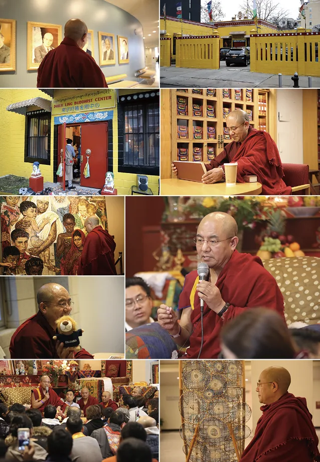
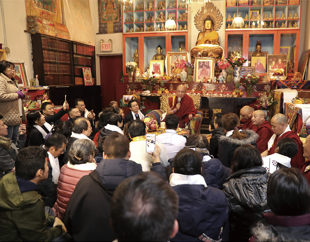
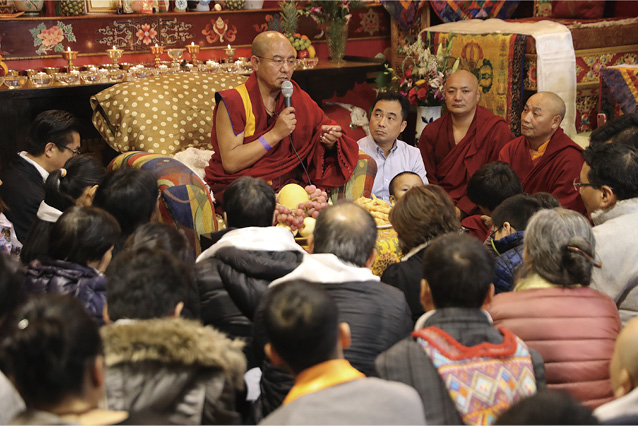
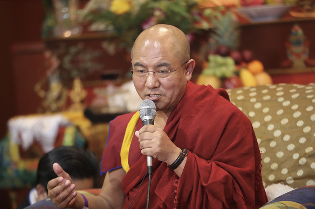
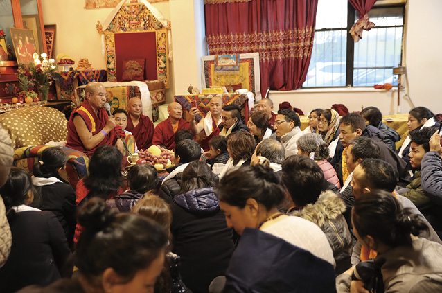
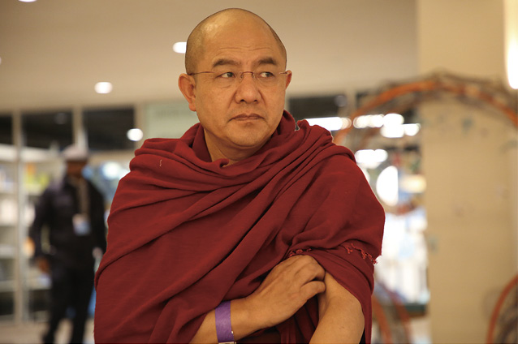

不管哪一个修法，最重要的，  
都是认识自己的心。

第67场

美国纽约觉囊时轮金刚道场

Jonang Kalachakra Center, New York, USA

美国·纽约

2017 / 11 / 13

## 观察心性

## Observe Your Mind

主持人：

1993年，法王如意宝晋美彭措吉祥贤师徒赴美弘法。在这个佛教中心，法王当年慈悲地赐予了极其珍贵的殊胜教言。扎西坚参仁波切曾多次提到此事。众所周知，法王如意宝是藏地雪域一位无偏大爱的高僧大德，对我们觉囊派，一直很关注，很重视。如今在喇荣佛学院，以慈诚罗珠大堪布和索达吉堪布仁波切为主的所有堪布，对觉囊派的法脉也都非常关注。这些，我们心里都是知道的。在此，我谨代表仁波切以及觉囊佛教中心，向您和大家表示衷心的感谢——

今天很高兴，来到觉囊派的佛教道场。我个人觉得这件事很重要，所以下面的演讲，我会先用藏语说一遍，再用汉语简单翻译一下——自己给自己做翻译。

在上个世纪，1993年，法王如意宝晋美彭措来过纽约，也来过这个道场。当年法王在这个道场，还灌过“莲师除障法”的顶。这个法有广、中、略三种不同的灌顶仪轨，法王用的是比较广的四级灌顶仪轨。不仅如此，法王还对觉囊派佛教中心的未来发展和弘法利生寄予了厚望。

我那时跟随法王如意宝，来过这个道场。听说当年的一些老道友，至今仍然健在。

## 秉持法王如意宝当年的遗风

我个人而言，对每个教派的法脉都有信心。前一段时间我在波士顿，先去了格鲁派的中心，再去了噶举派的中心。现在到了纽约，又来到觉囊派的道场。在我看来，不管哪个教派的道场，都是佛教的道场；不管是理论还是修行，各教派的究竟密意都是一致的。所以，我自己一直在努力学习各教派的宗义。

法王如意宝当年，不管对哪个教派，觉囊派也好，格鲁派也好，宁玛派也好，甚至包括苯教在类，都持开放和包容的心态。各大教派的佛殿，在喇荣佛学院的坛城上，都有一席之地。这也是大家非常清楚的。如今，我们也算是秉持法王如意宝当年的遗风吧。

## 觉囊的不共法脉：他空思想与六加行

接下来，我想讲一下觉囊派他空中观的观点。众所周知，要如理如实抉择如来藏的本体，需要强有力的窍诀和教证。而这样的窍诀和教证，在觉囊派的不共法脉中能得到。也就是说，整个藏传佛教的他空思想，或者说抉择如来藏的光明部分，主要依靠觉囊派的教义，才能真正地了悟和领受。

法王如意宝生前，对每个教派的宗义都有很好的信心和评价，而对觉囊派的法门尤为重视。老人家的色身在娑婆世界暂时显现无常的前一阶段，讲的正是觉囊派朵洛瓦大师所造的《宝性论》注释。这部注释讲到中间，法王如意宝示现无常，色身暂时收摄于光明法界——讲法的因缘暂时中止。

所以我认为，将来觉囊派的法源会有不断弘扬的特殊机缘。不管是上师如意宝的显现，还是我们这些传承弟子的意愿，好像都蕴藏着这样的因缘。这些值得大家思考，要多了解。

我个人从觉囊派的教法中，得到过很多利益，尤其是《山法》[^1]——我经常在课堂上引用其中的教言。在阅读此论的过程中，我受到了很大的启发：一个是修行人如何修持佛法，如何坚定地把握当前的觉受；一个是如来藏的本来面目，以实修的方式怎样领会、怎样现前。这两个方面，我觉得很有意义，很有收获。

我讲觉囊派的这些功德，并不是故意吹捧、赞叹。不是这样的。长期以来，我自己的观点就是这样的。

大家都知道，在密法的续部中，《时轮金刚》是释迦牟尼佛亲口宣讲的。当年，在印度南方的米积塔跟前，佛陀依靠时轮坛城，给有缘弟子宣讲了这部大续。这是佛陀亲口所说的、密法最主要的续部之一。印度的很多大德，都造过《时轮金刚》的注释。在藏地，包括麦彭仁波切在内的很多大德，也造过不少注释。

而在觉囊派的教典中，对《时轮金刚》的注释讲得非常细致。而且，觉囊派对《时轮金刚》的主要修法——“六加行”，需要在打好密法精要基础的前提下，才能进一步修持，非常深奥。

我曾去过壤塘的一个觉囊道场，里面有好几百个出家人。他们修六加行时的闭关方式、所修教言等，确实非常殊胜，很让人生信心。当时的堪布，也曾经在我们佛学院待过。

## 认识心性，无非是空性与光明

我今天的开示，没有特别准备，因为中心没有提要求。但既然来了，就跟大家简单讲一下佛教有关的重要修法。

佛教有很多修行法门，比如修本尊、念咒语等。但不管哪一个修法，最重要的，都是认识自己的心。而认识自心，无非两个方面，也就是本体空性和自性光明。

本体空性这个层面，释迦牟尼佛在第二转法轮的《般若经》中讲得非常清楚。有关二转法轮的观点和密意，龙猛菩萨和月称论师等历代中观宗大德，阐释得特别细致。在藏地，荣索班智达和全知麦彭仁波切的教言，对认识心性的空性部分，讲得非常清楚。

至于心的光明部分，佛陀在第三转法轮的经典中讲得非常清楚，弥勒菩萨的《宝性论》和龙猛菩萨的《赞法界论》则进一步做了阐释。之后，藏地的全知无垢光尊者、明朗大译师，尤其是觉囊派的大德们，以窍诀的方式，将心性的光明部分，宣讲得特别透彻。

心的本体是空性，大家只要内观，就会非常清楚。在不离空性的前提下，心的自性也是光明的。《般若经》中说：“心无有心，心之自性是光明。”非常明确地讲到了光明。诸位大德的教言书中，也讲到了心的自性光明，而且，有时他们会用日月的光芒来比喻心性光明。

每个人的心都是光明的。这种光明，实际上是所认识的心性的另一种特质。所谓的光明，并不是像阳光或者灯光一样，特别耀眼。心的本体是空性的，在这个空性当中，还有明明清清的部分——并不是像虚空那样的单空，这就是光明。禅宗也有“烦恼即菩提”的道理。这个道理，通过上师的窍诀或自己的修行，最后得到了，就是所谓的认识心性。

作为一个修行人，如果不能认识自心，无论修什么法，都不一定能遣除痛苦；而一旦认识了心的本体，不管修什么法，做什么事，都会变得容易。

## 不观自己的心，离解脱会越来越远

佛教最主要的特点，就是观自己的心。藏传佛教很多大德的教言，都强调认识自己的心性。如果耽著表面的形象，从不观察自心，说明修得不是很深。

昨天，我给一些藏族人作开示。他们有的依止过上师，也听过一些密法，所以我告诉他们：作为修行人，归根结底要向内观，要对自心有所了解。否则，就像现在学术界的个别人一样，整天讨论别人的过失，从不内观，离解脱只会越来越远。在短暂的人生，一定要关注自心，尽量认识它的本来面目。

关于修行的教言，藏族人多多少少听过一些。很多汉族修行人，十多二十年来，也一直在学习，对很多教言都比较了解。但对内观自心——这么重要的修行，会不会缺乏足够的重视？

在纽约这个城市，有很多仁波切和上师，每天都有不同的法讯。对你们而言，并不缺少听法的机会。但有时候，因为自己雾里云里，没有把握好机会，没有认真学习，非常可惜。

因此，我今天在这里，对那些还没有修行，或虽然修行，但却不重视观心的人，稍稍作一个提醒，也算是一个鼓励：希望大家在修行的过程中，多多观照自己的心，认识自己的心。

## 所有的江河，终将汇入同一个大海

正如我刚才讲到的那样，我自己坚定地认为：在藏传佛教内部，不管哪一个教派，究竟密意都是互不相违的，不但不相违，而且融会贯通、一味一体。关于这一点，有智慧、有修行体验的人，观点完全一致。只有那些不了知各宗派究竟意趣的人，才会分别“你属于那一派，我属于这一派”，以致下面好多弟子也在中间扯来扯去。实际上，所有宗派、所有上师，都如江河交汇一般，最终流入十方三世诸佛究竟密意的大海。

藏传佛教著名的大德——班钦洛桑曲坚说过：凡是精通了义教证和理证的修行人，或具有丰富修证的瑜伽士，经过观察或体悟，一定会得出各教派究竟密意一致的结论。

这句话很重要。如果既不精通了义的经续教证、严密的理证推理，又没有任何的修行体验，只是像搞学术研究一样，在书本上钻来钻去、夸夸其谈，“这个不合理，那个不如法”，不可能通达甚深广大的佛法真理。

不仅藏传佛教内部如此，如果详细研究或认真修持南传佛教以及北传佛教的教义，会发现他们的究竟意趣也是一致的。

所以，我们对佛教的所有分支和教派，都应该秉持清净和包容的心态。这不是为了应付某个场合，口头客气地说两句：“对每一个宗派，我都有信心，都非常喜欢。”不是这样的。应当发自内心对佛教所有分支和教派都有信心。各宗派之间应该快乐融洽，共同闻思修行、护持佛教、利益众生，而不是互相排斥。

自己给自己当翻译有点困难。有时候还可以，有时候就——有人告诉我：“你喝点水就好了。”（众笑）

我对未来的希望是，每个人都能对各大教派生起不退转的信心。实际上，觉囊派也好，其他宗派也好，都是前辈大德以智慧和悲心创立的。前辈们撰著的这些珍贵论典，我们应该以无有偏袒的心，认真地学习和修持，并以之引导有缘的众生。

在这个过程中，先要对自己的宗派生起信心和定解，这个很重要。有了这样的基础，再无偏地学习各宗见解，并把学到的宗义逐渐推广。对各教各派的大德教言，如果有时间、有能力，各方面因缘具足，每个人都应该去学、去修。倘若每个佛教徒都能够这样，佛教的智慧广弘于全世界，不会有任何困难。

我们应该认识到，传承祖师们以其不共的能力和智慧，发掘并传承下来的教言宝藏，对后人而言，是一笔极其珍贵的财富。这笔财富如何使用、如何分享、如何传承下去，我们这一代人肩负着重要的责任。

从这个意义上讲，我们都应该成为历史的见证人，也应该成为有时代责任感的修行人。

## 三个原因，三种欢喜

最后我要表达的是，今天来到觉囊中心，心里很欢喜。这样的欢喜，有三个原因。第一个原因，在当前的时代，各教派之间有必要建立圆融无违的关系。今天正好有机缘，和大家共同学习，所以很欢喜。

第二个原因，20多年前，我跟随上师如意宝，来过这里。20多年以后，我独自一人，再次来到这里。对个人而言，这是一次非常珍贵的体验，也是自己忆念上师的殊胜因缘。依靠这样的因缘，启发了自己的某些潜力。

第三个原因，今天这样的因缘，创造了一个好的缘起。刚才仁波切讲，在我们以后的人生里，要尽量弘扬觉囊派的教理和修行法门。我觉得，我们每个人都有这样的责任和能力。我自己将来弘法或修学时，也会以觉囊派的一些法要作为切入点，尽量在世界范围内弘扬如来的教法，给全球众生带去利益。

总之，依靠这三种因缘，今天跟大家有这样的聚会，我心里非常欢喜。

主持人：

堪布仁波切不仅给我们开示了取舍的要点，还在实修方面赐予了殊胜的教言。对此，我们表示衷心的感谢！

[^1]: 《山法》，全名为《山法了义海论》，为觉囊派开山祖师笃补巴·喜饶坚赞（1290-1361年）所造，重点阐发他空要义。
