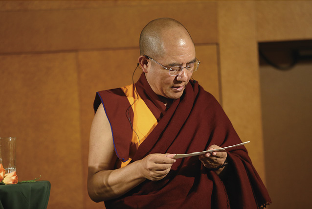
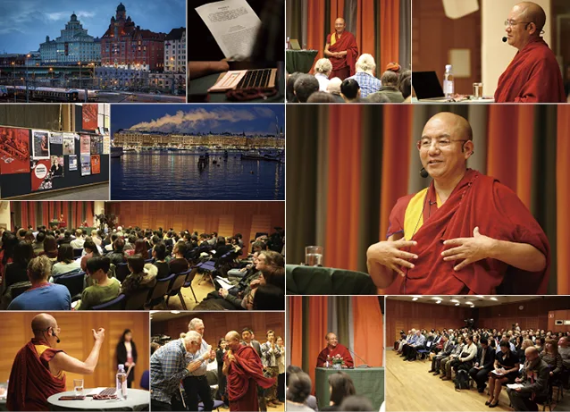
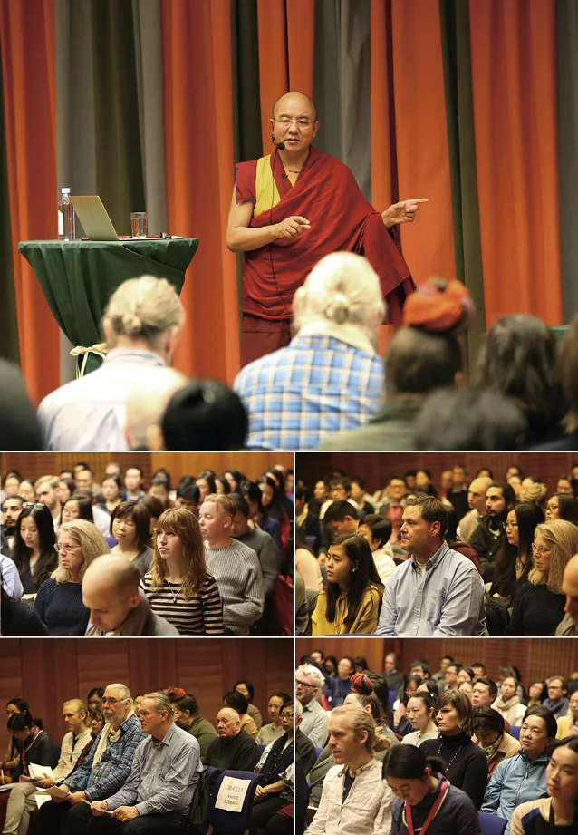
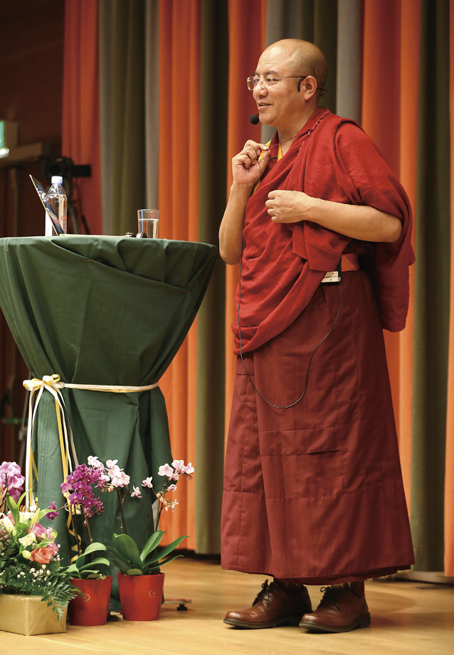
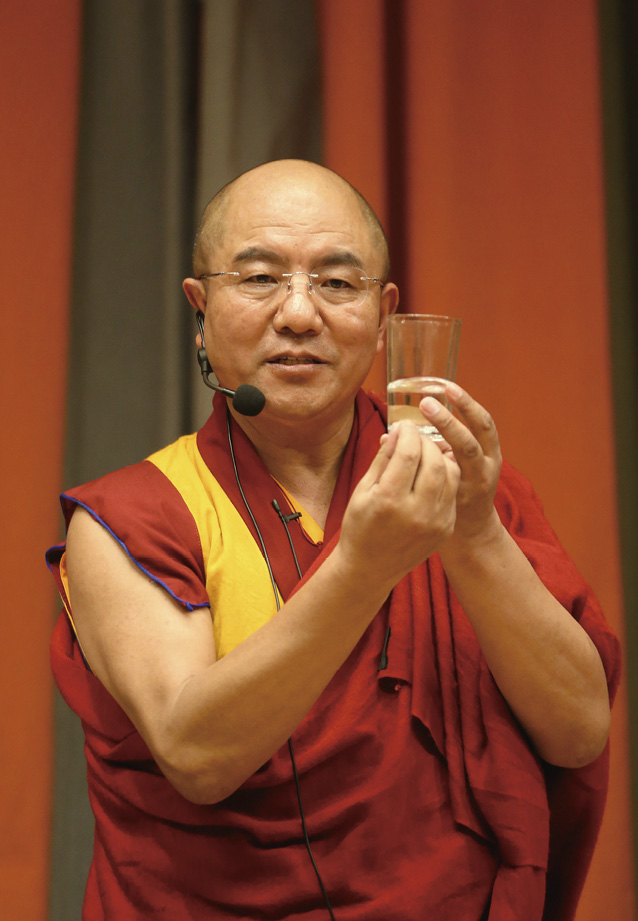
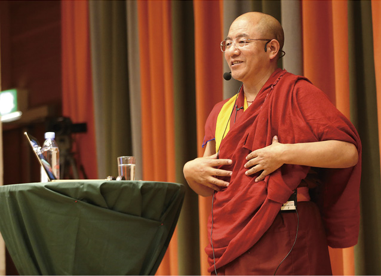
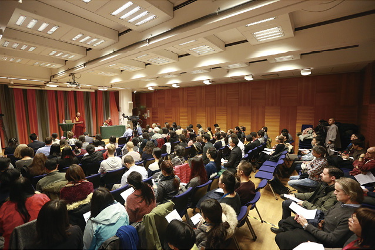
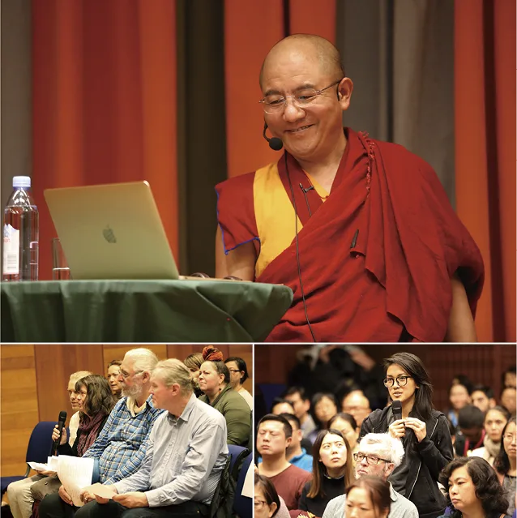

活在天堂，还是地狱，  
选择权都在自己手里。

第71场

瑞典斯德哥尔摩ABF大楼演讲厅

Stockholm, Sweden ABF Stockholm

瑞典·斯德哥尔摩

2017 / 11 / 26

## 《心经》，超凡的喜悦

## “The Heart Sutra”- Happiness and Beyond

主持人：

尊敬的各位来宾，下午好！欢迎大家的到来！今天，我们非常荣幸地邀请到颇具影响力的藏传佛教大师索达吉堪布仁波切，来ABF为我们演讲。

在物欲横流的今天，当人们在重重压力之下，内心越来越浮躁和焦虑的时候，堪布却在孜孜不倦地传讲和翻译佛法，鼓励佛教徒在日常生活中培养仁爱和慈悲，也鼓励大众用佛教精神找寻内心的幸福和喜悦。堪布曾做过《幸福的根本是心》《遇见喜悦》《佛教告诉你调整情绪的方法》等演讲，也撰写了多部畅销书，如《苦才是人生》《做才是得到》，帮助人们用正能量面对生活。

在演讲和著作中，堪布经常提到，让生活充满喜悦的方法主要有两种：一是以菩提心利益他人，二是懂得般若波罗蜜多的空性智慧。今天，堪布将为我们带来“心经·超凡的喜悦”主题讲座。

《心经》以简短的文字和深微的意义，涵摄了般若波罗蜜多的所有精华。在座的有些道友，甚至只是读诵《心经》，也能够减轻压力，放松心情，安住于平和的心境。

下面，让我们以热烈的掌声，欢迎索达吉堪布仁波切！相信大家能在今天的精神大餐中，收获难得的喜悦！

今天在这里，跟大家一起分享和学习的，是佛教中著名的《般若波罗蜜多心经》，简称《心经》。这是佛教关于空性非常重要、非常专业的一部经典。我讲的时候，可能会涉及一些佛教术语，不知道大家能不能接受，我有一点担心。

今天用的是唐玄奘的汉译本。藏传佛教经常念诵和学习的《心经》，和唐玄奘的译本大体相同，只是前后内容要多一些。

实际上，汉传佛教也有比较广的译本，跟藏文译本的内容基本相同。以前的鸠摩罗什，还有法护，都翻译过。我看过汉传佛教《心经》的不同版本，大概共有七个。

## 没有信仰的人，也喜欢读《心经》

在藏传佛教的历史上，不管哪一个教派，都非常重视《心经》。藏地有很多教派，比如宁玛派、萨迦派、噶举派、格鲁派、觉囊派等，好多不同的传承。但各教派的寺院僧众也好，信教群体也好，都会读诵《心经》。

汉传佛教也有很多的教派，比如净土宗、禅宗、密宗、华严宗、天台宗等，各个教派也都非常重视《心经》。

南传佛教也有部分佛教徒非常重视这部经。大概是在1998年，有一个泰国僧人来到了我们喇荣沟。他身边一直带着《心经》，每天都念诵。后来他邀请我去泰国，我便在1999年去了一趟。回来后写了一本书，叫《泰国游记》。我在这本书里提到，南传佛教的部分僧人对《心经》也非常重视，在日课中经常念诵。

在社会上，尤其在汉地，不仅佛教徒对《心经》有信心，不少艺术家、书画家以及文化界人士，对《心经》也很感兴趣。在大大小小的书法展览会上，随时可以发现不同风格和不同形式的《心经》创作。其他很多艺术作品，比如油画、木雕、茶具等，也以各种各样的形式展现《心经》的魅力。

现在，《心经》不仅仅是一种宗教经文，也成了世间的某些文化符号。我认识的很多企业家，他们本人并不学佛，却把《心经》作为自己的企业文化，让员工经常念诵。

许多没有信仰的人，平时也喜欢念诵《心经》。这可能是因为，《心经》里说眼耳鼻舌身、色声香味触等都没有，念了以后，好像现实中的很多东西也没有了，暂时少了很多执著，心里比较舒服。

## 260个字，涵摄八万四千法门

这么短的文字——唐玄奘的译本只有260个字，为什么能有那么大的作用？这里面有很多隐秘的意义。

按照佛教的观点，《心经》浓缩了释迦牟尼佛转三次法轮所讲的全部内容。有点像现在的芯片，很小很小的一个东西，里面却存有好多文字、图片或音视频。同样，小小的一部《心经》，却浓缩了广大甚深的佛法内容，非常不可思议。

释迦牟尼佛一共转了三次法轮，讲了八万四千法门。第一次转法轮，是在印度的鹿野苑，主要讲苦、集、灭、道的四谛法门；第二次转法轮，是在灵鹫山，主要讲般若空性；第三次转法轮，是在广严城等地，主要讲如来藏以及延伸到密法方面的一些内容。

佛陀第一转法轮，除了讲四谛，还讲了五蕴、十二处、十八界和十二缘起。《心经》里有这方面的道理。

大家公认，《心经》主要是涵摄第二转法轮的精华。《心经》的“心”，指的不是心脏，而是信仰、精华的意思。藏文里面叫酿波，意思是“智慧的心要”，也就是所有智慧波罗蜜多的精要。

佛陀宣说的《般若经》，广的有十万颂，中等的有二万五千颂，比较略的有八千颂，再略一点的是《般若摄颂》，再略的就是《心经》，最略的只有一个字“阿”。最略的般若经典就是这样的：“阿——”

在佛教当中，凡是有关“阿”字的修法，都有很深的意义。很多人可能不理解，“阿”字为什么有甚深的意义？

我们初到人间的时候，都是“阿——阿——”地哭。刚一出生，就自然而然地发出般若空性的意义，根本不用学。最后离开世间的时候，我们也是“阿——”，呼出最后一口气就死了，也是般若空性。而且，不管哪个国家、哪个民族，生活中都离不开“阿”字的发音。“阿”字构成了我们的语言，构成了我们心灵的世界。

藏传佛教有“阿”字的具体修法。以前我的老师法王晋美彭措告诉弟子们，如果发愿念一亿遍“阿”字，他就把他最好的念珠分给大家。当时我们都发了愿。我脖子上戴的这颗念珠，就是二十多年前发愿念“阿”字得到的。但是，我到现在也念得不多，只完成了一部分，还没有一亿。

般若空性有“无生”的意思。而“阿”字的含义，就是无生。无生的，就是空性的，大概是这个意思。至于具体的修法，怎么是“阿”字，怎么观想，今天先不讲。我刚才讲“阿”字很重要，不是开玩笑。

今天跟大家介绍的，是比“阿”字稍微广一点的《般若经》，也就是《般若波罗蜜多心经》。这部经典是般若空性的精要，揭示了万法本体空性的道理，比如眼耳鼻舌身等全都不存在，都是空性的。

第三转法轮讲的是光明如来藏。“色即是空，空即是色”，其中“空即是色”讲的就是光明的内容，专业性比较强。

对佛教来讲，般若法门非常重要。释迦牟尼佛圆寂之前，郑重地叮嘱阿难尊者，要好好保护般若经典。他告诉阿难：“我讲的其他法，如果全部隐没，我都不会责怪你；但我讲的空性法门，即使失坏了只言片语，我也会责怪你。”

## 每天一遍《心经》，既满愿又消灾

读诵《心经》，可以实现自己的愿望，遣除各种各样的违缘。在藏传佛教中，祈祷平安也好，遣除违缘也好，增长财富、延长寿命也好，人们都会念诵《心经》。每年最后一个月的最后一天，也会念9遍《心经》，以遣除来年的所有灾难。

所以，当你们遇到困难、举步维艰的时候，如果好好诵这部经典，最后一定会渡过难关。我从小时候开始，每天都会念《心经》。虽然藏文《心经》比汉文的字数多，花的时间长一点，但我几乎没有间断过。如果有事中断了，过两天也会补上。

今天上午，我发了一条微博：“每天念汉文的《心经》一遍，六字真言‘嗡玛呢巴美吽’108遍，加起来要不了2分钟。”在座的各位，如果有兴趣，有生之年最好每天念一遍《心经》。汉文的《心经》很短，不到一分钟就念完了。每天坚持念一遍《心经》，我认为对每个人而言，都很有必要。

我算了一下，人的一天有1440分钟，拿出2分钟来念《心经》和六字真言，还剩1438分钟。如果你有信仰，或对《心经》感兴趣，坚持做这两件事情非常好。

作为一个佛教徒，如果整天散乱，2分钟都不愿意拿出来，那实在太懒惰了。有些人早就皈依了，但行为却不像个佛教徒——从来不做跟佛法有关的事，既不爱学习，也不爱念修，只是挂了个名而已。

有些人觉得：“我不用学佛，做一个善良的人就可以了。”你自己认为自己很善良，实际上却不一定。你的某些行为可能比较恶劣，但自己却不知道。

我不要求大家都变成佛教徒，但如果没有宗教的约束，或者说，没有宗教的指引，也许我们会在不知不觉中，犯下很多错误。现在，很多人什么都不信，只相信自己。自己的行为本来不如法，却认为非常合理。尤其是西方的自我中心主义[^1]，在激发人类的创造力方面，也许起到一定的作用，但过度地吹嘘和吹捧自己，不太合理。

很多人过于自信，以致对自己的权利和义务都分不清楚。人活着当然需要权利，但知道自己应该做什么、不应该做什么，也非常重要。我们有些人，每天花一分钟时间念《心经》都不愿意，却经常说“我们佛教徒应该如何如何”“你们佛教徒应该如何如何”，眼睛经常盯着别人，从来不管自己。

真正的智慧，既要观察外面的物质世界，又要观察自己的内心世界；既要观察别人，也要观察自己。

## 玄奘版《心经》，一段传奇的故事

唐玄奘翻译的《心经》比较短。对这个短短的译本，汉传佛教非常重视。为什么？它有自己的一段历史。

当年唐玄奘到印度取经，历史上记载了这么一件事：唐玄奘途经一个寺院时，发现里面有一个生病的僧人，非常痛苦。一看，僧人得了可怕的麻风病。玄奘没有继续前行，而是停下来照顾他，一直到他病好为止。僧人特别感谢他，临走时给了他一本梵文的《心经》，比较略，内容和今天学习的版本一样。

后来，玄奘求学的过程中，无论遇到什么困难，只要念这部《心经》，就会烟消云散。尤其是一次他去到恒河边，被当地人抓起来，准备献祭给水神时，他临危不惧：“如果你们非要把我扔在河里，也可以。但我作为出家人，死前有一个要求。”他们问：“什么要求？”他说：“我念完三遍《心经》以后，你们再扔。”他们觉得这个要求不过分，就答应了。玄奘把三遍《心经》一念完，天空立刻乌云密布，电闪雷鸣，所有的危难当下解除。

这件事，很多敦煌文献都有记载。汉传佛教之所以特别重视唐玄奘的译本，原因可能也在这里。

## 听《心经》，品味超凡喜悦

我以前讲过几次《心经》，时间都比较充裕。今天的时间很短，没办法细讲，只能从字面上框架性地介绍一下。很多人天天念《心经》，却不懂内容，听了这堂课以后，应该会有所了解。

| 《般若波罗蜜多心经》：观自在菩萨，行深般若波罗蜜多时，照见五蕴皆空，度一切苦厄。

这是前面的一个缘起。当时，佛陀进入了禅定，观世音菩萨也在行持般若波罗蜜多空性，并安住于五蕴皆空、远离一切痛苦的境界。由此可知，《心经》是观世音菩萨通过佛的加持，入于空性的禅定，和舍利子之间对话，形成的一部经典。

稍微有点佛教基础的人都知道，佛经有不同的类别：有些是释迦牟尼佛亲口说的，像《般若摄颂》《真实名经》等；有些是佛陀加持某个成就者弟子说的，比如《心经》；有些则是某个弟子和佛陀之间的对话，比如《文殊请问经》，记录了文殊菩萨和佛陀之间的一段对话内容。

有些西方学者认为，这部经既然是观世音菩萨说的，而不是佛陀所说，那就不应该列为佛经。这种观点完全是从学术角度衡量，不太合理。其实，人类历史上的许多文献，也不全是作者亲自书写的。各国首脑的演讲，也有一些是秘书或其他人代笔的。可是，学术界好像从来没有去观察过，某个总统的著作是不是全部由他本人所作。可见，他们的某些学术成果，可能也需要观察。

佛教宣讲了很多不可思议的力量，包括禅定的力量、智慧的力量、神变的力量等。对这些特殊的不共道理，佛教自己是有解释的。总之，《心经》是佛陀的意等持入于观世音菩萨的禅定后，由观世音菩萨宣说的，属于佛陀意加持的一部经。

| 舍利子，色不异空，空不异色，色即是空，空即是色，受想行识亦复如是。

前面的缘起说，观世音菩萨照见了五蕴皆空、远离一切苦厄的境界。在这里，他告诉舍利子：“色不异空，空不异色，色即是空，空即是色。”

我要稍微讲一点佛教的术语，不然没办法解释。整部《心经》，讲了“基般若”“道般若”“果般若”三方面的内容。此处讲的是了知“基般若”，先广说色蕴空性，再分别宣说七个甚深——藏传《心经》中有八个甚深。

首先广说色蕴空性。这四句，在藏文中的顺序是“色即是空，空即是色，色不异空，空不异色”，和汉文的顺序对调了一下。

“色即是空”的意思是，世俗显现的本体是空性的，或者说，我们凡夫人看到的这个世界，在真正证悟空性的时候，都是不存在的。凡夫根识前显现的法，本体确实不存在。物理学家也认为，所有显现，本体都是空的，万物皆非真实存在。这里断除了第一个“有”的边。

“空即是色”的意思是，胜义中不存在的这些法，在世俗显现中是有的。这里的色，不光是眼睛看到的色法。在佛教里面，色包含了五根、五境、无表色等很多内容。前面讲，这些色法的显现实际上是空性的。而这里又讲，空性中也是有显现的，断除了第二个“无”的边。

“色不异空”是断除第三个边“非二俱”——也不是有的，也不是无的，因为这两个是无离无合的。

“空不异色”断了第四个边，远离非二俱，也就是“二俱”——既是有的，又是无的。

四句话，断除了四个边，即有、无、二俱和非二俱。断除了这四个边以后，剩下的就是万法的实相：不是有，不是无，不是这两者，不是这两者以外的法。看起来有点矛盾，但实际上不矛盾，万法的本性就是这样。

稍微学过中观般若空性的人，用自己的智慧观察时会发现，这样的空性见解，不是佛教站在宗教立场的说法，而完全是智慧抉择的结论。

我们可以看一下这个水杯。表面上看，这是色法，但它的本体其实并不存在。物理学家也认为，夸克是构成物质的基本单元，再往下分会变成什么，没有确定的答案。现代科学还没有突破能量和场的概念。不管怎么样，我们看到的这个水杯，其本体并不是水杯。虽然在我们的肉眼里，它确实像是一个水杯，但肉眼看到的东西并不真实。

量子力学也讲到，万法最后会变成空。但真正的实相——和光明无二无别的空性，量子力学还没有抉择到。不管我们内在的心，还是外在的事物，经过慢慢观察，最后都没有了。但所有的这些“没有”，并不是一个单空，而是跟光明或显现无二无别的大空性。关于显现和空性是一个本体的内容，大家还需要继续学习和修行才能了解。

| 舍利子，是诸法空相，不生不灭，不垢不净，不增不减。

这里讲到了七种甚深的法。因为一切万法本来就是空性的，所以生和灭都是不存在的，清净和不清净、增和减，在诸法的空性当中都是找不到的，只能在现象中寻找。

接下来，讲的是了知“道般若”。在道般若里面，首先讲五蕴皆空，即色、受、想、行、识这五蕴都是空性。这是以前面所说的空性道理类推而来的。

| 是故空中无色，无受想行识，

以色蕴的空性类推，五蕴都是不存在的。五蕴的每一个本体，都以前面的方式类推，而得出空性的结论。

接下来是道般若的第二个内容，十二处：六根、六境。十二处也是空性。

| 无眼耳鼻舌身意，无色声香味触法，

以前有人问我：“我们明明有眼睛，明明有鼻子，《心经》里为什么说没有？”其实这是一个非常简单的问题。佛教根本没有破显现中的眼耳鼻舌身，这一点谁都看得到。但我们眼耳鼻舌的根也好，色声香味的对境也好，真正用智慧来观察的时候，都是不成立的。

| 无眼界乃至无意识界，

这是道般若的第三个内容，叫十八界：六根、六境、六识。十八界也是空性。

一会儿我讲完后会提问，你们要给我解释啊。今天这一堂课的内容，如果不会解释，听了我的课也没用。《心经》的大致内容，我希望大家都会解释。

“超凡的喜悦”这个题目，是我们前一段时间确定的。但如果对《心经》，连字面意思都不理解，恐怕没办法得到欢悦和快乐。最多是在听《心经》的过程中睡觉，因美梦而获得喜悦。但这种喜悦，不一定要在这个场合享受。

下面讲十二缘起：

| 无无明亦无无明尽，乃至无老死，亦无老死尽，

十二缘起也是空性的。

在《心经》里，不仅五蕴没有，连单独的空性也不存在。以此类推，十二处、十八界，还有十二缘起，以及下面讲的四谛，都一样：断除第一个边，断除第二个边，断除第三个边，断除第四个边。

| 无苦集灭道，

这是讲四谛的空性。

接下来是了知“果般若”：

| 无智亦无得。

果般若也是空性。

学习般若空性，最后会得到相应的果位或者功德。第一个功德是：

| 以无所得故，菩提萨埵，依般若波罗蜜多故，心无挂碍；无挂碍故，无有恐怖，远离颠倒梦想，究竟涅槃。

以无所得的缘故，菩萨依靠般若波罗蜜多，可以得到心无挂碍的境界。以心没有挂碍的缘故，所有的恐怖也不存在，远离一切颠倒梦想，得到究竟的涅槃。

还有一个功德：

| 三世诸佛，依般若波罗蜜多故，得阿耨多罗三藐三菩提。

三世诸佛都是依靠般若波罗蜜多，获得阿耨多罗三藐三菩提果。这是《心经》最终的功德。

《心经》由于综合了显宗和密宗的教义，具有咒语的作用，所以《心经》也叫咒语。这个咒语的名字叫：

| 故知般若波罗蜜多，是大神咒，是大明咒，是无上咒，是无等等咒，能除一切苦，真实不虚。

咒语是这样念的：

| 故说般若波罗蜜多咒，即说咒曰：揭谛揭谛 波罗揭谛 波罗僧揭谛 菩提萨婆诃。

以上，我简单从字面上解释了一下。以前讲过很多次，都比较广。如果对其中的每一个词，都想广泛地了解，可以参阅以前的讲记。有汉语的，也有英文的——已经翻译了。

## 种种恐惧，《心经》为你遣除

在这样的时代，不管什么人，依靠念诵《心经》来安心都非常重要。我自己是这么认为的。

我们的心，总有很多不安。按照《心经》的说法，就是恐怖。对生存的担忧，对五蕴假合的身体住世多长时间的担忧，都属于恐怖。说具体一点，比如工作能不能在有生之年不变，收入能不能一直稳定，身体能不能一直健康，青春能不能永远存留，等等。这些恐怖，我们在生活中多多少少都有一些。

应该怎样遣除这些恐怖呢？有些担忧和不安，其实是我们自己想出来的，根本不会出现。还有一些呢，依靠因缘或缘起不可思议的力量，比如念诵《心经》，就可以遣除。

我们除了要对物质世界有所认知，还需要在精神世界找到依托。人生的很多恐怖，需要依靠心的力量来解除。如果没有心的力量，科学再发达，物质条件再好，也不一定能解决问题。因此，我们每个人都应该有自己的信仰，或者固定的价值观。

我非常坚定地认为：除了获取物质上的满足，我们还要懂得快乐的方法、净化心灵的方法。不管有没有信仰，只要经常观自心，就有机会认识自己的心性。到那个时候，很多问题都不再是问题。

每次看到一些所谓的名人或成功人士，我都会想：“他会不会很痛苦？”如果内心充满痛苦，外面再有名声，再有财富，人生也是有缺陷的。我也经常看到，一些人表面上并不成功，内心却充实而喜悦。内心坚强、纯净的人，不管遇到什么坎坷，都不会视为挫折。

因此，活在天堂，还是地狱，选择权都在自己手里。

大家要把这260个字，作为日常的心灵享受。这一点，非常重要。此外，大家还要学会学习，学会思考。通过不断的学习和思考，你们会发现，宗教思想里有很多对治烦恼的智慧和方法。

接下来，我先用藏语念一遍《心经》的传承，然后你们用汉语念一遍，最后再用英语念一遍。结束以后，可以进行一些互动。

（堪布念传承等）

现场互动

问：堪布您好，很荣幸见到您。佛教讲因果，也讲无常，这两者有没有冲突？另外，这两个概念是不是由心的功能生起的？它最初的由来是什么？是因为无明，所以才有因果或者无常，还是说有一个独立于无明之外的规律？

堪布：要懂得这个问题，一定要懂十二缘起。十二缘起讲到了外物的缘起和内心的缘起。外在物质的缘起，比如春、夏、秋、冬的四季更替，种子和苗芽之间的关系等。虽然是无常的，但因和果之间的种种变化，有它自己的一个规律。

内在的十二缘起也一样。我们的业力，或者说前一刹那和后一刹那之间，虽然是无常的，但也存在“善有善报、恶有恶报”的无欺因果规律。

问：我想请您介绍一下，佛教在泰国的发展情况。

堪布：我1999年去过泰国的一些学校。当时就所谓的藏传佛教跟南传佛教之间的关系，写了一本书，叫《泰国游记》，有英文译本。在这里面，我讲了自己的一些看法。

这几年，我们连续开了几届“世界青年佛学研讨会”。这个研讨会的第五届、第六届、第七届，都在泰国清迈的朱拉隆功大学举行。在此期间，我们会和泰国的高层以及南传佛教的大德进行探讨。虽然在某些地方，我们有所不同，但总体上很有合作的因缘。

明年是第八届“世青会”了，也准备在清迈举行。到时候你如果有时间，可以参加。在那里，你可能会了解更多具体的情况。你如果想报名，我们可以想想办法，但也不敢确定。

问：佛说：“无色、无香、无味，四大皆空。”但是佛又说：“一叶一菩提，一花一世界。”这一虚一实何为因果？

堪布：这个很简单。刚才我讲过，眼耳鼻舌身意在显现上是有的，而实际却是空性的。佛陀所讲的五蕴、十二处等，或是世间的一切万法，如果对其本体进行观察，都不存在。但在世俗名言或现实生活中，“一叶一菩提”也好，“一花一世界”也好，全都以虚幻的方式无欺存在。显现和空性并不矛盾，我们必须要了解这个道理。

[^1]: 主张完全自由，随心所欲，没有伦理约束，一切决定根据“我”的意愿。
