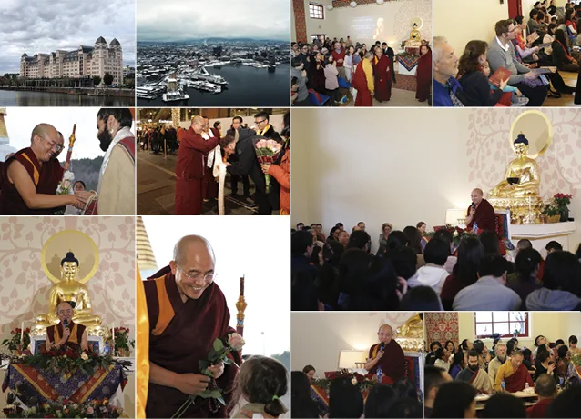
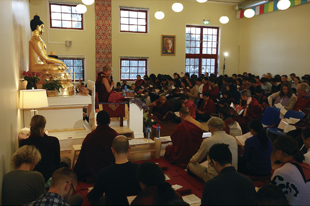
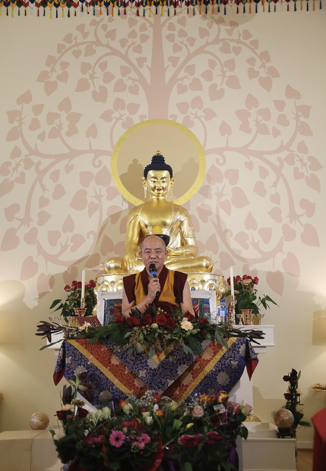
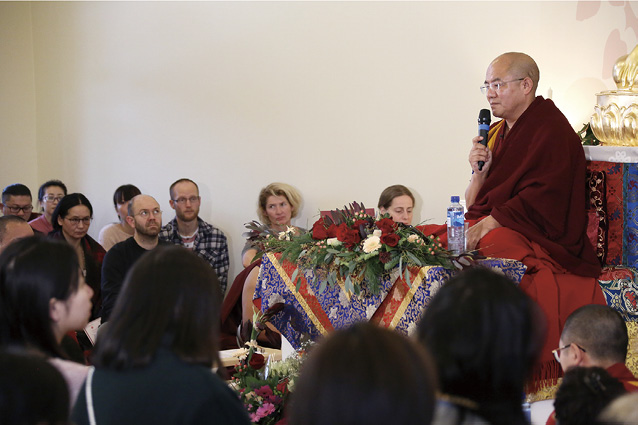

如果弟子能把上师的教言不断地弘扬给他人，

这就是最好的报师恩。

第73场

挪威奥斯陆噶玛扎西林

Karma Tashi Ling, Oslo, Norway

挪威·奥斯陆

2017 / 12 / 2

## 《生生世世摄受愿文》讲解

## Aspiration to be Cared for in Every Lifetime explain

首先，在我们听受正法前，大家要发无上殊胜的菩提心。发菩提心的时候要观想：为利益天下无边的一切众生，我们想尽一切办法，让他们将来都能获得正等觉的果位！

## 尊重差异

今天给大家讲法王晋美彭措的祈祷文——《生生世世摄受愿文》。无论是不是法王的传承弟子，只要对与自己有缘的根本上师有信心，都可用此偈颂祈祷。这篇发愿文，其实是一篇祈祷文，也是求加持的偈颂。虽然只有几句简单的颂词，但其意义非常甚深、广大。

这次是按照佛教的方式来传讲。佛教的方式与西方人的思维模式不同。东西方文化差异较大，各国、各地区的习俗更是不同。如今提倡全球一体化，即用某一种文化统一所有的文化。年轻人在西方学习完批判主义、自我主义的思想，回到家乡、祖国后就对传统文化一概否认。我觉得这种行为很可怕。虽然科技改变了生活，但不是所有的改变都有必要和意义。有些东西一旦改变，将是人类永远无法弥补的遗憾！

西方一些国家的规矩，虽然我也很难接受，但我会以尊重的心态来对待，绝不会轻易诽谤和诋毁。因此，希望西方学者和东方年轻人，在创业和学习先进知识时，不要毁坏我们的传统文化。于1950年获得诺贝尔文学奖的英国哲学家罗素曾说：“西方有科学技术的优势，而传统文化和道德最好向东方国度和民族学习。”

## 依止善知识

按照西方的观点，老师和学生是平等的，没有必要互相恭敬。在学习知识的时候也的确没有互相恭敬或观察。学木工、画画或其他技术时，对授业者也只是称为老师，并没有“视师如佛”之类的要求。

然而，听闻佛法需要遵循佛教“依止善知识”的要求。这一点千万不能西化！其实，拜师学艺的时候如果过于强调师生平等，那很难学到师父的真本事。众所周知，去年、今年美国的多所高校频频发生“学生对老师一味批判，以致无法开展教学”的新闻。

佛教历经千年传承至今的“依止善知识”，使无数人获得了圣者果位。我们更加不能轻毁它，也不要随意进行改革。当然，对人类社会有用的改革值得提倡，但如果把有用变成了无用，就是失败的改革。

我在接近40年的学习、授课的人生里，接触过各种文化和人。我始终认为佛教的“依止善知识”非常有用。我曾在上世纪90年代来过欧洲和美国，当时西方很多好修行人非常稳重，他们坚定地依止自己的上师，努力地祈祷自己的上师，至今一直修行自己的法门。

记得当时遇到了这个中心的法脉创始人——卡卢仁波切、第十六世大宝法王噶玛巴、创巴仁波切的传承弟子们，他们在提及上师名字时热泪盈眶——具足智慧、慈悲的上师已离开人世，具信弟子尚留在世间，当忆起上师的音容笑貌时，种种痛苦和思念难以抑制地涌上心头。这种感觉，我非常能理解：获得了上师的加持、智慧和摄受的弟子孤独地留在人世间，除了上师的头发、加持品以外，再也找不到上师的印迹，有种无依无靠的感觉。

回顾自己这一生，感恩学校老师教给了自己知识，感恩亲生父母赐予了自己身体以及养育之恩。但是，他们没法给予自己观心的窍诀，以及从轮回苦海中获得解脱的教诲甘露。唯有上师能给予自己无上的教导，上师是谁都无法比拟的恩人。

这首偈颂是法王如意宝当年在五台山所著。

## 上师是佛的真实化现

> 三世一切善逝佛，自前显现善知识，

> 无等宏恩德海藏，如意宝前诚祈祷。

> 过去、现在、未来三世的一切如来、佛陀，在我们自现前显现为殊胜的善知识。他给予了我很多解脱和精神上的指导，因此他的恩德无与伦比，而且他的功德如大海里无尽的宝藏一样。我要在这样的上师如意宝面前非常恭敬地祈祷。

佛教认为对于具相上师，弟子可以视师如佛。具相上师的最主要条件是有证悟、有大悲心且戒律清净。对这样的上师才可以视师如佛。其实，不只是大乘，就连声闻乘也承许上师是佛的化身。《大鼓经》云：“阿难莫哀伤，阿难莫哭泣，我于未来时，化为善知识，利益汝等众。”具相上师的确是佛的化现，而且他具足三藏功德。如果我们把上师当如意宝一般恭敬、欢喜地祈祷、顶礼，上师一定会赐予我们智慧和慈悲，一定能满足我们一切所愿。

声闻乘、大乘和密乘各自都有具相上师的条件。在尚未和上师结上法缘前，必须要非常认真地观察，之后再确定是否要依止其听法或求灌顶等。在依止了上师后，就最好不要再观察其过失了。

有些人观察上师的时候是戴着“有色眼镜”的，他认为所有上师都是假的。即使是一位极具功德的上师，在他面前也会被当成普通人，导致自己永远都得不到加持和利益。另一些人是事先不观察，凭着感性去依止，依止过后发现上师的很多过失并大肆宣扬。这样既对佛教不利，也对自己不利。还有些人虽然一开始观察并选择了依止一位上师，但是后来和上师的关系破裂了，于是他就用处理俗世感情的方式来对待上师。从佛教角度讲，这也很不合理。

俗世规则与佛法规则有很多不同之处。修行人应该以佛教戒律为主，普通人可以世间规则为主。因此，在依止上师前，一定要明白自己的身份，找准自己的定位。这一点至关重要！

藏传佛教有“上师瑜伽”修法，无论在家人还是出家人，对自己的根本上师要当成佛一样经常祈祷、顶礼。

## 对上师观清净心

> 您度众生方便行，如何示现种种相，

> 刹那亦不生邪见，所作妙观求加持。

> 上师，您度化众生时有很多善巧方便。无论您显现什么形象、示现何种行为，希望我连一刹那的邪见也不要生起，并将您的全部行为视为善妙来祈求您的加持！

上师们为度化众生要显现各种形象，因为众生的根基不同。有些以寂静方式调伏；有些以忿怒方式调伏；有些以人的形象度化；有些以动物的形象摄受。上师需要度化各种各样的众生，行为上会有不同的示现，这时自己要尽量地观清净心。

正如《大圆满前行引导文》中讲的那样，如来芽尊者依止智悲光尊者期间，无论上师显现什么样的行为，他连一刹那的邪见也没有产生过。法王如意宝在自传中也说过：“我没有什么传记好写，也没有什么特别稀有的事情。我一生中唯一的传记就是在依止善知识的时候，对我的上师没有产生过邪见。”他依止托噶如意宝的六年里，上师所讲的法都当成甚深的教言，甚至连托噶如意宝的一个玩笑、一个咳嗽、一句非常简单的话语，都当成非常有用的教言，并且在很长一段时间里都在琢磨其中的深义。倘若有如此的信心，并深刻思维上师的任何话语，的确会对自相续有巨大的帮助。

我在依止上师如意宝及其他上师的时候，对得过法恩的上师都观清净心，从来没有观察过他们的过失。即便自己分别念觉得不合理时，也会以很好的心态接受，不会产生邪见，更不会诽谤。而现今很多人并没有好好依止善知识，听说有人经常打上师，上师被打得头破血流、不敢说话，看上去很可怜。

只有把上师当作一位特别了不起的人并经常祈祷，自己才会真正获得上师的加持和密意。西方有些大学教授认为自己的导师很了不起，以至于改变了自己的人生，所以他非常恭敬这位导师。而有些学校里，有些学生连老师的名字都忘了，对老师教的课更是没有感觉，这种师生关系很不利于知识的正向传递。

无论是依止善知识，还是寻找志同道合的伙伴，最好先不要戴着有色眼镜，给对方贴上“化缘”“骗子”等标签。不管上师显现何种形象，只要依止了上师就要一心一意地依止，不要生邪见。如果心里产生了一些邪见，要念金刚萨埵心咒忏悔。

人一生中能依止一位善知识是非常不容易的事。希望每个人在依止上师的过程中，不要像普通人交朋友一样换来换去。从究竟解脱的角度来说，依止上师的时候三心二意，不仅对自己毫无利益，而且损害生生世世。

我经常在想：虽然没有为上师做过多么伟大的事情，但是心里面没有经常生邪见，也没有出现诽谤等不如法的行为，更没有做过让上师彻底不高兴的事。尽管有时候上师显现上不高兴，我们也会给上师解释清楚。我觉得依止善知识在佛法中非常重要，有部佛经专门宣说了“如理如法依止善知识”。佛教徒应该用佛教的方式圆满修行。

## 珍藏和弘扬上师的教言

> 愿您慈授之善说，只言我亦不违越，

> 满瓶倾泻诸加持，无余融入我相续。

> 上师，您慈悲心所赐予的教诲、善说，只言片语我也不会违越。愿您相续中的所有加持如满瓶倾泻般融入我的相续，愿您相续中的所有功德悉数融入我的相续。

这也是求加持的方法。这个偈颂讲到了两方面：上师的教言尽量不违背；上师的教言铭记于心。上师在度化众生时，会讲一些对在家人、出家人各自相应的教言。作为弟子，一定要妥善地保存、积极地弘扬这些教言，不能让它们随风飘散了。

具信弟子会以各种方式受持上师的教言。首批在西方弘法的上师们的弟子，把上师们的教言翻译成了各种语言和文字，并用高科技将上师们所有的音视频资料保存了下来。之所以这样做，是因为所有的上师到一定时间都会示现无常，如果他的教言、法音保存得当，未来可以一直不断地利益众生。

在此，希望那些对你们有恩德的上师教言，能得以保存和弘扬。实际上，上师唯一是要将智慧传递给众生、度化众生。上师表面的一些布施钱财等行为，并不一定是真正利益众生。真正利益众生就是将智慧留给众生。因此，报师恩的最好方式，就是让上师的教言利益更多的有缘众生。

华智仁波切在如来芽尊者前，听受过25次大圆满前行法。后来，他将上师的教言全部立成文字，编纂了《普贤上师言教》。这部著作的名称表明了上师的教言与普贤王如来的教言是无二无别的。昨天，我与很多教授及挪威的佛教总负责人谈到：“现今在挪威流通的藏传佛教教言，大多数是以《普贤上师言教》为主。”所以，如果弟子能把上师的教言不断地弘扬给他人，这就是最好的报师恩。

## 融入上师的事业

> 愿怙主于净垢刹，示现种种幻舞时，

> 我成您之胜随从，一同趋入菩提行。

> 怙主上师，无论您将来在清净刹土中，还是在不清净刹土中，示现各种幻化游舞的时候，愿我也能荣幸地跟随您，一同趋入菩提之道。

很多人觉得“跟着上师多幸福啊”，其实，有些人真的跟着上师去的时候，两三天以后觉得累了就想走了。以前，法王晋美彭措没有见过麦彭仁波切，但是得到了上师的加持，所以他发愿：无论您将来是到清净刹土，还是到不清净刹土，哪怕您当旁生的时候，我也跟随您一起流转！

真正的跟随上师，不一定是身体跟着上师。上师任何的弘法利生事业，你都发心融入其中，这才是真正的跟随上师。而且我建议最好离上师稍远一点，否则清净心观得不好的人，离上师太近了会经常生邪见，甚至挑出上师的很多毛病。以前，法王上师经常出国，我有时也跟着一起去。那时，我内心也比较矛盾，因为五部大论的学习就会耽误了。所以，有时跟在上师身边，很可能也会生“烦恼”。

阿底峡尊者有三位弟子：仲敦巴给尊者当翻译，一个弟子每天给尊者做饭，另一个弟子每天自己闭关。闭关的弟子看不起另外两个弟子，觉得他俩不好好修行。后来仲敦巴尊者的成就最高，闭关的那个人因为很傲慢，结果并没有修出个好歹来。

## 依止上师的信心要坚定

> 一旦自现胜净土，至尊示现成佛时，

> 愿吾亦列首眷属，成为弘扬事业尊。

> 在自现的清净刹土中，上师您显现为正等觉、获得佛果的时候，愿我也成为您的首批眷属。在首批弟子中，愿我成为您弘法利生事业中最主要、最得力的使者。

这里的发愿方式是，生生世世乃至上师获得佛果，我愿一直做您的眷属。

有些人开始会依止上师，自己稍有点成就的时候，就不理上师了。甚至自己有一些不共的功德、成就时，会想尽办法破坏上师的事业。这类不如法的事情非常多，在此就不详尽展开了。我们要明白“一日为师，终身为父”的道理。所以，生生世世依止上师的信心要坚定。

## 生生世世不离师

> 愿从今起生生世，不离唯一依怙您，

> 证觉汝亦成部主，根除一切众生界。

> 总而言之，从现在开始乃至生生世世都不离开您，当我获得佛果时，上师就像普贤王如来一样成为我的怙主（普贤王如来是五部佛的部主，也是众生的怙主），祈愿您能无余摧毁轮回之城。

“灭尽轮回城市”并不是把城市全部毁坏，而是众生通过修行逐渐从六道轮回中解脱的意思。

## 撰写时的场景

祈祷文的后跋，这段没有翻译成汉文[^1]，大意如下：陪伴我一生的弟子日珠堪布，祈请我这样的老年人写一篇可以终生修持的祈祷文。虽然我答应了这个要求，但如果有美味佳肴及暖和的衣服，那我再写出更多曲调动听、文字优美的词句都没问题——可能上师原本想写的很多。

当时，上师在五台山的东台顶“那罗延窟”山洞里撰写了这篇祈祷文。因为我们是夏天去的汉地，听说汉地很热，所以带的衣服很薄。那个山洞却特别冷，虽然买了毛毯，上师还是感觉冷。

上师接着说道：“没有营养的食物难以消化。”那时，藏地带去的食物，因为没有冰箱就没法吃了，后来我们在当地买了点蔬菜。上师第一次去汉地，特别不适应汉地的生活，即便蔬菜也经常不消化。加之衣服没有带够，手指已经冻僵了。当时，我们在五台山已经待了两个多月了，上师很思念色达和学院，此情此景之下，就不想再多写什么了。

我们看后跋，也能反映出当时山洞里有意思的生活状况。

法王如意宝的传承弟子及其他人，经常都在念诵这篇祈祷文。希望每个人都能如理如法地依止善知识并时时祈祷。

[^1]: 后堪布将其翻译出来，内容为：“一生依止弟子日珠者，具有一生实修之法缘，劝请临近寿终老者我，撰写世世摄受之愿文。若盘中有高堆极佳肴，泛起油滴营养极丰富，身上亦有极美服饰著，极动听语必会无尽涌，然无营养多食伤害腹，无衣严寒紧裹诸手指，漂泊无亲边地心忧伤，只想放置无义多言语。严寒逼迫、手指冻僵之际阿旺罗珠宗美撰写于五台山。”
