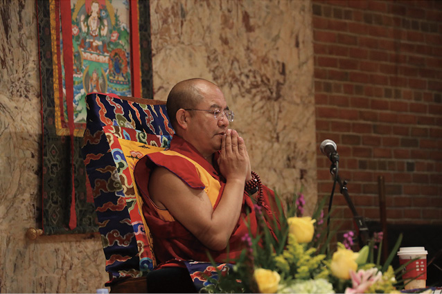
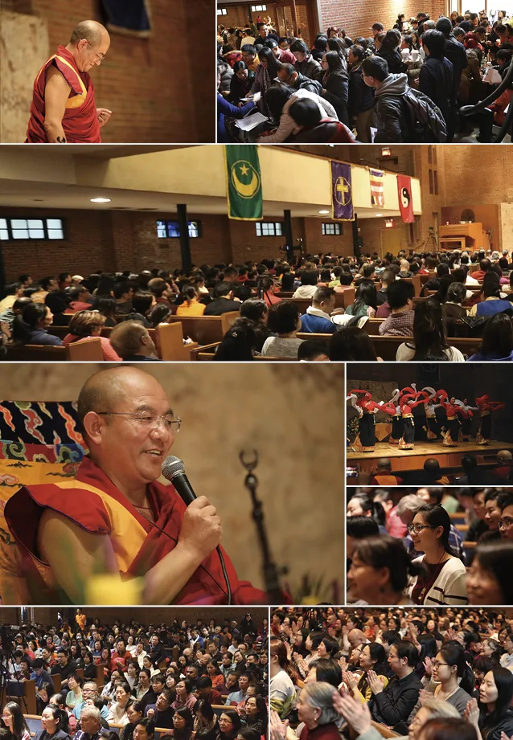
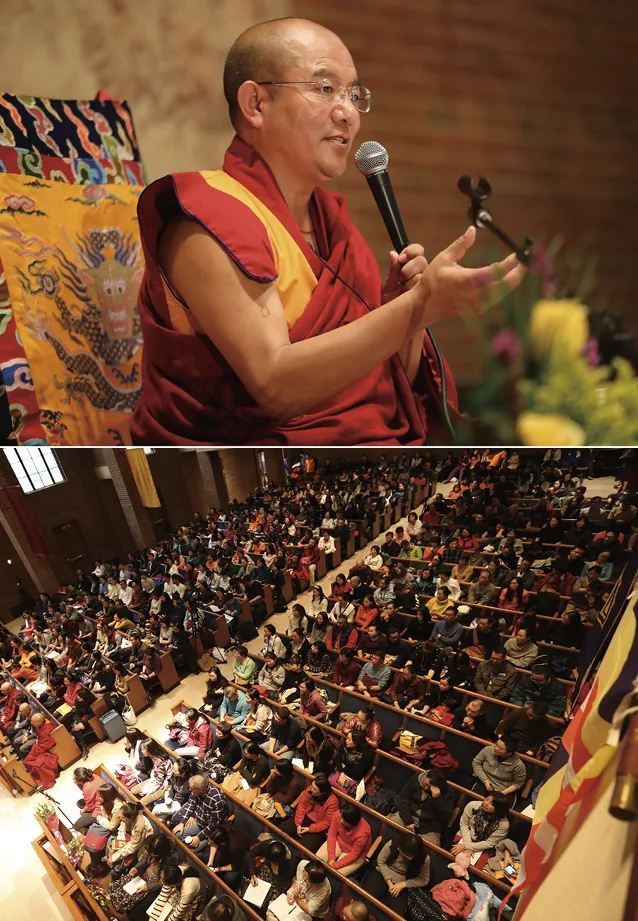
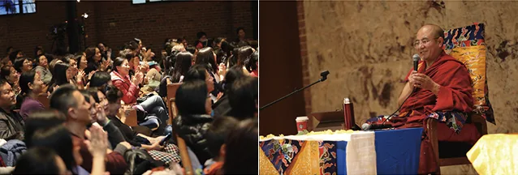
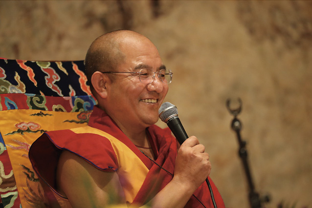
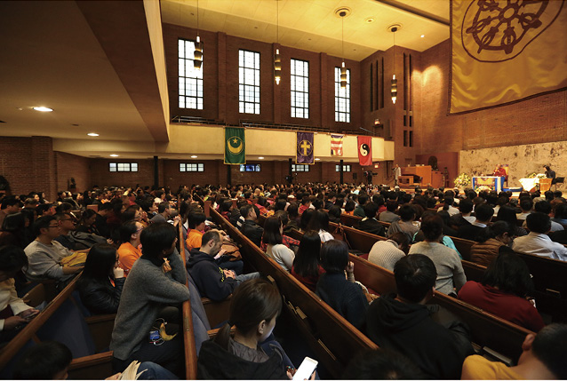
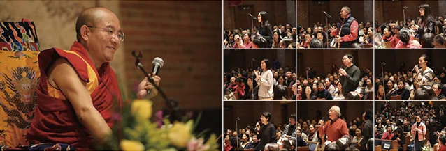
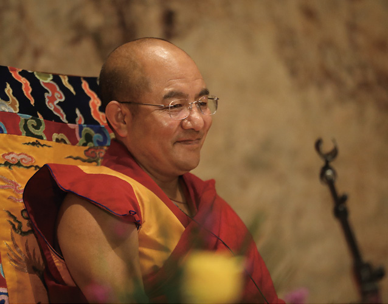
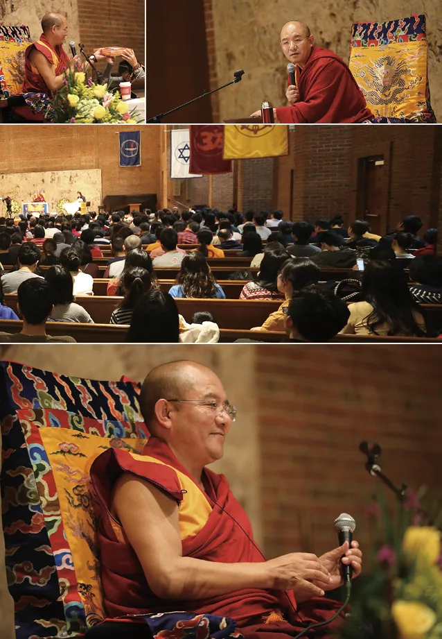
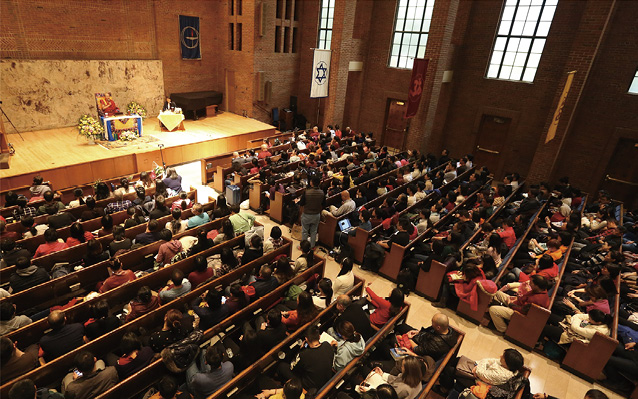

死亡来临之前，  
要一直保持勇往直前、  
富有激情的利他精神。

第69场

美国纽约BSA

BSA New York, USA

美国·纽约

2017 / 11 / 19

## 你在忙什么

## What Makes You so Busy？

主持人：

大家下午好！首先，欢迎堪布来到纽约！这是我们莫大的荣幸和福报！堪布这次在纽约，有一系列的佛法开示。他今天的演讲主题是“你在忙什么”。

当今这个时代，每个人都非常忙碌，忙于工作、家庭、交际以及个人琐事。然而，在追求幸福的过程中，我们的烦恼却越来越多。我们到底在忙什么呢？佛教又能为我们的幸福提供怎样的帮助？

堪布曾经说过：佛教不仅仅是一个宗教，也是一门心灵教育，也是探索人类情感的心灵科学，也是对治烦恼的一剂良药。下面，我们有请堪布——

尊敬的顾先生、尊敬的各位，下午非常好！

我之所以说“下午非常好”，是因为大家刚吃过午饭，等会儿可能特别困。刚好，我这边有一杯咖啡。

今天，我们一起思考人生。如果在听的过程中犯困、疲倦，我允许你们睡大觉。我在西方的传法方式，跟在藏地不一定相同。

我来自喜马拉雅山脉，是一个普通的藏族出家人。藏族人特别喜欢歌舞，他们唱歌和跳舞的欢乐场景，你们刚才都听到、看到了。我的民族特别讲究因缘和缘起。我认为，我们今天的聚集，是一个很好的缘起。

## 真正的宗教，都是智慧和爱的教育

刚才，我们的议员顾先生说：法拉盛[^1]是宗教自由的发源地。在这里，各种不同的宗教都能互相尊重、互相学习、互相探讨。

在当今时代，这是非常有必要的。因为，我们生活在文化多样的世界，应该以包容和开放的心态拥抱整个人类。我自己虽然是一个佛教徒，但却经常到不同的地方，参加其他宗教的活动，或者和没有任何信仰的各阶层人士交流，或去一些学校听教授们讲课。

今天，这里有很多佛教徒。我希望你们也能接受不同层次的宗教教义。其实，世界上的很多宗教，都有千年以上的历史，都慈悲为怀、教人行善，对人类的心灵教育非常有意义。对所有这些，我们既可以称之为“宗教”，也可以称之为“智慧和爱的教育”。

## 消费主义的盛行与宗教文化的黯淡

对一个有信仰的人而言，虽然学习和弘扬自己的宗教很重要，但从目前全球的形势来看，所有的宗教氛围都变得越来越淡，消费主义已经成为文化主流。

我有一个看法。所谓的消费主义，就是通过网络、电视、电影等各种途径和手段，把人类的兴趣和目光，吸引到物质和金钱上。在这个过程中，宗教信仰慢慢退出人们的生活，甚至被彻底遗忘。尽管这些心灵之光，已经在人类历史上闪耀了几千年。

消费主义以商业销售为目的，不断扩大经济规模，刺激人类的欲望。因为，只有每个人的欲望越来越大，产品销量越来越多，商业利润才会越来越大。如今，整个地球的人，都在以消费主义为主导、经济发展为核心的生活模式下，忙忙碌碌。

全世界大多数国家，都将西方国家尤其是美国，作为本国发展的指导和标杆。作为世界经济强国，美国的科学技术可以说登上了历史的顶峰。可是，它的宗教文化和民族文化，却没有太多的沉淀。如果美国的教育，只围绕经济发展而实施，其他国家也会跟随，把经济发展作为教育的核心目标。

在消费主义盛行的世界，谁的财富多，谁就是强者。但实际上，人类需要的不只是经济，还需要文化，需要政治，需要宗教，需要艺术。而这些，是人类几千年历史沉淀下来的宝贵财富。如果所有的人，都不再重视内心的艺术、宗教以及文化，都只关注金钱和财富，到最后，可能不得不接受这样的后果：外在的经济越发展，越提升，内心的世界越苍白，越痛苦。

将地球的各种资源占为己有的人，现在被称为成功人士。这些所谓的成功者，表面上很风光，很美好，背后却给人类带来了精神、环境以及教育等方面的种种危机。因为人类需要这样的成功者，所以我们不能知足少欲，不能有宗教的谦卑与约束。

一个人拥有很多名牌衣服，很多豪车，很多别墅，很多金钱，这就是他们认为的成功。为了这样的成功，大家甚至可以不择手段，大搞虚假吹捧、不实宣传。

现在世间有一种说法，叫做“钻石恒久远，一颗永流传”[^2]。非常奇怪，在19世纪之前，一直没有这样的“流传”。后来，一些商家为了赚取巨额利润，不断进行这样的宣扬，最后成功地“流传”到全世界。

表面上看，钻石很坚固。实际上，它代表的意义并不坚固。

## 富人有99只羊， 却向穷人讨要他唯一的羊

在消费主义的刺激下，很多人都为自己设定了奋斗目标，并为此不断地忙碌，活得特别辛苦。但人的欲望是没法满足的，拥有再多，也觉得不够。

有一个故事是这样的：在某个地方，一个富人有99只羊。他的邻居是一个贫穷的人，只有一只羊。但这个富贵的人却对贫穷的人说：“你反正只有一只羊，不如给我，这样我就有100只羊了，正好凑成一个圆满吉祥的数字。”现在的世界格局，跟这个故事有点类似。

我们前两天去参观了联合国的总部。上午的时候，我们看到一个数据：全世界为了战争而购买的武器，每天就花费50多亿美元。到了下午的时候，又看到一个数据：每一天买武器的钱有50多亿美元，这一天的开支，能遣除世界上最贫穷的4个国家的贫困。

如今，全世界每年大概有1100万人死于疾病或贫困。在南苏丹、尼日尔等非洲国家，百分九十几的人都处于赤贫状态，人均收入每天不到1美元。如果减少一天购买武器的费用，就可以遣除他们的贫穷。

去年我看了一本书，叫做《人类简史》。里面说到，虽然全世界现在没有战争，但因为心理疾病和饥荒而死去的人，远远超过战争的死亡人数。对此，我是有切身体会的。在我去过的非洲国家中，比如纳米比亚、莱索托等，确实非常贫困。那里的生活条件，跟我们这里相比，真的是天壤之别。不管哪个国家、哪个家庭、哪个人士，要真正地关心和帮到他们，都有很大的困难。

虽然我们每个人都在追求金钱、成功和快乐，但在这些背后，却有许多意想不到的事情。我在这里，并不是要反对什么。如果想反对，每个人都有权力站起来，发表自己的看法。

## 远离瞎忙，让人生具有实义

在这样的大环境中，有信仰的人经常说“我特别忙”，没信仰的人也经常说“我特别忙”。很多人甚至害怕自己“不忙”，宁可忙死、累死，也不愿意停下来休息。好像人活着，就是为了奔波、忙碌，直到生命结束。

我觉得，每个人都有必要问一下自己：“我到底在忙什么？每天这么辛苦，到底是为了啥？”如果是为了基本的生活而忙，我非常赞叹。一个人整天闲着，一点也不忙，全靠别人的资助过活，是不太合理的。但我们有些人的忙碌，完全是生计以外的瞎忙：自己抓不着，别人也看不出，没什么实在意义。

其实，我们不管怎么忙，总有一天会抛下一切，独自离开。

我们的人生，需要实现真正的意义和目标。而这一切，都需要在心上去建立。所以，大家不管怎么忙，都不要忘了反观自心。为此，我们需要进行禅修。一个懂得禅修的人，也一定懂得放松身心，止息忙碌。

我以前经常讲禅修。最早是在上个世纪，地点是沈阳、哈尔滨、齐齐哈尔等城市。那时候，人们没有现在这么忙，但我觉得帮助大家放松身心，还是很有必要，所以就在1994年去了那些城市。当时给大家讲解的时候，有时叫禅定，有时叫瑜伽，有时叫气功，用了很多方便方法。

这几年，我一直在讲比较有深度的专业禅修，和比较简单的消除疲劳的瑜伽禅定。昨天在哥伦比亚大学，有教授建议我开发一些具有特色的禅修课，我答应了。今天在教堂里，也有很多人提出了类似的希望。我们有一个“智悲禅修中心”，以这个缘起，以后可以慢慢开始。

## 爱世界，爱众生

禅修分两个方面。一方面是爱，如果进一步阐释，就叫悲心、慈心、菩提心。也就是说，我们要通过禅修，训练这颗心去爱别人。方法比较简单，就是在禅修的时候，反复在心里想：“我爱你，我爱你……”

在培养爱心的过程中，需要先从小范围开始。可以先训练自己，爱父亲母亲，爱自己的小孩，爱自己的亲戚，爱自己的朋友。爱是一种善妙的心态。我们爱别人的时候，自身会产生一种力量，一种很有功德的力量。遗憾的是，我们有些人尽管学了佛，却不懂得爱别人。

进一步讲，大乘佛教要求对任何众生，都要有一颗真诚的爱心，没有一丝一毫的怨恨和伤害。每一个大乘佛教徒，都需要在相续中生起这样的爱心。

当然，我们做任何一件事情，都需要把握好尺度。如果过了度，哪怕是训练爱心，也会走向反面，给自己带来烦恼和痛苦。我们要以适度的心态，从爱身边的人开始，逐渐爱世界上所有的人。

通过长期的训练，我们的爱是可以逐渐扩大的——从爱一个众生，到爱所有的众生。如果训练的专业性比较强，最后会生起大乘佛教真正的菩提心。不过，我们现在没有这么高的要求。大家在禅修的过程中，只是练习对别人好就可以。不管什么人，都训练自己要对他好。可以这么说，佛教讲的悲心就是对所有的众生好。

## 以心观心，看它到底在什么地方

禅修的另一方面，是智慧。它分为高层次和一般的层次。一般的层次很简单，就是所谓的专注。禅修的时候，身心全部放松下来，心专注于自己的头顶，然后专注自己的心间，再到整个身体，或者先想到左手、右手，再慢慢扩大，一直到全部身体。在这个过程中，心一直想：“这是我的手，这是我的脚，这是我的头……”心不散乱，一直专注。

如果心开始散乱，我们也要随之觉察。比如，这颗心不再关注身体，而是专注到墙上，专注到咖啡或别的什么地方了，心里就想：“噢！现在我的心到墙上去了，到咖啡上去了，到什么人的身边去了……”

也就是说，当我们的心正在想一件事情时，要用另一个分别念去了知它。心本来是一体的，没有什么两样，但我们观察的时候，可以有两种不同的反体。如果我们的心专注得足够深，可以观想人无我和法无我。

用自己的心观自己的心，看它到底在什么地方，一直这样专注和安住，就叫做寂止。如果我们用智慧来观察心是什么样的，就叫做胜观。不管是修胜观，还是修寂止，用自己的心观察自己的心，都非常重要。在佛教当中，这方面有特别深奥的窍诀。《中般若经》中是这样说的：“心无有心，心之自性为光明。”

在座的各位可以观察一下，自己的心到底是什么样的。我给大家一分钟时间，你们每个人都观察一下自己的心，看它到底是什么样的。等一会儿，默默地给我答案。

（大家观心……）

我相信每个人都有了自己的答案。如果有时间，我们要经常观自己的心。这个时候，最好不要睡着。我以前做过一次讲座，坐在我前面的一个人，讲座一开始就睡着了，直到讲座结束还在睡。我想，今天这里应该不会有这样的情况。

全知麦彭仁波切有一则教言：观察自己的这颗心，它正在起心动念时，也是空的，就像前面的虚空。表面上看，这是一个非常简单的比喻：正在起心动念的这颗心，一经观察，就像前面的虚空一样，是了不可得的。实际上，这是观心最好的比喻和窍诀。

你们最好不要忘记这个教言。如果深度地理解了这句话，你们从那么远的地方——比如从西雅图飞过来，所花的机票钱也是值得的。为什么这样讲呢？因为我们的价值观，是可以依靠另一种价值观来衡量的。

在座大多数是修行人，对自己的心应该有较深的认识，否则行为很容易改变。这多年来，你们一直坚持信仰，坚持修行，坚持利益众生。从这个层面看，大家的修行还是很不错的。

总之，修行真的很重要。如果不修行，再多的理论和文字都是苍白的，没有什么力量。以后不管怎样，我们都要学会修行。

## 对未来，千万不要放弃希望

在繁杂的人世间，有烦恼，有痛苦，是正常现象。幸运的是，我们这一生，值遇了指引心灵的智慧教育。依靠它，可以获得内心的安宁和安稳。所以，除了关注生活的忙碌外，我们更要关注内心的忙碌。而要想消除这种忙碌，内观的时候，佛法将满足我们内心最有意义的需求。

在将来的日子里，不管你是佛教徒，还是其他身份的人，都不能放弃对于未来的希望——千万不要放弃。在这个世间，要有坚强的信念和勇往直前的精神，才能生存下来。否则，无论是生活，还是修行，都会遇到障碍，以致举步维艰，无法前进。

未来，我们需不需要发展、需不需要进步？肯定需要。遇到违缘怎么办？如果你有信仰，那就默默祈祷自己的佛菩萨、上帝或其他主尊。在任何信仰的皈依境面前，祈祷都是非常有用的。

## 他90多岁了，思想还在进步

除此之外，我们还需要不断地学习。听说美国有一个叫做查理·芒格的人，已经90多岁了。他说：我现在的智慧，跟10多年前相比，又有新的进步。之所以这么说，是因为他80多岁的时候，还特别爱看书，特别爱学习。我看过他的一些书，很有收获。

查理·芒格是巴菲特的精神导师。到了90多岁，思想还在进步。可我们有些佛教徒，才四五十岁，就说“我老了”“我该退休了”“现在不想干了”……按照大乘的佛教精神，我们在死亡来临之前，乃至生生世世，都应该一直保有勇往直前、富有激情的利他精神。

对各种不同的宗教和思想，大家要有主动交流的勇气。作为佛教徒，如果在其他宗教或非宗教人士面前，以自己的信仰、民族或习惯为由，自己给自己设置障碍，不愿互相沟通，说明心不够包容。

而且，所有的学习和交流，不能只停留在表面上，而要深入内心、发自内心。作为大乘佛教徒，我们要多学知识，多跟和不同背景的人接触。用现在的话来说，叫做“走出舒适区”。也就是说，要放下自己固有的习惯，主动接触更多的人，进入更宽广的学习领域。

一些专修的人可能会怀疑：这样做是不是太杂了？实际上，从大乘佛教利益众生的角度来讲，这样的学习和交流是不可缺少的。

## 买不起真钻石，戴假的也可以

我们每一个人，还要学会节约。现在很多地方，包括日本等国，都在提倡极简主义。当然，我并不是要求你们，一件衣服必须穿多少年。不过，这样的人也有。乔布斯20多年的形象，一直是一条牛仔裤和一件黑上衣。这在他不同年龄的照片上，都能看到。扎克伯格也一样，多年只穿一件灰色短袖和黑色外套。这是因为他们比较穷吗？肯定不是。

我的建议是，你们有20套衣服就可以了。如果穿得太简朴，会让世人看不惯；但如果太多，也确实有点浪费。佛教徒要懂得知足少欲。

有些人认为，佛教徒应该不吃不喝或者苦行。其实不一定。佛教的生活观，强调不堕两边，不要特别奢侈，也不要过分贫穷。有这样的生活理念，人生不会陷入太大的痛苦。买不起真钻石，戴假的也可以。（众笑）

## 一只老狗狂吠，群狗也跟着乱叫

人类的很多痛苦，都是旁人传递的错误信息导致的。查理·芒格先生说：“人类是一种社会动物，大多数人都在社会的大染缸里，随别人而转。”

现在，如果某个产品的广告铺天盖地、遍布世界，全球的目光都会专注在上面，形成一股流行的风。为什么会这样呢？因为世间人喜欢盲目跟风，别人宣传什么就是什么，就像藏地非常出名的萨迦班智达说的那样：“如同老狗狂乱吠，群狗亦是随声奔。”看到这些现象，有时会觉得很可怕。

我也曾经盲目过一回。很久以前，我听别人说，喝咖啡对身体好，自己就跟着喝。过了一段时间，又听别人说，喝咖啡对身体不好，可是已经习惯了，很难改过来。以前我当牧民的时候，咖啡很容易得到，根本不值钱。但是现在，一杯这样的黑咖啡要卖很多钱——我说的是青稞做成的“藏式咖啡”。

现在，所谓的市场经济就是这样，所谓的文化推广也是这样。大家都忙着把不值钱的东西变得值钱，关注内心安宁的人越来越少。这个时候，我们更应该有自己的主张，而不是随波逐流。

## 不出家，一样可以解脱

在密法当中，即使不舍欲妙，没有太多克制，过着幸福的世俗生活，也同样有解脱的机会。当你认识心性的本面、认识烦恼的本体时，就获得了真正的解脱，不需要放弃世俗的欲望和俗事，也不需要舍弃家人。

以前有一个叫国王，叫恩扎布德。他对释迦牟尼佛说：“我很想解脱，但我没办法出家，因为我舍不得美丽的花园，也舍不得可爱的眷属。”释迦牟尼佛给他传了认识心性的窍诀，他如是修持，最后获得了成就。

在座的很多人，以后不一定有出家的机会。虽然出家很好，但也并非每个人都有这个必要。以在家人的身份，一样可以修行，一样可以认识自己的心性。我今天讲的心如虚空的道理，如果好好观察、慢慢思维，一样有解脱的机会。

现场互动

问：我们很容易把世间的执著带进佛法。比如，我很喜欢布施，在每个月的佛菩萨节日，都想做布施，但这样做，经济上又有压力。我想请教您，怎样才能更有智慧，可以做到信而不迷？

堪布：这个问题很好。做人确实需要有智慧，尤其是佛教徒。如果没有智慧，分不清楚哪个重要，哪个次要，在形式上花过多的时间和精力，有时候真的会变成迷信。

现在很多佛教徒，不好好闻思，整天糊里糊涂，把很多事情都搞得乱乱的。如果一个佛教徒每天忙着烧香拜佛，参加各种活动，一点儿不提升自己的智慧，那就是迷信了。

对于佛教，我们应该智信。不管你是哪个宗派的佛教徒，或是其他宗教的信徒，都一定要进行理论学习。没有稳固的理论基础，我们做的很多事情可能都不太如法。

问1：很少有法师谈到这类话题，所以我很好奇：到底有多少人真的证悟成佛了，又有多少人获得了不同程度的证悟境界？

堪布：在佛教历史上，不同的时期有不同的得果情况。在果法期，获得阿罗汉果位的人比较多。现在已经过了果法期，但在斯里兰卡和别的一些地方，据说仍然有证得圣果的。至于证悟者，现在非常多，我自己亲眼见过的就有不少。

问2：对这些证悟者，我们能接受他们传的法吗？

堪布：可以，到时我可以推荐——真的有很多证悟者。

问：您今晚的演讲让我获益良多，非常感谢您赐予的智慧法语。您刚才提到了禅修和慈悲。我的体会是，对别人付出爱、表达爱非常容易，但要得到别人的爱却很难。得不到回报的时候，心里会感到空虚。怎样才能让自己感觉好一点，并继续付出自己的爱？

堪布：真正的爱是诚挚的，无条件的。真正爱一个人，即使得不到他的爱，还是会继续付出。如果因为没有得到回报，就不爱了，说明自己对他不是真正的爱，也不是完整的爱，可能掺杂了别的成分。这个时候，只能观空性，尽量不要恨。

问：顶礼上师！顶礼佛法僧三宝以及各位同修！非常感激上师能来美国弘法。按照大乘佛教的观点，所有众生最后都可以得度，因为每个众生都有佛性。上师，您今天讲，心的本质和虚空一样，是空性的。既然这样，我们暂时抛开信仰，单单从逻辑角度，怎么推出众生都有佛性？

堪布：单从逻辑角度，完全可以推出众生皆有佛性的结论。不过逻辑推理属于现相界的世俗名言。就世俗谛而言，可以说每个众生将来都有成佛的机会。而今天讲的心如虚空，是通过修行得到的证悟境界，属于胜义谛。在胜义谛的境界中，一切万法都是一味一体的。

问：我是纽约大学的学生，跟随您学佛很久了。我到美国以后，发现美国人的很多观念和佛教的比较相似，比如他们的平等观和慈悲观。我想，这可能也是西方人对佛教越来越有兴趣的原因之一。我很想影响更多的美国人信仰佛教。而且我觉得，他们和佛教相似的那些观念，是我们可以利用的。请问，您有没有什么方法，让佛教在西方发扬光大？

堪布：你的问题也很棒。西方的逻辑思维，跟佛教的某些智慧的确很相似。让佛教在西方发扬光大，的确非常有意义。

30多年的学佛经历和体验，让我深深地认识到，不管从外境的宏观与微观层面，还是从内心的爱与慈悲方面，现在的社会，不论东方西方，都需要佛法的力量。我这样说，并不是因为自己是佛教徒，所以故意吹捧、宣传。不是这样的。如果觉得佛教不合理，即使自己是佛教徒，我也不会这么说。

弘扬佛法的时候，通过禅修认识自己的心，是一种方法；通过利他的行为感化别人，也是一种方法；通过逻辑推理，认识世界和自心的本质，也是一种方法。2500多年前的佛教智慧，被现代科学多途径、多角度印证的事实，也可以让很多人了解。

将来在这方面，在座的各位，尤其是年轻人，都肩负着一定的责任。大家只要有这个心，一定会集聚相应的因缘和能力。

问：我的问题跟刚刚那个同学的差不多。我想知道，怎样才能用我们的知识，更有效地帮助别人，尤其是不信任何宗教的那些人？

堪布：只要有帮助他人的心，并且一直不忘，处处都会有机会。但年轻时候的心态容易改变，我希望再过20年、30年，你还能保持这颗珍贵的心。

问：乔布斯说，他把每一天都当成人生的最后一天，想到什么重要的事情，就赶紧去做。末学想在死之前写一本书，不知道如不如法？书的内容类似于科幻小说，每个人的头上都有一个死亡的颈环，当人们去探索这个颈环的秘密时，发现自己大多数时间都被一个类似VR系统的东西所操纵，浪费了很多生命。最终人们认识到，浪费太多时间在琐事上是没有意义的，于是选择另外了一种生活方式。不知道我这样的想法和行为，如不如法？

堪布：你所讲的这些内容，我没有看过，所以不太了解。其实现在的科幻也好，VR也好，都有能帮助众生的很多方便。但如果不注意辨别，有些书籍、动画片或科幻片，也会损害人类的身心健康。所以，你可能还需要进一步地分析、多方面地研究，最后再看看。

问：我拜读过您讲的《入菩萨行论》。里面有几个词，我不太懂，一个是相续，一个是戒体，请您开示。

堪布：相续，是指连续不断的整个过程。比如，白天和晚上是连续不断的，所以叫时间的相续；我们的心，前一刹那和后一刹那也是连续不断的，所以叫心的相续。

戒体就是戒律的本体。比如说，菩萨戒的本体叫做菩萨戒的戒体，密乘戒的本体叫做密乘戒的戒体。就像你的身体，可以分解为身和体；戒体，也即戒和体。

问：顶礼上师！您说爱是一种力量，爱要有适当的心态——过多的爱会造成痛苦。我是一个两岁孩子的妈妈，怎样才能做到“以适当的心态去爱”？如果您是一位父亲，会怎么样爱自己的孩子？

堪布：我如果爱一个孩子，或者爱一个人，首先会想到，一切都是因缘而来。既然因缘而来，那么也会随缘而去。如果发现自己爱得过度或过分了，我会尽量地放下。爱要随缘，不能因为爱而互相伤害。

但不管怎样，我的爱心不会消失。这里面，有一种分寸。

问：我有一个问题想了10多年，为什么说娑婆世界跟涅槃世界是不可分的？

堪布：轮回和涅槃在本性当中，的确是没有分别的。龙猛菩萨有一句话：“涅槃与世间，无有少分别，世间与涅槃，亦无少分别。”在胜义当中，二者连细微的差别也没有。但是，在世俗名言中，轮回和涅槃还是有差别的。

问1：弟子有一个比较实际的问题。我们在家修行人，有些不是养家糊口的主力，需要依靠家人的忙碌，才能学佛修行。这种情况下，应该怎样引导家人，在他努力工作的同时，又接触一些解脱的思想？还有，怎么样引导年龄小的孩子，让他既努力学习知识，又懂得追求有意义的人生？

堪布：很多在家人可能都有这个问题。我们学佛，一定要随顺家人。如果家里的阻力非常大，可以运用善巧方便，偷偷地学。如果阻力不是很大，可以逐渐地影响他们。

很多佛教徒都有这种想法：我的家人为什么还不学佛？其实，家人不一定要跟我们一样学佛。每个人的因缘不同，不能强迫。在信仰方面，应该给家人一个空间。与此同时，我们要尽心尽力地学修，不舍弃自己的信仰。

问2：对小孩子，怎样才能既鼓励他努力学习，又让他明白，人生的价值不只是追求财富或者世间福报？

堪布：让他努力地学习，努力地追求世间财富，同时再让他背一点《心经》。

问：我有两个问题。第一个，当今社会，小孩拼命竞争学习成绩和各种特长，孩子和家长的压力都很大。在时间和精力都有限的情况下，应该如何取舍？第二个问题，多伦多“学仁社”在上师的加持下，现在发展得比较好。我们《弟子规》学完以后，会继续学习新的内容。对此，上师有什么建议吗？还有就是，如何正确地引导小孩学佛？

堪布：这一次，包括多伦多在内，加拿大和美国的各个地方，都来了很多佛教徒。你们组建“学仁社”，学习佛法，特别好，我很感谢。

这次大家不应该来——那么远的地方，我一直比较心疼。但是既然来了，也可以吧。不管怎么样，希望你们回去之后，不断地努力。

对于孩子的教育，我们也经常关注，但没法改变整个教育体制。总之，大家一方面要迎合世间，一方面也要努力让自己的文化不流失。我在这里看到——芝加哥和波士顿也一样，很多华人的孩子都没有忘记本民族的语言文字。

这件事很重要，在座的各位都要努力。这里毕竟不是华人的世界，也许到了下一代，再下一代，孩子们就不会说本民族的语言了。真的有这种可能。所以在这之前，我们要有意识地拯救自己的文化。

各个学佛小组，包括“学仁社”在内，学会已经给了很多建议。我在这里没有什么要说的了。一如既往地，希望大家共同努力。

问1：我是加拿大菩提学会的学员。首先，祈请上师以后到加拿大传法。弟子最近比较关注人工智能的发展，感觉超出了自己的想象。人工智能在工作能力上超过人类，已经不是一个问题了。目前的问题是，我们怎么去防止人工智能对人类的危害。我想请教上师，作为佛教徒，我们在这方面有什么能做的事情吗？要不要开发一个给人工智能传法的人工智能？

堪布：对于人工智能超过人类的担忧，我个人倒没有。不过，给人工智能机器人传法的希望，也没有。

人工智能确实值得佛教徒去关注，不要认为无所谓。它在不同的领域，都有不同的表现，在某些领域的行为甚至非常惊人。这个世界变得很快，有时难免让人担心。但也没办法，已经变成这样了。

问2：上师慈悲！可以给我们做一个皈依吗？

堪布：哦对，今天说是要皈依的，昨天很多人祈请。大家这样想：为了利益一切众生，我现在要皈依三宝。我简单念一下仪轨。你们这样坐着就可以。

（堪布为大家做皈依）

堪布：最后一个人。为了表达一个缘起。你是问问题吗？

道友：我有一件珍贵的礼物，是从印度正觉塔请来的佛的僧衣，希望供养上师。

堪布：OK，你拿上来吧。很吉祥，很圆满。谢谢！

主持人：

感恩上师给我们做了如此精彩的开示！我相信，这也是一个非常好的缘起。希望上师每年都能来美弘法！

[^1]: 法拉盛（Flushing）是美国纽约皇后区境内的一个区域。近年来，由于华、韩、印度、巴基斯坦、萨尔瓦多和希腊裔等移民的涌入，法拉盛已成为纽约市族裔最多元的社区，使用的语言超过150种。
[^2]: 钻石被誉为20世纪最精彩的营销骗局。20世纪初，全球最大的钻石开采公司戴比尔斯（De Beers），策划了“把钻石作为订婚戒和结婚戒”的营销活动。从那以后，钻石成了象征爱情和忠贞的精髓，赠送钻戒代表着悠久的求爱传统。1951年，公司推出“A diamond is forever”的广告词。进入中国市场时，被译为“钻石恒久远，一颗永流传”。
