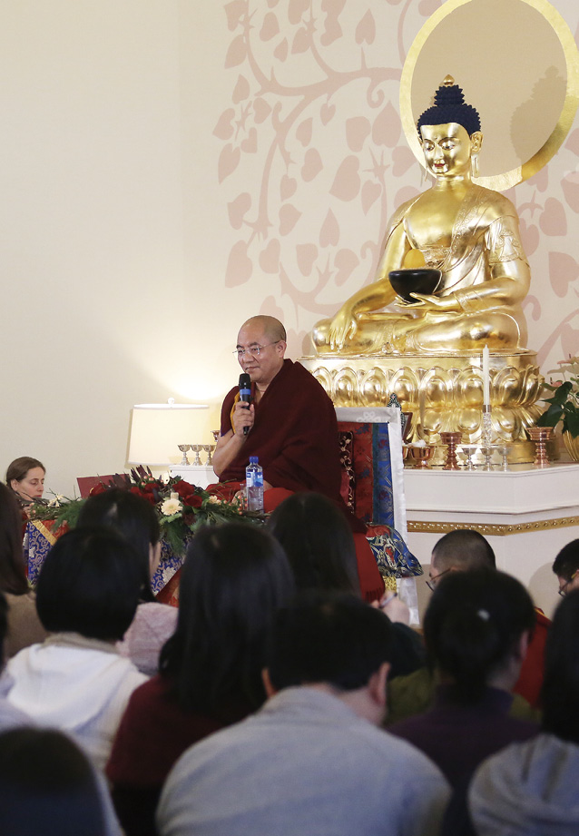
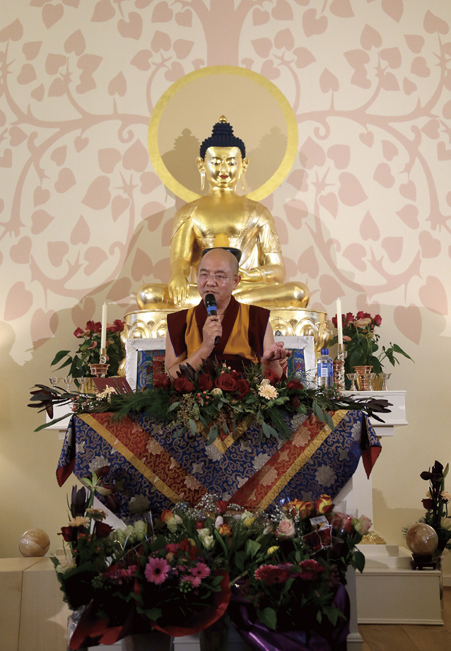
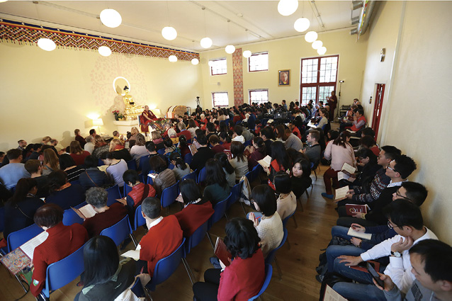
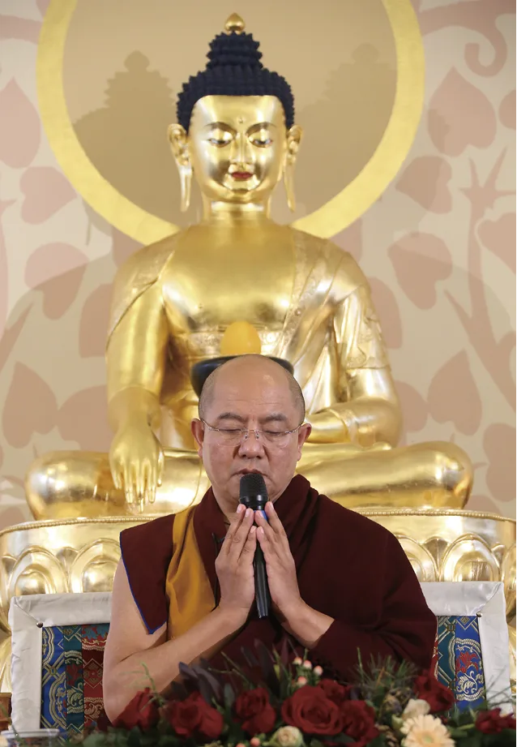
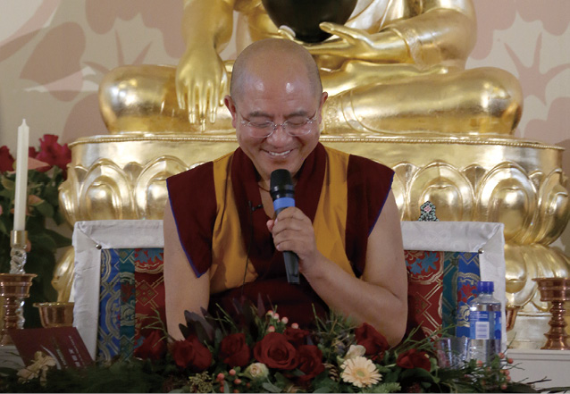
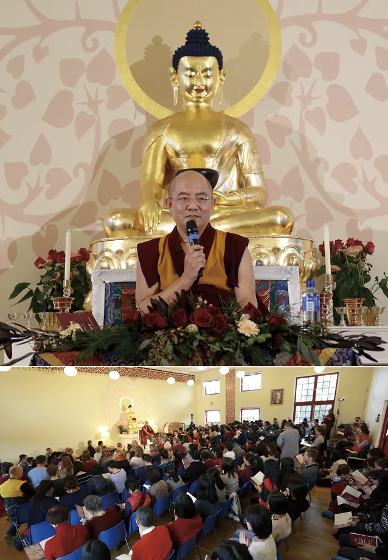
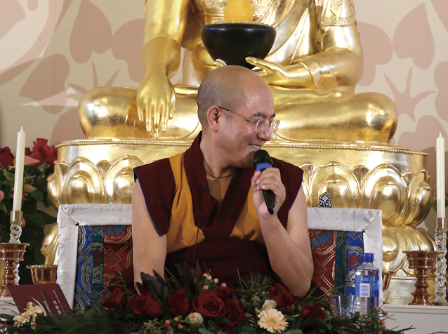

真正的观音菩萨，  
就是慈悲众生的心。

第74场

挪威奥斯陆噶玛扎西林

Karma Tashi Ling, Oslo, Norway

挪威·奥斯陆

2017 / 12 / 2

## 四臂观音的修法

## Avalokiteshvara Sadhana

今天给大家简单地讲一些有关“六字真言”方面的内容。

## 培养信仰与修行

看得出来，在座的各位对真理有种希求心、欢喜心。一个人心中如果有信仰、有依靠的话，那么无论做任何事、过何种生活都会很快乐；反之，则会杞人忧天、一事无成。

如今世界瞬息万变，若只是寻求外力来经营生活，不一定能达成所愿。如果稍微能认识自心或经常修行，那就能坦然直面人生中的各种境遇。作为有信仰的人，更应该认真学习相关的道理。如果没有坚实的理论基础，很容易被种种俗事所影响，最终会放弃自己的信仰。

在学习时，我们要尽量舍弃“小我”，因为“小我”会让自己越来越狭隘、纠结和无所适从。对于修行人来说，自己的传承、上师、法脉及教派等是很重要的切入点，但不能过分执著，否则不利于宗教的发展、团结与合作。所以，我们要以大我精神、利美精神来拥抱世界。

前几天，我发过一条微博：“我们有生之年，每天最少念108遍六字真言，如果当天忘了念，之后也可以补上。”此外还要求念《般若波罗蜜多心经》，汉文版比较简短，英文版也有短的。我粗略估算了下：一天共有1440分钟，抽出两分钟念诵，还剩1338分钟。剩下的时间足够做其他事了。微博发布后，大概有2万多人自愿参与。

我们拥有珍贵的人身，如果没有用来学习、修持、念诵佛教的经典、论典、咒语，是非常可惜的。达波瓦尊者在《胜道宝鬘论》中说，得到人身却没有修行，会有十种遗憾。佛教的修行方式很丰富，有念诵、念咒、念经、禅定以及观修寂止、胜观等不同层次的修法。每个人都能在其中找到适合自己的方式。

## 念修观音法门

这次大家从周边国家和地区不辞辛苦来到这里，充分说明了大家对法的希求心。佛法的价值，的确也值得如此苦行。所以，只是求个法、得个灌顶、接个传承远远不够，更重要的是修持它。听说这里很多人闭关三年三个月或长期修行，这一点非常随喜。

是不是货真价实的修行人，打眼就能看出来。每次遇到不同的人，我一看对方的眼睛，基本上就能推测出来了。遇到修行人就会比较放松，而遇到学术界的人就有点紧张。学术界的人很好，藏地学因明的人也属于学术界，因为因明也是用智慧来观察、分析。

人生真的很短暂，如果死时没有一点修行境界，可能还会在轮回中不断地漂泊。因此，有生之年除了追求真正有深度的智慧外，还应该念一些观音心咒。刚才看到很多人在转绕佛塔，这个行为非常好，功德也特别大。

藏地修行人都要念观音心咒，有人一生中能念上亿遍观音心咒。虽然他们文化程度不高，但有虔诚的信心。他们一辈子念诵、禅修，过得特别快乐。据说这里的幸福指数是最高的，但是真的幸福吗？所谓的幸福指数越高，生活压力也越大。全球患抑郁症等心理疾病的人也越来越多了。

依靠观音菩萨修法，可以遣除心灵的痛苦，对个人乃至全人类来说都很重要，观世音菩萨是三世诸佛慈悲心的总集。我们先要让自己的心平静下来，然后开始修慈悲心。否则，一颗暴躁的心，即便观音菩萨也束手无策。通过修行，短短的时间里就能从粗暴、痛苦变得乐于助人。所以，作为修行人，即便无能为力，也不要放弃可怜的众生。

## 大乘佛法的核心是大悲心

昨天在诺贝尔和平奖的纪念馆里看到一些照片，有的家庭三代人都在战争中流亡，从巴基斯坦到伊拉克，再到叙利亚，再到挪威。想到这些人的苦难，换作是我会怎样？这时候才能发现自己的慈悲心修得怎么样。

大乘佛法的核心就是要像爱自己一样爱众生。即使每天一个微笑也能带给别人快乐，也是赐予他人的一种“爱”。有个小故事说：有一个老人住在养老院里，她的丈夫、儿子都遇车祸死了。她自己也得了抑郁症，于是她准备买药自杀。药店的老板微笑着迎接她。过了两天，这个老人给药店老板写了一张纸条：“那天我原本想在你店里买药自杀的，可是你的微笑治愈了我，让我有了活下去的动力。特别感谢你！”看似寻常之事，却改写了他人的命运。

很多人自诩是大乘佛教徒，但却经常害别人、说他人过失。现在很多大乘佛教徒，一讲到空性、修行就兴趣盎然，而谈及利益众生时，内心和行为上都很匮乏。所以，修行时先想尽一切办法让内心生起慈心、悲心，再生起菩提心。如此，修任何法就成了正等觉的因。如果抓不住修行的根本，就得不到理想的结果。

如果要生起利他心，首先要明白大悲心的重要性。如今，各企业、各高端人士都流行禅修，但大乘佛教徒与他们不同，我们是在慈悲心的基础上禅修。否则，禅修就只变成放松、舒缓身心而已。

藏传佛教中，华智仁波切的《击要三句》是很有意义的教言。其中提到三位上师的名号：见解是龙钦绕降，修行是智悲光，行为是如来芽。这三位传承上师的名号有着非常甚深的道理：见解是龙钦绕降，是说空性智慧很重要；修行是智悲光，是说见解空性不离光明，不能舍弃大悲心；智慧和悲心结合起来的行为，就是如来芽。也许能即生成就，即使没有成就也一定会很快乐，啊啦啦（表示很稀有的感叹词）！

## 修习慈悲法门饶益有情

人世间的爱是简单、脆弱的爱，慈悲心、大悲心则是对众生无条件的爱。如果具足这样的大悲心，我的心就与观音菩萨的心无二无别。修习这样的慈悲法门，自私自利、痛苦、烦恼的心会逐渐消失。如果心不调柔，学得越多，傲慢心、嫉妒心、狡诈心也越盛。佛教中说，自己是自己的怙主，也是自己的老师，因此，我们要经常观察自己的利他心有没有增长。只要利他心有增长，自私自利心就会相应地减少。

有人说：西方不讲大悲心，而讲自尊心。但两者并不矛盾，如果自尊心是害众生的心，越强大越可怕；反之，爱众生、爱人类、爱动物、爱大自然的自尊心，越强大越好。如果我们修行懒惰，利益众生的心很脆弱，烦恼痛苦的心很强大，说明我们还要不断地磨炼。

四臂观音修法是极具价值的法门，生活、修行中在自己前方观想观音菩萨，或观想自身为四臂观音都可以。每天念108遍观音心咒是很容易做到的。华智仁波切说过：“大家共修的加持像熊熊燃烧的烈火一样，个人做善事的加持就像小小的火星一样。”所以，我们今天集体发愿共修念观音心咒的功德非常大。这样修持善法的功德有种算法：如果有2万人每人念一遍心经，那每个人都得到了2万遍心经的功德。这是前辈大德们一致承认的。希望大家共同长期修行。

我们所修的善根和功德，要回向给可怜的众生，包括世界上遭受战争的难民、遭受饥饿的人们、遭受疾病无药可医的患者等。我们可能无法像伟大的菩萨们一样利益众生，但心中要发愿不害众生。我们的发愿应该像观音菩萨那样饶益有情。

如果日行一善有困难，一个月或一年做一件利益众生的事，也是人生中最有意义的。前段时间一则新闻对我触动很大：美国的一个美女大学生在餐厅吃饭，这时进来一位流浪汉，这个美女给他买了一顿饭，而且还听完了他的哭诉——这个流浪汉的父亲早逝，母亲也刚去世，他现在无依无靠只有选择自杀。流浪汉离开餐厅时，递给这个美女一张纸条，上面写到：“非常感谢你，美丽的人！我今天本打算结束自己的生命，可是因为遇到你，你的善行让我又重拾活下去的希望。”

真正的观音菩萨，就是慈悲众生的心。希望我们每个人都能成为观音菩萨！
