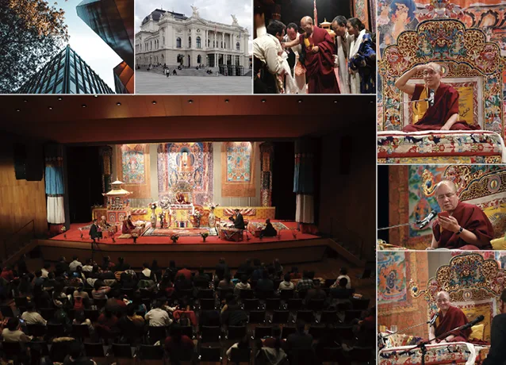
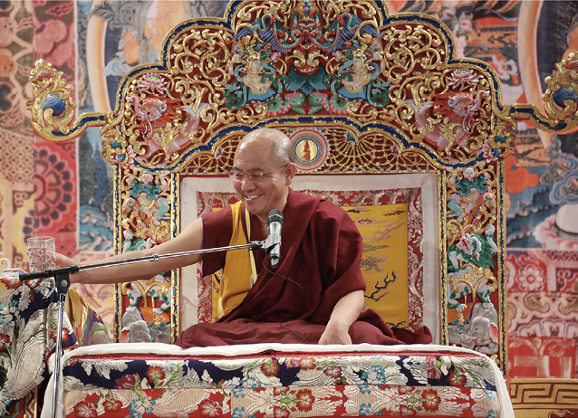
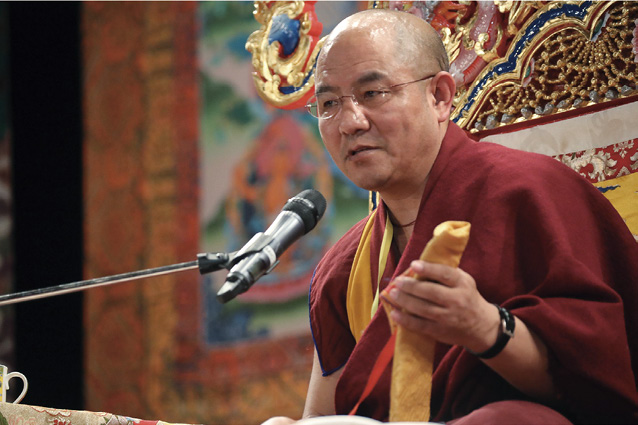
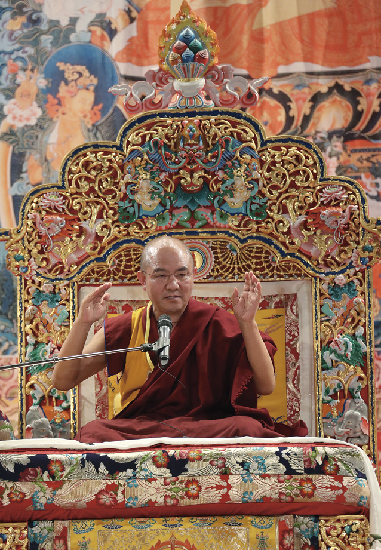
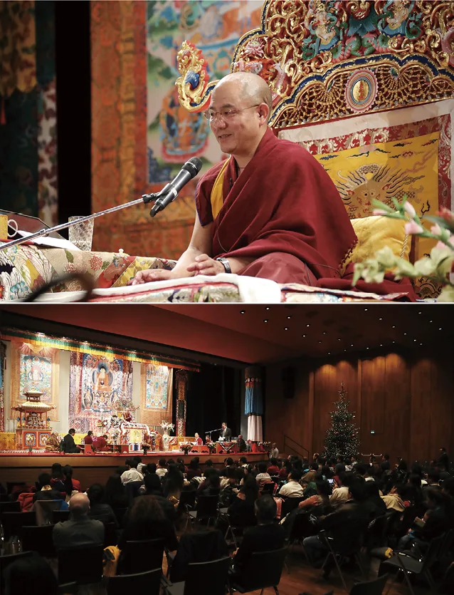
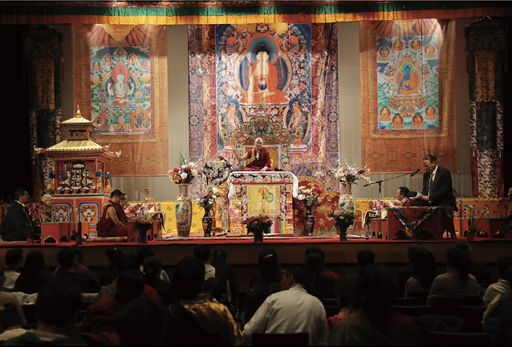
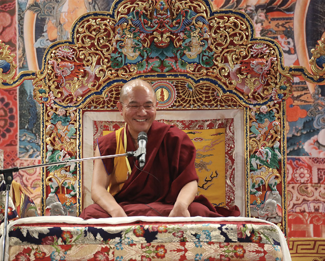
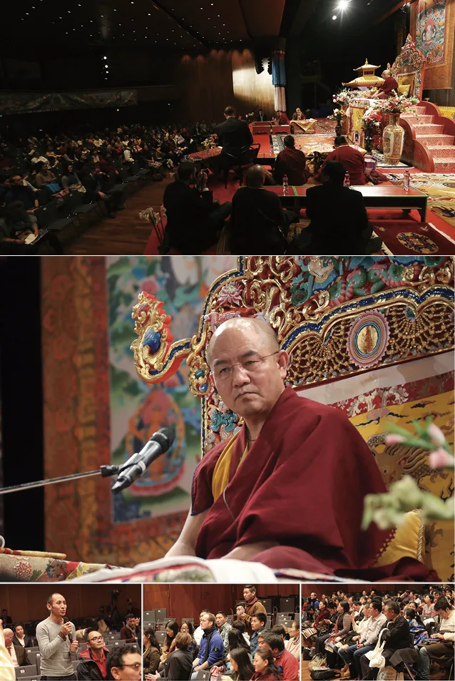
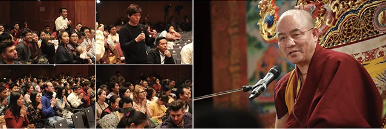

无论哪个民族，  
一旦其语言和文字消亡了，  
这个民族就彻底无法起死回生了。

第76场

瑞士苏黎世施尼岑霍夫场馆

Schinznehof, Zurich, Switzerland

瑞士·苏黎世

2017 / 12 / 9

## 如何保存藏文化和精神

## Preservation of Tibetan Culture and Spirit

主持人：

今天，我们非常荣幸地邀请到了索达吉堪布仁波切！仁波切常年任教于藏地雪域的喇荣五明佛学院，他是法王如意宝晋美彭措的心子、持教者。这是仁波切第一次来到苏黎世。

仁波切的弘法利生事业遍及全球，如繁星般成千上万的弟子遍布世界各地。他日夜不间断地行持着利生事业，于百忙之中抽出时间来到我们这里，给在苏黎世生活的藏族同胞们赐予最珍贵的开示。我谨代表前译持明中心对仁波切的到来表示最热烈的欢迎！我谨代表在座各位向上师仁波切恭敬顶礼！

这两天的现场时间安排如下：

今天上午，仁波切给大家简单地开示有关藏文化和佛法方面的内容，下午讲解有关皈依和发心方面的内容；明天上午，宣讲佛法中的四圣谛等方面的内容，下午举行千佛灌顶。

今天在座的藏族同胞中，有些人是我以前就熟识的，有些人则是第一次见面，但我们彼此心中都有一种无法言表的喜悦！

现今在苏黎世生活的藏族人，追根溯源来说，是从上个世纪60年代开始迁徙至此的，尔后人口陆续增加至八九千，直到目前有将近一万人定居在这里。我发现大家不是集中居住在一个地区，而是分散的。

原本我以为今天下雪再加上各自都有其他安排，就不会有多少人来，结果却出乎意料。既然大家来了，我肯定是知无不言、言无不尽。考虑到听众里既有藏族人也有西方人，所以我先用藏语讲，然后翻译者用德语转述。

## 扎根海外的藏族人

今天和大家探讨的是有关藏文化和藏传佛教的话题。“文化”一词，实际上包涵很多方面，但归根结底就是落在语言和文字上。历史反复地提醒着我们：无论哪个民族，一旦其语言和文字消亡了，这个民族就彻底无法起死回生了。

早前我造访过美国、澳大利亚、加拿大、德国和英国等地，那里也居住着很多藏族人。从他们的生活、工作、教育等方面看，他们在这些国家和民族中不断地进步、发展。生活在苏黎世的藏族人，也有着很高的评价。这是因为大家秉持佛教的理念，在行为举止、起心动念等方面的自我要求较高。所以，苏黎世的当地人对藏族人的评价，比对非洲人和穆斯林人的更高。也有很多人说“藏族人还是比较可靠的”，甚至把藏族列入了高等民族之列。

大多数定居在这里的藏族人，之前都是移民过来的，但他们生活得还不错。第一代迁徙来的藏族人，对当地的语言、文化不是很了解。到了第二代、第三代藏族人，他们在不同的学校里学语言和生活常识，就比较了解当地的风俗人情，而且也能融入其他民族了，在生活上也没有较大的困难了。在座的藏族同胞中有很多知识分子，要么在政府或银行工作，要么经商或从事科研工作。说明藏族人已经完全融入了西方社会，甚至在道德和文化领域达到了较高的水准。

## 藏语和藏文化开始衰落

这些成就对大家扎根立足来说有极大的必要性。但另一方面来看，藏族的语言和文字在全世界范围内已经开始衰落了。生为藏族人却不懂藏语——很多藏族人除了英、德、中及其他语言外，压根无法用藏语交流。如果自己缺失藏文化背景，久而久之，就会被所在地的语言、文字和文化同化。

据联合国教科文组织统计，全球现存语种数量近6000种左右，其中80%的语种正在衰亡。罪魁祸首是谁呢？有专家表示就是英语，而且它在未来极有可能成为全球统一的语言。

学藏语的藏族人越来越少了。国外的藏族年轻人里，学藏语的寥寥无几；国内的藏族人，虽然用藏语交流，但上了大学以后慢慢地也就不讲藏语了。我担心：再过20年、50年或者80年，藏文化、藏语和藏文字很可能会彻底地消亡。国外较年长的藏族人，虽然对本民族文化深信不疑，但他们的受教育程度不高。他们也五六十岁了，当他们相继离世之后，第二代、第三代藏族年轻人除了会说英语，几乎没有学过藏语和藏文。

藏族人大多时候很令人费解。为什么这么说呢？西方的很多学校里，很多专业教授、科学家都能说一口比较流利的藏语，而且他们还在学习藏文。而我们藏族年轻人，却舍弃了自己的母语和文字。国内外很多年轻人，不仅不会讲母语，还很轻视它。

## 藏族人应弘扬藏文化和藏传佛教

藏族人里有很多从事科研工作，但对藏语和藏文化做了哪些研究呢？反而，很多西方学者在关注、研究藏传佛教和藏文化。当然，对国外的藏族人来说，上有受教育程度不高的老人，下有年幼无知的小孩，为了养家糊口不得不掌握其他语言。为了眼前的苟且，就抛弃千年传承的藏族语言、文字、传统和精神，会不会造成无法挽回的损失？

众所周知，各个国家都有大量的移民。大多数移民在当地从事偷盗、抢夺等扰乱社会治安、违法乱纪的行当。国外的藏族人虽然也是移民过来的，但他们都从事着正当行业，因此各个国家对藏族人都有高度赞扬和认可。如果藏族人在自给自足之余，用佛法和藏文化帮助其他民族和国家，那一定能利益当地人。如此一来，大家不仅身心愉悦，而且还能遣除他们对藏文化和藏传佛教的疑惑。

以前，藏族人每去一个地方，就会被评价为工作懒惰，但现今也和其他民族一样被称赞为吃苦耐劳。无论从事哪个行业，大家对藏族的评价都是“吃苦耐劳的民族”。

当前最要紧的是藏族的语言和文化正在衰落。历史上，满族占领了汉族最大的政治中心，统治着辽阔的疆土。而一百年后，汉族重新夺回了所有疆土并统一了文字，其后满文彻底消失了。前车之鉴，藏族人应该不遗余力地弘扬藏文化和藏传佛教。

## 从小重视藏语和藏文化

听说这里的学校周末也上课，周末如果能让小孩子学藏文和藏语就更好了。有些小孩不一定每个周末都参加，所以可以在各个社区多增加几所学校。只花两三个小时学习藏文肯定是不够的，因为他们大部分时间都在学习英语、法语和德语，等他们长大后就不会讲母语了。

昨天抵达苏黎世后，看到有些孩子的藏语讲得很流利，我感到甚是欣慰。而有些孩子根本不会说藏语，我感到很伤心。当今很多学者对藏文化、藏语和藏文字非常地重视。他们比藏族人还关注这些，全身心地投入其中做研究。

曾经去美国的时候，我遇到一位专门研究藏文化的外国老人，他的头发已经花白了。他用了三十年的时间专门学习藏文，他也很担心藏文化的衰落。因此，我们藏族人更应该重视母语和文化。如果有人问你是哪个民族的，你说自己是藏族人，对方问你会不会讲藏语，你说不会；又问你认不认识藏文，你摇摇头。我们流着藏族血液，如今从肤色上已经区分不开了。因此，生为藏人，一定要先懂母语，再掌握其他语言。

## 佛教是最高级的心智科学

再谈谈藏传佛教方面的话题。年轻人看不惯老年人转绕、磕头、念诵等信仰，关键是他们自己也没有这方面的兴趣。纵观全球，东方在人文、道德方面造诣颇高，西方在自然科学方面发展迅猛。于1950年获得诺贝尔文学奖的英国哲学家罗素说：“科学知识可以向西方学习，而宗教和人文道德应向东方学习。”

按现代科学分类，佛法属于心智科学范畴，应该是最高级的心智科学。历史上，苏黎世出过一位著名的心理学家——荣格。他一生都在学修《西藏度亡经》，他曾说：“宗教是调伏人心最好的方法，尤其佛法是与内心相应的最高科学。”

藏族个别年轻人觉得：佛法是迷信的、落后的、不科学的，是老年人才修的。其实这是他们对佛法的偏见。藏族老年人一手持佛珠、一手摇转经轮，口中念着观音心咒，同时转绕佛塔，这就是世界上最高级的心智科学。

以往我在欧洲和美国演讲的时候，担任翻译的大多数是西方人。虽然也有藏族年轻人来翻译，但他们对宗教毫无涉猎，压根无法翻译佛法方面的内容。西方人对佛教很感兴趣，并前往尼泊尔、印度学习，而雪域高原的藏传佛教，却没有藏族年轻人懂得。希望藏族年轻人不要只相信科学，要知道佛法是科学之王，更是心智科学之王。希望你们好好地去认知它！

我没出家前，也在师范学校学过物理、化学、生物等自然科学和心理学等社会科学。当时我有很多疑惑，却找不到能说服我的答案。直到后来学习了佛法，当年的很多疑惑自然就心开意解了。比如，佛教中抉择一切万法都是空性的，从粗大到细微、从细微到无分，一层层地分析，最终抉择出空性智慧。有位叫薛定谔的物理学家，他于1933年获得了诺贝尔物理学奖，被称为量子力学奠基人之一。他的观点就与佛教中观的空性智慧非常接近。

## 寄语

最后，我提三点希望：

第一点，希望大家尽快地拯救藏族的语言和文字。藏族俗语说：“兔唇是吉祥的象征。”意思是，兔唇本来不是吉祥的，却被说成是吉祥的。同样，我们藏族的语言已经在衰落了，就不能说还没有衰落。因此，需要建立一些拯救藏语的中心。

定居在这里的每一位藏族人，都应该认真商量如何更好地保护、传承藏文化和藏传佛教。尤其是佛教中心的出家人，也应该以不偏教派的方式，组织大家一起学习。这一点迫在眉睫。

中国的康巴、青海地区，有一个叫“促进藏文化发展协会”的团体。他们关注不会说藏语的五六岁藏族小孩，甚至二三十岁的藏族年轻人，并提供帮助。如果大家也都能做一些类似的工作，那藏语应该不会衰落下去。

第二点，希望藏族人要团结。藏地有萨迦派、格鲁派、噶举派、觉囊派、宁玛派、苯波教等五六个教派，如果大家能互相团结，那对藏传佛教、藏文化的进步和发展都会带来很大的利益。

虽然这里也有一些佛教中心和寺院，但大家好像一年里面没听过几次法。听说藏族的上师们来讲法的时候，藏族人来的非常少。这是非常大的遗憾！在家男女不应有教派的分别，自己在哪里最方便就去哪里听法，上师们更不会因为不同的教派而犯难。

以前去美国的一些地方，正值上师们在开法会，参加者大多数是汉族人和西方人。藏族人几乎不怎么去，就算是去了也不会念经——这和平时没学过有关。本来藏族人应该是懂藏文、说藏语的，现在却要和其他民族一样学习藏语和藏文。对于其他民族来说，学藏语和藏文应该是非常困难的事，但他们却能对会供、念经、法本等信手拈来。这确实令人感到悲哀。

最后一点，希望大家重视我们本民族的传统文化——藏语、藏文、藏传佛教和藏族服饰等。平时就应该重视修学佛法，而不是来了一位名气很大的上师才去听一次课。即便不是声名远扬的上师，只要他传授因果取舍的道理，那他就是一位善知识。因此，要经常学修各教派的法。

各位虽生活在异国他乡，但苏黎世的社会条件很好，且自然环境也像藏地一样有山、森林和雪，当地人对我们有很大的恩德。所以，你们在这里更要好好学习、弘扬藏传佛教和藏文化。我们向西方人学习自然科学的同时，也要向他们介绍对内心有极大帮助的佛法。大家彼此互相依偎，在佛法里称为缘起法。

尽管每个人都有身心上的困难，但大家一起努力弘扬藏文化，可以让更多的年轻人既懂佛法，又懂现代科技和多门语言。他们将来无论去哪里都不必看别人脸色，岂不是更好吗？

今天的长篇大论归纳为两句话：

第一句：生为藏人，勿忘佛法。

第二句：生为藏人，勿忘母语，勿忘民族文化。

若只是为了眼前的苟且而放弃本民族的文化瑰宝，那将来更不可能会为民族和世界做出贡献。

最后，恳请诸位慎思！重视！勿忘！

现场互动

问：您怎样看待民族特征？我们很少使用藏语是受环境的影响，还是因为人的改变？

堪布：民族特征，有社会学和人类学等不同的安立方式。一般以文化来认定。文化，指人们共同的生活方式和价值观。按照生活方式和价值观来分，两者基本一致的称为文化，秉持这种文化的群体称为民族。藏族就是有共同的生活方式和价值观的群体。

语言衰落的主因是环境，尤其是网络和信息化时代。如果我们也没有好好保护，各种因素加在一起会使它急速消失。

问：有些藏族上师会来这里讲经说法。如果他们讲的跟我们有关，那我们会非常重视；反之，就不会重视了。您对此怎么看待？有些人既不是僧人也不是瑜伽士，却随意地穿僧衣，这是否如法呢？

堪布：与自己相关的话题会很重视，与自己无关的话题就没那么重视，无论是谁都有这样的情况。今天我讲的话题，不仅仅与我有关。藏语、藏传佛法在世界上占有非常重要的地位，和我的饮食、衣物、名声等没有任何关系。因为，藏语正在衰落是真实、客观的情况。

全知无垢光尊者云：“多世曾为三界主，身披袈裟唯今世。”意思是，虽然在轮回中，我们曾多世转生为三界的领主，但身披袈裟的机会却是难得一遇的。以修道者的眼光看，世间最宝贵的物品莫过于披搭于身的袈裟。身披袈裟的功德难以言表。所以，不是出家人不可以披袈裟。
