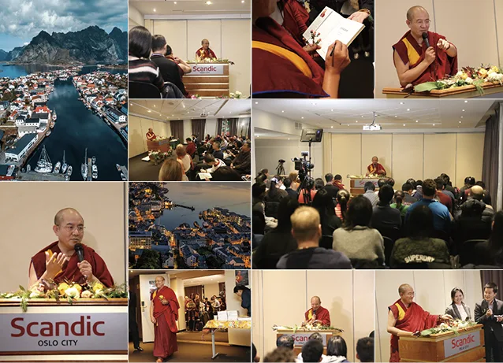
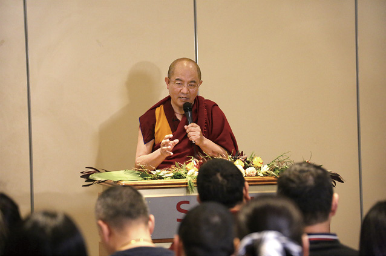
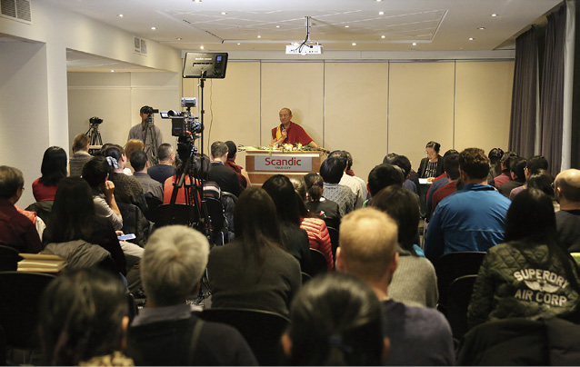
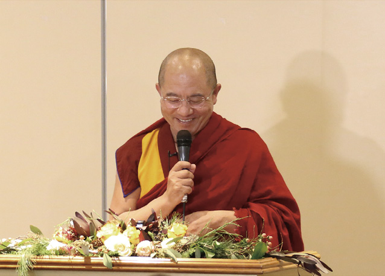
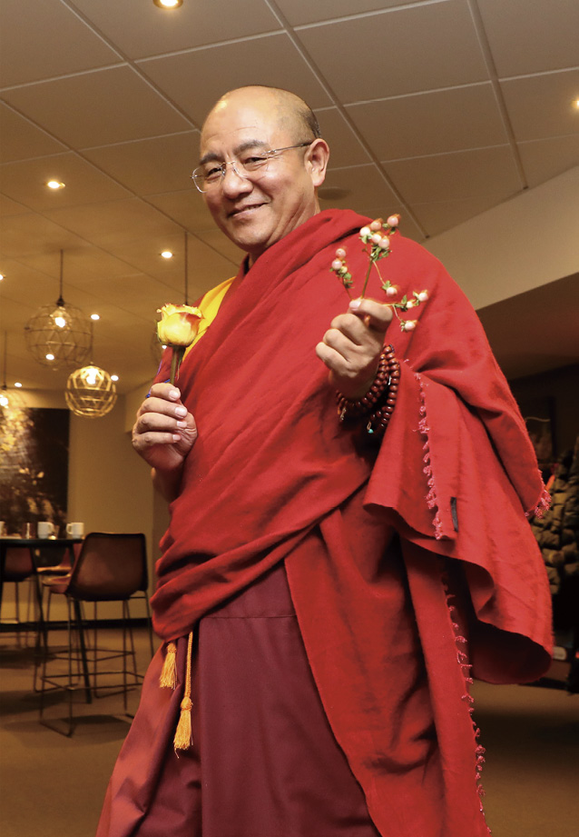
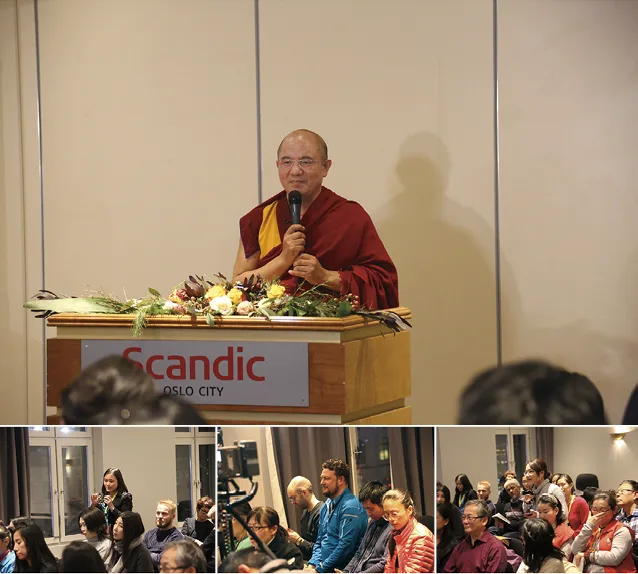
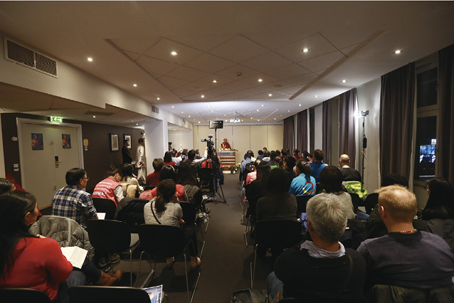
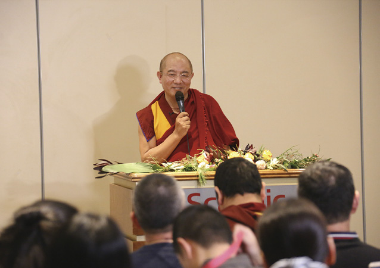
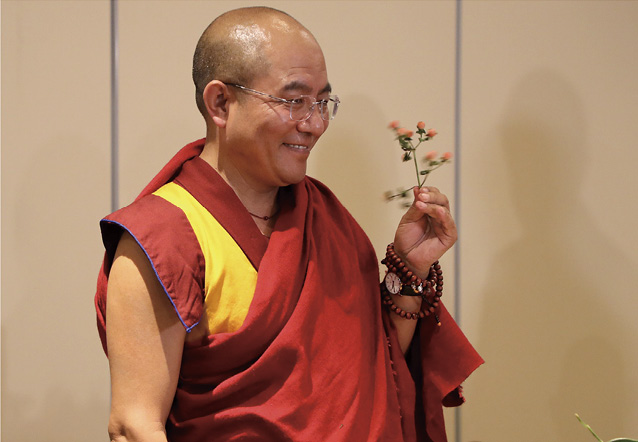

这是最好的时代，  
也是最坏的时代。

第75场

挪威奥斯陆BSA

BSA Oslo, Norway

挪威·奥斯陆

2017 / 12 / 5

## 媒体与科技时代的正念

## Media, Mindfullness and Technology

主持人：

尊敬的各位来宾，尊敬的索达吉堪布仁波切，亲爱的朋友们，大家晚上好，感谢大家的到来！

今年能邀请到索达吉堪布来这里开示，是我们大家的荣幸。感谢堪布不辞辛劳，从中国长途跋涉到美国再到欧洲，这让我们意识到此次机会非常难得，应该倍感珍惜。请允许我简单地介绍索达吉堪布仁波切：

索达吉堪布于1985年舍俗出家，前往喇荣五明佛学院，依止法王如意宝晋美彭措为根本上师。堪布深入研修五部大论、甚深密续，通过堪布资格考核后成为学院的大堪布，并担任法王汉族弟子的翻译。后受法王的托付，肩负起为汉地四众弟子传讲佛法的重任。作为藏传佛教的堪布、学者、翻译家和现代佛教思想家，堪布不遗余力地专注于将传统佛教和现代世界、现代生活相融合，在东西方都享有盛誉。在过去的30多年里，堪布一直孜孜不倦地系统传讲佛法，并通过其广大的弘法利生事业培养出了一大批佛学人才。这也使堪布成为当今世界上最具影响力的藏传高僧大德之一。

现在让我们掌声有请索达吉堪布仁波切，为我们开示“媒体与科技时代的正念”——

今天与大家一起探讨“媒体与科技时代的正念”。这个话题，大家比较熟悉，也非常关心。

## 网络社交与心理疾病

现今处在高科技、媒体社交发展迅猛的时代，有人说“这是最好的时代，也是最坏的时代”。

当今时代，科技的发达让全球信息瞬间一览无余，个人生活、修行体验确实变得很便利。譬如订宾馆前先看评价如何，手机上外卖点菜，上网订飞机票，等等。

但过于依赖科技的话，人反而会变笨：开车有GPS定位，如果没有定位就不认得路；演讲有PPT、投影仪，如果没有这些就记不住内容；老师让学生下载好教材再讲课……

过于依赖科技，还会带来很多心理疾病。有专家说：现代人的心理疾病与社交媒体有密切的关系。焦虑、自闭、抑郁的现象越来越多，尤其在发达国家愈加明显。原因是很多年轻人在网络社交方面花了大量的时间。这些心理疾病，反而在比较贫穷、落后的国家和人群中不常见。据统计，现今每天使用网络的人数，占到了全球70亿人口的50%，2015年和2016年就已达到了40%。如果整天都活跃在网络上，自然会患上各种心理疾病。

据业内人士分析，人们上网时对某些物品的喜好，会被网络后台跟踪，这种跟踪信息会被收录在庞大的数据库里，之后再根据个人喜好，推送海量的相关信息给个人。最后，当你打开网络时，映入眼帘的全是符合你口味的内容——上了年纪的人就不太会操作这些，反而被叫做“网络文盲”。

大多数年轻人从小生活在科技时代。他们经常网购，当他们的所需没法满足时，内心就会产生很多负面情绪。久而久之，他们与现实生活中亲朋好友的社交就逐渐减少了，因为这些在虚拟世界里就可以满足。他们跟父母连十分钟的电话也不愿意打，却在网上和他人聊得热火朝天，一连几个小时也不觉得累。人们面对面的交流越来越少了，网络上的交流却与日俱增——但其中无效信息居多。手机可存1000个联系人，但只存了150个，常联系的可能仅有10个。

我们的时间、精力和能力都是有限的，就像手机内存只有60MB或120MB一样。这个时代，信息铺天盖地，让人眼花缭乱。长期的内心不被满足，最后会导致各种心理疾病。发达国家的高端企业和大学都在禅修，正是因为科技发展到最顶点时，才发现客观物质并不能解决人类的主观意识问题。所以，建议大家不要沉迷于网络，一天至少关机一小时。即便不禅修，也要过一个正常的生活。然后再观心，才会有新的发现。

## 禅修解决内心问题

禅修可分为两种：观察修和安住修。佛教的修心法门非常多，藏传佛教也有很多殊胜的修心法门，我也翻译过很多。各种禅修法都是历经上百年、上千年的传承和教授。藏传佛教称禅修为“罗雍”，意思是修养。禅修，其实就是修养自己的内心。

现在流行的“正念”，也是源自佛教“四念处”修法。即“身念处”，观身不净；“受念处”，观受是苦；“心念处”，观心无常；“法念处”，观法无我。如果四念处观得好，就能破除颠倒、断掉烦恼而证悟。寂天菩萨在《入菩萨行论·智慧品》中以“四念处”来破法执，从而抉择法无我的智慧。

藏传佛教中有很多修心法门。譬如，《修心七要》是非常殊胜的修心法，很多修行人都修过，唐弥桑波做过非常好的注疏。格西朗日塘巴的《修心八颂》，很多大德都传讲过，虽然只有短短的八个颂词，但是里面的内容非常值得实修。如果经常实修，身心都会得到极大的提升，并生起真正的智慧和悲心。噶玛拉希拉尊者撰著的《修心次第》，详细论述了上等、中等和下等的修心次第。书中介绍了寂止和胜观的修法，以及如何禅修的方法。布绕巴尊者的《修心法》也是内容简短、加持力极大的修心法门。前辈大德都非常重视的《开启修心门扉》里也讲了很多禅修法门。扎嘎仁波切所著的《扎嘎山法》，主要也讲了闭关专修时如何修心、看破世间的方法。这部法以前讲过一两次，讲完以后大家都很有收获。

## 世界需要爱和慈悲

挪威是一个非常开放、包容的地方，昨天南传佛教、汉传佛教、藏传佛教及其余的宗教人士，探讨了关于未来佛法弘扬的问题。大家都秉着求同存异的态度来学习和修行。我相信，这里的宗教徒们和无信仰的自由主义学者之间，都能互相学习、互相理解、互相包容。如果这里都不存在和谐的氛围，那在其他地方也很难找到了。

虽然我们个人的能力有限，但也应该以有限的生命和能力，为世界和平做出点贡献。有些人认为“世界和平”的命题太大。其实，每个人的身体都是一个世界，自己的家也是一个世界。比如，我在佛学院有一个小房子，这就是我的世界。我们对自己的世界应该创造一种爱和慈悲的氛围。如果每个人都没有利他心，即便科技再发达，这个世界也不一定美好。

## 警惕“暗网”

我们能看到的只是科技正面的部分，还有很多负面的部分是看不到的，这部分称为“暗网”。我们所见的都是由社交媒体渲染后的世界，并不是真实的。既得利益集团为达到目的，将信息包装好后再呈现在我们面前，我们也不得不接受。二战期间，希特勒的纳粹主义对所谓的“劣等民族”进行丑化，对纳粹主义进行美化。当时媒体的渲染很可怕，整个欧洲都疯狂地支持他们。

现代社交媒体展现的只是冰山一角，只有10%露出了水面，其余90%还在水面下。“暗网”体系非常庞大，有些国家虽然采取了干预措施，但也阻挡不住很多全球交易。例如，比特币是一种加密数字货币，今年上半年的成交价是1:1000美元，目前已经上涨至1:10000美元。“暗网”的交易市场体系庞大、操作环环相扣，且交易内容多为枪支、毒品、色情等被大多数国家所禁止的项目。“暗网”的交易都是秘密进行，不少人在其中尝到了甜头，比如黑帮等很多见不得阳光的组织。

## 修炼内心应对变化

世界的真相难以知晓，网络时代难以分清幻相和真相，人们的生活缺乏安全感，这些都是科技带给我们的。这个时代变化很快，与任何一个时代都不相同，无论你是什么身份，都要提前做好心理准备。

媒体时代既需要正面的评价，也需要对负面的了解和警惕。无论时代怎么变，内心应该始终保持一种正面的、淡定的、宁静的状态，并安住在这样的状态中。训练自己的心态很有必要，就像运动员经过长期训练可以轻松自如地掌控身体一样。如果我们经常禅修、观心，就有能力应对生活中的突变。倘若没有经过训练，遇到突发情况就会措手不及。

无论是否有信仰，平时修炼内心对每个人都很重要。佛教评判一个人修行好坏的标准，主要看他平时的修炼。即便做不到佛教的标准，也可以一天关机一小时来反观内心，回归真实的生活。

最后，给各位提三点希望：

第一点，一天关机一小时，这是第一个窍诀。

第二点，观万法如梦如幻，对任何事都不要太执著，因为越执著越痛苦，最后反而会把事情搞砸。《金刚经》中云：“一切有为法，如梦幻泡影，如露亦如电，应作如是观。”经常念诵这句偈颂，遇到任何事情就不会特别痛苦和在意了。

第三点，希望大家重视并经常思维《修心七要》和《修心八颂》。

现场互动

问：既然我们已无法避开媒体和网络，那怎样利用它来修行呢？

堪布：我觉得，没办法离开它就只有接受，但在接受的过程中不能过度沉迷。否则，很有可能患上心理疾病。因此，要有正知正念，经常从正、反两方面去了解。自己要知道这些信息是专门来吸引我注意力的，要明白后台的大数据想要我迷失其中。网络时代有很多孤独的人，因为在网上可以和人沟通，但在现实世界中却做不到。长此以往，自己很适应网络环境，而对现实生活和人群会格格不入。依靠网络，很多正常人慢慢变得不正常了。

问：目前佛法好像都是对个体和僧团修行的指导，不知道有没有对社会、政府、企事业单位等机构的指导？当前有没有佛法和社会学、教育学、环境保护等结合的学术研究？

堪布：其实佛教既有个人修法，也有集体修法。集体修法就是社会性的，如果不是社会性的，很多文化都不会认可它。佛教本身就包括了社会学、环境以及大自然等方面的内容。

问：藏传佛教怎么理解死亡？死后有没有灵魂，有没有可能会被科学家证实？

堪布：关于这方面，有一本书叫《西藏度亡经》，我也翻译过一本书叫《前世今生论》，其中讲得比较细致。

问：我们能做什么，让信息时代、网络环境变得更好，对人们不那么有危害性？

堪布：你不一定能改变这个世界，但可以改变你的小世界。今天早上，我在街上看到很多乞丐，不由得想到：也许改变一个人的命运有困难，但可以把正面信息和知识，通过网络传递给大家。

问：我们这代年经人能很快掌握很多新技术，而我身边的很多人在掌握技术的同时并没有慈悲心。应该怎样帮助他们呢？

堪布：如果想让掌握技术的人心里有爱，最好是念观音心咒。还要充分了解科技的利弊。先念观音心咒，然后不断传播爱的教育，即便有些事情不能改变，也会对他们有帮助。

问：互联网、多媒体已经和我们息息相关，作为一个凡夫，如何区分平台上的正知正念和邪知邪说？

堪布：这个问题确实很难分析，尤其是年纪较小的孩子根本没有取舍能力。年轻一代从小就在恶劣的网络环境中成长，将来前途堪忧。虽然我们没办法避开网络，但在应用过程中要有自己的原则，同时也要做很多思想准备。最关键的是要看穿背后的秘密，该用的用、不该用的尽量避免。我经常是查完资料就关掉网络，这样会好一点。

主持人：

非常感谢堪布仁波切的精彩开示！感谢大家的积极参与！

正如堪布所说：在信息爆炸时代，正念必不可少，它既能帮助我们保护自己和他人的心，也能帮助我们远离恶业，而正念的培养与稳固需要佛教的次第学习。在此，希望大家能够早日树立正念，在平时的生活和学习中能念念不忘善法！

让我们恭送索达吉堪布仁波切，感恩上师！
