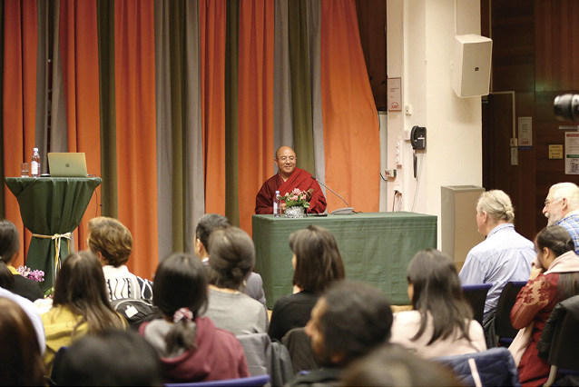

最高的禅修境界，

就是行、住、坐、卧都不离觉知，

同时帮助众生不离觉悟。

第72场

挪威奥斯陆太极中心

Norsk Taiji Center, Oslo, Norway

挪威·奥斯陆

2017 / 12 / 1

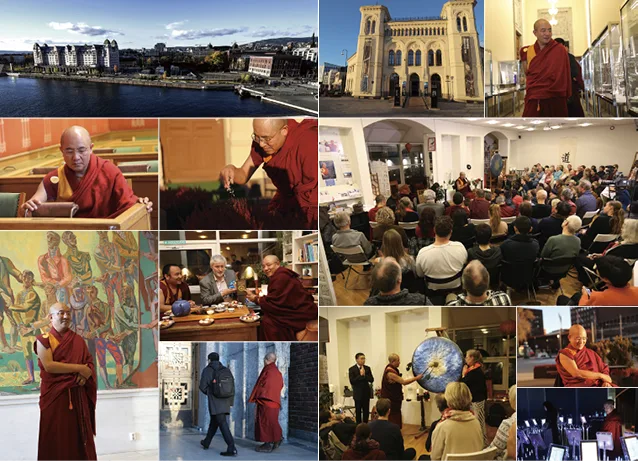

## 现代生活中的科学与灵修

## Science and Spirituality in Modern Life

主持人：

尊敬的堪布！女士们、先生们，欢迎大家来到挪威太极中心！

现在，由我为大家介绍今晚的演讲嘉宾——索达吉堪布。堪布来自中国色达喇荣五明佛学院，是一位公认的、极具影响力的佛教大师，也是一位佛教精神领袖。为了让更多人领悟佛法的精华，堪布利用现代科技传播佛法，至今已30多年。曾有网友在堪布的微博下留言提问：“我们生命中最需要什么？”堪布回答说：“内心的平和、安详与自在。”

堪布的思维缜密、理性，他对逻辑学及许多其他学科，有着广泛深入的了解和掌握。为了促进科学与佛教的交流，堪布与多位科学家就“宗教与科学”这一话题开展过多次探讨。堪布曾在书中写到：“科学家孜孜不倦地探究真相，以他们毕生所学经由实验得出的结论，与释迦牟尼佛在佛经里描述的人类世界及宇宙奥秘类似。我们既要探索科学，也要学习甚深的佛法。只有以智慧为前提，才不会对所学感到沾沾自喜，也能避免盲目、草率地质疑不同观点。”

当今时代，科学技术在高速发展，人们的物质需求也得到了极大满足。对于灵性的追求，逐渐成为人们生命中最重要的部分。人们开始关注内心，希望在生活中获得内心的平静与祥和。

今天，堪布为大家演讲的主题是“现代生活中的科学与灵修”。现在，请大家热烈欢迎堪布——

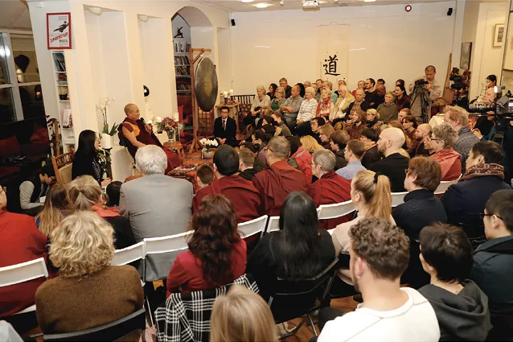

很高兴来到挪威太极中心，和大家探讨“道”！

我来自藏地，从小在一个有信仰的群体中受教育、成长，对于“道”、太极等方面也有涉猎。在我还没出家、大概19岁到21岁左右的时候，喜欢练太极，目的只是为了打架。当时我们知道有种太极动作很舒缓，还有种类似少林寺里飞檐走壁等超越普通人行径的动作，恰恰这种是我们喜欢的。那时，我每天晚上都会去空教室里练习。

出家后，我也对这方面做了点研究。我们以前对它的理解比较浅显，实际上它蕴含了很深的意义，诸如白色和红色、阴和阳、白天和夜晚、苦和乐、空性和光明等世间万物阴阳和合的道理。而人们所见的只是其中一部分，还有很多隐秘的部分与我们形影不离，从来也没有清晰地显现。这部分可归为“道”或藉由宗教来认识。

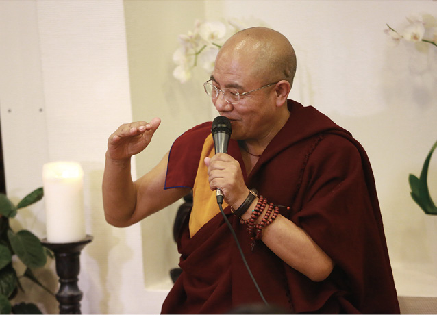

## 年轻与科技的局限性

如今，科技的发达使很多人认为，科学能解决一切问题。不置可否的是，科学确实解决了很多问题、创造了种种方便，但是，我们只看到了好处、利益和方便，可能忽视了负面、灾难性、危险性的一面，而今科技的弊端在日益凸显。

我们身处这个时代，面临前所未有的机遇和挑战，既满怀希望也忧心忡忡。人们觉得有了新科学，旧的宗教、传统文化就不实用了。譬如，一个年轻人觉得自己可以独立创业，而当他真正着手干的时候，才发现没有父母的资助很难开展起来，这时他又不得不求助于父母。

科学如同年轻人，传统文化如同老年人。很多人秉持科学主义思想，将上千年的传统文化视为迷信、无用、陈旧的宗教概念，且不遗余力地抨击和驱逐它。若是这些人不信任何神、佛倒有情可原，但他们只是给自己的信仰换个头衔而已。揭开他们信仰的面纱，才发现尽是电脑、手机里抽象的动漫人物。

短短的几十年里，人类历史就发生了翻天覆地的变化，价值观也随之改变。老、中、青三代人的世界观完全不同。老人基本上停留在旧的价值观，而现今世界属于中年人、青年人。所以，大人和小孩之间经常会有思想冲突。总之，老年人看不惯年轻人的生活方式和行为，年轻人也抱怨父母、长辈不理解他们。

世界的发展的确需要年轻人的技术和思想。但是一味地相信科学，我们很可能已经被科学欺骗了。我并不是不认可科学，它确实为人类做出了很多贡献，但很多人把科学当“神”来拜，致使处在探索阶段的科学俨然成了“上帝”。于1927年获得诺贝尔物理学奖的威尔逊先生曾说：“科学并不是权威，也不能统治一切，它只是人们在探索真理时的知识。”目前，科学也只能描述有限范围内的世界，仅仅处在探索物质阶段，尚未涉及心灵层面。

## 幸福的关键在于内心

实际上，生活得快乐与否取决于自己的内心。如果没有认知和了悟内心，即便住在皇宫、天堂般的环境中，也不一定快乐。据说，挪威在今年被评为“全世界最快乐的国度”，但我初来乍到，还看不出所以然。我每去一个国家，就会在当地买点小物件。比如，前段时间去美国就买了一个笔记本、一双袜子，回来后用人民币一换算，顿时觉得美国物价很贵。来挪威后听闻这里的物价也很贵，买了几支笔用人民币一换算，内心也稍微有点“不快乐”。

所谓的幸福指数，并不是只由金钱决定，而是综合考量社会福利、居住环境等多方面因素而定。北欧国家的社会福利确是其他国家无法相比的，我虽然也在竭力说服自己待在这里最快乐，但不知道随着时间增加是否依然快乐。不过，我还是希望离开这里时会觉得依依不舍。其实，幸福的关键在于内心，内心的快乐才最重要。内心想要获得快乐的话，自己就要有修行、有信仰，并会调整内心。这些才是最有意义的，因为幸福和快乐都是安立在自心上。

## 禅修的作用和次第

藏地的经济条件虽然不好，但人们内心有一种自在的力量。这种力量，可以通过禅修来获得并且适用于每个人。禅修，可以看成是融合科技与心灵的工具。只有静下心来，才能连接上物质世界。宇宙万物存在着各种力量，生命的力量是其中最强大的。虽然对生命物质形式的研究有很多，但科技无法完全了知生命的奥秘。生命的内核是认识自心、以心观心。

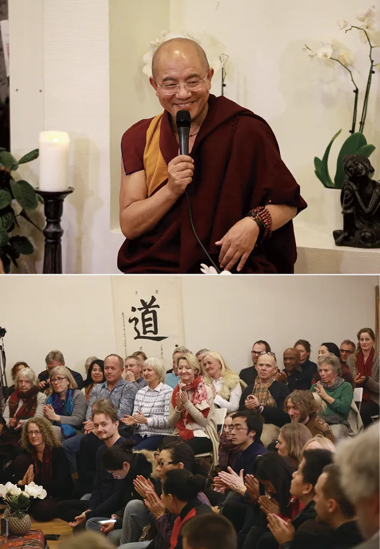

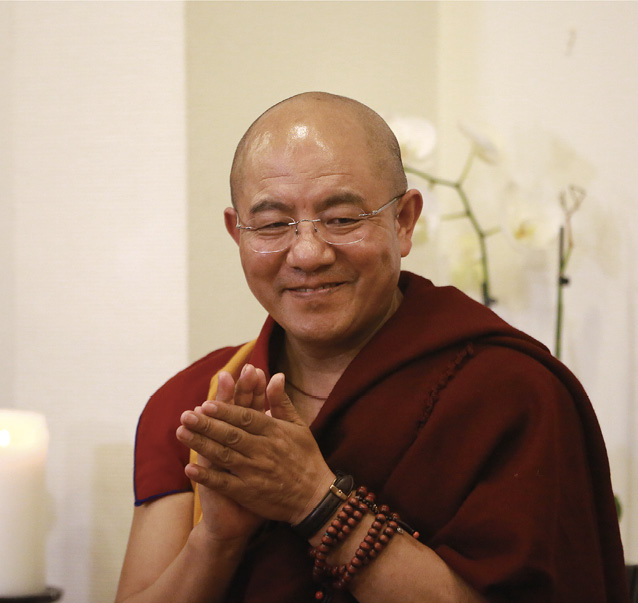

以往，人们认为生活中的问题，可以用科技轻松地解决。然而，很多高科技公司的人，如谷歌、微软、推特等的企业家，芝加哥公牛队球员，苹果公司的高管和员工，他们都在练习禅修，这充分地说明了“科学无法帮你找回内心的宁静”。因此，他们不得不通过禅修来重新认识自心。富有且名声显赫的企业家们，最初学禅修只是想缓解疲劳而已，他们更不会为了物质上的“快乐”练习禅修。

一路上看到欧洲的古建筑、文物都保存得很好，但不知道人们内心的传统思想保留下来了多少。让内心回归宁静的方法，几千年来一直在各地的各个宗教中传承着。当科技风起云涌时，古老的传承就被湮没了。目前流行的“禅修”风，在佛教两千多年的发展史中只是寻常之事。南传佛教的僧人基本上在寺院里禅修，也有在山上禅修的，总之终其一生都在禅修；藏传佛教中也有“三年三个月闭关”“终生闭关”“每年闭关一百天或七天”等禅修传统；汉传佛教也一直传承禅宗思想，至今从无间断过。禅修于佛教而言，是件再熟悉不过的事了。

禅修划分难易程度为：初级，让身心放松、缓解压力，心中没有乱七八糟的事；中级，观察自己的负面情绪，之后它就慢慢消失了，始终让自己处于正念中；高级，以心观心，以寂静的方式认识心的本来面目，即觉悟、开悟。开悟之人不会为任何烦恼、痛苦所转，过得非常开心，即便在幸福指数不高的国家里，依然会快乐地生活。最高的禅修境界，就是行、住、坐、卧都不离觉知，同时帮助众生不离觉悟。

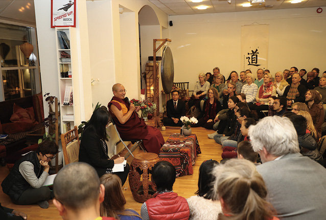

希望大家能学习禅修。最初禅修时，环境最好比较寂静；在家里坐凳子或盘腿坐都可以；禅修时间长短根据自己的情况来定。禅修对情绪的调节有很大帮助，就像身体需要经常清洁一样，如果内心没有经常清理，情绪就很难控制住。禅修也不是一蹴而就的，应该培养长期禅修的习惯。这样，内心会逐渐变得调柔、堪能和自在。面对生活中发生的任何事情，也能勇敢地面对、轻松自如地应对。

## 观察自心，了悟实相

我并不羡慕有钱、有地位的人，却很羡慕有证悟境界的人。因为他们无论何时、身处何地都很快乐，而且他们的一切言行举止都在利益这个世界。所以，我们要学会观察自心、调节自心，当因缘成熟时就能明白心的实相，整个世界无论如何变化都不离自心。

我衷心地希望大家，要用各种方式去观察自心，比如快乐的心是什么样的、痛苦的心是什么样的、追逐世间名利的心又是什么样的，当你观察分析到一定的时候，瞬间就会洞见心的本来面目。那时，你就不会再消极、懒惰了，也会对家人越来越好，更会对社会、世界越来越有责任感。纵观历史，有很多伟大的觉悟者在真正觉悟人生之后，并不是住在封闭的地方独自享乐，而是将爱和智慧传递给更多有缘众生！

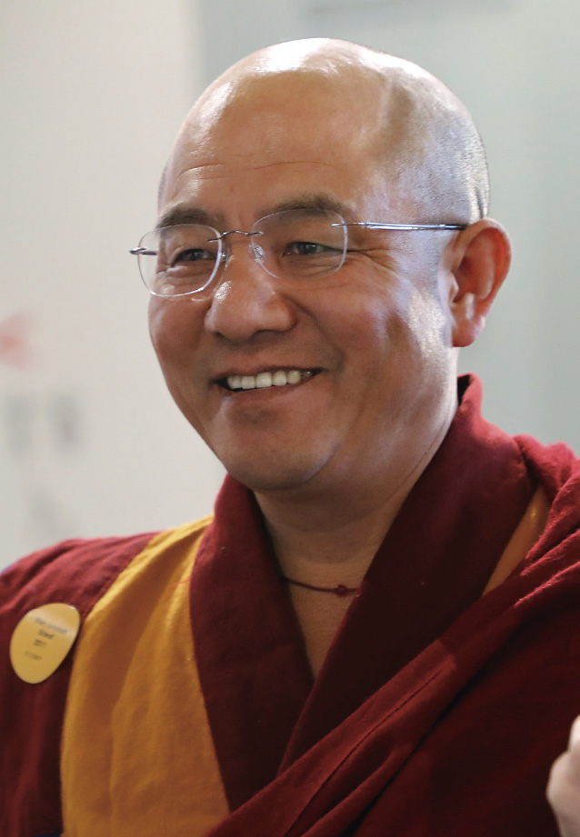

现场互动

主持人：

现在，我们将敲响“北极光鼓”，把殊胜的教法传播出去！同时也为此次演讲作回向。这个铜锣昨天刚被送到太极中心，它是世上独一无二的，由德国铸锣的工艺大师打造。它来到了北海岸——一个可以看到北极光的国家。请大家为了和平、光明、爱和人类一起回向！

堪布：

藏传佛教里有这样的说法：为了听受真理，应先给大家发出信号——如敲锣、击犍椎、法鼓等声音，即便只是听到声音，也能在心里种下解脱的种子；如果前往听法，其利益更不用说了。所以，愿我们敲锣的声音，听到的人都能获得真正的利益。敲锣的时候，通过观自心也会认识内心。

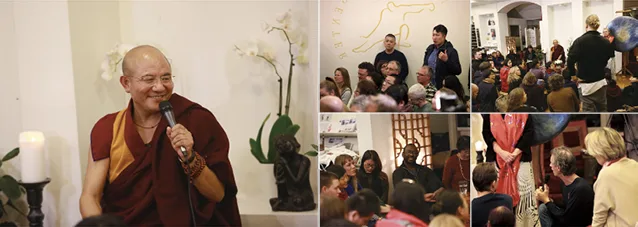

问：我一直对特斯拉的生前信仰很好奇，也在科技和宗教方面寻找答案。对于未来的科技发明，您有什么建议吗？

堪布：刚才说人类到了恐惧的时候了，是因为各个国家的军费开支很庞大，而且都有自己的武器库。前几天去联合国总部，了解到全球一天的军费开支是50多亿美元，完全能解决非洲4个贫穷国家的饥荒问题。现在全世界的主流思想并不是和平，而是不信任、敌对。历史的原因，曾致各个国家处于危险的境况。我对这些方面非常担心，但也无能为力。

问：如果未来可以通过发明仪器和技术，让大脑进入禅修状态甚至开悟。您认为这是件好事还是坏事？

堪布：若是真能凭借科技手段而证悟，倒是很不错的。但我觉得这可能有一定的困难。佛教有观想本尊的修法，有人用科幻做了一些本尊影像，但我用它观想的时候反而不好观，一直觉得是假的；用自己的传统方式观想，获得的加持反而更大。

截至目前，科技对心理方面的研究还很匮乏。心理学家也只是通过脑科学、生物科学来研究意识。佛教认为人有八种意识，而心理学家对第六意识都还没完全掌握。所以，我觉得未来用科技证悟是无法实现的。

问：在您看来，如果人工智能产生了自我意识，人类将会面临什么？

堪布：这几年，人工智能发展得过快了，很多人对此也比较担忧。比如，“阿尔法狗”超越人类的行为，人工智能互相对话时说出了未曾输入的语言等事件。但是，人工智能的数据还是由人类在后台输入、存储、创造。今年，我在泰国遇到了这位给“阿尔法狗”命名的科学家，我也问过他相同的问题。他也认为人工智能暂时绝不可能超越人类，因为技术掌握在人类手里。

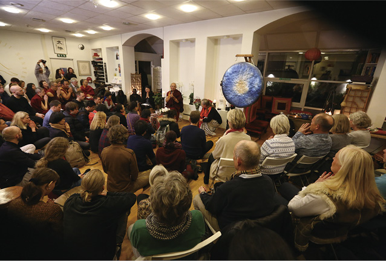

问：如果一位家庭成员总给大家带来负面情绪，我们该怎么办？是接受这个事实，还是采取一些措施？

堪布：不管是家人还是自己，处在特别消极或特殊的状态时，我们应该接受。生活中遇到任何事情，不要逃避，而要勇敢地面对。面对的方式要善巧，也可以咨询智者，最终找到一个最佳方法。其实，状态不佳是正在提升中。我觉得这并不是什么坏事，而是应该寻求解决方法。

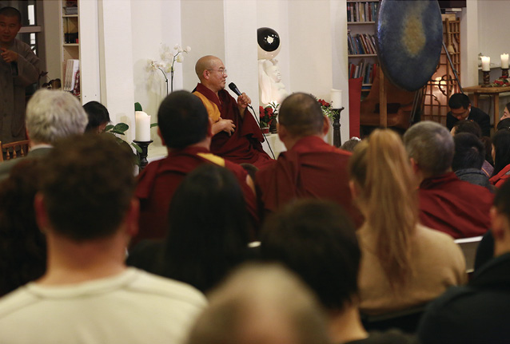

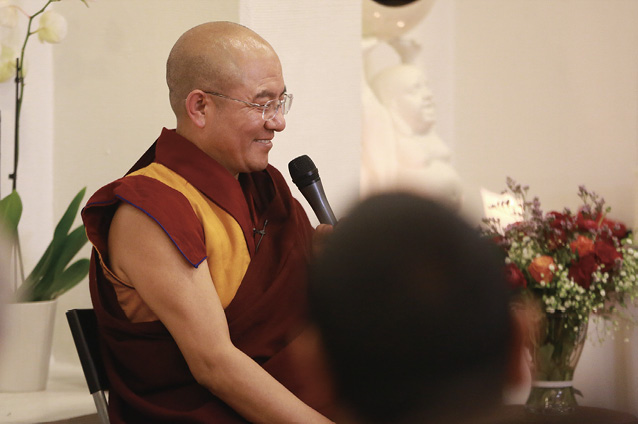

问：作为心灵科学的专家，您能否教给我们让内心更清明、更幸福的方法，并带领我们共同练习？

堪布：本来，我到挪威来是想获得更多的快乐。如果让挪威再快乐些，那全世界就没法用幸福指数衡量了。（众笑）

其实，最快乐的时候是人比较满足的时候。真正的快乐来自内心，认识心的本性才是最快乐的。这种顶级体验是通过禅修来获得的。我认为这才是最究竟的不变的快乐。

问：最近，我的一位亲人去世了，但我感觉和他能进行精神交流，他也经常出现在我的脑海中，有时候我也会梦到他。在梦中他告诉我，他并没有离开这个世界。请问佛教是如何解释这种现象的？这只是偶尔出现在我们梦中吗？还是说有更深的含义？

堪布：这种现象有两种情况。一种是他的意识还惦记着家人、好友，他的灵魂一直没有投胎。这种情况可以念一些观音心咒“嗡玛呢巴美吽”，藏地也有专门的仪式超度亡灵。另一种是自己白天太思念逝者了，导致晚上梦中会出现这样的景象。

最后，太极中心让我给大家作个祈福……

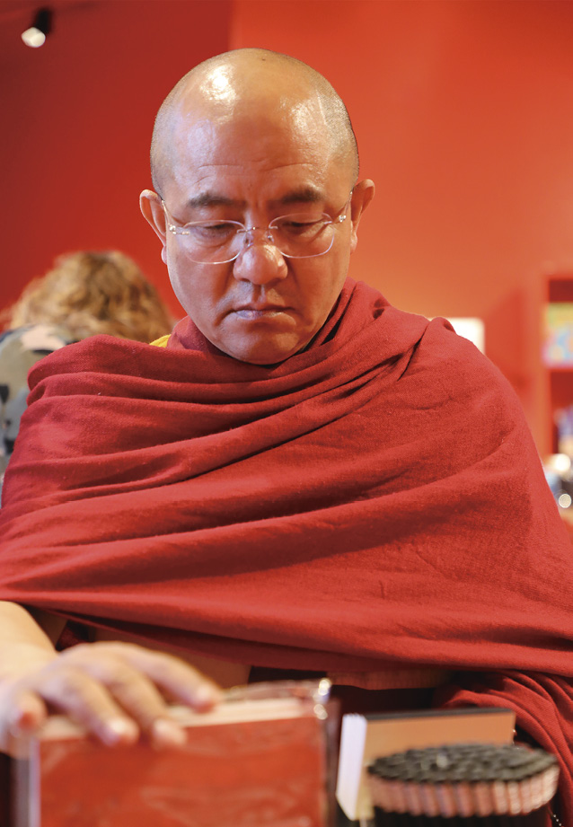

主持人：

非常感谢仁波切！能够邀请到您、听到您的开示，我们感到非常荣幸！您的演讲加深了我们对内心的认识。您的慈悲也让我深受触动。跟您共聚一堂是我们莫大的荣幸。最后想对您说：“保持联系，愿您旅途平安！希望您的挪威之行开心、圆满！”
